## 第 1 章：单板计算机与树莓派简介

让我们开启这段激动人心的旅程，探索借助树莓派进行数字图像处理的科学领域。首先，我们需要熟悉单板计算机和树莓派的基础知识。

本章将讨论单板计算机的定义、历史及其设计理念。我们会将单板计算机与常规计算机进行比较，然后将重点转向史上最受欢迎、销量最高的单板计算机——树莓派。到本章结束时，我们将掌握足够的知识来独立搭建自己的树莓派。本章旨在帮助大家熟悉单板计算机的基本概念以及树莓派的搭建方法。

### 单板计算机

单板计算机（以下简称 SBC）是围绕单个印刷电路板构建的、功能完整的计算机系统。一台 SBC 拥有微处理器、内存、输入/输出接口以及一个最低限度功能计算机所需的其他特性。与台式个人电脑不同，大多数 SBC 没有用于外设功能或扩展的扩展插槽。由于所有组件——处理器、内存、GPU 等——都集成在一块印刷电路板（PCB）上，因此我们无法对 SBC 进行升级。

少数 SBC 被设计为可插入背板以实现系统扩展。SBC 有众多类型、尺寸、形状、外形规格和功能集。得益于电子和半导体技术的进步，大多数 SBC 的价格都非常低廉。单台售价约 50 美元，我们就拥有了一款适用于新应用开发、破解、调试、测试、硬件开发和自动化系统的开发工具。

SBC 通常采用以下外形规格制造：
- Pico-ITX
- PXI
- Qseven
- VMEbus
- VPX
- VXI
- AdvancedTCA
- CompactPCI
- 嵌入式紧凑型扩展 (ECX)
- Mini-ITX
- PC/104
- PICMG

### 单板计算机与常规计算机的区别

表 1-1 列出了单板计算机与常规计算机的区别。

***表 1-1.** 单板计算机与常规计算机的区别*

| **单板计算机** | **常规计算机** |
|---|---|
| 非模块化 | 模块化 |
| 组件无法升级或更换 | 组件可升级或更换 |
| 片上系统 | 非片上系统 |
| 外形小巧 | 外形较大 |
| 可便携 | 大多数不可便携或半便携 |
| 功耗更低 | 功耗更高 |
| 比常规计算机便宜 | 比单板计算机昂贵 |

### 片上系统

单板计算机主要是片上系统（SoC）。片上系统是一种集成电路（IC），它将计算机的所有组件集成在单个芯片上。由于其低功耗和多用途特性，SoC 在移动电子设备中非常常见。SoC 广泛应用于手机、单板计算机和嵌入式硬件中。一个 SoC 包含其运行所需的所有硬件和软件。

# 第 1 章 单板计算机与树莓派简介

## SoC 与传统 CPU 比较

使用 `SoC` 的最大优势在于其尺寸。如果我们使用传统 `CPU`，由于需要在板上布置大量独立的芯片和其他组件，很难制造出紧凑的计算机。然而，使用 `SoC` 时，我们可以将完整的专用计算系统放入智能手机和平板电脑中，同时仍有充足的空间容纳电池、天线以及其他远程通信和数据传输所需的附加组件。

由于集成度极高且体积紧凑，`SoC` 的功耗远低于传统 `CPU`。对于移动和便携式系统而言，这是 `SoC` 的一大显著优势。此外，通过消除计算机主板上多余的集成电路来减少芯片数量，也进一步缩小了主板尺寸。

## 单板计算机的历史

`Dyna-Micro` 是第一款真正的单板计算机。它基于 Intel `C8080A`处理器，并使用了 Intel 首款 EPROM `C1702A`。1976 年，康涅狄格州德比市的 E&L Instruments 公司将其更名为`MMD-1`（`Mini-Micro Designer 1`）并推向市场。它作为微型计算机的典范而闻名。在计算机发展的早期，单板计算机非常流行，许多家用计算机实际上就是单板计算机。然而，随着个人电脑的兴起，单板计算机的受欢迎程度逐渐下降。自 2010 年以来，由于生产成本降低，单板计算机再次受到欢迎。

除了`MMD-1`之外，历史上还有其他一些著名的单板计算机：

- `BBC Micro` 基于 MOS 技术开发的`6502A`处理器，运行频率为`2MHz`。

- `Ferguson Big Board II` 是一款基于 Zilog `Z80`的计算机，运行频率为`4MHz`。

- `Nascom` 是另一款基于 Zilog `Z80`的计算机。

## 流行的单板计算机系列

根据制造商和设计者的不同，单板计算机被划分为系列、型号和代际。以下是几个流行的单板计算机系列：

- 树莓派系列，由树莓派基金会出品

- Banana Pi 和 Banana Pro

- Intel Up Squared 套件

- CubieBoard

- BeagleBone

## 树莓派

树莓派是一系列信用卡大小的单板计算机，由英国的树莓派基金会开发。树莓派基金会由埃本·厄普顿于 2009 年创立。开发树莓派的目的是通过提供低成本的计算平台，促进学校和发展中国家基础计算机科学的教学。

树莓派基金会的树莓派于 2012 年发布。它获得了巨大成功，并在两年内售出了超过 200 万台。随后，树莓派基金会发布了树莓派的修订版本。他们还为树莓派推出了其他配件。

更多关于树莓派基金会的信息，请访问其网站 [`www.raspberrypi.org`](https://www.raspberrypi.org)。

树莓派当前生产型号及其他配件的产品页面，请访问 [`www.raspberrypi.org/products`](https://www.raspberrypi.org/products)。

本书中的所有代码示例均在配备 `8GB` 内存的树莓派 4 Model B 上编写、执行和测试过。表 1-2 列出了树莓派 4 Model B 的规格。

`表 1-2. 树莓派 4 Model B 规格`

| 发布日期 | 2019 年 6 月 |
| :--- | :--- |
| 架构 | `armv8` |
| SoC 博通 | `BCM2711` |
| 中央处理器 | 四核 `Cortex-A72` (`ARM v8`) 64 位 SoC @ `1.5GHz` |
| 图形处理器 | 博通 `VideoCore IV` |
| 内存 | |

# Raspberry Pi 4 Model B 规格参数

## 内存

- 2GB、4GB 或 8GB LPDDR4-3200 SDRAM（视型号而定）

## USB

- 2 个 USB 3.0 端口，2 个 USB 2.0 端口

## 视频输出

- 2 × micro-HDMI 端口（最高支持 4kp60）
- 2 通道 MIPI DSI 显示屏端口

## 板载存储

- microSDHC 卡槽

## 板载网络

- 2.4 GHz 和 5.0 GHz IEEE 802.11ac 无线
- 蓝牙 5.0，BLE
- 千兆以太网

## 电源

- 通过 microUSB 提供 3A 5V 电源

图 1-1 展示了 Raspberry Pi 4 Model B 的正面视图。

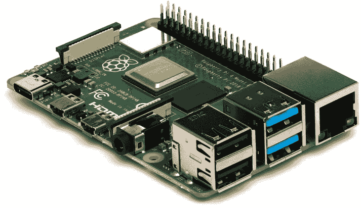

*图 1-1. Raspberry Pi 4 Model B 板卡正面视图 1*

该图清晰地展示了板卡上所有重要的组件，包括 USB 端口、以太网端口、micro-HDMI 端口、3.5mm 音频插孔、用于供电的 USB Type C 端口以及 CSI 和 DSI 接口。

图 1-2 展示了板卡的俯视图。

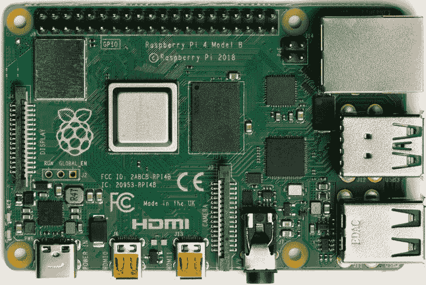

*图 1-2. Raspberry Pi 4 Model B 板卡俯视图 2*

在底部视图中，我们可以清晰地看到 microSD 卡槽（图 1-3）。

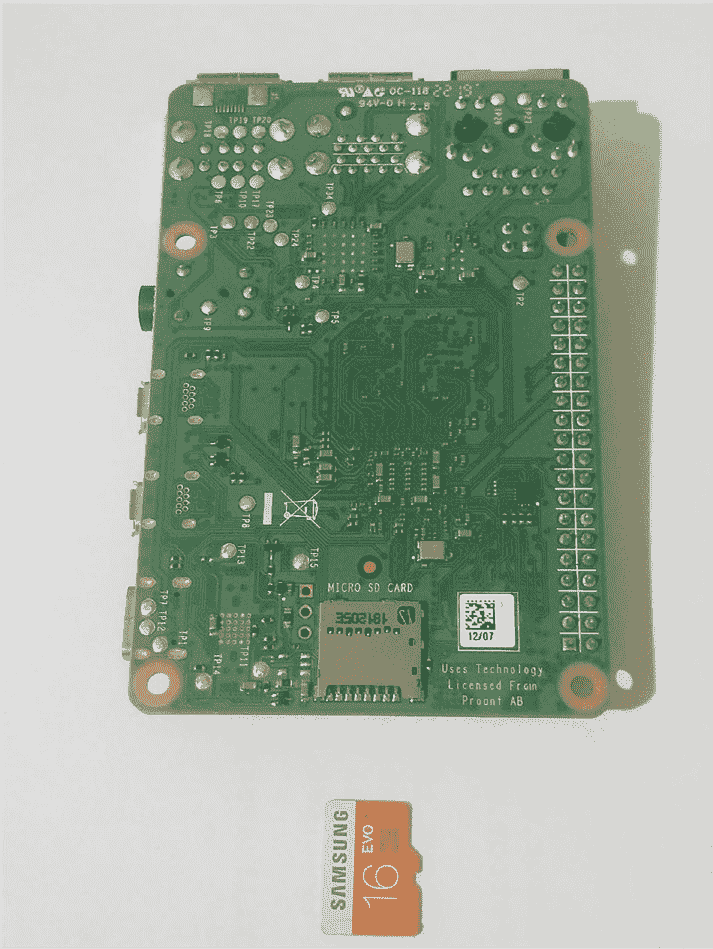

*图 1-3. 插有 microSD 卡的 Raspberry Pi 4 Model B 板卡底部视图*

1.  图片由 Laserlicht 提供，遵循 CC-BY-SA 4.0 许可证 (<https://creativecommons.org/licenses/by-sa/4.0/deed.en>)
2.  图片由 Laserlicht 提供，遵循 CC-BY-SA 4.0 许可证 (<https://creativecommons.org/licenses/by-sa/4.0/deed.en>)

## Raspberry Pi 设置

在使用 Raspberry Pi 进行探索和冒险之前，必须先对其进行设置。如前所述，我在此次设置中使用的是一块 Raspberry Pi 4 Model B。请确保你使用的是带有内置 Wi-Fi 功能的 RPi 板卡型号。所有型号的设置过程几乎相同。

我们将以无头模式使用 Raspberry Pi 板卡。这意味着我们不会连接任何键盘、鼠标或显示器。我们只需将其连接到 Wi-Fi 网络，然后进行远程访问。因此，我们不需要很多硬件设备。除了 RPi 板卡本身，我们还需要以下物品：

**一台电脑** – 我们需要一台装有 Windows、macOS、Linux、UNIX 或 BSD 操作系统的电脑，用于为 RPi 板卡准备 microSD 卡。

**可联网的 Wi-Fi 连接** – 我们需要联网来将操作系统安装到 microSD 卡上。后续还需要联网将 RPi 连接到互联网，并在其上安装必要的软件。

**microSD 卡** – 我们需要一张 microSD 卡。为了获得最佳体验，我通常建议至少使用一张 32GB Class 10 的 microSD 卡。如果你想了解更多关于 microSD 卡等级的信息，请访问以下网址：<https://www.sdcard.org/developers/sd-standard-overview/speed-class/>

**microSD 卡读卡器** – 我们需要一个读卡器，以便电脑能够读取和写入 microSD 卡。为了进行无头设置，我们需要修改 microSD 卡的内容。microSD 卡读卡器有多种类型。下图（图 1-4）是一个通用读卡器的图片。

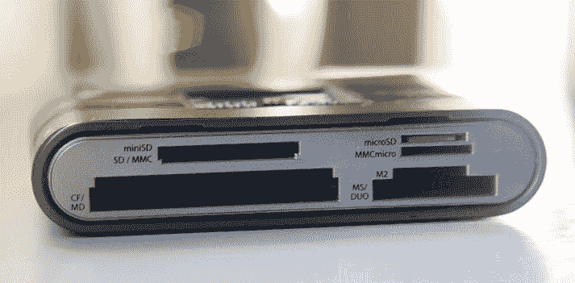

*图 1-4. 通用读卡器 3*

**一个电源适配器** – 我们需要一个电源适配器为 RPi 板卡供电。RPi 4B 使用 USB Type C 接口供电。

像这款一样的使用 Type-C 接口的电源适配器：<https://www.raspberrypi.com/products/type-c-power-supply/>，而其他一些型号则使用微型 USB 电源适配器，例如这款：<https://www.raspberrypi.com/products/micro-usb-power-supply/>。

我们可以在线上商城或当地的电子爱好者商店采购所有这些配件以及 RPi 主板。

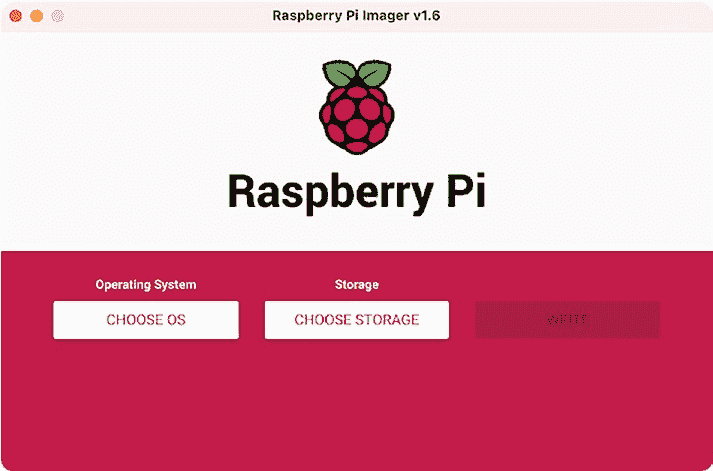

3.  图片由 Alen 提供，遵循 CC0 1.0 通用（CC0 1.0）许可协议（<https://creativecommons.org/publicdomain/zero/1.0/>）

# 第 1 章 单片计算机与树莓派简介

## 准备 microSD 卡

以下是准备存储卡的步骤：

1. 将存储卡插入读卡器，并连接到计算机。

2. 从 [`www.raspberrypi.com/software/`](https://www.raspberrypi.com/software/) 安装 **Raspberry Pi Imager** 软件。对于 Debian 及其衍生系统，请在终端模拟器中运行以下命令：

```
sudo apt install rpi-imager
```

3. 打开已安装的 **Raspberry Pi Imager** 程序。其界面如图 1-5 所示。

`图 1-5.` *Raspberry Pi Imager 界面*

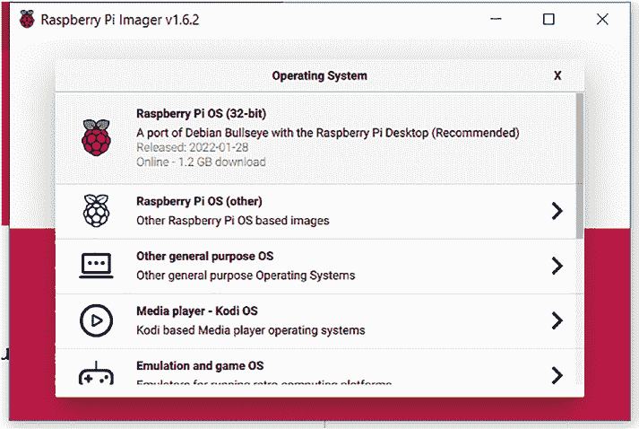

4. 点击 **CHOOSE OS** 按钮。将弹出如图 1-6 所示的选项。

`图 1-6.` *选择操作系统*

点击选择 **Raspberry Pi OS (other)** 选项。随后会显示另一列表选项，如图 1-7 所示。

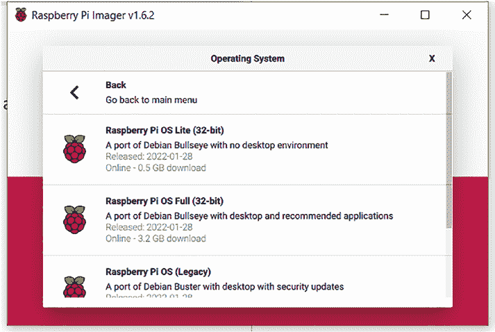

`图 1-7.` *选择操作系统*

选择 **Raspberry Pi OS (Legacy)**。这是 **Debian Buster** 的一个维护良好的版本，支持树莓派摄像头的命令行工具。

5. 现在，点击 **CHOOSE STORAGE** 按钮。它将显示连接到计算机的 microSD 卡，如图 1-8 所示。

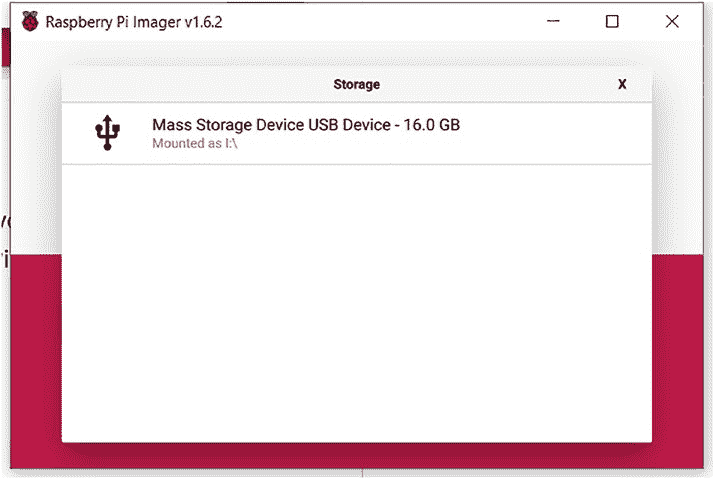

`图 1-8.` *选择存储设备*

6. 这将激活 **WRITE** 按钮，如图 1-9 所示。

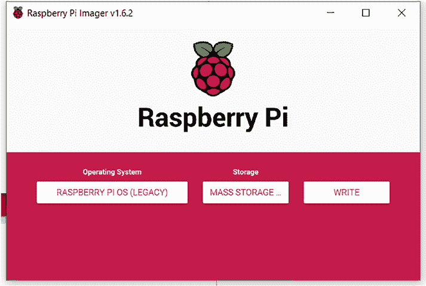

`图 1-9.` *写入按钮已激活*

点击 **WRITE** 按钮。将显示一条警告消息，如图 1-10 所示。

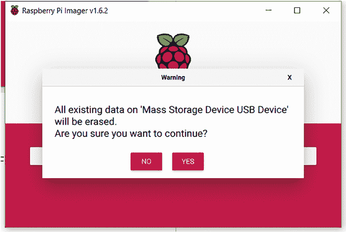

`图 1-10.` *警告消息*

不必担心此消息。点击 **YES** 按钮。它将开始从互联网下载文件并写入 microSD 卡。将出现一个进度条，如图 1-11 所示。

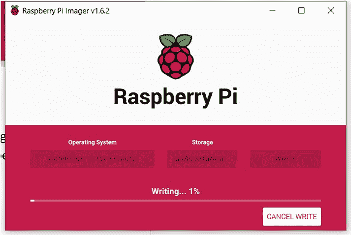

`图 1-11.` *进度条*

整个流程完成后，将显示如下消息（图 1-12）。

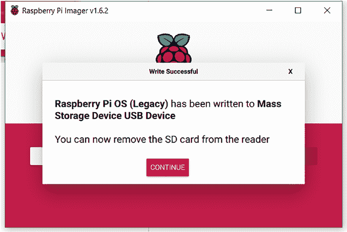

`图 1-12.` *完成消息*

点击 **CONTINUE** 按钮。断开读卡器连接，然后重新连接。

7. 重新连接后，它将在文件系统中显示为一个名为 `boot` 的驱动器。操作系统可能会自动为其分配一个盘符。在 `boot` 位置创建一个空文件，并将其命名为 `ssh`。不要使用任何扩展名。这将启用远程登录功能。

8. 再创建另一个文件，并将其命名为 `wpa_supplicant.conf`。这是为了确保 RPi 主板在启动后能够连接到 Wi-Fi。将以下内容添加到该文件中并保存：

```
country=IN
ctrl_interface=DIR=/var/run/wpa_supplicant
GROUP=netdev
```

# 第 1 章 单板计算机与树莓派简介

`update_config=1`
```
network={
scan_ssid=1
ssid="TP-Link_710E"
psk="internet1"
}
```
请记得将`SSID`和`PSK`部分替换为你自己的 Wi-Fi 名称和密码。

9) 现在，安全地断开 microSD 卡读卡器。

## 启动树莓派

这是最简单的部分。请按照以下步骤操作：

1) 从读卡器中取出 microSD 卡，并将其插入树莓派主板的 microSD 卡插槽中。
2) 确保此时主电源开关处于关闭状态。将树莓派连接到电源。
3) 打开电源开关。

此时我们可以看到树莓派主板上的指示灯闪烁。这意味着树莓派正在启动。等待几分钟，直到启动过程完成。

## 远程访问树莓派

我们已以无头模式启动树莓派主板。这意味着我们没有直接连接任何 I/O 设备（如显示器、键盘或鼠标）。让我们远程连接到它。首先，我们必须知道它的 IP 地址。

由于我们在启动前启用了 SSH 功能并为其提供了 Wi-Fi 设置，因此在启动过程中它已经连接到了 Wi-Fi。

有很多方法可以查找 IP 地址。如果你隶属于某个组织（工作场所、研究实验室或大学），请咨询你的网络/系统管理员，以找出树莓派的 IP 地址。

如果是你的个人 Wi-Fi，那么在所有类 UNIX 系统（Linux、BSD、macOS）上，你可以运行一条命令来查找 IP 地址。对于 Debian 及其衍生版（Ubuntu、树莓派操作系统等），我们可以安装以下命令：

```
sudo apt install nmap -y
```
该实用程序（`nmap`）用于扫描网络。查找所有连接到网络的 IP 地址的命令如下：

```
sudo nmap -sn 192.168.0.*
```
请将数字修改为你自己网络的 IP 地址。它会产生如下输出：

```
Starting Nmap 7.80 ( https://nmap.org ) at 2022-02-01 11:26 IST
Nmap scan report for 192.168.0.1
Host is up (0.0025s latency).
Nmap scan report for 192.168.0.100
Host is up (0.0023s latency).
Nmap scan report for 192.168.0.102
Host is up (0.091s latency).
Nmap done: 256 IP addresses (3 hosts up) scanned in
2.72 seconds
```
你可以使用`ipconfig`（Windows）或`ifconfig`（类 UNIX 系统）命令来查找你自己系统的 IP 地址。从这个列表中，我们可以排除所有已知 IP 地址的已知设备。如果家庭网络中连接的设备太多，那么可以关闭所有不必要设备的 Wi-Fi。在我的例子中，树莓派的 IP 地址是`192.168.0.100`。

在 Windows 电脑上，我们可以安装 Zenmap 实用程序，它是`nmap`的图形界面。我们可以从[`nmap.org/zenmap/`](https://nmap.org/zenmap/)下载并安装它。它也可用于类 UNIX 系统。

安装该实用程序并打开它。它看起来如图 1-13 所示。

*图 1-13. Zenmap 图形界面*

我们可以轻松地使用它。在`目标`文本框中填写`192.168.0.*`。在`命令`文本框中填入我们之前使用的命令（`nmap -sn 192.168.0.*`）。然后点击`扫描`按钮。扫描完成需要一些时间。有时扫描会提前失败。在这种情况下，请继续尝试，尝试几次后就会成功。因为它完全是开源和免费的，所以我们不能抱怨。扫描完成后，它会产生如图 1-13 所示的结果。有时，它还会在 MAC 地址旁边显示所连接设备的制造商名称。这使得识别树莓派主板变得容易。

一旦我们获取了树莓派的 IP 地址，就可以远程登录了。

我们可以使用多种 SSH 工具来远程登录树莓派主板，例如类 UNIX 操作系统自带的 `ssh` 工具。只需在操作系统的终端模拟器中运行以下命令：

```
ssh pi@192.168.0.100
```
`pi` 是用户名。系统会提示输入密码，密码是 `raspberry`。

这样，我们就可以远程登录树莓派主板并运行命令了。

在 Windows 系统上，`PuTTY` 和 `Bitvise SSH` 客户端是几款流行的工具。

不过，我发现 `MobaXterm` 使用起来非常方便。它集成了远程终端、文件传输和 X11 转发功能。有了这个工具，我们无需再安装其他任何东西。从 [`mobaxterm.mobatek.net/`](https://mobaxterm.mobatek.net/) 安装它。安装完成后，打开它。窗口外观如图 1-14 所示。

*图 1-14. MobaXterm*

在此窗口中，点击 `Start local terminal` 按钮。它将会启动一个本地终端窗口。在那里，我们可以运行以下命令来连接树莓派主板：

```
ssh pi@192.168.0.100
```
`pi` 是用户名。系统会提示输入密码，密码是 `raspberry`。

这样，我们就可以远程登录树莓派主板并运行命令了。

现在，是时候重温一下我们在学校学过的 UNIX 概念和命令了。我们可以在这个远程终端上运行所有 Linux/UNIX 命令。`MobaXterm` 最大的优点之一是它内置了一个 `XServer` 程序，当我们启动该工具时会自动运行。我们可以在窗口右上角看到该程序的图标。类 UNIX 系统允许我们通过 X11 转发远程访问 GUI 应用程序。在树莓派中，这项功能默认是启用的。我们只需要在另一端（即我们连接树莓派的计算机，或其他任何类 UNIX 系统）有一个 `XServer` 工具。正如之前讨论的，`MobaXterm` 已经自带了。只需在终端中运行以下命令：

```
nohup pcmanfm &
```
它会打开一个 `文件资源管理器` 工具的窗口，如图 1-15 所示。

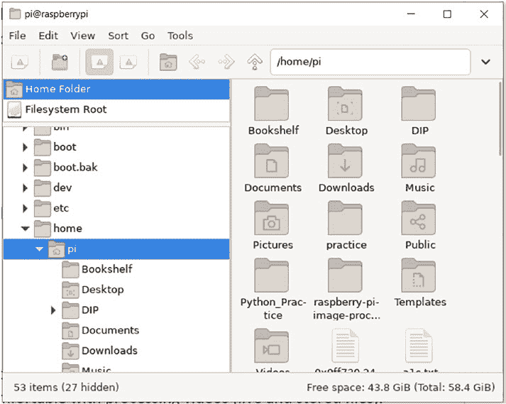

*图 1-15. 通过 X11 转发访问的文件资源管理器*

请记住，这个 `文件资源管理器` 工具正在树莓派上运行。我们是通过 X11 转发来访问其 GUI 的。这样，结合使用 `nohup`（不挂起）和 `&`，我们可以从终端启动任何 GUI 工具。`&` 确保终端的控制权返回给我们，而 `nohup` 则使进程在用户注销后仍能继续运行。

## 配置树莓派

现在，在提示符下输入 `sudo raspi-config` 并按回车键。它会打开 `raspi-config` 工具，这是树莓派操作系统的配置工具。首先，更新它，如图 1-16 所示。

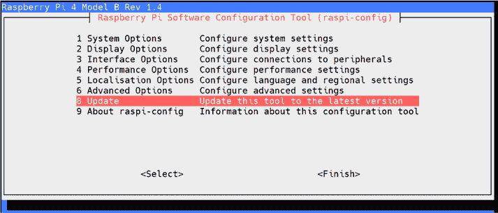
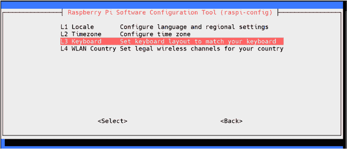

*图 1-16. 更新 raspi-config 工具*

更新需要一些时间。更新完成后，进入第五个选项“本地化选项”。界面如下所示（图 1-17）。

*图 1-17. 本地化选项*

根据自己的选择设置所有这些选项，然后在主菜单中选择 `Finish`。系统会询问是否重启。选择 `Yes`，树莓派将会重启。

## 树莓派操作系统

操作系统是使计算机工作的一组基本程序和实用工具。它是用户和计算机之间的接口。树莓派操作系统是一款基于流行的 Linux 发行版 Debian 的免费操作系统。它针对树莓派系列单板计算机进行了优化。它甚至被移植到了其他类似的单板计算机上，例如 Banana Pro。

## config.txt 文件

树莓派没有传统的 BIOS 或 UEFI。BIOS/UEFI（基本输入输出系统 / 统一可扩展固件接口）用于在计算机开机后启动系统。它还负责管理计算机操作系统与连接的外围设备（如硬盘、显卡、键盘、鼠标和打印机）之间的数据流。

由于树莓派没有 BIOS/UEFI，通常使用 BIOS/UEFI 存储和修改的各种系统配置参数，改为存储在一个名为 `config.txt` 的文本文件中。

树莓派的 `config.txt` 文件位于树莓派的启动分区中。在 Linux 系统中，通常可以通过 `/boot/config.txt` 访问该文件。然而，在 Windows 和 MacOS 系统中，它显示为 microSD 卡可访问部分中的一个文件。正如我们已经知道的，该卡的可访问部分被标记为 `boot`。

在树莓派上，你可以使用以下命令编辑此文件：

```
sudo nano /boot/config.txt
```

**注意：** `nano` 是一款适用于 Linux 的简单易学的终端文本编辑器。请访问其主页 [`www.nano-editor.org`](https://www.nano-editor.org) 了解更多信息。我发现它比 `vi` 或 `vim` 编辑器更容易使用。

要了解更多关于 `config.txt` 的信息，请访问页面 [`elinux.org/RPiconfig`](http://elinux.org/RPiconfig)。示例配置也可以在 [`elinux.org/R-Pi_configuration_file`](http://elinux.org/R-Pi_configuration_file) 找到。

### 更新 RPi

树莓派必须连接互联网才能成功更新。让我们更新固件和树莓派操作系统。

#### 更新固件

要更新固件，请运行命令 `sudo rpi-update`。

#### 更新和升级树莓派操作系统

我们将使用 `APT` 来完成此操作。`APT`（高级软件包工具）是一个处理 Debian 及其他衍生系统中软件安装和移除的程序。`APT` 通过自动获取、配置和安装软件包，简化了 Debian 系统上软件管理的过程。同样，我们也需要互联网连接。

首先，在终端中输入以下命令来更新系统的软件包列表：

```
sudo apt update
```

这会从相应的远程仓库下载软件包列表，并更新到本地计算机，以便提供关于最新版本软件包及其依赖项的信息，从而进行安装和更新。应该在运行安装或升级命令之前运行此命令。

接下来，使用以下命令将所有已安装的软件包升级到最新版本：

```
sudo apt full-upgrade -y
```

这会获取本地计算机上标记为要升级的软件包的新版本。它还会检测并安装任何依赖项，并移除过时的软件包。

定期执行此操作将使树莓派操作系统保持最新。输入这些命令后，更新操作系统需要一些时间，因为这些命令会从互联网上的远程仓库获取数据和软件包。

**注意：** 命令 `apt help` 会列出 `apt` 工具相关的所有选项。

### 关闭和重启 RPi

我们可以使用以下任一命令安全地关闭 RPi：

```
sudo shutdown -h
sudo init 0
```

我们可以使用以下任一命令重启 RPi：

```
sudo reboot -h
sudo init 6
```

### 总结

在本章中，我们学习了如何以无头模式通过 Wi-Fi 设置和访问 RPi。现在我们对这部分内容已经得心应手了。

下一章将聚焦于数字图像处理所涉及的概念。我们还将使用 Python 3 编写基本程序。

---
