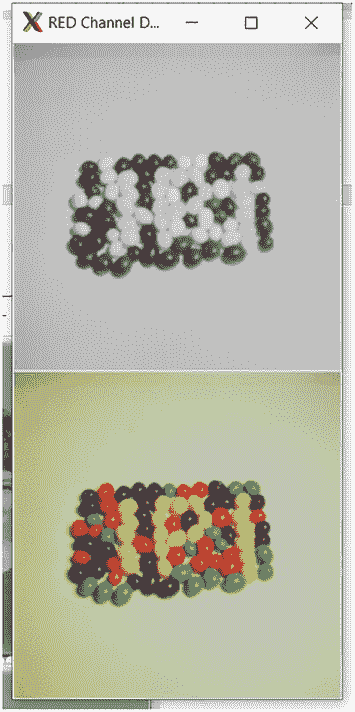
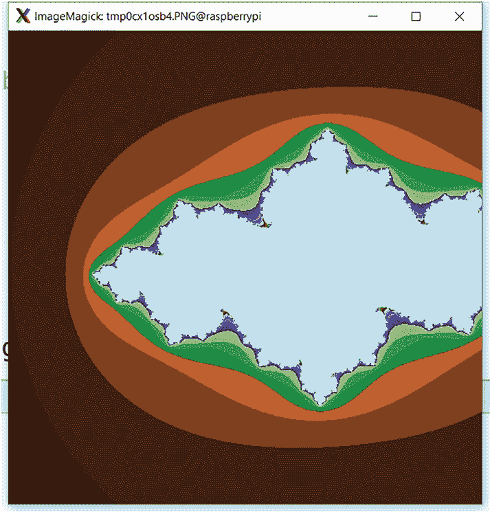
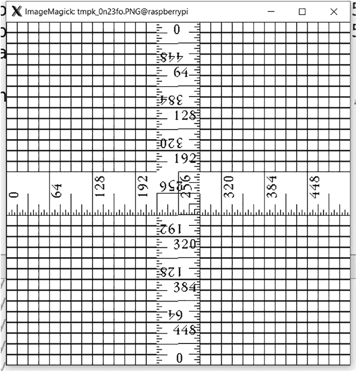

# 第 4 章

# 图像基本操作

在上一章中，我们开始使用 Pillow 进行图像处理。我们还使用了`Tkinter`来显示图像。在本章中，我们将学习可应用于图像的各种算术和逻辑运算。我们将探索使用 Pillow 中的`Image`、`ImageChops`和`ImageOps`模块来实现这些操作。我们还将学习如何在 Tkinter 中使用滑块来动态改变程序输入。

我们将学习以下主题：

* `Image` 模块
* `ImageChops` 模块
* `ImageOps` 模块

## Image 模块

让我们从`Image`模块开始。使用此模块，我们可以对图像执行多种操作。

© Ashwin Pajankar 2022

A. Pajankar, *树莓派图像处理编程*,

[`doi.org/10.1007/978-1-4842-8270-0_4`](https://doi.org/10.1007/978-1-4842-8270-0_4#DOI)

### 图像通道

我们可以使用例程`split()`将图像分割成其组成的各个通道。我们也可以使用例程`merge()`将多个图像合并成一个单一图像。清单 4-1 展示了这一演示过程。

***清单 4-1.*** `prog01.py`

```
from PIL import Image, ImageTk
import tkinter as tk

im = Image.open("/home/pi/DIP/Dataset/4.1.07.tiff")
root = tk.Tk()
root.title("RED Channel Demo")

r, g, b = im.split()

photo1 = ImageTk.PhotoImage(r)
l1 = tk.Label(root, image=photo1)
l1.pack()
l1.photo = photo1

photo2 = ImageTk.PhotoImage(Image.merge("RGB", (r, g, b)))
l2 = tk.Label(root, image=photo2)
l2.pack()
l2.photo = photo2

root.mainloop()
```

输出结果如图 4-1 所示。



**图 4-1.** 红色通道和原始图像

# 色彩空间转换

你可以使用`convert()`函数更改图像的模式，如列表 4-2 所示。

## 列表 4-2. `prog02.py`

```python
from PIL import Image, ImageTk
import tkinter as tk

im1 = Image.open("/home/pi/DIP/Dataset/4.1.07.tiff")

res1 = im1.convert("L")

root = tk.Tk()
root.title("Colorspace Conversion Demo")
photo = ImageTk.PhotoImage(res1)
l = tk.Label(root, image=photo)
l.pack()
l.photo = photo
root.mainloop()
```

列表 4-2 中的代码将图像的模式更改为`L`。函数`convert()`支持`RGB`、`CMYK`和`L`模式之间的所有可能转换。你可以在[`www.color-management-guide.com/color-spaces.html`](https://www.color-management-guide.com/color-spaces.html)了解更多关于色彩空间的信息。

# 图像混合

我们可以使用 `blend()` 方法混合两张图像。它接受三个参数——要混合的两张图像以及 `alpha` 的值。其混合所采用的数学公式如下：

`output = image1 * (1.0 - alpha) + image2 * alpha`

现在，我们将编写一个程序，通过改变 `alpha` 的值，让我们亲身感受混合效果。我们将使用 `Tkinter` 中的滑块部件。下面的列表 4-3 演示了这一过程。

## 列表 4-3. `prog03.py`

```
from PIL import Image, ImageTk
import tkinter as tk

def show_value_1(alpha):
    print('Alpha: ', alpha)
    img = Image.blend(im1, im2, float(alpha))

    photo = ImageTk.PhotoImage(img)
    l['image'] = photo
    l.photo = photo

root = tk.Tk()
root.title('Blending Demo')

im1 = Image.open("/home/pi/DIP/Dataset/4.1.07.tiff")
im2 = Image.open("/home/pi/DIP/Dataset/4.1.08.tiff")

photo = ImageTk.PhotoImage(im1)
l = tk.Label(root, image=photo)
l.pack()
l.photo = photo

w1 = (tk.Scale(root, label="Alpha", from_=0, to=1,
               resolution=0.01, command=show_value_1, orient=tk.HORIZONTAL))
w1.pack()

root.mainloop()
```

列表 4-3 中的代码通过 `tk.Scale()` 调用语句创建了一个滑块部件。该语句超过了 79 个字符，为了符合 PEP8 标准，我将其写成两行，每行均少于 79 个字符。传递给 `tk.Scale()` 调用的参数如下：

- `Tkinter` 窗口变量名
- `label`：与滑块关联的标签
- `from_` 和 `to`：数值范围
- `resolution`：滑块的分辨率
- `command`：滑块值改变时执行的函数
- `orient`：滑块的方向

当你用鼠标指针移动滑块时，会调用自定义的 `show_value_1()` 函数。我们会将滑块当前位置的值打印到控制台，用于调试。语句 `img = Image.blend(im1, im2, float(alpha))` 创建了一张混合后的图像。接下来的几行代码更新了 `Tkinter` 窗口中的图像：

```
photo = ImageTk.PhotoImage(img)
l['image'] = photo
l.photo = photo
```

每次我们改变滑块位置并计算出新图像时，`show_value_1()` 函数都会更新。这使得程序变得有趣且具有交互性，因为我们可以改变 `alpha` 的值来观察过渡效果。

输出结果如图 4-2 所示。

## 图 4-2. 图像混合工具 1

1 4.1.07、4.1.08 南加州大学（USC）拍摄的软糖图片。免费使用 ([`sipi.usc.edu/database/copyright.php`](http://sipi.usc.edu/database/copyright.php))

我们将沿用相同的基本代码框架来演示 Pillow 库的其他功能。

# 调整图像大小

你可以使用 `resize()` 函数调整图像大小，如列表 4-4 所示。

***列表 4-4.*** `prog04.py`

```python
from PIL import Image, ImageTk
import tkinter as tk

def show_value_1(size):
    print('Resize: ', size, ' : ', size)
    img = im.resize((int(size), int(size)))
    photo = ImageTk.PhotoImage(img)
    l['image'] = photo
    l.photo = photo
```

```python
root = tk.Tk()
root.attributes('-fullscreen', True)
im = Image.open("/home/pi/DIP/Dataset/4.1.07.tiff")
photo = ImageTk.PhotoImage(im)
l = tk.Label(root, image=photo)
l.pack()
l.photo = photo
w1 = (tk.Scale(root, label="Resize", from_=128,
    to=512, resolution=1, command=show_value_1, orient=tk.
    HORIZONTAL))
w1.pack()
root.mainloop()
```

# 第 4 章 图像的基本操作

此示例将图像尺寸从(128, 128)变化到(512, 512)。例程`resize()`将新的尺寸元组作为参数。代码还通过调用`root.attributes()`函数以全屏模式调用Tkinter窗口。要关闭此窗口，您必须按键盘上的`Alt+F4`。运行代码并查看输出。

## 旋转图像

我们可以使用`rotate()`例程，该例程将旋转角度作为参数。代码清单4-5演示了这一思想。

**代码清单4-5.** `prog05.py`

```python
from PIL import Image, ImageTk
import tkinter as tk

def show_value_1(angle):
    print('Angle: ', angle)
    img = im.rotate(float(angle))
    photo = ImageTk.PhotoImage(img)
    l['image'] = photo
    l.photo = photo

root = tk.Tk()
root.title("Rotation Demo")
im = Image.open("/home/pi/DIP/Dataset/4.1.07.tiff")
photo = ImageTk.PhotoImage(im)
l = tk.Label(root, image=photo)
l.pack()
l.photo = photo
w1 = (tk.Scale(root, label="Angle", from_=0, to=90,
               resolution=1, command=show_value_1, orient=tk.
               HORIZONTAL))
w1.pack()
root.mainloop()
```

运行此代码以体验图像的旋转效果。我们还可以使用`transpose()`函数对图像进行转置。它接受以下参数之一：`PIL.Image.FLIP_LEFT_RIGHT`、`PIL.Image.FLIP_TOP_BOTTOM`、`PIL.Image.ROTATE_90`、`PIL.Image.ROTATE_180`、`PIL.Image.ROTATE_270`或`PIL.Image.TRANSPOSE`。代码清单4-6中的代码示例展示了180度的旋转。

**代码清单4-6.** `prog06.py`

```python
from PIL import Image, ImageTk
import tkinter as tk

root = tk.Tk()
root.title("Transpose Demo")
im = Image.open("/home/pi/DIP/Dataset/4.1.07.tiff")
out = im.transpose(Image.ROTATE_180)
photo = ImageTk.PhotoImage(out)
l = tk.Label(root, image=photo)
l.pack()
l.photo = photo
root.mainloop()
```

此外，以下代码行（代码包中的`prog07.py`）将垂直翻转图像：

```python
out = im.transpose(Image.FLIP_TOP_BOTTOM)
```

## 裁剪和粘贴操作

我们可以使用`crop()`方法裁剪图像的一部分。它接受一个由四个元组组成的参数，这些元组指定要从图像中裁剪的矩形框的坐标。Pillow还有一个`paste()`方法，用于将矩形图像粘贴到另一张图像上。`paste()`方法接受要粘贴的图像和坐标作为参数。代码清单4-7中的程序演示了如何通过巧妙组合`crop()`、`rotate()`和`paste()`来旋转面部。

**代码清单4-7.** `prog08.py`

```python
from PIL import Image

im = Image.open("/home/pi/DIP/Dataset/4.1.07.tiff")
face_box = (100, 100, 150, 150)
face = im.crop(face_box)
rotated_face = face.transpose(Image.ROTATE_180)
im.paste(rotated_face, face_box)
im.show()
```

代码清单4-7中代码的输出如图4-3所示。

**图 4-3.** 裁剪和粘贴演示

## 复制和保存图像到文件

您可以使用`copy()`方法将整个Pillow图像复制到另一个Python变量。您可以使用`save()`方法将Pillow图像保存到文件。代码清单4-8中展示了一个示例。

**代码清单4-8.** `prog09.py`

```python
from PIL import Image

im = Image.open("/home/pi/DIP/Dataset/4.1.07.tiff")
im1 = im.copy()
im1.save("test.tiff")
```

代码清单4-8中的代码从指定位置打开一张图像，将其复制到`im1`变量中，并将其保存到当前位置，文件名为`test.tiff`。

## 获取特定像素的值

您可以使用`getpixel()`确定特定像素的值。它通常是一个表示通道强度的元组。对于RGB图像，您会得到红色、绿色和蓝色的强度。使用方式如下（代码包中的`prog10.py`）：

```python
print(im.getpixel((100,100)))
```

通过这种方式，我们可以确定该像素的值。

## 曼德勃罗集

曼德勃罗集是一种分形，我们可以使用Pillow生成它。

**注：** 在[`mathworld.wolfram.com/MandelbrotSet.html`](https://mathworld.wolfram.com/MandelbrotSet.html)上阅读更多关于曼德勃罗集的信息。

我们可以使用代码清单4-9中的代码创建一个曼德勃罗集。

**代码清单4-9.** `prog10_1.py`

```python
from PIL import Image

# drawing area (xa < xb and ya < yb)
xa = -2.0
xb = 1.0
ya = -1.5
yb = 1.5
maxIt = 256  # iterations

# image size
imgx = 512
imgy = 512

#create mtx for optimized access
image = Image.new("RGB", (imgx, imgy))
mtx = image.load()

#optimizations
lutx = [j * (xb-xa) / (imgx - 1) + xa for j in range(imgx)]

for y in range(imgy):
    cy = y * (yb - ya) / (imgy - 1) + ya
    for x in range(imgx):
        c = complex(lutx[x], cy)
        z = 0
        for i in range(maxIt):
            if abs(z) > 2.0: break
            z = z * z + c
        r = i % 4 * 64
        g = i % 8 * 32
        b = i % 16 * 16
        mtx[x, y] = r,g,b

image.show()
image.save("mandel.png", "PNG")
```

输出如图4-4所示。

**图 4-4.** 曼德勃罗集

## 朱利亚集

我们可以像代码清单4-10所示的那样创建一个朱利亚集。

**代码清单4-10.** `prog10_2.py`

```python
from PIL import Image
import random

# drawing area (xa < xb and ya < yb)
xa = -2.0
xb = 1.0
ya = -1.5
yb = 1.5
maxIt = 256  # iterations

# image size
imgx = 512
imgy = 512

image = Image.new("RGB", (imgx, imgy))
```

# 绘制朱莉娅集

**第 4 章 图像基本操作**

```python
c = complex(random.random() * 2.0 - 1.0, random.random() - 0.5)

for y in range(imgy):
    zy = y * (yb - ya) / (imgy - 1) + ya
    for x in range(imgx):
        zx = x * (xb - xa) / (imgx - 1) + xa
        z = complex(zx, zy)
        for i in range(maxIt):
            if abs(z) > 2.0: break
            z = z * z + c
        r = i % 4 * 64
        g = i % 8 * 32
        b = i % 16 * 16
        image.putpixel((x, y), b * 65536 + g * 256 + r)

image.show()
image.save("julia.png", "PNG")
```

输出结果如图 4-5 所示。



> **注意** 您可以通过以下网址深入了解朱莉娅集：
> [`mathworld.wolfram.com/JuliaSet.html`](https://mathworld.wolfram.com/JuliaSet.html)
> [`www.britannica.com/science/Julia-set`](https://www.britannica.com/science/Julia-set)

## 噪声与渐变

噪声是信号中不需要的部分。根据信号类型的不同，噪声可以呈现多种形式。我们知道图像是一种信号，因此图像中也可能存在噪声。在拍摄或传输图像时，噪声可能被无意中引入图像。我们可以生成（或模拟）噪声，如代码清单 4-11 所示。

**代码清单 4-11.** `prog10_3.py`

```python
from PIL import Image
im = Image.effect_noise((512, 512), 0.01)
im.show()
```

我们可以生成线性渐变，如代码清单 4-12 所示。

**代码清单 4-12.** `prog10_4.py`

```python
from PIL import Image
im = Image.linear_gradient('P')
im.show()
```

我们可以生成径向渐变，如代码清单 4-13 所示。

**代码清单 4-13.** `prog10_5.py`

```python
from PIL import Image
im = Image.radial_gradient('P')
im.show()
```

请运行所有这些代码清单，以查看代码的实际效果。

## ImageChops 模块

**第 4 章 图像基本操作**

该模块包含许多可用于图像的基本算术和逻辑运算例程。让我们逐一快速了解它们。

我们可以使用`add()`方法将两幅图像相加。

以下是图像相加的示例代码：

`im3 = ImageChops.add(im1, im2)`

`add_module()`方法用于相加两幅图像，且不对结果进行裁剪：

`im3 = ImageChops.add_modulo(im1, im2)`

`darker()`方法逐像素比较两幅图像，并返回较暗的像素：

`im3 = ImageChops.darker(im1, im2)`

`difference()`方法返回两幅图像绝对值的差：

`im3 = ImageChops.difference(im1, im2)`

它使用以下数学公式计算差值：

`image3 = abs(image1 - image2)`

我们可以按如下方式反转图像：

`im2 = ImageChops.invert(im1)`

与`darker()`类似，您可以使用`lighter()`方法返回较亮像素的集合：

`im3 = ImageChops.lighter(im1, im2)`

`logical_and()`和`logical_or()`是用于图像的逻辑运算。这些运算借助黑白图像进行说明。以下是这些例程的使用示例：

```python
im1 = Image.open("/home/pi/DIP/Dataset/ruler.512.tiff")
im2 = Image.open("/home/pi/DIP/Dataset/ruler.512.tiff")
im2 = im2.transpose(Image.ROTATE_90)
im3 = ImageChops.logical_and(im1.convert("1"), im2.convert("1"))
im3 = ImageChops.logical_or(im1.convert("1"), im2.convert("1"))
```

这些示例首先将灰度图像转换为黑白图像，然后对其执行逻辑运算。图 4-6 显示了逻辑与运算的输出结果。



您可以使用`multiply()`方法将一幅图像叠加到另一幅图像上：

`im3 = ImageChops.multiply(im1, im2)`

`screen()`方法将反转后的图像相互叠加：

`im3 = ImageChops.screen(im1, im2)`

你可以使用`subtract()`方法将一个图像从另一个图像中减去，如下所示：

`im3 = ImageChops.subtract(im1, im2)`

可以在不裁剪结果的情况下进行减法运算，如下所示：

`im3 = ImageChops.subtract_modulo(im1, im2)`

可以使用给定的灰度级别填充通道，如下所示：

`im2 = ImageChops.constant(im1, 10)`

可以计算逻辑异或，如下所示：

`im3 = ImageChops.logical_xor(im1.convert("1"), im2.convert("1"))`

可以使用柔光算法将两个图像叠加在一起，如下所示：

`im3 = ImageChops.soft_light(im1, im2)`

可以使用强光算法将两个图像叠加在一起，如下所示：

`im3 = ImageChops.hard_light(im1, im2)`

可以使用叠加算法将两个图像叠加在一起，如下所示：

`im3 = ImageChops.overlay(im1, im2)`

也可以偏移图像的数据，如下所示：

`im2 = ImageChops.offset(im1, xoffset=128, yoffset=128)`

## ImageOps

该模块包含许多预定义且有用的操作。

可以自动调整图像的对比度，如下所示：

`im2 = ImageOps.autocontrast(im1)`

可以将灰度图像着色，如下所示：

`im2 = ImageOps.colorize(im1, (125, 150, 134), (10, 12, 17))`

可以从所有边均匀裁剪图像的边框，如下所示：

`im2 = ImageOps.crop(im1, 50)`

`ImageOps.crop()`方法的第一个参数是图像，第二个参数是裁剪边框的宽度（以像素为单位）。

也可以扩展图像的边框。扩展后的边框将在所有边上均匀填充黑色像素，如下所示：

`im2 = ImageOps.expand(im1, 50)`

可以垂直翻转图像，如下所示：

`im2 = ImageOps.flip(im1)`

也可以水平翻转图像，如下所示：

`im2 = ImageOps.mirror(im1)`

可以使用`posterize()`方法减少所有颜色通道的位数。该方法接受图像和要为每个通道保留的位数作为参数。示例如下：

`im2 = ImageOps.posterize(im1, 3)`

此示例仅保留每个通道的三位。

`solarize()`方法会反转所有高于特定灰度阈值的像素，如下所示：

`im2 = ImageOps.solarize(im1, 100)`

可以填充图像，如下所示：

`im2 = ImageOps.pad(im1, (128, 128))`

可以缩放图像，如下所示：

`im2 = ImageOps.scale(im1, 1.5)`

可以自动均衡图像的直方图，如下所示：

`im2 = ImageOps.equalize(im1)`

可以将彩色图像转换为灰度图像，如下所示：

`im2 = ImageOps.grayscale(im1)`

可以反转图像，如下所示：

`im2 = ImageOps.invert(im1)`

## 总结

本章详细探讨了`Image`、`ImageChops`和`ImageOps`模块。在下一章中，我们将探讨更多用于图像高级操作的 `Pillow` 模块，例如滤波、增强、直方图和量化。
