# 第 5 章 图像高级操作

上一章探讨了使用 Pillow 对图像进行算术和逻辑运算。然而，图像处理的世界远不止于此。Pillow 提供了更多的功能。你可以增强和过滤图像。你还可以计算图像及其通道的直方图。本章将涵盖以下主题：

- `ImageFilter`模块
- `ImageEnhance`模块
- 颜色量化
- 直方图与均衡化

## `ImageFilter`模块

我们可以使用 Pillow 中的`ImageFilter`模块对图像执行各种滤波操作。你可以使用滤波器去除噪声、添加模糊效果，以及锐化和平滑图像。`清单 5-1`展示了一个使用`ImageFilter`模块的简单图像滤波程序。

© Ashwin Pajankar 2022

A. Pajankar, *Raspberry Pi Image Processing Programming*,

https://doi.org/10.1007/978-1-4842-8270-0_5

`清单 5-1.` `prog01.py`

```python
from PIL import Image, ImageFilter
```

```python
im1 = Image.open("/home/pi/DIP/Dataset/4.1.08.tiff")

im2 = im1.filter(ImageFilter.BLUR)

#im2 = im1.filter(ImageFilter.CONTOUR)
#im2 = im1.filter(ImageFilter.DETAIL)
#im2 = im1.filter(ImageFilter.EDGE_ENHANCE)
#im2 = im1.filter(ImageFilter.EDGE_ENHANCE_MORE)
#im2 = im1.filter(ImageFilter.EMBOSS)
#im2 = im1.filter(ImageFilter.FIND_EDGES)
#im2 = im1.filter(ImageFilter.SMOOTH)
#im2 = im1.filter(ImageFilter.SMOOTH_MORE)
#im2 = im1.filter(ImageFilter.SHARPEN)

im2.show()
```

`图 5-1`显示了该程序的输出结果。

`图 5-1.` 模糊滤镜演示

取消代码文件中的行注释，即可查看其他滤镜的效果。

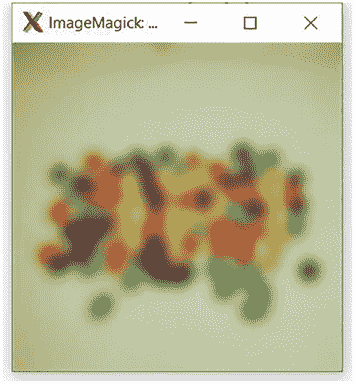

我们也可以使用自定义滤镜，如`代码清单 5-2`所示。

`代码清单 5-2.` `prog02.py`

```python
from PIL import Image, ImageFilter

im1 = Image.open("/home/pi/DIP/Dataset/4.1.08.tiff")

custom_filter = ImageFilter.GaussianBlur(radius=float(5))

im2 = im1.filter(custom_filter)

im2.show()
```

`图 5-2`显示了该程序的输出结果。

`图 5-2.` 自定义高斯滤镜

`代码清单 5-2`中的代码使用了`GaussianBlur()`方法创建自定义滤镜。模糊半径为 5。我们可以更改半径。接下来，使用`Tkinter`中的滑块来修改代码，使模糊半径变为动态可调（见`代码清单 5-3`）。

`代码清单 5-3.` `prog03.py`

```python
from PIL import Image, ImageTk, ImageFilter
import tkinter as tk

def show_value_1(blur_radius):
    print('高斯模糊半径：', blur_radius)
    custom_filter = ImageFilter.GaussianBlur(radius=float(blur_radius))
    img = im1.filter(custom_filter)
    photo = ImageTk.PhotoImage(img)
    l['image'] = photo
    l.photo = photo

root = tk.Tk()
root.title('高斯模糊滤镜演示')

im1 = Image.open("/home/pi/DIP/Dataset/4.1.07.tiff")
photo = ImageTk.PhotoImage(im1)
l = tk.Label(root, image=photo)
l.pack()
l.photo = photo

w1 = tk.Scale(root, label="模糊半径", from_=0, to=10, resolution=0.2, command=show_value_1, orient=tk.HORIZONTAL)
w1.pack()

root.mainloop()
```

`代码清单 5-3`的输出结果如`图 5-3`所示。

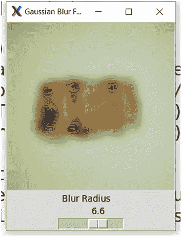

`图 5-3.` 使用 Tkinter 的高斯模糊

我们可以看到`GaussianBlur()`已被应用在图像上。

接下来要探索的滤镜是卷积滤镜。对于这个示例，我们需要理解核（kernel）的概念。核是用于图像处理操作的**方形矩阵**。我们主要使用核来进行滤波。核可以产生多种效果，包括模糊、平滑、降噪、锐化和边缘突出。

当使用滤波器去除图像中的高频分量时，这个过程称为低通滤波，因为它允许低频数据通过滤波器。它会产生模糊、平滑和降噪等效果。

当使用滤波器去除图像中的低频分量时，这个过程称为高通滤波，因为它允许高频数据通过滤波器。它会产生锐化和边缘突出等效果。

`图 5-4`展示了一个示例核。

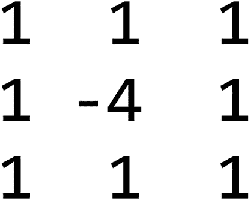

`图 5-4.` 一个核

`代码清单 5-4`展示了一个用于图像卷积的核的代码示例。

`代码清单 5-4.` `prog04.py`

```python
from PIL import Image, ImageTk, ImageFilter
import tkinter as tk

root = tk.Tk()
root.title('卷积核演示')

im1 = Image.open("/home/pi/DIP/Dataset/4.1.07.tiff")
custom_filter = ImageFilter.Kernel((3, 3), [1, 1, 1, 1, -4, 1, 1, 1, 1])
img = im1.filter(custom_filter)
photo = ImageTk.PhotoImage(img)
l = tk.Label(root, image=photo)
l.pack()
l.photo = photo

root.mainloop()
```

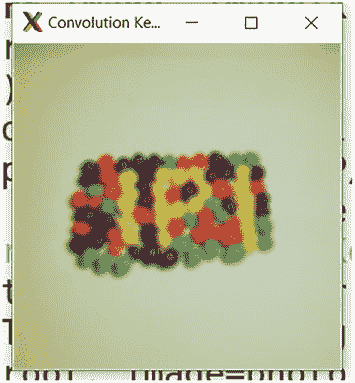

运行程序`Listing 5-4`，它会产生以下输出（`图 5-5`）。

`图 5-5.` 一个卷积演示

截至目前，`ImageFilter.Kernel()`方法仅支持大小为`3x3`和`5x5`的卷积核。试试下面这个`5x5`的卷积核：

```python
custom_filter = ImageFilter.Kernel((5, 5), [1,1,1,1,1,
1,1,1,1,1, 1,1,-10,1,1, 1,1,1,1,1, 1,1,1,1,1])
```

我们可以使用数字非锐化掩码滤镜，如`清单 5-5`所示。

`清单 5-5.` `prog05.py`

```python
from PIL import Image, ImageTk, ImageFilter
import tkinter as tk

def show_value_1(blur_radius):
    print('Unsharp Blur Radius: ', blur_radius)
    custom_filter = ImageFilter.UnsharpMask(radius=float(blur_radius))
    img = im1.filter(custom_filter)
```

# 第5章 图像高级操作

```
    photo = ImageTk.PhotoImage(img)
    l['image'] = photo
    l.photo = photo

root = tk.Tk()
root.title('Digital Unsharp Mask Demo')
im1 = Image.open("/home/pi/DIP/Dataset/4.1.07.tiff")
photo = ImageTk.PhotoImage(im1)
l = tk.Label(root, image=photo)
l.pack()
l.photo = photo
w1 = (tk.Scale(root, label="Blur Radius", from_=0, to=10,
resolution=0.2, command=show_value_1, orient=tk.
HORIZONTAL))
w1.pack()
root.mainloop()
```

数字非锐化掩码可以锐化图像。图`5-6`展示了掩码半径为 10 时的输出。

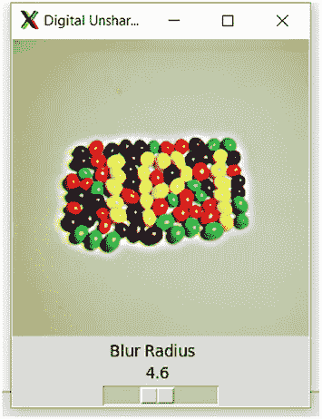

***图 5-6.** 数字非锐化演示*

半径为 10 会生成一张高度锐化的图像。

接下来，我们学习一下 `Pillow` 中的中值、最小值和最大值滤镜。所有这些滤镜只接受奇数作为窗口大小。清单`5-6`中的代码演示了中值滤镜。

***清单 5-6.*** `prog06.py`

```
from PIL import Image, ImageTk, ImageFilter
import tkinter as tk

def show_value_1(window_size):
    print('Window Size: ', window_size)
    if (int(window_size) % 2 == 0):
        print("Invalid Window Size...\nWindow Size must be an odd number...")
    else:
        custom_filter = ImageFilter.MedianFilter(size=int(window_size))
        img = im1.filter(custom_filter)
        photo = ImageTk.PhotoImage(img)
        l['image'] = photo
        l.photo = photo

root = tk.Tk()
root.title('Median Filter Demo')
im1 = Image.open("/home/pi/DIP/Dataset/4.1.07.tiff")
photo = ImageTk.PhotoImage(im1)
l = tk.Label(root, image=photo)
l.pack()
l.photo = photo
w1 = (tk.Scale(root, label="Window Size", from_=1, to=19,
resolution=1, command=show_value_1, orient=tk.
HORIZONTAL))
w1.pack()
root.mainloop()
```

图`5-7`中的输出显示了窗口大小为 19 的效果。

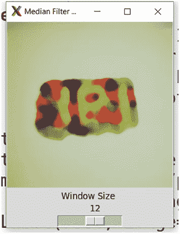

***图 5-7.** 一个中值滤镜*

如果你使用下面这行代码将滤镜更改为最小值滤镜：

```
custom_filter = ImageFilter.MinFilter(size=int(window_size))
```

那么你将得到图`5-8`所示的输出。

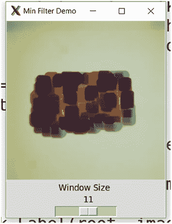

***图 5-8.** 一个最小值滤镜*

这是一个最大值滤镜的示例：

```
custom_filter = ImageFilter.MaxFilter(size=int(window_size))
```

最大值滤镜的输出如图`5-9`所示。

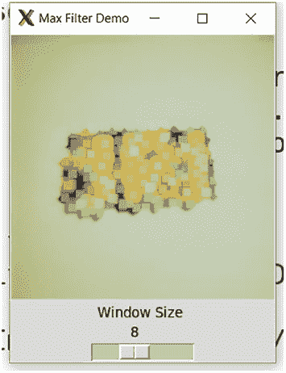

***图 5-9.** 最大值滤镜*

接下来，我们将看一个众数滤镜的示例。众数滤镜适用于偶数和奇数窗口大小。清单`5-7`展示了众数滤镜的代码示例。

***清单 5-7.*** `prog09.py`

```
from PIL import Image, ImageTk, ImageFilter
import tkinter as tk

def show_value_1(window_size):
    print('Window Size: ', window_size)
    custom_filter = ImageFilter.ModeFilter(size=int(window_size))
    img = im1.filter(custom_filter)
    photo = ImageTk.PhotoImage(img)
    l['image'] = photo
    l.photo = photo
```

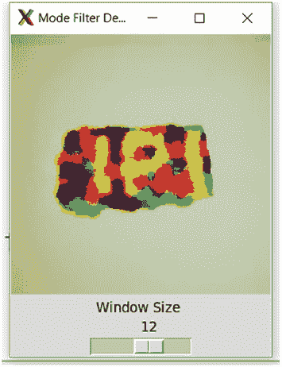

```
root = tk.Tk()
root.title('Mode Filter Demo')
im1 = Image.open("/home/pi/DIP/Dataset/4.1.07.tiff")
photo = ImageTk.PhotoImage(im1)
l = tk.Label(root, image=photo)
l.pack()
l.photo = photo
w1 = (tk.Scale(root, label="Window Size", from_=1, to=19,
```

# 第 5 章 图像高级操作

我们也可以像下面这样使用 `BoxBlur()` 的代码：

`custom_filter = ImageFilter.BoxBlur(radius=int(window_size))`

输出结果如图 5-10 所示

**图 5-10.** 模式滤镜

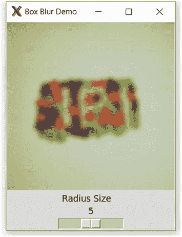

输出结果如图 5-11 所示

**图 5-11.** 方框模糊

你已经了解了如何使用滤镜；现在，让我们看看如何增强图像。

## ImageEnhance 模块

我们可以使用 Pillow 中的 `ImageEnhance` 模块来调整图像的对比度、色彩、锐度和亮度，就像我们过去在旧模拟电视机上所做的那样。

清单 5-8 展示了色彩调整的代码。

**清单 5-8.** `prog11.py`

```python
from PIL import Image, ImageTk, ImageEnhance
import tkinter as tk

def show_value_1(factor):
    print('Color Factor: ', factor)
    enhancer = ImageEnhance.Color(im1)
    img = enhancer.enhance(float(factor))
    photo = ImageTk.PhotoImage(img)
    l['image'] = photo
    l.photo = photo

root = tk.Tk()
root.title('Color Adjustment Demo')
im1 = Image.open("/home/pi/DIP/Dataset/4.1.07.tiff")
photo = ImageTk.PhotoImage(im1)
l = tk.Label(root, image=photo)
l.pack()
l.photo = photo

w1 = (tk.Scale(root, label="Color Factor", from_=0, to=2,
               resolution=0.1, command=show_value_1, orient=tk.
HORIZONTAL))
w1.pack()
w1.set(1)
root.mainloop()
```

在清单 5-8 中，图像处理代码如下：`enhancer = ImageEnhance.Color(im1)` 和 `img = enhancer.enhance(float(factor))`。

对于所有其他图像增强操作，我们可以遵循相同的编码风格。首先，我们创建一个增强器，然后对其应用增强因子。我们还必须在代码中注意到 `w1.set(1)`。这会在开始时将滑块设置为 1。更改 `set()` 的参数会改变滑块指针的默认位置。

运行清单 5-8 中的程序，并查看输出结果。

要更改对比度，请使用清单 5-9 中的代码。

**清单 5-9.** `prog12.py`

```python
from PIL import Image, ImageTk, ImageEnhance
import tkinter as tk

def show_value_1(factor):
    print('Contrast Factor: ', factor)
    enhancer = ImageEnhance.Contrast(im1)
    img = enhancer.enhance(float(factor))
    photo = ImageTk.PhotoImage(img)
    l['image'] = photo
    l.photo = photo

root = tk.Tk()
root.title('Contrast Adjustment Demo')
im1 = Image.open("/home/pi/DIP/Dataset/4.1.07.tiff")
photo = ImageTk.PhotoImage(im1)
l = tk.Label(root, image=photo)
l.pack()
l.photo = photo

w1 = (tk.Scale(root, label="Contrast Factor", from_=0, to=2,
               resolution=0.1, command=show_value_1, orient=tk.
HORIZONTAL))
w1.pack()
w1.set(1)
root.mainloop()
```

运行清单 5-9 中的程序，并查看输出结果。

以下增强器用于更改亮度：

`enhancer = ImageEnhance.Brightness(im1)`

以下增强器用于更改锐度：

`enhancer = ImageEnhance.Sharpness(im1)`

为了更精细地控制锐度，请对滑块使用以下代码：`w1 = (tk.Scale(root, label="Sharpness Factor", from_=0, to=2, resolution=0.1, command=show_value_1, orient=tk.HORIZONTAL))`

这些全都是图像增强操作。下一节将介绍更高级的图像操作。

## 颜色量化

颜色量化是减少图像中不同颜色数量的过程。新图像在外观上应与原图相似。颜色量化有多种用途，例如当你想将图像存储在数字介质中时。现实生活中的图像拥有数百万种颜色。然而，以数字格式对它们进行编码并保留所有与颜色相关的信息会导致图像尺寸巨大。如果你限制图像中的颜色数量，那么存储颜色相关信息所需的空间就会更少。这就是量化的实际应用。`Image` 模块有一个名为 `quantize()` 的方法，用于图像量化。

清单 5-10 中的代码演示了 Pillow 中的图像量化。

**清单 5-10.** `prog15.py`

```python
from PIL import Image, ImageTk
import tkinter as tk

def show_value_1(num_of_col):
    print('Number of colors: ', num_of_col)
    img = im1.quantize(int(num_of_col))
    photo = ImageTk.PhotoImage(img)
    l['image'] = photo
    l.photo = photo

root = tk.Tk()
root.title('Color Quantization Demo')
im1 = Image.open("/home/pi/DIP/Dataset/4.1.07.tiff")
photo = ImageTk.PhotoImage(im1)
l = tk.Label(root, image=photo)
l.pack()
l.photo = photo

w1 = (tk.Scale(root, label="Number of colors", from_=4, to=16,
               resolution=1, command=show_value_1, orient=tk.
HORIZONTAL))
w1.pack()
w1.set(256)
root.mainloop()
```

以下输出（图 5-12）显示了一张量化后的图像。

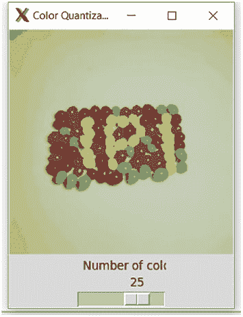

**图 5-12.** 量化后的图像

## 直方图与均衡化

你可能在学校里学习过统计学中的频数表。其实，直方图就是频数表的可视化形式。你可以计算任何以数字形式表示的数据集的直方图。

`Image` 模块有一个名为 `histogram()` 的方法，用于计算图像的直方图。一张 RGB 图像有三个 8 位通道。这意味着它可以拥有惊人的 256 x 256 x 256 种颜色。绘制这样一个数据集的直方图会非常困难。因此，`histogram()` 方法计算图像中单个通道的直方图。每个通道有 256 个不同的亮度级。直方图是一个针对通道每个亮度级的数值列表。

每个通道的直方图列表中包含 256 个数字。假设 `红色` 通道的直方图数值为 (4, 8, 0, 19, …, 90)。这意味着有 4 个像素的红色亮度为 0，8 个像素的红色亮度为 1，没有像素的红色亮度为 2，19 个像素的红色亮度为 3，依此类推，直到最后一个值，该值表示有 90 个像素的红色亮度为 255。

当我们合并所有三个通道的直方图时，会得到一个包含 768 个数字的列表。在本章中，我们只计算直方图，不会进行可视化显示。当我们学习高级图像处理库 `scipy.ndimage` 时，会学习如何分别表示每个通道的直方图。

清单 5-11 中的代码计算并存储了图像及其各个通道的直方图。

***清单 5-11.*** `prog16.py`

```
from PIL import Image

im1 = Image.open("/home/pi/DIP/Dataset/4.1.07.tiff")
print(len(im1.histogram()))
r, g, b = im1.split()
print(len(r.histogram()))
print(len(g.histogram()))
print(len(b.histogram()))
```

修改此程序，以直接打印图像和通道的直方图。

灰度图像（`L` 模式图像）的直方图只有 256 个值，因为它只有一个通道。

### 直方图均衡化

你可以调整直方图以增强图像对比度。这种技术称为直方图均衡化。`ImageOps.equalize()` 方法可以对图像的直方图进行均衡化。清单 5-12 展示了这一过程的一个示例。

***清单 5-12.*** `prog17.py`

```
from PIL import Image, ImageOps

im1 = Image.open("/home/pi/DIP/Dataset/4.1.07.tiff")
print(im1.histogram())
im2 = ImageOps.equalize(im1)
print(im2.histogram())
im2.show()
```

# 在`Listing 5-12`的程序中，打印了直方图均衡化后的原始图像。在程序中添加`im1.show()`语句，然后运行程序，观察图像之间的差异。

## 本章小结

在本章中，我们探讨了如何使用 Pillow 库进行高级图像处理。对于想要入门一个易于编程且数学要求较低的图像处理库的初学者来说，Pillow 是不错的选择。

然而，如果你需要更具数学性和科学性的方法，那么 Pillow 可能并非最佳选择。在接下来的章节中，我们将学习一个更强大的图像处理库：`scipy.ndimage`。它被全世界的科学界广泛使用。

我们还将学习`NumPy`和`matplotlib`库的基础知识，它们在处理和显示图像时会非常有用。
