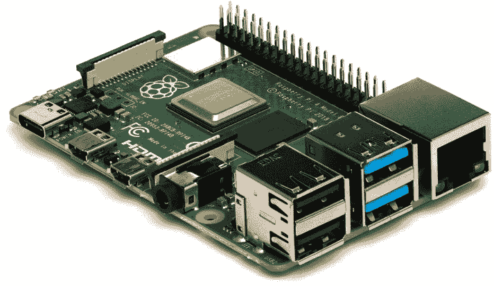
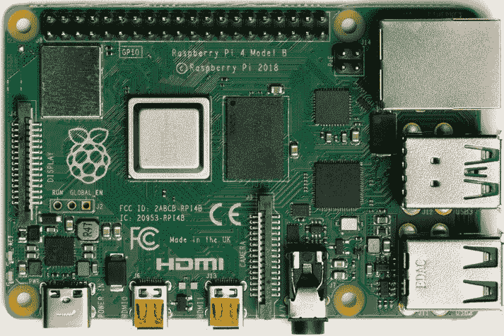
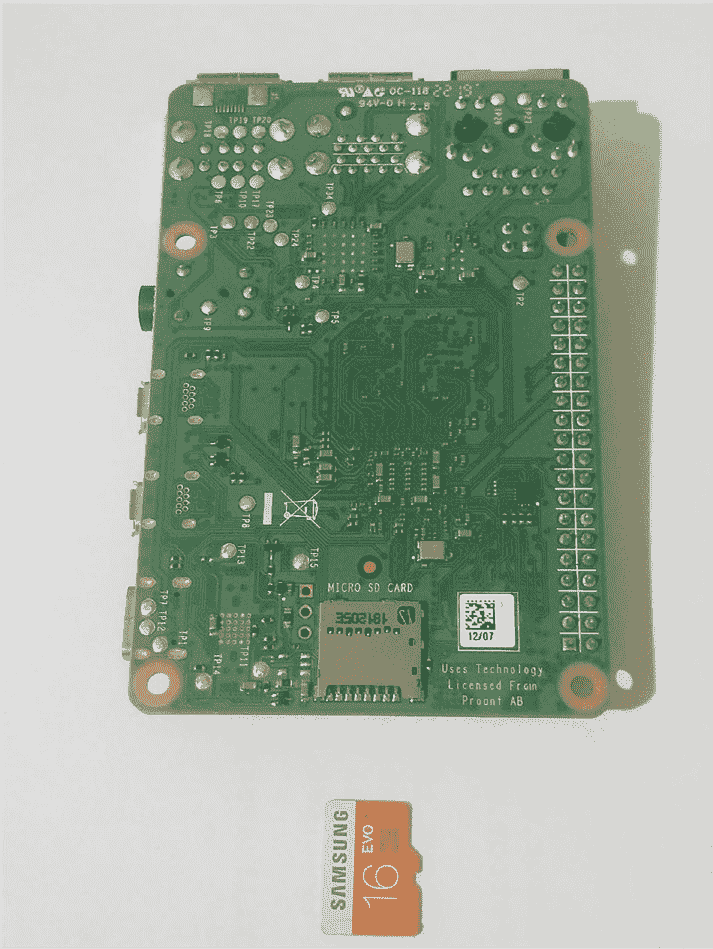
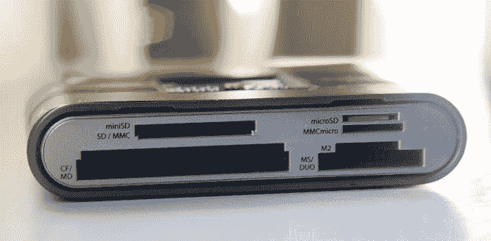
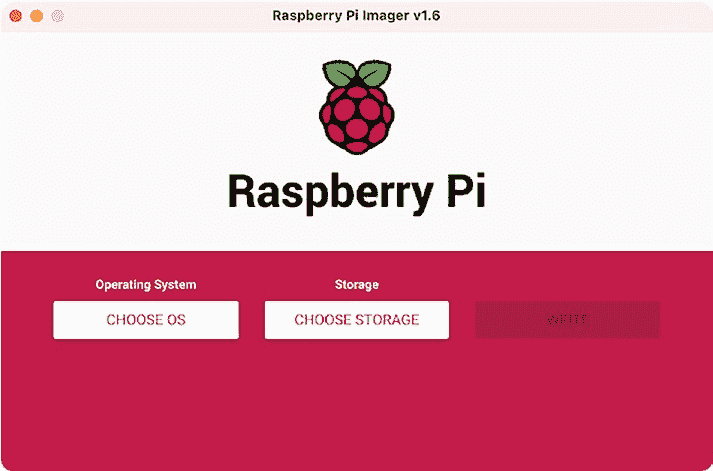

# Raspberry Pi 4 Model B 规格参数

## 内存

- 2GB、4GB 或 8GB LPDDR4-3200 SDRAM（视型号而定）

## USB

- 2 个 USB 3.0 端口，2 个 USB 2.0 端口

## 视频输出

- 2 × micro-HDMI 端口（最高支持 4kp60）
- 2 通道 MIPI DSI 显示屏端口

## 板载存储

- microSDHC 卡槽

## 板载网络

- 2.4 GHz 和 5.0 GHz IEEE 802.11ac 无线
- 蓝牙 5.0，BLE
- 千兆以太网

## 电源

- 通过 microUSB 提供 3A 5V 电源

图 1-1 展示了 Raspberry Pi 4 Model B 的正面视图。

*图 1-1. Raspberry Pi 4 Model B 板卡正面视图 1*

该图清晰地展示了板卡上所有重要的组件，包括 USB 端口、以太网端口、micro-HDMI 端口、3.5mm 音频插孔、用于供电的 USB Type C 端口以及 CSI 和 DSI 接口。

图 1-2 展示了板卡的俯视图。

*图 1-2. Raspberry Pi 4 Model B 板卡俯视图 2*

在底部视图中，我们可以清晰地看到 microSD 卡槽（图 1-3）。

*图 1-3. 插有 microSD 卡的 Raspberry Pi 4 Model B 板卡底部视图*

1.  图片由 Laserlicht 提供，遵循 CC-BY-SA 4.0 许可证 (<https://creativecommons.org/licenses/by-sa/4.0/deed.en>)
2.  图片由 Laserlicht 提供，遵循 CC-BY-SA 4.0 许可证 (<https://creativecommons.org/licenses/by-sa/4.0/deed.en>)

## Raspberry Pi 设置

在使用 Raspberry Pi 进行探索和冒险之前，必须先对其进行设置。如前所述，我在此次设置中使用的是一块 Raspberry Pi 4 Model B。请确保你使用的是带有内置 Wi-Fi 功能的 RPi 板卡型号。所有型号的设置过程几乎相同。

我们将以无头模式使用 Raspberry Pi 板卡。这意味着我们不会连接任何键盘、鼠标或显示器。我们只需将其连接到 Wi-Fi 网络，然后进行远程访问。因此，我们不需要很多硬件设备。除了 RPi 板卡本身，我们还需要以下物品：

**一台电脑** – 我们需要一台装有 Windows、macOS、Linux、UNIX 或 BSD 操作系统的电脑，用于为 RPi 板卡准备 microSD 卡。

**可联网的 Wi-Fi 连接** – 我们需要联网来将操作系统安装到 microSD 卡上。后续还需要联网将 RPi 连接到互联网，并在其上安装必要的软件。

**microSD 卡** – 我们需要一张 microSD 卡。为了获得最佳体验，我通常建议至少使用一张 32GB Class 10 的 microSD 卡。如果你想了解更多关于 microSD 卡等级的信息，请访问以下网址：<https://www.sdcard.org/developers/sd-standard-overview/speed-class/>

**microSD 卡读卡器** – 我们需要一个读卡器，以便电脑能够读取和写入 microSD 卡。为了进行无头设置，我们需要修改 microSD 卡的内容。microSD 卡读卡器有多种类型。下图（图 1-4）是一个通用读卡器的图片。

*图 1-4. 通用读卡器 3*

**一个电源适配器** – 我们需要一个电源适配器为 RPi 板卡供电。RPi 4B 使用 USB Type C 接口供电。

像这款一样的使用 Type-C 接口的电源适配器：<https://www.raspberrypi.com/products/type-c-power-supply/>，而其他一些型号则使用微型 USB 电源适配器，例如这款：<https://www.raspberrypi.com/products/micro-usb-power-supply/>。

我们可以在线上商城或当地的电子爱好者商店采购所有这些配件以及 RPi 主板。

3.  图片由 Alen 提供，遵循 CC0 1.0 通用（CC0 1.0）许可协议（<https://creativecommons.org/publicdomain/zero/1.0/>）