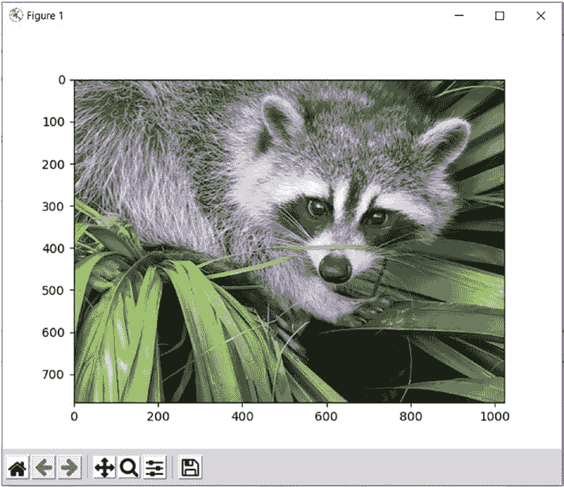
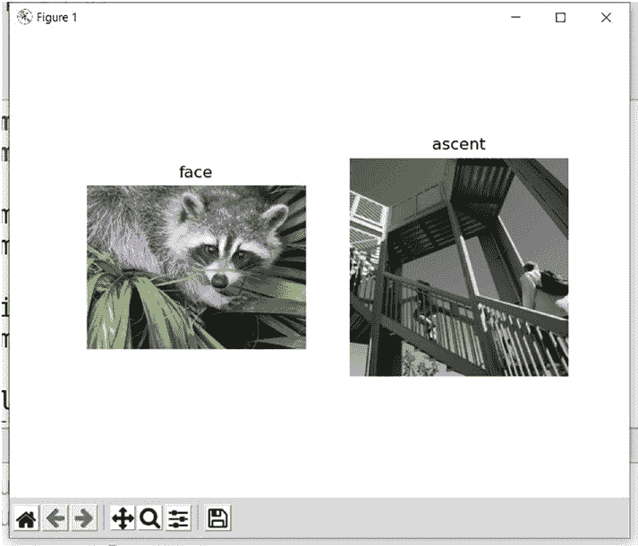
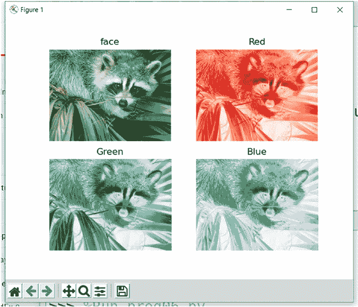

# 第六章

# Python 科学计算生态系统简介

在上一章中，我们学习了如何使用`Pillow`进行高级图像处理。`Pillow`是图像处理操作的一个很好的起点。然而，它有其局限性。当涉及到实现复杂的图像处理操作（例如分割、形态学操作、高级滤波器和测量）时，`Pillow`就显得力不从心了。我们确实需要使用更好的库来进行高级图像处理。`SciPy`生态系统为Python的所有科学用途奠定了基础。

`SciPy`代表科学计算Python。它广泛使用`NumPy`（数值计算Python）和`matplotlib`分别进行数值运算和数据可视化。本章涵盖`NumPy`、`SciPy`和`matplotlib`的基础知识，并通过`NumPy`、`scipy.misc`和`matplotlib`探索入门级的编程示例。我们将在本章中探讨以下主题：

- Python 科学计算生态系统
- `matplotlib`
- PIL 图像对象与`NumPy`的`ndarray`之间的转换

在本章结束时，我们将掌握`SciPy`生态系统的基础知识。

## Python 科学计算生态系统

Python科学计算生态系统是一个用于Python的开源免费库集合，专用于科学领域。它包含用于数值运算（`NumPy`）、科学运算（`SciPy`）和数据可视化（`matplotlib`）的模块。它被世界各地的科学、数学、工程和分析社区广泛使用。

该生态系统包含以下核心组件：

- `NumPy`
- `SciPy`
- `matplotlib`
- `IPython`
- `Pandas`
- `Sympy`
- `Nose`

许多其他库使用生态系统中的核心模块来提供额外的算法和数据结构。例如`OpenCV`和`Scikit`。

图6-1恰当地总结了Python科学计算生态系统在科学计算领域的作用。

**图6-1.** Python科学计算生态系统的核心组件

在树莓派上安装Python科学计算生态系统组件的最佳方法是使用`pip`工具。

首先，使用以下命令升级你的树莓派：

```
sudo python3 -m pip install --upgrade pip
```

然后，使用以下命令安装Python科学计算生态系统的组件：

```
pip3 install numpy scipy matplotlib ipython jupyter pandas sympy nose
```

这将安装所有必需的库。

## 简单示例

让我们学习几个简单的示例。我们将学习如何从`scipy.misc`读取内置图像，将其存储在一个变量中，并查看该变量的数据类型，如清单6-1所示。

**清单6-1.** `prog01.py`

```python
from scipy import misc

img = misc.face()
print(type(img))
```

输出如下：

```
<class 'numpy.ndarray'>
```

# 关于图像数据类型与 NumPy 的初步介绍

在 Scientific Python 中，所有存储图像数据的变量都属于同一类型。这意味着图像的数据类型是`ndarray`，它来自`NumPy`。要开始学习科学图像处理以及一般的科学编程，我们必须了解`NumPy`是什么。

`NumPy`官网（[www.numpy.org](http://www.numpy.org)）这样描述：*NumPy 是用于科学计算的基础包。它提供了以下特性：*

*   *一个强大的多维数组对象*

*   *用于数学计算的有用方法*

*   *用于集成更快的 `C/C++` 和 `FORTRAN` 代码的封装器和工具*

要开始使用`SciPy`和`NumPy`进行图像处理，我们需要学习`NumPy`中 N 维（或多维）数组对象的基础知识。

`NumPy`的 N 维数组是一个同质（包含所有相同数据类型元素）的多维数组。它有多个维度，每个维度被称为一个轴。`NumPy`中 N 维数组对应的类是`numpy.ndarray`。这就是我们在“清单 6-1”的输出中看到的内容。所有主流的图像处理库，如`Mahotas`、`OpenCV`、`scikit-image`和`scipy.ndimage`（我们将在本书中深入学习后者），都使用`numpy.ndarray`来表示图像。这些库都有`read()`、`open()`和`imread()`方法，用于从磁盘加载图像到`numpy.ndarray`对象。

`NumPy`及其 N 维数组本身是非常宏大的主题，需要用大量的书籍才能完全解释清楚。因此，我们将在需要时学习它们的相关重要特性。现在，你需要了解一些重要的`ndarray`属性，这些属性将帮助你理解`ndarray`所表示的图像的重要特征。

我们也可以检查图像的属性。请考虑“清单 6-2”中的代码。

**清单 6-2.** `prog02.py`

```python
from scipy import misc
img = misc.face()
print(img.dtype)
print(img.shape)
print(img.ndim)
print(img.size)
```

输出如下：

```
uint8
(768, 1024, 3)
```

让我们看看这些输出分别意味着什么。

`dtype`属性用于表示图像元素的数据类型。在这个例子中，它是`uint8`，表示一个无符号的 8 位整数，这意味着它可以有 256 个不同的值。

`shape`表示图像的维度或尺寸。在这个例子中，它是一张彩色图像，分辨率为 1024 x 768，并且有三个颜色通道，分别对应红色、绿色和蓝色。每个像素的每个通道可以取 256 个可能值中的一个。因此，组合起来可以为每个像素产生 256*256*256 种不同的颜色。你可以将彩色图像可视化为三个二维平面的排列。而灰度图像则是一个灰度值单平面。

`ndim`表示图像的维数。彩色图像有三维，灰度图像有二维。

`size`表示数组中元素的总数。它可以通过将各维度的值相乘来计算。在这个例子中，它是 768 * 1024 * 3 = 2359296。

我们可以查看每个单独像素对应的 RGB 值，如清单 6-3 所示。

**清单 6-3.** `prog03.py`

```python
from scipy import misc
img = misc.face()
print(img[10, 10])
```

“清单 6-3”中的代码访问了位于(10, 10)的像素值。输出是`[172 169 188]`。

以上便是 NumPy 和图像处理的基础知识。在后续章节中，你会在需要的时候学到更多关于 NumPy 的知识。

# Matplotlib

到目前为止，我们一直使用`misc.imshow()`方法来显示图像。虽然这个方法对于简单的应用很有用，但它比较原始。对于科学应用，我们必须使用一个更高级的框架。`Matplotlib`就为此目的而生。它是一个用于 Python 的 Matlab 风格的绘图和数据可视化库。我们已经安装了它。它是 Scientific Python 生态系统不可或缺的一部分。与 NumPy 一样，`matplotlib`也是一个庞大的主题，需要专门的书籍来阐述。本书中的示例使用`matplotlib`中的`pyplot`模块来满足图像处理需求。“清单 6-4”展示了一个简单的图像处理程序。

清单 6-4. `prog04.py`

```python
import scipy.misc as misc
import matplotlib.pyplot as plt
img = misc.face()
plt.imshow(img)
plt.show()
```

“清单 6-4”中的代码导入了`pyplot`模块。`imshow()`方法将图像添加到绘图窗口中。`show()`方法用于显示绘图窗口。输出如图 6-2 所示。



图 6-2. Matplotlib 演示 1

我们也可以关闭坐标轴（或标尺）并为图像添加标题，如“清单 6-5”所示。

清单 6-5. `prog05.py`

```python
import scipy.misc as misc
import matplotlib.pyplot as plt
img = misc.ascent()
```


```python
plt.imshow(img, cmap='gray')
plt.axis('off')
plt.title('Ascent')
plt.show()
```

由于图像是灰度图，我们必须在`imshow()`方法调用中选择一个灰色的颜色映射（`cmap='gray'`），以便图像的色彩空间能在绘图窗口中正确显示。`axis('off')`用于关闭坐标轴。`title()`方法用于指定图像的标题。输出如图 6-3 所示。

图 6-3. 自定义 Matplotlib 绘图

我们可以使用`imshow()`将多个图像推送到绘图窗口的图像网格中，如“清单 6-6”所示。

清单 6-6. `prog06.py`

```python
import scipy.misc as misc
import matplotlib.pyplot as plt
img1 = misc.face()
img2 = misc.ascent()
titles = ['face', 'ascent']
images = [img1, img2]
plt.subplot(1, 2, 1)
plt.imshow(images[0])
plt.axis('off')
plt.title(titles[0])
plt.subplot(1, 2, 2)
plt.imshow(images[1], cmap='gray')
plt.axis('off')
plt.title(titles[1])
plt.show()
```

我们之前已经在`imshow()`中使用了`subplot()`方法。`subplot()`方法的前两个参数指定了网格的维度，第三个参数指定了图像在网格中的位置。网格中图像的编号从左上角开始。左上角的位置是第一个位置，下一个位置是第二个，依此类推。结果显示在图 6-4 中。



图 6-4. 单个绘图中的多张图像

# 图像通道

你可以分离多通道图像的图像通道。该过程的代码如“清单 6-7”所示。

***清单 6-7.*** `prog07.py`

```python
import scipy.misc as misc
import matplotlib.pyplot as plt
img = misc.face()
r = img[:, :, 0]
```

# 第 6 章 科学 Python 生态系统简介

```
g = img[:, :, 1]
b = img[:, :, 2]
titles = ['face', 'Red', 'Green', 'Blue']
images = [img, r, g, b]
plt.subplot(2, 2, 1)
plt.imshow(images[0])
plt.axis('off')
plt.title(titles[0])
plt.subplot(2, 2, 2)
plt.imshow(images[1], cmap='Reds')
plt.axis('off')
plt.title(titles[1])
plt.subplot(2, 2, 3)
plt.imshow(images[2], cmap='Greens')
plt.axis('off')
plt.title(titles[2])
plt.subplot(2, 2, 4)
plt.imshow(images[3], cmap='Blues')
plt.axis('off')
plt.title(titles[3])
plt.show()
```

清单 6-7 中代码的运行结果如图 6-5 所示。



**图 6-5.** 颜色通道

我们可以使用`np.dstack()`方法（该方法用于合并所有通道）来重建原始图像，如清单 6-8 所示。

**清单 6-8.** `prog08.py`

```
import scipy.misc as misc
import matplotlib.pyplot as plt
import numpy as np

img = misc.face()
r = img[:, :, 0]
g = img[:, :, 1]
b = img[:, :, 2]

output = np.dstack((r, g, b))
plt.imshow(output)
plt.axis('off')
plt.title('Combined')
plt.show()
```

运行清单 6-8 中的代码，亲身观察`np.dstack()`方法的工作原理。

## PIL 图像对象与 NumPy ndarray 之间的转换

你可以使用`np.asarray()`和`Image.fromarray()`方法在 PIL 图像与 NumPy ndarray 之间进行转换，如清单 6-9 所示。

**清单 6-9.** `prog09.py`

```
from PIL import Image
import numpy as np
import matplotlib.pyplot as plt

img = Image.open('/home/pi/DIP/Dataset/4.1.07.tiff')
print(type(img))

num_img = np.asarray(img)
print(type(num_img))

img = Image.fromarray(np.uint8(num_img))
print(type(img))
```

控制台输出如下：

```
<class 'PIL.TiffImagePlugin.TiffImageFile'>
<class 'numpy.ndarray'>
<class 'PIL.Image.Image'>
```

## 本章小结

在本章中，我们了解了**科学 Python**技术栈及其组成库，例如 NumPy 和 matplotlib。我们还探索了用于基本图像处理和转换的`scipy.misc`模块。在下一章中，我们将开始探索`scipy.ndimage`模块，学习更多图像处理操作。
