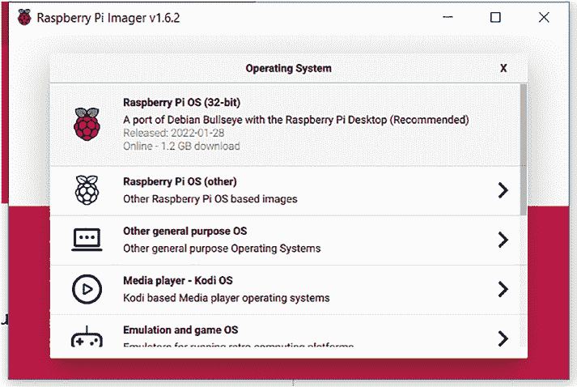
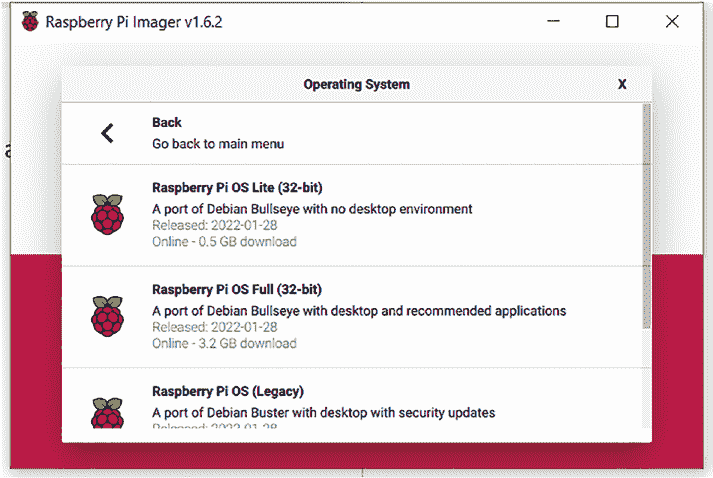
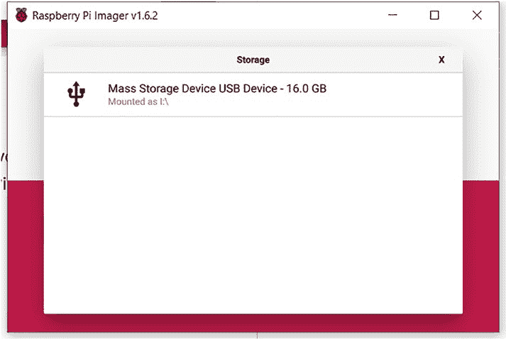
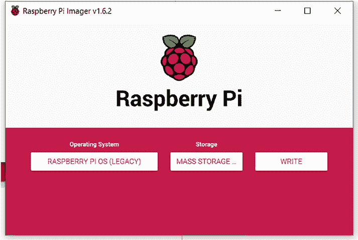
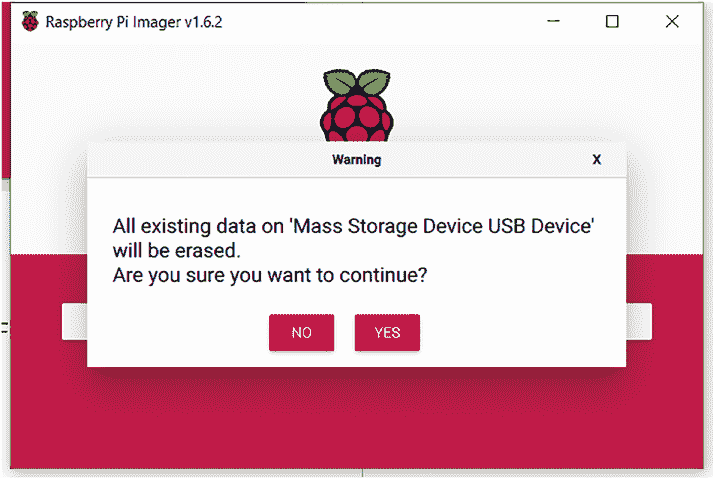
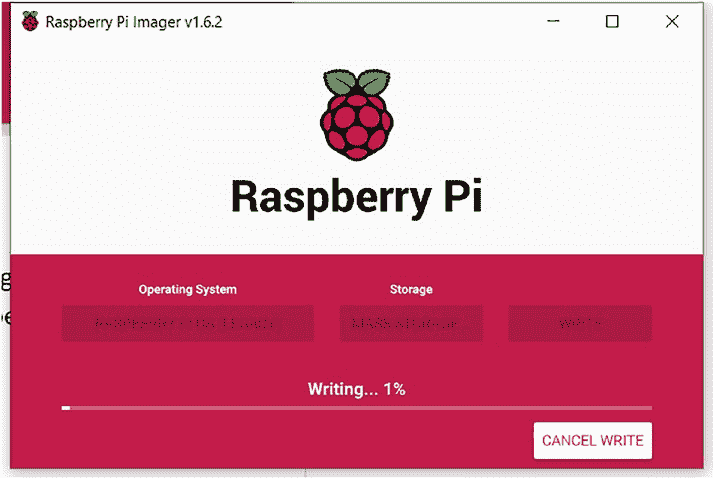
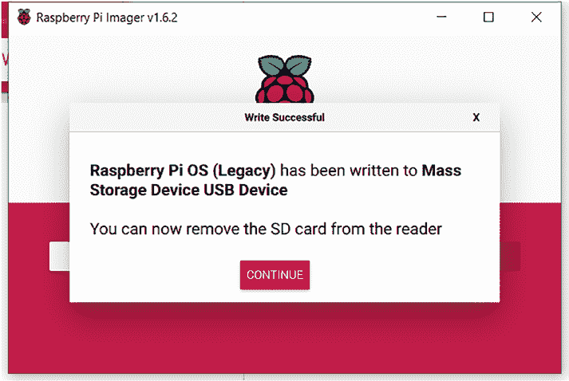

# 第 1 章 单片计算机与树莓派简介

## 准备 microSD 卡

以下是准备存储卡的步骤：

1. 将存储卡插入读卡器，并连接到计算机。

2. 从 [`www.raspberrypi.com/software/`](https://www.raspberrypi.com/software/) 安装 **Raspberry Pi Imager** 软件。对于 Debian 及其衍生系统，请在终端模拟器中运行以下命令：

```
sudo apt install rpi-imager
```

3. 打开已安装的 **Raspberry Pi Imager** 程序。其界面如图 1-5 所示。

`图 1-5.` *Raspberry Pi Imager 界面*



4. 点击 **CHOOSE OS** 按钮。将弹出如图 1-6 所示的选项。

`图 1-6.` *选择操作系统*

点击选择 **Raspberry Pi OS (other)** 选项。随后会显示另一列表选项，如图 1-7 所示。



`图 1-7.` *选择操作系统*

选择 **Raspberry Pi OS (Legacy)**。这是 **Debian Buster** 的一个维护良好的版本，支持树莓派摄像头的命令行工具。

5. 现在，点击 **CHOOSE STORAGE** 按钮。它将显示连接到计算机的 microSD 卡，如图 1-8 所示。



`图 1-8.` *选择存储设备*

6. 这将激活 **WRITE** 按钮，如图 1-9 所示。



`图 1-9.` *写入按钮已激活*

点击 **WRITE** 按钮。将显示一条警告消息，如图 1-10 所示。



`图 1-10.` *警告消息*

不必担心此消息。点击 **YES** 按钮。它将开始从互联网下载文件并写入 microSD 卡。将出现一个进度条，如图 1-11 所示。



`图 1-11.` *进度条*

整个流程完成后，将显示如下消息（图 1-12）。



`图 1-12.` *完成消息*

点击 **CONTINUE** 按钮。断开读卡器连接，然后重新连接。

7. 重新连接后，它将在文件系统中显示为一个名为 `boot` 的驱动器。操作系统可能会自动为其分配一个盘符。在 `boot` 位置创建一个空文件，并将其命名为 `ssh`。不要使用任何扩展名。这将启用远程登录功能。

8. 再创建另一个文件，并将其命名为 `wpa_supplicant.conf`。这是为了确保 RPi 主板在启动后能够连接到 Wi-Fi。将以下内容添加到该文件中并保存：

```
country=IN
ctrl_interface=DIR=/var/run/wpa_supplicant
GROUP=netdev
```