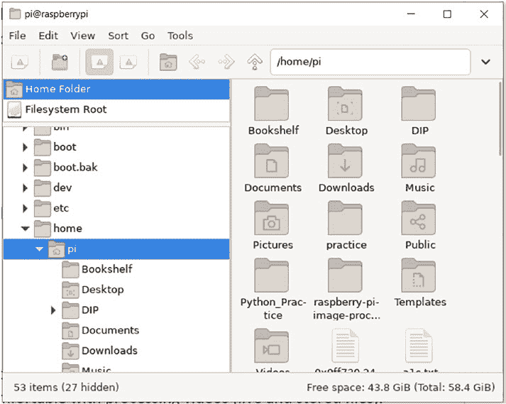
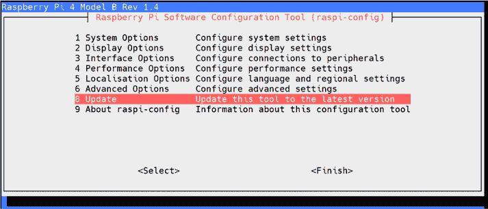
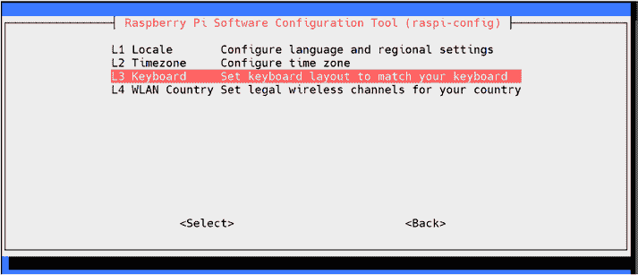

# 第 1 章 单板计算机与树莓派简介

`update_config=1`
```
network={
scan_ssid=1
ssid="TP-Link_710E"
psk="internet1"
}
```
请记得将`SSID`和`PSK`部分替换为你自己的 Wi-Fi 名称和密码。

9) 现在，安全地断开 microSD 卡读卡器。

## 启动树莓派

这是最简单的部分。请按照以下步骤操作：

1) 从读卡器中取出 microSD 卡，并将其插入树莓派主板的 microSD 卡插槽中。
2) 确保此时主电源开关处于关闭状态。将树莓派连接到电源。
3) 打开电源开关。

此时我们可以看到树莓派主板上的指示灯闪烁。这意味着树莓派正在启动。等待几分钟，直到启动过程完成。

## 远程访问树莓派

我们已以无头模式启动树莓派主板。这意味着我们没有直接连接任何 I/O 设备（如显示器、键盘或鼠标）。让我们远程连接到它。首先，我们必须知道它的 IP 地址。

由于我们在启动前启用了 SSH 功能并为其提供了 Wi-Fi 设置，因此在启动过程中它已经连接到了 Wi-Fi。

有很多方法可以查找 IP 地址。如果你隶属于某个组织（工作场所、研究实验室或大学），请咨询你的网络/系统管理员，以找出树莓派的 IP 地址。

如果是你的个人 Wi-Fi，那么在所有类 UNIX 系统（Linux、BSD、macOS）上，你可以运行一条命令来查找 IP 地址。对于 Debian 及其衍生版（Ubuntu、树莓派操作系统等），我们可以安装以下命令：

```
sudo apt install nmap -y
```
该实用程序（`nmap`）用于扫描网络。查找所有连接到网络的 IP 地址的命令如下：

```
sudo nmap -sn 192.168.0.*
```
请将数字修改为你自己网络的 IP 地址。它会产生如下输出：

```
Starting Nmap 7.80 ( https://nmap.org ) at 2022-02-01 11:26 IST
Nmap scan report for 192.168.0.1
Host is up (0.0025s latency).
Nmap scan report for 192.168.0.100
Host is up (0.0023s latency).
Nmap scan report for 192.168.0.102
Host is up (0.091s latency).
Nmap done: 256 IP addresses (3 hosts up) scanned in
2.72 seconds
```
你可以使用`ipconfig`（Windows）或`ifconfig`（类 UNIX 系统）命令来查找你自己系统的 IP 地址。从这个列表中，我们可以排除所有已知 IP 地址的已知设备。如果家庭网络中连接的设备太多，那么可以关闭所有不必要设备的 Wi-Fi。在我的例子中，树莓派的 IP 地址是`192.168.0.100`。

在 Windows 电脑上，我们可以安装 Zenmap 实用程序，它是`nmap`的图形界面。我们可以从[`nmap.org/zenmap/`](https://nmap.org/zenmap/)下载并安装它。它也可用于类 UNIX 系统。

安装该实用程序并打开它。它看起来如图 1-13 所示。

*图 1-13. Zenmap 图形界面*

我们可以轻松地使用它。在`目标`文本框中填写`192.168.0.*`。在`命令`文本框中填入我们之前使用的命令（`nmap -sn 192.168.0.*`）。然后点击`扫描`按钮。扫描完成需要一些时间。有时扫描会提前失败。在这种情况下，请继续尝试，尝试几次后就会成功。因为它完全是开源和免费的，所以我们不能抱怨。扫描完成后，它会产生如图 1-13 所示的结果。有时，它还会在 MAC 地址旁边显示所连接设备的制造商名称。这使得识别树莓派主板变得容易。

一旦我们获取了树莓派的 IP 地址，就可以远程登录了。

我们可以使用多种 SSH 工具来远程登录树莓派主板，例如类 UNIX 操作系统自带的 `ssh` 工具。只需在操作系统的终端模拟器中运行以下命令：

```
ssh pi@192.168.0.100
```
`pi` 是用户名。系统会提示输入密码，密码是 `raspberry`。

这样，我们就可以远程登录树莓派主板并运行命令了。

在 Windows 系统上，`PuTTY` 和 `Bitvise SSH` 客户端是几款流行的工具。

不过，我发现 `MobaXterm` 使用起来非常方便。它集成了远程终端、文件传输和 X11 转发功能。有了这个工具，我们无需再安装其他任何东西。从 [`mobaxterm.mobatek.net/`](https://mobaxterm.mobatek.net/) 安装它。安装完成后，打开它。窗口外观如图 1-14 所示。

*图 1-14. MobaXterm*

在此窗口中，点击 `Start local terminal` 按钮。它将会启动一个本地终端窗口。在那里，我们可以运行以下命令来连接树莓派主板：

```
ssh pi@192.168.0.100
```
`pi` 是用户名。系统会提示输入密码，密码是 `raspberry`。

这样，我们就可以远程登录树莓派主板并运行命令了。

现在，是时候重温一下我们在学校学过的 UNIX 概念和命令了。我们可以在这个远程终端上运行所有 Linux/UNIX 命令。`MobaXterm` 最大的优点之一是它内置了一个 `XServer` 程序，当我们启动该工具时会自动运行。我们可以在窗口右上角看到该程序的图标。类 UNIX 系统允许我们通过 X11 转发远程访问 GUI 应用程序。在树莓派中，这项功能默认是启用的。我们只需要在另一端（即我们连接树莓派的计算机，或其他任何类 UNIX 系统）有一个 `XServer` 工具。正如之前讨论的，`MobaXterm` 已经自带了。只需在终端中运行以下命令：

```
nohup pcmanfm &
```
它会打开一个 `文件资源管理器` 工具的窗口，如图 1-15 所示。



*图 1-15. 通过 X11 转发访问的文件资源管理器*

请记住，这个 `文件资源管理器` 工具正在树莓派上运行。我们是通过 X11 转发来访问其 GUI 的。这样，结合使用 `nohup`（不挂起）和 `&`，我们可以从终端启动任何 GUI 工具。`&` 确保终端的控制权返回给我们，而 `nohup` 则使进程在用户注销后仍能继续运行。

## 配置树莓派

现在，在提示符下输入 `sudo raspi-config` 并按回车键。它会打开 `raspi-config` 工具，这是树莓派操作系统的配置工具。首先，更新它，如图 1-16 所示。




*图 1-16. 更新 raspi-config 工具*

更新需要一些时间。更新完成后，进入第五个选项“本地化选项”。界面如下所示（图 1-17）。

*图 1-17. 本地化选项*

根据自己的选择设置所有这些选项，然后在主菜单中选择 `Finish`。系统会询问是否重启。选择 `Yes`，树莓派将会重启。

## 树莓派操作系统

操作系统是使计算机工作的一组基本程序和实用工具。它是用户和计算机之间的接口。树莓派操作系统是一款基于流行的 Linux 发行版 Debian 的免费操作系统。它针对树莓派系列单板计算机进行了优化。它甚至被移植到了其他类似的单板计算机上，例如 Banana Pro。

## config.txt 文件

树莓派没有传统的 BIOS 或 UEFI。BIOS/UEFI（基本输入输出系统 / 统一可扩展固件接口）用于在计算机开机后启动系统。它还负责管理计算机操作系统与连接的外围设备（如硬盘、显卡、键盘、鼠标和打印机）之间的数据流。

由于树莓派没有 BIOS/UEFI，通常使用 BIOS/UEFI 存储和修改的各种系统配置参数，改为存储在一个名为 `config.txt` 的文本文件中。

树莓派的 `config.txt` 文件位于树莓派的启动分区中。在 Linux 系统中，通常可以通过 `/boot/config.txt` 访问该文件。然而，在 Windows 和 MacOS 系统中，它显示为 microSD 卡可访问部分中的一个文件。正如我们已经知道的，该卡的可访问部分被标记为 `boot`。

在树莓派上，你可以使用以下命令编辑此文件：

```
sudo nano /boot/config.txt
```

**注意：** `nano` 是一款适用于 Linux 的简单易学的终端文本编辑器。请访问其主页 [`www.nano-editor.org`](https://www.nano-editor.org) 了解更多信息。我发现它比 `vi` 或 `vim` 编辑器更容易使用。

要了解更多关于 `config.txt` 的信息，请访问页面 [`elinux.org/RPiconfig`](http://elinux.org/RPiconfig)。示例配置也可以在 [`elinux.org/R-Pi_configuration_file`](http://elinux.org/R-Pi_configuration_file) 找到。

### 更新 RPi

树莓派必须连接互联网才能成功更新。让我们更新固件和树莓派操作系统。

#### 更新固件

要更新固件，请运行命令 `sudo rpi-update`。

#### 更新和升级树莓派操作系统

我们将使用 `APT` 来完成此操作。`APT`（高级软件包工具）是一个处理 Debian 及其他衍生系统中软件安装和移除的程序。`APT` 通过自动获取、配置和安装软件包，简化了 Debian 系统上软件管理的过程。同样，我们也需要互联网连接。

首先，在终端中输入以下命令来更新系统的软件包列表：

```
sudo apt update
```

这会从相应的远程仓库下载软件包列表，并更新到本地计算机，以便提供关于最新版本软件包及其依赖项的信息，从而进行安装和更新。应该在运行安装或升级命令之前运行此命令。

接下来，使用以下命令将所有已安装的软件包升级到最新版本：

```
sudo apt full-upgrade -y
```

这会获取本地计算机上标记为要升级的软件包的新版本。它还会检测并安装任何依赖项，并移除过时的软件包。

定期执行此操作将使树莓派操作系统保持最新。输入这些命令后，更新操作系统需要一些时间，因为这些命令会从互联网上的远程仓库获取数据和软件包。

**注意：** 命令 `apt help` 会列出 `apt` 工具相关的所有选项。

### 关闭和重启 RPi

我们可以使用以下任一命令安全地关闭 RPi：

```
sudo shutdown -h
sudo init 0
```

我们可以使用以下任一命令重启 RPi：

```
sudo reboot -h
sudo init 6
```

### 总结

在本章中，我们学习了如何以无头模式通过 Wi-Fi 设置和访问 RPi。现在我们对这部分内容已经得心应手了。

下一章将聚焦于数字图像处理所涉及的概念。我们还将使用 Python 3 编写基本程序。

---

## 第 2 章：Python 与数字图像处理入门

在最后一章中，我们探索了单板计算机和树莓派的奇妙世界。我们启动了树莓派，将其连接到互联网，并更新了树莓派操作系统。

在本章中，我们将开始学习 Python 和数字图像处理（DIP）的概念。让我们从 Python 的介绍开始。我个人觉得 Python 很了不起，并且为之着迷。Python 是一种简单而强大的编程语言。程序员使用 Python 时，很容易专注于解决给定的问题，因为他们不必担心语法。Python 完美契合了树莓派的理念，即为每个人提供编程。这就是为什么它成为树莓派和其他计算机最受欢迎的编程平台。

以下是本章我们将学习的主题列表：

- Python 的历史
- Python 的特性
- Python 3
- Python 的集成开发环境（IDE）
- 数字图像处理简介

到本章结束时，我们将熟悉数字图像处理和 Python 3 基础的概念。

### Python 编程语言的简史

Python 是在 20 世纪 80 年代末设计和构思的。其实施于 1989 年底由荷兰国家数学与计算机科学研究所（Centrum Wiskunde & Informatica）的吉多·范罗苏姆（Guido van Rossum）正式开始。Python 是 ABC 编程语言的继承者，而 ABC 本身又受到 SETL 编程语言的启发。1991 年 2 月，范罗苏姆在新闻组 `alt.sources` 上公开发布了 Python 源代码。

Python 这个名字的灵感来源于英国电视节目*蒙提·派森的飞行马戏团*，因为范罗苏姆是蒙提·派森的忠实粉丝。

范罗苏姆是 Python 编程语言的主要作者。他引导 Python 的开发、增强和进一步演进，发挥了核心作用。直到 2018 年 7 月，他一直担任 Python 的“终身仁慈独裁者”。目前，Python 的开发由一个五人指导委员会领导。

Python 编程语言的核心哲学（Python 之禅）在 PEP-20（PEP 代表 Python 增强提案）中进行了解释，可在 [`www.python.org/dev/peps/pep-0020`](https://www.python.org/dev/peps/pep-0020) 找到。

它包含 20 条软件原则，其中 19 条已被记录在案。原则如下：

- 优美胜于丑陋。
- 明确胜于隐晦。
- 简单胜于复杂。
- 复杂胜于凌乱。
- 扁平胜于嵌套。
- 稀疏胜于稠密。
- 可读性很重要。
- 特殊情况不足以特殊到打破规则。
- 实用性胜于纯粹性。
- 错误永远不应悄悄忽略。
- 除非明确沉默。
- 面对歧义，拒绝猜测的诱惑。
- 应该有一种——最好只有一种——显而易见的方法来做这件事。
- 虽然那种方式一开始可能并不明显，除非你是荷兰人。
- 现在行动胜于永远不行动。
- 虽然永远不行动往往比立即行动更好。
- 如果实现难以解释，那是个坏主意。
- 如果实现容易解释，那可能是个好主意。
- 命名空间是一个绝妙的主意——让我们多做一些吧！

### Python 的特性

以下是使 Python 在编程社区中广受欢迎和喜爱的特性。

#### 简单

Python 是一种采用极简主义方法的简单语言。阅读一个编写良好且优秀的 Python 程序会让你感觉像是在阅读英文文本。

#### 易于学习