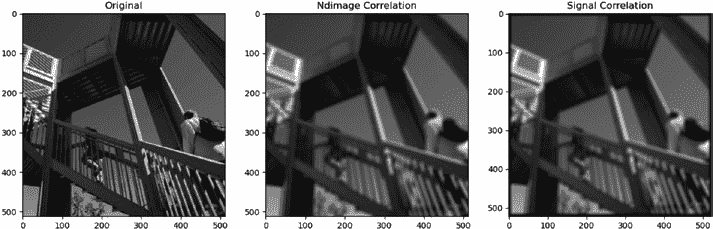
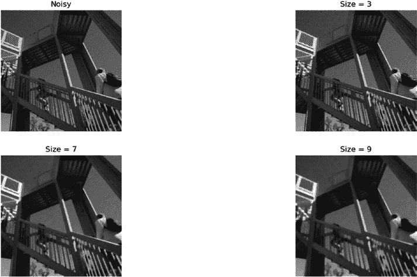
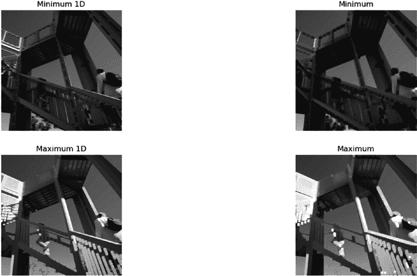
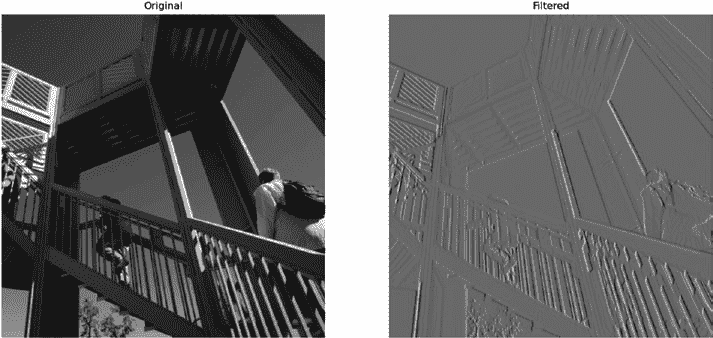
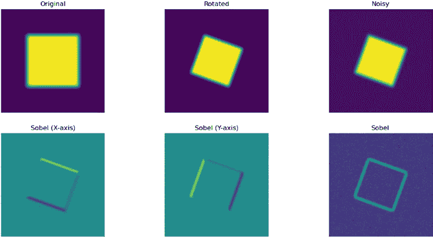
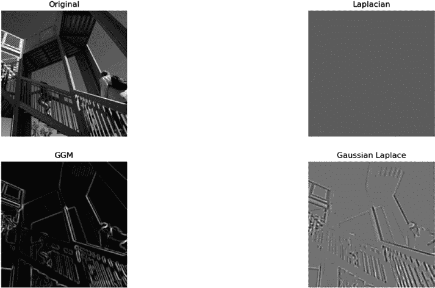
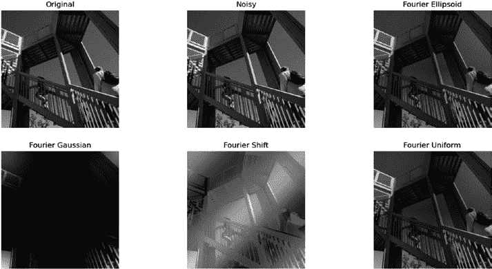

# 第 8 章

# 滤波器

在上一章中，我们学习了 SciPy 库的`scipy.ndimage`模块中的功能。我们学习了如何对图像应用诸如`shift`和`zoom`之类的变换。我们还学习了如何获取图像的统计信息。我们了解了如何计算和绘制图像的直方图。

在第 [5](https://doi.org/10.1007/978-1-4842-8270-0_5) 章中，我们使用 Pillow 库学习了图像滤波器。在本章中，我们将详细研究这些滤波器背后的理论。我们还将了解图像处理中使用的滤波器类型和内核，以及这些滤波器的应用。

以下是本章涵盖的主题：

- 内核

- 低通滤波器

- 高通滤波器

- 傅里叶滤波器

学完本章后，我们将能够熟练使用 SciPy 滤波器及其应用。

© Ashwin Pajankar 2022

A. Pajankar，`树莓派图像处理编程`，

[`doi.org/10.1007/978-1-4842-8270-0_8`](https://doi.org/10.1007/978-1-4842-8270-0_8#DOI)

## 第 8 章 滤波器

### 内核、卷积和相关

内核（也称为卷积矩阵或掩膜）是用于执行图像处理的二维矩阵。我们可以将内核用于卷积和相关等操作。

卷积将矩阵的每个元素与其局部邻居相加，并由内核加权。根据所使用的内核，卷积可以产生多种结果，例如模糊、锐化、浮雕和边缘检测。

在对矩阵使用卷积时，我们可以使用各种技术来处理边缘，例如扩展、包裹、镜像、裁剪、内核裁剪、常量以及避免重叠。

让我们演示对一维和二维矩阵的`convolve1d()`和`convolve()`函数，如清单 8-1 所示。

***清单 8-1.*** `prog00.py`

```python
import scipy.ndimage as ndi
import numpy as np

print(ndi.convolve1d([0, 1, 2, 3, 4, 5, 6],
                     weights=[1, 2, 3]))

a = np.array([[0, 1, 2, 3],
              [4, 5, 6, 7],
              [8, 9, 10, 11],
              [12, 13, 14, 15]])

k = np.array([[0 ,1, 0],[1, 1, 1],[0, 1, 0]])

print(ndi.convolve(a, k, mode='nearest'))
```

输出如下：

```
[ 1  4 10 16 22 28 33]
[[ 5  9 14 18]
 [21 25 30 34]
 [41 45 50 54]
 [57 61 66 70]]
```

我们也可以将卷积操作应用于图像矩阵。网址为 [`setosa.io/ev/image-kernels`](https://setosa.io/ev/image-kernels) 的教程讨论了各种内核及其对图像的影响。我们可以使用 SciPy 的`signal`模块中的`convolve2d()`函数。清单 8-2 提供了一个演示。

***清单 8-2.*** `prog01.py`

```python
import scipy.ndimage as ndi
import scipy.signal
import numpy as np
import scipy.misc as misc
import matplotlib.pyplot as plt

img = misc.ascent()
k = np.ones((11, 11), np.uint8)/121

c1 = ndi.convolve(img, k, mode='nearest')
c2 = scipy.signal.convolve2d(img, k)

print(c1)
print(c2)

plt.subplot(1, 3, 1)
plt.imshow(img, cmap='gray')
plt.title('Original')

plt.subplot(1, 3, 2)
plt.imshow(c1, cmap='gray')
plt.title('Ndimage Convolution')

plt.subplot(1, 3, 3)
plt.imshow(c2, cmap='gray')
plt.title('Signal Convolution')

plt.show()
```

它生成的输出如图 8-1 所示。


***图 8-1.*** 卷积演示

卷积是通过组合两个输入生成单个输出的一种数学方式。相关比较两个信号。清单 8-3 是对相关操作的演示。

***清单 8-3.*** `prog02.py`

```python
import scipy.ndimage as ndi
import numpy as np

print(ndi.correlate1d([0, 1, 2, 3, 4, 5, 6], weights=[1, 2, 3]))

a = np.array([[0, 1, 2, 3],
              [4, 5, 6, 7],
              [8, 9, 10, 11],
              [12, 13, 14, 15]])

k = np.array([[0, 1, 0],
              [1, 1, 1],
              [0, 1, 0]])

print(ndi.correlate(a, k, mode='nearest'))
```

输出如下：

```
[ 3 8 14 20 26 32 35]
[[ 5 9 14 18]
 [21 25 30 34]
 [41 45 50 54]
 [57 61 66 70]]
```

# 第 8 章 滤波器

让我们将相关运算应用于图像。我们将（与列表 8-2 类似）使用两种不同的方法计算相关，如列表 8-4 所示。

***列表 8-4.*** `prog03.py`

```python
import scipy.ndimage as ndi
import scipy.signal
import numpy as np
import scipy.misc as misc
import matplotlib.pyplot as plt

img = misc.ascent()
k = np.ones((11, 11), np.uint8) / 121

c1 = ndi.correlate(img, k, mode='nearest')
c2 = scipy.signal.correlate2d(img, k)

print(c1)
print(c2)

plt.subplot(1, 3, 1)
plt.imshow(img, cmap='gray')
plt.title('原始图像')

plt.subplot(1, 3, 2)
plt.imshow(c1, cmap='gray')
plt.title('Ndimage 相关')

plt.subplot(1, 3, 3)
plt.imshow(c2, cmap='gray')
plt.title('Signal 相关')

plt.show()
```

输出如图 8-2 所示。



# 第 8 章 滤波器

***图 8-2.** *相关演示*

## 低通滤波器

我们可以使用各种核与卷积运算来创建滤波器。滤波器用于增强图像或对图像执行操作。从信号（或图像，就此而言）中移除高频数据的滤波器称为`低通滤波器`。低通滤波器有许多应用。我们现在就来了解一下。

### 模糊

我们可以使用模糊核对图像进行模糊处理。SciPy 提供了许多使用模糊核进行卷积的例程。列表 8-5 演示了将高斯滤波器应用于图像。

***列表 8-5.*** `prog04.py`

```python
import scipy.misc as misc
import scipy.ndimage as ndi
import matplotlib.pyplot as plt

img = misc.face()

output1 = ndi.gaussian_filter(img, sigma=3)
output2 = ndi.gaussian_filter(img, sigma=5)
output3 = ndi.gaussian_filter(img, sigma=7)

output = [output1, output2, output3]
titles = ['Sigma = 3', 'Sigma = 5', 'Sigma = 7']

for i in range(3):
    plt.subplot(1, 3, i + 1)
    plt.imshow(output[i], cmap='gray')
    plt.title(titles[i])
    plt.axis('off')

plt.show()
```

高斯滤波器的例程接受图像和 `sigma` 的值。输出如图 8-3 所示。

***图 8-3.** *高斯滤波器演示*

均匀滤波器会将像素的值替换为以该像素为中心的一个区域的平均值。我们来看一个均匀滤波器，如列表 8-6 所示。

***列表 8-6.*** `prog05.py`

```python
import scipy.misc as misc
import scipy.ndimage as ndi
import matplotlib.pyplot as plt

img = misc.face()

output1 = ndi.uniform_filter(img, size=19)
output2 = ndi.uniform_filter(img, size=25)
output3 = ndi.uniform_filter(img, size=31)

output = [output1, output2, output3]
titles = ['尺寸 = 19', '尺寸 = 25', '尺寸 = 31']

for i in range(3):
    plt.subplot(1, 3, i + 1)
    plt.imshow(output[i], cmap='gray')
    plt.title(titles[i])
    plt.axis('off')

plt.show()
```

均匀滤波器的例程接受图像和滤波器的大小。输出如图 8-4 所示。

***图 8-4.** *均匀滤波器演示*

我们还可以使用一维高斯滤波器，如列表 8-7 所示。

***列表 8-7.*** `prog06.py`

```python
import scipy.misc as misc
import scipy.ndimage as ndi
import matplotlib.pyplot as plt

img = misc.ascent()

y3 = ndi.gaussian_filter1d(img, sigma=3)
y6 = ndi.gaussian_filter1d(img, sigma=6)

plt.subplot(1, 3, 1)
plt.imshow(img, cmap='gray')
plt.title('原始图像')

plt.subplot(1, 3, 2)
plt.imshow(y3, cmap='gray')
plt.title('Sigma = 3')

plt.subplot(1, 3, 3)
plt.imshow(y6, cmap='gray')
plt.title('Sigma = 6')

plt.show()
```

一维高斯滤波例程接受图像和`Sigma`值。输出如图 8-5 所示。

***图 8-5.** 一维高斯滤波器示例*

我们甚至可以像清单 8-8 所示对图像应用一维均匀滤波。

***清单 8-8.*** `prog07.py`

```python
import scipy.misc as misc
import scipy.ndimage as ndi
import matplotlib.pyplot as plt

img = misc.ascent()
y9 = ndi.uniform_filter1d(img, size=9)
y12 = ndi.uniform_filter1d(img, size=12)

plt.subplot(1, 3, 1)
plt.imshow(img, cmap='gray')
plt.title('Original Image')

plt.subplot(1, 3, 2)
plt.imshow(y9, cmap='gray')
plt.title('Size = 9')

plt.subplot(1, 3, 3)
plt.imshow(y12, cmap='gray')
plt.title('Size = 12')

plt.show()
```

一维均匀滤波例程接受图像和滤波器的大小。输出如图 8-6 所示。

***图 8-6.** 一维均匀滤波器示例*

百分位滤波器计算邻域像素的`n`百分位值，并将其应用于中心像素。我们可以像清单 8-9 所示对图像应用百分位滤波器。

***清单 8-9.*** `prog08.py`

```python
import scipy.misc as misc
import scipy.ndimage as ndi
import matplotlib.pyplot as plt

img = misc.ascent()
out1 = ndi.percentile_filter(img, size=10,
                             percentile=10)
out2 = ndi.percentile_filter(img, size=45,
                             percentile=65)

plt.subplot(1, 3, 1)
plt.imshow(img, cmap='gray')
plt.title('Original Image')

plt.subplot(1, 3, 2)
plt.imshow(out1, cmap='gray')
plt.title('percentile=10')

plt.subplot(1, 3, 3)
plt.imshow(out2, cmap='gray')
plt.title('percentile=65')

plt.show()
```

输出如图 8-7 所示。

***图 8-7.** 百分位滤波器示例*

秩滤波器是非线性滤波器。秩滤波器使用局部灰度排序来计算输出。我们甚至可以像清单 8-10 所示对图像应用秩滤波器。

***清单 8-10.*** `prog09.py`

```python
import scipy.misc as misc
import scipy.ndimage as ndi
import matplotlib.pyplot as plt

img = misc.ascent()
out1 = ndi.rank_filter(img, size=10, rank=10)
out2 = ndi.rank_filter(img, size=45, rank=65)

plt.subplot(1, 3, 1)
plt.imshow(img, cmap='gray')
plt.title('Original Image')

plt.subplot(1, 3, 2)
plt.imshow(out1, cmap='gray')
plt.title('rank=10')

plt.subplot(1, 3, 3)
plt.imshow(out2, cmap='gray')
plt.title('rank=65')

plt.show()
```

输出如图 8-8 所示。

***图 8-8.** 秩滤波器示例*

## 噪声降低

我们可以使用低通滤波器来降噪。在接下来的两个示例（清单 8-11 和清单 8-12）中，我们将使用`NumPy`例程创建人工噪声并将其添加到测试图像中。清单 8-11 展示了如何使用高斯滤波器降噪。

***清单 8-11.*** `prog10.py`

# 第 8 章 滤波器

## 高斯滤波器

```python
import scipy.misc as misc
import scipy.ndimage as ndi
import numpy as np
import matplotlib.pyplot as plt

img = misc.ascent()
noisy = img + 0.8 * img.std() * np.random.random(img.shape)

output1 = ndi.gaussian_filter(noisy, sigma=1)
output2 = ndi.gaussian_filter(noisy, sigma=3)
output3 = ndi.gaussian_filter(noisy, sigma=5)

output = [noisy, output1, output2, output3]
titles = ['Noisy', 'Sigma = 1', 'Sigma = 3', 'Sigma = 5']

for i in range(4):
    plt.subplot(2, 2, i+1)
    plt.imshow(output[i], cmap='gray')
    print(output[i])
    plt.title(titles[i])
    plt.axis('off')

plt.show()
```

输出如图 8-9 所示。

图 8-9. 用于降噪的高斯滤波器

## 中值滤波器

类似地，我们可以如清单 8-12 所示，对噪声图像应用中值滤波器。

### 清单 8-12.`prog11.py`

```python
import scipy.misc as misc
import scipy.ndimage as ndi
import numpy as np
import matplotlib.pyplot as plt

img = misc.ascent()

noisy = img + 0.8 * img.std() * np.random.random(img.shape)

output1 = ndi.median_filter(noisy, 3)

output2 = ndi.median_filter(noisy, 7)

output3 = ndi.median_filter(noisy, 9)

output = [noisy, output1, output2, output3]

titles = ['Noisy', 'Size = 3', 'Size = 7', 'Size = 9']

for i in range(4):
    plt.subplot(2, 2, i+1)
    plt.imshow(output[i], cmap='gray')
    plt.title(titles[i])
    plt.axis('off')

plt.show()
```



输出结果如图 8-10 所示。

图 8-10. 用于降噪的中值滤波器

## 最小和最大滤波器

如代码清单 8-13 所示，最小滤波器和最大滤波器也可应用于含噪图像。

### 代码清单 8-13.`prog12.py`

```python
import scipy.misc as misc
import scipy.ndimage as ndi
import numpy as np
import matplotlib.pyplot as plt

img = misc.ascent()

output1 = ndi.minimum_filter1d(img, 9)
output2 = ndi.minimum_filter(img, 9)
output3 = ndi.maximum_filter1d(img, 9)
output4 = ndi.maximum_filter(img, 9)

output = [output1, output2, output3, output4]
titles = ['Minimum 1D', 'Minimum', 'Maximum 1D', 'Maximum']

for i in range(4):
    plt.subplot(2, 2, i+1)
    plt.imshow(output[i], cmap='gray')
    plt.title(titles[i])
    plt.axis('off')

plt.show()
```

输出结果如图 8-11 所示。



图 8-11. 最小和最大滤波器

## 高通滤波器

**高通滤波器**的工作原理与低通滤波器完全相反。它们允许高频信号通过。它们也使用核和卷积。然而，高通滤波器使用的核与低通滤波器不同。当我们将高通滤波器应用于图像时，它会使图像锐化（与模糊相反），并突出边缘。

代码清单 8-14 演示了用于检测测试图像边缘的 Prewitt 滤波器。

### 代码清单 8-14.`prog13.py`

```python
import scipy.misc as misc
import scipy.ndimage as ndi
import matplotlib.pyplot as plt

img = misc.ascent()
filtered = ndi.prewitt(img)

output = [img, filtered]
titles = ['Original', 'Filtered']

for i in range(2):
    plt.subplot(1, 2, i+1)
    plt.imshow(output[i], cmap='gray')
    plt.title(titles[i])
    plt.axis('off')

plt.show()
```



输出结果如图 8-12 所示。

图 8-12. Prewitt 滤波器

我们可以在图 8-12 中看到被突出显示的边缘。

我们还可以分别对单个轴以及整个图像应用 Sobel 滤波器。它将检测水平边缘、垂直边缘以及两个轴上的边缘。代码清单 8-15 生成一个测试图像并应用 Sobel 滤波器。

### 代码清单 8-15.`prog14.py`

```python
import numpy as np
import scipy.ndimage as ndi
import matplotlib.pyplot as plt

img = np.zeros((516, 516))
img[128:-128, 128:-128] = 1
img = ndi.gaussian_filter(img, 8)
rotated = ndi.rotate(img, -20)
noisy = rotated + 0.09 * np.random.random(rotated.shape)

sx = ndi.sobel(noisy, axis=0)
sy = ndi.sobel(noisy, axis=1)
sob = np.hypot(sx, sy)

titles = ['Original', 'Rotated', 'Noisy',
          'Sobel (X-axis)', 'Sobel (Y-axis)', 'Sobel']
output = [img, rotated, noisy, sx, sy, sob]

for i in range(6):
    plt.subplot(2, 3, i+1)
    plt.imshow(output[i])
    plt.title(titles[i])
    plt.axis('off')

plt.show()
```



输出结果如图 8-13 所示。

图 8-13. Sobel 滤波器

最后，代码清单 8-16 演示了拉普拉斯算子、高斯梯度幅值和高斯-拉普拉斯滤波器。

### 代码清单 8-16.`prog15.py`

```python
import scipy.misc as misc
import scipy.ndimage as ndi
import matplotlib.pyplot as plt

img = misc.ascent()

output1 = ndi.laplace(img)
output2 = ndi.gaussian_gradient_magnitude(img, sigma=3)
output3 = ndi.gaussian_laplace(img, sigma=3)

titles = ['Original', 'Laplacian', 'GGM', 'Gaussian Laplace']
output = [img, output1, output2, output3]

for i in range(4):
```



# 第 8 章 滤波器

`plt.subplot(2, 2, i+1)`

```
plt.imshow(output[i],
cmap='gray')
plt.title(titles[i])
plt.axis('off')
plt.show()
```

输出结果如图 8-14 所示。

**图 8-14.** 拉普拉斯算子、高斯梯度幅值和高斯拉普拉斯滤波器

## 傅里叶滤波器

傅里叶滤波器在频域中工作。它们计算图像的傅里叶变换，操纵频率，最后计算逆傅里叶变换以生成最终输出。我们可以对图像应用各种傅里叶滤波器，如代码清单 8-17 所示。

**代码清单 8-17.** `prog16.py`

```
import scipy.ndimage as ndi
import scipy.misc as misc
import matplotlib.pyplot as plt
import numpy as np

img = misc.ascent()
noisy = img + 0.09 * img.std() * np.random.random(img.shape)

fe = ndi.fourier_ellipsoid(img, 1)
fg = ndi.fourier_gaussian(img, 1)
fs = ndi.fourier_shift(img, 1)
fu = ndi.fourier_uniform(img, 1)

titles = ['Original', 'Noisy',
'Fourier Ellipsoid', 'Fourier Gaussian',
'Fourier Shift', 'Fourier Uniform']

output = [img, noisy, fe, fg, fs, fu]

for i in range(6):
    plt.subplot(2, 3, i+1)
    plt.imshow(np.float64(output[i]), cmap='gray')
    plt.title(titles[i])
    plt.axis('off')
    plt.show()
```

输出结果如图 8-15 所示。



**图 8-15.** 各种傅里叶滤波器

## 本章小结

本章我们介绍了种类繁多的滤波器。我们了解了它们的类型，并探讨了其应用。图像滤波这一主题过于庞大，无法在一章内完全探讨。

下一章，我们将介绍形态学算子、图像阈值分割和基础图像分割。
