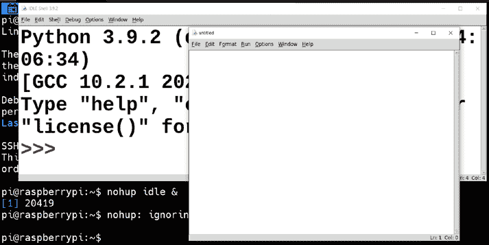
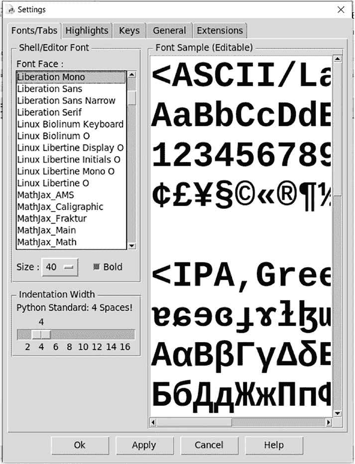
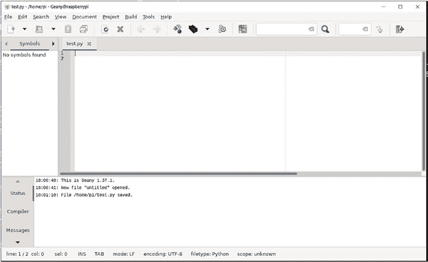
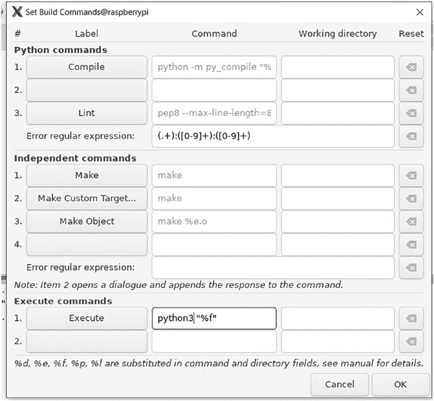
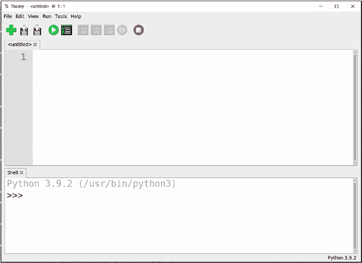

# Python 简介

由于其简单且类似英语的语法，`Python` 非常容易学习。这是它被作为第一门编程语言教授给学习入门编程课程的高中生和大学生的主要原因。整整一代新的程序员正在将 `Python` 作为他们的第一门编程语言来学习。

## 易于阅读

与其他高级编程语言不同，`Python` 不会混淆代码并使其难以阅读。与其他编程语言编写的代码相比，`Python` 代码类似英语的结构使其更容易阅读。这使得它比 `C` 和 `C++` 等其他高级语言更容易理解和学习。

## 易于维护

由于 `Python` 代码易于阅读、理解和学习，任何维护代码的人都能很快熟悉代码库。我可以从我个人维护和增强用 `Bash` 和 `Python 2` 编写的大型遗留代码库的经验来证明这一点。

## 开源

`Python` 是一个开源项目，这意味着其源代码是免费提供的。您可以对其进行修改以满足您的需求，并在您的应用程序中使用原始代码和修改后的代码。

## 高级语言

在编写 `Python` 程序时，您无需管理内存管理、CPU 时序和调度进程等底层细节。所有这些任务都由 `Python` 解释器管理。您可以直接使用易于理解的类似英语的语法编写代码。

## 可移植性

`Python` 解释器已被移植到许多操作系统平台。`Python` 代码也是可移植的。如果您小心避免与系统相关的编码，所有 `Python` 程序都将在受支持的平台上运行，而无需进行太多更改。

您可以在 `GNU/Linux`、`Windows`、`Android`、`FreeBSD`、`Mac OS`、`iOS`、`Solaris`、`OS/2`、`Amiga`、`Palm OS`、`QNX`、`VMS`、`AROS`、`AS/400`、`BeOS`、`OS/390`、`z/OS`、`Psion`、`Acorn`、`PlayStation`、`Sharp Zaurus`、`RISC OS`、`VxWorks`、`Windows CE` 和 `PocketPC` 上使用 `Python`。

## 解释型语言

`Python` 是一种解释型语言。让我们看看这意味着什么。用 `C`、`C++` 和 `Java` 等高级编程语言编写的程序首先会被编译。这意味着它们首先被转换成一种中间格式。当我们运行程序时，这个中间格式由链接器/加载器从辅助存储器（即硬盘）加载到内存（`RAM`）中。

因此，`C`、`C++` 和 `Java` 有单独的编译器和链接器/加载器。`Python` 则不是这样。`Python` 直接从源代码运行程序。您无需费心编译和链接到合适的库。这使得 `Python` 程序真正可移植，因为您可以将程序从一台计算机复制到另一台计算机，只要目标计算机上安装了必要的库，程序就能正常运行。

## 面向对象

`Python` 支持面向过程编程以及面向对象编程范式。

所有面向对象的编程范式都在 `Python` 中实现。在面向对象的编程语言中，程序是围绕结合数据和相关功能的对象构建的。`Python` 是一种非常简单但功能强大的面向对象编程语言。

## 可扩展性

`Python` 的一个特性是您可以从 `Python` 程序中调用 `C` 和 `C++` 例程。如果您希望应用程序的核心功能运行得更快，您可以用 `C/C++` 编写该部分并在 `Python` 程序中调用它（`C/C++` 程序通常比 `Python` 程序运行得更快）。

## 丰富的库

`Python` 拥有一个预安装的庞大标准库。该标准库包含现代编程语言所需的所有基本功能。它提供了用于数据库、单元测试（我们将在本书后面探讨这一点）、正则表达式、多线程、网络编程、计算机图形学、图像处理、`GUI` 等内容。

其他实用工具。这是 `Python`“自带电池”理念的一部分。

除了标准库之外，`Python` 还拥有数量庞大且不断增长的第三方库集合。这些库的列表可以在 `Python` 包索引上找到。

## 健壮性

`Python` 通过错误处理能力提供了健壮性。遇到错误时，会提供完整的堆栈跟踪信息，这能让程序员的工作更轻松。运行时错误被称为异常。处理这些错误的功能被称为异常处理机制。

## 快速原型开发

`Python` 被用作快速原型开发工具。如你所知，`Python` 拥有丰富的库并且易于学习，这促使许多软件架构师将其用作工具，快速将他们的想法原型化为可运行的模型。

## 内存管理

在汇编语言以及 `C` 和 `C++` 等编程语言中，内存管理是程序员的责任。这除了手头的任务之外，还增加了额外的负担，给程序员带来了不必要的压力。而在 `Python` 中，`Python` 解释器负责内存管理。这有助于程序员避开内存问题，专注于手头的任务。

## 功能强大

`Python` 拥有现代编程语言所需的一切。它被应用于计算机视觉、超级计算、药物发现、科学计算、模拟和生物信息学等应用程序中。全球有数百万程序员使用 `Python`。许多大型组织，如 `NASA`、`Google`、`SpaceX` 和 `Cisco`，都在其应用程序和基础设施中使用 `Python`。

## 社区支持

我发现这是 `Python` 最吸引人的特性。回想一下，`Python` 是开源的。它还有一个由全球近百万程序员组成的社区（可能更多，因为如今高中生也在学习 `Python`）。互联网上也有大量的论坛来支持遇到障碍的程序员。我所有与 `Python` 相关的问题都从未得不到解答。

## Python 3

`Python 3` 于 2008 年发布。`Python` 开发团队决定摒弃 `Python` 中一些冗余的特性，简化更多功能，修正一些设计缺陷，并添加一些亟需的功能。

他们决定为此需要一个主版本号变更，并且最终的版本将不向后兼容。`Python 2.x` 和 `3.x` 应该并行存在，以便程序员社区有足够的时间将他们的代码和第三方库从 `2.x` 迁移到 `3.x`。在大多数情况下，`Python 2.x` 代码无法直接运行，因为 `2.x` 和 `3.x` 之间存在显著差异。

## Raspberry Pi OS 上的 Python 2 和 Python 3

`Raspberry Pi OS` 是 `Debian Linux` 的一个衍生版本。`Raspberry Pi OS` 中预装了 `Python 2` 和 `Python 3` 解释器。可以通过在终端中运行命令 `python` 来调用 `Python 2` 解释器。可以通过在终端中运行命令 `python3` 来调用 `Python 3` 解释器。我们可以通过运行以下任一命令来检查 `Python 3` 解释器的版本：

```
python3 -V
python --version
```

你可以通过运行以下命令来检查 `Python 3` 二进制文件的位置：

```
which python3
```

## 运行 Python 程序与 Python 模式

你已经为 `Python` 编程设置好了环境，那么让我们开始学习 `Python` 的一些基本概念。`Python` 有两种模式——交互模式和脚本模式。让我们详细了解一下这两种模式。

### 交互模式

`Python` 的交互模式是一个命令行 shell。它为每个执行的语句提供即时输出。它还会将先前执行语句的输出存储在活动内存中。当 `Python` 解释器执行新语句时，在评估当前输出时会考虑整个先前执行的语句序列。我们必须在终端中输入命令 `python3` 来将 `Python 3` 解释器调用到交互模式，如下所示：

```
pi@raspberrypi:~ $ python3
Python 3.4.2 (default, Oct 19 2014, 13:31:11)
[GCC 4.9.1] on linux
Type "help", "copyright", "credits" or "license" for more information.
>>>
```

你可以直接在此交互模式下执行 `Python` 语句，就像从操作系统 shell/控制台运行命令一样，如下所示：

```
>>>print ('Hello World!')
Hello World!
>>>
```

本书不会使用交互模式。但是请记住它，因为这是检查小段代码（五到十行）最快的方法。我们可以使用 `exit()` 语句退出交互模式，如下所示：

```
>>> exit()
pi@raspberrypi:~ $
```

### 脚本模式

脚本模式是指 `Python` 脚本文件（`.py`）由 `Python` 解释器执行的模式。

创建一个名为 `test.py` 的文件，并将 `print ('Hello World!')` 语句添加到文件中。保存文件，并使用 `Python 3` 解释器运行它，如下所示：

```
pi@raspberrypi:~ $ python3 test.py
Hello World!
pi@raspberrypi:~ $
```

在这个例子中，`python3` 是解释器，`test.py` 是文件名。如果 `test.py` 文件不在我们调用 `python3` 解释器的同一目录中，我们必须提供 `Python` 文件的绝对路径。

## Python 的 IDE

集成开发环境（`IDE`）是一个软件套件，包含了编写和测试程序所需的所有基本工具。一个典型的 `IDE` 包含编译器、调试器、代码编辑器和构建自动化工具。大多数编程语言都有各种 `IDE` 来改善程序员的生活。`Python` 也有很多 `IDE`。让我们看看其中的几个。

### IDLE

# IDLE 与 Geany 编辑器

IDLE 代表集成开发环境（Integrated DeveLopment Environment）。我们需要在 Raspberry Pi OS 上安装它。IDLE3 适用于 Python 3。它在 Python 初学者中很受欢迎。我们可以使用以下命令安装它：

```
pip3 install idle
```

我们可以使用以下命令启动 IDLE3：

```
nohup idle &
```

图 2-1 显示了 IDLE3 代码编辑器和交互式提示符。



**图 2-1.** Python 3 解释器的 IDLE3 交互式提示符和一个新的代码文件

我们可以转到主菜单中的 Options ➤ Configure IDLE。我们可以在此处更改编辑器的设置（图 2-2）。



**图 2-2.** IDLE3 配置选项



## Geany

Geany 是一个使用 GTK+ 工具包的文本编辑器，具有集成开发环境的基本功能。它支持多种文件类型和编程语言。它有一些不错的功能。请访问 [www.geany.org](https://www.geany.org) 了解更多详情。图 2-3 显示了 Geany 文本编辑器窗口。

**图 2-3.** Geany IDE

在代码编辑器中输入 `print("Hello World!")`，并将文件保存为 `/home/pi` 目录下的 `test.py`。单击菜单栏中的 Build，然后选择 Execute。你也可以使用 F5 键盘快捷键来执行程序。程序将在终端窗口中执行。你需要按 Enter 键来关闭执行窗口。Geany 的默认 Python 解释器是 Python 2。我们需要将其更改为 Python 3。为此，请转到 Build ➤ Set Build Commands。将会出现如图 2-4 所示的窗口。



**图 2-4.** Set Build Commands 窗口

在 Set Build Commands 窗口中，在 Execute Commands 部分，将 `python "%f"`（如图 2-4 方框中高亮所示）更改为 `python3 "%f"`，以将 Python 3 解释器设为默认解释器。

之后，重新运行程序以验证一切工作正常。



---

# 第 2 章 Python 与数字图像处理入门

## Thonny IDE

最新版 Raspberry Pi OS 也预装了 Thonny IDE。它默认使用 Python 3（且仅支持 Python 3，因此我们无需更改设置）。我们可以通过以下命令启动它：

```
nohup thonny &
```

图 2-5 展示了 Thonny IDE 的截图。

**图 2-5.** Thonny IDE

---

## 数字图像处理简介

为了开始学习数字图像处理（DIP），我们将简要回顾一些相关主题的基本概念。

### 信号处理

任何携带信息的事物，当用数学方式表示时，被称为信号。从给定信号中提取有用且相关信息的过程或技术称为信号处理。执行此类任务的系统称为信号处理系统。

信号处理系统的最佳示例是人类大脑。它处理来自各种感官的多种类型的信号。人脑是一个生物信号处理系统。当系统由电子元件构成时，它被称为电子信号处理系统。信号处理是一门结合数学与电气工程的学科。

电子信号分为两种类型——模拟信号和数字信号。下表列出了这两种信号的区别。

| 模拟信号 | 数字信号 |
| :--- | :--- |
| 连续信号 | 本质上是离散的 |
| 用正弦波表示 | 用方波表示 |
| 连续信号 | 离散信号 |
| 因噪声而劣化 | 不受噪声影响 |
| 不灵活 | 灵活，可执行多种操作 |
| 消耗更少带宽 | 消耗大量带宽 |
| 功耗高 | 功耗低于模拟 |
| 在捕获、存储和传输中存在大量错误 | 错误较少，且有校验和与纠错算法可用 |

### 图像处理

图像是一种信号。因此，图像处理是信号处理的一种类型。图像处理系统是信号处理系统的一种。眼睛和大脑的组合是生物图像处理系统的一个例子。图像处理系统有两种类型——模拟和数字。

#### 模拟图像处理

静态和运动胶片相机的时代代表了模拟时代。模拟图像的来源是胶片相机（静态和运动）、老式传真机和电传机。老式电视系统、CRT 显示器和胶片放映机代表了模拟图像处理系统。模拟图像处理广泛涉及模拟电子系统、机械部件、光学器件和化学处理（用于显影和存储胶片）。

#### 数字图像处理

随着数字计算机、存储系统、图像传感器和数码相机的出现，图像可以以数字格式捕获、存储和处理。使用数字计算机从图像（包括模拟和数字图像）中处理和检索信息称为数字图像处理。它广泛涉及数字传感器（数码相机）、数字计算机和数字存储设备。以下是数字图像处理系统的一些应用：

*   计算机化图像编辑、校正、增强、去噪等。
*   医学图像处理与诊断辅助
*   太空图像处理（处理来自哈勃望远镜和地面望远镜的图像）
*   工业应用，如产品检测和分拣
*   生物识别技术（指纹、人脸和虹膜识别）
*   电影制作与视觉效果
*   遥感技术（处理航空和卫星图像）

以下科学学科与数字图像处理有显著重叠：

*   信号处理
*   数字电子技术
*   计算机/机器视觉
*   生物视觉
*   人工智能、模式识别和机器学习
*   机器人学与机器人视觉

## 使用树莓派和 Python 进行数字图像处理

由于数字图像处理需要数字计算机，我们必须借助计算机以及相应的编程平台来实现。

树莓派满足了数字图像处理对最小功耗系统的所有要求。它最吸引人的特点是成本低廉。此外，它还能与多种数字图像传感器（如网络摄像头和树莓派摄像头模块）进行连接。

我们了解到，Python 是一种易于学习的编程语言，它帮助我们专注于手头的任务，而无需过多担心语法问题。它也是树莓派最受欢迎的编程平台。Python 拥有许多第三方图像处理和可视化库。这使得树莓派和 Python 成为初学者入门数字图像处理最显而易见的选择。

## 练习题

完成以下练习，以更好地理解 Python 3 的背景知识。

*   访问并浏览 Python 主页 [www.python.org](http://www.python.org)。
*   访问并浏览 Python 文档页面 [docs.python.org/3/](https://docs.python.org/3/)。
*   在 [docs.python.org/3/whatsnew/index.html](https://docs.python.org/3/whatsnew/index.html) 查看 Python 最新版本的新特性。

## 本章总结

在本章中，我们了解了 Python 的背景、历史和特性。我们还学习了 Python 2.x 与 Python 3.x 之间的重要区别。我们学习了如何在脚本模式和解释器模式下使用 Python 3。我们介绍了几款流行的 Python IDE，并在树莓派上配置了适用于 Python 3 的 Geany。最后，我们学习了数字图像处理领域的相关知识。在下一章中，我们将开始学习 Python 中一个名为 Pillow 的流行数字图像处理库。我们还将学习如何使用 `Tkinter` 库来显示图像。

# 第 3 章：开始上手

在上一章中，我们学习了 Python 的设计理念，也了解了为什么应该使用 Python 3，以及一些与数字图像处理相关的概念。本章我们将探讨如何在树莓派上使用 Python 3 进行图像处理编程。我们将学习如何将树莓派连接到各种摄像头传感器以获取图像。我们将介绍 Python 3 中的 Pillow 和 Tkinter 库。以下是本章将要学习的主题列表：

*   图像来源
*   使用网络摄像头
*   树莓派摄像头模块
*   用于数字图像处理的 Python 3

在本章结束时，我们将能够熟练使用摄像头以及 `Pillow` 和 `Tkinter` 库。

## 图像来源

为了学习如何进行数字图像处理，我们需要数字图像。世界各地有一些标准的图像数据集可供使用；我们将使用来自以下数据库的几张免费图像：[sipi.usc.edu/database/](http://sipi.usc.edu/database/)。

---

© Ashwin Pajankar 2022

A. Pajankar，《树莓派图像处理编程》，

[doi.org/10.1007/978-1-4842-8270-0_3](https://doi.org/10.1007/978-1-4842-8270-0_3)

我们可以在 `[sipi.usc.edu/database/copyright.php](https://sipi.usc.edu/database/copyright.php)` 阅读这些图像的版权相关信息。