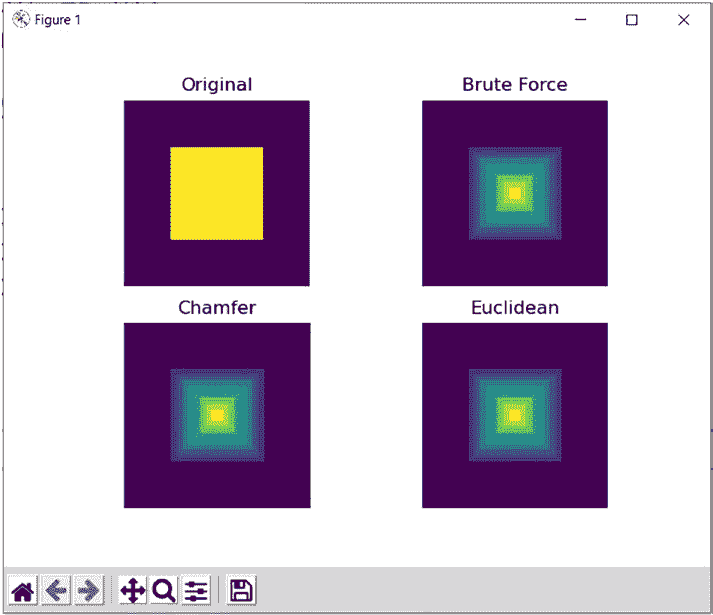
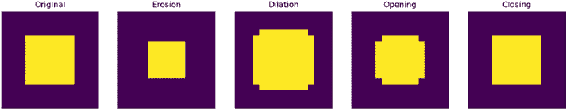
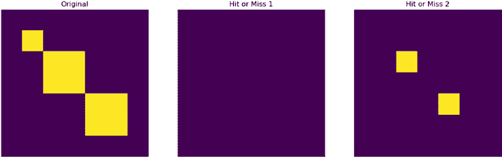
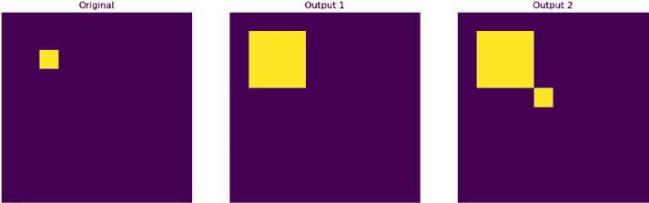
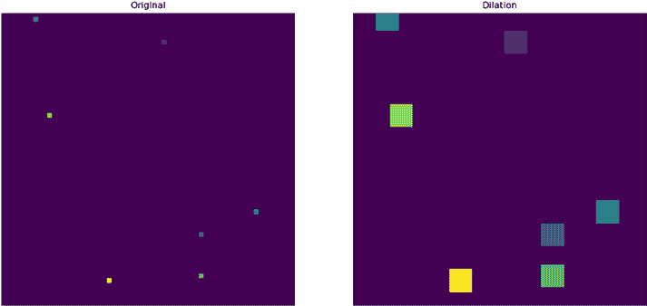
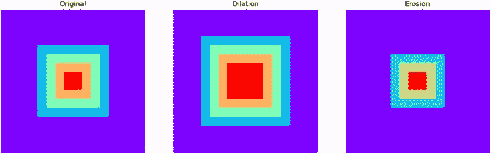

# 第 9 章

# 形态学、阈值分割与图像分割

在上一章中，我们研究了图像滤波器背后的原理，以及用于图像增强的滤波器类型和实际应用。

本章我们将学习并演示图像处理中的重要概念，例如形态学、图像的形态学操作、阈值分割和图像分割。我们将学习并演示以下内容：
*   距离变换
*   形态学与形态学操作
*   阈值分割与图像分割

## 距离变换

距离变换是对二值图像执行的一种操作。二值图像包含背景元素（零值——黑色）和前景元素（白色）。距离变换将每个前景元素替换为到背景的最短距离值。`scipy.ndimage` 提供了三种计算二值图像距离变换的方法。代码清单 9-1 中的代码演示了如何实际使用距离变换来生成测试图像。

***代码清单 9-1.*** `prog01.py`

```
import scipy.ndimage as ndi
import matplotlib.pyplot as plt
import numpy as np

img = np.zeros((32, 32))
img[8:-8, 8:-8] = 1

print(img)

dist1 = ndi.distance_transform_bf(img)
dist2 = ndi.distance_transform_cdt(img)
dist3 = ndi.distance_transform_edt(img)

output = [img, dist1, dist2, dist3]
titles = ['Original', 'Brute Force', 'Chamfer', 'Euclidean']

for i in range(4):
    print(output[i])
    plt.subplot(2, 2, i+1)
    plt.imshow(output[i],
    interpolation='nearest')
    plt.title(titles[i])
    plt.axis('off')
    plt.show()
```

代码清单 9-1 所示的代码分别使用暴力算法、倒角距离算法和欧几里得方法计算距离变换。我们将在本章中使用距离变换来生成测试图像。输出结果如图 9-1 所示。



# 第 9 章 形态学、阈值分割与图像分割

***图 9-1.** 距离变换*

# 形态学与形态学操作

形态学是研究形状与形式的学科。图像的形态学研究关注的是形状而非像素值。形态学操作通常在二值图像上执行。让我们了解几个与形态学操作相关的概念。

## 结构元素

结构元素是一个矩阵，用于与给定的二值图像进行交互。它有不同的形状，例如球形、环形或线形。它也可以有多种尺寸，如 3×3 或 7×7 的矩阵。较大的结构元素需要更多计算时间。一个简单的结构元素可以定义为奇数大小的单位矩阵，例如 `np.ones((3, 3))`。

## 二值形态学操作

让我们简要了解各种形态学操作。膨胀会使输入图像中的形状扩大。腐蚀会使输入图像中的形状收缩。开运算是先腐蚀后膨胀。闭运算是先膨胀后腐蚀。

仅仅通过阅读很难理解这些概念。请查看清单 9-2 中的示例，该示例在二值图像上演示了这些概念。

***清单 9-2.*** `prog02.py`

```python
import matplotlib.pyplot as plt
import scipy.ndimage as ndi
import numpy as np

img = np.zeros((16, 16))
img[4:-4, 4:-4] = 1
print(img)

erosion = ndi.binary_erosion(img).astype(img.dtype)
dilation = ndi.binary_dilation(img).astype(img.dtype)
opening = ndi.binary_opening(img).astype(img.dtype)
closing = ndi.binary_closing(img).astype(img.dtype)

output = [img, erosion, dilation, opening, closing]
titles = ['Original', 'Erosion', 'Dilation', 'Opening', 'Closing']

for i in range(5):
    print(output[i])
    plt.subplot(1, 5, i+1)
    plt.imshow(output[i], interpolation='nearest')
    plt.title(titles[i])
    plt.axis('off')

plt.show()
```

清单 9-2 中的代码示例生成一个二值图像，并对其应用所有二值形态学操作。输出结果如图 9-2 所示。

***图 9-2.** 对二值图像进行形态学操作*

另一个重要的操作是 `binary_fill_holes()`。它用于填充二值图像中的孔洞，如清单 9-3 所示。

***清单 9-3.*** `prog03.py`

```python
import matplotlib.pyplot as plt
import scipy.ndimage as ndi
import numpy as np

img = np.ones((32, 32))
x, y = (32 * np.random.random((2, 20))).astype(np.int)

img[x, y] = 0
noise_removed = ndi.binary_fill_holes(img).astype(int)

output = [img, noise_removed]
titles = ['Original', 'Noise Removed']

for i in range(2):
    print(output[i])
    plt.subplot(1, 2, i+1)
    plt.imshow(output[i], interpolation='nearest')
    plt.title(titles[i])
    plt.axis('off')

plt.show()
```

清单 9-3 中的代码生成一个 32×32 的方阵图像，所有值均为 1（白色值）。然后随机将几个像素设置为 0（黑色值）。这些黑色像素可以视为图像中的孔洞，随后可通过 `binary_fill_holes()` 去除。输出结果如图 9-3 所示。

***图 9-3.** 使用形态学操作去除噪声*

之前我们讨论过二值结构。现在让我们使用二值结构对图像应用形态学操作。清单 9-4 演示了这一点。

***清单 9-4.*** `prog04.py`

```python
import matplotlib.pyplot as plt
import scipy.ndimage as ndi
import numpy as np

img = np.zeros((16, 16))
img[4:-4, 4:-4] = 1

struct = ndi.generate_binary_structure(2, 1)
print(struct)

erosion = ndi.binary_erosion(img, struct).astype(img.dtype)
dilation = ndi.binary_dilation(img, struct).astype(img.dtype)
opening = ndi.binary_opening(img, struct).astype(img.dtype)
closing = ndi.binary_closing(img, struct).astype(img.dtype)

output = [img, erosion, dilation, opening, closing]
titles = ['原始图像', '腐蚀', '膨胀', '开运算', '闭运算']

for i in range(5):
    print(output[i])
    plt.subplot(1, 5, i+1)
    plt.imshow(output[i], interpolation='nearest')
    plt.title(titles[i])
    plt.axis('off')

plt.show()
```

输出结果如图 9-4 所示。



# 第九章 形态学、阈值处理与图像分割

`图 9-4.` 使用结构元素的形态学运算

我们可以分别执行带结构元素和不带结构元素的击中或击不中变换，如`代码清单 9-5`所示。

`代码清单 9-5. prog05.py`

```python
import matplotlib.pyplot as plt
import scipy.ndimage as ndi
import numpy as np

img = np.zeros((7, 7), dtype=int)
img[1, 1] = img[2:4, 2:4] = img[4:6, 4:6] = 1
struct = np.array([[1, 0, 0],
                   [0, 1, 1],
                   [0, 1, 1]])
print(struct)
hit_or_miss1 = ndi.binary_hit_or_miss(img).astype(int)
hit_or_miss2 = ndi.binary_hit_or_miss(img, structure1=struct).astype(int)
output = [img, hit_or_miss1, hit_or_miss2]
titles = ['原始图像', '击中或击不中 1', '击中或击不中 2']

for i in range(3):
    print(output[i])
    plt.subplot(1, 3, i+1)
```



# 第九章 形态学、阈值处理与图像分割

```python
plt.imshow(output[i], interpolation='nearest')
plt.title(titles[i])
plt.axis('off')

plt.show()
```
输出结果如图 9-5 所示。
`图 9-5.` 二值击中或击不中运算

我们甚至可以演示二值传播，如代码清单 9-6 所示。
`代码清单 9-6.` `prog06.py`

```python
import matplotlib.pyplot as plt
import scipy.ndimage as ndi
import numpy as np

n = 10
img = np.zeros((n, n), dtype=np.uint8)
img[2, 2] = 1
mask = np.zeros((n, n), dtype=np.uint8)
mask[1:4, 1:4] = mask[4, 4] = mask[6:8, 6:8] = 1
struct = np.ones((3, 3))
o1 = ndi.binary_propagation(img, mask=mask).astype(int)
```



# 第九章 形态学、阈值处理与图像分割

```python
o2 = ndi.binary_propagation(img, mask=mask, structure=struct).astype(int)
output = [img, o1, o2]
titles = ['原始图像', '输出 1', '输出 2']

for i in range(3):
    print(output[i])
    plt.subplot(1, 3, i+1)
    plt.imshow(output[i], interpolation='nearest')
    plt.title(titles[i])
    plt.axis('off')

plt.show()
```
输出结果如图 9-6 所示。

**图 9-6.** 二值传播

## 灰度形态学运算

存在一组灰度形态学运算。代码清单 9-7 所示的代码生成八个随机值，并将它们分配到完全黑暗（零值）背景的像素上。然后使用`grey_dilation()`方法对其进行膨胀操作。

# 第九章 形态学、阈值处理与图像分割

## 代码清单 9-7.`prog07.py`
```python
import matplotlib.pyplot as plt
import scipy.ndimage as ndi
import numpy as np

img = np.zeros((64, 64))
x, y = (63 * np.random.random((2, 8))).astype(np.int)
img[x, y] = np.arange(8)
dilation = ndi.grey_dilation(img, size=(5, 5), structure=np.ones((5, 5)))
output = [img, dilation]
titles = ['原始图像', '膨胀']

for i in range(2):
    print(output[i])
    plt.subplot(1, 2, i+1)
    plt.imshow(output[i], interpolation='nearest')
    plt.title(titles[i])
    plt.axis('off')

plt.show()
```

输出结果如图 9-7 所示。


# 第九章 形态学、阈值处理与图像分割

***图 9-7.** 灰度膨胀*

此处我们使用了一个 5x5 的结构元素。

**注意：** 此示例使用了 `random()` 方法。当您执行配套代码中的代码时，输出结果不会完全相同。

代码清单 9-8 所示的代码对距离变换应用了灰度膨胀和灰度腐蚀运算。

***代码清单 9-8.*** `prog08.py`

```python
import matplotlib.pyplot as plt
import scipy.ndimage as ndi
import numpy as np

img = np.zeros((16, 16))
img[4:-4, 4:-4] = 1
img = ndi.distance_transform_bf(img)
```



# 第九章 形态学、阈值处理与图像分割

```python
dilation = ndi.grey_dilation(img, size=(3, 3), structure=np.ones((3, 3)))
erosion = ndi.grey_erosion(img, size=(3, 3), structure=np.ones((3, 3)))
```

## 阈值与分割

这是本书的最后一部分，涉及图像处理最重要的应用之一：分割。在阈值操作中，你根据阈值将灰度图像转换为二值（黑白）图像。强度值大于阈值的像素被赋值为白色，强度值低于阈值的像素被赋值为黑色。这被称为二值阈值，是阈值和分割最基本的形式。示例如清单 9-9 所示。

**清单 9-9.** `prog09.py`

```python
import matplotlib.pyplot as plt
import scipy.misc as misc

img = misc.ascent()
thresh = img > 127
output = [img, thresh]
titles = ['Original', 'Thresholding']

for i in range(2):
    plt.subplot(1, 2, i+1)
    plt.imshow(output[i], cmap='gray')
    plt.title(titles[i])
    plt.axis('off')
plt.show()
```

清单 9-9 中的代码将阈值设置为 127。在灰度中，像素值 127 对应于灰色。生成的阈值化图像如图 9-9 所示。

**图 9-9.** 二值阈值

阈值是图像分割最基本的形式。图像分割是指根据某些属性（如像素颜色、区域的连通性等）将图像划分为多个区域。通过对阈值化图像应用形态学操作，你可以获得更好的图像分割结果（参见清单 9-10）。

**清单 9-10.** `prog10.py`

```python
import matplotlib.pyplot as plt
import scipy.misc as misc
import scipy.ndimage as ndi
import numpy as np

img = misc.ascent()
thresh = img > 127
dilated = ndi.binary_dilation(thresh, structure=np.ones((9, 9))).astype(int)
eroded = ndi.binary_erosion(dilated, structure=np.ones((9, 9))).astype(int)
output = [img, thresh, dilated, eroded]
titles = ['Original', 'Thresholding', 'Dilated', 'Eroded and Segmented']

for i in range(4):
    plt.subplot(2, 2, i+1)
    plt.imshow(output[i], cmap='gray')
    plt.title(titles[i])
    plt.axis('off')
plt.show()
```

输出结果如图 9-10 所示。

**图 9-10.** 阈值化和分割后的图像

顶帽变换提取图像中的小元素。我们可以计算白顶帽和黑顶帽，如清单 9-11 所示。

**清单 9-11.** `prog11.py`

```python
import matplotlib.pyplot as plt
import scipy.misc as misc
import scipy.ndimage as ndi

img = misc.ascent()
struct = ndi.generate_binary_structure(rank=2, connectivity=3)
o1 = ndi.black_tophat(input=img, structure=struct)
o2 = ndi.white_tophat(input=img, structure=struct)
output = [img, o1, o2]
titles = ['Original', 'Black Tophat', 'White Tophat']

for i in range(3):
    plt.subplot(1, 3, i+1)
    plt.imshow(output[i], cmap='gray')
    plt.title(titles[i])
    plt.axis('off')
plt.show()
```

输出结果如图 9-11 所示。

**图 9-11.** 黑顶帽和白顶帽

我们还可以对结构进行迭代，如清单 9-12 所示。

**清单 9-12.** `prog12.py`

```python
import scipy.ndimage as ndi

struct = ndi.generate_binary_structure(2, 1).astype(int)
print(struct)
print(ndi.iterate_structure(struct, 2).astype(int))
print(ndi.iterate_structure(struct, 3).astype(int))
```

输出如下：

```
[[0 1 0]
 [1 1 1]
 [0 1 0]]
[[0 0 1 0 0]
 [0 1 1 1 0]
 [1 1 1 1 1]
 [0 1 1 1 0]
 [0 0 1 0 0]]
[[0 0 0 1 0 0 0]
 [0 0 1 1 1 0 0]
 [0 1 1 1 1 1 0]
 [1 1 1 1 1 1 1]
 [0 1 1 1 1 1 0]
 [0 0 1 1 1 0 0]
 [0 0 0 1 0 0 0]]
```

我们还可以计算形态学梯度，如清单 9-13 所示。

**清单 9-13.** `prog13.py`

```python
import matplotlib.pyplot as plt
import scipy.misc as misc
import scipy.ndimage as ndi

img = misc.ascent()
o1 = ndi.morphological_gradient(img, size=(3, 3))
struct = ndi.generate_binary_structure(2, 1)
o2 = ndi.morphological_laplace(img, structure=struct)
output = [img, o1, o2]
titles = ['Original', 'M Gradient', 'M Laplace']

for i in range(3):
    plt.subplot(1, 3, i+1)
    plt.imshow(output[i], cmap='gray')
    plt.title(titles[i])
    plt.axis('off')
plt.show()
```

输出结果如图 9-12 所示。

**图 9-12.** 形态学梯度

## 总结

在本章中，我们学习了用于生成测试图像的**距离变换**。然后学习了形态学以及如何对图像使用形态学操作。形态学操作分为两种——**二值形态学**和**灰度形态学**。我们还研究了阈值化，这是最简单的图像分割形式。

在下一章，我们将研究和演示视频处理。
