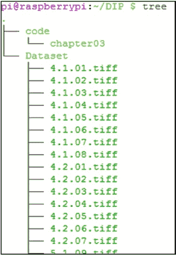
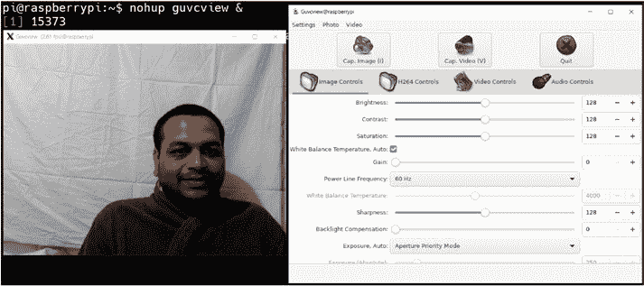
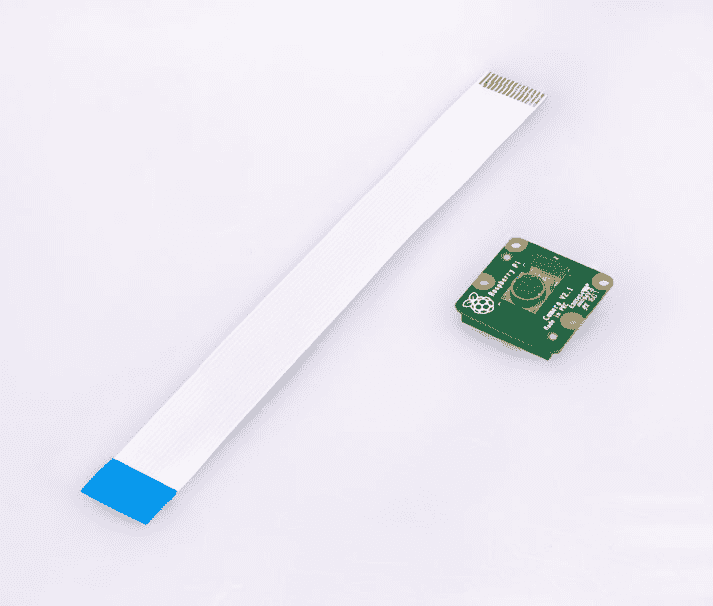
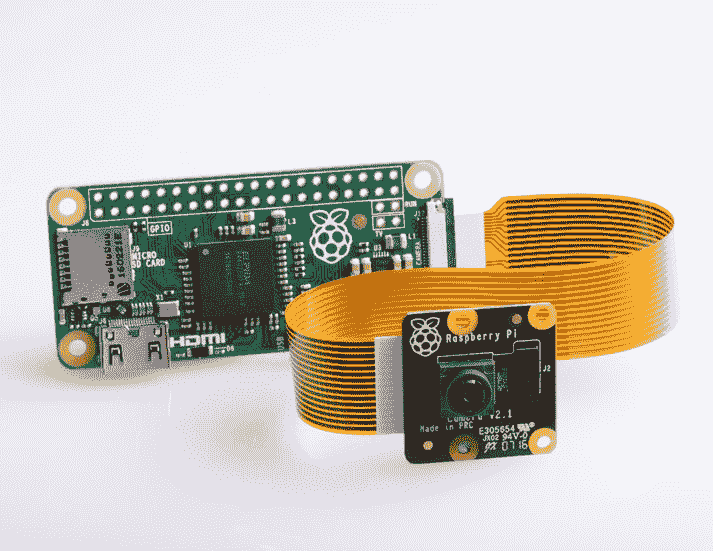
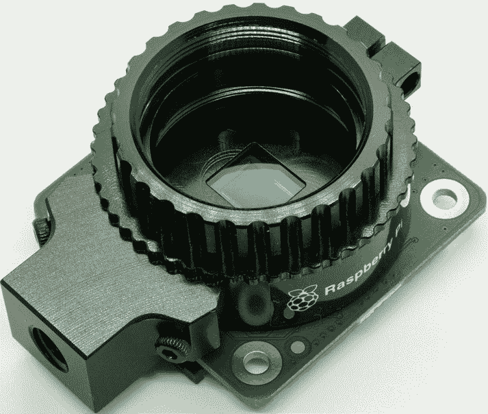
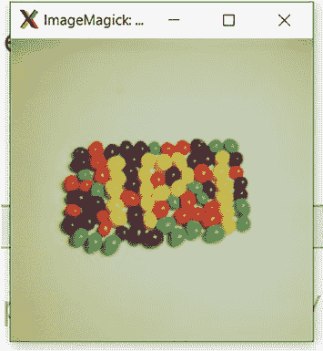
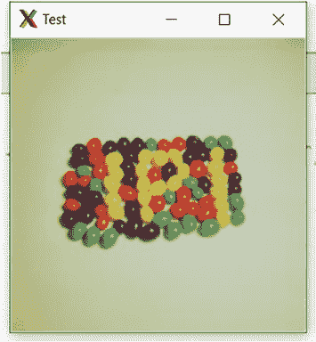

# 排版后的文档

我们将使用本书数据库中的图像文件 `4.1.07.tiff`、`4.1.08.tiff`、`gray21.512` 和 `ruler.512` 进行演示。

在本章中，我们将开始编程。我们需要将所有文件组织到一个目录中，并使用章节子目录保存代码。在终端中运行以下命令，为书籍代码和图像数据集创建目录结构：

```
mkdir DIP
cd DIP
mkdir code
mkdir dataset
cd code
mkdir chapter03
```

将所有图像解压到 `Dataset` 目录中。现在目录结构将如图 3-1 所示。



**图 3-1.** 数据集的目录组织结构

我们在 `DIP` 目录中使用 `tree` 命令查看目录结构。

> **注意**：如果尚未安装 `tree` 工具，请使用以下命令进行安装：
> ```
> sudo apt install tree
> ```

我们刚刚下载并解压的图像被用作全球数字图像处理和计算机视觉研究的标准图像。


## 使用网络摄像头

让我们看看如何使用标准 USB 网络摄像头捕获图像。树莓派 3 有四个 USB 端口，您可以使用其中一个连接网络摄像头。我使用的是罗技 c922 USB 网络摄像头（见图 3-2）。


**图 3-2.** 网技 c922¹

> **注意**：在购买网络摄像头之前，请检查其与树莓派的兼容性：http://elinux.org/RPi_USB_Webcams

¹ 图像由 Pmwiki1 根据 CC0 1.0 通用许可证（CC0 1.0）提供（https://creativecommons.org/publicdomain/zero/1.0/）

连接网络摄像头并在终端中运行 `lsusb` 命令。这将显示连接到计算机的所有 USB 设备列表。输出类似于以下内容：

```
pi@raspberrypi:~$ lsusb
Bus 002 Device 001: ID 1d6b:0003 Linux Foundation 3.0 root hub
Bus 001 Device 003: ID 046d:085c Logitech, Inc. C922 Pro Stream Webcam
Bus 001 Device 002: ID 2109:3431 VIA Labs, Inc. Hub
Bus 001 Device 001: ID 1d6b:0002 Linux Foundation 2.0 root hub
```

### `guvcview`

如果您能在输出中看到 USB 网络摄像头，说明摄像头已被检测到。有不少 Linux 工具可以用来通过网络摄像头捕获图像。如果您喜欢图形界面，`guvcview` 是其中之一。如果尚未安装，请使用以下命令安装：

```
sudo apt install guvcview
```

安装 `guvcview` 后，可以通过运行以下命令访问它：

```
nohup guvcview &
```

这将显示一个预览窗口和应用程序窗口，如图 3-3 所示。



**图 3-3.** `guvcview` 工具和摄像头预览窗口

如图 3-3 所示，它是一个多功能工具，提供了统一的界面，用于调整连接到树莓派主板的网络摄像头的属性。可以使用此工具捕获图像和视频。作为练习，请进一步探索此工具。

### `fswebcam`

另一个有用的工具是 `fswebcam`，它是一个命令行工具。使用以下命令安装：

```
sudo apt install fswebcam
```

您可以从终端调用 `fswebcam` 工具，使用网络摄像头捕获图像，如下所示：

```
fswebcam -r 1920x1080 --no-banner test.jpg
```

这将捕获分辨率为 `1920x1080` 像素的图像。`--no-banner` 标志会禁用图像上的时间戳横幅。图像保存为 `test.jpg`。命令的输出如下：

```
pi@raspberrypi:~$ fswebcam -r 1920x1080 --no-banner test.jpg
--- Opening /dev/video0...
Trying source module v4l2...
/dev/video0 opened.
No input was specified, using the first.
--- Capturing frame...
Captured frame in 0.00 seconds.
```

--- 正在处理捕获的图像...

禁用横幅。

将 JPEG 图像写入到 `'test.jpg'`。

然后，在当前目录下检查名为 `test.jpg` 的图像文件。

## Pi 摄像头模块

树莓派基金会为树莓派设计了专用的摄像头模块。有两个版本，每个版本都有普通型和 `NoIR`（无红外）两种变体。原始版本是 500 万像素的摄像头模块。新版本是 800 万像素的摄像头模块。

图 3-4 展示了摄像头模块 V2 的图像。



**第 3 章  开始上手**

***图 3-4.** Pi 摄像头模块 V22*

这是一个适用于普通光照条件的标准摄像头模块。

图 3-5 展示了适用于低光照条件的 NoIR 版本。关于它们的更多详细信息，请访问 [`www.raspberrypi.org/products/camera-module-v2`](https://www.raspberrypi.org/products/camera-module-v2)。该摄像头可通过专用的摄像头接口连接到任何型号的树莓派，如图 3-5 所示。

2 图像由树莓派基金会提供，遵循 CC-by-SA 4.0 许可协议 [(https://creativecommons.org/licenses/by-sa/4.0/deed.en)](https://creativecommons.org/licenses/by-sa/4.0/deed.en) 58



**第 3 章  开始上手**

***图 3-5.** 将 Pi 摄像头模块连接到 Pi33*

在图 3-5 中，NoIR 摄像头模块 V2 连接到了一块树莓派 Zero W 主板（这是树莓派家族中一款紧凑型主板型号）。Pi 摄像头模块直接连接到 GPU。由于它连接到 GPU，因此对 CPU 的影响很小，从而让 CPU 可以处理其他任务。Pi 摄像头与 USB 摄像头之间的区别在于，Pi 摄像头模块具有更高的性能水平和更高的帧率，并支持 h.264 视频编码。

树莓派基金会还生产了另一款高品质的摄像头模块，该模块具有可互换的 C 和 CS 安装座，用于安装镜头。该套件包括摄像头模块和 C 到 CS 安装座适配器。摄像头外观如图 3-6 所示。

3 图像由树莓派基金会提供，遵循 CC-by-SA 4.0 许可协议 [(https://creativecommons.org/licenses/by-sa/4.0/deed.en)](https://creativecommons.org/licenses/by-sa/4.0/deed.en) 59



**第 3 章  开始上手**

***图 3-6.** 高品质摄像头模块 4*

我们可以在产品页面上阅读更多关于该摄像头模块的信息，网址为 [`www.raspberrypi.com/products/raspberry-pi-high-quality-camera/`](https://www.raspberrypi.com/products/raspberry-pi-high-quality-camera/)。

4 图像由树莓派基金会提供，遵循 CC-by-SA 4.0 许可协议 [(https://creativecommons.org/licenses/by-sa/4.0/deed.en)](https://creativecommons.org/licenses/by-sa/4.0/deed.en) 60

## raspistill

我们用来通过摄像头模块捕获图像的命令行工具是 `raspistill`。我们按如下方式调用它：

```bash
raspistill -o test.png
```

`raspistill` 不会向控制台或终端写入任何内容，因此我们需要检查目录以查看是否已创建或更新了 `test.png`。

这就是如何使用各种摄像头和命令行工具捕获图像，以便在树莓派上探索 DIP 世界。

## 用于数字图像处理的 Python 3

# 第 3 章  开始上手

Python 3 没有预装任何用于图像处理的库。`Python Imaging Library`（`PIL`）是在 Python 中进行图像处理时最受欢迎的、对初学者友好的图像处理库之一。该库提供广泛的文件格式支持和相当强大的图像处理能力。`核心图像库`旨在实现对存储于几种基本图像格式中的数据实现更快的访问。PIL 的缺点是，在 2009 年发布最后一个稳定版本（1.1.7）以及 2011 年最后一次提交之后，就没有新的版本发布了。此外，PIL 不支持 Python 3。官方上，我们没有听说 PIL 已经消亡。然而，有一个友好的分支（衍生）项目，它是 PIL 的非官方替代品和增强版。它与 Python 3 配合良好，被称为`Pillow`。它基本上向后兼容 PIL。你可以在其主页[`python-pillow.org/`](https://python-pillow.org/)上获取关于 Pillow 的更多信息。

让我们开始学习 Pillow 的基础知识。我们可以通过在终端运行以下命令来安装 Pillow：

```bash
sudo pip3 install pillow
```

这将为 Python 3 安装 Pillow 库。要检查它是否安装正确，请以解释器模式打开 Python 3，并运行以下命令序列。如果 Pillow 安装正确，这些命令将显示其版本号。

```python
Python 3.9.2 (default, Mar 12 2021, 04:06:34)
[GCC 10.2.1 20210110] on linux
Type "help", "copyright", "credits" or "license" for more information.
>>> from PIL import Image
>>> print(Image.__version__)
8.1.2
>>>
```

## 处理图像

现在让我们来处理图像。在开始之前，我们需要安装一个名为`xv`的图像查看工具，以便内置函数`show()`能够正常工作。问题在于`xv`工具已被弃用。因此，你将使用另一个名为`xli`的工具，并通过一个 Linux 命令将其指向`xv`。运行以下命令：

```bash
sudo apt-get install xli -y
cd /usr/local/bin
sudo ln -s /usr/bin/xli xv
```

将清单 3-1 所示的程序保存为`/home/pi/DIP/code/chapter03`目录下的`prog01.py`。

***清单 3-1.*** `prog01.py`

```python
from PIL import Image
im = Image.open("/home/pi/DIP/Dataset/4.1.07.tiff")
im.show()
```



使用以下命令运行此代码：

```bash
python3 prog01.py
```

它将在一个`xli`窗口中显示图像。这是最简单的 Pillow 程序；它通过函数调用`open()`将图像加载到 Python 变量中，并通过函数调用`show()`显示它。在第一行中，我们导入了 Pillow 的`Image`模块。我们将在下一章中了解更多关于该模块的信息。`show()`的标准版本效率不高，因为它会将图像保存到一个临时文件，并调用`xv`工具来显示图像。然而，它对于调试目的来说很方便。

输出如图 3-7 所示。

***图 3-7.** 一个简单的演示 5*

5 4.1.07, 4.1.08 在南加州大学拍摄的软糖图片。免费使用 ([`sipi.usc.edu/database/copyright.php`](http://sipi.usc.edu/database/copyright.php)) 63


由于`show()`函数的局限性，我们将在需要时使用 Python 内置的 GUI 模块`Tkinter`来显示图像。清单 3-2 创建了一个空窗口，如图 3-8 所示。

***清单 3-2.*** `prog02.py`

```python
import tkinter as tk
root = tk.Tk()
root.title("Test")
root.mainloop()
```

***图 3-8.** 一个空窗口*

让我们使用 Tkinter 显示一张图像，如清单 3-3 所示。

***清单 3-3.*** `prog03.py`

```python
from PIL import Image, ImageTk
import tkinter as tk
im = Image.open("/home/pi/DIP/Dataset/4.1.07.tiff")
root = tk.Tk()
root.title("Test")
photo = ImageTk.PhotoImage(im)
l = tk.Label(root, image=photo)
l.pack()
l.photo = photo
root.mainloop()
```



该程序使用 Python 内置的 GUI 模块，名为`Tkinter`。我们在第二行导入它。`ImageTk`模块提供了通过`PhotoImage()`函数将`Pillow`图像转换为 Tk 兼容图像的功能。我们用以下语句创建 Tk 窗口：

```
root = tk.Tk()
```

代码将 Pillow 图像显示为标签。`title()`方法设置图像标题。在代码中，`Label()`和`pack()`函数用于创建图像标签。`l.photo() = photo`这行代码是为了应对 Python 的垃圾回收机制。`root.mainloop()`是 Tk GUI 的主循环。

输出结果如图 3-9 所示。

**图 3-9.** Tkinter 和 Pillow 的实际应用

**注意** 如果在执行此程序时遇到与导入相关的错误，请在终端运行以下命令：

```
sudo apt-get install python3-pil.imagetk
```

我们也可以按如下方式检查图像的属性：

***清单 3-4.*** `prog04.py`

```
from PIL import Image

im = Image.open("/home/pi/DIP/Dataset/4.1.07.tiff")

print(im.mode)
print(im.format)
print(im.size)
print(im.info)
print(im.getbands())
```

它会产生以下输出：

```
RGB
TIFF
(256, 256)
{'compression': 'raw', 'dpi': (1, 1), 'resolution': (1, 1)}
('R', 'G', 'B')
```

让我们逐行分析这个程序。

图像的**模式（mode）**定义其像素的类型和深度。以下是 Pillow 中可用的标准模式：

* 1（1 位像素，黑白，每个像素存储为一个字节）

* L（8 位像素，黑白）

* P（8 位像素，使用调色板映射到任何其他模式）

* RGB（3x8 位像素，真彩色）

* RGBA（4x8 位像素，带透明度的真彩色）

* CMYK（4x8 位像素，分色）

* YCbCr（3x8 位像素，色彩视频格式）

图像的**格式（format）**指的是文件格式。**大小（size）**指图像以像素为单位的分辨率。**信息（info）**指图像的辅助信息。函数`getbands()`用于获取图像中颜色的波段。

## 小结

在本章中，我们开始了 Pillow 基础内容的学习。我们学习了如何加载和显示图像。我们还了解了一些图像属性，并学习了如何使用各种传感器捕获图像。在下一章中，我们将详细探索`Pillow`中的`Image`、`ImageChops`和`ImageOps`模块。