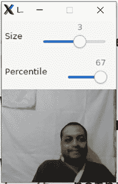
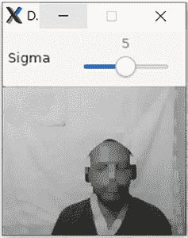
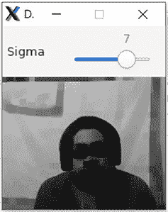

# 第 10 章

# 视频处理

在上一章中，我们学习了在图像处理领域使用形态学操作。我们还使用像`NumPy`、`SciPy`和`matplotlib`这样的库演示了所有这些操作。

到目前为止，贯穿本书，我们一直在讨论如何处理静态图像。我们知道获取静态图像的方法以及如何处理它们。本章专门致力于处理连续图像流，例如视频和实时网络摄像头视频流。我们还将介绍一个新库`OpenCV`。我们将在本章中涵盖以下主题：

- `OpenCV`库简介
- 转换图像的色彩空间
- 在实时网络摄像头视频流中分离颜色通道
- 对实时网络摄像头视频流的更多操作

到本章结束时，我们将非常熟悉使用`SciPy`和`NumPy`处理网络摄像头视频流和视频。

## OpenCV 库简介

我们已经探索了在`SciPy`和`NumPy`库中发现的许多函数如何用于处理图像。现在我们将来审视另一个流行的图像处理库`OpenCV`中非常有限的一部分。我们将使用它来读取实时网络摄像头视频流和视频文件。对于处理视频和实时网络摄像头视频流，我们仍将使用`SciPy`。

`OpenCV`代表开源计算机视觉。它是一个用于实时计算机视觉的库。它包含大量用于图像处理和视频处理的功能。它还包含许多计算机视觉算法的实现。它主要用 C++ 编写。它有针对 C++、Python、Java、MATLAB/OCTAVE 和 JavaScript 等语言的接口（API；应用程序编程接口）。我们可以在网页[`opencv.org/`](https://opencv.org/)上进行探索。

让我们开始在我们的树莓派上安装这个库，使用以下命令：

```bash
pip install opencv-python
```

### 摄像头与代码示例

对于后续的演示，我们将需要一个网络摄像头。

我一直使用的是`罗技 C922 Pro`。这款摄像头价格不菲，大约需要 150 美元。不过，我会在多款应用中使用它。如果这款摄像头超出您的预算，您也可以使用较便宜的摄像头进行演示。大多数品牌 USB 摄像头都能与树莓派完美配合。您还可以在网页[`elinux.org/RPi_USB_Webcams`](https://elinux.org/RPi_USB_Webcams)上查看与树莓派兼容的摄像头列表。开始使用时，将摄像头连接到树莓派的四个 USB 端口之一即可。

现在，请查看下面的代码清单（清单 10-1）。

**清单 10-1.** `prog00.py`

```python
import numpy as np
import cv2 as cv

cap = cv.VideoCapture(0)
cap.set(cv.CAP_PROP_FRAME_WIDTH, 256)
cap.set(cv.CAP_PROP_FRAME_HEIGHT, 144)

if not cap.isOpened():
    print("Cannot open camera...")
    exit()

while True:
    ret, frame = cap.read()
    if not ret:
        print("Can't receive frame... \nExiting ...")
        break
    cv.imshow('frame', frame)
    if cv.waitKey(1) == 27:
        break

cap.release()
cv.destroyAllWindows()
```

运行该程序。摄像头内置的指示灯会亮起，并在显示器上显示如下输出窗口（图 10-1）。

**图 10-1.** 实时摄像头画面的输出

那就是我！按下键盘上的 ESC 键可以停止程序。窗口（图 10-1）将关闭，摄像头上的指示灯也会熄灭。现在，我们来逐行理解程序。前两行代码中，我们导入了所需的库（包括 OpenCV），并为了方便创建了别名。接着，下面这行代码创建了一个与摄像头对应的对象：

`cap = cv.VideoCapture(0)`

传递的参数是摄像头的索引。如果只连接了一个摄像头，则参数始终为 0。接下来的两行代码定义了摄像头工作的分辨率：

`cap.set(cv.CAP_PROP_FRAME_WIDTH, 256)`  
`cap.set(cv.CAP_PROP_FRAME_HEIGHT, 144)`

函数`cap.set()`用于设置连接到计算机的摄像头的属性。属性非常多。下面这个（stackoverflow.com）的问题详细讨论了可以使用 OpenCV 设置的摄像头属性：

[`stackoverflow.com/questions/11420748/setting-camera-parameters-in-opencv-python`](https://stackoverflow.com/questions/11420748/setting-camera-parameters-in-opencv-python)

另外，我希望读者了解，在较低分辨率下，通过摄像头获取的视频流会更快、响应更及时。由于树莓派的处理能力有限，在较低分辨率下，我们会在输出窗口中获得更高的每秒帧数（FPS）。您可以在以下网络资源中获取所有标准分辨率的列表：

[`en.wikipedia.org/wiki/List_of_common_resolutions`](https://en.wikipedia.org/wiki/List_of_common_resolutions)

[`yusef.es/labs/resolutions.htm`](https://yusef.es/labs/resolutions.htm)

如果无法访问摄像头，以下代码行将终止程序的执行：

```python
if not cap.isOpened():
    print("Cannot open camera...")
    exit()
```

只要我们没有在键盘上按下 ESC 键，`while`循环块就会一直运行。

```python
while True:
    ret, frame = cap.read()
```

函数调用`cap.read()`会返回状态和帧。帧是一个`numpy` `ndarray`对象，包含了当前帧。我们可以像在之前章节中练习过的那样，使用 NumPy 和 SciPy 例程对其进行常规操作。

如果摄像头帧读取操作的状态不成功，我们会按如下方式终止循环：

```python
if not ret:
    print("Can't receive frame... \nExiting ...")
    break
```

下面的例程调用会显示帧图像：

`cv.imshow('frame', frame)`

# 视频处理

以下代码用于检测键盘上是否按下了 ESC 键：

```
if cv.waitKey(1) == 27:
    break
```

以下代码通过销毁对象来释放摄像头：

```
cap.release()
```

以下代码用于销毁所有当前 OpenCV 窗口：

```
cv.destroyAllWindows()
```

## 第 10 章 视频处理

请将本程序视为本章后续所有程序的模板。我们可以修改该程序，实现视频文件的读取与显示。

我们需要修改与摄像头相关的代码，具体如下：

```
cap = cv.VideoCapture('test.mp4')
```

我们将视频文件的名称作为参数传入。同时，还需要修改 `while` 循环块中的以下代码：`if cv.waitKey(1) == 27:`

使用摄像头时传入的参数是 `1`。然而，为了显示视频文件的帧，我们需要计算传递给此函数调用的参数值。首先需要了解视频的帧率（以 FPS 为单位），然后用 `1000` 除以该帧率。

接着，将计算结果作为参数传递给函数调用 `cv.waitKey()`。我们来看几个标准帧率的示例。通常，电影帧率约为 24 FPS（实际为 23.97）。因此，`1000/24 = 41.67`，约等于 `42`。所以，24 FPS 对应的函数调用为 `cv.waitKey(42)`。对于 25 FPS，则为 `cv.waitKey(40)`。

对于 30 FPS，对应的函数调用为 `cv.waitKey(33)`，以此类推。作为练习，请按照上述修改方法打开一个视频文件。

## 转换图像的色彩空间

色彩空间是颜色模型的数学表示。颜色模型是一种以可重现方式表示色彩的方法。OpenCV 库读取的图像、实时摄像头画面或视频默认采用 BGR 色彩空间。我们可以将图像从 BGR 转换为我们所需的任意色彩空间。本章中，我们经常需要将实时摄像头画面从 BGR 转换为灰度图。下面介绍具体方法。请参阅清单 10-2。

### 清单 10-2. `prog01.py`

```
import numpy as np
import cv2 as cv

cap = cv.VideoCapture(0)
cap.set(cv.CAP_PROP_FRAME_WIDTH, 256)
cap.set(cv.CAP_PROP_FRAME_HEIGHT, 144)

if not cap.isOpened():
    print("无法打开摄像头...")
    exit()

while True:
    ret, frame = cap.read()

    if not ret:
        print("无法接收帧... \n 正在退出...")
        break

    gray = cv.cvtColor(frame,
                       cv.COLOR_BGR2GRAY)

    cv.imshow('frame', gray)

    if cv.waitKey(1) == 27:
        break

cap.release()
cv.destroyAllWindows()
```

在以下代码中，我们将彩色帧转换为灰度帧：

```
gray = cv.cvtColor(frame,
                   cv.COLOR_BGR2GRAY)
```

函数 `cvtColor()` 用于实现色彩空间之间的转换。本章中我们会频繁使用此函数，因为 SciPy 中的许多图像处理例程需要灰度图像作为输入。运行程序即可查看输出效果。

## 分离实时摄像头画面中的颜色通道

我们还可以使用清单 10-3 中的代码分离实时摄像头画面中的颜色通道。

### 清单 10-3. `prog02.py`

```
import numpy as np
import cv2 as cv
from datetime import datetime

cap = cv.VideoCapture(0)
cap.set(cv.CAP_PROP_FRAME_WIDTH, 256)
cap.set(cv.CAP_PROP_FRAME_HEIGHT, 144)

if not cap.isOpened():
    print("无法打开摄像头...")
    exit()

while True:
    ret, frame = cap.read()

    if not ret:
        print("无法接收帧... \n 正在退出...")
        break

    print(datetime.now())
    print(frame.dtype)
    print(frame.shape)
    print(frame.ndim)
    print(frame.size)

    b = frame[:, :, 0]
    g = frame[:, :, 1]
    r = frame[:, :, 2]

    cv.imshow('红色通道', r)
    cv.imshow('绿色通道', g)
    cv.imshow('蓝色通道', b)

    if cv.waitKey(1) == 27:
        break

cap.release()
cv.destroyAllWindows()
```

在此代码清单（`prog02.py`）中，我们不仅可以看到每帧的属性，还能看到所有颜色通道的信息，如图 10-2 输出所示。

**图 10-2.** 颜色通道分离

# 第 10 章 视频处理

此外，控制台会以每秒多次的频率显示输出（就像此处一样，因此它会非常快速地滚动）：

```
2022-01-30 13:00:30.427360
```

`uint8`

`(144, 176, 3)`

## 实时摄像头流的更多操作

让我们看看使用 `SciPy` 库例程对实时摄像头流执行的更多操作。我们将涵盖大量示例。我们在前几章中已经学习了所有这些操作，现在将把它们应用到实时摄像头流上。

### 几何变换

让我们连续旋转摄像头帧。清单 `10-4` 展示了代码。

`清单 10-4. prog03.py`

```python
import numpy as np
import cv2 as cv
import scipy.ndimage as ndi

angle = 0

cap = cv.VideoCapture(0)
cap.set(cv.CAP_PROP_FRAME_WIDTH, 256)
cap.set(cv.CAP_PROP_FRAME_HEIGHT, 144)

if not cap.isOpened():
    print("Cannot open camera...")
    exit()

while True:
    ret, frame = cap.read()
    if not ret:
        print("Can't receive frame... \nExiting ...")
        break
    angle = (angle + 1) % 360
    output = ndi.rotate(frame, angle, reshape=False)
    cv.imshow('Rotated Frame', output)
    if cv.waitKey(1) == 27:
        break

cap.release()
cv.destroyAllWindows()
```

操作帧的代码如下所示：

```python
angle = (angle + 1) % 360
output = ndi.rotate(frame, angle, reshape=False)
```

逻辑非常简单。我们只需在每一帧中增加旋转角度，当达到 `360` 度时，重新开始。下图（图 `10-3`）显示了其中一帧的截图。

`图 10-3. 实时摄像头源的几何变换`

实际上，截图（图 `10-3`）无法完全展现实际输出效果。运行程序，亲自查看输出结果吧。

### 卷积

让我们定义一个核，并使用卷积操作将其应用于流中的帧，如清单 `10-5` 所示。

`清单 10-5. prog04.py`

```python
import numpy as np
import cv2 as cv
import scipy.ndimage as ndi

cap = cv.VideoCapture(0)
n = 5
k = np.ones((n, n, n), np.uint8)/(n*n*n)

cap.set(cv.CAP_PROP_FRAME_WIDTH, 256)
cap.set(cv.CAP_PROP_FRAME_HEIGHT, 144)

if not cap.isOpened():
    print("Cannot open camera...")
    exit()

while True:
    ret, frame = cap.read()
    if not ret:
        print("Can't receive frame... \nExiting ...")
        break
    output = ndi.convolve(frame, k, mode='nearest')
    cv.imshow('Convolved Frame', output)
    if cv.waitKey(1) == 27:
        break

cap.release()
cv.destroyAllWindows()
```

由于这是一个模糊核，输出的是来自摄像头的模糊视频流，如截图（图 `10-4`）所示。

`图 10-4. 来自摄像头的模糊视频流`

`OpenCV` 库也具备创建轨迹条的功能。让我们创建一个轨迹条，用于调整核矩阵的大小。

清单 `10-6` 包含相关代码。

`清单 10-6. prog05.py`

```python
import numpy as np
import cv2 as cv
import scipy.ndimage as ndi

def nothing(x):
    pass

WINDOW_NAME = "Live Convolution"
cv.namedWindow(WINDOW_NAME)
cv.createTrackbar('Kernel Size', WINDOW_NAME, 1, 5, nothing)

cap = cv.VideoCapture(0)
n = 1

cap.set(cv.CAP_PROP_FRAME_WIDTH, 256)
cap.set(cv.CAP_PROP_FRAME_HEIGHT, 144)

if not cap.isOpened():
    print("Cannot open camera...")
    exit()

while True:
    ret, frame = cap.read()
    if not ret:
        print("Can't receive frame... \nExiting ...")
        break
    n = cv.getTrackbarPos('Kernel Size', WINDOW_NAME)
    k = np.ones((n, n, n), np.uint8)/(n*n*n)
    output = ndi.convolve(frame, k, mode='nearest')
    cv.imshow(WINDOW_NAME, output)
    if cv.waitKey(1) == 27:
        break

cap.release()
cv.destroyAllWindows()
```

我们已经熟悉大部分代码。让我们理解一下新的部分。以下代码定义了一个空函数：

```python
def nothing(x):
    pass
```

以下代码定义了一个命名窗口：

```python
WINDOW_NAME = "Live Convolution"
cv.namedWindow(WINDOW_NAME)
```

我们需要一个命名窗口来绑定新创建的轨迹条，操作如下：

`cv.createTrackbar('Kernel Size', WINDOW_NAME, 1, 5, nothing)`

此代码创建了一个命名的轨迹条，允许我们从 `1` 滑动到 `5`。它被附加到之前创建的命名窗口上。我们之前定义的空函数（`nothing`）与该轨迹条关联，每次操作轨迹条时都会调用它。在 `while` 循环中，我们通过以下函数调用获取滑块的当前位置：

`n = cv.getTrackbarPos('Kernel Size', WINDOW_NAME)`

现在，我们可以通过滑动轨迹条上的滑块来改变内核的大小。图 `10-5` 显示了输出结果。

`图 10-5. 使用轨迹条`

## 视频处理

在本章中，我们将频繁使用轨迹条的代码。

### 相关性

让我们使用轨迹条，并在实时网络摄像头源上应用相关性，如清单 `10-7` 所示。

`清单 10-7. prog06.py`

# 第 10 章：视频处理

## 滤波

我们在前面的章节中已经了解了许多滤波器。接下来，让我们在实时网络摄像头源上逐一应用它们。

让我们看看图 10-6 中的输出结果。

**图 10-6.** 带轨迹条的相关性

**注意** 我们可以通过以下链接阅读更多关于相关性概念的内容：
<https://towardsdatascience.com/convolution-vs-correlation-af868b6b4fb5>

清单 10-8 展示了高斯滤波器。

### 清单 10-8. `prog07.py`

```python
import numpy as np
import cv2 as cv
import scipy.ndimage as ndi

def nothing(x):
    pass

WINDOW_NAME = "Live Gaussian"
cv.namedWindow(WINDOW_NAME)
cv.createTrackbar('Sigma Size', WINDOW_NAME, 1, 15, nothing)

cap = cv.VideoCapture(0)
cap.set(cv.CAP_PROP_FRAME_WIDTH, 256)
cap.set(cv.CAP_PROP_FRAME_HEIGHT, 144)

if not cap.isOpened():
    print("Cannot open camera...")
    exit()

while True:
    ret, frame = cap.read()
    if not ret:
        print("Can't receive frame... \nExiting ...")
        break

    n = cv.getTrackbarPos('Sigma Size', WINDOW_NAME)
    output = ndi.gaussian_filter(frame, sigma=n)
    cv.imshow(WINDOW_NAME, output)

    if cv.waitKey(1) == 27:
        break

cap.release()
cv.destroyAllWindows()
```

接下来，应用一个均匀滤波器，如清单 10-9 所示。

### 清单 10-9. `prog08.py`

```python
import numpy as np
import cv2 as cv
import scipy.ndimage as ndi

def nothing(x):
    pass

WINDOW_NAME = "Live Uniform"
cv.namedWindow(WINDOW_NAME)
cv.createTrackbar('Filter Size', WINDOW_NAME, 1, 15, nothing)

cap = cv.VideoCapture(0)
cap.set(cv.CAP_PROP_FRAME_WIDTH, 256)
cap.set(cv.CAP_PROP_FRAME_HEIGHT, 144)

if not cap.isOpened():
    print("Cannot open camera...")
    exit()

while True:
    ret, frame = cap.read()
    if not ret:
        print("Can't receive frame... \nExiting ...")
        break

    n = cv.getTrackbarPos('Filter Size', WINDOW_NAME)
    output = ndi.uniform_filter(frame, size=n)
    cv.imshow(WINDOW_NAME, output)

    if cv.waitKey(1) == 27:
        break

cap.release()
cv.destroyAllWindows()
```

接下来，应用百分位滤波器。清单 10-10 中的代码定义了两个轨迹条，用于调整传递给滤波器的参数。

### 清单 10-10. `prog09.py`

```python
import numpy as np
import cv2 as cv
import scipy.ndimage as ndi

def nothing(x):
    pass

WINDOW_NAME = "实时百分位滤波"

cv.namedWindow(WINDOW_NAME)
cv.createTrackbar('尺寸', WINDOW_NAME, 1, 5, nothing)
cv.createTrackbar('百分位', WINDOW_NAME, 1, 75, nothing)

cap = cv.VideoCapture(0)
cap.set(cv.CAP_PROP_FRAME_WIDTH, 256)
cap.set(cv.CAP_PROP_FRAME_HEIGHT, 144)

if not cap.isOpened():
    print("无法打开摄像头...")
    exit()

while True:
    ret, frame = cap.read()
    if not ret:
        print("无法接收帧... \n 正在退出...")
        break

    s = cv.getTrackbarPos('尺寸', WINDOW_NAME)
    p = cv.getTrackbarPos('百分位', WINDOW_NAME)

    output = ndi.percentile_filter(frame, size=s, percentile=p)

    cv.imshow(WINDOW_NAME, output)
    if cv.waitKey(1) == 27:
        break

cap.release()
cv.destroyAllWindows()
```



输出结果如图 10-7 所示。

**图 10-7.** 百分位滤波器

接下来实现一个最小值滤波器，如代码清单 10-11 所示。

### 代码清单 10-11. `prog10.py`

```python
import numpy as np
import cv2 as cv
import scipy.ndimage as ndi

def nothing(x):
    pass

WINDOW_NAME = "实时最小值滤波"

cv.namedWindow(WINDOW_NAME)
cv.createTrackbar('滤波器尺寸', WINDOW_NAME, 1, 55, nothing)
```

# 第 10 章：视频处理

接下来应用最大值滤波器，如代码清单 10-12 所示。

## 代码清单 10-12. `prog11.py`

```python
import numpy as np
import cv2 as cv
import scipy.ndimage as ndi
```

我们还可以应用 Prewitt 和 Laplace 滤波器，如代码清单 10-13 所示。

## 代码清单 10-13. `prog12.py`

```python
import numpy as np
import cv2 as cv
import scipy.ndimage as ndi

cap = cv.VideoCapture(0)
cap.set(cv.CAP_PROP_FRAME_WIDTH, 256)
cap.set(cv.CAP_PROP_FRAME_HEIGHT, 144)

if not cap.isOpened():
    print("无法打开摄像头...")
    exit()

while True:
    ret, frame = cap.read()
    if not ret:
        print("无法接收帧... \n 正在退出...")
        break

    o1 = ndi.prewitt(frame)
    o2 = ndi.laplace(frame)

    cv.imshow("Prewitt", o1)
    cv.imshow("Laplace", o2)

    if cv.waitKey(1) == 27:
        break

cap.release()
cv.destroyAllWindows()
```

**注意：** 更多关于这两种滤波器的信息，请参阅以下网址：

- [`www.geeksforgeeks.org/matlab-image-edge-detection-using-prewitt-operator-from-scratch/`](https://www.geeksforgeeks.org/matlab-image-edge-detection-using-prewitt-operator-from-scratch/)

- [`www.l3harrisgeospatial.com/docs/laplacianfilters.html`](https://www.l3harrisgeospatial.com/docs/laplacianfilters.html)

应用高斯梯度幅度滤波器，如代码清单 10-14 所示。

## 代码清单 10-14. `prog13.py`

```python
import numpy as np
import cv2 as cv
import scipy.ndimage as ndi

def nothing(x):
    pass

WINDOW_NAME = "高斯梯度幅度"

cv.namedWindow(WINDOW_NAME)
cv.createTrackbar('Sigma', WINDOW_NAME, 1, 10, nothing)

cap = cv.VideoCapture(0)
```

# 第 10 章 视频处理

`cap.set(cv.CAP_PROP_FRAME_WIDTH, 256)`
`cap.set(cv.CAP_PROP_FRAME_HEIGHT, 144)`

```
if not cap.isOpened():
    print("Cannot open camera...")
    exit()
```

```
while True:
    ret, frame = cap.read()
    if not ret:
        print("Can't receive frame... \nExiting ...")
        break
    s = cv.getTrackbarPos('Sigma', WINDOW_NAME)
    gray = cv.cvtColor(frame, cv.COLOR_BGR2GRAY)
    output = ndi.gaussian_gradient_magnitude(gray, sigma=s)
    cv.imshow(WINDOW_NAME, output)
    if cv.waitKey(1) == 27:
        break
cap.release()
cv.destroyAllWindows()
```

下面我们应用高斯-拉普拉斯滤波器，如清单 10-15 所示。

***清单 10-15.*** `prog14.py`

```
import numpy as np
import cv2 as cv
import scipy.ndimage as ndi

def nothing(x):
    pass

WINDOW_NAME = "Gaussian Laplace"
cv.namedWindow(WINDOW_NAME)
cv.createTrackbar('Sigma', WINDOW_NAME, 1, 10, nothing)
cap = cv.VideoCapture(0)
cap.set(cv.CAP_PROP_FRAME_WIDTH, 256)
cap.set(cv.CAP_PROP_FRAME_HEIGHT, 144)

if not cap.isOpened():
    print("Cannot open camera...")
    exit()

while True:
    ret, frame = cap.read()
    if not ret:
        print("Can't receive frame... \nExiting ...")
        break
    s = cv.getTrackbarPos('Sigma', WINDOW_NAME)
    gray = cv.cvtColor(frame, cv.COLOR_BGR2GRAY)
    output = ndi.gaussian_laplace(gray, sigma=s)
    cv.imshow(WINDOW_NAME, output)
    if cv.waitKey(1) == 27:
        break
cap.release()
cv.destroyAllWindows()
```

## 形态学操作

我们还可以在实时视频上应用形态学操作，如清单 10-16 所示。

***清单 10-16.*** `prog15.py`

```
import numpy as np
import cv2 as cv
import scipy.ndimage as ndi

def nothing(x):
    pass

WINDOW_NAME = "Distance Transform"
cv.namedWindow(WINDOW_NAME)
cv.createTrackbar('Sigma', WINDOW_NAME, 1, 10, nothing)
cap = cv.VideoCapture(0)
cap.set(cv.CAP_PROP_FRAME_WIDTH, 256)
cap.set(cv.CAP_PROP_FRAME_HEIGHT, 144)

if not cap.isOpened():
    print("Cannot open camera...")
    exit()

while True:
    ret, frame = cap.read()
    if not ret:
        print("Can't receive frame... \nExiting ...")
        break
    grey = cv.cvtColor(frame, cv.COLOR_BGR2GRAY)
    n1 = cv.getTrackbarPos('Sigma', WINDOW_NAME)
    output = ndi.grey_dilation(grey, size=(7, 7), structure=np.ones((n1, n1)))
    cv.imshow(WINDOW_NAME, output)
    if cv.waitKey(1) == 27:
        break
cap.release()
cv.destroyAllWindows()
```



此代码对实时网络摄像头流应用灰度膨胀，如图 10-8 所示。

***图 10-8.** 灰度膨胀*

类似地，我们还可以对实时视频流应用腐蚀操作，如清单 10-17 所示。

***清单 10-17.*** `prog16.py`

```
import numpy as np
import cv2 as cv
import scipy.ndimage as ndi

def nothing(x):
    pass

WINDOW_NAME = "Distance Transform"
cv.namedWindow(WINDOW_NAME)
cv.createTrackbar('Sigma', WINDOW_NAME, 1, 10, nothing)
cap = cv.VideoCapture(0)
cap.set(cv.CAP_PROP_FRAME_WIDTH, 256)
cap.set(cv.CAP_PROP_FRAME_HEIGHT, 144)

if not cap.isOpened():
    print("Cannot open camera...")
    exit()

while True:
    ret, frame = cap.read()
    if not ret:
        print("Can't receive frame... \nExiting ...")
        break
    grey = cv.cvtColor(frame, cv.COLOR_BGR2GRAY)
    n1 = cv.getTrackbarPos('Sigma', WINDOW_NAME)
    output = ndi.grey_erosion(grey, size=(7, 7), structure=np.ones((n1, n1)))
    cv.imshow(WINDOW_NAME, output)
    if cv.waitKey(1) == 27:
        break
cap.release()
cv.destroyAllWindows()
```



输出结果如图 10-9 所示。

***图 10-9.** 灰度腐蚀*

## 小结

在本章中，我们学习了如何将 SciPy 例程应用于网络摄像头的实时视频流和视频文件。现在，我们已经能够熟练处理视频（包括实时视频和存储的视频文件）。
