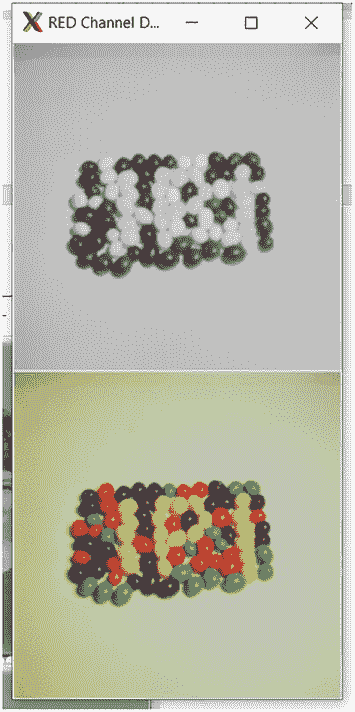

# 图像基本操作

在上一章中，我们开始使用 Pillow 进行图像处理。我们还使用了`Tkinter`来显示图像。在本章中，我们将学习可应用于图像的各种算术和逻辑运算。我们将探索使用 Pillow 中的`Image`、`ImageChops`和`ImageOps`模块来实现这些操作。我们还将学习如何在 Tkinter 中使用滑块来动态改变程序输入。

我们将学习以下主题：

* `Image` 模块
* `ImageChops` 模块
* `ImageOps` 模块

## Image 模块

让我们从`Image`模块开始。使用此模块，我们可以对图像执行多种操作。

© Ashwin Pajankar 2022

A. Pajankar, *树莓派图像处理编程*,

[`doi.org/10.1007/978-1-4842-8270-0_4`](https://doi.org/10.1007/978-1-4842-8270-0_4#DOI)

### 图像通道

我们可以使用例程`split()`将图像分割成其组成的各个通道。我们也可以使用例程`merge()`将多个图像合并成一个单一图像。清单 4-1 展示了这一演示过程。

***清单 4-1.*** `prog01.py`

```
from PIL import Image, ImageTk
import tkinter as tk

im = Image.open("/home/pi/DIP/Dataset/4.1.07.tiff")
root = tk.Tk()
root.title("RED Channel Demo")

r, g, b = im.split()

photo1 = ImageTk.PhotoImage(r)
l1 = tk.Label(root, image=photo1)
l1.pack()
l1.photo = photo1

photo2 = ImageTk.PhotoImage(Image.merge("RGB", (r, g, b)))
l2 = tk.Label(root, image=photo2)
l2.pack()
l2.photo = photo2

root.mainloop()
```

输出结果如图 4-1 所示。



**图 4-1.** 红色通道和原始图像