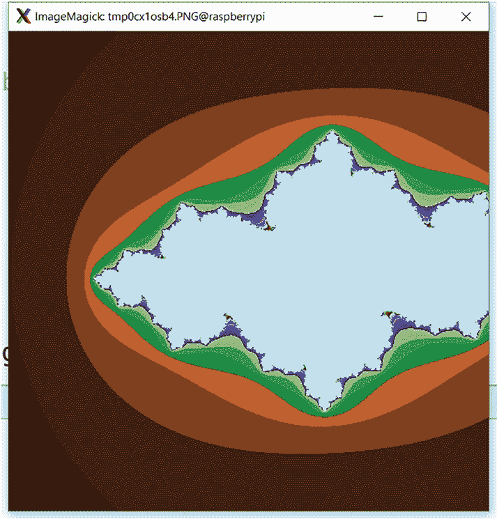
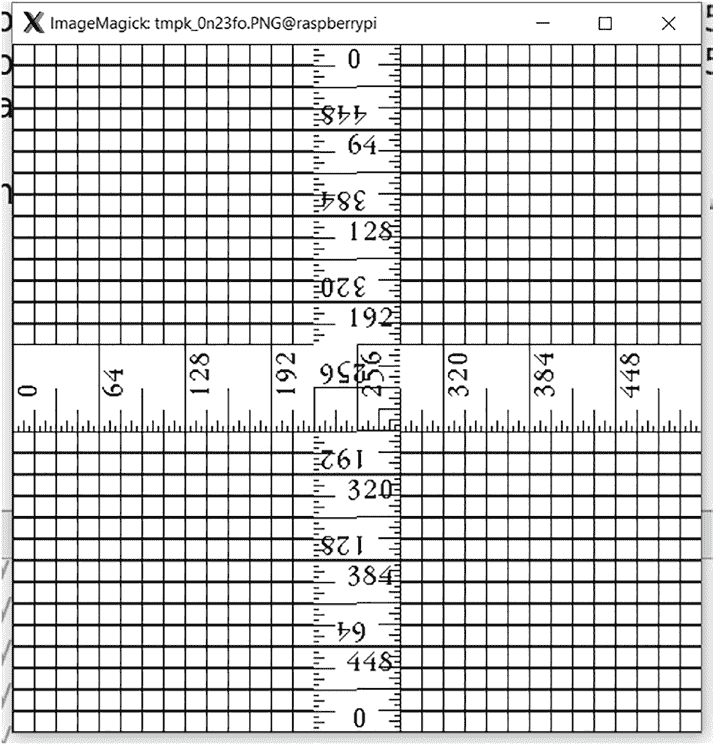

# 绘制朱莉娅集

**第 4 章 图像基本操作**

```python
c = complex(random.random() * 2.0 - 1.0, random.random() - 0.5)

for y in range(imgy):
    zy = y * (yb - ya) / (imgy - 1) + ya
    for x in range(imgx):
        zx = x * (xb - xa) / (imgx - 1) + xa
        z = complex(zx, zy)
        for i in range(maxIt):
            if abs(z) > 2.0: break
            z = z * z + c
        r = i % 4 * 64
        g = i % 8 * 32
        b = i % 16 * 16
        image.putpixel((x, y), b * 65536 + g * 256 + r)

image.show()
image.save("julia.png", "PNG")
```

输出结果如图 4-5 所示。



> **注意** 您可以通过以下网址深入了解朱莉娅集：
> [`mathworld.wolfram.com/JuliaSet.html`](https://mathworld.wolfram.com/JuliaSet.html)
> [`www.britannica.com/science/Julia-set`](https://www.britannica.com/science/Julia-set)

## 噪声与渐变

噪声是信号中不需要的部分。根据信号类型的不同，噪声可以呈现多种形式。我们知道图像是一种信号，因此图像中也可能存在噪声。在拍摄或传输图像时，噪声可能被无意中引入图像。我们可以生成（或模拟）噪声，如代码清单 4-11 所示。

**代码清单 4-11.** `prog10_3.py`

```python
from PIL import Image
im = Image.effect_noise((512, 512), 0.01)
im.show()
```

我们可以生成线性渐变，如代码清单 4-12 所示。

**代码清单 4-12.** `prog10_4.py`

```python
from PIL import Image
im = Image.linear_gradient('P')
im.show()
```

我们可以生成径向渐变，如代码清单 4-13 所示。

**代码清单 4-13.** `prog10_5.py`

```python
from PIL import Image
im = Image.radial_gradient('P')
im.show()
```

请运行所有这些代码清单，以查看代码的实际效果。

## ImageChops 模块

**第 4 章 图像基本操作**

该模块包含许多可用于图像的基本算术和逻辑运算例程。让我们逐一快速了解它们。

我们可以使用`add()`方法将两幅图像相加。

以下是图像相加的示例代码：

`im3 = ImageChops.add(im1, im2)`

`add_module()`方法用于相加两幅图像，且不对结果进行裁剪：

`im3 = ImageChops.add_modulo(im1, im2)`

`darker()`方法逐像素比较两幅图像，并返回较暗的像素：

`im3 = ImageChops.darker(im1, im2)`

`difference()`方法返回两幅图像绝对值的差：

`im3 = ImageChops.difference(im1, im2)`

它使用以下数学公式计算差值：

`image3 = abs(image1 - image2)`

我们可以按如下方式反转图像：

`im2 = ImageChops.invert(im1)`

与`darker()`类似，您可以使用`lighter()`方法返回较亮像素的集合：

`im3 = ImageChops.lighter(im1, im2)`

`logical_and()`和`logical_or()`是用于图像的逻辑运算。这些运算借助黑白图像进行说明。以下是这些例程的使用示例：

```python
im1 = Image.open("/home/pi/DIP/Dataset/ruler.512.tiff")
im2 = Image.open("/home/pi/DIP/Dataset/ruler.512.tiff")
im2 = im2.transpose(Image.ROTATE_90)
im3 = ImageChops.logical_and(im1.convert("1"), im2.convert("1"))
im3 = ImageChops.logical_or(im1.convert("1"), im2.convert("1"))
```

这些示例首先将灰度图像转换为黑白图像，然后对其执行逻辑运算。图 4-6 显示了逻辑与运算的输出结果。



您可以使用`multiply()`方法将一幅图像叠加到另一幅图像上：

`im3 = ImageChops.multiply(im1, im2)`

`screen()`方法将反转后的图像相互叠加：

`im3 = ImageChops.screen(im1, im2)`

你可以使用`subtract()`方法将一个图像从另一个图像中减去，如下所示：

`im3 = ImageChops.subtract(im1, im2)`

可以在不裁剪结果的情况下进行减法运算，如下所示：

`im3 = ImageChops.subtract_modulo(im1, im2)`

可以使用给定的灰度级别填充通道，如下所示：

`im2 = ImageChops.constant(im1, 10)`

可以计算逻辑异或，如下所示：

`im3 = ImageChops.logical_xor(im1.convert("1"), im2.convert("1"))`

可以使用柔光算法将两个图像叠加在一起，如下所示：

`im3 = ImageChops.soft_light(im1, im2)`

可以使用强光算法将两个图像叠加在一起，如下所示：

`im3 = ImageChops.hard_light(im1, im2)`

可以使用叠加算法将两个图像叠加在一起，如下所示：

`im3 = ImageChops.overlay(im1, im2)`

也可以偏移图像的数据，如下所示：

`im2 = ImageChops.offset(im1, xoffset=128, yoffset=128)`

## ImageOps

该模块包含许多预定义且有用的操作。

可以自动调整图像的对比度，如下所示：

`im2 = ImageOps.autocontrast(im1)`

可以将灰度图像着色，如下所示：

`im2 = ImageOps.colorize(im1, (125, 150, 134), (10, 12, 17))`

可以从所有边均匀裁剪图像的边框，如下所示：

`im2 = ImageOps.crop(im1, 50)`

`ImageOps.crop()`方法的第一个参数是图像，第二个参数是裁剪边框的宽度（以像素为单位）。

也可以扩展图像的边框。扩展后的边框将在所有边上均匀填充黑色像素，如下所示：

`im2 = ImageOps.expand(im1, 50)`

可以垂直翻转图像，如下所示：

`im2 = ImageOps.flip(im1)`

也可以水平翻转图像，如下所示：

`im2 = ImageOps.mirror(im1)`

可以使用`posterize()`方法减少所有颜色通道的位数。该方法接受图像和要为每个通道保留的位数作为参数。示例如下：

`im2 = ImageOps.posterize(im1, 3)`

此示例仅保留每个通道的三位。

`solarize()`方法会反转所有高于特定灰度阈值的像素，如下所示：

`im2 = ImageOps.solarize(im1, 100)`

可以填充图像，如下所示：

`im2 = ImageOps.pad(im1, (128, 128))`

可以缩放图像，如下所示：

`im2 = ImageOps.scale(im1, 1.5)`

可以自动均衡图像的直方图，如下所示：

`im2 = ImageOps.equalize(im1)`

可以将彩色图像转换为灰度图像，如下所示：

`im2 = ImageOps.grayscale(im1)`

可以反转图像，如下所示：

`im2 = ImageOps.invert(im1)`

## 总结

本章详细探讨了`Image`、`ImageChops`和`ImageOps`模块。在下一章中，我们将探讨更多用于图像高级操作的 `Pillow` 模块，例如滤波、增强、直方图和量化。