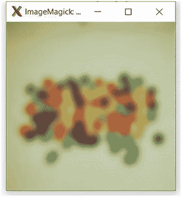
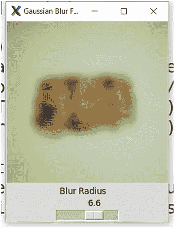
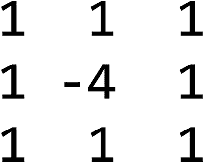
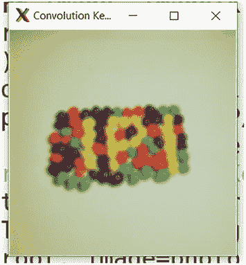
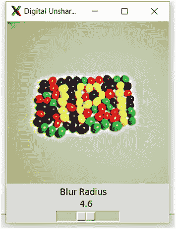
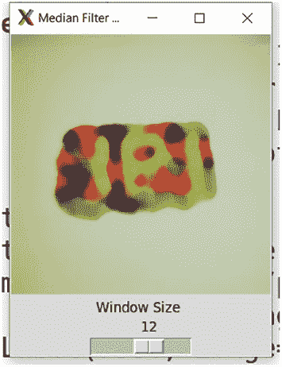
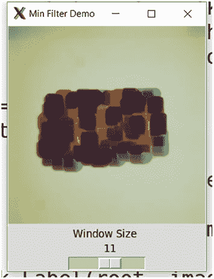
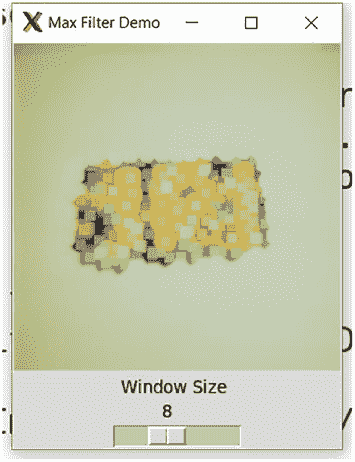
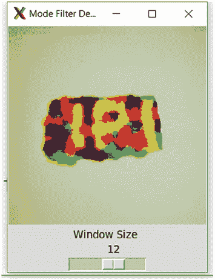

# 第 5 章 图像高级操作

上一章探讨了使用 Pillow 对图像进行算术和逻辑运算。然而，图像处理的世界远不止于此。Pillow 提供了更多的功能。你可以增强和过滤图像。你还可以计算图像及其通道的直方图。本章将涵盖以下主题：

- `ImageFilter`模块
- `ImageEnhance`模块
- 颜色量化
- 直方图与均衡化

## `ImageFilter`模块

我们可以使用 Pillow 中的`ImageFilter`模块对图像执行各种滤波操作。你可以使用滤波器去除噪声、添加模糊效果，以及锐化和平滑图像。`清单 5-1`展示了一个使用`ImageFilter`模块的简单图像滤波程序。

© Ashwin Pajankar 2022

A. Pajankar, *Raspberry Pi Image Processing Programming*,

https://doi.org/10.1007/978-1-4842-8270-0_5

`清单 5-1.` `prog01.py`

```python
from PIL import Image, ImageFilter
```

```python
im1 = Image.open("/home/pi/DIP/Dataset/4.1.08.tiff")

im2 = im1.filter(ImageFilter.BLUR)

#im2 = im1.filter(ImageFilter.CONTOUR)
#im2 = im1.filter(ImageFilter.DETAIL)
#im2 = im1.filter(ImageFilter.EDGE_ENHANCE)
#im2 = im1.filter(ImageFilter.EDGE_ENHANCE_MORE)
#im2 = im1.filter(ImageFilter.EMBOSS)
#im2 = im1.filter(ImageFilter.FIND_EDGES)
#im2 = im1.filter(ImageFilter.SMOOTH)
#im2 = im1.filter(ImageFilter.SMOOTH_MORE)
#im2 = im1.filter(ImageFilter.SHARPEN)

im2.show()
```

`图 5-1`显示了该程序的输出结果。

`图 5-1.` 模糊滤镜演示

取消代码文件中的行注释，即可查看其他滤镜的效果。



我们也可以使用自定义滤镜，如`代码清单 5-2`所示。

`代码清单 5-2.` `prog02.py`

```python
from PIL import Image, ImageFilter

im1 = Image.open("/home/pi/DIP/Dataset/4.1.08.tiff")

custom_filter = ImageFilter.GaussianBlur(radius=float(5))

im2 = im1.filter(custom_filter)

im2.show()
```

`图 5-2`显示了该程序的输出结果。

`图 5-2.` 自定义高斯滤镜

`代码清单 5-2`中的代码使用了`GaussianBlur()`方法创建自定义滤镜。模糊半径为 5。我们可以更改半径。接下来，使用`Tkinter`中的滑块来修改代码，使模糊半径变为动态可调（见`代码清单 5-3`）。

`代码清单 5-3.` `prog03.py`

```python
from PIL import Image, ImageTk, ImageFilter
import tkinter as tk

def show_value_1(blur_radius):
    print('高斯模糊半径：', blur_radius)
    custom_filter = ImageFilter.GaussianBlur(radius=float(blur_radius))
    img = im1.filter(custom_filter)
    photo = ImageTk.PhotoImage(img)
    l['image'] = photo
    l.photo = photo

root = tk.Tk()
root.title('高斯模糊滤镜演示')

im1 = Image.open("/home/pi/DIP/Dataset/4.1.07.tiff")
photo = ImageTk.PhotoImage(im1)
l = tk.Label(root, image=photo)
l.pack()
l.photo = photo

w1 = tk.Scale(root, label="模糊半径", from_=0, to=10, resolution=0.2, command=show_value_1, orient=tk.HORIZONTAL)
w1.pack()

root.mainloop()
```

`代码清单 5-3`的输出结果如`图 5-3`所示。



`图 5-3.` 使用 Tkinter 的高斯模糊

我们可以看到`GaussianBlur()`已被应用在图像上。

接下来要探索的滤镜是卷积滤镜。对于这个示例，我们需要理解核（kernel）的概念。核是用于图像处理操作的**方形矩阵**。我们主要使用核来进行滤波。核可以产生多种效果，包括模糊、平滑、降噪、锐化和边缘突出。

当使用滤波器去除图像中的高频分量时，这个过程称为低通滤波，因为它允许低频数据通过滤波器。它会产生模糊、平滑和降噪等效果。

当使用滤波器去除图像中的低频分量时，这个过程称为高通滤波，因为它允许高频数据通过滤波器。它会产生锐化和边缘突出等效果。

`图 5-4`展示了一个示例核。



`图 5-4.` 一个核

`代码清单 5-4`展示了一个用于图像卷积的核的代码示例。

`代码清单 5-4.` `prog04.py`

```python
from PIL import Image, ImageTk, ImageFilter
import tkinter as tk

root = tk.Tk()
root.title('卷积核演示')

im1 = Image.open("/home/pi/DIP/Dataset/4.1.07.tiff")
custom_filter = ImageFilter.Kernel((3, 3), [1, 1, 1, 1, -4, 1, 1, 1, 1])
img = im1.filter(custom_filter)
photo = ImageTk.PhotoImage(img)
l = tk.Label(root, image=photo)
l.pack()
l.photo = photo

root.mainloop()
```



运行程序`Listing 5-4`，它会产生以下输出（`图 5-5`）。

`图 5-5.` 一个卷积演示

截至目前，`ImageFilter.Kernel()`方法仅支持大小为`3x3`和`5x5`的卷积核。试试下面这个`5x5`的卷积核：

```python
custom_filter = ImageFilter.Kernel((5, 5), [1,1,1,1,1,
1,1,1,1,1, 1,1,-10,1,1, 1,1,1,1,1, 1,1,1,1,1])
```

我们可以使用数字非锐化掩码滤镜，如`清单 5-5`所示。

`清单 5-5.` `prog05.py`

```python
from PIL import Image, ImageTk, ImageFilter
import tkinter as tk

def show_value_1(blur_radius):
    print('Unsharp Blur Radius: ', blur_radius)
    custom_filter = ImageFilter.UnsharpMask(radius=float(blur_radius))
    img = im1.filter(custom_filter)
```

# 第5章 图像高级操作

```
    photo = ImageTk.PhotoImage(img)
    l['image'] = photo
    l.photo = photo

root = tk.Tk()
root.title('Digital Unsharp Mask Demo')
im1 = Image.open("/home/pi/DIP/Dataset/4.1.07.tiff")
photo = ImageTk.PhotoImage(im1)
l = tk.Label(root, image=photo)
l.pack()
l.photo = photo
w1 = (tk.Scale(root, label="Blur Radius", from_=0, to=10,
resolution=0.2, command=show_value_1, orient=tk.
HORIZONTAL))
w1.pack()
root.mainloop()
```

数字非锐化掩码可以锐化图像。图`5-6`展示了掩码半径为 10 时的输出。



***图 5-6.** 数字非锐化演示*

半径为 10 会生成一张高度锐化的图像。

接下来，我们学习一下 `Pillow` 中的中值、最小值和最大值滤镜。所有这些滤镜只接受奇数作为窗口大小。清单`5-6`中的代码演示了中值滤镜。

***清单 5-6.*** `prog06.py`

```
from PIL import Image, ImageTk, ImageFilter
import tkinter as tk

def show_value_1(window_size):
    print('Window Size: ', window_size)
    if (int(window_size) % 2 == 0):
        print("Invalid Window Size...\nWindow Size must be an odd number...")
    else:
        custom_filter = ImageFilter.MedianFilter(size=int(window_size))
        img = im1.filter(custom_filter)
        photo = ImageTk.PhotoImage(img)
        l['image'] = photo
        l.photo = photo

root = tk.Tk()
root.title('Median Filter Demo')
im1 = Image.open("/home/pi/DIP/Dataset/4.1.07.tiff")
photo = ImageTk.PhotoImage(im1)
l = tk.Label(root, image=photo)
l.pack()
l.photo = photo
w1 = (tk.Scale(root, label="Window Size", from_=1, to=19,
resolution=1, command=show_value_1, orient=tk.
HORIZONTAL))
w1.pack()
root.mainloop()
```

图`5-7`中的输出显示了窗口大小为 19 的效果。



***图 5-7.** 一个中值滤镜*

如果你使用下面这行代码将滤镜更改为最小值滤镜：

```
custom_filter = ImageFilter.MinFilter(size=int(window_size))
```

那么你将得到图`5-8`所示的输出。



***图 5-8.** 一个最小值滤镜*

这是一个最大值滤镜的示例：

```
custom_filter = ImageFilter.MaxFilter(size=int(window_size))
```

最大值滤镜的输出如图`5-9`所示。



***图 5-9.** 最大值滤镜*

接下来，我们将看一个众数滤镜的示例。众数滤镜适用于偶数和奇数窗口大小。清单`5-7`展示了众数滤镜的代码示例。

***清单 5-7.*** `prog09.py`

```
from PIL import Image, ImageTk, ImageFilter
import tkinter as tk

def show_value_1(window_size):
    print('Window Size: ', window_size)
    custom_filter = ImageFilter.ModeFilter(size=int(window_size))
    img = im1.filter(custom_filter)
    photo = ImageTk.PhotoImage(img)
    l['image'] = photo
    l.photo = photo
```



```
root = tk.Tk()
root.title('Mode Filter Demo')
im1 = Image.open("/home/pi/DIP/Dataset/4.1.07.tiff")
photo = ImageTk.PhotoImage(im1)
l = tk.Label(root, image=photo)
l.pack()
l.photo = photo
w1 = (tk.Scale(root, label="Window Size", from_=1, to=19,
```