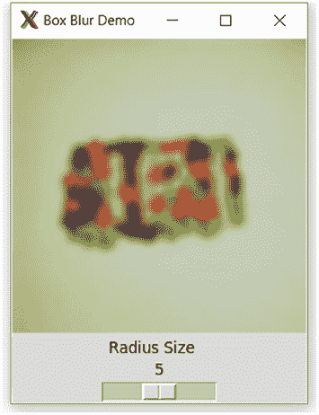
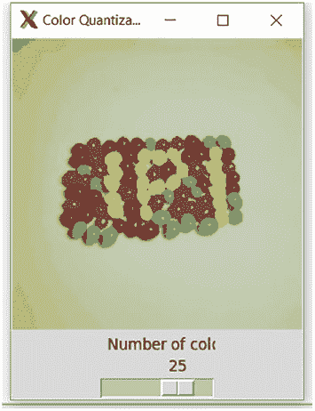

# 文本排版

`resolution=1`, `command=show_value_1`, `orient=tk`.

`HORIZONTAL`）

`w1.pack()`

`root.mainloop()`

输出结果如图 5-10. 所示

***图 5-10.** 模式滤镜*



## 第 5 章 图像高级操作

我们也可以像下面这样使用 `BoxBlur()` 的代码：

`custom_filter = ImageFilter.BoxBlur(radius=int(window_size))`

输出结果如图 5-11. 所示

***图 5-11.** 方框模糊*

你已经了解了如何使用滤镜；现在，让我们看看如何增强图像。

### ImageEnhance 模块

我们可以使用 Pillow 中的 `ImageEnhance` 模块来调整图像的对比度、色彩、锐度和亮度，就像我们过去在旧模拟电视机上所做的那样。

清单 5-8 展示了色彩调整的代码。

***清单 5-8.*** `prog11.py`

```
from PIL import Image, ImageTk, ImageEnhance
import tkinter as tk

def show_value_1(factor):
    print('Color Factor: ', factor)
    enhancer = ImageEnhance.Color(im1)
    img = enhancer.enhance(float(factor))
    photo = ImageTk.PhotoImage(img)
    l['image'] = photo
    l.photo = photo

root = tk.Tk()
root.title('Color Adjustment Demo')
im1 = Image.open("/home/pi/DIP/Dataset/4.1.07.tiff")
photo = ImageTk.PhotoImage(im1)
l = tk.Label(root, image=photo)
l.pack()
l.photo = photo

w1 = (tk.Scale(root, label="Color Factor", from_=0, to=2,
               resolution=0.1, command=show_value_1, orient=tk.
HORIZONTAL))
w1.pack()
w1.set(1)
root.mainloop()
```

在清单 5-8 中，图像处理代码如下：`enhancer = ImageEnhance.Color(im1)` 和 `img = enhancer.enhance(float(factor))`。

对于所有其他图像增强操作，我们可以遵循相同的编码风格。首先，我们创建一个增强器，然后对其应用增强因子。我们还必须在代码中注意到 `w1.set(1)`。这会在开始时将滑块设置为 1。更改 `set()` 的参数会改变滑块指针的默认位置。

运行清单 5-8 中的程序，并查看输出结果。

要更改对比度，请使用清单 5-9. 中的代码。

***清单 5-9.*** `prog12.py`

```
from PIL import Image, ImageTk, ImageEnhance
import tkinter as tk

def show_value_1(factor):
    print('Contrast Factor: ', factor)
    enhancer = ImageEnhance.Contrast(im1)
    img = enhancer.enhance(float(factor))
    photo = ImageTk.PhotoImage(img)
    l['image'] = photo
    l.photo = photo

root = tk.Tk()
root.title('Contrast Adjustment Demo')
im1 = Image.open("/home/pi/DIP/Dataset/4.1.07.tiff")
photo = ImageTk.PhotoImage(im1)
l = tk.Label(root, image=photo)
l.pack()
l.photo = photo

w1 = (tk.Scale(root, label="Contrast Factor", from_=0, to=2,
               resolution=0.1, command=show_value_1, orient=tk.
HORIZONTAL))
w1.pack()
w1.set(1)
root.mainloop()
```

运行清单 5-9 中的程序，并查看输出结果。

以下增强器用于更改亮度：

`enhancer = ImageEnhance.Brightness(im1)`

以下增强器用于更改锐度：

`enhancer = ImageEnhance.Sharpness(im1)`

为了更精细地控制锐度，请对滑块使用以下代码：`w1 = (tk.Scale(root, label="Sharpness Factor", from_=0, to=2, resolution=0.1, command=show_value_1, orient=tk.HORIZONTAL))`

这些全都是图像增强操作。下一节将介绍更高级的图像操作。

### 颜色量化

颜色量化是减少图像中不同颜色数量的过程。新图像在外观上应与原图相似。颜色量化有多种用途，例如当你想将图像存储在数字介质中时。现实生活中的图像拥有数百万种颜色。然而，以数字格式对它们进行编码并保留所有与颜色相关的信息会导致图像尺寸巨大。如果你限制图像中的颜色数量，那么存储颜色相关信息所需的空间就会更少。这就是量化的实际应用。`Image` 模块有一个名为 `quantize()` 的方法，用于图像量化。

清单 5-10 中的代码演示了 Pillow 中的图像量化。

***清单 5-10.*** `prog15.py`

```
from PIL import Image, ImageTk
import tkinter as tk

def show_value_1(num_of_col):
    print('Number of colors: ', num_of_col)
    img = im1.quantize(int(num_of_col))
    photo = ImageTk.PhotoImage(img)
    l['image'] = photo
    l.photo = photo

root = tk.Tk()
root.title('Color Quantization Demo')
im1 = Image.open("/home/pi/DIP/Dataset/4.1.07.tiff")
photo = ImageTk.PhotoImage(im1)
l = tk.Label(root, image=photo)
l.pack()
l.photo = photo

w1 = (tk.Scale(root, label="Number of colors", from_=4, to=16,
               resolution=1, command=show_value_1, orient=tk.
HORIZONTAL))
w1.pack()
w1.set(256)
root.mainloop()
```

以下输出（图 5-12）显示了一张量化后的图像。



***图 5-12.** 量化后的图像*

### 直方图与均衡化

你可能在学校里学习过统计学中的频数表。其实，直方图就是频数表的可视化形式。你可以计算任何以数字形式表示的数据集的直方图。

`Image` 模块有一个名为 `histogram()` 的方法，用于计算图像的直方图。一张 RGB 图像有三个 8 位通道。这意味着它可以拥有惊人的 256 x 256 x 256 种颜色。绘制这样一个数据集的直方图会非常困难。因此，`histogram()` 方法计算图像中单个通道的直方图。每个通道有 256 个不同的亮度级。直方图是一个针对通道每个亮度级的数值列表。

每个通道的直方图列表中包含 256 个数字。假设 `红色` 通道的直方图数值为 (4, 8, 0, 19, …, 90)。这意味着有 4 个像素的红色亮度为 0，8 个像素的红色亮度为 1，没有像素的红色亮度为 2，19 个像素的红色亮度为 3，依此类推，直到最后一个值，该值表示有 90 个像素的红色亮度为 255。

当我们合并所有三个通道的直方图时，会得到一个包含 768 个数字的列表。在本章中，我们只计算直方图，不会进行可视化显示。当我们学习高级图像处理库 `scipy.ndimage` 时，会学习如何分别表示每个通道的直方图。

清单 5-11 中的代码计算并存储了图像及其各个通道的直方图。

***清单 5-11.*** `prog16.py`

```
from PIL import Image

im1 = Image.open("/home/pi/DIP/Dataset/4.1.07.tiff")
print(len(im1.histogram()))
r, g, b = im1.split()
print(len(r.histogram()))
print(len(g.histogram()))
print(len(b.histogram()))
```

修改此程序，以直接打印图像和通道的直方图。

灰度图像（L 模式图像）的直方图只有 256 个值，因为它只有一个通道。

### 直方图均衡化

你可以调整直方图以增强图像对比度。这种技术称为直方图均衡化。`ImageOps.equalize()` 方法可以对图像的直方图进行均衡化。清单 5-12 展示了这一过程的一个示例。

***清单 5-12.*** `prog17.py`

```
from PIL import Image, ImageOps

im1 = Image.open("/home/pi/DIP/Dataset/4.1.07.tiff")
print(im1.histogram())
im2 = ImageOps.equalize(im1)
print(im2.histogram())
im2.show()
```


