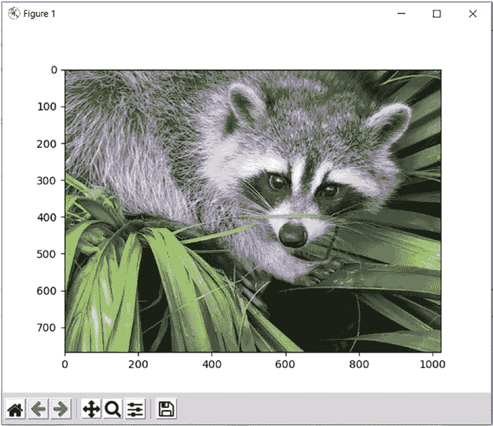
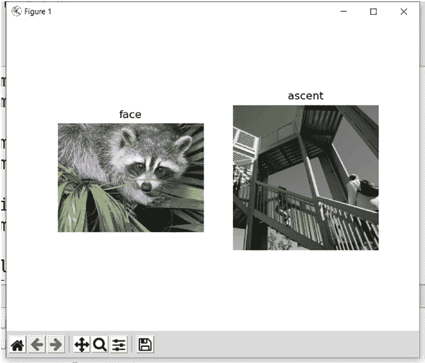

# Matplotlib

到目前为止，我们一直使用`misc.imshow()`方法来显示图像。虽然这个方法对于简单的应用很有用，但它比较原始。对于科学应用，我们必须使用一个更高级的框架。`Matplotlib`就为此目的而生。它是一个用于 Python 的 Matlab 风格的绘图和数据可视化库。我们已经安装了它。它是 Scientific Python 生态系统不可或缺的一部分。与 NumPy 一样，`matplotlib`也是一个庞大的主题，需要专门的书籍来阐述。本书中的示例使用`matplotlib`中的`pyplot`模块来满足图像处理需求。“清单 6-4”展示了一个简单的图像处理程序。

***清单 6-4.*** `prog04.py`

```python
import scipy.misc as misc
import matplotlib.pyplot as plt
img = misc.face()
plt.imshow(img)
plt.show()
```

“清单 6-4”中的代码导入了`pyplot`模块。`imshow()`方法将图像添加到绘图窗口中。`show()`方法用于显示绘图窗口。输出如图 6-2 所示。



***图 6-2.** Matplotlib 演示 1*

我们也可以关闭坐标轴（或标尺）并为图像添加标题，如“清单 6-5”所示。

***清单 6-5.*** `prog05.py`

```python
import scipy.misc as misc
import matplotlib.pyplot as plt
img = misc.ascent()
```


```python
plt.imshow(img, cmap='gray')
plt.axis('off')
plt.title('Ascent')
plt.show()
```

由于图像是灰度图，我们必须在`imshow()`方法调用中选择一个灰色的颜色映射（`cmap='gray'`），以便图像的色彩空间能在绘图窗口中正确显示。`axis('off')`用于关闭坐标轴。`title()`方法用于指定图像的标题。输出如图 6-3 所示。

***图 6-3.** 自定义 Matplotlib 绘图*

我们可以使用`imshow()`将多个图像推送到绘图窗口的图像网格中，如“清单 6-6”所示。

***清单 6-6.*** `prog06.py`

```python
import scipy.misc as misc
import matplotlib.pyplot as plt
img1 = misc.face()
img2 = misc.ascent()
titles = ['face', 'ascent']
images = [img1, img2]
plt.subplot(1, 2, 1)
plt.imshow(images[0])
plt.axis('off')
plt.title(titles[0])
plt.subplot(1, 2, 2)
plt.imshow(images[1], cmap='gray')
plt.axis('off')
plt.title(titles[1])
plt.show()
```

我们之前已经在`imshow()`中使用了`subplot()`方法。`subplot()`方法的前两个参数指定了网格的维度，第三个参数指定了图像在网格中的位置。网格中图像的编号从左上角开始。左上角的位置是第一个位置，下一个位置是第二个，依此类推。结果显示在图 6-4 中。



***图 6-4.** 单个绘图中的多张图像*

