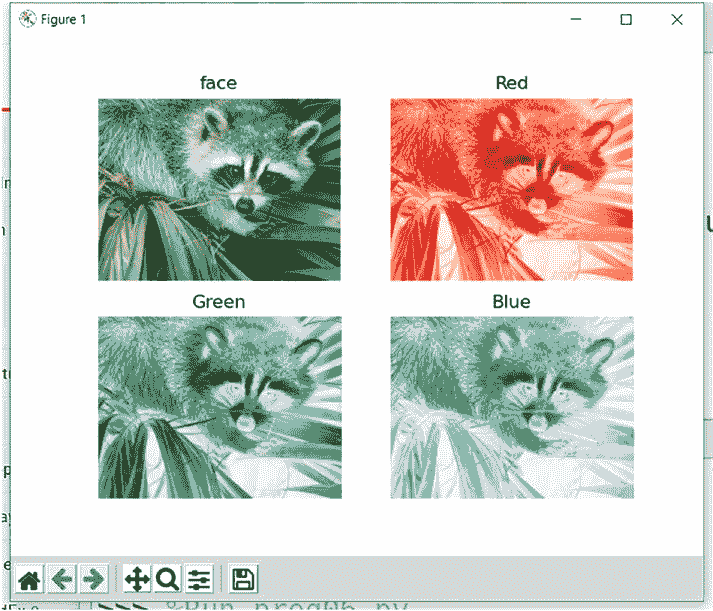

# 第 6 章 科学 Python 生态系统简介

```
g = img[:, :, 1]
b = img[:, :, 2]
titles = ['face', 'Red', 'Green', 'Blue']
images = [img, r, g, b]
plt.subplot(2, 2, 1)
plt.imshow(images[0])
plt.axis('off')
plt.title(titles[0])
plt.subplot(2, 2, 2)
plt.imshow(images[1], cmap='Reds')
plt.axis('off')
plt.title(titles[1])
plt.subplot(2, 2, 3)
plt.imshow(images[2], cmap='Greens')
plt.axis('off')
plt.title(titles[2])
plt.subplot(2, 2, 4)
plt.imshow(images[3], cmap='Blues')
plt.axis('off')
plt.title(titles[3])
plt.show()
```

清单 6-7 中代码的运行结果如图 6-5 所示。



**图 6-5.** 颜色通道

我们可以使用`np.dstack()`方法（该方法用于合并所有通道）来重建原始图像，如清单 6-8 所示。

**清单 6-8.** `prog08.py`

```
import scipy.misc as misc
import matplotlib.pyplot as plt
import numpy as np

img = misc.face()
r = img[:, :, 0]
g = img[:, :, 1]
b = img[:, :, 2]

output = np.dstack((r, g, b))
plt.imshow(output)
plt.axis('off')
plt.title('Combined')
plt.show()
```

运行清单 6-8 中的代码，亲身观察`np.dstack()`方法的工作原理。

## PIL 图像对象与 NumPy ndarray 之间的转换

你可以使用`np.asarray()`和`Image.fromarray()`方法在 PIL 图像与 NumPy ndarray 之间进行转换，如清单 6-9 所示。

**清单 6-9.** `prog09.py`

```
from PIL import Image
import numpy as np
import matplotlib.pyplot as plt

img = Image.open('/home/pi/DIP/Dataset/4.1.07.tiff')
print(type(img))

num_img = np.asarray(img)
print(type(num_img))

img = Image.fromarray(np.uint8(num_img))
print(type(img))
```

控制台输出如下：

```
<class 'PIL.TiffImagePlugin.TiffImageFile'>
<class 'numpy.ndarray'>
<class 'PIL.Image.Image'>
```

## 本章小结

在本章中，我们了解了**科学 Python**技术栈及其组成库，例如 NumPy 和 matplotlib。我们还探索了用于基本图像处理和转换的`scipy.misc`模块。在下一章中，我们将开始探索`scipy.ndimage`模块，学习更多图像处理操作。