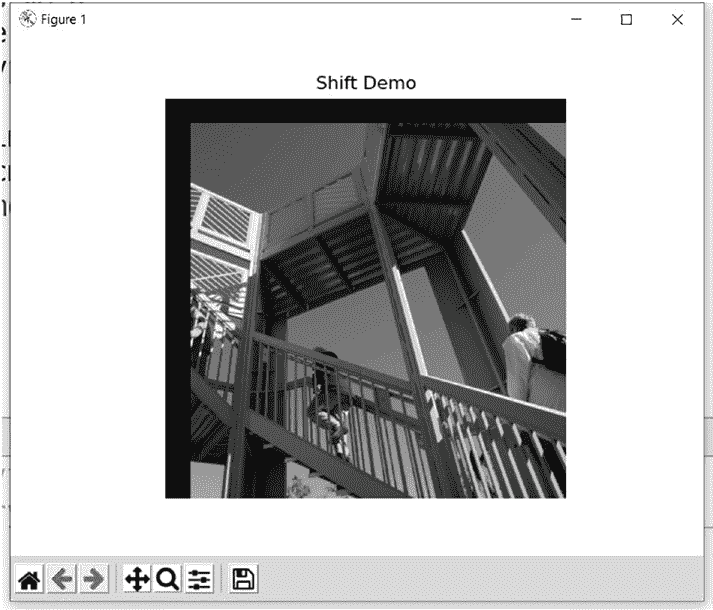
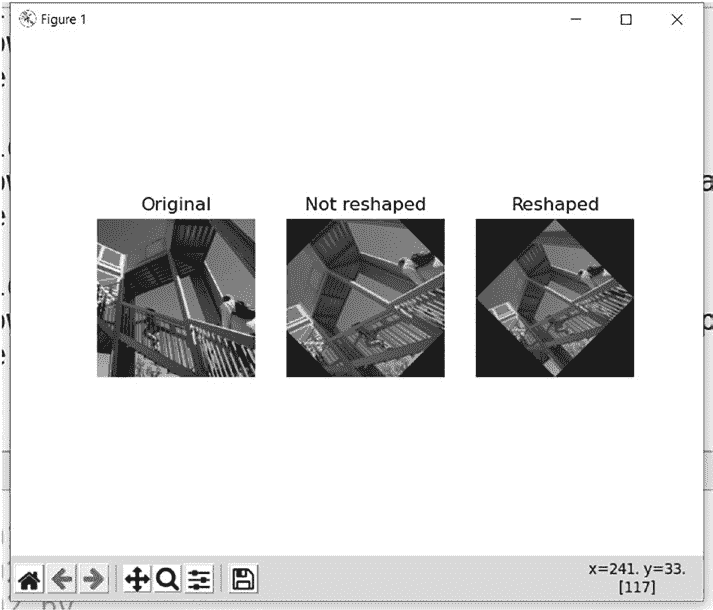
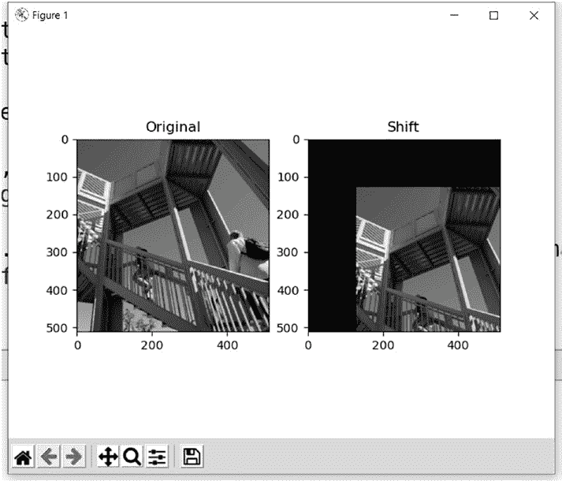

# 第 7 章 变换与测量

在上一章中，我们介绍了科学 Python 技术栈。我们学习了 NumPy 和 matplotlib 的基础知识。我们分别探索了 NumPy 和 matplotlib 中有用的`ndarray`模块和`pyplot`模块。我们还学习了`scipy.misc`模块以及如何使用它进行基本的图像处理。在本章中，我们将进一步探索 SciPy 库。我们将学习使用`scipy.ndimage`库来处理图像。我们还将探索可用于图像变换和图像测量的方法。

在本章结束时，我们将能够熟练地对图像执行操作。

## 变换

我们在上一章中研究了一些可以通过`scipy.misc`实现的基本变换。在这里，我们将学习更多的变换。

© Ashwin Pajankar 2022

A. Pajankar, *树莓派图像处理编程*,

[`doi.org/10.1007/978-1-4842-8270-0_7`](https://doi.org/10.1007/978-1-4842-8270-0_7#DOI)

**注意** 与`scipy.misc`类似，`scipy.ndimage`也有一个`imread()`方法，功能与`scipy.misc.imread()`相同。

在本书的后续部分，我们将一直使用`face()`和`ascent()`。这些是 SciPy 内置的库图像。但是，如果我们想使用数据集目录中的其他图像，我们可以使用 SciPy 的`scipy.misc`或`scipy.ndimage`模块中的`imread()`函数。

让我们从简单的平移变换开始。`shift()`方法接受图像和要应用于坐标的平移值作为参数。示例如清单 7-1 所示。

### 清单 7-1. `prog01.py`

```python
import scipy.misc as misc
import scipy.ndimage as ndi
import matplotlib.pyplot as plt

img = misc.ascent()
output = ndi.shift(img, 32.0)
plt.imshow(output, cmap='gray')
plt.title('Shift Demo')
plt.axis('off')
plt.show()
```

图 7-1 展示了输出结果。



**图 7-1.** 平移操作演示

我们还可以使用 `zoom()` 方法放大图像。需要将图像以及各轴的缩放比例作为参数传递给该方法。清单 7-2 展示了此操作的一个示例。

### 清单 7-2. `prog02.py`

```python
import scipy.misc as misc
import scipy.ndimage as ndi
import matplotlib.pyplot as plt

img = misc.ascent()
plt.imshow(ndi.zoom(img, [5, 3]), cmap='gray')
plt.title('Zoom Demo')
plt.axis('off')
plt.show()
```

清单 7-2 的输出结果见图 7-2。

**图 7-2.** 缩放演示

我们也可以使用 `rotate()` 函数来旋转图像。清单 7-3 展示了使用此函数的几种方式。

### 清单 7-3. `prog03.py`

```python
import scipy.misc as misc
import scipy.ndimage as ndi
import matplotlib.pyplot as plt

img = misc.ascent()
plt.subplot(1, 3, 1)
plt.imshow(img, cmap='gray')
plt.title('Original')
plt.axis('off')
plt.subplot(1, 3, 2)
plt.imshow(ndi.rotate(img, 45, reshape=False), cmap='gray')
plt.title('Not reshaped')
plt.axis('off')
plt.subplot(1, 3, 3)
plt.imshow(ndi.rotate(img, 45, reshape=True), cmap='gray')
plt.title('Reshaped')
plt.axis('off')
plt.show()
```

输出结果如图 7-3 所示。



**图 7-3.** 旋转演示

我们还可以通过定义一个自定义函数，以另一种方式应用平移几何变换。清单 7-4 对此进行了演示。

### 清单 7-4. `prog04.py`

```python
import scipy.misc as misc
import scipy.ndimage as ndi
import matplotlib.pyplot as plt

def shift_func(output_coords,
               x_shift=128,
               y_shift=128):
    return (output_coords[0] - x_shift,
            output_coords[1] - y_shift)

img = misc.ascent()
plt.subplot(1, 2, 1)
plt.imshow(img, cmap='gray')
plt.title('Original')
plt.subplot(1, 2, 2)
plt.imshow(ndi.geometric_transform(img, shift_func),
           cmap='gray')
plt.title('Shift')
plt.show()
```

如清单 7-4 所示，我们传递了一个自定义函数用于几何变换。输出结果如图 7-4 所示。



**图 7-4.** 使用几何变换进行平移

接下来，我们讨论仿射变换。仿射变换是一种几何变换，它保持输出图像中线条之间的平行关系。清单 7-5 演示了这样一种变换。

### 清单 7-5. 仿射变换

```python
import scipy.misc as misc
import scipy.ndimage as ndi
import matplotlib.pyplot as plt

img = misc.ascent()
plt.subplot(1, 3, 1)
plt.imshow(img, cmap='gray')
plt.title('Original')

T = [[1, 0, 128], [0, 1, 128], [0, 0, 1]]
plt.subplot(1, 3, 2)
plt.imshow(ndi.affine_transform(img, T), cmap='gray')
plt.title('Translation')

S = [[0.5, 0, 0], [0, 0.5, 0], [0, 0, 1]]
plt.subplot(1, 3, 3)
plt.imshow(ndi.affine_transform(img, S), cmap='gray')
plt.title('Scaling')

plt.show()
```

在仿射变换中，我们需要定义一个变换矩阵，然后将其应用于图像或几何形状。在清单 7-5 中，我们将缩放和平移（平移的另一种说法）操作应用于图像。

图 7-5 显示了输出结果。

**图 7-5.** 仿射变换

我们还可以对图像应用样条变换。