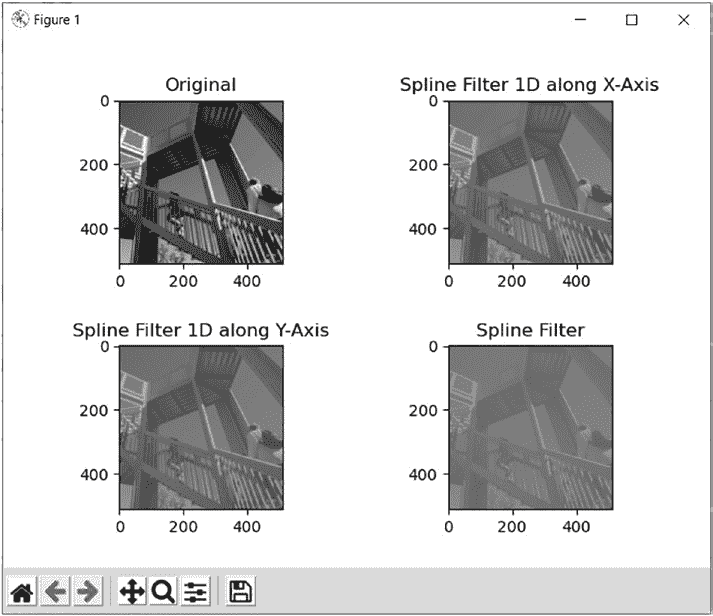

# 第 7 章 变换与测量

***列表 7-6.*** 样条变换

```python
import scipy.misc as misc
import numpy as np
import scipy.ndimage as ndi
import matplotlib.pyplot as plt

img = misc.ascent()

sp_filter_axis_0 = ndi.spline_filter1d(img, axis=0)
sp_filter_axis_1 = ndi.spline_filter1d(img, axis=1)
sp_filter = ndi.spline_filter(img, order=3)

plt.subplot(2, 2, 1)
plt.imshow(img, cmap='gray')
plt.title('Original')
plt.subplots_adjust(hspace=0.5, wspace=0.5)

plt.subplot(2, 2, 2)
plt.imshow(sp_filter_axis_0, cmap='gray')
plt.title('Spline Filter 1D along X-Axis')

plt.subplot(2, 2, 3)
plt.imshow(sp_filter_axis_1, cmap='gray')
plt.title('Spline Filter 1D along Y-Axis')

plt.subplot(2, 2, 4)
plt.imshow(sp_filter, cmap='gray')
plt.title('Spline Filter')

plt.show()
```

输出如图 7-6 所示。



***图 7-6.** 样条变换*

## 测量

让我们来处理测量。第一个是直方图，它是像素强度频率分布的直观表示。

列表 7-7 展示了直方图的演示。

***列表 7-7.*** prog07.py

```python
import scipy.misc as misc
import scipy.ndimage as ndi
import matplotlib.pyplot as plt

img = misc.face()
hist = ndi.histogram(img, 0, 255, 256)
plt.plot(hist, 'k')
plt.title('Face Histogram')
plt.grid(True)
plt.show()
```

我们将图像、箱的最低和最高限制以及箱的数量作为参数传递给计算直方图的函数。输出如图 7-7 所示。

***图 7-7.** 直方图*

我们再计算一些测量值，如列表 7-8 所示。

***列表 7-8.*** prog08.py

```python
import scipy.misc as misc
import scipy.ndimage as ndi

img = misc.ascent()

print(ndi.minimum(img))
print(ndi.minimum_position(img))
print(ndi.maximum(img))
print(ndi.maximum_position(img))
print(ndi.extrema(img))
```

输出如下：

```
(201, 268)
(190, 265)
(0, 255, (201, 268), (190, 265))
```

我们也可以计算一些统计属性，如列表 7-9 所示。

***列表 7-9.*** prog09.py

```python
import scipy.misc as misc
import scipy.ndimage as ndi

img = misc.ascent()

print(ndi.sum(img))
print(ndi.mean(img))
print(ndi.median(img))
print(ndi.variance(img))
print(ndi.standard_deviation(img))
```

输出如下：

```
87.47987365722656
80.0
2378.9479362999555
48.774459877070456
```

此外，我们还可以计算质心，如列表 7-10 所示。

***列表 7-10.*** prog10.py

```python
import scipy.misc as misc
import scipy.ndimage as ndi

img = misc.ascent()

print(ndi.center_of_mass(img))
```

输出如下：

```
(259.9973423539629, 254.6090727219797)
```

计算图像中的标签也可以实现，如列表 7-11 所示。

***列表 7-11.*** prog11.py

```python
import scipy.misc as misc
import scipy.ndimage as ndi
import numpy as np

img = misc.face()
a = np.zeros((6,6), dtype=int)
a[2:4, 2:4] = 1
a[4, 4] = 1
a[:2, :3] = 2
a[0, 5] = 3

print(ndi.find_objects(a))
print(ndi.find_objects(a, max_label=2))
print(ndi.find_objects(a, max_label=4))
print(ndi.find_objects(img, max_label=4))
print(ndi.sum_labels(img))
```

输出如下：

```
[(slice(2, 5, None), slice(2, 5, None)), (slice(0, 2, None), slice(0, 3, None)), (slice(0, 1, None), slice(5, 6, None))]
[(slice(2, 5, None), slice(2, 5, None)), (slice(0, 2, None), slice(0, 3, None))]
[(slice(2, 5, None), slice(2, 5, None)), (slice(0, 2, None), slice(0, 3, None)), (slice(0, 1, None), slice(5, 6, None)), None]
[(slice(1, 768, None), slice(7, 1024, None), slice(0, 3, None)), (slice(1, 768, None), slice(8, 1024, None), slice(0, 3, None))]
```


好的，作为一名高级文档工程师和翻译员，我将遵循您提供的所有注意事项和示例，将给定的英文文本翻译成中文。

---


`(slice(1, 768, None), slice(0, 1024, None), slice(0, 3, None))`

`(slice(0, 768, None), slice(1, 1023, None), slice(0, 3, None))`

### 总结

在本章中，我们探讨了变换和测量的方法。我们研究了平移和缩放变换，并计算了灰度图像的直方图。我们还计算了图像的统计信息。

在下一章中，我们将详细研究图像核和滤波器、它们的类型及其在图像增强中的应用。

