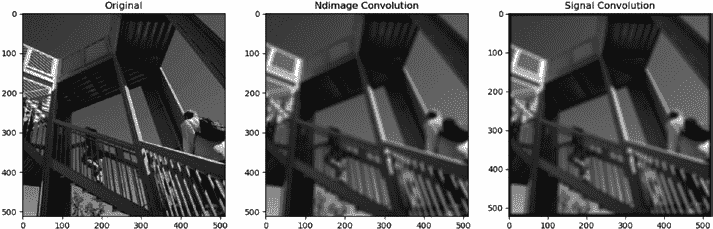

# 滤波器

在上一章中，我们学习了 SciPy 库的 `scipy.ndimage` 模块中的功能。我们学习了如何对图像应用诸如 `shift` 和 `zoom` 之类的变换。我们还学习了如何获取图像的统计信息。我们了解了如何计算和绘制图像的直方图。

在第 [5](https://doi.org/10.1007/978-1-4842-8270-0_5) 章中，我们使用 Pillow 库学习了图像滤波器。在本章中，我们将详细研究这些滤波器背后的理论。我们还将了解图像处理中使用的滤波器类型和内核，以及这些滤波器的应用。

以下是本章涵盖的主题：

- 内核
- 低通滤波器
- 高通滤波器
- 傅里叶滤波器

学完本章后，我们将能够熟练使用 SciPy 滤波器及其应用。

© Ashwin Pajankar 2022  
A. Pajankar，*树莓派图像处理编程*，  
[`doi.org/10.1007/978-1-4842-8270-0_8`](https://doi.org/10.1007/978-1-4842-8270-0_8#DOI)

## 第 8 章 滤波器

### 内核、卷积和相关

内核（也称为卷积矩阵或掩膜）是用于执行图像处理的二维矩阵。我们可以将内核用于卷积和相关等操作。

卷积将矩阵的每个元素与其局部邻居相加，并由内核加权。根据所使用的内核，卷积可以产生多种结果，例如模糊、锐化、浮雕和边缘检测。

在对矩阵使用卷积时，我们可以使用各种技术来处理边缘，例如扩展、包裹、镜像、裁剪、内核裁剪、常量以及避免重叠。

让我们演示对一维和二维矩阵的 `convolve1d()` 和 `convolve()` 函数，如清单 8-1 所示。

***清单 8-1.*** `prog00.py`

```python
import scipy.ndimage as ndi
import numpy as np

print(ndi.convolve1d([0, 1, 2, 3, 4, 5, 6],
                     weights=[1, 2, 3]))

a = np.array([[0, 1, 2, 3],
              [4, 5, 6, 7],
              [8, 9, 10, 11],
              [12, 13, 14, 15]])

k = np.array([[0 ,1, 0],[1, 1, 1],[0, 1, 0]])

print(ndi.convolve(a, k, mode='nearest'))
```

输出如下：

```
[ 1  4 10 16 22 28 33]
[[ 5  9 14 18]
 [21 25 30 34]
 [41 45 50 54]
 [57 61 66 70]]
```

我们也可以将卷积操作应用于图像矩阵。网址为 [`setosa.io/ev/image-kernels`](https://setosa.io/ev/image-kernels) 的教程讨论了各种内核及其对图像的影响。我们可以使用 SciPy 的 `signal` 模块中的 `convolve2d()` 函数。清单 8-2 提供了一个演示。

***清单 8-2.*** `prog01.py`

```python
import scipy.ndimage as ndi
import scipy.signal
import numpy as np
import scipy.misc as misc
import matplotlib.pyplot as plt

img = misc.ascent()
k = np.ones((11, 11), np.uint8)/121

c1 = ndi.convolve(img, k, mode='nearest')
c2 = scipy.signal.convolve2d(img, k)

print(c1)
print(c2)

plt.subplot(1, 3, 1)
plt.imshow(img, cmap='gray')
plt.title('Original')

plt.subplot(1, 3, 2)
plt.imshow(c1, cmap='gray')
plt.title('Ndimage Convolution')

plt.subplot(1, 3, 3)
plt.imshow(c2, cmap='gray')
plt.title('Signal Convolution')

plt.show()
```

它生成的输出如图 8-1 所示。



***图 8-1.** 卷积演示*

卷积是通过组合两个输入生成单个输出的一种数学方式。相关比较两个信号。清单 8-3 是对相关操作的演示。

***清单 8-3.*** `prog02.py`


好的，作为高级文档工程师和翻译员，我将严格按照您提供的注意事项和示例格式，将给定的英文文本翻译成中文。


```python
import scipy.ndimage as ndi
import numpy as np

print(ndi.correlate1d([0, 1, 2, 3, 4, 5, 6], weights=[1, 2, 3]))
```

```python
a = np.array([[0, 1, 2, 3],
              [4, 5, 6, 7],
              [8, 9, 10, 11],
              [12, 13, 14, 15]])

k = np.array([[0, 1, 0],
              [1, 1, 1],
              [0, 1, 0]])

print(ndi.correlate(a, k, mode='nearest'))
```

输出如下：

```
[ 3 8 14 20 26 32 35]
[[ 5 9 14 18]
 [21 25 30 34]
 [41 45 50 54]
 [57 61 66 70]]
```

