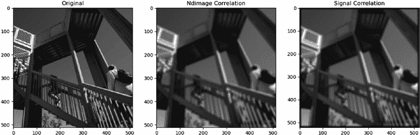

# 第 8 章 滤波器

让我们将相关运算应用于图像。我们将（与列表 8-2 类似）使用两种不同的方法计算相关，如列表 8-4 所示。

***列表 8-4.*** `prog03.py`

```python
import scipy.ndimage as ndi
import scipy.signal
import numpy as np
import scipy.misc as misc
import matplotlib.pyplot as plt

img = misc.ascent()
k = np.ones((11, 11), np.uint8) / 121

c1 = ndi.correlate(img, k, mode='nearest')
c2 = scipy.signal.correlate2d(img, k)

print(c1)
print(c2)

plt.subplot(1, 3, 1)
plt.imshow(img, cmap='gray')
plt.title('原始图像')

plt.subplot(1, 3, 2)
plt.imshow(c1, cmap='gray')
plt.title('Ndimage 相关')

plt.subplot(1, 3, 3)
plt.imshow(c2, cmap='gray')
plt.title('Signal 相关')

plt.show()
```

输出如图 8-2 所示。

