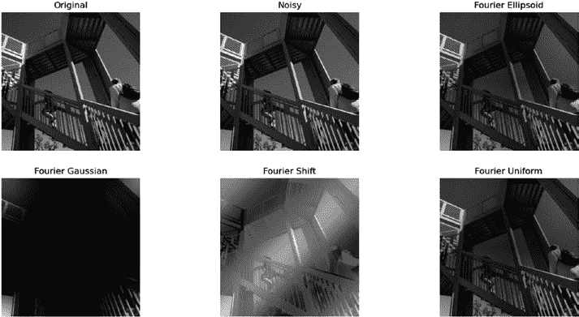

# 第 8 章 滤波器

`plt.subplot(2, 2, i+1)`

```
plt.imshow(output[i],
cmap='gray')
plt.title(titles[i])
plt.axis('off')
plt.show()
```

输出结果如图 8-14 所示。

***图 8-14.** 拉普拉斯算子、高斯梯度幅值和高斯拉普拉斯滤波器*

## 傅里叶滤波器

傅里叶滤波器在频域中工作。它们计算图像的傅里叶变换，操纵频率，最后计算逆傅里叶变换以生成最终输出。我们可以对图像应用各种傅里叶滤波器，如代码清单 8-17 所示。

***代码清单 8-17.*** prog16.py

```
import scipy.ndimage as ndi
import scipy.misc as misc
import matplotlib.pyplot as plt
import numpy as np

img = misc.ascent()
noisy = img + 0.09 * img.std() * np.random.random(img.shape)

fe = ndi.fourier_ellipsoid(img, 1)
fg = ndi.fourier_gaussian(img, 1)
fs = ndi.fourier_shift(img, 1)
fu = ndi.fourier_uniform(img, 1)

titles = ['Original', 'Noisy',
'Fourier Ellipsoid', 'Fourier Gaussian',
'Fourier Shift', 'Fourier Uniform']

output = [img, noisy, fe, fg, fs, fu]

for i in range(6):
    plt.subplot(2, 3, i+1)
    plt.imshow(np.float64(output[i]), cmap='gray')
    plt.title(titles[i])
    plt.axis('off')
    plt.show()
```

输出结果如图 8-15 所示。



***图 8-15.** 各种傅里叶滤波器*

## 本章小结

本章我们介绍了种类繁多的滤波器。我们了解了它们的类型，并探讨了其应用。图像滤波这一主题过于庞大，无法在一章内完全探讨。

下一章，我们将介绍形态学算子、图像阈值分割和基础图像分割。

