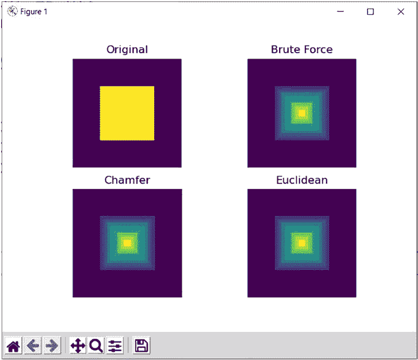

# 形态学、阈值分割与图像分割

在上一章中，我们研究了图像滤波器背后的原理，以及用于图像增强的滤波器类型和实际应用。

本章我们将学习并演示图像处理中的重要概念，例如形态学、图像的形态学操作、阈值分割和图像分割。我们将学习并演示以下内容：

*   距离变换
*   形态学与形态学操作
*   阈值分割与图像分割

## 距离变换

距离变换是对二值图像执行的一种操作。二值图像包含背景元素（零值——黑色）和前景元素（白色）。距离变换将每个前景元素替换为到背景的最短距离值。`scipy.ndimage` 提供了三种计算二值图像距离变换的方法。代码清单 9-1 中的代码演示了如何实际使用距离变换来生成测试图像。

***代码清单 9-1.*** prog01.py

```
import scipy.ndimage as ndi
import matplotlib.pyplot as plt
import numpy as np

img = np.zeros((32, 32))
img[8:-8, 8:-8] = 1

print(img)

dist1 = ndi.distance_transform_bf(img)
dist2 = ndi.distance_transform_cdt(img)
dist3 = ndi.distance_transform_edt(img)

output = [img, dist1, dist2, dist3]
titles = ['Original', 'Brute Force', 'Chamfer', 'Euclidean']

for i in range(4):
    print(output[i])
    plt.subplot(2, 2, i+1)
    plt.imshow(output[i],
    interpolation='nearest')
    plt.title(titles[i])
    plt.axis('off')
    plt.show()
```

代码清单 9-1 所示的代码分别使用暴力算法、倒角距离算法和欧几里得方法计算距离变换。我们将在本章中使用距离变换来生成测试图像。输出结果如图 9-1 所示。



## 第 9 章 形态学、阈值分割与图像分割

***图 9-1.** 距离变换*


