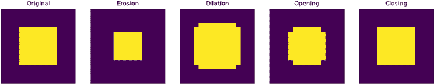

# 形态学与形态学操作

形态学是研究形状与形式的学科。图像的形态学研究关注的是形状而非像素值。形态学操作通常在二值图像上执行。让我们了解几个与形态学操作相关的概念。

## 结构元素

结构元素是一个矩阵，用于与给定的二值图像进行交互。它有不同的形状，例如球形、环形或线形。它也可以有多种尺寸，如 3×3 或 7×7 的矩阵。较大的结构元素需要更多计算时间。一个简单的结构元素可以定义为奇数大小的单位矩阵，例如 `np.ones((3, 3))`。

## 二值形态学操作

让我们简要了解各种形态学操作。膨胀会使输入图像中的形状扩大。腐蚀会使输入图像中的形状收缩。开运算是先腐蚀后膨胀。闭运算是先膨胀后腐蚀。

仅仅通过阅读很难理解这些概念。请查看清单 9-2 中的示例，该示例在二值图像上演示了这些概念。

***清单 9-2.*** `prog02.py`

```python
import matplotlib.pyplot as plt
import scipy.ndimage as ndi
import numpy as np

img = np.zeros((16, 16))
img[4:-4, 4:-4] = 1
print(img)

erosion = ndi.binary_erosion(img).astype(img.dtype)
dilation = ndi.binary_dilation(img).astype(img.dtype)
opening = ndi.binary_opening(img).astype(img.dtype)
closing = ndi.binary_closing(img).astype(img.dtype)

output = [img, erosion, dilation, opening, closing]
titles = ['Original', 'Erosion', 'Dilation', 'Opening', 'Closing']

for i in range(5):
    print(output[i])
    plt.subplot(1, 5, i+1)
    plt.imshow(output[i], interpolation='nearest')
    plt.title(titles[i])
    plt.axis('off')

plt.show()
```

清单 9-2 中的代码示例生成一个二值图像，并对其应用所有二值形态学操作。输出结果如图 9-2 所示。

***图 9-2.** 对二值图像进行形态学操作*

另一个重要的操作是 `binary_fill_holes()`。它用于填充二值图像中的孔洞，如清单 9-3 所示。

***清单 9-3.*** `prog03.py`

```python
import matplotlib.pyplot as plt
import scipy.ndimage as ndi
import numpy as np

img = np.ones((32, 32))
x, y = (32 * np.random.random((2, 20))).astype(np.int)

img[x, y] = 0
noise_removed = ndi.binary_fill_holes(img).astype(int)

output = [img, noise_removed]
titles = ['Original', 'Noise Removed']

for i in range(2):
    print(output[i])
    plt.subplot(1, 2, i+1)
    plt.imshow(output[i], interpolation='nearest')
    plt.title(titles[i])
    plt.axis('off')

plt.show()
```

清单 9-3 中的代码生成一个 32×32 的方阵图像，所有值均为 1（白色值）。然后随机将几个像素设置为 0（黑色值）。这些黑色像素可以视为图像中的孔洞，随后可通过 `binary_fill_holes()` 去除。输出结果如图 9-3 所示。

***图 9-3.** 使用形态学操作去除噪声*

之前我们讨论过二值结构。现在让我们使用二值结构对图像应用形态学操作。清单 9-4 演示了这一点。

***清单 9-4.*** `prog04.py`

```python
import matplotlib.pyplot as plt
import scipy.ndimage as ndi
import numpy as np

img = np.zeros((16, 16))
img[4:-4, 4:-4] = 1

struct = ndi.generate_binary_structure(2, 1)
print(struct)

erosion = ndi.binary_erosion(img, struct).astype(img.dtype)
dilation = ndi.binary_dilation(img, struct).astype(img.dtype)
opening = ndi.binary_opening(img, struct).astype(img.dtype)
closing = ndi.binary_closing(img, struct).astype(img.dtype)

output = [img, erosion, dilation, opening, closing]
titles = ['原始图像', '腐蚀', '膨胀', '开运算', '闭运算']

for i in range(5):
    print(output[i])
    plt.subplot(1, 5, i+1)
    plt.imshow(output[i], interpolation='nearest')
    plt.title(titles[i])
    plt.axis('off')

plt.show()
```

输出结果如图 9-4 所示。

