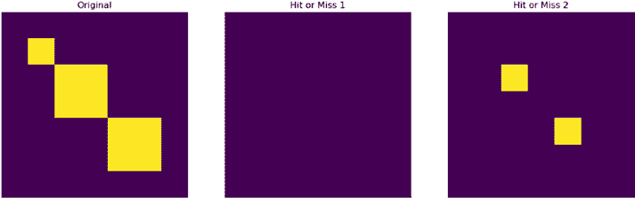

# 第九章 形态学、阈值处理与图像分割

`图 9-4.` 使用结构元素的形态学运算

我们可以分别执行带结构元素和不带结构元素的击中或击不中变换，如`代码清单 9-5`所示。

`代码清单 9-5. prog05.py`

```python
import matplotlib.pyplot as plt
import scipy.ndimage as ndi
import numpy as np

img = np.zeros((7, 7), dtype=int)
img[1, 1] = img[2:4, 2:4] = img[4:6, 4:6] = 1
struct = np.array([[1, 0, 0],
                   [0, 1, 1],
                   [0, 1, 1]])
print(struct)
hit_or_miss1 = ndi.binary_hit_or_miss(img).astype(int)
hit_or_miss2 = ndi.binary_hit_or_miss(img, structure1=struct).astype(int)
output = [img, hit_or_miss1, hit_or_miss2]
titles = ['原始图像', '击中或击不中 1', '击中或击不中 2']

for i in range(3):
    print(output[i])
    plt.subplot(1, 3, i+1)
```

