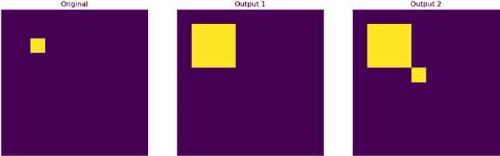

# 第九章 形态学、阈值处理与图像分割

```python
    plt.imshow(output[i], interpolation='nearest')
    plt.title(titles[i])
    plt.axis('off')

plt.show()
```

输出结果如图 9-5 所示。

***图 9-5.** 二值击中或击不中运算*

我们甚至可以演示二值传播，如代码清单 9-6 所示。

***代码清单 9-6.*** `prog06.py`

```python
import matplotlib.pyplot as plt
import scipy.ndimage as ndi
import numpy as np

n = 10
img = np.zeros((n, n), dtype=np.uint8)
img[2, 2] = 1
mask = np.zeros((n, n), dtype=np.uint8)
mask[1:4, 1:4] = mask[4, 4] = mask[6:8, 6:8] = 1
struct = np.ones((3, 3))
o1 = ndi.binary_propagation(img, mask=mask).astype(int)
```



