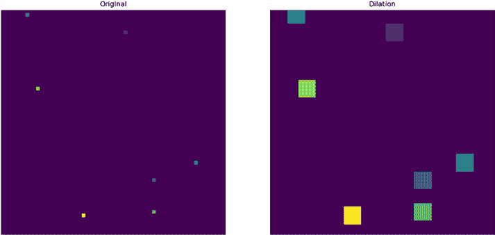

# 第九章 形态学、阈值处理与图像分割

## 代码清单 9-7.`prog07.py`
```python
import matplotlib.pyplot as plt
import scipy.ndimage as ndi
import numpy as np

img = np.zeros((64, 64))
x, y = (63 * np.random.random((2, 8))).astype(np.int)
img[x, y] = np.arange(8)
dilation = ndi.grey_dilation(img, size=(5, 5), structure=np.ones((5, 5)))
output = [img, dilation]
titles = ['原始图像', '膨胀']

for i in range(2):
    print(output[i])
    plt.subplot(1, 2, i+1)
    plt.imshow(output[i], interpolation='nearest')
    plt.title(titles[i])
    plt.axis('off')

plt.show()
```

输出结果如图 9-7 所示。
