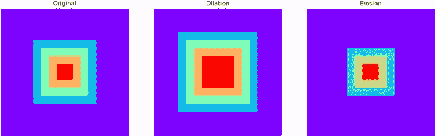

# 第九章 形态学、阈值处理与图像分割

***图 9-7.** 灰度膨胀*

此处我们使用了一个 5x5 的结构元素。

**注意：** 此示例使用了 `random()` 方法。当您执行配套代码中的代码时，输出结果不会完全相同。

代码清单 9-8 所示的代码对距离变换应用了灰度膨胀和灰度腐蚀运算。

***代码清单 9-8.*** `prog08.py`

```python
import matplotlib.pyplot as plt
import scipy.ndimage as ndi
import numpy as np

img = np.zeros((16, 16))
img[4:-4, 4:-4] = 1
img = ndi.distance_transform_bf(img)
```



