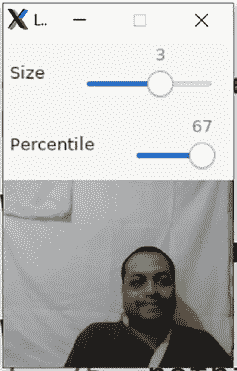

# 第 10 章 视频处理

此外，控制台会以每秒多次的频率显示输出（就像此处一样，因此它会非常快速地滚动）：

```
2022-01-30 13:00:30.427360
```

`uint8`

`(144, 176, 3)`

## 实时摄像头流的更多操作

让我们看看使用 `SciPy` 库例程对实时摄像头流执行的更多操作。我们将涵盖大量示例。我们在前几章中已经学习了所有这些操作，现在将把它们应用到实时摄像头流上。

### 几何变换

让我们连续旋转摄像头帧。清单 `10-4` 展示了代码。

`清单 10-4. prog03.py`

```python
import numpy as np
import cv2 as cv
import scipy.ndimage as ndi

angle = 0

cap = cv.VideoCapture(0)
cap.set(cv.CAP_PROP_FRAME_WIDTH, 256)
cap.set(cv.CAP_PROP_FRAME_HEIGHT, 144)

if not cap.isOpened():
    print("Cannot open camera...")
    exit()

while True:
    ret, frame = cap.read()
    if not ret:
        print("Can't receive frame... \nExiting ...")
        break
    angle = (angle + 1) % 360
    output = ndi.rotate(frame, angle, reshape=False)
    cv.imshow('Rotated Frame', output)
    if cv.waitKey(1) == 27:
        break

cap.release()
cv.destroyAllWindows()
```

操作帧的代码如下所示：

```python
angle = (angle + 1) % 360
output = ndi.rotate(frame, angle, reshape=False)
```

逻辑非常简单。我们只需在每一帧中增加旋转角度，当达到 `360` 度时，重新开始。下图（图 `10-3`）显示了其中一帧的截图。

`图 10-3. 实时摄像头源的几何变换`

实际上，截图（图 `10-3`）无法完全展现实际输出效果。运行程序，亲自查看输出结果吧。

### 卷积

让我们定义一个核，并使用卷积操作将其应用于流中的帧，如清单 `10-5` 所示。

`清单 10-5. prog04.py`

```python
import numpy as np
import cv2 as cv
import scipy.ndimage as ndi

cap = cv.VideoCapture(0)
n = 5
k = np.ones((n, n, n), np.uint8)/(n*n*n)

cap.set(cv.CAP_PROP_FRAME_WIDTH, 256)
cap.set(cv.CAP_PROP_FRAME_HEIGHT, 144)

if not cap.isOpened():
    print("Cannot open camera...")
    exit()

while True:
    ret, frame = cap.read()
    if not ret:
        print("Can't receive frame... \nExiting ...")
        break
    output = ndi.convolve(frame, k, mode='nearest')
    cv.imshow('Convolved Frame', output)
    if cv.waitKey(1) == 27:
        break

cap.release()
cv.destroyAllWindows()
```

由于这是一个模糊核，输出的是来自摄像头的模糊视频流，如截图（图 `10-4`）所示。

`图 10-4. 来自摄像头的模糊视频流`

`OpenCV` 库也具备创建轨迹条的功能。让我们创建一个轨迹条，用于调整核矩阵的大小。

清单 `10-6` 包含相关代码。

`清单 10-6. prog05.py`

```python
import numpy as np
import cv2 as cv
import scipy.ndimage as ndi

def nothing(x):
    pass

WINDOW_NAME = "Live Convolution"
cv.namedWindow(WINDOW_NAME)
cv.createTrackbar('Kernel Size', WINDOW_NAME, 1, 5, nothing)

cap = cv.VideoCapture(0)
n = 1

cap.set(cv.CAP_PROP_FRAME_WIDTH, 256)
cap.set(cv.CAP_PROP_FRAME_HEIGHT, 144)

if not cap.isOpened():
    print("Cannot open camera...")
    exit()

while True:
    ret, frame = cap.read()
    if not ret:
        print("Can't receive frame... \nExiting ...")
        break
    n = cv.getTrackbarPos('Kernel Size', WINDOW_NAME)
    k = np.ones((n, n, n), np.uint8)/(n*n*n)
    output = ndi.convolve(frame, k, mode='nearest')
    cv.imshow(WINDOW_NAME, output)
    if cv.waitKey(1) == 27:
        break

cap.release()
cv.destroyAllWindows()
```

我们已经熟悉大部分代码。让我们理解一下新的部分。以下代码定义了一个空函数：

```python
def nothing(x):
    pass
```

以下代码定义了一个命名窗口：

```python
WINDOW_NAME = "Live Convolution"
cv.namedWindow(WINDOW_NAME)
```

我们需要一个命名窗口来绑定新创建的轨迹条，操作如下：

`cv.createTrackbar('Kernel Size', WINDOW_NAME, 1, 5, nothing)`

此代码创建了一个命名的轨迹条，允许我们从 `1` 滑动到 `5`。它被附加到之前创建的命名窗口上。我们之前定义的空函数（`nothing`）与该轨迹条关联，每次操作轨迹条时都会调用它。在 `while` 循环中，我们通过以下函数调用获取滑块的当前位置：

`n = cv.getTrackbarPos('Kernel Size', WINDOW_NAME)`

现在，我们可以通过滑动轨迹条上的滑块来改变内核的大小。图 `10-5` 显示了输出结果。

`图 10-5. 使用轨迹条`

## 视频处理

在本章中，我们将频繁使用轨迹条的代码。

### 相关性

让我们使用轨迹条，并在实时网络摄像头源上应用相关性，如清单 `10-7` 所示。

`清单 10-7. prog06.py`

# 第 10 章：视频处理

## 滤波

我们在前面的章节中已经了解了许多滤波器。接下来，让我们在实时网络摄像头源上逐一应用它们。

让我们看看图 10-6 中的输出结果。

**图 10-6.** 带轨迹条的相关性

**注意** 我们可以通过以下链接阅读更多关于相关性概念的内容：
<https://towardsdatascience.com/convolution-vs-correlation-af868b6b4fb5>

清单 10-8 展示了高斯滤波器。

### 清单 10-8. `prog07.py`

```python
import numpy as np
import cv2 as cv
import scipy.ndimage as ndi

def nothing(x):
    pass

WINDOW_NAME = "Live Gaussian"
cv.namedWindow(WINDOW_NAME)
cv.createTrackbar('Sigma Size', WINDOW_NAME, 1, 15, nothing)

cap = cv.VideoCapture(0)
cap.set(cv.CAP_PROP_FRAME_WIDTH, 256)
cap.set(cv.CAP_PROP_FRAME_HEIGHT, 144)

if not cap.isOpened():
    print("Cannot open camera...")
    exit()

while True:
    ret, frame = cap.read()
    if not ret:
        print("Can't receive frame... \nExiting ...")
        break

    n = cv.getTrackbarPos('Sigma Size', WINDOW_NAME)
    output = ndi.gaussian_filter(frame, sigma=n)
    cv.imshow(WINDOW_NAME, output)

    if cv.waitKey(1) == 27:
        break

cap.release()
cv.destroyAllWindows()
```

接下来，应用一个均匀滤波器，如清单 10-9 所示。

### 清单 10-9. `prog08.py`

```python
import numpy as np
import cv2 as cv
import scipy.ndimage as ndi

def nothing(x):
    pass

WINDOW_NAME = "Live Uniform"
cv.namedWindow(WINDOW_NAME)
cv.createTrackbar('Filter Size', WINDOW_NAME, 1, 15, nothing)

cap = cv.VideoCapture(0)
cap.set(cv.CAP_PROP_FRAME_WIDTH, 256)
cap.set(cv.CAP_PROP_FRAME_HEIGHT, 144)

if not cap.isOpened():
    print("Cannot open camera...")
    exit()

while True:
    ret, frame = cap.read()
    if not ret:
        print("Can't receive frame... \nExiting ...")
        break

    n = cv.getTrackbarPos('Filter Size', WINDOW_NAME)
    output = ndi.uniform_filter(frame, size=n)
    cv.imshow(WINDOW_NAME, output)

    if cv.waitKey(1) == 27:
        break

cap.release()
cv.destroyAllWindows()
```

接下来，应用百分位滤波器。清单 10-10 中的代码定义了两个轨迹条，用于调整传递给滤波器的参数。

### 清单 10-10. `prog09.py`

```python
import numpy as np
import cv2 as cv
import scipy.ndimage as ndi

def nothing(x):
    pass

WINDOW_NAME = "实时百分位滤波"

cv.namedWindow(WINDOW_NAME)
cv.createTrackbar('尺寸', WINDOW_NAME, 1, 5, nothing)
cv.createTrackbar('百分位', WINDOW_NAME, 1, 75, nothing)

cap = cv.VideoCapture(0)
cap.set(cv.CAP_PROP_FRAME_WIDTH, 256)
cap.set(cv.CAP_PROP_FRAME_HEIGHT, 144)

if not cap.isOpened():
    print("无法打开摄像头...")
    exit()

while True:
    ret, frame = cap.read()
    if not ret:
        print("无法接收帧... \n 正在退出...")
        break

    s = cv.getTrackbarPos('尺寸', WINDOW_NAME)
    p = cv.getTrackbarPos('百分位', WINDOW_NAME)

    output = ndi.percentile_filter(frame, size=s, percentile=p)

    cv.imshow(WINDOW_NAME, output)
    if cv.waitKey(1) == 27:
        break

cap.release()
cv.destroyAllWindows()
```



输出结果如图 10-7 所示。

**图 10-7.** 百分位滤波器

接下来实现一个最小值滤波器，如代码清单 10-11 所示。

### 代码清单 10-11. `prog10.py`

```python
import numpy as np
import cv2 as cv
import scipy.ndimage as ndi

def nothing(x):
    pass

WINDOW_NAME = "实时最小值滤波"

cv.namedWindow(WINDOW_NAME)
cv.createTrackbar('滤波器尺寸', WINDOW_NAME, 1, 55, nothing)
```

# 第 10 章：视频处理

接下来应用最大值滤波器，如代码清单 10-12 所示。

## 代码清单 10-12. `prog11.py`

```python
import numpy as np
import cv2 as cv
import scipy.ndimage as ndi
```

我们还可以应用 Prewitt 和 Laplace 滤波器，如代码清单 10-13 所示。

## 代码清单 10-13. `prog12.py`

```python
import numpy as np
import cv2 as cv
import scipy.ndimage as ndi

cap = cv.VideoCapture(0)
cap.set(cv.CAP_PROP_FRAME_WIDTH, 256)
cap.set(cv.CAP_PROP_FRAME_HEIGHT, 144)

if not cap.isOpened():
    print("无法打开摄像头...")
    exit()

while True:
    ret, frame = cap.read()
    if not ret:
        print("无法接收帧... \n 正在退出...")
        break

    o1 = ndi.prewitt(frame)
    o2 = ndi.laplace(frame)

    cv.imshow("Prewitt", o1)
    cv.imshow("Laplace", o2)

    if cv.waitKey(1) == 27:
        break

cap.release()
cv.destroyAllWindows()
```

**注意：** 更多关于这两种滤波器的信息，请参阅以下网址：

- [`www.geeksforgeeks.org/matlab-image-edge-detection-using-prewitt-operator-from-scratch/`](https://www.geeksforgeeks.org/matlab-image-edge-detection-using-prewitt-operator-from-scratch/)

- [`www.l3harrisgeospatial.com/docs/laplacianfilters.html`](https://www.l3harrisgeospatial.com/docs/laplacianfilters.html)

应用高斯梯度幅度滤波器，如代码清单 10-14 所示。

## 代码清单 10-14. `prog13.py`

```python
import numpy as np
import cv2 as cv
import scipy.ndimage as ndi

def nothing(x):
    pass

WINDOW_NAME = "高斯梯度幅度"

cv.namedWindow(WINDOW_NAME)
cv.createTrackbar('Sigma', WINDOW_NAME, 1, 10, nothing)

cap = cv.VideoCapture(0)
```