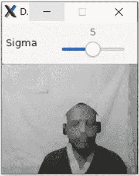
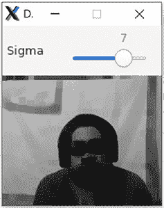

# 第 10 章 视频处理

`cap.set(cv.CAP_PROP_FRAME_WIDTH, 256)`

`cap.set(cv.CAP_PROP_FRAME_HEIGHT, 144)`

```
if not cap.isOpened():
    print("Cannot open camera...")
    exit()
```

```
while True:
    ret, frame = cap.read()
    if not ret:
        print("Can't receive frame... \nExiting ...")
        break
    s = cv.getTrackbarPos('Sigma', WINDOW_NAME)
    gray = cv.cvtColor(frame, cv.COLOR_BGR2GRAY)
    output = ndi.gaussian_gradient_magnitude(gray, sigma=s)
    cv.imshow(WINDOW_NAME, output)
    if cv.waitKey(1) == 27:
        break
cap.release()
cv.destroyAllWindows()
```

下面我们应用高斯-拉普拉斯滤波器，如清单 10-15 所示。

***清单 10-15.*** `prog14.py`

```
import numpy as np
import cv2 as cv
import scipy.ndimage as ndi

def nothing(x):
    pass

WINDOW_NAME = "Gaussian Laplace"
cv.namedWindow(WINDOW_NAME)
cv.createTrackbar('Sigma', WINDOW_NAME, 1, 10, nothing)
cap = cv.VideoCapture(0)
cap.set(cv.CAP_PROP_FRAME_WIDTH, 256)
cap.set(cv.CAP_PROP_FRAME_HEIGHT, 144)

if not cap.isOpened():
    print("Cannot open camera...")
    exit()

while True:
    ret, frame = cap.read()
    if not ret:
        print("Can't receive frame... \nExiting ...")
        break
    s = cv.getTrackbarPos('Sigma', WINDOW_NAME)
    gray = cv.cvtColor(frame, cv.COLOR_BGR2GRAY)
    output = ndi.gaussian_laplace(gray, sigma=s)
    cv.imshow(WINDOW_NAME, output)
    if cv.waitKey(1) == 27:
        break
cap.release()
cv.destroyAllWindows()
```

## 形态学操作

我们还可以在实时视频上应用形态学操作，如清单 10-16 所示。

***清单 10-16.*** `prog15.py`

```
import numpy as np
import cv2 as cv
import scipy.ndimage as ndi

def nothing(x):
    pass

WINDOW_NAME = "Distance Transform"
cv.namedWindow(WINDOW_NAME)
cv.createTrackbar('Sigma', WINDOW_NAME, 1, 10, nothing)
cap = cv.VideoCapture(0)
cap.set(cv.CAP_PROP_FRAME_WIDTH, 256)
cap.set(cv.CAP_PROP_FRAME_HEIGHT, 144)

if not cap.isOpened():
    print("Cannot open camera...")
    exit()

while True:
    ret, frame = cap.read()
    if not ret:
        print("Can't receive frame... \nExiting ...")
        break
    grey = cv.cvtColor(frame, cv.COLOR_BGR2GRAY)
    n1 = cv.getTrackbarPos('Sigma', WINDOW_NAME)
    output = ndi.grey_dilation(grey, size=(7, 7), structure=np.ones((n1, n1)))
    cv.imshow(WINDOW_NAME, output)
    if cv.waitKey(1) == 27:
        break
cap.release()
cv.destroyAllWindows()
```



此代码对实时网络摄像头流应用灰度膨胀，如图 10-8 所示。

***图 10-8.** 灰度膨胀*

类似地，我们还可以对实时视频流应用腐蚀操作，如清单 10-17 所示。

***清单 10-17.*** `prog16.py`

```
import numpy as np
import cv2 as cv
import scipy.ndimage as ndi

def nothing(x):
    pass

WINDOW_NAME = "Distance Transform"
cv.namedWindow(WINDOW_NAME)
cv.createTrackbar('Sigma', WINDOW_NAME, 1, 10, nothing)
cap = cv.VideoCapture(0)
cap.set(cv.CAP_PROP_FRAME_WIDTH, 256)
cap.set(cv.CAP_PROP_FRAME_HEIGHT, 144)

if not cap.isOpened():
    print("Cannot open camera...")
    exit()

while True:
    ret, frame = cap.read()
    if not ret:
        print("Can't receive frame... \nExiting ...")
        break
    grey = cv.cvtColor(frame, cv.COLOR_BGR2GRAY)
    n1 = cv.getTrackbarPos('Sigma', WINDOW_NAME)
    output = ndi.grey_erosion(grey, size=(7, 7), structure=np.ones((n1, n1)))
    cv.imshow(WINDOW_NAME, output)
    if cv.waitKey(1) == 27:
        break
cap.release()
cv.destroyAllWindows()
```



输出结果如图 10-9 所示。

***图 10-9.** 灰度腐蚀*

## 小结

在本章中，我们学习了如何将 SciPy 例程应用于网络摄像头的实时视频流和视频文件。现在，我们已经能够熟练处理视频（包括实时视频和存储的视频文件）。

## 结语

本书涵盖了多种用于图像处理的 Python 库。同时，我们还使用了搭载 Raspberry Pi OS Debian Buster 的 Raspberry Pi 4 单板计算机作为首选平台。


