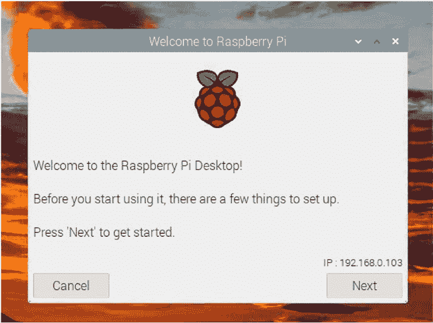
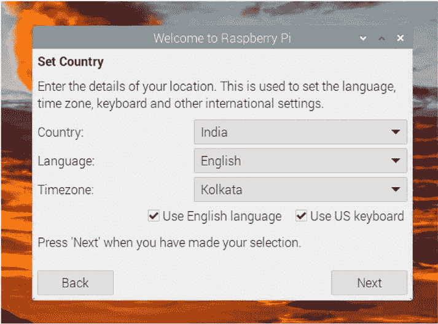
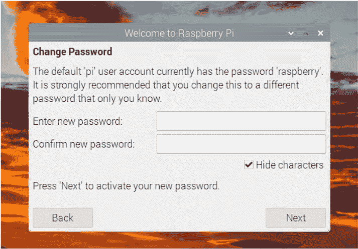
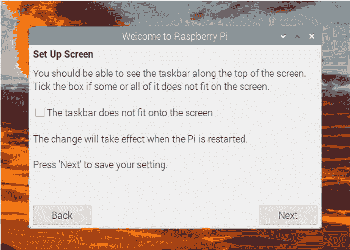
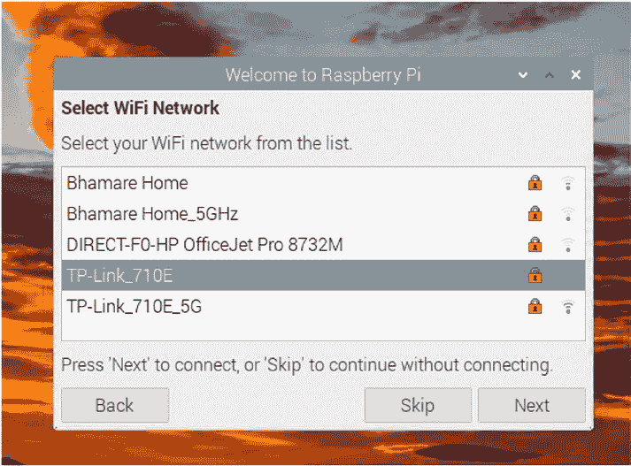
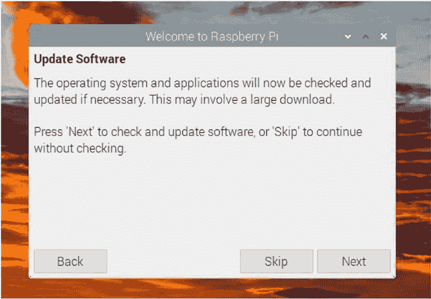
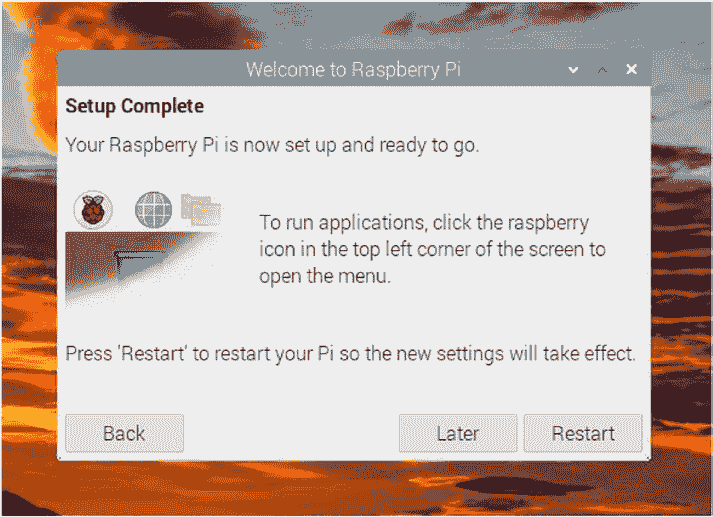
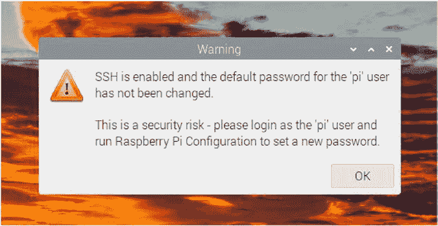
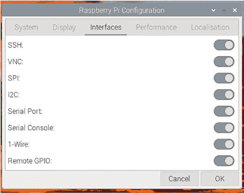

# 排版后内容

演示所有 Python 3 代码。所有代码示例同样可以在任何其他操作系统上运行，例如 Windows、macOS、其他 Linux 发行版、Unix 发行版以及 BSD（如 FreeBSD）。

## 第 10 章 视频处理

图像处理与计算机视觉的世界非常广阔。如果我们将其比作海洋，那我们仍身处其海岸边缘。凭借基础知识，我们完全能够向更深水域探索，并更深入地理解计算机视觉。掌握了高级知识，我们就能为计算机视觉编写各种真实案例程序。

## 附录

本节将探讨一些主题，帮助我们更高效地使用图像处理和树莓派单板计算机。虽然我在其他章节中未能为这些主题找到合适的位置，但我个人认为它们在学习过程中非常有用。本附录涵盖以下主题：

- `pgmagick` 图像处理库
- 连接显示器
- 连接以太网/有线网络
- 使用虚拟网络计算 (VNC) 进行远程桌面

阅读完本附录后，您应该能够熟练运用这些树莓派的技巧与窍门。

### pgmagick 图像处理

这里我们将使用一个名为 `pgmagick` 的简单图像处理库。它是针对图像处理程序 `ImageMagik` 的 Python 封装。您可以在其主页了解更多关于 `ImageMagik` 程序的信息：[`imagemagick.org/index.php`](https://imagemagick.org/index.php)。

让我们通过按顺序运行以下命令来安装所有内容：

```
sudo apt-get install imagemagick libgraphicsmagick++1-dev -y
sudo apt-get install g++ libboost-python-dev -y
sudo pip3 install pgmagick
```

© Ashwin Pajankar 2022  
A. Pajankar，*树莓派图像处理编程*，  
[`doi.org/10.1007/978-1-4842-8270-0`](https://doi.org/10.1007/978-1-4842-8270-0#DOI)

## 附录

这将安装使用 `pgmagick` 库编写 Python 程序所需的一切。清单 [A-1] 创建了一个简单的绿色背景，并将其保存为当前目录中的图像。

***清单 A-1.*** `prog00.py`

```python
from pgmagick.api import Image
img = Image((300, 200), 'Green')
img.write('bg-green.png')
```

让我们创建一个透明背景，如清单 [A-2] 所示。

***清单 A-2.*** `prog01.py`

```python
from pgmagick.api import Image
img = Image((300, 200), 'transparent')
img.write('transparent.png')
```

让我们创建一个渐变图像，如清单 [A-3] 所示。

***清单 A-3.*** `prog02.py`

```python
from pgmagick.api import Image
img = Image((300, 200), 'gradient:#00ff00-#0000ff')
img.write('gradient.png')
```

我们可以使用清单 [A-4] 中的代码向图像添加一些文本。

***清单 A-4.*** `prog03.py`

```python
from pgmagick.api import Image
img = Image((300, 200))
img.annotate('Hello World', angle=60)
img.write('helloworld60.png')
```

## 附录

我们还可以检索图像的属性，如清单 [A-5] 所示。

***清单 A-5.*** `prog04.py`

```python
from pgmagick.api import Image
img = Image((300, 200))
print(img.width, img.height)
```

这些是该库的基础知识。请运行所有前面的程序并查看输出。您可以在 [`pythonhosted.org/pgmagick/`](https://pythonhosted.org/pgmagick/) 进一步探索此库。

### 连接显示器

到目前为止，我们一直以无头模式（使用 SSH 连接并通过 Wi-Fi 进行 X-11 转发）访问树莓派。我们也可以通过选择合适的连接器来连接视觉显示器（HDMI/VGA 显示器）。如果选择使用树莓派 4B 的 HDMI，则需要一个 **micro-HDMI 转 HDMI** 适配器（可在在线市场查找）。如果选择使用 VGA 显示器，则需要一个 **micro-HDMI 转 VGA** 适配器。在在线市场上，我们可以找到一种 **micro-HDMI 转 HDMI 和 VGA 组合适配器**，它能兼容这两种情况。

#### 使用 VGA 显示器


另外，如果我们希望使用 VGA 显示器，则必须在首次启动前修改`/boot/config.txt`文件。此步骤仅适用于 VGA 显示器。如果您使用的是 HDMI 显示器，请跳过此部分。

将 microSD 卡插入读卡器，并在 **Windows 资源管理器**（或您操作系统的文件浏览器）中浏览它。在 Windows 资源管理器中，它将显示为一个标记为 `boot` 的可移动介质驱动器。

打开`config.txt`文件并进行以下修改：

- 将`#disable_overscan=1`改为`disable_overscan=1`
- 将`#hdmi_force_hotplug=1`改为`hdmi_force_hotplug=1`
- 将`#hdmi_group=1`改为`hdmi_group=2`
- 将`#hdmi_mode=1`改为`hdmi_mode=16`
- 将`#hdmi_drive=2`改为`hdmi_drive=2`
- 将`#config_hdmi_boost=4`改为`config_hdmi_boost=4`

完成这些修改后保存文件。现在，microSD 卡已准备好用于连接 VGA 显示器的 Pi。

## 连接显示器后启动

如前所述，我们可以将 Pi 连接到我们选择的显示器并启动。首次启动后，我们会看到一个设置或配置向导，如图 A-1 所示。这仅是一次性过程，因此请继续。



**图 A-1.** 配置向导



单击 **Next** 按钮，您将看到以下窗口（图 A-2）。

**图 A-2.** 区域设置



为您的地区选择最合适的选项，然后单击 **Next**（您也可以通过单击 **Back** 返回之前的选项）。您将看到以下窗口（图 A-3）。

**图 A-3.** 更改默认密码



更改默认密码。强烈建议这样做，因为任何入侵您 Wi-Fi 的人都可以使用默认密码远程登录您的 Pi 并造成严重破坏。按下 **Next** 按钮，它将显示以下窗口（图 A-4）。

**图 A-4.** 设置屏幕



如果任务栏（在屏幕顶部区域）不适合屏幕，请勾选该框，然后单击 **Next**。它将显示以下窗口（图 A-5）。

**图 A-5.** 设置 Wi-Fi



我们可以在这里设置 Wi-Fi（如果尚未设置；如果已设置，请单击 **Skip** 按钮），然后它将显示更新窗口（图 A-6）。

**图 A-6.** 软件更新



我们可以单击 **Next** 按钮，它将更新软件（我们也可以跳过此步骤，但我建议更新软件）。完成后，它将显示一条成功消息（图 A-7）。

**图 A-7.** 成功！



在此处单击 **Restart** 按钮。重启后，如果您跳过了更改密码的步骤，它将显示以下警告（图 A-8）。

**图 A-8.** 警告

只要密码是默认的，我们在启动后就会继续看到此警告。一旦我们更改密码，它将在启动后停止出现。

至此设置完成。

## 连接到以太网/有线网络

大多数人会在组织（工作场所或学术机构）或家中使用 Pi 板。这些地方通常都有连接到互联网的有线局域网。我们可以使用 RJ45 连接器将 Pi 连接到局域网。Pi 板具有用于有线网络的 RJ45 端口。几乎所有现代路由器都带有 DHCP（动态主机配置协议），一旦连接到有线网络，Pi 就会自动分配一个 IP 地址。



## 使用 VNC 进行远程桌面

我们可以使用 VNC 软件远程访问桌面。我们必须


在使用 Pi 之前，需要先启用 VNC。我们在第一章中已经了解了 `raspi-config` 工具。我们可以使用它（在命令行中）启用 VNC。在桌面环境中，我们也可以找到用于相同任务的 GUI 工具。点击左上角的树莓派图标。这是一个类似 Windows 的菜单。在 `Preferences`（首选项）部分，我们可以找到 `Raspberry Pi Configuration`（树莓派配置）选项。

点击该选项，它会打开一个新窗口。在那里，点击第三个选项卡，标签为 `Interfaces`（接口）。它会显示如下内容（图 A-9）。

**图 A-9.** 接口

在这里，请确保至少 `SSH` 和 `VNC` 选项已启用。

为了我的开发和编程课程，我需要其他选项，所以我将它们全部启用了。

## 附录

之后，从以下任意一个网址下载 VNC 查看器客户端：

- [`www.realvnc.com/en/connect/download/viewer/`](https://www.realvnc.com/en/connect/download/viewer/)
- [`www.tightvnc.com/download.php`](https://www.tightvnc.com/download.php)
- [`sourceforge.net/projects/tigervnc/files/stable/1.12.0/`](https://sourceforge.net/projects/tigervnc/files/stable/1.12.0/)

`RealVNC` 是最流行的 VNC 客户端之一，也是我正在使用的客户端。

我将解释其设置过程。如果您希望使用其他客户端，请查阅相关文档和教程。我们首先需要通过提供 IP 地址来配置连接，如下所示（图 A-10）。

**图 A-10.** 配置远程连接

我们还需要进行身份验证。我更喜欢保存密码，这样就不必在每次尝试连接时都输入了（图 A-11）。

**图 A-11.** 输入并保存密码

最后，如果您是第一次连接，它会显示一条警告消息。点击 `Always`（始终）按钮，它将启动远程桌面（图 A-12）。

**图 A-12.** 使用 RealVNC 的树莓派 OS 远程桌面

图 A-12 显示了一个打开了终端客户端的远程桌面。在顶部区域，我们可以看到 VNC 软件的选项。请探索它们以更好地理解。

## 索引

## A

模拟图像处理, 47

## B

二值阈值处理, 182, 183  
方框模糊, 105

## C

颜色量化, 108, 109  
色彩空间转换, 71, 72  
卷积, 95–97, 146–148, 150, 161  
自定义高斯滤波器, 93

## D

fswebcam, 56, 57  
数字图像处理 (DIP), 31, 46–48  
用于此的 Python 3, 61–67  
用于此的树莓派和 Python, 49  
信号处理, 46, 47  
数字非锐化掩膜, 97–99  
距离变换, 169, 170, 180, 188

## E

均衡化, 110, 111  
以太网/有线网络, 234

## F

滤波器, 145  
卷积, 146, 148  
相关性, 149  
傅里叶滤波器, 165  
高通滤波器  
Prewitt 滤波器, 162  
Sobel 滤波器, 164  
核, 146  
低通滤波器, 150  
模糊核, 150  
降噪, 156, 158, 159, 161

## G

高斯滤波器, 93, 150, 151, 153, 156–158, 206  
Geany, 43, 44, 50  
灰度形态学操作, 178, 180, 181  
guvcview, 55, 56

## H

直方图均衡化, 111, 112  
直方图, 90, 91, 110, 111

## I

图像  
混合, 72–74  
通道, 70  
颜色量化, 108, 109  
直方图均衡化, 111, 112  
直方图与均衡化, 110, 111  
ImageChops, 69  
ImageChops 模块, 85–88  
ImageEnhance 模块, 91, 105–108  
ImageFilter 模块, 91–105  
Image.fromarray() 方法, 126  
Image 模块, 69  
特定像素, 获取其值, 79  
色彩空间转换, 71, 72  
复制与保存, 79  
裁剪与粘贴操作, 77, 78  
图像混合, 72–74  
图像通道, 70  
Julia 集, 81–83  
Mandelbrot 集, 79–81  
噪声与渐变, 84  
调整大小, 75, 76  
旋转, 76, 77  
ImageOps, 67, 69, 89, 90  
图像处理编程  
模拟图像处理, 47  
fswebcam, 56, 57  
guvcview, 55, 56  
图像源, 51–53  
Pi 相机模块, 57–60  
raspistill, 61  
网络摄像头, 54, 55  
图像源, 51–53  
集成开发环境 (IDEs)  
Geany, 43, 44  
IDLE, 40–42  
Thonny IDE, 45

## J

Julia 集, 81–83

## K

核, 95–97, 143

## L

实时网络摄像头流  
卷积操作, 200  
相关性, 204  
滤波, 206  
高斯梯度幅度滤波器, 214  
高斯拉普拉斯滤波器, 215  
最大值滤波器, 211  
百分位滤波器, 208  
Prewitt 和拉普拉斯滤波器, 213  
均匀滤波器, 207  
几何变换, 198  
灰度膨胀, 218, 220  
形态学操作, 216

## M

Mandelbrot 集, 79–81  
Matplotlib, 118  
图像通道, 123  
np.dstack() 方法, 125  
pyplot 模块, 119  
subplot() 方法, 122  
最大值滤波器, 99, 102, 103  
测量, 139  
质心, 142  
直方图, 140  
统计属性, 141  
中值滤波器, 99, 101, 158  
microSD 读卡器, 10, 11, 20  
最小值滤波器, 101, 102  
众数滤波器, 103, 104  
形态学梯度, 186, 187  
形态学操作, 171  
二值图像, 173  
二值传播, 177  
暗像素, 174  
grey_dilation() 方法, 178, 180, 181  
去除噪声, 174  
结构元素, 172, 176

## N, O

噪声与渐变, 84

## P, Q

pgmagick 图像处理, 223–225  
Pi 相机模块, 49, 51, 57–60  
电源, 11, 20  
Python, 3, 31, 37  
数字图像处理, 61–67  
DIP, 49  
Python 图像库 (PIL), 61  
Python 编程语言  
特性, 34–37  
Geany, 43, 44  
历史, 32, 33  
IDLE, 40–42  
集成开发环境, 40  
交互模式, 38, 39  
Python 3, 37  
树莓派 OS 上的 Python 2 和 Python 3, 38  
脚本模式, 39  
Thonny IDE, 45

## R

快速原型开发, 36  
树莓派, 5–9  
远程访问, 20–25  
启动, 20  
config.txt 文件, 27, 28  
配置, 25, 26  
DIP, 49  
固件更新, 28  
microSD 卡准备, 12–20  
树莓派 OS 更新与升级, 28, 29  
设置, 10, 11  
关闭与重启树莓派, 29  
树莓派 OS 上的 Python 2 和 Python 3, 38  
raspistill, 61  
远程桌面, VNC  
接口, 235  
首选项部分, 235  
树莓派 OS, 239  
RealVNC, 236  
健壮性, 36

## S

科学 Python, 113–116, 127  
科学 Python 生态系统, 114  
核心组件, 115  
dtype 属性, 117  
灰度图像, 118  
NumPy 主页, 116  
numpy.ndarray 对象, 117  
NumPy 的 N 维数组, 116  
科学计算, 115  
scipy.misc, 存储, 115  
信号处理, 数字图像处理, 46, 47  
单板计算机 (SBCs), 1, 2  
流行的 SBC 系列, 5  
树莓派, 5–29  
与普通计算机的比较, 3  
SoCs, 3, 4  
片上系统 (SoCs), 3  
历史, 4  
vs. 普通 CPU, 4

## T, U

Thonny IDE, 45  
阈值处理与分割, 182, 184  
TKinter, 50, 51, 63, 64, 69, 72, 73, 95  
变换, 129  
仿射变换, 136  
几何变换, 134  
rotate() 函数, 132  
shift() 方法, 130  
样条变换, 137  
zoom() 方法, 131

## V

VGA 显示, 225  
启动, 226  
更改默认密码, 229  
config.txt 文件, 226  
配置向导, 227  
本地化设置, 228  
重启按钮, 234  
软件更新, 232  
罗技 C922 Pro, 190  
OpenCV, 190  
视频处理, 189  
颜色通道, 实时网络摄像头流, 196  
色彩空间, 194  
FPS, 192  
LED 指示灯, 192  
实时网络摄像头流 (参见 实时网络摄像头流)

## W, X, Y

网络摄像头, 54, 55  
白顶帽变换和黑顶帽变换, 184, 185  
Wi-Fi 连接, 10

## Z

Zenmap, 22

