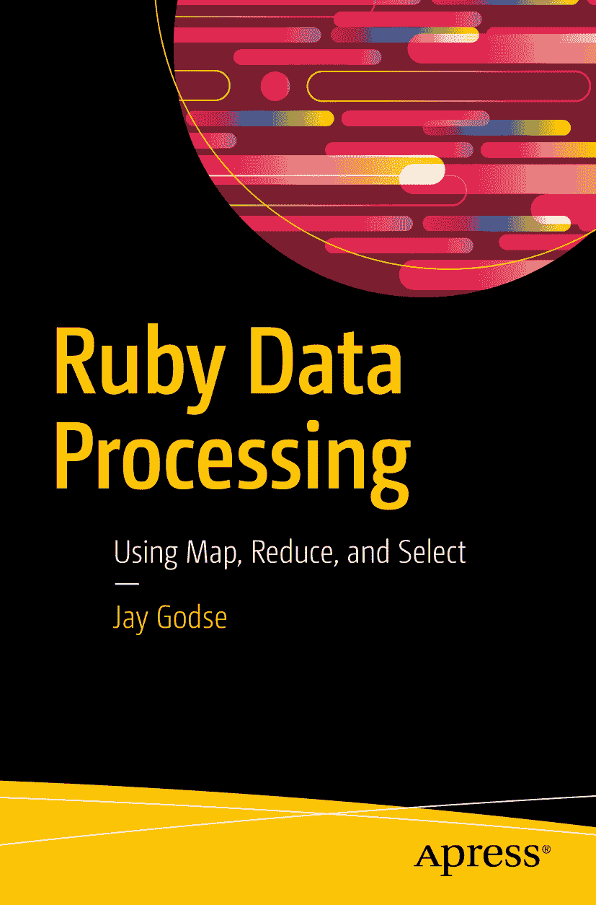

+   [Ruby 数据处理](README.md)
+   
+   [引言](ruby-data-processing_02_fmt.md)
+   [目录](ruby-data-processing_03_fmt.md)
+   [1. 基础 Ruby](ruby-data-processing_04_fmt.md)
+   [2. 函数概述与简单示例](ruby-data-processing_05_fmt.md)
+   [3. 复杂解决方案](ruby-data-processing_06_fmt.md)
+   [将姓名列表转换为 CSV 格式](ruby-data-processing_07_fmt.md)
+   [生成随机姓名列表](ruby-data-processing_08_fmt.md)
+   [清洗数据集](ruby-data-processing_09_fmt.md)
+   [为销售数据序列添加累计总额注释](ruby-data-processing_10_fmt.md)
+   [求两个函数的交点](ruby-data-processing_11_fmt.md)
+   [滑动窗口平均值](ruby-data-processing_12_fmt.md)
+   [数据集反规范化](ruby-data-processing_13_fmt.md)
+   [毕达哥拉斯三元组](ruby-data-processing_14_fmt.md)
+   [逆向工程复杂解决方案](ruby-data-processing_15_fmt.md)
+   [帕斯卡三角形的解法](ruby-data-processing_16_fmt.md)