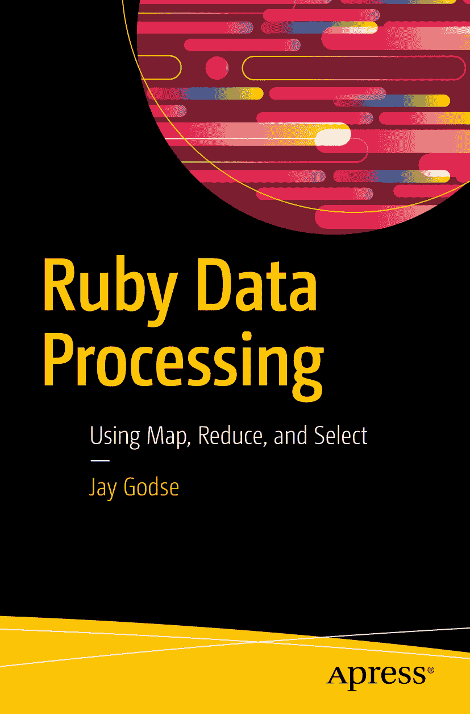

## 

### 杰伊·戈德西

### **Ruby 数据处理：使用 Map、Reduce 和 Select**

本书作者引用的任何源代码或其他补充材料，读者均可通过 GitHub 上的图书产品页面获取，地址为 [`www.apress.com/9781484234730`](http://www.apress.com/9781484234730)。如需更详细信息，请访问 [`www.apress.com/source-code`](http://www.apress.com/source-code)。

ISBN `978-1-4842-3473-0`

电子版 ISBN `978-1-4842-3474-7`

[`doi.org/10.1007/978-1-4842-3474-7`](https://doi.org/10.1007/978-1-4842-3474-7)

美国国会图书馆控制编号：`2018934400`

© 杰伊·戈德西 2018

本作品受版权保护。出版商保留所有权利，无论是全部还是部分材料，具体包括翻译、重印、插图复用、朗诵、广播、以缩微胶片或任何其他物理形式复制，以及信息存储与检索的传输和电子改编、计算机软件，或当前已知或未来开发的任何类似或不同方法的权利。书中可能出现的商标名称、徽标和图片。我们不会在每个商标名称、徽标或图片出现时都使用商标符号，而是仅以编辑方式使用这些名称、徽标和图片，以维护商标所有者的利益，无意侵犯商标权。

本出版物中使用的商品名称、商标、服务标记和类似术语，即使未标明为商标，也不应被视为对其是否受专有权利保护的立场表达。尽管本书中的建议和信息在出版时被认为是真实准确的，但作者、编辑和出版商均不对可能存在的任何错误或遗漏承担法律责任。出版商对本书所包含的材料不作任何明示或暗示的担保。

采用无酸纸印刷

由 Springer Science+Business Media New York 负责全球图书发行，地址：233 Spring Street, 6th Floor, New York, NY 10013。电话：`1-800-SPRINGER`，传真：`(201) 348-4505`，电子邮件：`orders-ny@springer-sbm.com`，或访问 `www.springeronline.com`。Apress Media, LLC 是一家加利福尼亚有限责任公司，其唯一成员（所有者）是 Springer Science + Business Media Finance Inc (SSBM Finance Inc)。SSBM Finance Inc 是一家特拉华州公司。
