# SAP MII（制造集成与智能）的发展历史

`SAP MII` 源自`Lighthammer`软件公司开发的`Lighthammer CMS`（协同制造套件）。`Lighthammer`软件的开发始于 1998 年，产品代号为“晨间咖啡”（Morning Coffee）。其初衷是让制造人员每天早晨都能访问运营信息，以便为每日生产会议做好准备。

`SAP AG`于 2005 年收购了`Lighthammer`，并将产品更名为`SAP xMII`，其中“x”代表`xApp`。随后，该产品被重新命名为`SAP MII`（`SAP 制造集成与智能`）。`SAP xMII`的初始版本为 11.5，运行在微软互联网信息服务（Microsoft Internet Information Server）上。后来，他们将其迁移至`SAP NetWeaver 7`。`SAP MII`正是原始愿景（`SAP xMII`）的延续与演进，其范围不仅扩展到可视化和分析，还包括将车间内的多个制造系统相互集成，并与企业其他系统进行集成。

`SAP MII`在持续扩展，许多新功能被添加以增强`SAP MII`的先前版本。

图 1-1 展示了 2005 年至 2009 年间功能的演进历程。

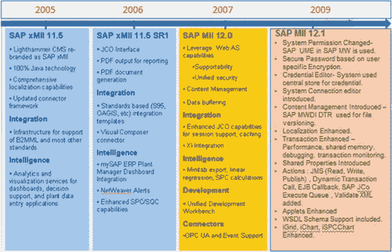

图 1-1. `SAP MII` 11.5 至 12.1

图 1-2 展示了 2010 年至 2015 年间的进步。

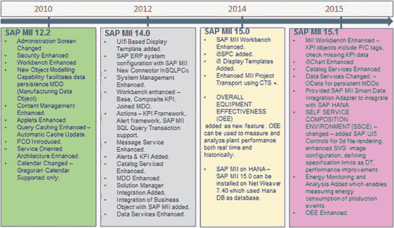

图 1-2. `SAP MII` 12.2 至 15.1

## SAP MII 概览

`SAP MII` 是一个灵活的**平台**，其基本设计可进行定制以适应客户需求。它提供了强大的集成能力和高质量的智能分析。`SAP MII` 能够实现车间系统与企业系统之间近乎实时的数据集成。`SAP MII` 还提供了一个**模型驱动**的开发环境，这意味着它不遵循传统的逐行编码风格，而是一种**拖放式**的层级设计开发模式。

`SAP MII` 可以使用 `Business Logic` 服务开发多种逻辑。同时，借助可视化引擎，它可以通过用户界面提供卓越的智能体验。`SAP MII` 内置了连接性和内容，用于连接 `SAP` 业务套件，如 `ERP`、`SAP SCM` 和 `SAP PLM`。`SAP MII` 可以将数据持久化存储在 `MDO` 中，这样客户就无需为数据存储设置额外的数据库，从而降低了成本和维护费用。目前，`SAP MII` 拥有标准的告警和 `KPI` 生成机制。

`SAP MII` 使用 `XML` 和 `Java` 适配器等网络标准作为集成组件，以连接 `ERP` 和其他相关业务组件。`SAP MII` 可以同时与多个来源和不同的数据连接器进行集成，并提供基于网页的分析仪表盘。目前，`SAP MII` 可以连接到 `HANA`，并利用 `HANA` 的内存数据库进行设计。

简而言之，`SAP MII` 可以根据以下几点进行阐述：

- `SAP MII` 能够集成所有可用的制造系统以及信息系统，为企业用户提供一个通用的交互平台。
- `SAP MII` 通过支持制造员工通过 `PDA`（个人数字助理）、智能手机和其他数字设备监控关键应用，成功推动了无线应用领域的革命。
- `XML` 是 `SAP MII` 作为结构语言的支柱，它能够处理车间制造系统与 `ERP`、`CRM` 等业务应用之间的不同集成问题。它还利用 `SOAP`（简单对象访问协议）等标准，协助将车间与供应链优化进行集成。
- `SAP MII` 有助于实现制造的实时监控，从而使供应链规划更加顺畅，并做出更佳的决策。
- `SAP MII` 可以重用现有的遗留系统，为企业内的最终用户解锁数据。它为用户提供了一个友好的环境，使其能够在单个浏览器界面中建立来自多个系统的不同数据形式之间的联系。
- `SAP MII` 软件无需在客户端进行管理，并且在 `SAP MII` 实施过程中，也无需维护复杂的数据仓库或数据模型。
- `SAP MII` 允许为计算机集成制造、`IIoT`、机器对机器通信能力以及实时智能设计智能解决方案。
- `SAP MII` 能够通过传递实时通知和对车间任何活动的确认等信息，提高员工生产力。这有助于员工对所接收到的信息立即采取行动。
- `SAP MII` 还能从**大数据**制造分析中提供企业级的洞察。
- 使用 `SAP MII`，可以定义制造指标和 `KPI`，并在全球各站点部署相同的标准化计算。

### SAP MII 架构

在 `SAP MII` 中，**集成**与**智能**是设计自动化制造解决方案时需要考虑的关键因素。因此，若从更细致的层面审视 `SAP MII` 的构建，它可分为几个层级。从集成方面来看，`SAP MII` 可以使用 `SAP PCo` 或 `OPC` 连接器连接到任何车间系统；从管理方面来看，`SAP MII` 可以通过 Java 连接器连接到 `ERP`。从智能方面来看，可以利用 `SAP MII` 丰富的可视化服务开发各类仪表盘、报告、分析及其他指标，以获取实时可见性。请参见图 1-3。

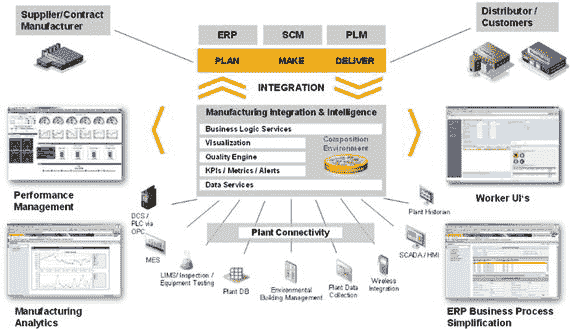

图 1-3. SAP MII 架构视图

以下要点解释了这些 `SAP MII` 架构概念：

- `SAP MII` 是一个开放平台，可集成用于制造运营的不同系统，无论其用途如何。
- `SAP MII` 使用先进的 Web 服务器技术，从多个数据源提取数据，并在服务器端进行聚合。它将数据源转换为业务上下文，进行个性化处理后，将结果交付给最终用户。
- `SAP MII` 使用 `SAP Java 连接器` 和 Web 服务等标准协议，无缝连接到 `ERP` 系统。
- `SAP MII` 提供特定于各种标准制造车间系统的多种数据连接器。
- `SAP MII` 支持与 `ERP` 和车间系统之间以同步和异步模式进行双向数据访问。
- `SAP MII` 独立于浏览器，具有可扩展性和可伸缩性。
- 数据功能可通过 `HTTP`、`SMTP` 和 `FTP` 等标准传输方式访问。

开始安装 `SAP MII` 时，可能会产生一个重要问题：如何部署该解决方案？根据客户的需求和预算，`SAP MII` 可以通过三种方式安装：本地安装、区域安装或全局安装。

- **本地安装**：`SAP MII` 安装在制造工厂现场。每个工厂站点对应一个 `SAP MII` 系统。所有这些系统都连接到全局 `ERP`。请参见图 1-4。

    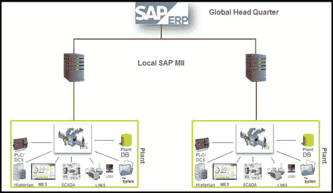

    图 1-4. SAP MII 本地服务器拓扑

- **区域安装**：每个区域有一个 `SAP MII` 服务器，一个区域可包含多个制造工厂。区域 `SAP MII` 可以连接到全局 `ERP`。这是最常用的架构。请参见图 1-5。

    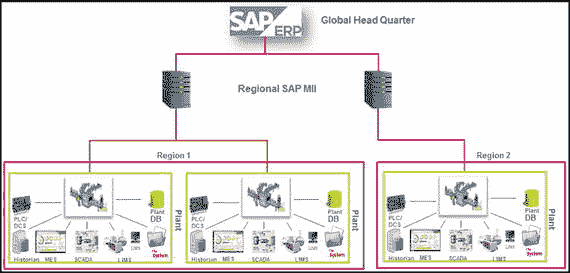

    图 1-5. SAP MII 区域服务器拓扑

- **全局安装**：全局仅部署一个 `SAP MII`，位于总部或数据中心。它由所有制造工厂共享。请参见图 1-6。

    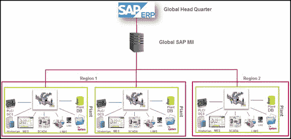

    图 1-6. SAP MII 全局服务器拓扑

## SAP MII 系统概览

为了说明 `SAP MII` 平台概览及其相关配置，以下各节将详细介绍各个开发领域。

### SAP MII 安装

`SAP MII` 通常安装在应用服务器上的 `SAP NetWeaver` 平台，但最新版本（从 `SAP MII 15.0` 开始）可以安装在 `SAP HANA` 平台上。`SAP MII` 安装的先决条件包括 `NetWeaver` 版本和相应的 `Java J2EE` 引擎版本。从 `SAP MII` 版本 `12.0` 开始，所有版本都具有固定的 `NetWeaver` 版本。此处我们以最新版本 `SAP MII 15.1` 为例说明其设置。

`SAP MII 15.1` 可以安装在 `SAP NetWeaver 7.4` 或 `SAP NetWeaver 7.5 Java 应用服务器` 上。

要运行 `SAP MII 15.1`，客户端机器需要 `JRE 1.6` 或更高版本。`SAP MII` 不完全支持 `JRE 1.7.8` 及以上版本，有时会导致崩溃。

要安装 `SAP MII 15.1`，请登录 `SAP Service Marketplace`（[`http://service.sap.com`](http://service.sap.com)）。在软件下载支持包中选择 `SAP MII` 选项，然后选择 `15.1` 版本。接着下载对应版本的 `SAP MII sca` 组件文件和 `SAP MII admin sca` 组件文件。按照 `SAP` 安装指南完成安装（[`https://help.sap.com/viewer/p/SAP_MANUFACTURING_INTEGRATION_AND_INTELLIGENCE`](https://help.sap.com/viewer/p/SAP_MANUFACTURING_INTEGRATION_AND_INTELLIGENCE)）。

关于服务器硬件规模，`SAP` 在 `SAP Marketplace` 中提供了一个名为 `Quick Sizer` 的即时工具（`service.sap.com/sizing`）。

### SAP MII 的系统配置

`SAP MII` 根据需求有不同的基本配置。下面将进一步说明。

#### 安全性

与其他任何工具一样，安全性是 `SAP MII` 的一个主要且重要的组成部分。由于 `SAP MII` 是一个平台，并且可以开发客户特定的解决方案，因此 `SAP MII` 必须在解决方案内部提供安全保障。

### 用户管理

`SAP MII` 拥有多种安全流程。其中最重要的部分之一是用户管理或用户管理。

用户管理由 `SAP NetWeaver J2EE Web.AS 用户管理引擎 (UME)` 处理。以下是 `SAP MII` 系统访问的基本角色。

- `xMII 只读`：授予对 `SAP MII` 系统和工作台具有只读访问权限的用户角色。
- `xMII 用户`：授予对 `SAP MII` 系统及使用 `SAP MII` 开发的解决方案具有基本访问权限的用户角色。拥有此权限的用户不能执行任何类型的配置。
- `xMII 开发者`：授予使用 `SAP MII 工作台` 开发复合应用程序的开发人员角色。开发者可以执行开发所需的某些配置，例如调度作业配置。
- `xMII 管理员`：授予系统管理员角色。此角色拥有所有 `SAP MII` 系统和 `NetWeaver` 的配置能力。
- `xMII 超级管理员`：授予对 `SAP MII` 及其在 `NetWeaver` 和用户管理中的相关配置具有完全访问权限的角色。

#### UME 的架构

如图 1-7 所示，UME 架构中包含三个主要层级。最底层包括带有各自持久化适配器的数据源。用户数据存储在多个数据源中，因此最底层仅专用于用户数据存储。第二层是持久化管理器。它帮助持久化适配器创建、读取、写入和搜索与用户管理相关的数据。最顶层被称为应用程序编程接口 (API)。所有与从数据源写入或读取数据相关的配置都通过持久化管理器完成，以确保信息安全，并确保不会泄露给使用 API 的应用程序。这些应用程序可以确定用户管理数据具体存储位置的详细信息。

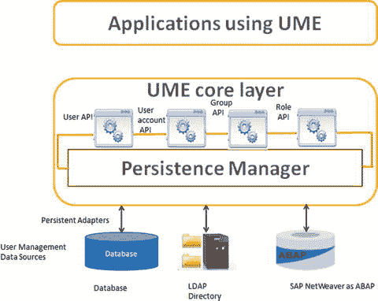

图 1-7. UME 的架构

在 SAP MII 中，可以创建项目特定的多层角色。通过使用此功能，可以限制所有用户对解决方案的访问，以便管理员用户能够按权限执行某些配置。除此之外，还可以在 UME 中创建项目或应用程序特定的角色，以分配在工作台上开发对象的安全权限。

除了创建角色之外，还有必要在 NetWeaver 中创建用户，以便访问 SAP MII。如果客户已为其他应用程序在 NetWeaver 中维护用户，则这些相同的用户可以在 SAP MII 中重用，因为 SAP MII 也是基于 NetWeaver 的。

有两种访问用户管理或用户管理的方法：

1.  在浏览器中键入以下 URL：`https://<server>:<port>/useradmin`
2.  从 MII 菜单中，转到“安全服务” ➤ “用户管理”。参见图 1-8。

    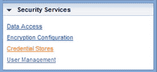

    图 1-8. 用户管理的菜单选项

在“用户管理”中，可以创建新用户、复制或修改现有用户配置文件以及删除现有用户。

从“用户管理”屏幕，也可以对角色和组创建执行与用户创建相同的操作。参见图 1-9。

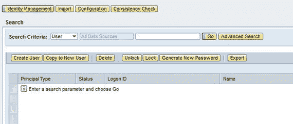

图 1-9. NetWeaver 中的用户管理

以下是 SAP MII 用于识别授权操作的标准后缀：

*   `_R`：允许读取访问
*   `_RW`：允许读取和写入访问
*   `_RWD`：允许读取、写入和删除访问
*   `_deploy`：强制立即部署
*   `_transport`：允许传输访问
*   `_all`：允许读取、写入、删除和传输访问

## 数据访问

SAP MII 数据访问用于将 SAP MII 角色分配给 SAP MII 数据服务器。需要分配 `Admin` 和 `Data Access Security Editor` 这两个系统安全服务，才能在数据访问上执行特定功能。

要配置数据访问，请从 `Available Servers` 列表中选择一个服务器，然后单击 `Edit`。从 `Available Roles` 列表中，选择一个角色，并使用 `Add All`、`Add`、`Remove` 和 `Remove All` 按钮将其添加到分配给服务器列表的角色中，或从中移除。要选择多个角色，请按住 `Ctrl` 键，然后单击相应的角色。然后单击 `Save`。参见图 1-10。

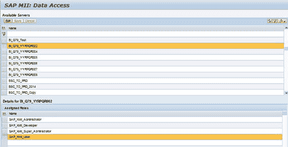

图 1-10. 数据访问屏幕

## 加密配置

加密配置使用加密算法对保存在 SAP Manufacturing Integration and Intelligence 中的数据服务器、调度和凭据进行编码。参见图 1-11。

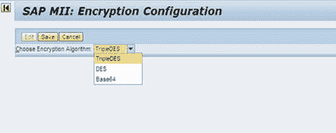

图 1-11. SAP MII 加密配置屏幕

可用的加密算法由 SAP NetWeaver 实例决定，可能包括以下内容：

*   TripleDES，提供最强的数据加密。这是默认设置。它基于数据加密标准 (DES)，数据会被加密三次。
*   DES 提供第二强的数据加密。
*   Base64 提供最弱的数据加密。当没有其他加密方法可用时，系统使用 Base64 编码。

## 凭据存储

您可以使用 `Credential Stores` 屏幕为用户名和密码添加别名，该别名可以被修改或删除（参见图 1-12）。这些别名在 SAP Manufacturing Integration and Intelligence 工作台操作中使用，而不是在操作配置中输入用户名和密码。所有需要用户名和密码进行配置的对象都提供带有密码加密的凭据存储。然后，可以使用别名的凭据来配置：

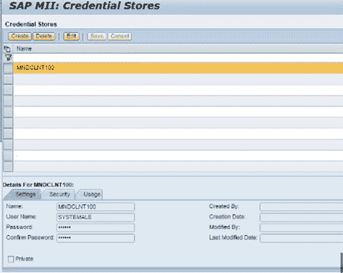

图 1-12. SAP MII 凭据别名配置

*   SAP 服务器
*   BLS 操作

## Illuminator 服务

Illuminator 服务是 SAP MII 中数据服务的支柱。SAP MII illuminator 服务基本上是一组提供 SAP MII 某些核心功能的 HTTP 服务。您可以通过 XML 消息交换从外部调用这些服务。

每个 illuminator 服务都有一个服务名称和一个或多个模式，即服务操作。在执行时，您必须同时指定服务名称、模式以及输入参数（如果有的话）。这些服务可以独立调用，也可以通过使用 AJAX 或 BLS 从网页调用。以下是这些服务的三个主要用途：

*   作为从 MII 内部表获取数据的唯一方式
*   从性能角度看，在代码中使用此功能的最佳方式之一
*   易于直接从 IRPT 或 JS 使用

以下是 illuminator 服务的语法：

`http://<server>:<port>/XMII/Illuminator?service=<service name>&mode=<mode name>&content-type=text/xml`

以下是 MII 12.0 及更高版本中可用的服务列表：

*   Admin：用于检索 SAP MII 服务器的管理和安全信息。
*   Scheduler：用于根据程序逻辑，无需任何用户干预即可自动从 MII BLS 或网页控制计划作业。
*   SystemInfo：用于获取 SAP MII 的系统相关信息。

以下是 MII 12.1 及更高版本中提供的更多服务：

*   Indexing：包含检查索引内容和监控索引器的方法。索引器会重建索引信息。它将遍历数据库中的所有文件并重新为其建立索引。仅当索引因某种原因不同步时才应使用此功能。
*   Monitoring：用于检索登录、文件使用、服务器使用等信息。您可以从此处确定系统负载、运行中的事务、查询等。
*   BLSManager：用于检索 BLS 的信息，如 BLS 的运行时间、最长运行时间、日志、输出、统计信息等。您可以执行终止事务、删除事务、清除事务缓存等活动。
*   Transport：用于将配置或项目从一个系统传输到另一个系统。
*   DataServer：用于执行数据服务器的基本功能，例如启用、禁用、删除、导出和导入。

在最新版本的 SAP MII 中，包含了几项新服务：

*   Alert：提供列表、查看、删除等基本功能。
*   oData：SAP MII 中新增，现在支持与 SAP HANA 的集成。SAP MII 可以托管在 SAP HANA 上。

请参考作者撰写的 SCN 博客：[`https://blogs.sap.com/2013/01/02/illuminator-services-of-sap-mii/`](https://blogs.sap.com/2013/01/02/illuminator-services-of-sap-mii/)

