# SAP MII 管理配置

若要开发 SAP MII 解决方案，具有管理员角色的开发者需要进行某些配置才能继续。SAP MII 管理菜单页面中有多个需要配置的部分。本章节将说明最重要的部分。这些配置是强制性的，并且在开始 SAP MII 项目之前必须掌握相应的知识。

要访问 SAP MII 菜单页面，请通过浏览器访问以下 URL：
`https://<主机>:<端口>/XMII/Menu.jsp`

## 系统管理菜单选项

SAP MII 菜单包含系统管理选项。此菜单允许您配置系统级设置。这些系统管理活动需要管理员和其它管理安全服务权限。这些权限必须分配给用户角色，才能访问和管理系统管理菜单中可用的管理任务。此菜单包含如图 1-13 所示的配置项。

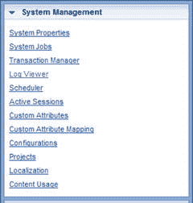
图 1-13. SAP MII 系统配置菜单选项

### 系统属性屏幕

系统属性屏幕用于配置 SAP MII 的通用管理配置，如图 1-14 所示。

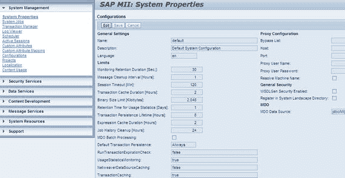
图 1-14. SAP MII 系统属性配置屏幕

### 系统作业屏幕

系统作业是按固定时间间隔在后台运行的任务，用于执行 SAP MII 服务器和内容的内部维护。请参见图 1-15。

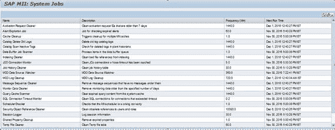
图 1-15. SAP MII 内部系统作业详情

SAP MII 服务器上运行的默认系统作业（如图 1-16 高亮所示）如下：

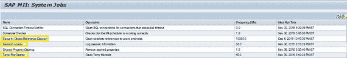
图 1-16. SAP MII 中的重要系统作业

*   `会话记录器`：每 30 分钟运行一次，根据活跃的唯一用户数记录系统使用情况。
*   `安全对象引用清理器`：每 7 天运行一次，删除相应数据库表中的无效系统和性能角色、自定义属性角色以及用户。
*   `临时文件清理器`：每小时运行一次，清理临时文件表。

### 事务管理器屏幕

事务管理器屏幕监控系统中正在执行的 BLS 事务（见图 1-17）。

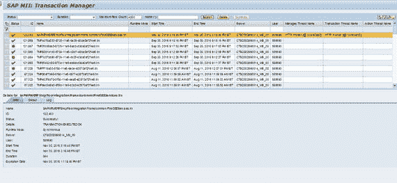
图 1-17. SAP MII 事务管理器屏幕

### 日志查看器屏幕

日志查看器屏幕（见图 1-18）显示 SAP NetWeaver 日志查看器。系统日志可以通过 SAP NetWeaver 管理员控制台 (NWA) 查看。可通过 `NWA_READONLY` 角色，利用 `https://<主机>:<端口>/nwa` 链接进行查看。此外，`NWA_SUPERADMIN` 允许用户对 NetWeaver 界面和 MII 所需的配置拥有完全查看权限和控制权，以及访问受管系统中数据的权限。只读角色（`NWA_READONLY`）不允许用户对受管系统进行更改。另一个角色（`NWA_SUPERADMIN`）则允许完全控制。您可以查看过去 24 小时的日志。跟踪级别默认为错误，可通过导航至 `SAP NetWeaver 管理员控制台 ➤ 系统管理 ➤ 配置 ➤ 日志配置` 进行修改。

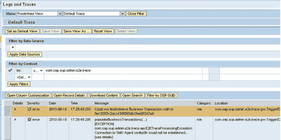
图 1-18. SAP MII 日志查看器

跟踪级别可设置为以下任一选项：

*   `全部`：记录所有消息：调试、路径、信息、警告、错误和严重。
*   `调试`：用于调试目的，包含详尽的底层信息。
*   `路径`：用于跟踪 MII BLS 的执行流程，例如，可用于跟踪进入和离开方法、循环和分支操作时的路径。
*   `信息`：用于显示已执行的提示性文本。
*   `警告`：即使出现问题或存在需要开发者/操作员关注的异常，应用程序也能完成任务。
*   `错误`：应用程序可以从错误中恢复，但由于错误而无法完成所需任务，需要修正。
*   `严重`：应用程序无法从错误中恢复，这种严重情况会导致应用程序致命终止。
*   `无`：不记录任何消息。

### 调度程序菜单

`Scheduler`菜单提供了用户调度的所有作业的相关信息。任何业务逻辑（BLS）事务、查询和 MDO 都可以通过`Scheduler`定期执行。还可以查看正在运行、等待或停止的作业的状态。

需要为用户分配`Scheduler Security`服务，才能启用对`Scheduler`屏幕的访问，如图 1-19 所示。

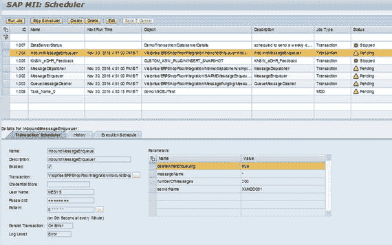
图 1-19. SAP MII 调度程序配置

调度程序有三个选项卡：
- `Transaction Scheduler`（事务调度程序）
- `History`（历史记录）
- `Execution Schedule`（执行计划）

#### 事务调度程序（Transaction Scheduler）

此选项卡上的元素说明如下：
- `Name`（名称）：已调度作业的名称。
- `Description`（描述）：作业的详细信息及其预期功能。
- `Enabled`（已启用）：一个复选框选项，勾选后，作业将根据 cron 模式定期运行。如果未勾选此复选框，则作业不会被调度。
- `Transaction, Query, or MDO (Manufacturing Data Object)`（事务、查询或 MDO）：指示将被调度运行的 BLS 事务、数据查询或 MDO 查询。
- `Run As Username`（运行身份用户名）：指示用于运行作业的用户凭证。
- `Run As Password`（运行身份密码）：表示上述用户的密码。
- `Parameters`（参数）：指示所选事务的输入参数（如果有）。用户在将事务作为计划作业运行时，理想情况下应输入要使用的输入参数的值。
- `Pattern`（模式）：指示一个 cron 模式，该模式决定了要运行作业的计划。可以手动创建 cron 模式，或通过使用`Build Pattern`屏幕创建。点击`Build Pattern`按钮可调用`Build Pattern`屏幕，它能帮助轻松创建 cron 模式。

`Scheduler Service`每 500 毫秒检查一次是否有准备就绪的作业，然后执行这些作业。使用`Scheduler`可以定期执行任何业务逻辑事务、查询或 MDO，以执行各种活动，例如通过数据查询从制造车间系统提取数据、执行 Web 服务或 RFC、计算并更新 KPI。

`Scheduler`屏幕还会显示有关计划作业的以下信息。
- `Status`（状态）：表示作业的状态。取值可以是`Stopped`、`Pending`和`Running`。
    - `Stopped`：表示作业当前已停止。未启用的任务具有此状态。
    - `Pending`：表示作业已调度，正在等待下一次运行。
    - `Running`：表示计划作业当前正在运行。
- `Name`（名称）：表示在`Scheduler`中设置的作业名称。
- `Next Run Time`（下次运行时间）：指示此计划作业下一次运行的时间。
- `File`（文件）：表示已调度运行的业务逻辑事务、查询或 MDO 的完整路径。
- `Description`（描述）：说明在`Scheduler`中设置的作业。

#### 历史记录（History）

`Scheduler`还允许管理员或任何具有足够授权权限的用户查看`Job Execution History`屏幕，如图 1-20 所示。

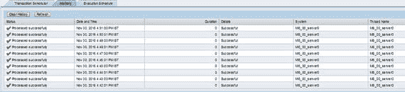
图 1-20. 调度程序执行历史记录屏幕

此屏幕显示计划作业先前执行尝试的详细信息，包括状态、持续时间和详细信息。

#### 执行计划（Execution Schedule）

最后，`Execution Schedule`功能会显示该作业接下来 20 次计划运行的时间表，如图 1-21 所示。

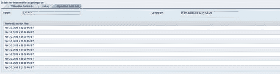
图 1-21. 调度程序执行计划

### 活动会话屏幕（Active Sessions Screen）

如果用户被分配了管理角色，则可以通过`Active Sessions`屏幕查看已登录到 SAP MII 服务器的用户列表。除了用户登录名之外，此屏幕还提供用户的全名、电子邮件地址、首次登录的日期和时间、系统上次访问的日期和时间以及会话何时过期。参见图 1-22。

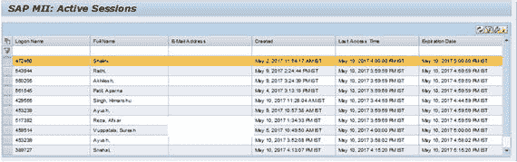

图 1-22. SAP MII 活动会话屏幕

### 自定义属性屏幕（Custom Attributes Screen）

`Custom Attributes`屏幕用于管理自定义属性，以存储应用程序使用的配置或业务数据。参见图 1-23。

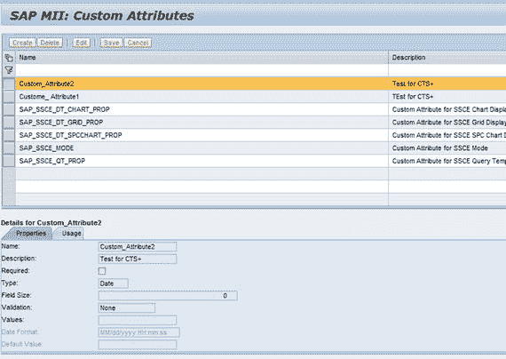

图 1-23. SAP MII 自定义属性配置

### 自定义属性映射屏幕（Custom Attribute Mapping Screen）

`Custom Attribute Mapping`屏幕用于将自定义属性分配给现有用户或用户角色，以用作会话变量。参见图 1-24。

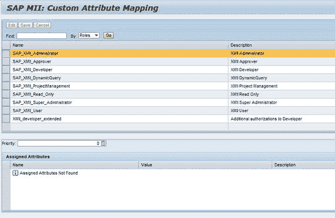

图 1-24. SAP MII 自定义属性映射配置

### 配置界面

配置界面用于以 ZIP 压缩包的形式将配置备份导入系统或从系统导出。图 1-25 中显示的配置均可导出和导入。

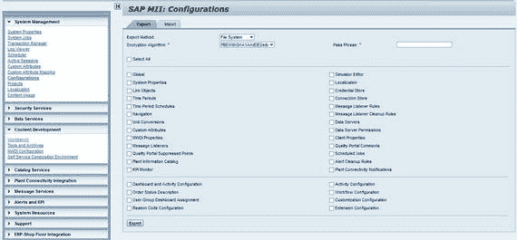

图 1-25. SAP MII 配置及其导出和导入功能

配置界面提供将系统配置备份为 ZIP 文件（`xmiibackup.zip`）并保存到本地系统上用户指定位置的功能，以及从类似的备份存档中恢复系统配置的功能。这在将配置从一个 SAP MII 安装环境传输到另一个环境时（例如，从开发环境传输到生产环境）非常有用。

您需要将配置管理安全服务分配给用户，才能访问配置界面。根据界面上勾选的选项，相应的配置会被导出到一个 XML 文件中。当点击“导出”按钮时，对应的文件会被包含在`xmiibackup.zip`存档中。在导入的情况下，您需要从本地文件系统中浏览包含先前导出的配置备份存档文件，然后点击“导入”将配置存档文件导入到 SAP MII 中。

以下说明的配置类型可在 SAP MII 中导出或导入：

- `系统属性`：系统属性备份在`SystemProperties.xml`文件中。

- `模拟器实例`：每个实例都作为单独的 XML 文件备份，命名为`<SimulatorServerName>.xml`，存放在存档中名为`Simulator_files`的文件夹内。默认的模拟器实例会备份为`DefaultSimulator.xml`。

- `计划任务`：每个计划任务都作为单独的 XML 文件备份，命名为`<ScheduleName>.xml`，存放在存档中名为`Scheduler_Jobs`的文件夹内。

- `消息监听器`：在消息服务中创建的消息监听器配置备份在`MessageServers.xml`文件中。

- `消息监听器规则`：在消息服务中创建的消息监听器处理规则备份在`MessageProcessRules.xml`文件中。

- `数据服务器权限`：在安全服务中配置的数据服务器安全权限备份在`ServerPermissions.xml`文件中。

- `消息监听器清理规则`：在消息服务中创建的清理规则备份在`MessageCleanupRules.xml`文件中。

- `数据服务器`：在数据服务中配置的数据服务器备份在`Servers.xml`文件中。

- `本地化`：本地化设置会作为单独的 XML 文件备份，命名为`<Language>.xml`，存放在存档中名为`Localization`的文件夹中。

- `链接对象`：在可视化服务中配置的导航链接对象备份在`ContentMap.xml`文件中。

- `时间段`：在数据服务中配置的时间段备份在`TimePeriods.xml`文件中。

- `导航`：每个关联了导航配置文件的角色或用户，都会作为相应的 XML 文件存储，命名为`<Role>.xml`或`<User>.xml`，存放在公共`Profiles`文件夹下对应的`ROLE`或`USER`文件夹中。

- `时间段计划`：在数据服务中配置的时间段计划备份在`Schedules.xml`文件中。

- `全局设置`：在 SAP MII 安装中定义的全局属性备份在`Globals.xml`文件中。

- `单位转换`：单位转换配置备份在`UnitConversions.xml`文件中。

- `自定义属性`：在系统管理中配置的自定义属性备份在`CustomAttributes.xml`文件中。

### 项目菜单

SAP MII 中的项目菜单允许 SAP MII 管理员（以及任何拥有项目管理安全服务的用户）备份和恢复 SAP MII 项目。这在将开发内容从一个 SAP MII 安装环境传输到另一个环境时（例如，从开发环境传输到生产环境）非常有用。参见图 1-26。

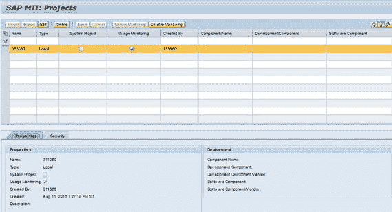

图 1-26. SAP MII 项目配置及其导出和导入功能

项目界面列出了各种项目及其详细信息，例如名称、描述、是否为系统项目、创建时间和创建者，以及将其删除或导出为压缩 ZIP 文件的选项。

从 SAP MII 导出的项目包含与 SAP MII Workbench 中定义的相同文件夹结构内的项目文件，以及一个`ExportManifest.xml`文件，该文件包含有关导出项目的必要元数据。将项目导入 SAP MII 时，不必包含`ExportManifest.xml`文件。也可以从外部创建项目结构并将其导入 SAP MII。但是请注意，如果将具有相同项目名称的项目导入 SAP MII，则现有项目将被覆盖，无论它是否是系统项目或隐藏项目。

SAP MII 中的系统项目由 SAP 提供，供 SAP MII 系统内部使用。这些项目无法删除，例如`Default`和`QualityPortal`。

### 本地化

本地化功能为 SAP MII 平台提供不同的语言支持（参见图 1-27）。

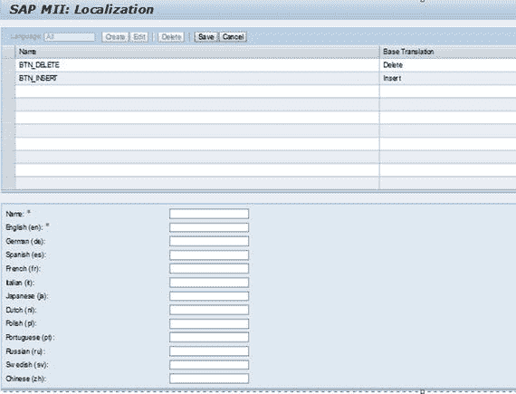

图 1-27. SAP MII 本地化配置

本地化可以通过两种方法设置（参见图 1-28）：

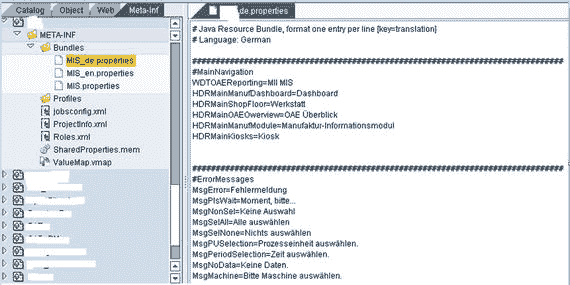

图 1-28. SAP MII 网页本地化

- `网页本地化`：任何 HTML 页面都可以根据区域语言进行本地化。HTML 页面需要保存为`.irpt`文件。此文件扩展名标识这些文件是需要系统在运行时将其作为 HTML 返回给浏览器之前进行处理的网页。在此过程中，系统会根据用户的语言将本地化键替换为其翻译。为此，开发人员需要在`#`标签内为特定语言定义本地化键及其值，例如`{##KeyName}`。在运行时，该值决定显示的语言。

- `项目本地化`：此功能可用于完全本地化项目。本地化字符串用于事务处理和`.irpt`页面。项目本地化的优先顺序是：用户语言，然后是系统语言，最后是英语 (EN)。如果未找到本地化值，则默认返回键。此外，通过 SAP MII Workbench 的`meta-inf`选项卡，您可以在`Bundles`文件夹下为客户特定的本地语言创建新的`.properties`文件。使用此文件，您可以为指定的语言添加`名称=值`对。