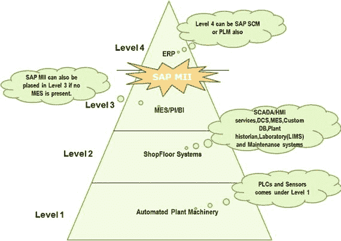

# 2. 为何在制造业中使用 SAP MII

本章解释了为何应在制造业中使用 SAP MII。它说明了制造业面临的挑战，以及 SAP MII 在克服这些挑战中所扮演的角色。

## 为何使用 SAP MII？

上一章解释了 SAP MII 是什么。当今制造业面临的最大问题之一便是：为何要使用 SAP MII？使用 SAP MII 的益处需要从多个角度考量，例如其功能特性、技术优势以及商业效益，这样才能证明其使用价值。SAP MII 是一个强大的集成平台，这意味着它可以作为不同第三方或遗留系统之间的中间件。不仅如此，SAP MII 还具备智能分析能力，因为它可用于开发各种智能实时分析和监控报告，并利用 3D 图形实现高端可视化。近期，SAP MII 还引入了另一个“I”要素，即“创新”（*innovation*）。SAP MII 的这一隐性特性通过连接 IIoT（工业物联网）智能移动设备，助您实现创新。

**注意**

术语 `innovation`（创新）指的是为现有方法引入新思路，或用更优的解决方案改进现有方法。新方案可能对用户更友好，或采用新设备、新技术以获得更好的结果。例如，智能手机是对传统手机的一次创新，其灵感源于市场对更灵活沟通方式的需求。

`IIoT` 指的是物联网技术。构成 `IIoT` 的不同技术包括：大数据技术、机器学习机制、方法控制以及传感器数据监控。一台机器如何与另一台机器通信，也称为 `M2M`（机器对机器）通信。使用 `IIoT` 的另一个因素是它能与移动设备集成，这样用户即使不在现场，也能连接到接近实时的数据。

## 制造业的关键挑战与解决方案

制造业面临着诸多挑战，包括生产成本上升、产品质量下降、合格劳动力难寻、市场竞争激烈等等。所有这些挑战都是相互关联的。例如，低效的人力往往会增加制造成本，并对产品质量产生不利影响。从长远来看，该企业将落后于人。为了更轻松、快速、高效地克服这些问题，公司需要一个强大的解决方案。以下章节将详细阐述制造业面临的挑战及其应对方案。

### 竞争激烈的市场与更低的制造成本

制造业是一个复杂但却是任何国家经济命脉的行业。如今，制造业面临着激烈的竞争。一家制造企业的竞争力可以根据质量、创新、效率、客户满意度、员工满意度等多个相互依赖的因素来评估。此外，这些职能部门之间沟通的速度也影响着企业的竞争力。决定制造业竞争力的因素有很多。要更有效地应对这一挑战，您必须识别出能以最低成本和高品质进行管理的核心竞争力。如今，创新也被视为一个能带来更优性能的因素，从而有助于降低制造成本。

SAP MII 以最低成本为制造企业提供了所有这些功能。在服务器层面，它具有以下特点：

-   内部数据库及低维护成本
-   能够使用连接器与 ERP 系统集成，从车间获取近乎实时的数据
-   多个流程无需人工成本
-   流程自动化，以避免人为错误

**注意**

`ERP` 代表企业资源计划。这是企业的规划和管理套件，有助于管理生产和产品的规划活动。这包括制造成本、交付、提货单、物料管理、运输管理、支付管理、库存管理、销售管理等。它通过利用强大的 `RDBMS`（关系型数据库管理系统）实时控制各个业务流程，帮助您从仓库到生产管理、从计划到生产管理获得业务的集成视图。

`shopfloor`（车间）是工厂或工作坊中操作人员工作的区域；该术语用于将工厂的生产部分与行政部分区分开来。

### 对精益供应链策略的偏好

如今，制造业更偏好精益供应链策略。这种方法以最少浪费的方式，将产品快速交付给最终客户。精益供应链有助于在快速预测客户需求的同时，以极高的效率轻松交付产品，从而为客户提供更好的解决方案。这最终有助于实现卓越的财务业绩。由于 SAP MII 是一个灵活的平台，因此可以根据需要开发客户特定的解决方案。此外，SAP MII 可以连接到车间系统和 ERP 解决方案，并能实现流程自动化，因此可以在 SAP MII 中设计出缩短生产周期的解决方案。SAP MII 还可以与质量模块集成，并实时监控生产。它可以更有效地检查生产浪费，从而缩短决策时间。

**注意**

`supply chain`（供应链）是企业资源规划的组成部分之一，它清晰地显示了库存从供应商到最终客户的流动情况。它提供了从原材料到最终产品，再到最终交付给客户的透明视图和更好的控制。

`Lean supply chain`（精益供应链）鼓励仅生产所需的数量，并考虑何时何地需要产品。这有助于减少不必要的生产，因为不必要的生产会导致浪费并推高成本。根据最终消费者的需求，可以用更少的资源生产更多产品，或者用更多的资源精确生产所需数量。只有针对每个产品进行单独处理，消除流程中不必要且被视为浪费的环节，这才能成功。因此，精益方法不仅关注消除流程中的浪费，还考虑价值流的提升。

### 分散的制造工厂系统

制造工厂涉及多个自动化系统、机器、工厂、总部，以及不同制造相关部门的安全系统。在一个更大的制造系统中，生产工厂分散在多个地点、区域或地理位置是很常见的。这些不同的单元相互隔离，彼此之间的沟通不畅。通常，ERP 是在总部或区域办公室集中实施的，而不是在每个工厂。由于 ERP 系统与这些单元没有直接连接，从不同站点和单元获取信息可能非常耗时。而且，由于这些信息是手动处理的，发生人为错误的可能性很高。如果在本地、区域或全球范围内将 ERP 与 MII 连接起来，管理层将始终能够获取近乎实时的数据。由于流程通过 SAP MII 实现了自动化，数据将始终保持准确。与此同时，MII 保证数据可靠交付，因此，如果任何工厂或单元断开连接，MII 在重新连接时可以立即将排队的全部数据推送到 ERP，而不会丢失任何数据。

### 生产问题的业务与财务影响

在制造工厂中，生产问题或偏差的业务与财务影响非常难以手动监控或控制。例如，假设出现这样一种场景：需要生产 100 个零件作为最终产品，但由于生产线故障，20 个报废，最终仅生产了 80 个，这仍被视为良好生产。但若 80 个报废，仅 20 个合格，则说明生产线或机器需要更换或纠正，因为报废数量超过了合格产品数量。`SAP MII` 可以连接到 `ERP`，从 `MII` 和 `ERP` 两端监控并触发工厂维护通知。这些通知能够及时告知维护主管此类业务损失，以便他们迅速更换或修复机器或生产线。

通过让高产线、低浪费的机器持续产出合格产品，也可以遏制财务损失。`MII` 还可以连接到 `ERP` 的质量模块，这样无论最终生产出的合格产品数量是多少，`MII` 都能与之衔接。`SAP MII` 还具备工厂维护计划监控功能。管理层和监管团队可以利用这一功能，借助在 `MII` 中开发的记分卡报告，了解生产线为何以及何时经历了计划停机、非计划停机、计划停止、故障等状态。这些问题可能由人工失误、物料短缺、偏离生产计划、设备过度使用、物流不当以及不可避免的事故导致。

### 生产缺乏控制与监控机制

很多时候，制造业企业因为无法控制和监控正在运行的生产线而面临问题。假设出现这样一种情况：他们需要跟踪生产过程中大型烤箱使用的温度控制器，当其超过特定阈值时，手动记录这一事件的确切时间。如果依赖人工干预，这些信息就可能出错。

另一种可能发生的情况是，锅炉或储罐阀门需要关闭，因为它已超出容量限制。但同样，由于缺乏恰当的机制，锅炉或储罐会溢出甚至爆裂。此类工厂事故甚至可能导致人员伤亡。`SAP MII` 提供了一个万无一失的解决方案来避免此类事故。它会持续检查阈值并设置警报，自动跟踪生产过程中实时出现的此类问题。`SAP MII` 还可以触发邮件通知主管，让他们了解此类事件。如果车间机器与 `SAP MII` 连接，那么当 `MII` 检测到机器发生故障或异常时，它可以停止该机器。

**注意**

温度控制器无需人工干预即可控制温度。这个智能工具从热传感器（如电阻温度检测器或热电偶）获取输入，并持续将该信息与设定点（即安全的目标温度）进行比较。它会向控制元件（例如控制温度的阀门）提供输出。

### 缺乏达成生产目标所需的决策流程

生产人员往往缺乏达成生产目标所需的决策支持信息。这些目标由各个工厂不同的关键绩效指标（KPI）来定义和衡量。由于车间与 `ERP` 之间没有直接连接，生产操作员甚至有时是主管，可能会利用这种脱节，手动停止机器或篡改数据，以达到生产目标，从而忽略实际读数。

通过使用 `SAP MII` 自动化车间涉及的机器并连接到 `ERP`，可以避免这些人为偏差。一旦 `SAP MII` 直接连接到车间机器和 `ERP`，它便可以利用来自车间和 `ERP` 的实时数据，展示有价值的整体设备效率（OEE）报告和自定义报告，例如机器报告、停机分析报告、良率概览报告等。`SAP MII` 能够非常高效地完全自动化此类场景。

**注意**

OEE 代表整体设备效率。它是 ISO 的衡量指标之一，并被纳入最佳实践解决方案中，用于识别真正有效的计划生产时间百分比。良好生产规范（GMP）建议工厂在只生产合格零件时，实际上应实现零停机。因此，如果 OEE 达到 100%，则被认为是理想的生产状态。如果随着时间的推移达到了非常优异的 OEE 结果，它将成为同一环境下其他设备的基准，或成为其他生产设备的行业标准。同样，它也可以用作基准来检测生产设备随时间推移在消除浪费方面的进展。

### 主数据副本导致的质量和合规性问题

如果 `ERP` 没有直接连接到车间，将主数据传输到车间的唯一方法是从 `ERP` 下载并导出到`Excel`中。在这种情况下，数据传输过程中会浪费大量时间，因为这依赖人工，且容易出错。数据被篡改的可能性也很高。为填补这一空白，`MII` 可以直接连接到 `ERP` 系统，并在数据从 `ERP` 推送时自动加载主数据。

## SAP MII 的功能层面

`SAP MII` 不仅是一个集成的，也是一个智能的一站式解决方案。它建立起车间与业务流程及运营之间的直接连接。这确保了企业系统与工厂之间的集成近乎实时，并将集成后的数据显示给用户。

当您考虑将 `SAP MII` 作为集成和智能化的解决方案时，请考虑以下功能方面。

### SAP MII 产品的可用性

目前，`SAP MII` 易于获取，是 SAP 实验室最值得信赖的解决方案之一，如今它与其他一些制造产品一起作为制造套件的一部分提供。`SAP MII` 需要许可，但如果工厂已经购买了制造套件的许可，则它将自动包含 `SAP MII`。

### 集成优势

SAP MII 拥有许多默认连接器，这使得它能非常轻松地连接到 Level 4、Level 3、Level 2 或 Level 1 的任何系统。SAP MII 可以填补 Level 3 和 Level 4 之间的空白；如果某个工厂没有 MES，那么 MII 也可以被部署在 Level 3。此外，MII 通过使用 SAP PCo 或 OPC 连接器，还可以连接到 Level 2 和 Level 1。见图 2-1。

图 2-1. SAP MII 在工业层级模型中的位置 注

产品生命周期管理（PLM）是一种通过在以人为中心的扩展型企业环境中集成业务数据，来管理任何流程或系统中涉及产品的理念。

制造执行系统（MES）是一种在制造业中用于监控并记录从原材料到成品转化过程的计算机化系统。它将车间发生的实时情况展示给参与决策的授权人员。该系统记录输入、输出、机器的任何严重故障或错误、操作员活动以及其他支持服务。

监控与数据采集系统（SCADA）是一种与应用软件集成以控制制造过程的软件。在现代制造业中，自动化系统主要与 SCADA 协同工作。它从传感器和 PLC 设备收集数据，并根据获取的实时数据对所有设备提供精细控制。

历史数据库可以从多个变量中的复杂系统提取数据，以描绘出制造环境的完整图景。Wonderware 历史数据库通过使用传统关系型数据库管理系统（RDBMS）处理并存储高速数据，能够存储大量的工厂历史数据。它提供了一个安全、高性能的数据库来整合不同的数据源，并提供快速检索技术，以理解不断增长的工业数据。

分布式控制系统（DCS）指的是生产工厂工业流程的控制系统，在该系统中，控制器分布在工厂的流程控制点上。中央控制室也设有集中控制。DCS 主要遵循分布式层次化控制理念来控制工厂自动化中的流程。

可编程逻辑控制器（PLC）是一种固态工业计算机控制系统，可以持续监测设备的输入状态，并为自动化流程或机器做出逻辑决策。PLC 是工业继电器的良好替代品，并提供比继电器更多的功能。由于 PLC 是模块化的，它可以安装在任何环境中来定义逻辑，并且能够抵御高温、粉尘、严寒或高湿度等任何恶劣的制造环境。而继电器则无法在这些环境下正常运行。PLC 由一个 16 位或 32 位微处理器组成，可连接到 CPU。任何类型的可执行控制逻辑都可以在 CPU 中设计，并通过常规运行传输到 PLC。

实验室信息管理系统（LIMS）或实验室信息系统（LIS）会考虑实验室操作中涉及的所有实验室仪器和设备。该系统通过集成仪器或设备，并自动管理样本读数的相关信息，使实验室能够根据定义的工作流程实现完全自动化。这种自动化提高了性能，并缩短了满足客户需求所需的时间。

SAP MII 拥有多种标准连接器以实现无缝集成，具体说明如下：

-   **聚合连接器**：在创建聚合查询时使用。它能将多个数据集合并为一个。这是 SAP 提供的默认连接器。
-   **ECC 连接器**：可以使用 SAP Java 连接器（SAP JCo）和 SAP Java 资源适配器（SAP JRA）连接到 SAP ECC。
-   **数据库连接器 (IDBC)**：可用于任何在 SAP NetWeaver 中定义的 JDBC（Java 数据库连接）-（Oracle、SQL 或任何数据库）或 ODBC（开放数据库连接）数据源。
-   **PCO 连接器**：用于支持 SAP PCo 的查询能力。这是 SAP 提供的默认连接器。
-   **Xml 连接器**：此连接器允许连接并查询任何返回 XML 格式的数据源，系统默认包含。
-   **报警套件连接器**：此连接器主要用于报警机制的数据源，使您能够连接到 Wonderware Alarm Advisor 软件。
-   **MDO 连接器**：此连接器专门用于 MDO 查询，且只能有一个活动的 MDO 连接器。这是 SAP 提供的默认连接器。
-   **开放式连接器**：开放式连接器用于浏览关系数据库中的历史数据。用户可以通过浏览标签名称和描述，并使用时间段来创建标签查询，而无需编写 SQL 查询。
-   **通用数据连接器 (OLEDB)**：当数据源本身不支持远程数据访问时，通用数据连接器（UDC）可实现远程数据访问。UDC 通过 TCP/IP 套接字与远程通用数据服务器（UDS）通信。OLEDB 连接器是一种允许访问 OLE DB 数据源的 UDC。
-   **Xacute 连接器**：此连接器用于通过 Xacute 查询连接到事务。这是 SAP 提供的默认连接器。
-   **KPI 连接器**：此连接器用于 KPI 查询。默认情况下，只允许一个活动的 KPI 连接器。这是 SAP 提供的默认连接器。
-   **OLAP 连接器**：此连接器允许连接并查询支持 XML for Analysis (XMLA) 规范的多维数据源。它通常用于集成 BI 查询。
-   **虚拟连接器**：此连接器有助于在不直接连接到数据源服务器的情况下，虚拟地查询和连接到其他 SAP MII 实例。这是 SAP 提供的默认连接器。
-   **IP21 和 IP21OLEDB 连接器**：IP21 连接器将 SAP 制造集成与智能（SAP MII）连接到 AspenTech InfoPlus.21 (IP21) 数据源。
-   **HANA SDA 连接器**：此连接器允许 SAP MII 连接到 HANA Studio。

**注**：SAP Java 连接器简称为 SAP JCo。它可以利用 Java 开发与 SAP 兼容的组件和应用程序。SAP JCo 与 SAP ECC 的通信是双向的（即支持入站和出站调用）。入站调用时，Java 调用 ABAP，出站调用则相反。

SAP JRA 是 SAP Java 资源适配器。它是一个用于连接 SAP 系统的 Java 企业版连接器。它允许您将 AS ABAP 与远程 Java 应用服务器（如 AS JAVA）集成，从而简化了不同可分发 SAP Java 应用程序与 AS ABAP（ABAP 应用服务器）之间的通信。

Java 数据库连接，即 JDBC，充当 Java 的 API，并定义了客户端访问数据库的协议。它是 Java 版平台的一部分，归甲骨文公司所有。它基于关系数据库规则，并提供查询和更新数据库中数据的函数和方法。

ODBC 代表开放数据库连接，是另一个用于查询数据库的 API，但它是一个开源标准应用程序。通过使用 ODBC，您可以访问不同的数据库，如 Access DB、Excel、DB2、Dbase 和 Text。除了 ODBC 软件之外，每个数据库还需要一个 Microsoft ODBC 连接器，才能使用 ODBC 软件进行连接和访问数据。

