# SAP MII 概述

本章将阐述制造业的概念。同时讨论 `SAP MII` 如何填补管理层与生产之间信息流的空白，并介绍 `SAP MII` 在制造业领域的历史、功能以及使用方法。

## 制造业的概念

制造业基本上涵盖了将不同原材料转化为成品的各个步骤。该过程始于收集原材料或生产半成品，同时也涉及最终产品的设计。这些材料经过进一步加工和改造，以获得预期的结果。在工业生产中，原材料被转化为成品。这些成品以大规模方式生产，并可依据需求进一步销售给其他制造商。这些成品也可能销售给批发商，批发商再转售给零售商，最终由零售商销售给终端用户或客户。因此，这一销售与购买构成了一个长链条，其中涉及不同的买方和卖方，共同使用着生产的成品。

## 制造业的革命

在早期，制造业仅限于少数专家，且生产规模非常小。工业革命之后，这一情况发生了改变，制造业开始大规模发展，但流程仍然完全或部分依赖于人工操作，且非常耗时。

后来，随着制造业的现代化，流程变得极其复杂，并加入了众多子组件。车间设备连接到 `PLC` 和传感器，传感器数据存储在 `DCS`、`LIMS`、`SCADA` 和 `Historian` 设备中。与此同时，生产计划、主数据治理等企业级模块也相继出现，以便管理层能够了解生产及其相关的业务统计数据。这在行业中形成了一个金字塔式的层级结构：底层是车间设备，最高层则包括 `ERP`（企业资源规划系统）。

生产车间与企业模块之间存在鸿沟，因为两者之间缺乏连接渠道。高层管理人员从未能实时或近乎实时地收到来自生产工厂的信息。此外，其他挑战也日益显现，例如从生产工厂获取错误信息，因为数据收集和生产信息采集都是人工流程（因此包含了人为错误）。

## 制造流程

制造业遵循一定的流程步骤来完成生产。不同类型的行业领域，其流程也各不相同。汽车行业可能有一套流程，但医药行业则不尽相同。在本书的后续章节中，我们将详细阐述各个领域及其预期的流程，包括说明 `SAP MII` 最适合应用于哪些环节，以及如何充分发挥其能力。

### 制造业的类型

在制造业中，根据行业标准、地区甚至大洲的不同，存在多种制造类型。尽管每个领域的流程和子流程各不相同，但从非常宽泛的层面来看，主要有两种制造类型：
- 离散制造
- 流程制造或批次制造

#### 离散制造

离散制造是对可区分的物品进行生产，其中最终产品的部分可以单独进一步制造，并可作为整个流程中下一个制造模块的输入。简而言之，离散制造包括所有易于识别、且可被拆解以还原成流程起始主要输入组件的生产部件。

离散制造所涉及的流程本质上并非连续。有时，每个流程可以单独启动或停止，并且可以以不同的生产速率运行。最终产品可以由单个或多个原材料或半成品输入生产而成。

离散制造遵循两种概念——一种是低产量高复杂度，另一种是高产量低复杂度。低产量高复杂度可能会根据市场需求变化而调整，而高产量低复杂度则需要极好的库存能力和对库存的适当控制。受控且高质量的库存既能降低生产成本，也能减少浪费。

离散行业的典例包括汽车、电子、航空等，其主要概念是将多种原材料或半成品组装起来，生产出与基础材料形态不同的新成品。

### 流程制造

流程制造，通常也被称为连续制造，是指生产任何与基础成分相同但形态不同的成品材料。在流程制造中，产品可以按批次或批量生产。这种情况下可以进行大规模生产。原材料包含几种成分，这些成分经过混合、搅拌、转化和转换，最终制造成最终产品。这意味着流程制造的最终产品无法被拆解回原材料状态。

流程制造中的流程本质上是连续的。最终产品只有在进行充分的市场调研并深入了解客户需求后才能生产。

质量控制是流程制造中的一个关键因素。一个强大且非常出色的质量控制流程包括质量检验，用以通过任何批次或批量的产品。基于质量原因，批次可以在后续阶段被召回进行重新测试和验证。由于生产组件的规模巨大，质量检查通常以批次进行，这提高了效率和速度。如果任何批次的质量样本中发现任何问题，该整个批次可能会被报废。过程中也支持质量控制。根据质量报告，可以调整原材料比例，以生产出更好的最终产品。

流程制造需要良好的仓库管理来存储库存，有时可能需要备用仓库。流程制造还需监控产品有效期，并根据市场需求将产品分销到各地。

流程行业的典例包括巧克力、食品、石油、天然气、镜片、药品等。

## 填补制造业的鸿沟

制造业面临的最大挑战之一是减少工作中的手工操作和人为干预，以使流程能够自动化。另一个挑战是填补管理层与车间之间的鸿沟，从而弥合业务与生产之间的差距。制造业一直在寻找能够提供实时集成的解决方案，以便管理层能够实时了解生产状况。这允许管理层据此规划生产。

市场上曾有少数本地化解决方案试图解决这一差距，但这些自研方案仅适用于特定的制造环境。2005 年，`SAP AG` 推出了 `SAP xMII` 产品，这成为制造业的一场革命。它不仅能够提供近乎实时的集成，还能为用户界面解决方案提供丰富的可视化功能。这使得管理层和车间都能够利用报表做出关键决策。`SAP xMII` 在制造业领域获得了广泛的认可，如今的 `SAP MII` 也是如此。

# SAP MII（制造集成与智能）的发展历史

`SAP MII` 源自 `Lighthammer` 软件公司开发的 `Lighthammer CMS`（协同制造套件）。`Lighthammer` 软件的开发始于 1998 年，产品代号为“晨间咖啡”（Morning Coffee）。其初衷是让制造人员每天早晨都能访问运营信息，以便为每日生产会议做好准备。

`SAP AG` 于 2005 年收购了 `Lighthammer`，并将产品更名为 `SAP xMII`，其中“x”代表 `xApp`。随后，该产品被重新命名为 `SAP MII`（`SAP 制造集成与智能`）。`SAP xMII` 的初始版本为 11.5，运行在微软互联网信息服务（`Microsoft Internet Information Server`）上。后来，他们将其迁移至 `SAP NetWeaver 7`。`SAP MII` 正是原始愿景（`SAP xMII`）的延续与演进，其范围不仅扩展到可视化和分析，还包括将车间内的多个制造系统相互集成，并与企业其他系统进行集成。

`SAP MII` 在持续扩展，许多新功能被添加以增强 `SAP MII` 的先前版本。

图 1-1 展示了 2005 年至 2009 年间功能的演进历程。

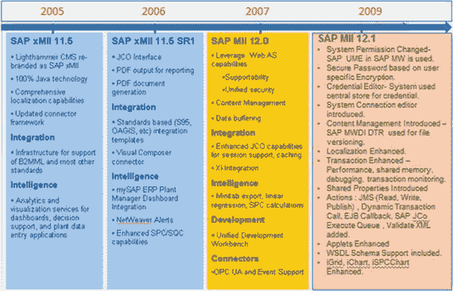

图 1-1. `SAP MII` 11.5 至 12.1

图 1-2 展示了 2010 年至 2015 年间的进步。

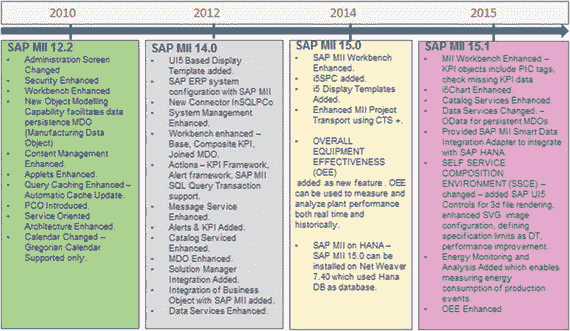

图 1-2. `SAP MII` 12.2 至 15.1

## SAP MII 概览

`SAP MII` 是一个灵活的 `平台`，其基本设计可进行定制以适应客户需求。它提供了强大的集成能力和高质量的智能分析。`SAP MII` 能够实现车间系统与企业系统之间近乎实时的数据集成。`SAP MII` 还提供了一个 `模型驱动` 的开发环境，这意味着它不遵循传统的逐行编码风格，而是一种 `拖放式` 的层级设计开发模式。

`SAP MII` 可以使用 `Business Logic` 服务开发多种逻辑。同时，借助可视化引擎，它可以通过用户界面提供卓越的智能体验。`SAP MII` 内置了连接性和内容，用于连接 `SAP` 业务套件，如 `ERP`、`SAP SCM` 和 `SAP PLM`。`SAP MII` 可以将数据持久化存储在 `MDO` 中，这样客户就无需为数据存储设置额外的数据库，从而降低了成本和维护费用。目前，`SAP MII` 拥有标准的告警和 `KPI` 生成机制。

`SAP MII` 使用 `XML` 和 `Java` 适配器等网络标准作为集成组件，以连接 `ERP` 和其他相关业务组件。`SAP MII` 可以同时与多个来源和不同的数据连接器进行集成，并提供基于网页的分析仪表盘。目前，`SAP MII` 可以连接到 `HANA`，并利用 `HANA` 的内存数据库进行设计。

简而言之，`SAP MII` 可以根据以下几点进行阐述：

- `SAP MII` 能够集成所有可用的制造系统以及信息系统，为企业用户提供一个通用的交互平台。

- `SAP MII` 通过支持制造员工通过 `PDA`（个人数字助理）、智能手机和其他数字设备监控关键应用，成功推动了无线应用领域的革命。

- `XML` 是 `SAP MII` 作为结构语言的支柱，它能够处理车间制造系统与 `ERP`、`CRM` 等业务应用之间的不同集成问题。它还利用 `SOAP`（简单对象访问协议）等标准，协助将车间与供应链优化进行集成。

- `SAP MII` 有助于实现制造的实时监控，从而使供应链规划更加顺畅，并做出更佳的决策。

- `SAP MII` 可以重用现有的遗留系统，为企业内的最终用户解锁数据。它为用户提供了一个友好的环境，使其能够在单个浏览器界面中建立来自多个系统的不同数据形式之间的联系。

- `SAP MII` 软件无需在客户端进行管理，并且在 `SAP MII` 实施过程中，也无需维护复杂的数据仓库或数据模型。

- `SAP MII` 允许为计算机集成制造、`IIoT`、机器对机器通信能力以及实时智能设计智能解决方案。

- `SAP MII` 能够通过传递实时通知和对车间任何活动的确认等信息，提高员工生产力。这有助于员工对所接收到的信息立即采取行动。

- `SAP MII` 还能从 `大数据` 制造分析中提供企业级的洞察。

- 使用 `SAP MII`，可以定义制造指标和 `KPI`，并在全球各站点部署相同的标准化计算。

### SAP MII 架构

在 `SAP MII` 中，`集成` 与 `智能` 是设计自动化制造解决方案时需要考虑的关键因素。因此，若从更细致的层面审视 `SAP MII` 的构建，它可分为几个层级。从集成方面来看，`SAP MII` 可以使用 `SAP PCo` 或 `OPC` 连接器连接到任何车间系统；从管理方面来看，`SAP MII` 可以通过 `Java` 连接器连接到 `ERP`。从智能方面来看，可以利用 `SAP MII` 丰富的可视化服务开发各类仪表盘、报告、分析及其他指标，以获取实时可见性。请参见图 1-3。

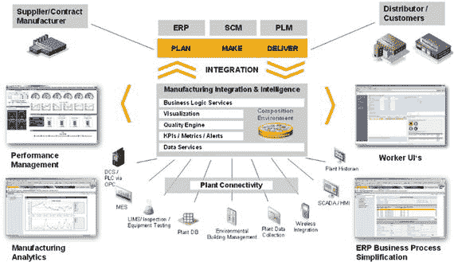

图 1-3. SAP MII 架构视图

以下要点解释了这些 `SAP MII` 架构概念：

- `SAP MII` 是一个开放平台，可集成用于制造运营的不同系统，无论其用途如何。

- `SAP MII` 使用先进的 Web 服务器技术，从多个数据源提取数据，并在服务器端进行聚合。它将数据源转换为业务上下文，进行个性化处理后，将结果交付给最终用户。

- `SAP MII` 使用 `SAP Java 连接器` 和 Web 服务等标准协议，无缝连接到 `ERP` 系统。

- `SAP MII` 提供特定于各种标准制造车间系统的多种数据连接器。

- `SAP MII` 支持与 `ERP` 和车间系统之间以同步和异步模式进行双向数据访问。

- `SAP MII` 独立于浏览器，具有可扩展性和可伸缩性。

- 数据功能可通过 `HTTP`、`SMTP` 和 `FTP` 等标准传输方式访问。

开始安装 `SAP MII` 时，可能会产生一个重要问题：如何部署该解决方案？根据客户的需求和预算，`SAP MII` 可以通过三种方式安装：本地安装、区域安装或全局安装。

- `本地安装`：`SAP MII` 安装在制造工厂现场。每个工厂站点对应一个 `SAP MII` 系统。所有这些系统都连接到全局 `ERP`。请参见图 1-4。

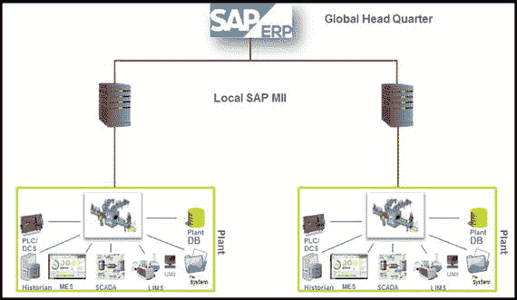

图 1-4. SAP MII 本地服务器拓扑

- `区域安装`：每个区域有一个 `SAP MII` 服务器，一个区域可包含多个制造工厂。区域 `SAP MII` 可以连接到全局 `ERP`。这是最常用的架构。请参见图 1-5。

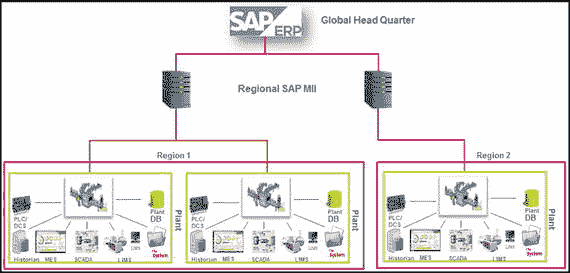

图 1-5. SAP MII 区域服务器拓扑

- `全局安装`：全局仅部署一个 `SAP MII`，位于总部或数据中心。它由所有制造工厂共享。请参见图 1-6。

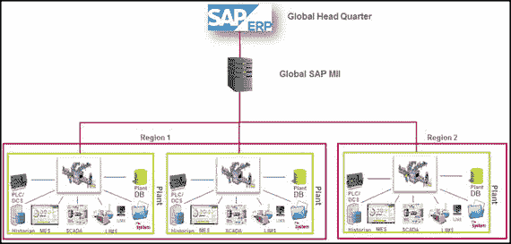

图 1-6. SAP MII 全局服务器拓扑

## SAP MII 系统概览

为了说明 `SAP MII` 平台概览及其相关配置，以下各节将详细介绍各个开发领域。

### SAP MII 安装

`SAP MII` 通常安装在应用服务器上的 `SAP NetWeaver` 平台，但最新版本（从 `SAP MII 15.0` 开始）可以安装在 `SAP HANA` 平台上。`SAP MII` 安装的先决条件包括 `NetWeaver` 版本和相应的 `Java J2EE` 引擎版本。从 `SAP MII` 版本 `12.0` 开始，所有版本都具有固定的 `NetWeaver` 版本。此处我们以最新版本 `SAP MII 15.1` 为例说明其设置。

`SAP MII 15.1` 可以安装在 `SAP NetWeaver 7.4` 或 `SAP NetWeaver 7.5 Java 应用服务器` 上。

要运行 `SAP MII 15.1`，客户端机器需要 `JRE 1.6` 或更高版本。`SAP MII` 不完全支持 `JRE 1.7.8` 及以上版本，有时会导致崩溃。

要安装 `SAP MII 15.1`，请登录 `SAP Service Marketplace`（[`http://service.sap.com`](http://service.sap.com)）。在软件下载支持包中选择 `SAP MII` 选项，然后选择 `15.1` 版本。接着下载对应版本的 `SAP MII sca` 组件文件和 `SAP MII admin sca` 组件文件。按照 `SAP` 安装指南完成安装（[`https://help.sap.com/viewer/p/SAP_MANUFACTURING_INTEGRATION_AND_INTELLIGENCE`](https://help.sap.com/viewer/p/SAP_MANUFACTURING_INTEGRATION_AND_INTELLIGENCE)）。

关于服务器硬件规模，`SAP` 在 `SAP Marketplace` 中提供了一个名为 `Quick Sizer` 的即时工具（`service.sap.com/sizing`）。

## SAP MII 的系统配置

`SAP MII` 根据需求有不同的基本配置。下面将进一步说明。

### 安全性

与其他任何工具一样，安全性是 `SAP MII` 的一个主要且重要的组成部分。由于 `SAP MII` 是一个平台，并且可以开发客户特定的解决方案，因此 `SAP MII` 必须在解决方案内部提供安全保障。

### 用户管理

`SAP MII` 拥有多种安全流程。其中最重要的部分之一是用户管理或用户管理。

用户管理由 `SAP NetWeaver J2EE Web.AS 用户管理引擎 (UME)` 处理。以下是 `SAP MII` 系统访问的基本角色。

- `xMII 只读`：授予对 `SAP MII` 系统和工作台具有只读访问权限的用户角色。
- `xMII 用户`：授予对 `SAP MII` 系统及使用 `SAP MII` 开发的解决方案具有基本访问权限的用户角色。拥有此权限的用户不能执行任何类型的配置。
- `xMII 开发者`：授予使用 `SAP MII 工作台` 开发复合应用程序的开发人员角色。开发者可以执行开发所需的某些配置，例如调度作业配置。
- `xMII 管理员`：授予系统管理员角色。此角色拥有所有 `SAP MII` 系统和 `NetWeaver` 的配置能力。
- `xMII 超级管理员`：授予对 `SAP MII` 及其在 `NetWeaver` 和用户管理中的相关配置具有完全访问权限的角色。

#### UME 的架构

如图 1-7 所示，`UME` 架构中包含三个主要层级。最底层包括带有各自持久化适配器的数据源。用户数据存储在多个数据源中，因此最底层仅专用于用户数据存储。第二层是持久化管理器。它帮助持久化适配器创建、读取、写入和搜索与用户管理相关的数据。最顶层被称为应用程序编程接口 (`API`)。所有与从数据源写入或读取数据相关的配置都通过持久化管理器完成，以确保信息安全，并确保不会泄露给使用 `API` 的应用程序。这些应用程序可以确定用户管理数据具体存储位置的详细信息。

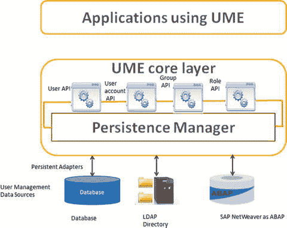

图 1-7. UME 的架构

在 `SAP MII` 中，可以创建项目特定的多层角色。通过使用此功能，可以限制所有用户对解决方案的访问，以便管理员用户能够按权限执行某些配置。除此之外，还可以在 `UME` 中创建项目或应用程序特定的角色，以分配在工作台上开发对象的安全权限。

除了创建角色之外，还有必要在 `NetWeaver` 中创建用户，以便访问 `SAP MII`。如果客户已为其他应用程序在 `NetWeaver` 中维护用户，则这些相同的用户可以在 `SAP MII` 中重用，因为 `SAP MII` 也是基于 `NetWeaver` 的。

有两种访问用户管理或用户管理的方法：

1.  在浏览器中键入以下 URL：`https://<server>:<port>/useradmin`
2.  从 `MII` 菜单中，转到“安全服务” ➤ “用户管理”。参见图 1-8。

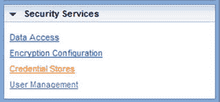

图 1-8. 用户管理的菜单选项

在“用户管理”中，可以创建新用户、复制或修改现有用户配置文件以及删除现有用户。

从“用户管理”屏幕，也可以对角色和组创建执行与用户创建相同的操作。参见图 1-9。

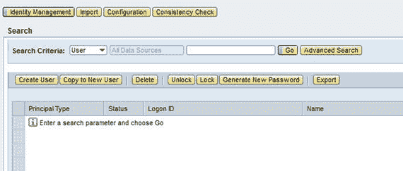

图 1-9. NetWeaver 中的用户管理

以下是 `SAP MII` 用于识别授权操作的标准后缀：

- `_R`：允许读取访问
- `_RW`：允许读取和写入访问
- `_RWD`：允许读取、写入和删除访问
- `_deploy`：强制立即部署
- `_transport`：允许传输访问
- `_all`：允许读取、写入、删除和传输访问

### 数据访问

`SAP MII` 数据访问用于将 `SAP MII` 角色分配给 `SAP MII` 数据服务器。需要分配 `Admin` 和 `Data Access Security Editor` 这两个系统安全服务，才能在数据访问上执行特定功能。

要配置数据访问，请从 `Available Servers` 列表中选择一个服务器，然后单击 `Edit`。从 `Available Roles` 列表中，选择一个角色，并使用 `Add All`、`Add`、`Remove` 和 `Remove All` 按钮将其添加到分配给服务器列表的角色中，或从中移除。要选择多个角色，请按住 `Ctrl` 键，然后单击相应的角色。然后单击 `Save`。参见图 1-10。

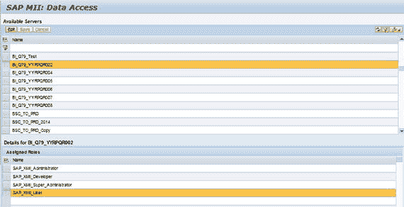

图 1-10. 数据访问屏幕

### 加密配置

加密配置使用加密算法对保存在 `SAP Manufacturing Integration and Intelligence` 中的数据服务器、调度和凭据进行编码。参见图 1-11。

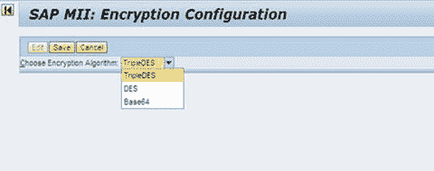

图 1-11. SAP MII 加密配置屏幕

可用的加密算法由 `SAP NetWeaver` 实例决定，可能包括以下内容：

- `TripleDES`，提供最强的数据加密。这是默认设置。它基于数据加密标准 (`DES`)，数据会被加密三次。
- `DES` 提供第二强的数据加密。
- `Base64` 提供最弱的数据加密。当没有其他加密方法可用时，系统使用 `Base64` 编码。

### 凭据存储

您可以使用 `Credential Stores` 屏幕为用户名和密码添加别名，该别名可以被修改或删除（参见图 1-12）。这些别名在 `SAP Manufacturing Integration and Intelligence` 工作台操作中使用，而不是在操作配置中输入用户名和密码。所有需要用户名和密码进行配置的对象都提供带有密码加密的凭据存储。然后，可以使用别名的凭据来配置：

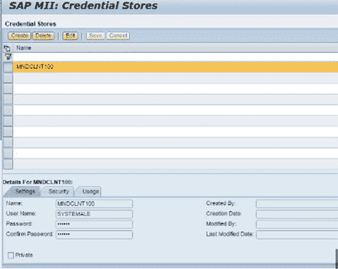

图 1-12. SAP MII 凭据别名配置

- `SAP` 服务器
- `BLS` 操作

### Illuminator 服务

`Illuminator` 服务是 `SAP MII` 中数据服务的支柱。`SAP MII illuminator` 服务基本上是一组提供 `SAP MII` 某些核心功能的 `HTTP` 服务。您可以通过 `XML` 消息交换从外部调用这些服务。

每个 `illuminator` 服务都有一个服务名称和一个或多个模式，即服务操作。在执行时，您必须同时指定服务名称、模式以及输入参数（如果有的话）。这些服务可以独立调用，也可以通过使用 `AJAX` 或 `BLS` 从网页调用。以下是这些服务的三个主要用途：

- 作为从 `MII` 内部表获取数据的唯一方式
- 从性能角度看，在代码中使用此功能的最佳方式之一
- 易于直接从 `IRPT` 或 `JS` 使用

以下是 `illuminator` 服务的语法：

```
http://<server>:<port>/XMII/Illuminator?service=<service name>&mode=<mode name>&content-type=text/xml
```

以下是 `MII 12.0` 及更高版本中可用的服务列表：

- `Admin`：用于检索 `SAP MII` 服务器的管理和安全信息。
- `Scheduler`：用于根据程序逻辑，无需任何用户干预即可自动从 `MII BLS` 或网页控制计划作业。
- `SystemInfo`：用于获取 `SAP MII` 的系统相关信息。

以下是 `MII 12.1` 及更高版本中提供的更多服务：

# Indexing
包含检查索引内容和监控索引器的方法。索引器会重建索引信息。它将遍历数据库中的所有文件并重新为其建立索引。仅当索引因某种原因不同步时才应使用此功能。

*   `Monitoring`：用于检索登录、文件使用、服务器使用等信息。您可以从此处确定系统负载、运行中的事务、查询等。
*   `BLSManager`：用于检索 `BLS` 的信息，如 `BLS` 的运行时间、最长运行时间、日志、输出、统计信息等。您可以执行终止事务、删除事务、清除事务缓存等活动。
*   `Transport`：用于将配置或项目从一个系统传输到另一个系统。
*   `DataServer`：用于执行数据服务器的基本功能，例如启用、禁用、删除、导出和导入。

## 在最新版本的 SAP MII 中
包含了几项新服务：

*   `Alert`：提供列表、查看、删除等基本功能。
*   `oData`：`SAP MII` 中新增，现在支持与 `SAP HANA` 的集成。`SAP MII` 可以托管在 `SAP HANA` 上。

请参考作者撰写的 SCN 博客：[https://blogs.sap.com/2013/01/02/illuminator-services-of-sap-mii/](https://blogs.sap.com/2013/01/02/illuminator-services-of-sap-mii/)

# SAP MII 管理配置

若要开发 SAP MII 解决方案，具有管理员角色的开发者需要进行某些配置才能继续。SAP MII 管理菜单页面中有多个需要配置的部分。本章节将说明最重要的部分。这些配置是强制性的，并且在开始 SAP MII 项目之前必须掌握相应的知识。

要访问 SAP MII 菜单页面，请通过浏览器访问以下 URL：
`https://<主机>:<端口>/XMII/Menu.jsp`

## 系统管理菜单选项

SAP MII 菜单包含系统管理选项。此菜单允许您配置系统级设置。这些系统管理活动需要管理员和其它管理安全服务权限。这些权限必须分配给用户角色，才能访问和管理系统管理菜单中可用的管理任务。此菜单包含如图 1-13 所示的配置项。

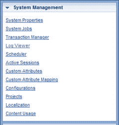
图 1-13. SAP MII 系统配置菜单选项

### 系统属性屏幕

系统属性屏幕用于配置 SAP MII 的通用管理配置，如图 1-14 所示。

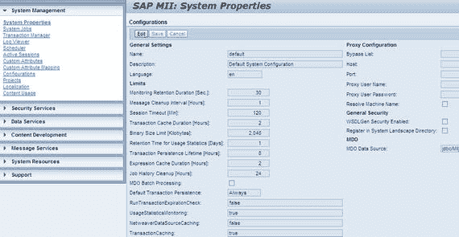
图 1-14. SAP MII 系统属性配置屏幕

### 系统作业屏幕

系统作业是按固定时间间隔在后台运行的任务，用于执行 SAP MII 服务器和内容的内部维护。请参见图 1-15。

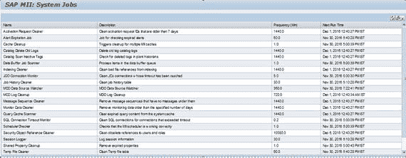
图 1-15. SAP MII 内部系统作业详情

SAP MII 服务器上运行的默认系统作业（如图 1-16 高亮所示）如下：

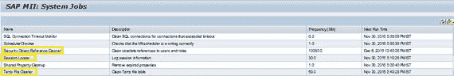
图 1-16. SAP MII 中的重要系统作业

*   `会话记录器`：每 30 分钟运行一次，根据活跃的唯一用户数记录系统使用情况。
*   `安全对象引用清理器`：每 7 天运行一次，删除相应数据库表中的无效系统和性能角色、自定义属性角色以及用户。
*   `临时文件清理器`：每小时运行一次，清理临时文件表。

### 事务管理器屏幕

事务管理器屏幕监控系统中正在执行的 BLS 事务（见图 1-17）。

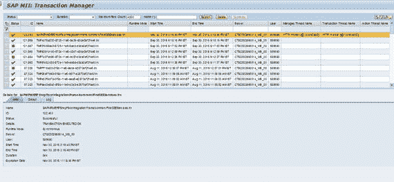
图 1-17. SAP MII 事务管理器屏幕

### 日志查看器屏幕

日志查看器屏幕（见图 1-18）显示 SAP NetWeaver 日志查看器。系统日志可以通过 SAP NetWeaver 管理员控制台 (NWA) 查看。可通过 `NWA_READONLY` 角色，利用 `https://<主机>:<端口>/nwa` 链接进行查看。此外，`NWA_SUPERADMIN` 允许用户对 NetWeaver 界面和 MII 所需的配置拥有完全查看权限和控制权，以及访问受管系统中数据的权限。只读角色（`NWA_READONLY`）不允许用户对受管系统进行更改。另一个角色（`NWA_SUPERADMIN`）则允许完全控制。您可以查看过去 24 小时的日志。跟踪级别默认为错误，可通过导航至 `SAP NetWeaver 管理员控制台 ➤ 系统管理 ➤ 配置 ➤ 日志配置` 进行修改。

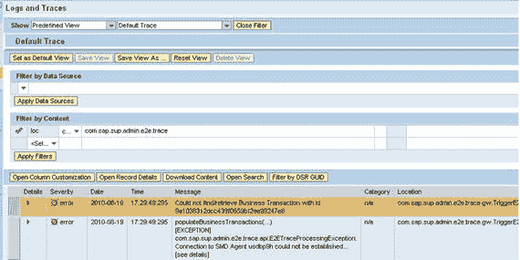
图 1-18. SAP MII 日志查看器

跟踪级别可设置为以下任一选项：

*   `全部`：记录所有消息：调试、路径、信息、警告、错误和严重。
*   `调试`：用于调试目的，包含详尽的底层信息。
*   `路径`：用于跟踪 MII BLS 的执行流程，例如，可用于跟踪进入和离开方法、循环和分支操作时的路径。
*   `信息`：用于显示已执行的提示性文本。
*   `警告`：即使出现问题或存在需要开发者/操作员关注的异常，应用程序也能完成任务。
*   `错误`：应用程序可以从错误中恢复，但由于错误而无法完成所需任务，需要修正。
*   `严重`：应用程序无法从错误中恢复，这种严重情况会导致应用程序致命终止。
*   `无`：不记录任何消息。

### 调度程序菜单

`Scheduler`菜单提供了用户调度的所有作业的相关信息。任何业务逻辑（BLS）事务、查询和 MDO 都可以通过`Scheduler`定期执行。还可以查看正在运行、等待或停止的作业的状态。

需要为用户分配`Scheduler Security`服务，才能启用对`Scheduler`屏幕的访问，如图 1-19 所示。

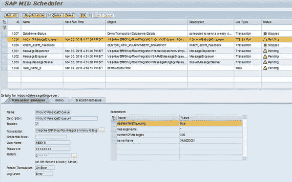
图 1-19. SAP MII 调度程序配置

调度程序有三个选项卡：
- `Transaction Scheduler`（事务调度程序）
- `History`（历史记录）
- `Execution Schedule`（执行计划）

#### 事务调度程序（Transaction Scheduler）

此选项卡上的元素说明如下：
- `Name`（名称）：已调度作业的名称。
- `Description`（描述）：作业的详细信息及其预期功能。
- `Enabled`（已启用）：一个复选框选项，勾选后，作业将根据 cron 模式定期运行。如果未勾选此复选框，则作业不会被调度。
- `Transaction, Query, or MDO (Manufacturing Data Object)`（事务、查询或 MDO）：指示将被调度运行的 BLS 事务、数据查询或 MDO 查询。
- `Run As Username`（运行身份用户名）：指示用于运行作业的用户凭证。
- `Run As Password`（运行身份密码）：表示上述用户的密码。
- `Parameters`（参数）：指示所选事务的输入参数（如果有）。用户在将事务作为计划作业运行时，理想情况下应输入要使用的输入参数的值。
- `Pattern`（模式）：指示一个 cron 模式，该模式决定了要运行作业的计划。可以手动创建 cron 模式，或通过使用`Build Pattern`屏幕创建。点击`Build Pattern`按钮可调用`Build Pattern`屏幕，它能帮助轻松创建 cron 模式。

`Scheduler Service`每 500 毫秒检查一次是否有准备就绪的作业，然后执行这些作业。使用`Scheduler`可以定期执行任何业务逻辑事务、查询或 MDO，以执行各种活动，例如通过数据查询从制造车间系统提取数据、执行 Web 服务或 RFC、计算并更新 KPI。

`Scheduler`屏幕还会显示有关计划作业的以下信息。
- `Status`（状态）：表示作业的状态。取值可以是`Stopped`、`Pending`和`Running`。
    - `Stopped`：表示作业当前已停止。未启用的任务具有此状态。
    - `Pending`：表示作业已调度，正在等待下一次运行。
    - `Running`：表示计划作业当前正在运行。
- `Name`（名称）：表示在`Scheduler`中设置的作业名称。
- `Next Run Time`（下次运行时间）：指示此计划作业下一次运行的时间。
- `File`（文件）：表示已调度运行的业务逻辑事务、查询或 MDO 的完整路径。
- `Description`（描述）：说明在`Scheduler`中设置的作业。

#### 历史记录（History）

`Scheduler`还允许管理员或任何具有足够授权权限的用户查看`Job Execution History`屏幕，如图 1-20 所示。

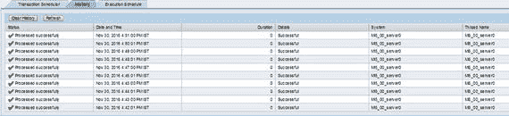
图 1-20. 调度程序执行历史记录屏幕

此屏幕显示计划作业先前执行尝试的详细信息，包括状态、持续时间和详细信息。

#### 执行计划（Execution Schedule）

最后，`Execution Schedule`功能会显示该作业接下来 20 次计划运行的时间表，如图 1-21 所示。

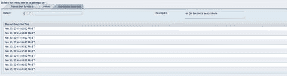
图 1-21. 调度程序执行计划

### 活动会话屏幕（Active Sessions Screen）

如果用户被分配了管理角色，则可以通过`Active Sessions`屏幕查看已登录到 SAP MII 服务器的用户列表。除了用户登录名之外，此屏幕还提供用户的全名、电子邮件地址、首次登录的日期和时间、系统上次访问的日期和时间以及会话何时过期。参见图 1-22。

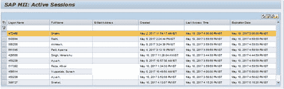

图 1-22. SAP MII 活动会话屏幕

### 自定义属性屏幕（Custom Attributes Screen）

`Custom Attributes`屏幕用于管理自定义属性，以存储应用程序使用的配置或业务数据。参见图 1-23。

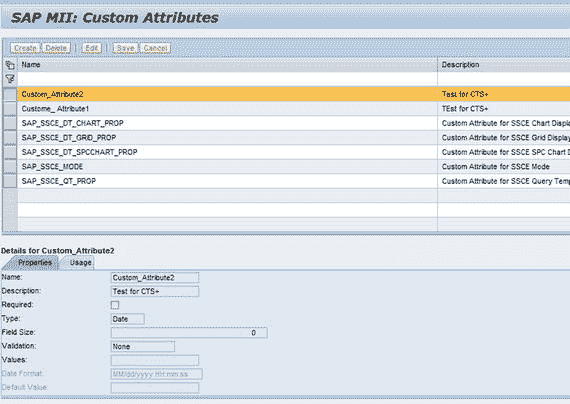

图 1-23. SAP MII 自定义属性配置

### 自定义属性映射屏幕（Custom Attribute Mapping Screen）

`Custom Attribute Mapping`屏幕用于将自定义属性分配给现有用户或用户角色，以用作会话变量。参见图 1-24。

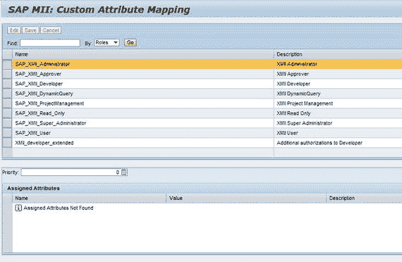

图 1-24. SAP MII 自定义属性映射配置

### 配置界面

配置界面用于以 ZIP 压缩包的形式将配置备份导入系统或从系统导出。图 1-25 中显示的配置均可导出和导入。

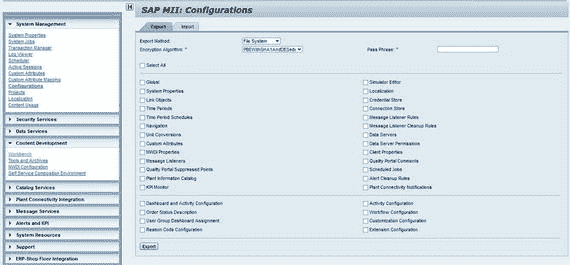

图 1-25. SAP MII 配置及其导出和导入功能

配置界面提供将系统配置备份为 ZIP 文件（`xmiibackup.zip`）并保存到本地系统上用户指定位置的功能，以及从类似的备份存档中恢复系统配置的功能。这在将配置从一个 SAP MII 安装环境传输到另一个环境时（例如，从开发环境传输到生产环境）非常有用。

您需要将配置管理安全服务分配给用户，才能访问配置界面。根据界面上勾选的选项，相应的配置会被导出到一个 XML 文件中。当点击“导出”按钮时，对应的文件会被包含在`xmiibackup.zip`存档中。在导入的情况下，您需要从本地文件系统中浏览包含先前导出的配置备份存档文件，然后点击“导入”将配置存档文件导入到 SAP MII 中。

以下说明的配置类型可在 SAP MII 中导出或导入：

- `系统属性`：系统属性备份在`SystemProperties.xml`文件中。

- `模拟器实例`：每个实例都作为单独的 XML 文件备份，命名为`<SimulatorServerName>.xml`，存放在存档中名为`Simulator_files`的文件夹内。默认的模拟器实例会备份为`DefaultSimulator.xml`。

- `计划任务`：每个计划任务都作为单独的 XML 文件备份，命名为`<ScheduleName>.xml`，存放在存档中名为`Scheduler_Jobs`的文件夹内。

- `消息监听器`：在消息服务中创建的消息监听器配置备份在`MessageServers.xml`文件中。

- `消息监听器规则`：在消息服务中创建的消息监听器处理规则备份在`MessageProcessRules.xml`文件中。

- `数据服务器权限`：在安全服务中配置的数据服务器安全权限备份在`ServerPermissions.xml`文件中。

- `消息监听器清理规则`：在消息服务中创建的清理规则备份在`MessageCleanupRules.xml`文件中。

- `数据服务器`：在数据服务中配置的数据服务器备份在`Servers.xml`文件中。

- `本地化`：本地化设置会作为单独的 XML 文件备份，命名为`<Language>.xml`，存放在存档中名为`Localization`的文件夹中。

- `链接对象`：在可视化服务中配置的导航链接对象备份在`ContentMap.xml`文件中。

- `时间段`：在数据服务中配置的时间段备份在`TimePeriods.xml`文件中。

- `导航`：每个关联了导航配置文件的角色或用户，都会作为相应的 XML 文件存储，命名为`<Role>.xml`或`<User>.xml`，存放在公共`Profiles`文件夹下对应的`ROLE`或`USER`文件夹中。

- `时间段计划`：在数据服务中配置的时间段计划备份在`Schedules.xml`文件中。

- `全局设置`：在 SAP MII 安装中定义的全局属性备份在`Globals.xml`文件中。

- `单位转换`：单位转换配置备份在`UnitConversions.xml`文件中。

- `自定义属性`：在系统管理中配置的自定义属性备份在`CustomAttributes.xml`文件中。

### 项目菜单

SAP MII 中的项目菜单允许 SAP MII 管理员（以及任何拥有项目管理安全服务的用户）备份和恢复 SAP MII 项目。这在将开发内容从一个 SAP MII 安装环境传输到另一个环境时（例如，从开发环境传输到生产环境）非常有用。参见图 1-26。

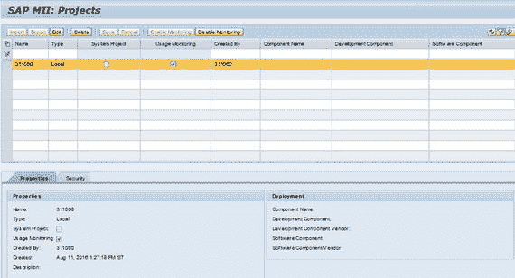

图 1-26. SAP MII 项目配置及其导出和导入功能

项目界面列出了各种项目及其详细信息，例如名称、描述、是否为系统项目、创建时间和创建者，以及将其删除或导出为压缩 ZIP 文件的选项。

从 SAP MII 导出的项目包含与 SAP MII Workbench 中定义的相同文件夹结构内的项目文件，以及一个`ExportManifest.xml`文件，该文件包含有关导出项目的必要元数据。将项目导入 SAP MII 时，不必包含`ExportManifest.xml`文件。也可以从外部创建项目结构并将其导入 SAP MII。但是请注意，如果将具有相同项目名称的项目导入 SAP MII，则现有项目将被覆盖，无论它是否是系统项目或隐藏项目。

SAP MII 中的系统项目由 SAP 提供，供 SAP MII 系统内部使用。这些项目无法删除，例如`Default`和`QualityPortal`。

### 本地化

本地化功能为 SAP MII 平台提供不同的语言支持（参见图 1-27）。

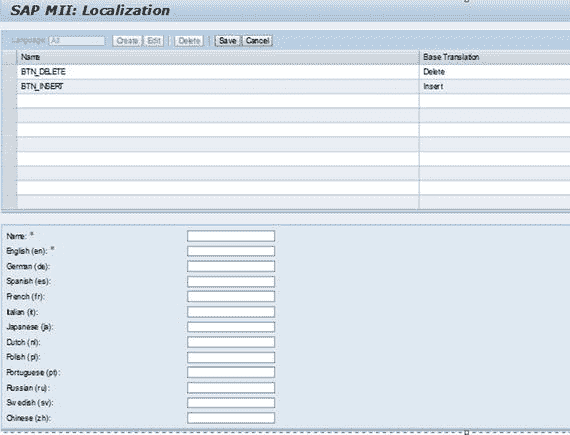

图 1-27. SAP MII 本地化配置

本地化可以通过两种方法设置（参见图 1-28）：

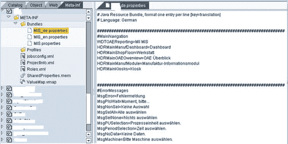

图 1-28. SAP MII 网页本地化

- `网页本地化`：任何 HTML 页面都可以根据区域语言进行本地化。HTML 页面需要保存为`.irpt`文件。此文件扩展名标识这些文件是需要系统在运行时将其作为 HTML 返回给浏览器之前进行处理的网页。在此过程中，系统会根据用户的语言将本地化键替换为其翻译。为此，开发人员需要在`#`标签内为特定语言定义本地化键及其值，例如`{##KeyName}`。在运行时，该值决定显示的语言。

- `项目本地化`：此功能可用于完全本地化项目。本地化字符串用于事务处理和`.irpt`页面。项目本地化的优先顺序是：用户语言，然后是系统语言，最后是英语 (EN)。如果未找到本地化值，则默认返回键。此外，通过 SAP MII Workbench 的`meta-inf`选项卡，您可以在`Bundles`文件夹下为客户特定的本地语言创建新的`.properties`文件。使用此文件，您可以为指定的语言添加`名称=值`对。

# 总结

本章引导您了解了制造的概念。进一步解释了制造过程中涉及的不同流程，以及如何在制造过程中弥合车间与管理层之间的差距。您还了解了 `SAP MII` 的演变历史、`SAP MII` 是什么，以及它通过其产品架构、安装概念和系统配置功能可以做什么。在下一章中，您将了解制造业面临的关键挑战，以及为何应从功能、技术和业务角度使用 `SAP MII`。
