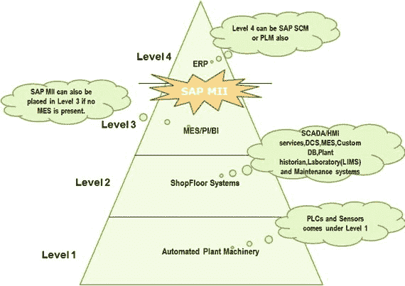

# 2. 为何在制造业中使用 SAP MII

本章解释了为何应在制造业中使用 `SAP MII`。它说明了制造业面临的挑战，以及 `SAP MII` 在克服这些挑战中所扮演的角色。

## 为何使用 SAP MII？

上一章解释了 `SAP MII` 是什么。当今制造业面临的最大问题之一便是：为何要使用 `SAP MII`？使用 `SAP MII` 的益处需要从多个角度考量，例如其功能特性、技术优势以及商业效益，这样才能证明其使用价值。`SAP MII` 是一个强大的集成平台，这意味着它可以作为不同第三方或遗留系统之间的中间件。不仅如此，`SAP MII` 还具备智能分析能力，因为它可用于开发各种智能实时分析和监控报告，并利用 3D 图形实现高端可视化。近期，`SAP MII` 还引入了另一个“I”要素，即“创新”（`innovation`）。`SAP MII` 的这一隐性特性通过连接 `IIoT`（工业物联网）智能移动设备，助您实现创新。

**注意**

术语 `innovation`（创新）指的是为现有方法引入新思路，或用更优的解决方案改进现有方法。新方案可能对用户更友好，或采用新设备、新技术以获得更好的结果。例如，智能手机是对传统手机的一次创新，其灵感源于市场对更灵活沟通方式的需求。

`IIoT` 指的是物联网技术。构成 `IIoT` 的不同技术包括：大数据技术、机器学习机制、方法控制以及传感器数据监控。一台机器如何与另一台机器通信，也称为 `M2M`（机器对机器）通信。使用 `IIoT` 的另一个因素是它能与移动设备集成，这样用户即使不在现场，也能连接到接近实时的数据。

## 制造业的关键挑战与解决方案

制造业面临着诸多挑战，包括生产成本上升、产品质量下降、合格劳动力难寻、市场竞争激烈等等。所有这些挑战都是相互关联的。例如，低效的人力往往会增加制造成本，并对产品质量产生不利影响。从长远来看，该企业将落后于人。为了更轻松、快速、高效地克服这些问题，公司需要一个强大的解决方案。以下章节将详细阐述制造业面临的挑战及其应对方案。

### 竞争激烈的市场与更低的制造成本

制造业是一个复杂但却是任何国家经济命脉的行业。如今，制造业面临着激烈的竞争。一家制造企业的竞争力可以根据质量、创新、效率、客户满意度、员工满意度等多个相互依赖的因素来评估。此外，这些职能部门之间沟通的速度也影响着企业的竞争力。决定制造业竞争力的因素有很多。要更有效地应对这一挑战，您必须识别出能以最低成本和高品质进行管理的核心竞争力。如今，创新也被视为一个能带来更优性能的因素，从而有助于降低制造成本。

`SAP MII` 以最低成本为制造企业提供了所有这些功能。在服务器层面，它具有以下特点：

-   内部数据库及低维护成本
-   能够使用连接器与 `ERP` 系统集成，从车间获取近乎实时的数据
-   多个流程无需人工成本
-   流程自动化，以避免人为错误

**注意**

`ERP` 代表企业资源计划。这是企业的规划和管理套件，有助于管理生产和产品的规划活动。这包括制造成本、交付、提货单、物料管理、运输管理、支付管理、库存管理、销售管理等。它通过利用强大的 `RDBMS`（关系型数据库管理系统）实时控制各个业务流程，帮助您从仓库到生产管理、从计划到生产管理获得业务的集成视图。

`shopfloor`（车间）是工厂或工作坊中操作人员工作的区域；该术语用于将工厂的生产部分与行政部分区分开来。

### 对精益供应链策略的偏好

如今，制造业更偏好精益供应链策略。这种方法以最少浪费的方式，将产品快速交付给最终客户。精益供应链有助于在快速预测客户需求的同时，以极高的效率轻松交付产品，从而为客户提供更好的解决方案。这最终有助于实现卓越的财务业绩。由于 `SAP MII` 是一个灵活的平台，因此可以根据需要开发客户特定的解决方案。此外，`SAP MII` 可以连接到车间系统和 `ERP` 解决方案，并能实现流程自动化，因此可以在 `SAP MII` 中设计出缩短生产周期的解决方案。`SAP MII` 还可以与质量模块集成，并实时监控生产。它可以更有效地检查生产浪费，从而缩短决策时间。

**注意**

`supply chain`（供应链）是企业资源规划的组成部分之一，它清晰地显示了库存从供应商到最终客户的流动情况。它提供了从原材料到最终产品，再到最终交付给客户的透明视图和更好的控制。

`Lean supply chain`（精益供应链）鼓励仅生产所需的数量，并考虑何时何地需要产品。这有助于减少不必要的生产，因为不必要的生产会导致浪费并推高成本。根据最终消费者的需求，可以用更少的资源生产更多产品，或者用更多的资源精确生产所需数量。只有针对每个产品进行单独处理，消除流程中不必要且被视为浪费的环节，这才能成功。因此，精益方法不仅关注消除流程中的浪费，还考虑价值流的提升。

### 分散的制造工厂系统

制造工厂涉及多个自动化系统、机器、工厂、总部，以及不同制造相关部门的安全系统。在一个更大的制造系统中，生产工厂分散在多个地点、区域或地理位置是很常见的。这些不同的单元相互隔离，彼此之间的沟通不畅。通常，`ERP` 是在总部或区域办公室集中实施的，而不是在每个工厂。由于 `ERP` 系统与这些单元没有直接连接，从不同站点和单元获取信息可能非常耗时。而且，由于这些信息是手动处理的，发生人为错误的可能性很高。如果在本地、区域或全球范围内将 `ERP` 与 `MII` 连接起来，管理层将始终能够获取近乎实时的数据。由于流程通过 `SAP MII` 实现了自动化，数据将始终保持准确。与此同时，`MII` 保证数据可靠交付，因此，如果任何工厂或单元断开连接，`MII` 在重新连接时可以立即将排队的全部数据推送到 `ERP`，而不会丢失任何数据。

### 生产问题的业务与财务影响

在制造工厂中，生产问题或偏差的业务与财务影响非常难以手动监控或控制。例如，假设出现这样一种场景：需要生产 100 个零件作为最终产品，但由于生产线故障，20 个报废，最终仅生产了 80 个，这仍被视为良好生产。但若 80 个报废，仅 20 个合格，则说明生产线或机器需要更换或纠正，因为报废数量超过了合格产品数量。`SAP MII` 可以连接到 `ERP`，从 `MII` 和 `ERP` 两端监控并触发工厂维护通知。这些通知能够及时告知维护主管此类业务损失，以便他们迅速更换或修复机器或生产线。

通过让高产线、低浪费的机器持续产出合格产品，也可以遏制财务损失。`MII` 还可以连接到 `ERP` 的质量模块，这样无论最终生产出的合格产品数量是多少，`MII` 都能与之衔接。`SAP MII` 还具备工厂维护计划监控功能。管理层和监管团队可以利用这一功能，借助在 `MII` 中开发的记分卡报告，了解生产线为何以及何时经历了计划停机、非计划停机、计划停止、故障等状态。这些问题可能由人工失误、物料短缺、偏离生产计划、设备过度使用、物流不当以及不可避免的事故导致。

### 生产缺乏控制与监控机制

很多时候，制造业企业因为无法控制和监控正在运行的生产线而面临问题。假设出现这样一种情况：他们需要跟踪生产过程中大型烤箱使用的温度控制器，当其超过特定阈值时，手动记录这一事件的确切时间。如果依赖人工干预，这些信息就可能出错。

另一种可能发生的情况是，锅炉或储罐阀门需要关闭，因为它已超出容量限制。但同样，由于缺乏恰当的机制，锅炉或储罐会溢出甚至爆裂。此类工厂事故甚至可能导致人员伤亡。`SAP MII` 提供了一个万无一失的解决方案来避免此类事故。它会持续检查阈值并设置警报，自动跟踪生产过程中实时出现的此类问题。`SAP MII` 还可以触发邮件通知主管，让他们了解此类事件。如果车间机器与 `SAP MII` 连接，那么当 `MII` 检测到机器发生故障或异常时，它可以停止该机器。

**注意**

温度控制器无需人工干预即可控制温度。这个智能工具从热传感器（如电阻温度检测器或热电偶）获取输入，并持续将该信息与设定点（即安全的目标温度）进行比较。它会向控制元件（例如控制温度的阀门）提供输出。

### 缺乏达成生产目标所需的决策流程

生产人员往往缺乏达成生产目标所需的决策支持信息。这些目标由各个工厂不同的关键绩效指标（`KPI`）来定义和衡量。由于车间与 `ERP` 之间没有直接连接，生产操作员甚至有时是主管，可能会利用这种脱节，手动停止机器或篡改数据，以达到生产目标，从而忽略实际读数。

通过使用 `SAP MII` 自动化车间涉及的机器并连接到 `ERP`，可以避免这些人为偏差。一旦 `SAP MII` 直接连接到车间机器和 `ERP`，它便可以利用来自车间和 `ERP` 的实时数据，展示有价值的整体设备效率（`OEE`）报告和自定义报告，例如机器报告、停机分析报告、良率概览报告等。`SAP MII` 能够非常高效地完全自动化此类场景。

**注意**

`OEE` 代表整体设备效率。它是 ISO 的衡量指标之一，并被纳入最佳实践解决方案中，用于识别真正有效的计划生产时间百分比。良好生产规范（`GMP`）建议工厂在只生产合格零件时，实际上应实现零停机。因此，如果 `OEE` 达到 100%，则被认为是理想的生产状态。如果随着时间的推移达到了非常优异的 `OEE` 结果，它将成为同一环境下其他设备的基准，或成为其他生产设备的行业标准。同样，它也可以用作基准来检测生产设备随时间推移在消除浪费方面的进展。

### 主数据副本导致的质量和合规性问题

如果 `ERP` 没有直接连接到车间，将主数据传输到车间的唯一方法是从 `ERP` 下载并导出到 `Excel` 中。在这种情况下，数据传输过程中会浪费大量时间，因为这依赖人工，且容易出错。数据被篡改的可能性也很高。为填补这一空白，`MII` 可以直接连接到 `ERP` 系统，并在数据从 `ERP` 推送时自动加载主数据。

## SAP MII 的功能层面

`SAP MII` 不仅是一个集成的，也是一个智能的一站式解决方案。它建立起车间与业务流程及运营之间的直接连接。这确保了企业系统与工厂之间的集成近乎实时，并将集成后的数据显示给用户。

当您考虑将 `SAP MII` 作为集成和智能化的解决方案时，请考虑以下功能方面。

### `SAP MII` 产品的可用性

目前，`SAP MII` 易于获取，是 SAP 实验室最值得信赖的解决方案之一，如今它与其他一些制造产品一起作为制造套件的一部分提供。`SAP MII` 需要许可，但如果工厂已经购买了制造套件的许可，则它将自动包含 `SAP MII`。

### 集成优势

`SAP MII` 拥有许多默认连接器，这使得它能非常轻松地连接到 Level 4、Level 3、Level 2 或 Level 1 的任何系统。`SAP MII` 可以填补 Level 3 和 Level 4 之间的空白；如果某个工厂没有 MES，那么 MII 也可以被部署在 Level 3。此外，MII 通过使用 `SAP PCo` 或 `OPC` 连接器，还可以连接到 Level 2 和 Level 1。见图 2-1。

图 2-1. `SAP MII` 在工业层级模型中的位置

产品生命周期管理（`PLM`）是一种通过在以人为中心的扩展型企业环境中集成业务数据，来管理任何流程或系统中涉及产品的理念。

制造执行系统（`MES`）是一种在制造业中用于监控并记录从原材料到成品转化过程的计算机化系统。它将车间发生的实时情况展示给参与决策的授权人员。该系统记录输入、输出、机器的任何严重故障或错误、操作员活动以及其他支持服务。

监控与数据采集系统（`SCADA`）是一种与应用软件集成以控制制造过程的软件。在现代制造业中，自动化系统主要与 `SCADA` 协同工作。它从传感器和 `PLC` 设备收集数据，并根据获取的实时数据对所有设备提供精细控制。

历史数据库可以从多个变量中的复杂系统提取数据，以描绘出制造环境的完整图景。Wonderware 历史数据库通过使用传统关系型数据库管理系统（`RDBMS`）处理并存储高速数据，能够存储大量的工厂历史数据。它提供了一个安全、高性能的数据库来整合不同的数据源，并提供快速检索技术，以理解不断增长的工业数据。

分布式控制系统（`DCS`）指的是生产工厂工业流程的控制系统，在该系统中，控制器分布在工厂的流程控制点上。中央控制室也设有集中控制。`DCS` 主要遵循分布式层次化控制理念来控制工厂自动化中的流程。

可编程逻辑控制器（`PLC`）是一种固态工业计算机控制系统，可以持续监测设备的输入状态，并为自动化流程或机器做出逻辑决策。`PLC` 是工业继电器的良好替代品，并提供比继电器更多的功能。由于 `PLC` 是模块化的，它可以安装在任何环境中来定义逻辑，并且能够抵御高温、粉尘、严寒或高湿度等任何恶劣的制造环境。而继电器则无法在这些环境下正常运行。`PLC` 由一个 16 位或 32 位微处理器组成，可连接到 `CPU`。任何类型的可执行控制逻辑都可以在 `CPU` 中设计，并通过常规运行传输到 `PLC`。

实验室信息管理系统（`LIMS`）或实验室信息系统（`LIS`）会考虑实验室操作中涉及的所有实验室仪器和设备。该系统通过集成仪器或设备，并自动管理样本读数的相关信息，使实验室能够根据定义的工作流程实现完全自动化。这种自动化提高了性能，并缩短了满足客户需求所需的时间。

`SAP MII` 拥有多种标准连接器以实现无缝集成，具体说明如下：

-   `聚合连接器`：在创建聚合查询时使用。它能将多个数据集合并为一个。这是 SAP 提供的默认连接器。
-   `ECC 连接器`：可以使用 SAP Java 连接器（`SAP JCo`）和 SAP Java 资源适配器（`SAP JRA`）连接到 SAP `ECC`。
-   `数据库连接器 (IDBC)`：可用于任何在 SAP NetWeaver 中定义的 JDBC（Java 数据库连接）（Oracle、SQL 或任何数据库）或 ODBC（开放数据库连接）数据源。
-   `PCO 连接器`：用于支持 `SAP PCo` 的查询能力。这是 SAP 提供的默认连接器。
-   `Xml 连接器`：此连接器允许连接并查询任何返回 XML 格式的数据源，系统默认包含。
-   `报警套件连接器`：此连接器主要用于报警机制的数据源，使您能够连接到 Wonderware Alarm Advisor 软件。
-   `MDO 连接器`：此连接器专门用于 `MDO` 查询，且只能有一个活动的 `MDO` 连接器。这是 SAP 提供的默认连接器。
-   `开放式连接器`：开放式连接器用于浏览关系数据库中的历史数据。用户可以通过浏览标签名称和描述，并使用时间段来创建标签查询，而无需编写 SQL 查询。
-   `通用数据连接器 (OLEDB)`：当数据源本身不支持远程数据访问时，通用数据连接器（`UDC`）可实现远程数据访问。`UDC` 通过 TCP/IP 套接字与远程通用数据服务器（`UDS`）通信。`OLEDB` 连接器是一种允许访问 `OLE DB` 数据源的 `UDC`。
-   `Xacute 连接器`：此连接器用于通过 `Xacute` 查询连接到事务。这是 SAP 提供的默认连接器。
-   `KPI 连接器`：此连接器用于 `KPI` 查询。默认情况下，只允许一个活动的 `KPI` 连接器。这是 SAP 提供的默认连接器。
-   `OLAP 连接器`：此连接器允许连接并查询支持 XML for Analysis (XMLA) 规范的多维数据源。它通常用于集成 BI 查询。
-   `虚拟连接器`：此连接器有助于在不直接连接到数据源服务器的情况下，虚拟地查询和连接到其他 `SAP MII` 实例。这是 SAP 提供的默认连接器。
-   `IP21 和 IP21OLEDB 连接器`：`IP21` 连接器将 SAP 制造集成与智能（`SAP MII`）连接到 AspenTech InfoPlus.21 (`IP21`) 数据源。
-   `HANA SDA 连接器`：此连接器允许 `SAP MII` 连接到 HANA Studio。

SAP Java 连接器简称为 `SAP JCo`。它可以利用 Java 开发与 SAP 兼容的组件和应用程序。`SAP JCo` 与 SAP `ECC` 的通信是双向的（即支持入站和出站调用）。入站调用时，Java 调用 `ABAP`，出站调用则相反。

`SAP JRA` 是 SAP Java 资源适配器。它是一个用于连接 SAP 系统的 Java 企业版连接器。它允许您将 `AS ABAP` 与远程 Java 应用服务器（如 `AS JAVA`）集成，从而简化了不同可分发 SAP Java 应用程序与 `AS ABAP`（ABAP 应用服务器）之间的通信。

Java 数据库连接，即 `JDBC`，充当 Java 的 API，并定义了客户端访问数据库的协议。它是 Java 版平台的一部分，归甲骨文公司所有。它基于关系数据库规则，并提供查询和更新数据库中数据的函数和方法。

`ODBC` 代表开放数据库连接，是另一个用于查询数据库的 API，但它是一个开源标准应用程序。通过使用 `ODBC`，您可以访问不同的数据库，如 Access DB、Excel、DB2、Dbase 和 Text。除了 `ODBC` 软件之外，每个数据库还需要一个 Microsoft `ODBC` 连接器，才能使用 `ODBC` 软件进行连接和访问数据。

# SAP MII 技术文档

`PCo` 是 SAP MII 的自由分发组件。它是一个基于 `.Net` 的应用程序，可以与车间层和 SPC 系统集成。`PCo` 还可以托管自定义设计的 Web 服务。SAP MII 有一个默认的连接器用于连接 SAP PCo。SAP Plant Connectivity 被称为 `SAP PCo`。

制造数据对象（`MDO`）可用于定义对象模型和数据结构，并可持久化数据。

`Aspen InfoPlus.21` 是一种高度灵活的过程历史记录系统，可参与从单一流程到跨多个地点的企业级全球部署。这种灵活性最终减少了通常发生的标签消耗，从而更好地管理所涉及的元数据。

工厂信息目录（`PIC`）包含经批准后从工作版本创建的标签和组层次结构。创建层次结构是为了通过以通用方式与标签数据服务器接口，为标签及其数据提供业务上下文。

`SAP HANA` 具有内置的数据库内存，所有数据都存储在 RAM 中。由于数据始终驻留在内存中，数据处理速度更快。这是处理实时分析和应用的最佳推荐方法。它使用基于行和基于列的技术，可以在短时间内处理海量实时数据。

## 基础设施优势

MII 可以安装在 `SAP NetWeaver` 之上，并且易于部署。基于 SAP MII 开发的解决方案比其他中间件工具更灵活。MII 可以与 `NWDI`、`CTS+` 和 `SAP Solution Manager` 集成，并且可以轻松跟踪所有更改。由于 SAP MII 部署因其简单性而不耗时，因此部署 SAP MII 解决方案只需极少的停机时间。

## 智能优势

SAP MII 可以通过仪表板、记分卡和丰富的分析工具提供车间层的性能管理。SAP MII 也是一个强大的报告平台，可以在企业数据仓库和 BI 中提供企业报告、即席查询/报告和高级分析。它可以在车间层执行从高管层到工厂层再到产线层的报告。使用 SAP MII 还可以进行 `SPC/SQC`（六西格玛）分析。

## 创新优势

SAP MII 可以提供与 `IIOT` 的兼容性，包括移动和平板设备，如 `iPhone`、`iPad` 等。这类创新使 SAP MII 解决方案用户友好且高效。SAP MII 可以与 `Google Maps` 集成，并通过 `SMS` 和电子邮件等平台进行通信。

## 跨工厂级设备的灵活性

由于 SAP MII 配备了 `Open`、`UDC` 和 `PCo` 连接器，它可以更灵活地连接到 `SCADA`、`DCS`、`PLC`（`IFIX`）、`Wonderware` 等系统，因为大多数车间层系统都使用标准 `OPC` 连接器。作为 SAP MII 的自由分发组件，`SAP PCo` 内置了 `OPC` 连接器，因此可以直接连接。

注意
SAP Manufacturing Execution 被称为 `SAP ME`。`SAP ME` 是 SAP 用于离散制造的 `MES` 产品之一。该解决方案帮助制造商以自动化和精细化的方式在每个操作级别管理车间层的生产。它还可以使用 SAP MII 连接到 ERP 以及车间层。`SAP ME` 使用名为 `SAPMEINT` 的集成组件来连接其他系统。

## 易于与其他 SAP 制造产品配合使用

由于 `SAP ECC` 是 SAP 的企业解决方案，同样，`SAP OEE` 和 `SAP ME` 是由 SAP 作为 `MES` 解决方案开发和维护的，因此将 SAP MII 连接到这三个产品非常高效、易于配置，并且在连接和集成方面非常可靠。`SAP OEE` 和 `SAP ME` 等制造产品也建立在 SAP MII 平台之上。

## 符合行业标准的集成

`ISA-95` 是集成企业和控制系统的国际标准。`B2MML` 是业务到制造标记语言。它实际上用于实现 `ISA-95` 标准的数据模型，并且是使用万维网联盟的 `XML` Schema 语言（`XSD`）编写的 `XML` 模式的超集。SAP MII 可以按照 `B2MML` 与 `ISA-95` 标准集成。

## 统计与其他数学分析

SAP MII 可以进行数学和特定客户的统计计算。最大值、均值、平均值、标准差等标准函数在 SAP MII 包中默认可用。SAP MII 可以通过逻辑和可视化提供 `SPC/SQC` 分析。

## 预测分析能力

可以开发 SAP MII 的解决方案，这些解决方案能够根据某些参数提供机器何时应停止工作的预测性警报。SAP MII 可以分析所有历史值并创建预测性警报，以确定机器何时会停机。

# SAP MII 的技术优势

由于在车间层执行、ERP 系统和其他遗留系统方面的灵活性，以及 `SAP MII` 中简单的开发方法和标准化的编码技术，使其成为一个强大的制造解决方案开发平台。以下是您可以从 `SAP MII` 中利用的技术优势。

## 简单的编码标准

与其他需要手动编写并记忆要使用的函数和关键字来编写代码的技术不同，`SAP MII` 以拖放工具的形式提供了非常简单和标准的编码标准。它是一个易于使用的软件应用程序平台，用于通过 XML 操作、转换和分发工厂和生产信息。使用 `SAP MII`，您只需拖放所需的动作块，无需担心记忆编码函数、表达式和运算符，因为它们默认内置于动作块中。开发人员唯一需要考虑的是如何使用 `SAP MII` 的内置功能来处理业务案例背后的逻辑。

## XML 语言的灵活性

`SAP MII` 让开发人员能够以结构化的方式强健且高效地存储和使用 `XML`（可扩展标记语言）。由于 `MII` 是一个基于 Web 的应用程序，`XML` 用于在 Internet 和应用程序之间传输和提供数据。开发人员可以使用 `XML` 数据文件通过应用不同的样式表来生成动态内容。`XML` 提供了对数据内容的简单解析。事实上，它可以表示任何类型的数据结构，包括数据库和其他业务信息。`XML` 非常易于处理和转换，因为它始终是一个结构化的数据集。`XSLT` 是转换 `XML` 的 `XML` 技术之一，并且与 `SAP MII` 进一步兼容。因此，使用 `XML` 为您提供了根据客户需求移动和转换数据的灵活性。

## 高端高级业务逻辑服务

`SAP MII` 使开发人员能够对真实世界的业务规则进行编码，这些规则可以决定如何根据业务需求创建、显示、存储、操作和更改数据。简而言之，`SAP MII` 可以使用其标准逻辑服务处理任何类型的客户特定逻辑。业务逻辑定义了业务环境中从一个业务对象到另一个业务对象的逻辑流动，以便它们相互交互。业务对象进行通信的路径和方法应在业务逻辑服务中定义，通常称为 `BLS`。

`BLS` 基本定义了数据应如何转换或计算的过程或步骤，以及将其路由到其他系统的方法。`SAP MII` 提供了许多可以在 `BLS` 中使用的动作块，用于定义从数据输入输出、Web 输入输出、转换、数据计算、电子邮件通信到流程流控制等业务流程操作。

### 符合国际集成标准

制造业遵循特定的生产标准。根据当前工业自动化水平，`ISA-95` 是制造业中使用最广泛的标准之一。`ISA-95` 通常遵循 `B2MML` 结构，以便与其他系统交互。`SAP MII` 可与 `ISA-95` 标准集成，并能通过最少（简单）的编码来处理 `B2MML` 重构，同时还能接收 `B2MML` 并按照 `ISA-95` 标准生成 `B2MML`。

### 集成 UI5 的自助式组合环境

自助式组合环境（`SSCE`）经过扩展，可集成 UI 元素，并允许最终用户在仪表板中创建自己的前端视图。通过从名为 UI 元素的选择面板中添加合适的 UI 控件，即可创建仪表板。为了将 UI 元素与后端数据集成，可以从 `MII` 内容窗格中选择同一个 `MII` 实例的查询模板。同样，也可以选择显示模板，并通过配置可视化参数进行添加。对于 UI 控件，可以在“属性”选项卡中通过下拉选择来选取不同的事件，包括选择、按下等。还可以根据仪表板设计需求选择适当的布局。

`SSCE` 在后端创建代码，这些代码可以在“源代码”选项卡中查看和修改。修改只能在特定区域内进行。生成的代码不遵循 `MVC` 模式，而是在后端生成一个 HTML 文件。这是一项附加功能，只需通过拖放操作，就能以最小的工作量在几分钟内创建仪表板。

### 易于配置且灵活的解决方案

`SAP MII` 为开发者提供了非常友好的前端界面。`SAP MII` 足够灵活，可以定制任何特定客户的解决方案，并且在需要时还能进行扩展。`SAP MII` 拥有非常强大的照明服务；也就是说，可以使用它创建一套完整的即插即用型解决方案。`SAP MII` 提供了调度器、连接器和消息服务等功能，用于将任务配置为 `BLS` 或查询，并能轻松连接到 `SCADA`、`ERP` 等其他系统并进行配置。

### 与遗留系统通信的灵活性

`SAP MII` 可以通过 `UDS` 或 `PCo` 连接器轻松连接到 `SCADA`/`HMI`、`DCS`、`MES`、工厂历史数据库、自定义数据库、实验室和维护系统以及 `SPC`/`SQC` 系统等遗留系统。它能够近乎实时地精确获取数据。

注意：统计过程控制称为 `SPC`，统计质量控制称为 `SQC`。这两种控制都使用统计工具。虽然 `SQC` 更侧重于分析制造业流程中产生的变异，而 `SPC` 则侧重于通过预测生产过程中的问题并进行控制，从而最大限度地减少生产过程中的浪费。因此，`SPC` 是 `SQC` 的一种形式，用于检查导致低质量生产的缺陷，而 `SQC` 则完全致力于通过检查每个样本来检查产品质量。这些样品经过检验和可接受性测试，最终才能将产品推向市场。

### 与工厂级设备通信的灵活性

即使工厂环境中不存在遗留系统，只要像 `PLC` 这样的机器与 `UDC`/`PCo` 连接器兼容，就可以通过标签识别，将数据提取到 `SAP MII` 平台。

### 与共享网络中文件的连接兼容性

可以轻松地将 `PCo` 配置为连接到与 SharePoint 链接的任何文件，这些文件存储在共享驱动器中，通过 Microsoft `OLEDB` 连接器即可将数据获取到 `SAP MII` 平台。使用 `OLEDB` 连接器，`SAP MII` 可以从任何文件系统中获取数据。

注意：`OLE DB`（对象链接与嵌入，数据库，有时写作 `OLEDB` 或 `OLE-DB`），是由 [微软](https://en.wikipedia.org/wiki/Microsoft#Microsoft) 设计的 [API](https://en.wikipedia.org/wiki/Application_programming_interface#Application%20programming%20interface)，它允许你以统一的方式从各种来源访问数据。

### 向 NetWeaver 堆栈暴露服务

默认情况下，`MII` 服务通过 `NetWeaver` 作为服务向企业的所有元素公开。所有这些服务都可以被其他 `NetWeaver` 组件（如 `PI`、门户等）用于数据交换、高级报告和可视化。

### 高端可视化能力

`SAP MII` 支持与水晶报表集成，以便多个报表工具可以访问这些报表。`MII` 可以与企业门户集成以获得更好的可视化效果，并直接与 `ERP` 用户集成以访问这些报表。`SAP MII` 拥有一个轻量级门户，用于托管由 `SAP MI` 开发的专业可视化服务。`SAP` 最近引入了 `SSCE`，用于使用 `SAP UI5` 创建和托管特殊的可视化内容。

### 支持 Web 服务的能力

Web 服务可以通过使用 `XML`、`SOAP`、`WSDL` 和 `UDDI` 将企业连接在一起。Web 服务允许应用程序相互通信，而无需担心硬件、操作系统和编程语言。Web 服务也可以根据用户需求进行定制。`SAP MII` 可以直接连接到其他 Web 服务，以非常安全的方式从其他系统访问数据，因为 `MII` 支持多种加密方法。同样，如果任何第三方系统没有标准的 Web 服务来调用其数据，`MII` 可以将其 `BLS` 事务作为 Web 服务暴露出来，以便第三方系统可以使用它，以更安全的方式将数据传递给 `MII`。`MII` 还支持大多数 `REST` 和 `SOAP` 服务来接收和传递数据。

注意：简单对象访问协议（`SOAP`）是一种通用的消息传递协议，它与操作系统无关。它可以在所有操作系统中运行，例如 Windows、Linux 等。`SOAP` 通过 `HTTP` 进行通信，其基础语言是 `XML`。Web 服务描述语言（`WSDL`）的接口基于一种由 `XML` 定义的语言。`XML` 用于定义 Web 服务应提供的具有各种功能的方法。业务用户可以轻松地调用这些服务。统一描述、发现和集成（`UDDI`）是一个基于 `XML` 的注册中心。它帮助开发者在互联网上发布商业服务。`WSDL` 是其背后的语言。

### 提供语言支持的灵活性

`SAP MII` 通过简单的配置和最少的编码，消除了终端用户使用应用程序的语言障碍。它通过网页本地化和项目本地化功能提供语言支持灵活性。对于任何需要跨地域设计并使用不同相应语言的业务需求，都可以通过 HTML 或 `SAP UI5`，以用户定义的语言来维护网页前端应用程序。这提供了一个全球标准化但适应特定区域及当地语言的最终应用程序。

### 支持带有图形表示的分析

`SAP MII` 具有使用 `iSPCC` 图表小程序生成图形的功能，这些小程序可用于创建静态图像引用。`SAP MII` 是唯一能够支持 `SPC`/`SQC` 图表的中间件。`SPC` 图表可以启用标签告警点以及不同告警的自定义级别和注释。`MII` 可以为在 `MII` 中设计的报告显示动画对象或矢量图像。

### 简易调试技巧

在调试方面，SAP MII 提供了断点、监视点、操作成功/失败/未执行项的颜色编码、在断点处修改值的能力，以及灵活地复制粘贴以在另一个编辑器中分析来自不同操作的输出。

**注意**：断点是在代码调试过程中强制程序停止或暂停的操作。它有助于开发者在检查程序中每一步代码使用时，确认编码是否正确。

监视点是一种断点，可以放置在待调试的特定表达式上。每当该表达式中某个变量的值发生变化时，程序就会在应用的监视点处停止执行流。此外，值的变化可能涉及多个变量。它可以使用诸如 `a * b` 之类的运算符，其中 `a` 和 `b` 是具有一定值的变量，`*` 是两个变量之间的运算符。这有时也称为数据断点。

### 警报与 KPI 框架

SAP MII 内置了标准的警报和 KPI 机制。此功能在多个方面为开发者和客户提供帮助。它减少了为 SAP MII 服务器上托管的每个解决方案创建警报机制所需的工作量，并且易于配置。现在可以创建警报阈值并处理某些警报。除此之外，还可以为识别出的任何警报设置确认。也可以查询这些警报。在最新版本中，可以使用 OData 服务在 HANA 中暴露 KPI 和警报查询。它还可以利用 HANA 的分析引擎提供丰富的分析和预测分析。

### 内部数据存储能力

SAP MII 默认提供 NetWeaver 堆栈数据库，称为 MDO（制造数据对象）。MDO 是 SAP MII 的内部数据存储，客户可以在其中存储小量数据。随着 SAP 现在将 HANA 与 MII 集成，未来可能在 MDO 中存储大量数据。

**注意**：SAP NetWeaver 是 SAP 的一个技术平台，可以承载大多数 SAP 业务套件产品。可以在其名为 NetWeaver WEBAS（Web 应用服务器）的 Web 应用服务器上运行这些产品。

### 从业务角度看 SAP MII

SAP MII 的可扩展性、灵活性、低维护成本以及多层安全特性，使其成为制造业自动化中最受青睐且最合适的平台。以下章节将解释为何 SAP MII 最适合此类业务需求。

### 服务器搭建与安装成本更低

SAP MII 需要托管在 NetWeaver 上，最新版本可以托管在 SAP HANA 上。如果您的客户已经拥有 NetWeaver，则只需安装 SAP MII。SAP MII 无需为其自身标准组件单独安装数据库，因为它使用的是 NetWeaver 或 HANA 的应用数据库。补丁升级是免费的，并且易于安装，适用于 SAP MII。总体安装、设置和维护成本低于任何其他中间件工具。

### 业务风险低

由于 SAP MII 具有良好的兼容性，并能轻松与其他 SAP ERP 模块集成，因此通过 SAP 解决方案实现的标准化，为所有参与集成过程的组织带来了可靠性和安心感。过时软件和自定义集成的风险与成本已不再是这些组织需要担忧的问题。

### 提供跨应用的大规模可扩展性

SAP MII 提供了灵活性，可以根据需要扩展、集成、组合、捆绑和分层许多应用的不同功能。SAP MII 的可视化和用户界面开发功能可以为最终用户提供广泛、灵活、可扩展的界面。凭借集成功能，SAP MII 可以连接到多种车间系统。SAP MII 具有足够的灵活性，可以应用于大规模制造系统、快速制造系统和小规模制造系统。

### 提升效率

无论车间层和 ERP 层可用的不同系统或软件的供应商是谁，SAP MII 都可以连接到其中任何一个。因此，在任何场景中实施它都能使过程非常高效和可靠。供应商可以利用 SAP MII 支持的所有车间系统的双向集成，并支持车间层面的本土解决方案。

### 总体拥有成本低

SAP MII 可以在全球、区域和本地层面实施。由于这种灵活性，基于客户需求和预算，SAP MII 可以在相应环境中实施，并且仍将以同样高效的方式运行。

### 可定制性

由于 SAP MII 是一个平台，可以根据客户需求创建客户特定的解决方案，并生成客户特定的报告和前端应用程序。

### 项目团队规模更小

由于 SAP MII 易用的代码标准、强大的逻辑增强能力以及应用的灵活性和可扩展性，与任何其他中间件或报表工具相比，可以用更小的开发团队和项目团队来处理。

### NetWeaver 中的统一用户维护

SAP MII 基于 NetWeaver 构建，因此无需单独进行用户维护。单一用户角色即可访问 SAP MII 开发平台。

### 满足客户需求的多层安全

SAP MII 可以为任何解决方案提供多层安全保护。第一层安全是通过项目特定角色实现的，这些角色可以通过 NetWeaver 用户管理进行控制。除此之外，还可以设置强大的加密逻辑，以保持整个配置和数据的加密状态。SAP MII 拥有自定义属性，可以将用户界面限制给特定用户或用户组。对于 ECC 集成，可以为 Java 资源连接器设置客户特定的加密。另一种在 SAP MII 中保护解决方案的方法是在从 MII 发送信息时使用编码和解码。

### 更好的人力资源利用

由于 SAP MII 提供分步处理，并能在任何步骤或过程中进行控制，从而直接连接 ERP 或车间系统，因此减少了人力资源的需求，同一人员可以参与到更多流程中。可以将精力引导到提高人力利用效率上。

### 消息的可靠传递

制造业最关键的風險之一就是生产数据丢失。为防止这种情况，制造企业一直在寻找即使在连接中断/中断时也能保证数据传递的解决方案。使用 SAP MII 可以开发一个高度可扩展的解决方案，实现可靠的传递。

### 提供本地生存能力

在实际制造行业中，可能会发生车间运行正常但与 ERP 的连接中断的情况。这种情况下，车间需要停机，这将给公司造成经济损失。此时，如果 SAP MII 作为中间件运行，SAP MII 可以将数据缓冲在内部队列或内部数据库中，即使 ERP 连接中断，也能保持车间自动化持续运行。当连接重新建立后，MII 可以按照 FIFO 方法将数据推送到 ERP。

**注意**：FIFO 代表先进先出，意思是先进入的产品先出去。

### 制造员工单一用户界面

SAP MII 提倡单一用户登录功能。当用户登录到 SAP MII 系统时，无需再单独登录 ECC 或车间系统。SAP MII 在后端维护一个通用用户，以便 SAP MII 可以连接到 SAP ECC 来调度或确认 ECC 中的订单。

# BI/BW 与 MII 和 PI 的区别

如前所述，制造业的主要需求是拥有一个优秀的中件产品，能够集成从车间层到 ERP 系统的各种系统。另一个需求是拥有一个出色的报告解决方案，以便轻松满足制造系统庞大的报告需求。

SAP 有一款名为 `SAP PI` 的中件产品，用于将 ERP 与车间层集成；还有一款名为 `SAP BI` 的报告产品，用于提供可配置的、功能强大的报告功能。而 `SAP MII` 可以同时满足这两种需求。有时，很难确定使用哪种产品最佳。接下来的部分将说明何时以及为何使用每种特定产品。

## 什么是 SAP BI/BW？

`BI`（商业智能）是一种基于原始数据系列提供智能分析的应用程序。`BI` 可以为业务用户提供灵活、可配置的报告，并帮助您做出更明智的业务决策。`BI` 能够处理海量历史数据，并利用其高容量数据处理引擎进行分析。`BI` 还有另一个称为业务数据仓库（`BW`）的组件，它负责持久化所有历史数据，并帮助 `BI` 基于这些数据进行深入分析。

## 何时应使用 BI/BW？

-   `BI` 用于跨职能报告，而 `MII` 则与制造领域相关。

-   `SAP BI` 具有连接到 `SAP` 系统的原生连接器，但在涉及车间层时，由于其特殊的数据模型，难以提取数据。`SAP MII` 通过其专为主要车间系统和历史数据库设计的提取技术（并遵循 `ISA 95` 标准），克服了这些问题。

-   与 `SAP MII` 不同，`SAP BI/BW` 无法轻松复制 `SPC/SQC` 图表，这使得它在特定于制造的能力方面不太适用。

-   `SAP BI/BW` 无法在运行时提供工厂级的增值指标数据，例如设备可用性、停机时间、良率、周期时间和能源分析。它也无法像 `SAP MII` 那样轻松地直接与生产过程（如生产过账和从车间层的货物移动）集成。因此，`SAP MII` 还减少了在 `SAP` 中手动输入数值时可能发生的人力冗余。

-   `BI` 是为处理海量数据而建模和设计的，而 `MII` 无法一次性处理海量数据。要让 `MII` 处理海量数据，需要以批次方式进行调度。

-   `BI` 可以处理 Excel 文件（`.xls`、`.xlsx` 和 `.xlsm`）以提取数据，而 `MII` 则不能。`MII` 需要自定义 Java 代码才能从 Excel 文件中提取数据。如果文件名固定，`SAP MII` 可以通过 `PCo` 连接器处理 Excel 文件。

-   与 `SAP MII` 生成相同数据量报告所需的时间相比，`BI` 能够更快地生成包含海量数据的报告。未来，如果 `HANA` 与 `SAP MII` 的集成成熟，这一执行时间限制将不再成为问题。

-   `SAP BI` 是标准报告工具，因此报告和模板可以根据客户标准轻松定制，无需额外编码。由于 `SAP MII` 是一个平台，此类可定制模板需要从头开发，才能为客户提供类似功能。

## 什么是 SAP PI？

`SAP PI` 使您能够通过 A2A 和 B2B 连接器框架集成后端系统和应用程序。它通过业务流程引擎支持有状态和长时间运行的业务逻辑。

它只能提供从 ERP 到其他多个遗留系统的集成。它遵循点对点或点对多点的集成模式。它无法灵活地与用户界面集成。

## 何时使用 SAP PI？

-   当企业采用面向服务的架构，并且发现流程集成是必要的时候。

-   当需要一个存储库来存储客户环境中企业服务和业务流程所涉及的服务、数据类型或元数据时。

-   当需要通过 `UDDI`、Web 服务互操作性配置文件、寻址、安全性、可靠消息传递和协调来支持额外的 Web 服务标准时。

-   当需要在业务应用程序之间建立高数据量和关键场景的集成时。

## 什么是 SAP MII？

正如第 1 章所述，`SAP MII` 是一个灵活、强大的制造平台，用于开发从第 4 级（`ERP`）到第 0 级（车间机器）的集成解决方案。它包括高端可视化和一个独立于浏览器的用户界面。

## 何时使用 MII？

-   您需要分析和整理来自不同数据源的数据集。

-   您需要跨制造站点的全球运营访问权限。

-   您需要具有向下钻取功能的智能应用程序，以查看跨不同数据点的数据集在极细粒度上的分析结果。

-   您需要将车间或工厂机器连接到 ERP，以使用标准的 `SAP` 连接器实现实时数据可用性。

-   工厂人员需要能够执行报告职责（标准、移动和临时报告）以及基本的执行职责。

-   工厂运营、生产和管理用户需要可标准化、定制化或兼容移动端的报告，用于分析和监控制造业涉及的不同 `KPI`。

## BI、PI 还是 MII：该用哪个

当客户可以选择使用 `BI`、`PI` 或 `MII` 时，这可能会是一个艰难的决定。本节就制造业中哪个更优提供一些视角。本节将对 `BI`、`PI` 和 `SAP MII` 进行比较。

-   为了将消息和信息从车间层传输到 ERP，`SAP PI` 需要部署在本地工厂。但 `SAP MII` 可以部署在本地、区域甚至全球总部。`SAP MII` 比 `SAP PI` 更灵活。

-   `SAP PI` 以其数据路由设计和保证送达而闻名。您也可以轻松地在 `SAP MII` 中开发类似的设计。

-   由于 `SAP PI` 在车间层连接器方面存在局限性，可能会导致消息处理上的不一致性。`SAP MII` 具有标准的 `OPC` 兼容车间层连接器和用于工厂连接的 `SAP PCo`，这意味着 `SAP MII` 中的消息处理更快、更一致。

-   不同的制造车间可能有所不同，而且根据每个工厂使用的生产线也可能存在差异。为了使用 `PI` 处理类似的数据，需要在车间层进行定制，以使数据符合 `PI` 的结构。在 `SAP MII` 中，`XML` 是解决方案的骨干，这意味着数据结构的变化对 `SAP MII` 影响不大。

-   `SAP MII` 可以轻松处理 `SAP PI` 拥有的所有功能。`SAP MII` 相比 `SAP PI` 还多了一些可视化和数据处理方面的特性。如果客户的数据量非常大，并且需要一个能将海量数据从一个系统传输到另一个系统的解决方案，那么最好使用 `BI`。如果客户需要处理常规数据量的集成和智能分析，建议使用 `SAP MII`，因为它可以提供集成、智能分析以及高端可视化和许多其他制造方面的优势。

# 总结

本章讨论了制造业面临的关键挑战，并从功能、技术和业务角度阐述了为何应该使用 `SAP MII`。您了解了何时更倾向于使用 `MII` 而非 `SAP BI/BW`，以及反之亦然的情况。本章还解释了什么是 `PI`，包括其优缺点，并讨论了何时应选择 `MII` 而非 `PI`。

在下一章中，您将了解 `SAP MII` 的一些基本构建功能，包括 `BLS`、查询模板、可视化和常用的操作块。
