# 3. SAP MII 基础

在深入从技术角度探讨 SAP MII 并将其与功能需求关联之前，专业人员应清楚了解其基本的概念性整体配置以及智能开发 IDE 及其功能。本章将介绍 SAP MII 的基础知识、各类配置的相关步骤、开发组件及其他基本特性。

要处理 SAP MII 的技术部分，需要了解的重要特性包括：

-   `数据服务（Data Services）`，负责配置与其他系统的所有连接。
-   `消息服务（Message Services）`，处理通过 SAP MII 进出系统的消息流。
-   开发组件，包括逻辑服务、查询模板、MDO、可视化以及其他 Web 开发组件。

## 数据服务

`数据服务`通过为特定供应商的工厂系统协议提供连接器，并使用标准协议连接关系数据库，从而实现制造车间的连接。SAP MII 安装自带数据连接器，能够连接到任何制造车间系统。它还提供了不同类型的可配置数据查询（可通过 SAP MII Workbench 配置），用于从数据源检索或写入数据。这些数据查询可通过 HTTP 调用或基于 Web 界面的 Java 小程序进行访问。

`数据服务`的可用菜单选项如下：

-   `数据服务器`
-   `连接状态`
-   `连接`
-   `模拟器服务`
-   `共享内存`
-   `时间段`
-   `时间段计划`
-   `数据缓冲区`

其中一些特性将在以下章节中介绍。

### 数据服务器

`数据服务器`用于配置查询模板，以从不同来源查询数据。您可以在 SAP MII Workbench 中浏览这些数据。请参见图 3-1。

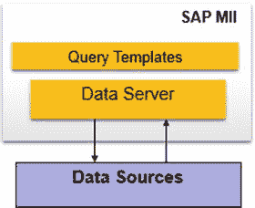

图 3-1. SAP MII 中数据服务器的位置

常见的服务器配置参数包括：

-   `名称`：所提供服务器的名称。必须唯一。
-   `连接器`：可用的连接器包括：`Aggregate`、`AlarmSuite`、`DataSource`、`IDBC`、`IP21`、`IP21OLEDB`、`InSQL`、`OLAP`、`OLEDB`、`Open`、`Simulator`、`通用数据连接器（UDC）`、`虚拟服务器`、`VirtualAlarm`、`VirtualIDBC`、`VirtualOLAP`、`VirtualTAG`、`VirtualXML`、`VirtualXacute`、`XML` 和 `Xacute`。
-   `连接器类型`：由数据源类确定的连接类型。可能的连接器类型有 `AGG`（聚合）、`ALARM`、`MDO`、`OLP`（OLAP）、`PCo`、`SQL`、`TAG`、`XCT`、`XML` 和 `KPIConnector`。
-   `已启用`：用于激活服务器的指示器。您可以勾选或取消勾选以分别启用或禁用服务器激活。如果启用了数据服务器并对其参数进行了更改，服务器将重新加载，更新后的设置将立即生效。
-   `允许动态查询`：用于支持具有 `动态查询` 角色的用户进行动态查询的指示器。当取消选择时，该数据服务器不支持动态查询。

### 创建连接器

请遵循以下一般配置步骤来创建连接器：

1.  从左侧菜单中，选择 `数据服务` ➤ `数据服务器`，如图 3-2 所示。

    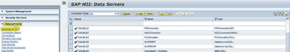

    图 3-2. SAP MII 数据服务器配置

2.  在下一个窗口中，选择 `创建`，如图 3-3 所示。

    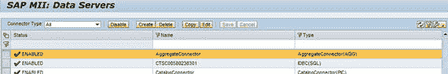

    图 3-3. `数据服务器` 配置中的 `创建` 按钮

3.  为便于后续识别，为其提供一个合适的服务器名称（必填）和描述（可选）。从下拉菜单中选择适当的连接器类型，如图 3-4 所示。

    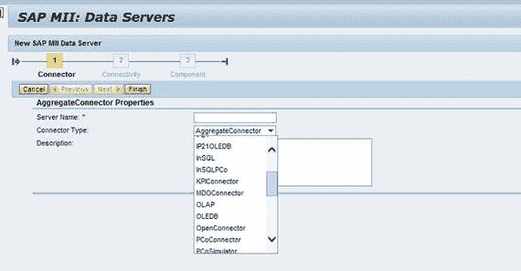

    图 3-4. 数据服务器配置

4.  根据您的要求，按照要创建的数据服务器类型执行后续步骤。

5.  您还可以使用图 3-5 所示的按钮删除、复制和编辑选定的连接器。

    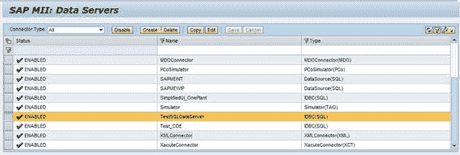

    图 3-5. SAP MII 数据服务器配置中的其他按钮

6.  从列表中选择数据服务器后，将显示连接器的详细信息，并且 `使用情况` 标签页会显示使用该连接器的 SAP MII Workbench 对象名称。请参见图 3-6。

    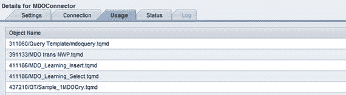

    图 3-6. 数据服务器中的使用情况检查

7.  `状态` 标签页显示连接器的状态为 `运行中`、`已停止` 或 `错误`，如图 3-7 所示。

    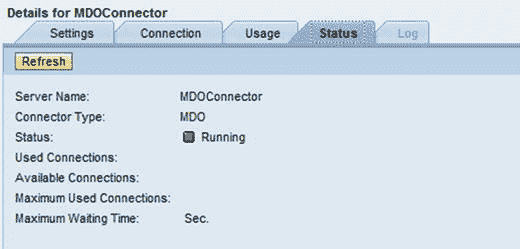

    图 3-7. 数据服务器中的状态检查

#### MDO 连接器

用于针对制造数据对象（`MDO`）执行查询的连接器。

从一般配置步骤的第二步开始，选择连接器为 `MDOConnector`。创建完成后，它将显示在 `设置` 标签页中，如图 3-8 所示。

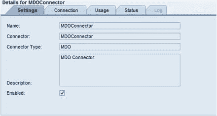

图 3-8. 配置 MDO 连接器

`连接` 标签页显示以下设置，如图 3-9 所示：

-   `数据前缀`：定义在处理日期或时间数据库列时使用的前缀。
-   `日期后缀`：定义在处理日期或时间数据库列时使用的后缀。
-   `保留天数`：用于数据缓冲。执行尝试在从数据缓冲区移除之前保留的天数。
-   `最大重试次数`：用于数据缓冲。系统在停止前重试执行尝试的次数。
-   `重试间隔`：用于数据缓冲。系统在重试执行尝试之前等待的毫秒数。


图 3-9. MDO 连接器连接创建


### IDBC (SQL/Oracle) 连接器

`IDBC 连接器` 提供了与任何数据库的直接连接，以便对其表数据创建 SQL 查询。数据库的示例包括 Microsoft SQL Server、Oracle 数据库、MaxDB、DB2 等。

在创建新的 IDBC 数据服务器配置时，至少需要更改用于身份验证的属性 `UserName`、`Password` 和 `ServerURL`。

SAP MII 中包含的 JDBC 驱动程序如下：

*   **Oracle**：必须使用 Oracle 7.3.4 或更高版本（`oracle.jdbc.driver.OracleDriver`）。
*   **SQL Server**：必须使用 SQL Server 6.X、7.X 或 2000（`com.inet.tds.TdsDriver`）。
*   **ODBC**

从常规配置的步骤 2 开始，选择 `MDOConnector` 作为连接器。创建完成后，它将在“设置”选项卡中显示，如图 3-10 所示。

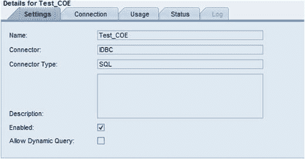

图 3-10. IDBC 连接器设置

在“连接”选项卡中，界面如图 3-11 所示。

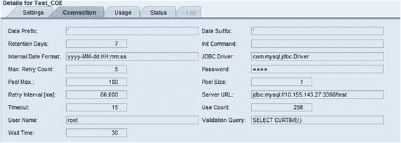

图 3-11. IDBC 连接配置

以下是适用于 IDBC 连接器的一些其他重要连接配置选项：

*   **池大小（Pool Size）**：连接池是任何数据库连接创建的线程总数，以允许相应数量的并行数据库命中。池大小表示 MII 可以同时打开的并行连接数。默认池大小为 1。
*   **最大池大小（Pool Max）**：用户可以设置最大池大小，数据库服务器据此允许用户创建池连接。用户可以使用为数据库连接池大小定义的相同值。通过在 MII 中定义此值，它也可以同时打开最多此数量的连接。默认值为 100。
*   **等待时间（Wait Time）**：定义当连接池已满时，连接的最大等待时间。

有关数据服务器的更多信息，请参考由 Suman Mukherjee 编写的以下 SCN 博客：`https://blogs.sap.com/2014/02/24/data-connection-details-for-data-server-configuration/` 和 `https://blogs.sap.com/2013/03/13/importance-of-pool-size-configuration-of-data-server-in-sap-mii/`。

#### PCo 连接器

工厂连接（PCo）连接器允许 SAP 制造集成与智能（SAP MII）支持 PCo 的查询功能。参见图 3-12。

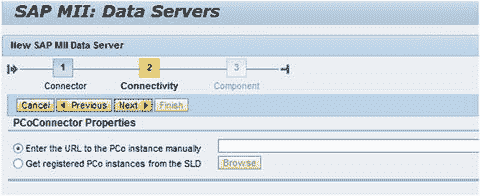

图 3-12. PCo 连接器配置

创建 PCo 连接时，可以采用以下选项之一：

*   手动输入 PCo 管理服务的 URL。
*   从系统景观目录（SLD）中检索已注册的 PCo 实例。

要配置如图 3-12 所示的 PCo 连接器属性，有两个选项可用：

*   **选项 1**：使用 CTC 模板完成功能单元 SLD 的初始设置。这是 SAP NetWeaver SLD 客户端配置的标准过程。在 SLD 中注册 PCo 管理服务。之后，按照以下说明操作。
*   **选项 2**：如果 PCo 管理 Web 服务接口需要身份验证，系统会提示用户输入用户名和密码。之后，按照以下说明操作。

要创建 PCo 数据服务器，您需要转到 MII 菜单 ➤ 数据服务 ➤ 数据服务器。您可以选择连接器类型为 `PCoConnector`，然后单击“创建”按钮。您需要为服务器提供一个唯一的名称。

在下一页，系统将询问 PCo 实例的 URL。您需要提供 URL，例如 `http://<主机>:<端口>/PCoManagement`。（`Host` 是安装 PCo 的系统名称，`Port` 是在 PCo 管理控制台中配置的默认端口 `50050`）。

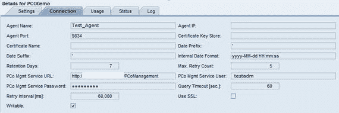

图 3-13. PCo 连接配置

最后，您需要提供用户名和密码。

#### UDC (OLEDB) 连接器

通用数据连接器（UDC）是一个框架，允许通过您开发的专有服务器应用程序访问 SAP 制造集成与智能（SAP MII）服务。OLEDB 连接器是一种 UDC，允许访问 OLE DB 数据源。OLEDB 连接器使用 PCo 服务器提供对符合 Microsoft 标准的数据源的 OLEDB 访问。可以通过选择 `OLEDBConnector` 作为连接器来使用 OLEDB 数据服务器创建标签查询。创建完成后，它将在“设置”选项卡中可用，如图 3-14 所示。

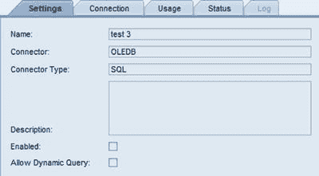

图 3-14. OLEDB 连接器设置选项卡

在“连接”选项卡中，您将看到如图 3-15 所示的设置。

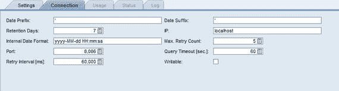

图 3-15. OLEDB 连接配置

此外，请选择“可写（Writable）”复选框。如果选中该复选框，连接器将支持写入 OLEDB 代理。如果未选中可写复选框，您将无法写入代理，这意味着 `CurrentWrite` 和 `HistoryWrite` 查询将失败。

#### XML 连接器

XML 连接器可用于连接到符合 XML 标准的数据源，以检索 SAP MII XML 格式的数据。SAP MII 中提供了一个名为 `XMLConnector` 的默认 XML 数据服务器，但也可以配置额外的 XML 数据服务器实例。参见图 3-16。

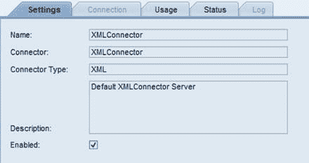

图 3-16. XML 连接器设置

在 XML 数据服务器配置中，只能编辑“描述”属性。使用 XML 数据服务器，可以在 SAP MII 中创建 XML 查询，以从 SAP MII 服务器中的 URL 或文件路径检索 XML 数据集。

#### Xacute 连接器

这是一个内部系统连接器，用于执行业务逻辑事务，这些事务是使用 SAP xMII Workbench 创建的数据查询，称为 Xacute 查询。随 SAP MII 标准安装提供了一个名为 `XacuteConnector` 的默认 Xacute 数据服务器配置。可以使用 `XacuteConnector` 数据服务器创建 Xacute 查询。参见图 3-17。

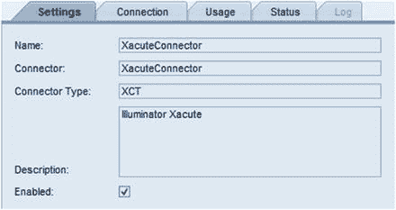

图 3-17. Xacute 连接器设置屏幕

从 Xacute 连接器的“连接”选项卡中，您可以看到 `Auto.Bind`（参见图 3-18）。该功能默认始终对此连接器启用。此功能使标准 SAP MII 照明器服务参数的值（例如 `IllumLoginName`、`IllumLoginRole` 等）能够从会话登录中自动绑定。


图 3-18. Xacute 连接配置


### 连接

连接用于创建和配置与其他系统的连接。用户名和密码别名在`Credential Stores`界面中定义，在连接配置过程中需要进一步分配这些别名。除此之外，还需要配置连接的具体细节，如服务器、端口、主机等。连接和凭据别名可在 SAP MII 操作块（如`JCo`、`JRA`、`Send Mail`等）中进一步使用，而无需再次提供每个配置细节。

维护这些别名的其中一个主要好处是，如果连接细节发生更改，这些更改可以直接纳入配置中，而无需修改 SAP MII 代码库。在生产环境中，反复更改代码是高风险、高成本且耗时的，因为这涉及大量的测试、文档编写和审批流程。请参见图 3-19。

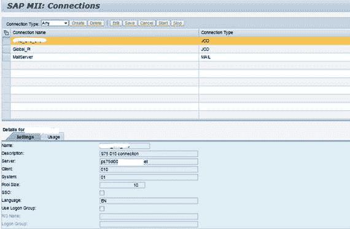

图 3-19. SAP MII 连接配置

以下几种连接类型是可能的：

*   `BC` (SAP 业务连接器)
*   `WAS` (SAP NetWeaver 应用服务器)
*   `JCO` (SAP Java 连接器)
*   `FTP` (文件传输协议)
*   `MAIL` (电子邮件)
*   `JMS` (Java 消息服务)
*   `EJB` (企业 JavaBeans)

### 连接状态

`连接状态`界面显示您已启用的数据库服务器的状态。该界面仅显示具有连接池的`IDBC`服务器信息。大多数基于标签的服务器，如通用数据服务器（`UDS`），不会响应状态检查。请参见图 3-20。

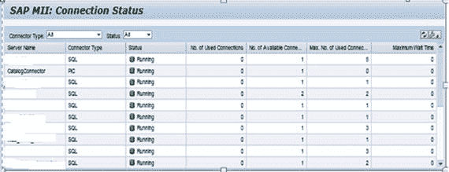

图 3-20. SAP MII 连接状态界面

当服务器可用连接数为零，或者出现配置、网络或通信问题导致 SAP MII 无法连接到服务器时，状态会相应地更新。

### 共享内存

共享内存是 SAP MII 中变量处理的强大概念之一。它用于存储带有某些属性的值，这些值可在以后保留。值可以被修改和删除。共享属性被认为是临时数据存储属性之一。共享属性在一个项目的所有事务中存储该值。它们类似于特定项目的全局数据占位符。

共享属性由两部分组成：默认内存和活动内存。变量创建时所有值都存储在默认内存中。同时，相同的值会被复制到活动内存中。活动内存总是优先于默认内存，因为默认内存仅用于使变量拥有一个默认值。所有业务逻辑只从活动内存中接受数据，并且技术人员和管理员用户可以根据需要在复制默认值后对其进行更改。您必须在 SAP MII 工作台中手动更改共享属性的默认值。共享属性可以在 SAP MII 工作台的`Meta-inf`选项卡的`SharedProperties.mem`文件中定义。

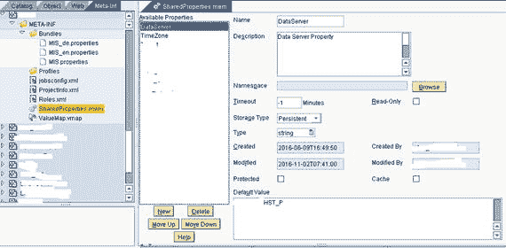

图 3-21. 默认共享内存配置

活动内存值可以通过在 SAP MII 工作台中转到工具 ➤ 共享内存来更改，如图 3-22 所示。

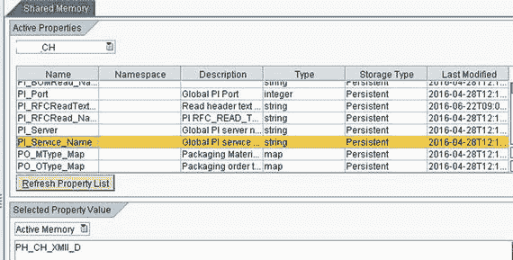

图 3-22. 共享内存活动内存配置

活动内存值也可以通过转到 SAP MII `Menu.jsp`页面的数据服务 ➤ 共享内存来更改。

## 消息服务功能

`消息服务`功能将企业系统与 SAP MII 集成。它可以在 SAP MII 中用于通过`HTTP POST`以异步 RFC、ALE/IDoc 或 XML 消息的形式接收企业数据。企业系统也可以发送数据。可以在 SAP MII 中配置消息监听器来接收这些数据。然后，处理规则使用特定的业务逻辑或消息来处理数据。MII 通过消息服务接收的消息存储在 SAP MI 数据库中，或者简单地分配到一个类别。MII 可以通过数据服务将这些消息发送到外部系统，或者通过 BLS 中的 Web 服务调用从外部系统编译这些消息。数据缓冲也通过`消息监听器`完成。

SAP MII 菜单页面上的消息服务具有如图 3-23 所示的功能。这些功能将在以下各节中更详细地讨论。


图 3-23. SAP MII 中的消息服务菜单

### 消息监听器

消息监听器用于异步接收来自企业系统的 Web 服务、RFC（同步和异步）或 IDOC 消息。

要配置 RFC/IDOC（`SAPJCo`）消息监听器，请点击消息监听器界面中的更新按钮。选中的监听器将根据 NetWeaver 中的配置进行更新。SAP MII 消息监听器有三种类型：`IDOC 监听器`（10 个）、`RFC 监听器`（10 个）和`SRFC 监听器`（10 个）。请参见图 3-24。

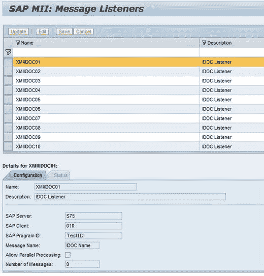

图 3-24. SAP MII 中的消息监听器配置

要完成 IDOC 或 RFC 的消息监听器配置，需要在 NetWeaver 中进行配置。以下必需属性应由 NetWeaver 服务器管理员设置：

*   `ProgramID`：唯一 ID，与 SAP ERP 中维护的 ID 相同。
*   `MaxReaderThreadCount`：SAP ERP 中允许的最大线程数。
*   `UserName`：用于登录 SAP ERP 配置文件的用户名。
*   `Password`：用于连接 SAP ERP 配置文件的用户密码。
*   `ServerName`：在 SAP ERP 中创建配置文件时使用的服务器 URL。
*   `PortNumber`：在 SAP ERP 中创建配置文件时使用的端口号。
*   `SAPClient`：在 SAP ERP 中创建配置文件时使用的客户端编号。

以下探测器服务用于消息监听器：

```
http://<服务器>:<端口>/XMII/Illuminator?service=WSMessageListener&mode=WSMessageListenerServer&NAME=<唯一消息名称>
```

指定通用属性部分的唯一名称。取消选中启用复选框允许用户定义消息监听器配置，但不会激活其使用。

任何消息监听器配置都可以根据需要启用或禁用。状态属性显示监听器的当前状态。当配置新监听器时，默认状态始终为已停止。此外，现有监听器可以在任何时间点启动或停止。已停止的消息监听器无法从发送方系统接收消息。

### 消息处理规则

消息处理规则用于确定用户希望如何处理传入的远程函数调用（RFC）、IDoc 和 Web 服务消息。消息根据其类型进行处理。消息服务中的处理规则被定义为在 SAP MII 从外部发送方系统接收到消息时自动处理消息。请参见图 3-25。

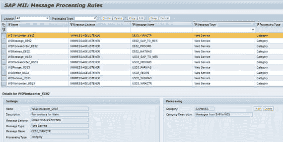

图 3-25. 消息处理规则界面

处理类型决定消息的处理方式。

*   **基于事务的规则**：消息立即传递给一个事务。一个业务逻辑事务被指定为处理规则。
*   **基于类别的规则**：仅将消息分配到一个类别，不进行自动处理。也就是说，当消息监听器接收到特定消息时，它会被缓冲到数据库中，并搜索相应的处理规则。类别用于将消息进行逻辑分组，以便进行临时处理。


### 消息清理规则

此项配置用于根据各种条件删除缓冲消息。“消息清理”屏幕显示消息清理规则列表，您可以在其中运行、启用、禁用消息清理规则，并根据需要删除它们。参见图 3-26。

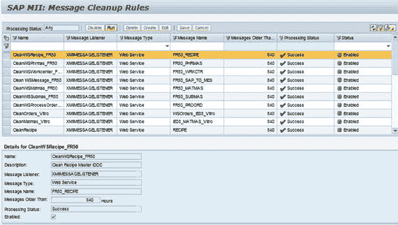

**图 3-26.** 消息清理规则配置屏幕

### 消息监控功能

消息监控功能使您能够搜索消息监听服务接收到的消息，查看消息详情，重新处理消息，以及根据需要从数据库中删除消息。参见图 3-27。

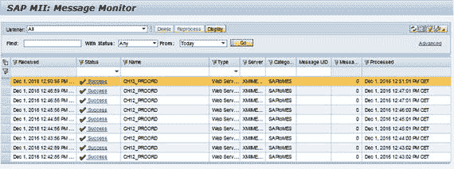

**图 3-27.** SAP MII 中的消息监控器

## 消息服务：服务质量

此功能可用于为工厂系统、SAP ERP 和 PI 中的客户端提供服务质量。消息可以通过两种方式处理。

### 仅一次（EO）

仅一次处理模式确保每条消息仅被处理一次。对于 RFC 和 IDoc，具有相同事务 ID 的消息会被消息处理拒绝，然后该消息作为重复消息存储在 MII 系统中。

对于 HTTP 消息，使用 `messageUID` 来确定消息 ID 是否重复。`messageUID` 可以在 URL 中传递，也可以使用 XPATH 创建。支持 EO 的完整 URL 如下所示：

```
http://<server>:<port>/XMII/Illuminator?service=WSMessageListener&mode=WSMessageListenerServer&NAME=<UniqueMessageName>&MESSAGEUID=<UniqueMessageUID>
```

### 按序仅一次（EOIO）

按序仅一次处理模式在队列中按顺序仅处理一次消息。SAP MII 根据客户端或发送方系统发送消息的顺序来处理消息。

序列号与消息一起发送到 SAP MII。要以 EOIO 格式处理消息，必须支持 EO，即必须存在 `messageUID`。

包含序列号和消息编号的完整 URL 是：

```
http://<server>:<port>/XMII/Illuminator?service=WSMessageListener&mode=WSMessageListenerServer&NAME=<UniqueMessageName>&MESSAGEUID=<UniqueMessageUID>&SEQUENCENAME=<SequenceName>&MESSAGENUMBER=<MessageNumber>
```

## 内容开发

内容开发是 SAP MII 的主要功能，开发人员可借此开发 SAP MII 解决方案。菜单的此部分包含 SAP MII 的 IDE。本节将讨论此菜单的以下组件：

- NWDI 配置
- 工作台
- 工具与存档
- 自助服务组合环境

### NWDI 配置

在“内容开发” ➤ “NWDI 配置”菜单中，指定 NWDI 中用于 SAP MII 开发对象的开发轨道名称。所有工作台项目都在同一开发轨道下，作为特定软件组件版本（SWCV）的开发组件（DC）创建。

开发轨道和 SWCV 在 NWDI 的 DTR 中创建，如图 3-28 所示。

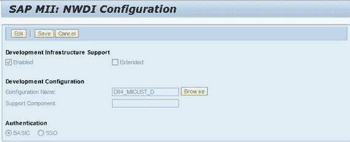

**图 3-28.** NWDI 配置说明

NWDI 的 DTR 在数据库中对源文件提供版本化存储。作为 NWDI 的一部分，DTR 作为 AS Java 上的服务运行。它无缝集成到所有开发流程中：作为开发人员，您可以使用 SAP NetWeaver Developer Studio 访问它，组件构建服务（CBS）直接从 DTR 检索源文件。DTR 中的对象主要在变更管理服务（CMS）中直接管理。

为了能够开发自己的应用程序，开发人员需要在系统景观目录（SLD）中创建自己的软件组件（SC）。开发人员必须在开始开发软件之前完成此操作。软件组件是应用程序的标准交付单元。配置向导会在安装后创建一个默认 SC。如果需要不同的 SC，或者配置向导未执行此步骤，则系统管理员或质量经理会创建软件组件（SC）。

在开发工作中，开发人员会向此 SC 添加新的开发组件。

开发组件（DC）是用于构建软件组件的可重用模块。DC 是一个命名容器，用于存放任意对象，例如 Java 源文件、JSP、字典定义、部署描述符等。这些包含的对象对其他组件不能直接可见，即 DC 作为一个黑盒运行。如果开发人员希望其中某些对象对外部可见，则必须显式定义“公共部分”。公共部分具有名称和用途，并包含一个名为实体的对象列表。

### SAP MII 工作台

SAP MII 工作台是一个用于开发和管理 SAP MII 开发对象的 IDE（集成开发环境）。

在工作台中，可以在其各自的区域开发多个与 MII 相关的对象。您可以在工作台中开发以下对象：

- BLS（业务逻辑服务）
- 查询模板
- 显示模板
- MDO 对象
- 网页

SAP MII 工作台包含几个区域。让我们浏览一下以便更好地理解。图 3-29 显示了完整的 SAP MII 工作台，并带有标注其诸多功能。

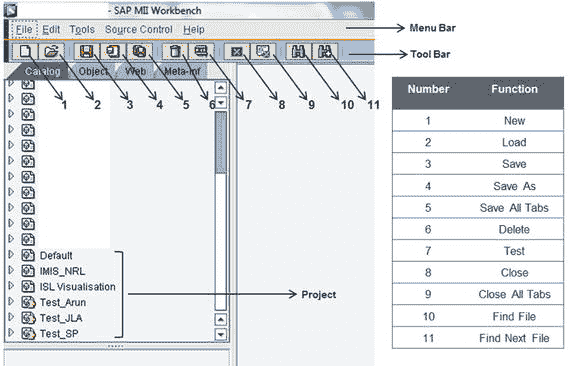

**图 3-29.** SAP MII 工作台

在 IDE 的顶部，有一个菜单栏，可让您在整个 IDE 中导航。除了该菜单外，“工具”下还有一些标准功能，例如全局变量声明和活动共享内存处理。

就在菜单栏下方，还有另一个工具栏。它帮助您创建新对象和模板，以及保存这些组件。除此之外，您还可以在开发过程中执行已开发的内容以进行完整性检查或单元测试。

在该工具栏下方，左侧有一个包含四个选项卡的区域。这实际上是开发组件的占位符。它显示开发组件的层次结构。

第一个选项卡称为“目录”，可以在此保存业务逻辑、查询模板和显示模板信息。

第二个选项卡是“对象”，开发人员可以在其中为 MDO、KPI 和警报创建自己的对象。开发人员可以在此区域根据开发组件定义他们的对象模型和规范。

第三个选项卡是“Web”。这是存储 Web 编码的地方，例如 HTML、IRPT、UI5、HTML5、JavaScript 和 CSS。除了 UI 组件外，txt、image、pdf 和 XML 文件也可以存储在 Web 选项卡上。

最后一个选项卡称为“元信息”。这是保存关键配置的地方，例如共享内存、项目特定的共享内存、角色等。换句话说，它存储项目的元数据。

在 SAP MII 服务器的左上侧，您会看到所有四个选项卡。在该服务器下方，基于某些预定义的层级维护着一个层次结构。在开始开发之前，需要在服务器下创建一个项目。此项目是唯一的占位符或逻辑容器，称为开发组件（DC），用于整个解决方案的开发元素。在 SAP MII 中，可以创建两种类型的项目——本地项目和共享项目。

本地项目在本地创建和存储。不支持版本控制。

如果 NWDI 连接到 SAP MII，则可以创建共享项目。基本上，当在工作台中创建项目时，它将为已在 NetWeaver 中为特定 SAP MII 创建的软件组件创建一个 DC（开发组件）。

左下部分用于特定于对象的配置。仅当选择某些对象时，它才会填充。

整个右侧部分用于解决方案建模。


### 业务逻辑服务 (BLS)

业务逻辑服务在 `SAP MII` 中通常被称为 `BLS`，是一个用于定义、设计和开发制造逻辑的 IDE（集成开发环境）。一个 `BLS` 由多种操作块、网络服务、调度器、数据连接器、逻辑编辑器等组成。

`BLS` 事务类似于图形化建模且可执行的 `MII` 事务，并以 XML 格式存储在 `SAP MII` 中。内部的 `MII` 内容在运行时由 `BLS` 引擎执行。参见图 3-30。

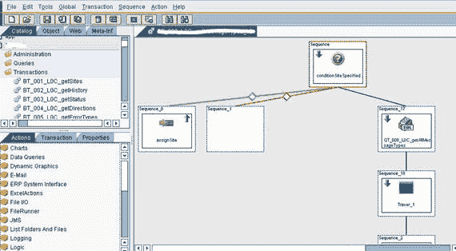

图 3-30。SAP MII 中的业务逻辑服务

这些功能共同提供了定义和运行与客户特定应用相关的业务逻辑所需的所有必要工具。`SAP MII 业务逻辑服务` 广泛的功能意味着它可以应用于各种应用，包括：

- 关键绩效指标（`KPI`）处理
- 警报和事件生成
- 数据抽取/转换/加载（`ETL`）
- 应用到应用的集成，包括双向 ERP 集成
- 报告、图形和仪表板图像的动态内容交付
- 对来自多个来源的数据进行复杂操作和转换
- 关联和合并来自多个来源的数据
- 运营工作流
- 自动化或手动数据采集
- 生产执行：跟踪、路由和监控

### 查询模板

这是 `SAP MII` 中主要的数据查询组件。`SAP MII 工作台` 提供了一些用于创建和管理数据查询的模板。通过配置这些模板，可以对在数据服务器部分配置的数据源进行检索、插入、删除和更新操作。查询模板可以在 `MII` 事务中使用；也可以直接从网页调用查询。

以下是 `SAP MII` 支持的查询模板列表：

- `AggregateQuery`
- `AlarmQuery`
- `OLAPQuery`
- `PCoQuery`
- `MDOQuery`
- `SQLQuery`
- `TagQuery`
- `XacuteQuery`
- `XMLQuery`
- `CatalogQuery`
- `KPIQuery`

其中，最常用的查询是 `SQL Query`、`MDO Query`、`PCo Query` 和 `Tag Query`，用于从除 `MDO` 之外的不同外部源系统中获取数据。`Xacute Query` 和 `XML Query` 是用于内部查询的最常用选项。`Xacute Query` 用于在网页上调用事务。`XML Query` 用于处理来自事务的 XML 相关调用和 illuminator 服务调用。参见图 3-31。

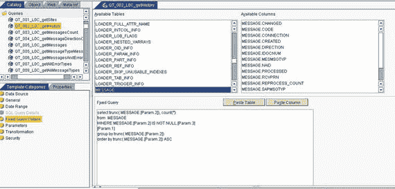

图 3-31。SAP MII 查询模板

### MDO 对象

制造数据对象（`MDO`）是 `SAP MII` 中新增的一层。它是 `SAP MII` 中为数据采集引入的一个创新概念。`MDO` 在 `MII` 中充当永久或临时数据存储的角色。`MDO` 可以将任何数据对象放入其命名空间中。它主要使用 `SAP MII` 标准数据库，即 `NetWeaver` 数据库来存储数据，因此在某种程度上，对于小规模项目来说，它是自定义数据库的一个良好替代品。当项目从一个系统迁移到另一个系统时，`MDO` 具有保持相同结构和命名空间的灵活性。除了对象维护之外，`MDO` 还具有数据查询能力，可以从任何数据源层（从工厂到 ERP）检索、存储、更新和删除数据。参见图 3-32。

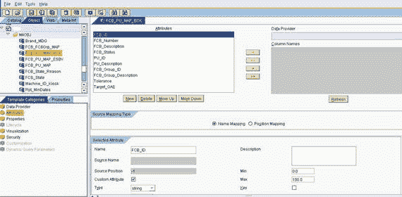

图 3-32。SAP MII MDO（制造数据对象）对象创建界面

`SAP MII` 中有三种类型的 `MDO`。它们是：

- `Persistent`（持久化）：用于永久存储和持久化数据。
- `On-Demand`（按需）：它是一种虚拟表，存在于执行实例期间。
- `Joined`（联接）：这是两个持久化 `MDO` 的联接。

## 可视化服务

可视化是指展示一组数据，以便能够以用户友好的方式轻松分析和研究数据点。通过各种报告、仪表板、交互式演示应用（移动端或网页端等），数据的呈现非常具有交互性和智能性。

与许多其他平台一样，`SAP MII` 允许用户创建可用于各种应用的仪表板对象和网页。

对于 `SAP MII`，可视化服务分为 `动态页面生成器` 和 `网页` 服务。

### 动态页面生成器

这用于创建基于 `SAP MII` 的 HTML 页面内容或图表 Servlet URL。这可以通过选择合适的显示模板和查询模板以及各种与尺寸和其他配置相关的属性来实现。

它包含了 `SAP MII` 中可用的各种显示模板组件，例如 `ichart`、`igrid`、`ispc` 等。对于新的 `UI5`，`SAP MII` 中也提供了相应的显示模板，例如 `i5grid`、`i5chart` 等。

### 网页

该服务用于为各种客户特定的仪表板创建丰富、灵活、用户友好的用户界面。`SAP MII` 中的网页生成支持多种 UI 技术，如 `IRPT`、`HTML`、`HTML5`、`UI5` 等，并支持多种脚本语言，如 `JavaScript`、`CSS` 等。参见图 3-33。

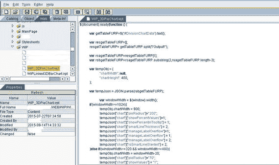

图 3-33。通过网页服务实现的 SAP MII 可视化

## 动画图形

动画对象是用于诸如数字驾驶舱或仪表板、标签生成、专用 UI 和报告组件等应用的定制化用户界面（UI）微件，您无需使用 applet 或其他控件即可使用它们。

这些对象在 `SAP MII 工作台` 中创建，基于可缩放矢量图形（`SVG`），这是一种用于表示矢量图形的基于 XML 的格式。参见图 3-34。

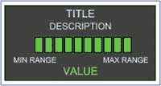

图 3-34。在 SAP MII 中使用动画图形的示例

`SVG` 文件和动画对象使用 `SAP MII 工作台` 中 `业务逻辑事务` 下的 `SVG 渲染器` 和 `动画渲染器` 操作转换为图像文件。


### 自助式组合环境

`SAP MII 自助式组合环境`是一款基于`SAP UI5`的工具，允许用户通过拖放`MII`对象来创建仪表盘。业务用户和技术用户均可使用。

`SSCE`在`SAP MII`中拥有强大的拖放环境，可使用任意`SAP MII`内容（`查询模板`、`显示模板`、`MDO`/`KPI`对象及资源文件）、`UI`元素以及来自`工厂信息目录`（`PIC`）的标签来创建仪表盘。来自`PIC`的已配置标签可放置在图像上。用户能够配置条件特定的颜色、图形和图标。此外，还可以使用`SSCE`的不同布局来创建显示画面。

创建的仪表盘提供`保存`选项以供后续使用。通过将已保存的内容添加到导航树中，还可以对仪表盘进行自定义。`SSCE`的重要组成部分之一是能够通过分配角色来保护仪表盘的安全。

`SAP MII 自助式组合环境`分为以下组件：

- **我的仪表盘选项卡**：一个单一屏幕，用户可在其中找到所有仪表盘和导航链接。参见图 3-35。
  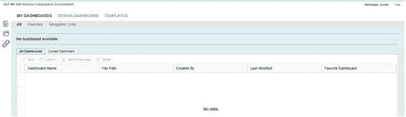
  图 3-35. `SSCE`中的“我的仪表盘”

- **设计仪表盘选项卡**：登录用户可设计/创建仪表盘的屏幕，如图 3-36 所示。
  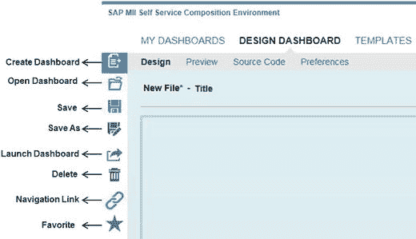
  图 3-36. “设计仪表盘”界面及左侧工具栏

- **左侧工具栏**：包含可触发`自助式组合环境`中所有操作的图标。参见图 3-36。

- **右侧窗格栏**：包含多个选项卡。第一个是`MII`对象，可集成任意`SAP MII`内容（如布局中的查询或显示模板）以创建仪表盘。第二个是`UI`元素，包含所有可用的 UI 设计控件，如`按钮`、`下拉菜单`、`文本框`、`单选按钮`、`复选框`等。您需要将其拖放到布局中以设计自己的仪表盘。同样，`PIC`和`剪贴板`用于嵌入`PIC`层级并引用仪表盘设计中使用的剪贴板内容。参见图 3-37。
  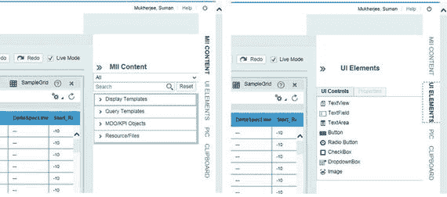
  图 3-37. “设计仪表盘”右侧菜单

- **布局工具栏**：位于布局上方的工具栏包含一些操作，可在仪表盘中嵌入任意`MII`元素并需要更改基本配置时执行。参见图 3-38。
  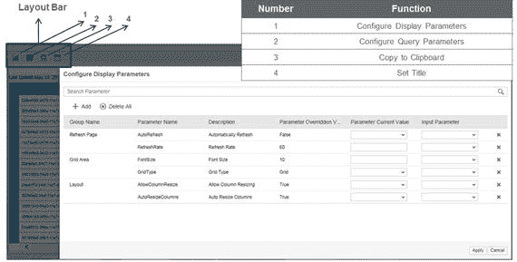
  图 3-38. “设计仪表盘”中的布局栏

