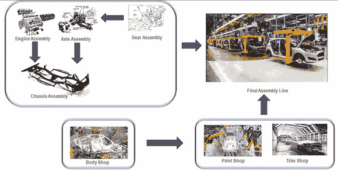

# 4. `SAP MII`在离散制造行业的实施

本章概述了离散制造及其所属的行业。还解释了`MII`如何满足此类行业的需求。并说明了如何利用`SAP MII`及其相关模块来填补管理层与生产层之间的信息流缺口。

## 属于离散制造的行业

如前一章所述，离散制造由可轻易识别且可拆卸以逆向还原初始主要供应输入组件的生产组件构成。许多行业都属于这一制造领域，包括汽车、航空、发电、采矿等。

以下各节描述了此处提及的部分离散制造行业。

### 汽车制造

汽车制造是较为传统的制造业之一。与其他制造业一样，汽车行业也涉及众多工艺步骤。`装配`是该行业的关键工艺步骤之一。在大多数制造企业中，零部件、发动机以及其他组件（如挡风玻璃、轮胎等）都由子公司生产；只有少数公司倾向于内部制造这些组件。

在汽车行业，第一条自动化装配线由亨利·福特于 1908 年引入。在此之前，车辆零部件的产量极低，并且需要专业工匠手工制作。装配线自动化引入了使用半自动机器人来复制零部件。但这仍未能显著提升装配流程的效率，因为多个专业人类装配工在组装机器人自动生产出的零件时，所需时间并无差别。

随后，装配流程被分解为不同的操作工序，每位装配工负责其中一道工序，以此类推。这一改进将装配时间缩短了约 8.5 小时，但流程再次被修订，并引入了操作工位站的概念。根据这一新概念，完整的装配过程被移至各个操作站进行，车辆底盘则被放置于可移动的传送带上。这一变革极大地助力了装配流程，将装配时间从数小时大幅缩短至几分钟。通过这种新流程，装配工可以在各自指定的工位站工作，并重复执行相同的操作。待装配的车辆通过传送带自动从一个工位站移动到下一个。后来，完整的装配流程被划分为更大的工段，但操作概念保持不变。这些工段包括：

*   **底盘**：这是任何车辆的骨架，也是装配流程的主要组件。底盘承载着车辆的整个车身，是车辆最坚固的部分。每个底盘都有一个特定的编号，作为该车辆的唯一识别码（称为`车辆识别码`或`VIN`）。它主要是一个铸造框架，通过焊接和螺栓连接与其他组件固定。底盘是任何装配流程的起始组件。首先，它被放置在传送带上，然后其他组件（如轮距、变速箱、油箱等）被添加到其上。

*   **车身装配**：车身装配处理车辆的上部结构。该装配从符合车辆形状的模压铝板开始。随后，车门支柱、车顶和地板面板通过焊接和螺栓连接安装到主车身上。每个工位站负责特定的装配操作。

*   **涂装车间**：这是装配线上最重要的工段之一。早期，整个涂装过程是手工完成的，但现在已完全使用机器人自动化进行。在开始喷涂前，车身会先涂上一层带静电的底漆，待干燥后，再在其上喷涂多层面漆。

*   **内饰装配**：车身喷漆完成后，开始进行内饰装配。在此阶段，内饰组件如方向盘、挡风玻璃、地板、线束等被安装到车身上。

*   **总装**：在此工段，底盘最终与车身结合。两条独立的装配线在此步骤合并。车身安装到底盘上，发动机总成和车轮总成在此区域完成。

*   **质量控制**：车辆装配中最关键的环节之一是质量控制。质量控制贯穿装配的每一个操作。它始于底盘，止于发运。每道操作都需要进行单独的质量检验。根据检验结果，需要进行必要的维修或更换。

汽车装配涉及数千个组件。这些组件从供应商处接收，并需要经过质量测试。每个组件都需要获得`SPC`认证。参见图 4-1。



图 4-1. 汽车制造流程

### 汽车行业对 `SAP MII` 的需求

自从自动化概念进入汽车行业的制造流程以来，不同层级涉及众多系统。顶层用于规划，底层是工厂自动化，直接与工位/工位的工厂机器人和设备相关。在大多数行业中，规划层使用 ERP 完成，车间自动化则由 MES 处理。MES 可以是自主研发的、由第三方处理的，或者是 SAP 自己的 MES 产品（`SAP ME`）。目前，ERP 规划与车间自动化之间存在脱节。这是亟需一种能够填补这一空白的解决方案的主要需求之一，而 `SAP MII` 有能力做到这一点。

当车间自动化到位且装配工人在其指定工位工作时，需要同步运行一个良好的仓库，以确保障碍线持续无缝生产。当装配工人发现物料短缺时，如果仓库能立即供应所需数量，便实现了无缝生产；否则，生产将受阻，生产工期也将延迟。

规划系统与仓库之间还需要实时同步。例如，车辆轮毂来自二级供应商。如果公司接到组装五辆汽车的订单，这意味着他们需要 20 个轮毂才能完成订单。但在轮毂装配工位，他们只有 5 个轮毂准备就绪。此时，企业需要检查仓库中的可用库存来完成此订单。如果仓库中轮毂数量少于 15 个，系统应足够智能，自动为供应商创建新订单，以便其及时向企业交付更多轮毂。为了按时高质量完成订单，始终需要这种实时集成。

对于任何汽车公司来说，质量控制都是最大的挑战之一。如果在任何组装步骤中任何质量参数不合格，则必须重复该步骤或报废相关物料，这完全是浪费时间、人力和物力。因此，质量控制应成为每项操作的强制要求。只有在特定操作的问题解决后，才允许将装配件移至下一个工位。每个流程的质量步骤都需要进行适当的 `SPC` 分析来捕获此类问题。因此，在质量控制的同时，还需要将生产线与 ERP 规划相集成，以便在创建订单时相应调整生产时间。

随着组装流程的自动化，工厂维护也需要与 ERP 集成，因此也应实现自动化。这有助于极大地减少任何机器或生产线的计划内或计划外停机时间。

综上所述，汽车行业对 `SAP MII` 的需求如下：
- 通过 `SAP MII` 集成车间和 ERP，为双方提供实时更新。
- 通过 `SAP MII` 集成车间和其他遗留系统，提供操作中的组件、3D 建模、设计等支持性数据。
- 通过 `SAP MII` 实现仓库的无缝集成，确保装配线始终正常运行。
- 通过 `SAP MII` 自定义应用程序，将装配线与质量模块连接起来，以维持适当的质量控制。
- 通过 `SAP MII` 将生产线与工厂维护模块正确集成，以减少停机时间并提高生产效率。
- 通过 `SAP MII` 创建各种仪表盘和分析报告，如 `SPC` 分析、`YTD`/`YTM` 报告、物料移动报告和订单状态报告，以更好地掌握生产状况。

#### 使用 `SAP MII` 实现解决方案

汽车行业采用分层架构模型，最顶层是用于规划、`PM` 和 `QM` 的 `ERP`，最底层是车间机器。需要一个自动化的 `MES` 层来连接车间机器和中间件系统。`SAP MII` 作为一个智能且集成的平台，是汽车制造业的最佳解决方案之一。`MII` 可以通过在 `SAP MII` 上开发定制解决方案来处理自动化的 `MES` 需求，从而满足这些要求，而无需涉及其他 SAP 产品。

另一个 SAP 产品 `SAP ME` 可以直接作为 `MES` 在车间使用。为了将 `SAP ME` 与 `ERP` 集成，它有一个名为 `SAP MEINT` 的组件，该组件利用了 `SAP MII` 的集成能力。`SAP ME` 还提供标准仪表盘（即生产操作员仪表盘 `POD`）和自定义仪表盘开发功能，这些功能利用了 `SAP MII` 的智能能力。

就该行业而言，监控订单是最重要的需求之一。为了实现这一点，`SAP MII` 可以使用其消息服务连接到 `ERP`，从而从 `ERP` 接收与生产订单相关的 `IDOC`（`LOIPRO`）及其相关的主数据 `IDOC`——`MATMAS`（物料主数据）和 `CLFMAS`（分类主数据）。`MII` 可以调度使用其“处理规则”功能开始处理收到的订单 `IDOC` 和主数据 `IDOC`。`SAP MII` 可以操作订单消息，并利用物料详情、描述和物料分类详情，根据 `MES` 需求对其进行增强。如果车间使用任何其他类型的遗留信息，如设计、3D 建模或工程数据，那么 `MII` 可以根据操作、子操作和组件，将这些信息与订单数据结合，并准备 `MES` 或车间层级所需的最终消息。

还可以设计自定义报告来监控订单状态，例如订单何时被接收、何时被处理以及何时被发送到 `MES`。这包括粒度信息，如订单是处于队列中还是在某个步骤中被处理，或者是否失败甚至在其它步骤中被重新处理。还可以维护适当的审计轨迹来跟踪订单——例如订单是自动处理还是需要人工干预来处理或重新处理消息。活动日志也可用，以便为高层管理人员提供关于特定订单的清晰视图，例如消耗的组件、使用的工程模型，以及哪个子组件在订单内被妥善管理或哪个失败。这个订单状态报告可以提供端到端订单处理流程的透明视图，包括在订单被接收时向 `ERP` 发送确认，以及在订单成功下达或取消时向特定用户组发送通知。

仓库管理是汽车行业的关键需求之一。这里，`ERP` 需要与仓库管理系统集成，还必须与装配线连接以满足需求。需要在 `ERP` 中创建转移订单，用于物料从接收端移至仓库，或从仓库移至装配线。与生产订单类似，转移订单也可以使用 `SAP MII` 进行监控和分析。使用 `SAP MII` 可以实现任意方向的准时交付。

# 与订单处理一样，与质量模块集成进行质量控制是另一个重要的行业需求

如前所述，`SAP MII` 具备通过 `IDOC` 或 `RFC` 连接任何 ERP 模块的标准能力。在 ERP 中，质量管理与计划直接相关。ERP 有一个标准模块（即质量管理 — `QM`）用于管理质量通知。每当任何操作完成时，车间会向 ERP 触发一个质量通知，以执行必要的质量检查。质量检查团队完成所需的质量检查后，他们会更新或关闭通知，并附上相应的原因。如果质量检查成功，则通知关闭；但若检查中发现任何问题，则会将其送去修复，同时通知的状态也会相应更新。

同一个产品在返工完成后会再次进行测试，状态最终也会相应更新（要么成功，要么报废）。`SAP MII` 可以在其自身的门户中，以更简化的方式复现复杂的 ERP 屏幕或模块。这有助于质量和生产团队以最少的用户交互轻松管理通知。无需像在 ERP 操作中那样，为了理解质量模块而进行单独的用户培训。`SAP MII` 还可以根据实际生产率和计划生产率（包含良品数量和废品数量）生成质量报告，有助于维护行业的 ISO 标准。

与 `QM` 模块类似，工厂维护是该行业中涉及的另一个重要领域。自动化装配线包含多种机械和传感器，设备可能发生故障或失灵。有时也需要将生产线停下来进行维护。此外，考虑到地区性假期或自然灾害，工厂中的系统可能会关闭。所有这些原因都会对生产以及最终产品的交付产生不利影响。

高层管理人员也感到需要监控这类情况，并在计划时予以考虑。在类似 `QM` 模块的 ERP 中，存在工厂维护模块以便更有效地处理计划。可以使用 `IDOC` 和 `RFC` 将工厂维护模块与 `MII` 集成，因此 `SAP MII` 可以创建任何故障、计划停机、非计划停机、中断、关机或换型通知。从 `MII` 出发，很容易开发一个简单且用户友好的屏幕，只需最少的用户交互，例如日期、通知类型、原因和用户名。利用通知管理，可以创建包含良好分析功能的停机自定义报告，并生成效率和可用性报告，有助于维护 ISO 标准。

在车间，操作员和生产用户会在黑板上手动绘制图表和图形，并召开会议来检测某一天、或某一周、某一月或某一年发生的任何异常情况。这类检测方式会因计算或数据分析错误而留有人为失误的可能。为了减少所有人为失误的机会，这些计算和分析可以通过 `SAP MII` 借助统计过程控制（`SPC`）、年初至今（`YTD`）和月初至今（`YTM`）图表来提供，这些图表通过交互式用户界面自动应用用户筛选器选择。

# 航空航天与国防空域

航空业是制造业世界中最古老的行业之一。航空业可以大致分为两个领域：公共航空和国防航空。公共航空主要与客机相关，而国防航空则与战斗机、发射器、导弹等相关。与汽车行业类似，航空业指出装配是最重要的部分之一。在这里，流程从设计阶段开始，在此阶段进行产品设计，随后设计需要在严谨的科学环境中进行测试，以确保其万无一失。一旦设计最终确定并获得批准，就会移交给生产单位。生产单位从收集材料组件和子组件开始。在生产单位中，生产飞机机身、机翼等主要结构。质量测试完成后，产品进入最终装配部分。在此部分，机身与机翼连接。进行飞机的内部装配、轮子安装、油箱安装，最后是发动机的安装。

一旦全部装配完成，产品将经过喷漆和耐热涂层处理。完成后，进行测试。测试是航空业中最关键和至关重要的环节。测试是整个装配过程中的持续流程。每个组件，如发动机轮子，都需要获得测试许可，并且必须经过严格的测试才能获得最终许可。最终的测试过程是现场测试，在此过程中，飞机在多种关键条件流程下进行测试，例如低温飞行、高温飞行、跑道浸水、低能见度等。这个过程检验产品的生存能力和各项参数。一旦从现场测试中获得最终许可，飞机就会交付给客户。

## 航空业对 SAP MII 的需求

在航空业中，最重要的需求之一是信息安全。由于制造涉及人类生命和政府机密，因此在解决方案中需要高等级的安防措施。将装配线与各种信息和生产系统集成是该行业的另一个非常重要的需求。需要与计划系统集成，以便获得物料移动的精确可见性，因为在该行业中，当前流程的半成品就是下一个流程的原材料。例如，生产流程的半成品是飞机的机身和机翼，而它们是下一步——总装的主要原材料。流程中的验证和确认是另一个重要需求。由于这是最安全、最关键的行业之一，只有经过认证的专业人员才能参与此流程。

总而言之，主要需求如下：

-   解决方案中的多层安全性。

-   与计划层、物料管理层和车间层的集成。

-   基于认证的验证和确认。

### 借助 SAP MII 实现解决方案

由于航空业更加注重安全、流程导向且技术精密，其车间自动化水平远高于其他行业。尽管流程以操作为导向，但该行业的验证过程更为复杂。为应对如此复杂的制造运营，需要一种能够从单一界面管理零件制造、装配和最终安装的高端集成化 MES 解决方案。`SAP ME` 能够处理此类离散制造执行需求，并具备灵活连接多个系统和机械设备的能力。它还提供可配置的仪表盘来满足各种可视化需求。`SAP CAMS` 在此类行业中应用广泛，因为它能以标准功能覆盖该行业的大部分需求。

**注意**

针对国防与安全领域的 `SAP 复杂装配制造解决方案 (CAMS)` 允许计划员和设计工程师定义机加工或制造零件、子组件、主要组件、最终流水线安装及工装的制造、安装或装配流程，同时也能定义质量保证流程。该套件还包含一个全面的车间管理应用，可为制造管理层、车间主管、车间操作员和机械师提供整个车间的完全可视性。

更多信息，请访问：[`http://help.sap.com/cams72?current=cams72`](http://help.sap.com/cams72?current=cams72)。

`SAP MII` 可作为此行业中的集成器使用。如果该行业使用 `SAP ME` 或 `SAP CAMS` 作为车间自动化 MES 解决方案，那么 `SAP MII` 可以与 `SAP MEINT` 或 `SAP CAMSINT` 协同工作，后者专门负责使用 `IDOC` 或 `RFC` 在车间层与 ERP 模块之间进行集成。在 `SAP MII` 中也可以实现与任何其他遗留系统的集成。通过添加更详细的零部件粒度信息来增强数据，同样可在 `SAP MII` 中实现。对于 `SAP MEINT` 和 `CAMSINT`，`SAP MII` 的工作流程如下：

**ERP 到 ME/CAMS**

```
1.  消息以 `IDOC` 形式从 ERP 传入 `SAP MII` 的 `SAP MII` 消息服务中。

2.  这些消息从消息服务中被拾取，并根据针对 `ME/CAMS` 的工作流配置在 `SAP MII` 中进行处理。`MEINT/CAMSINT` 中提供了标准工作流。也可以根据需求在工作流的所有四个步骤中自定义工作流。

3.  消息使用服务事务被推送到 MES。
```

**ME/MES 到 ERP**

```
1.  消息以 RFC 调用形式从 `ME/CAMS` 发出，并将传递至 ERP。

2.  这些消息被拾取，并根据针对 ERP 的工作流配置进行处理。`MEINT/CAMSINT` 中提供了标准工作流。也可以根据需求在工作流的步骤中自定义工作流。

3.  消息使用服务事务被推送到 ERP。
```

除了工作流之外，还可以使用活动钩子在 `ME/CAMS` 解决方案中添加新的逻辑/功能/验证。

由于航空业是一个非常注重安全的行业，因此需要多层安全防护。`SAP ME` 或 `SAP CAMS` 具备多层安全特性。这两个产品都使用 `LDAP` 进行用户身份验证，并且可以创建特定于功能的角色来限制对该解决方案每个页面的访问。除此之外，在 `SAP MII` 中，还可以使用自定义属性在同一页面的多个部分设置特定于角色的限制。

航空业最为精密和安全，因此需要对特定技能进行验证和确认。考虑到这一点，在 `SAP ME` 和 `SAP CAMS` 中，甚至可以在活动级别对操作配置进行用户认证管理。这样，当用户执行特定操作时，系统只会在该用户拥有该特定工作的有效证书时，才允许他们确认该操作。`SAP ME` 或 `SAP CAMS` 也支持与人力资源系统集成，以获取此类用户特定信息。

## 发电与采矿

发电与采矿是另一个重要的监控领域。虽然它与制造业没有直接关系，但自动化监控系统总是比容易出现人为错误的人工监控更受青睐。

采用现代发电技术时，会涉及大量传感器、`PLC` 和自动化机器，因此持续监控所有这些组件变得至关重要。对于风力发电和潮汐发电等其他发电方式，您必须能够获取关于天气状况（如空气流动、湿度、降雨量、云层形成等）的实时信息。然后，系统必须能够将风力发电机的迎风面或潮汐发电的螺旋桨调整到适当方向，甚至在必要时关闭发电机。

同样，对于火力发电和核能发电，锅炉温度与堆芯温度是控制与监控的关键参数。对于火力发电，燃料阀门和煤槽控制是其他需要监控的因素。对于水力发电，水库水位监控和水轮机转速是主要的控制标准。

### 发电与采矿领域对 SAP MII 的需求

现代采矿大多使用自动化的钻孔和挖掘机械，这些机械在地面控制下于地下工作。采矿组织需要实时追踪这些机械的位置，以确保它们在规定许可的层面进行挖掘。他们还需要能够监控设备状态，以确定这些机械何时需要维护。采矿行业的主要监控标准包括：这些机械的位置、设备状态，以及基于随时间变化的位置测量数据得出的性能和效率分析。

所有这些监控信息必须实时或接近实时地采集。在执行预测性分析后，基于历史数据预测未来事件也很重要。例如，一旦锅炉温度达到阈值并持续超过五分钟（此时间可能因火电厂运营团队而异），历史统计数据预测锅炉壁可能会开裂。因此，在此事件发生之前会发出预警，以便运营团队能够手动采取预防措施。或者，也可以采用自动化系统来关闭燃油管线阀门，停止向锅炉供应燃料。

### 使用 SAP MII 实现解决方案

在发电和采矿行业中，设备由 `PLC`、`SCADA` 或历史数据库系统控制。`SAP MII` 具备连接到这些系统的最佳能力，它通过 `SAP PCo`（一个与 `SAP MII` 软件包一同免费分发的组件）实现连接，并能实时监控这些设备。还可以在 `PCo` 中设置触发逻辑，这样一旦条件满足，通知就能轻松触发至 `MII`，随后 `MII` 可自动执行下一步操作。

根据当前功能，`SAP MII` 可以通过向 `SAP MII` 暴露 `HANA` 的服务，来连接并利用 `HANA` 的内存处理能力和预测分析功能。因此，现在基于来自 `MII` 的历史数据进行预测分析变得非常容易。

使用 `SAP MII` 分析功能还可以进行业务预测，例如通过预测现有历史数据来决定何时控制发电，以避免浪费已产生的电力。

设备状态监控、停机监控、班次详情、机器概览等信息也可以通过 `SAP MII` 实现，因为它能连接到任何车间系统、制造执行系统（`MES`）、数据库或任何计划系统，而 `MII` 可以充当这些系统之间的完美中间件。

在过去几年中，业界流行一种趋势：即使员工正在出差、访问其他部门或不在实时生产现场，也能通过 iPhone、iPad、Windows 平板等移动设备将所有信息尽收眼底。同时，还必须能够通过电子邮件或 `SMS` 将生产中的事件通知发送给相应的负责团队。`SAP MII` 为这些用户提供了非常丰富且易于交互的用户界面，并且兼容移动设备，即使员工不在生产单位，也能查看所有信息。此外，`SAP MII` 还能提供自助查询终端模式的前端应用程序。更进一步，`SAP MII` 能够针对车间发生的任何事件，向所需团队触发电子邮件和 `SMS` 通知。

## 本章小结

在本章中，您了解了离散制造过程中不同制造领域（例如汽车、航空航天和国防工业，以及发电和采矿行业）的基本功能。您还了解了哪些场景更适合采用自动化，以及 `SAP MII` 如何填补其中的空白。

在下一章中，您将学习流程制造。您将了解涉及制造的行业类型，还将学习 `SAP MII` 如何帮助满足这些行业的需求。