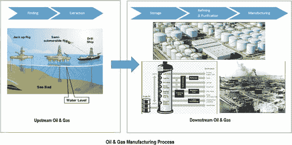
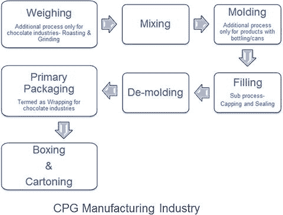
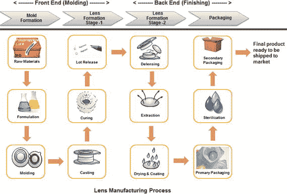

# 5. SAP MII 在流程制造中的实施

本章概述了流程制造以及属于此类制造方式的行业。它还解释了如何利用 `SAP MII` 及其相关模块为这些行业提供解决方案。

## 流程制造

流程制造比离散制造稍微复杂一些。它涉及将原材料转化或转变为最终产品。在此过程中，无法将参与不同过程的材料分离，以还原回最初的原材料。这个过程取决于几个关键因素，例如原材料的比例（百分比）、基材制备时间（搅拌、混合、蒸煮等）、模具或容器处理、装瓶或灌装管理、包装或密封管理、质量与废料管理以及仓库管理。由于基材的制备是通过搅拌、混合、纯化和蒸煮或其他相关方法完成的，因此原材料的测量和比例在计划系统中维护，并取决于批次大小，这被称作控制配方。控制配方及其对应的配方公式均在计划过程中维护。在此类行业中，生产是基于市场调研进行的，无需等待“客户需求”。产品制造并投放市场后，会进行市场调查，并根据调查结果再次改进产品并重新发布。这是流程制造业与离散制造业的主要区别。流程制造常见于制药、消费品包装以及石油和天然气制造行业。

## 石油和天然气制造

自从人类学会使用机器和发动机来减轻日常生活负担以来，燃料的概念便被引入。运行发动机和机器需要燃料。最初，机器依靠蒸汽运行，但要产生蒸汽，就需要燃烧煤炭或石油。石油被间接用于产生蒸汽。在内燃机发明之后，蒸汽机被取代，这些新机器可以直接使用石油运行。随着发动机、机器和自动化的创新，石油及其副产品已成为现代文明不可或缺的需求之一。

汽油、柴油和煤油是现代交通和公用事业的三种主要产品。天然气是日常生活和工业用途的基本产品之一。其他产品如润滑油、化学添加剂、甘油以及其他化妆品也源自此类石油。所有这些产品都是原油的副产品，而原油是从地下钻取的。

由于含有各种杂质，原油无法直接使用。石油和天然气行业遵循多种工艺来净化原油，使其可用。

通常，以下两种工艺用于提取和加工原油（见图 5-1）：

图 5-1. 石油和天然气制造工艺

* 石油上游

* 石油下游

### 石油上游

术语“石油上游”主要涉及从地下开采原油。在此过程中，重点是寻找和开采原油；它不涉及净化过程。不同的开采步骤或工艺直接与石油上游相关。

在石化行业中，地下石油的勘探是在上游过程中进行的。找到原油还不够；找到后，必须将其开采到地表。在油田中搭建钻井平台和油井以进行采油工作。开采完成后，原油被供应到炼油厂进行精炼。

### 石油上游行业对 SAP MII 的需求

石油钻井平台和油井并不一定位于同一区域或地理范围内。石油行业人员必须能够在一个统一的地方（即一个用户界面应用程序）集中获取来自所有钻井平台的信息。他们需要将所有必需的信息集中在一处，以便同时进行分析。

他们所需的信息包括以下几种：

- 钻井平台是可移动的，因此其精确坐标至关重要。操作人员需要在正确的位置进行精准钻探，以开采原油。
- 海洋天气也是一项需要掌握的重要信息。天气状况会影响应采取的适当行动方案。
- 了解钻井平台的状态（是停机、运行中还是处于理想状态）也很重要。根据此状态，可以轻松确定原油产量、已开采原油体积以及过程中涉及的其他关键属性。了解流程中所用设备的状态，对于监控设备故障或停机时间至关重要。高层管理人员期望，一旦出现问题，能够立即被发现并尽快解决。
- 业务利益相关者和管理人员希望以 `下钻` 模式查看来自不同钻井平台信息的分析视图。通过同一个仪表盘或报告，他们应该能够根据其分析和监控数据的需求，从最高层级的地理视图（如亚洲地区、欧洲地区等）下钻到更细粒度的地理视图（如放置在亚洲某地的钻井平台的各个单元）。
- 由于这是一个高危、高风险且容易发生事故的行业，必须配备先进的报警机制。并且期望该机制能够通过分析历史数据来预测潜在事故。基于该分析，它可以触发一些早期警报或预警，以避免事故发生。

### 基于 SAP MII 的解决方案

由于 `SAP MII` 是一个复合应用平台，它可以提供包含所有信息的单一界面的自定义应用程序。`SAP MII` 可以与 `Google Maps API` 集成，以提供包含所有坐标的 `Google Maps` 实时视图。由于 `SAP MII` 具有内置连接器，可连接到自动化 `Level 0` 和 `Level 1` 系统，因此它可以连接到不同的 `PLC`、`SCADA` 和 `Historian`，并获取实时时间序列数据。此外，`SAP MII` 还具有使用 `SAP PCo` 的内置报警机制。`SAP MII` 也可以直接连接到报警套件，因此可以使用 `SAP HANA` 在 `SAP MII` 中进行预测分析，然后直接触发钻井平台的报警。

## 石油下游行业

石油下游行业主要涉及所开采原油的提纯。对原油进行加工和精炼，直至得到最终产品。在下游流程中，加工后的原油被转化为其他产品，然后销售给最终客户。

此过程始于将原油通过管道从钻井平台输送到第一个炼油厂，然后再输送到地面。在炼油厂中，污染物从原油中分离出来，原油经过多个分离过程，得到第一级纯化油，即柴油。柴油经过进一步精炼得到下一级纯化油，即汽油。煤油是经过最精炼的油，在精炼过程的最后一级获得。在中间分离过程中，还会提取多种副产品，包括凡士林、润滑油等。要获得最终的工业化副产品，则需要进一步加工。有时，这些副产品会通过管道或轮船输送到二级炼油厂。

在提纯过程中，遵循一些通用步骤。

首先，将原油材料储存在储罐或容器中。通过多级热处理或混合化学物质进行加工，以净化材料或副产品。一旦最终产品准备就绪，油品将再次储存在储罐中，以备后续供应。副产品被转移到包装区，装入带有唯一标识号的桶中。桶装过程完成后，包装区根据批次要求将它们打包在一起。最后，包装好的产品被运往仓库，以便最终发货到市场。

在此过程中，质量保证始终是首要考虑的问题。在混料过程中，根据初始批次的质量报告，确定用于后续制造的混料比例。类似地，在桶装过程中，根据质量报告的内容，决定是需要进一步提纯，还是产品已准备好进行桶装。质量报告基于从生产单元采集的样品和按批次采集的样品来确定结果。每个组织都为每个批次定义了固定的样本量，以确定该批次的质量结果。

通常，天然气的处理也遵循类似的过程。

### 石油下游行业对 SAP MII 的需求

这些步骤中的大多数（物料、仓库/油罐销售、质量保证等）都由 `SAP ERP` 系统（`SAP ECC`）管理。提纯过程则由 `Wonderware` 系统、`SCADA`、`DCS`、`Historian` 或 `LIMS` 管理，具体取决于组织的系统架构。所有这些不同系统之间的脱节以及不同流程之间缺乏自动化，需要一个能够连接一切的体系。例如，生产订单和工单报告必须与实时数据一起呈现。这些报告显示订单状态是否已在 `ECC` 中下达，或者订单是否已在 `ECC` 中完成或技术上完成。这些报告包含的数据包括自动或手动批次创建、批次状态跟踪、已完成 `GI`（发货）或 `GR`（收货）、所有流程中的活动（有助于审计）以及事件记录和监控。

从这些不同系统捕获数据是石油下游行业的一项要求，因为它使生产用户能够以更细粒度的级别分析和监控现场的性能和状态。储罐和容器必须自动进行液位控制，以减少装载过程中的物料溢出。必须集成工厂维护和质量管理，以减少现场停机时间，提高质量并减少返工。

### 基于 SAP MII 的解决方案

`SAP MII` 可以与 `SAP ECC` 集成，并支持信息的双向流动。因此，车间操作员可以立即连接到实时生产数据。由于 `SAP MII` 可以使用 `SAP MII` 与 `SAP ECC` 集成，因此可以提供具有最小用户交互的自定义、用户友好的前端来复制 `ECC` 流程。用于在装载物料时检查和控制储罐或容器液位的报警系统也可以通过 `SAP MII` 实现，因为它能够生成警报和通知。`SAP MII` 可以连接到称重系统，以确定流程定义的第一级和第二级重量，并帮助进行罐到罐或罐到容器的转移过程。`SAP MII` 可以通过 `Web 服务` 和 `SAP PCo` 与 `Wonderware`、`Rockwell` 等 `MES` 系统以及 `Historian` 集成。它可以轻松连接到 `LIMS` 数据库以捕获物料的比重。`SAP MII` 具有 `PIC` 功能，可以创建 `ERP` 工作流的层级结构。如前一章所述，使用 `SAP MII` 也可以轻松实现 `PM` 和 `QM` 级别的集成。

## 快消品制造业

`CPG` 代表快速消费品，即指那些由终端消费者直接消耗、并以包装形式交付的商品。这些行业包括食品和饮料，例如软饮料、巧克力、冰淇淋，以及牙膏、面霜、洗护用品等日常生活用品。通常，从消费者的角度来看，快速消费品被定义为经常使用且需要频繁更换的商品。从制造业的角度来看，消费品是批量生产的，并且生产不会基于任何特定的消费者需求。有时人们认为 `CPG` 本身就是零售业。`CPG` 与零售的主要区别在于：`CPG` 制造可消费的产品，并将其交付给零售公司，而零售公司则将产品销售给消费者。所以，概括来说，`CPG` 涉及产品的制造，并通过批发业务将产品转移到零售商手中。零售商再将 `CPG` 产品销售给消费者。

在 `CPG` 行业中，制造过程取决于具体产品。概括而言，其工艺步骤如下所述。

### 原材料装载与称重

CPG 制造的第一步是原材料装载、称重，并将其分配至生产车间。在此过程中，用于生产基础产品的原材料从收货站或仓库中被收集，然后根据生产批次的大小进行称重、分离，并放置在各自的独立区域。例如，在巧克力制造过程中，需要称量可可粉、牛奶、黄油和糖等原材料。这些原材料未必由制造公司自己生产，也可能从其他供应商处采购。例如，一些巧克力公司从供应商处购买可可粉，而另一些公司则通过烘烤和研磨可可豆来制备粉末，作为其子工序。

### 基础材料的制备

下一步是制备基础材料。为此，所有分配给该批次的原材料被集中放置到混合机器中，以得到最终的基础产品。这个过程可能会持续很长时间。有时材料会同时添加；在其他情况下，则必须根据时间顺序依次添加。混合方式和时间由公司的秘方决定，其中精确的数量或时间已经预先定义。例如，在巧克力制备过程中，液态巧克力就是基础材料。为了制备这种液体，需要将可可粉、糖和牛奶混合，制成顺滑的糊状物。然后，将从可可豆中提取的可可脂与这种糊状物混合。

### 模具准备

模具准备是与基础材料制备并行的一个步骤。模具用于盛放基础材料。例如，对于巧克力，需要准备与巧克力棒形状和大小相符的塑料模具。对于软饮料，模具基本上就是塑料或金属瓶，其大小根据容量而变化。对于果汁，模具基本上是层压的利乐包。模具可以由 CPG 制造公司自己生产，也可以由其他公司生产，然后由 CPG 公司购买。

### 灌装材料

基础材料通过管道被输送到灌装线上，以完成灌装过程。灌装取决于各种制造产品。在灌装时，必须妥善维护几个重要的参数。例如，在巧克力制造过程中，必须将巧克力保持在特定温度以维持其液态。模具被灌满液态巧克力。同样，在制造软饮料时，需要一定的压力来维持液体的充气状态。在冰淇淋制造过程中，需要零度以下的温度来保持冰淇淋完好并防止融化。

一旦灌装完成，还需要完成一些子工序。例如，对于巧克力和冰淇淋的制造，需要添加配料和进行纸封。对于使用瓶子和罐子的软饮料、番茄酱、果汁和其他产品，则需要进行封盖和密封。在冷却过程中，所有这些产品会通过一个制冷过程以将温度调节到正常水平。有时，它们会被冷却到高于正常室温的温度，以赋予它们精确的形状和适当的硬度。例如，巧克力需要冷却，以使其形成坚硬的固体形状，便于在后续阶段进行分离。同样，对于其他类型的产品，冷却对于延长产品的寿命（即延长产品的货架期）也是必需的。

### 脱模/分离过程

脱模或分离是 CPG 制造的下一步。这涉及将产品与模具箱分离。“脱模”这个术语主要适用于巧克力制造业，因为一旦巧克力制成，就会将其从塑料模具中取出，而模具则用于下一个生产批次。“分离”则更适用于描述大多数 CPG 生产模式，因为在灌装时，产品是按照固定数量放置在一个托盘上的，这个托盘被称为料盒。例如，在冰淇淋制造中，所有的蛋筒和杯子都被放置在料盒中，一旦灌装和冷却完成，蛋筒和杯子就会从料盒中被取出。这就是分离过程。一旦分离完成，就得到了最终产品。

### 产品包装

包装是下一步。在此步骤中，对最终制造出的产品进行包装。首先进行的是单个产品的包装。例如，单个巧克力、冰淇淋棒、软饮料瓶或罐被包装好，然后移动到下一道工序进行装箱。贴标和打印是此步骤中的一个重要子工序。在这个子工序中，生产日期、批号、批号、有效期，有时还包括条形码，都会被打印在每个标签上，然后将相应的标签粘贴在产品上。

### 最终装箱

最后一步是装箱或最终包装。在此步骤中，根据批号大小对所有单个产品进行包装或装箱。批号大小是根据每个批次在生产计划系统中预先定义的。例如，一盒巧克力可以包含 10 块、12 块或 15 块独立的巧克力，并且这个确切的数量必须首先在计划系统中确定。有时，这种最终包装还会与另一个过程相关联，例如装外箱。装外箱指的是将多个盒子包装到一个更大的外纸箱中。

### 质量控制

质量控制是消费品包装商品（`CPG`）行业的主要步骤之一，并且与其下的每一个步骤或流程都息息相关。在第一步（原材料装载、称重并分配至厨房）中，每一种材料都需在质量实验室进行保质期、密度、颜色等检测。在基础材料制造步骤中，混合时需从混合物中取样检查，以确保各组分（颜色、香味、口味等）充分混合。在成型步骤中，需检查模具的长度、宽度、标志位置、标志压印质量、模具老化情况，并进行磁性测试以检测基础材料中可能存在的污染物。对于使用瓶罐包装的番茄酱、软饮料等产品，需检查并测试这些瓶罐确保无泄漏、无有害化学物质或细菌、无漂浮物、无变形。在灌装步骤中，灌装完成后，需通过紫外线、磁力和振动测试进行质量检测，以清除液体中的气泡或任何金属污染物。

在此步骤中还进行另一项重要的质量检测，称为“商誉量检查”。例如，假设每瓶产品规定为 200 克。根据公司政策，在自动灌装时，可以灌装多于规定量，但灌装少于规定量则是不良做法。

每个罐、瓶或杯中额外增加的重量称为商誉量，即 `商誉量（每瓶/每杯/每罐）= 实际量 - 计划量`。在封盖和密封子流程中，需从生产线上收集已封盖和密封的瓶子样品，检查瓶盖位置以及容器是否密封不透气。

在冷却过程中，需检查是否维持了既定的温度，冷却过程后，还需再次检查样品产品是否已按要求充分冷却。例如，冷却过程后，收集巧克力样品并从中间切开，检查其是否完全冷却且内部无未融化部分。在脱模步骤中，需对每个产品进行人工目视检查（有时使用摄像头），确保无破损产品或灌装不当的产品。另一项检测是通过实际品尝产品进行。从当前生产线上随机抽取样品进行品尝。例如，检查巧克力中是否含有葡萄干、坚果、巧克力豆或顶料。测试人员品尝样品以确认产品口味是否合格并放行。在包装步骤中，检查产品是否包装严密、封口完好，并确认关键信息如批号、批次号、生产日期、保质期等是否按要求打印在每一个样品上。图 5-2 展示了这一整体流程。

图 5-2.

CPG 制造业流程

### CPG 行业对 SAP MII 的需求

消费品包装商品（`CPG`）行业需要跨不同系统的分析报表和智能集成。由于 CPG 制造涉及多个传感器、感应设备和可编程逻辑控制器（`PLC`）。制造速度非常快，所有分析都必须基于实时数据完成，因此智能集成是 CPG 行业的主要需求。该领域还涉及多个监控与数据采集系统（`SCADA`）和历史数据库，因此系统必须与这些系统集成以获取历史数据。所涉及机器的停机时间是该行业的另一个关键风险因素，因为它可能给公司造成巨大损失。质量采购也是该行业的一个重要需求。由于现代 CPG 行业涉及自动化，与计划和物料管理模块的集成对于缩短生产周期、提高生产速率从而加快交货速度也至关重要。分析报表在生产绩效监控中起着重要作用。整体设备效率（`OEE`）报告是帮助行业维持 ISO 标准的关键报告之一。除此之外，还需要废物管理、返工管理和质量通知管理方面的关键质量报告。物料分配、订单状态和产品移动报告有助于工作人员了解物料或最终产品的流动情况，作为供应链监控的一部分。除了分析报表外，状态报告也很重要。这些包括机器状态报告、生产线状态报告、资源可用性报告、生产计分板、信息亭（`KIOSK`）视图等。这些报告提供了现场当前状况和生产率的概览。

### 基于 SAP MII 的解决方案

`SAP MII` 可以满足 CPG 制造的所有需求。CPG 的主要解决方案是智能集成和智能报表。`SAP MII` 两者都能提供。从集成角度来看，`SAP MII` 可以通过 `SAP PCo`、`UDC` 和 `OPC` 连接器直接连接到 `PLC`、传感器、`SCADA` 和历史数据库，以获取实时和历史数据。`SAP MII` 可以提供所有状态报告，如机器状态、生产线状态、可用性报告等。`SAP MII` 可以与 `SAP ECC` 集成，提供实时订单状态报告和物料管理报告，因为这些都是 ERP 计划的一部分。`SAP MII` 在图表库方面具有极大的灵活性，可以轻松提供客户所需的图表。由于 `OEE` 报告是 CPG 行业重要且关键的需求之一，可以通过两种方式处理——要么使用 `SAP MII`，通过自定义逻辑在 `SAP MII` 中计算所有 `OEE` 衍生数据，要么使用 SAP 的新产品 `SAP OEE`。如上一章所述，PM（生产管理）和 QM（质量管理）级别的集成也易于通过 `SAP MII` 实现。

## 制药制造

制药行业涉及生产有助于生物体康复过程的产品。它生产用于治疗疾病的药物。所有上市的药物必须符合世界卫生组织（`WHO`）、美国食品药品监督管理局（`FDA`）或英国药品和健康产品管理局（`MHRA`）制定的规则。

制药行业可分为几个分支，例如救命药物，包括片剂、胶囊、糖浆和其他注射剂；生命支持设备，如心脏起搏器、助听器和支架 ICU 设备；光学部件，如眼镜、镜片、滴眼液等；以及医疗器械，如血糖测量套件、RNA、DNA 和蛋白质分析套件等。每个分支的制造工艺各不相同，通常是公司机密，并依赖于研究和专利。

我们以隐形眼镜制造为例进行讨论。镜片制造涉及两个工艺——模具制造以及抛光和精加工。模具制造工艺是一种较老的工艺，先用塑料制成模具，然后注入液态凝胶材料以形成镜片。抛光和精加工技术是一种更现代化的隐形眼镜制作工艺。制造镜片的凝胶被固化成圆柱形棒状，称为等离子棒。然后将这些棒切割成小片，并对两面进行抛光。接下来将详细解释这两种工艺。

### 成型工艺

## 镜片制造工艺

在模具制造过程中，模具由塑料制成；将塑料原料装入机器并熔化。之后，用这种液化塑料为一片镜片制造两个模具。一个称为前曲面模具，另一个称为基弧模具。这两个模具都必须按照美国食品药品监督管理局（FDA）批准的度数预测来制造。前曲面模具和基弧模具被固定在一起，两者之间的间隙填充有镜片制造凝胶。这些填充了凝胶的模具会经历若干子工序，例如振动和紫外线检查，以确保没有气泡。还有其他几个子工序用于测试成型镜片的质量和真实性，这些工序均属于组织的质量方针范畴。

### 精加工工艺

进一步的步骤是将模具脱模，以得到最终产品，即实际的镜片。镜片会涂覆多种化学成分，如氮、碳、氧等，为最终消费者的眼睛提供额外保护。在此之后，镜片会再次经过多项质量检查。

### 现代化集成工艺中的镜片制造

在抛光与精加工镜片制造工艺中，一旦等离子体胶棒准备就绪并被切割成小片，每一小片就会被放入自动抛光机中。在这些机器中，等离子体凝胶片被抛光，最终镜片得以制造完成。镜片的目标度数被输入抛光机，以便机器仅将镜片抛到所需水平。

### 质量控制

在镜片制造过程中，涉及多个关键属性和参数，需要定期检查。关键参数基于镜片度数。在模具制造过程中，关键属性和参数分两个阶段进行测量。第一阶段测量的是预测度数、预测中心厚度、预测直径和预测半径等关键参数。这些是在塑料模具中测量的。此阶段称为“预测”，因为根据模具可以预测出所有这些结果以得到实际测量值。第二阶段测量的是实际度数、实际柱面、实际透氧性、实际中心厚度、实际镀膜厚度、实际直径、实际轴位、真空测试等关键属性。这些是在脱模后的实际制造镜片上测量的。见图 5-3。

图 5-3. 镜片制造流程

### 制药行业对 `SAP MII` 的需求

制药行业的主要需求场景涉及集成和报告。在集成需求方面，`SAP ECC` 与机器的集成最为重要。质量控制通过一系列机器测试和人工目视检查来完成。对于目视检查，需要填写并维护纸质表格，但要完好地保存所有纸质记录非常困难。制药行业的一个关键需求是追踪从原材料接收到产品过期的全过程，因为这直接关系到人的生命。大多数公司甚至在产品过期后，出于法律原因仍会将完整记录保存数年，以便任何人在任何时候想要检查特定产品的记录时，都能进行回溯。

从报告角度来看，产品手册是最关键的报告需求之一。它包含产品的完整记录，例如使用的成分及其百分比、原材料的过期日期、原材料来源、批次号、患者 ID、患者批准机构及日期、药品生产时间、生产条件和参数、参数的实际结果、质量检验记录、储存参数详情、分配批次详情等。这些详细信息都带有精确的时间戳和审计信息。

由于安全与保障是该行业的另一个主要关注点，资源可用性、资源的流程认证、合规性验证以及机器可用性也是重要的所需报告。如上所述，制药行业需要处理海量数据，并且需要长期保存数据，因此，配备适当的归档和备份方案的稳健数据持久化机制至关重要。

### `SAP MII` 解决方案

如果考虑制药行业的集成需求，`SAP MII` 可以提供最佳解决方案。`SAP MII` 具备用于连接 `SAP ECC` 的标准连接器，并可使用推送和拉取方法直接从 `ECC` 获取数据。主数据和计划数据可以从 `ECC` 推送到 `MII`，`MII` 可以存储这些数据并提供丰富的分析。`SAP MII` 可以使用标准的 `PCo` 连接器直接与车间机器集成。因此，使用 `SAP MII` 可以实时直接获取机器数据。由于目视检查是一个重要需求，`SAP MII` 可以直接与 `CSV` 和 `Excel` 文件集成以读取和存储数据。`SAP MII` 可以为最终用户提供用于检查表的自定义屏幕，以便他们直接将检查报告记录到 `SAP MII` 屏幕中。

制药行业中常见的自定义报告包括：良率报告、实际数量与计划数量对比报告、延迟与准时排程报告、机器概览报告、趋势报告、生产率报告、针对各工艺质量参数和属性的偏差报告、历史报告、捕获设备在选定期间内不同状态的机器状态报告，以及审计报告（何人、何时、何事、何因、何地）。通过使用 `SAP MII` 从各个集成系统收集所有相关数据，可以轻松创建这些报告。同样，`SAP MII` 可以构建产品报告，以提供每个制造产品的完整可视性，并提供报告的电子副本，这比纸质打印件更容易存储。

处理高数据量是制药行业的另一项重要需求，使用 `SAP MII` 有多种方法可以实现该需求。由于 `SAP MII` 现在可以托管在 `SAP HANA` 上，这可以成为满足此需求的一个绝佳解决方案。`SAP MII` 可以利用 `SAP HANA` 的内存处理能力，并将数据存储在 `HANA` 数据库中。这将加快处理速度。除此之外，`SAP MII` 可以采用传统方式将数据存储在任何关系数据库中，并生成所有必需的报告。

另一种方法是使用 `BI`。在这种情况下，`SAP MII` 可以作为集成器，将数据移动到 `BI` 数据池。`SAP MII` 还能够进行统计计算，例如均值、平均数和标准差，这些是关键工艺参数和关键质量属性。由于其连接到任何遗留系统和任何 `SAP` 系统的灵活性，`SAP MII` 使得在合理时间范围内呈现近乎实时的数据变得非常容易。