# 7. SAP MII 的新特性

随着技术的进步，SAP MII 通过新的补丁和升级版本不断发展。它始于 SAP MII 11.5 版本，最新版本是 15.1。

本章解释了 SAP MII 中可用的新特性。本章涵盖的 SAP MII 功能如下：

*   MDO
*   可视化服务
*   UI5 和 SSCE
*   KPI 和警报
*   PIC
*   PCo
*   查询和 JRA 中的会话处理
*   SAP 15.X 中的新操作块

## 什么是 MDO？

MDO 是制造数据对象，可以将从不同数据源接收、配置并与 SAP MII 集成的数据存储在 SAP MII 后端应用程序数据库中。它用于定义数据对象模型的结构并持久化数据。此功能在 SAP MII 12.2 版本中添加，并在后续版本中得到了进一步增强。

当需要引用一组不频繁更新的数据时，最好使用 MDO 作为存储。尽管 SAP MII 可以与外部存储系统集成，但很多时候，由于外部数据库服务器崩溃、连接问题和安全访问问题，SAP MII 将无法从外部数据库获取数据。除此之外，外部数据库需要额外的成本和维护。它们需要额外的专家资源来处理。SAP 设计 MDO 的方式是，如果 SAP MII 使用了 MDO，则其将被存储在后台应用程序中。MDO 存储将发生在标准数据库中；否则，如果 SAP MII 安装在 HANA 平台上，则 MDO 存储将发生在 HANA 数据库中。HANA 内存处理速度更快，因此如果 MDO 存储在 HANA 数据库中，其数据处理速度也会更快。将数据保存在 MDO 中无需额外成本，并且具有 SAP MII 专业知识的开发人员也可以处理 MDO 及其设计。

## MDO 如何工作

顾名思义，MDO 是制造数据对象的实例。开发人员可以在 Workbench 的“对象”选项卡中创建 MDO，就像创建任何其他对象类型一样。

一旦在 MII Workbench 中创建了 MDO 对象，就会在 SAP MII 数据库中创建一个数据对象。对象创建涉及创建一个具有列定义的表。这个新创建的数据对象指向一个特定于该 MDO 的新建数据库表。对该 MDO 执行的任何数据操作都将相应地存储在该数据库表中。

SAP MII 提供了三种类型的 MDO：

*   持久 MDO
*   按需 MDO
*   连接 MDO

### 持久 MDO

这些就像物理数据库表。在内部，SAP MII 会为任何持久 MDO 创建一个数据表，该表位于安装 SAP MII 的同一数据库中，并使用相同的底层应用程序数据库模式。持久 MDO 可以保留存储在 MDO 中的数据，直到手动删除。

### 按需 MDO

按需 MDO 不会创建物理数据表。没有选项可以将数据存储在数据库中。数据是按需填充的。当查询按需 MDO 的数据时，数据提供程序在后台运行以在运行时提供数据集，并且数据在运行时期间存在。一旦 MDO 执行完毕，数据实例将无法检索。

### 连接 MDO

这些是两个或多个持久 MDO 的连接，以获取多个 MDO 表的组合视图。连接 MDO 支持 MDO 之间的 INNER JOIN 和 LEFT OUTER JOIN。

## 创建 MDO

以下章节描述了如何在 SAP MII 中创建 MDO 类型。

### 创建持久 MDO

按照以下步骤创建持久 MDO：

1.  打开 SAP MII Workbench。
2.  打开“对象”选项卡。
3.  右键单击需要创建 MDO 对象的文件夹。
4.  选择 `新建文件 > 持久 MDO`，如图 7-1 所示。
    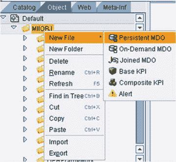
    图 7-1。创建持久 MDO
5.  MDO 的可用屏幕列表可以在页面左下角的 `模板类别` 选项卡下找到（见图 7-2）。可用的配置如下：
    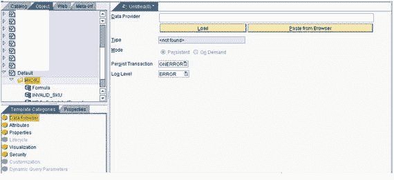
    图 7-2。MDO 数据提供程序界面
    *   数据提供程序
    *   属性
    *   特性
    *   生命周期
    *   可视化
    *   安全性

#### 数据提供程序

`数据提供程序` 是数据将要存储到 MDO 中的对象。此配置为 MDO 提供初始数据。这是一个可选配置。

1.  要定义 `数据提供程序`，请单击 `加载` 按钮，如图 7-3 所示。
    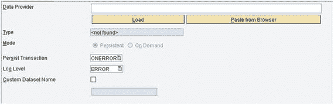
    图 7-3。定义数据提供程序
2.  从可用的树结构中选择对象（`BLS` 或 `查询模板`），如图 7-4 所示。
    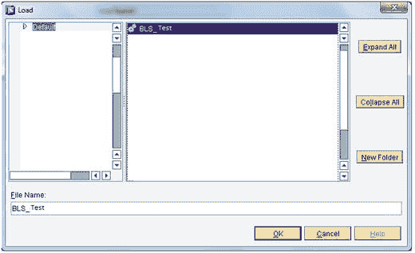
    图 7-4。加载对象
3.  点击 `确定` 以确认 `数据提供程序` 的对象，然后从左侧模板面板中选择 `属性` 配置。

#### 属性

该配置定义了数据模型的数据结构和设计。属性是必填项。

1.  当您选择“属性”配置时，将显示如图 7-5 所示的界面。
    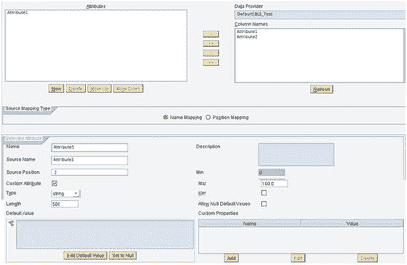
    图 7-5.
    `MDO 属性配置` 界面中的 `列名称` 会根据 `数据提供者` 列出所有列。所需的列可以拖放到 `属性` 列表下。如果最初没有指定 `数据提供者`，则必须通过单击 `新建` 按钮并分配属性的属性来定义属性。`源映射类型` 单选按钮指定您是希望按名称还是按位置映射属性。您可以修改属性值。两种不同类型的属性如下：
    * `源名称`：对于 `数据属性` 类型，源名称将 `MDO` 属性名称链接到 `数据提供者` 属性名称，并且必须与 `数据提供者` 属性名称完全匹配。
    * `源位置`：当使用 `数据提供者` 时，可以提供源位置，并且该属性将获取 `数据提供者` 在数据集中返回的输出。
    * `自定义属性`：只要在不引用 `数据提供者`（源名称和位置）的情况下创建任何新属性，此功能就会绑定到该属性。
    * `键`：如果选中此复选框，该属性的行为类似于 `MDO` 表结构的主键。
    * `允许空默认值`：如果选中此项，则该列将允许将空默认值插入 `MDO` 表；否则，必须为该列插入一个值。
    * `数据属性`（直接映射到 `数据提供者` 的列）
    * `自定义属性`（未映射到 `数据提供者` 的列，由开发人员新建）
    可以为该列定义一个默认值，这样，如果没有向 `MDO` 表传递任何值，它可以采用针对该属性列定义的默认值。

#### 生命周期

`生命周期` 可用于定义数据在 `MDO` 中持久保留的时长。这仅适用于持久化 `MDO`。仅当选择了 `数据提供者` 时，此项才可见。参见图 7-6。
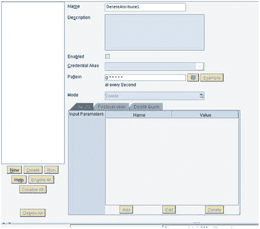
图 7-6.
`MDO 生命周期` 配置

可以根据定义的模式调度任何 `任务`。您需要提供一个凭证别名以便从调度程序执行它。以下类型的模式可用：
* `替换`：当执行 `MDO 数据提供者` 时，持久化数据会被删除并替换为结果数据集。
* `更新`：当执行 `MDO 数据提供者` 时，持久化数据会根据 `MDO` 的键属性，用结果数据集进行更新。
* `删除`：当执行 `MDO 数据提供者` 时，存储在 `MDO` 中的持久化数据将被完全删除。
* `输入`：可以为运行时执行提供 `数据提供者事务性` 或 `查询输入` 参数的默认值。
* `执行后`：这在以 `替换`、`更新`、`删除` 模式执行 `MDO` 后，定义了在流程中作为依赖逻辑一部分被视为必要的任何事务。
* `删除查询`：这定义了用于删除 `MDO` 数据的 `查询` 模板。仅当选择了 `删除` 模式时，此选项卡才启用。

#### 安全性

此配置为要执行的 `MDO` 对象定义了 `读取者` 和 `写入者` 角色部分。

1.  可以从可用角色下拉列表中，将 `读取者` 和 `写入者` 角色添加为 `NetWeaver` 中可用的角色，如图 7-7 所示。
    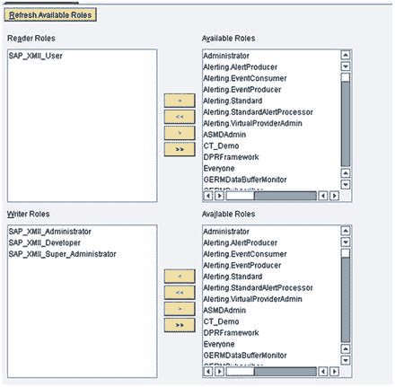
    图 7-7.
    `MDO 安全性` 配置

现在，持久化 `MDO` 已创建并执行。

### 创建按需 MDO

按需模式 `MDO` 指的是当向对象发出查询请求时，从定义的 `数据提供者` 中检索出的数据。这些数据可以是所有对象数据，也可以是 `数据提供者` 内容的过滤子集，具体取决于您的报告需求。它不会持久化数据，因此此处不能使用 `INSERT/UPDATE/DELETE MDO` 查询。创建步骤与持久化 `MDO` 相同。

### 创建连接 MDO

请按照以下步骤连接两个或多个 `MDO`：

# 创建连接 MDO

1.  打开`SAP MII工作台`。

2.  打开`对象`选项卡。

3.  右键单击需要创建`MDO`对象的文件夹。

4.  选择`新建文件` ➤ `连接 MDO`，如图 7-8 所示。

    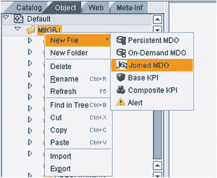

    图 7-8. 创建`连接 MDO`

5.  当您选择连接`MDO`时，将显示如图 7-9 所示的界面。

    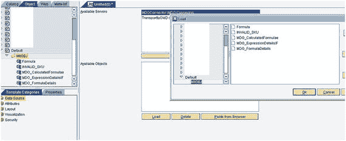

    图 7-9. 选择要连接的`MDO`对象

## 配置选项

可以进行以下配置：

*   `数据源`
*   `属性`
*   `布局`
*   `可视化`
*   `安全性`

### 数据源

`数据源`提供了用于选择要应用于连接的服务器和`MDO`对象的配置。可用的服务器选项列出了在`MII`服务器上配置的`MDO`连接器，其中只需选择一个`MDO`连接器。

可用对象选项使您可以浏览服务器上所有可用的项目`MDO`。您可以从可用列表中加载来自多个项目的多个`MDO`。

### 属性

您可以从各自可用的 MDO 对象中选择属性。对于`INNER`或`LEFT OUTER INNER`连接，至少需要定义一条条件（参见图 7-10）。此外，还可以借助过滤器表达式来指定`WHERE`子句。以下选项可用：

- `已选对象`：列出上一步为`JOIN`操作选择的所有 MDO。

- `可用属性`：列出在“已选对象”列表中选中的 MDO 的属性。

- `已选属性`：为`JOIN`操作选择并添加的所有属性都将列在该部分的表格下。

- `显示名称`：您可以根据需要更改列的`JOIN`输出名称。

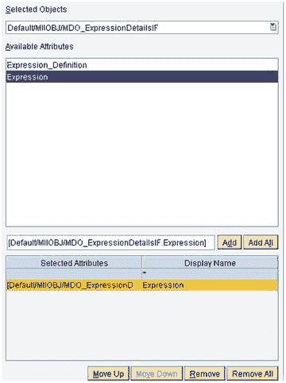

图 7-10. 连接的 MDO 属性配置界面

图 7-11 展示了如何选择连接类型。

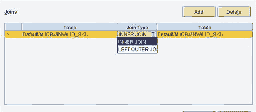

图 7-11. 已连接 MDO 注释中可用的连接

`INNER`连接与`JOIN`相同。它们也被称为`EQUIJOIN`。SQL`INNER`连接返回`table1`和`table2`相交且满足`INNER`连接条件的记录。参见图 7-12。

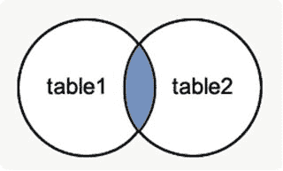

图 7-12. `INNER`连接示例

`LEFT OUTER`连接：`LEFT OUTER`连接返回`ON`条件中指定的左侧表中的所有行，以及另一个表中连接字段相等（即满足连接条件）的那些行。参见图 7-13。

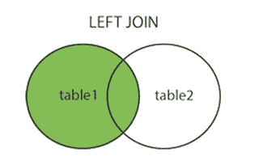

图 7-13. `LEFT OUTER`连接示例

1.  需要在 MDO 之间至少定义一条条件，才能将连接应用于可用的运算符，如图 7-14 所示。

    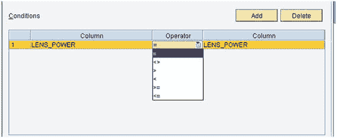

    图 7-14. 已连接 MDO 中的可用条件

2.  此外，您还可以筛选为连接输出选择的属性，如图 7-15 所示。

    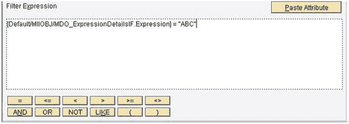

    图 7-15. 已连接 MDO 中的过滤器表达式

### 布局

显示 MDO 对象之间连接的图形视图。此界面反映在“属性”选项卡上所做的任何更改。

### 安全性

与持久性和按需 MDO 相同。

### MDO 的限制

尽管 MDO 是免费的，但它们有一些限制。以下是 MDO 的一些限制：

- 不建议用于处理海量数据。

- 不建议用于频繁处理高数据量访问的场景。

- 不建议在单次执行调用中查询大量数据。

在 MII 中创建的 MDO 表的详细信息会使用唯一标识号（例如 `MDO3567`）存储在后台标准表中，而不是使用用户在创建 MDO 时提供的名称。这使得通过 Illuminator 服务从后台 MII 标准表中识别特定的 MDO 变得非常困难。SAP 可能会在下一个版本中更改 MDO 的设计，以便在动态获取不同详细信息时更容易调用 MDO。

## 可视化服务

数据可视化是一种视觉传达（描述性统计）的实践，涉及数据的研究和可视化表示。数据可视化服务以交互方式可视化数据。它们从数据分析开始，以最终设计和开发的产品结束。最终产品可以是交互式报告、仪表盘、交互式演示应用程序（移动端或 Web 端）等。

与许多其他平台一样，SAP MII 允许用户创建可用于各种应用程序的仪表盘对象和网页。SAP MII 可视化服务分为两部分：

- 动态页面生成器

- 动画对象

### 动态页面生成器

这会创建一个基于 SAP MII 的 HTML 页面内容或图表 Servlet URL。可以通过选择合适的显示模板、查询模板以及与尺寸和其他配置相关的各种其他属性来实现。

请按照以下步骤创建显示模板：

1.  在 SAP MII 管理菜单中，选择 `内容开发` ➤ `工作台`。将显示 SAP MII 工作台界面。执行以下任一操作：

2.  选择 `文件` ➤ `新建` 以显示您可以创建的模板类型。

    有些显示模板是基于小程序的，还有一些是新增的基于 UI5 的模板。参见图 7-16。

    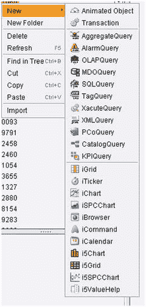

    图 7-16. SAP MII 中的显示模板列表

    可用的不同显示模板如下：

    - `iGrid`
    - `iTicker`
    - `iChart`
    - `iSPC Chart`
    - `iBrowser`
    - `iCommand`
    - `iCalendar`
    - `i5Chart`
    - `i5Grid`
    - `i5SPC Chart`
    - `i5ValueHelp`

    除了这些显示模板之外，`动画对象`选项也可用，并且可以使用它来更改 SVG 图像（动画对象将在本章后面介绍）。以下部分介绍了一些常用的显示模板。

#### iGrid

可以使用网格显示模板通过 SAP MII 连接器查看数据。您可以定义颜色上下文相关的高亮显示，以基于数据值或范围来突出显示数据元素。网格可用于向用户呈现单选或多选列表框。以下是可以在 SAP MII 工作台中配置的`iGrid`属性（参见图 7-17）：

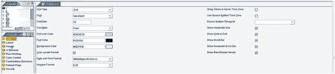

图 7-17. `iGrid`配置

- 网格区域
- 布局
- 表头
- UI 行为
- 行标题
- 颜色上下文
- 上下文菜单行为
- 刷新页面
- 安全性

#### iTicker

启用一个滚动的股票行情条，可以显示从任何 SAP MII 连接器返回的数据。`iTicker`使用小程序的高度和宽度标签自动调整小程序窗口的大小。行情文本会自动垂直居中。数据值可以在行情条中以不同颜色高亮显示。

可配置的`iTicker`属性包括以下内容（参见图 7-18）：

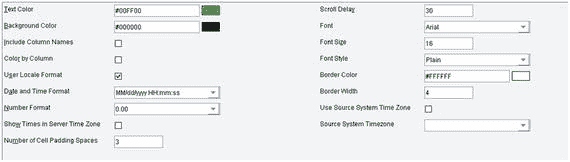

图 7-18. `iTicker`配置

- [行情区域](http://help.sap.com/saphelp_mii122sp01/helpdata/en/44/da4751c6880ec1e10000000a422035/content.htm)
- [数据映射](http://help.sap.com/saphelp_mii122sp01/helpdata/en/44/da4805c6880ec1e10000000a422035/content.htm)
- [颜色上下文](http://help.sap.com/saphelp_mii122sp01/helpdata/en/44/da48a4c6880ec1e10000000a422035/content.htm)
- [刷新页面](http://help.sap.com/saphelp_mii122sp01/helpdata/en/44/b3fdb64c7914e6e10000000a114e5d/content.htm)
- [安全性](http://help.sap.com/saphelp_mii122sp01/helpdata/en/46/7f9f3fb7402d8ae10000000a11466f/content.htm)

### iChart

处理并显示数据集，每个数据集最多支持 32 个标签和数千个观测值，并以多种图表类型呈现。SAP MII 使用 `iChart` 小程序，该小程序支持 `SelectionEvent` 小程序参数，并允许将 JavaScript 函数链接到图例中的项目。

`iChart` 属性可以在 SAP MII 工作台的以下界面上进行配置（参见图 7-19）：

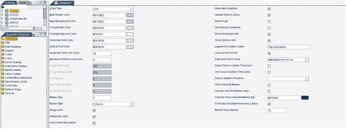

图 7-19. `iChart` 配置

- 图表区域
- 标题
- 数据映射
- 图例
- X 轴
- Y 轴
- 服务器缩放
- 数据系列详情
- 上下文菜单行为
- 刷新页面
- 安全性

### iSPC 图表

以多种统计过程控制（SPC）图表格式处理和显示每个标签包含数千个观测值的数据集。每个 SPC 图表都包含以下内容（见图 7-20）：

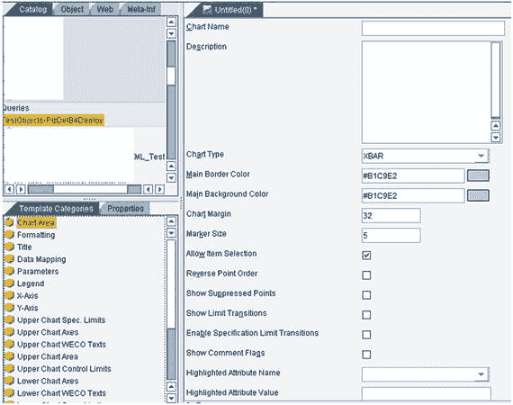

图 7-20. `iSPC` 图表配置

- 一组适合分析类型的汇总统计信息
- 原始数据视图和完整的统计计算结果视图
- SPC 规则违反情况，可逐点向下钻取
- 每个点的附加属性信息
- 协作式点记录功能

图 7-20 显示了在与应用程序的 SPC 图表交互时可以显示的数据的不同视图或多维度。当用户单击 SPC 图表中的数据点时，屏幕会更新以显示该点的特定信息。如果从链接到 SPC 图表的数据查询中返回了任何维度的附加数据，这些数据将作为视图的附加上下文进行显示。

以下是 SAP MII 工作台中的 `iSPC` 图表可配置属性：

- 图表区域
- 格式设置
- 标题
- 数据映射
- 参数
- 图例
- X 轴
- Y 轴
- 上方图表规格限
- 上方图表轴
- 上方图表 WECO 文本
- 上方图表区域
- 上方图表控制限
- 下方图表轴
- 下方图表 WECO 文本
- 下方图表规格限
- 下方图表区域
- 下方图表控制限
- 警报
- 限值文本
- 上下文菜单行为
- 上下文菜单安全性
- 刷新页面
- 安全性

### iBrowser

使用 `iBrowser`，您可以将来自多种来源的数据映射到 SAP MII 树、列表或下拉列表视图，这些视图提供选择、向下钻取和其他功能。

当创建查询以映射到浏览器时，适用以下规则：

- 当查询返回单列时，浏览器配置为列表框或下拉列表框。
- 当返回两列且选中了“数据链接模式”时，第二列显示项目的数据链接值，并且该列被隐藏。浏览器配置为列表框或下拉列表框。
- 当返回两列且未选中“数据链接模式”复选框时，浏览器配置为树。查询必须返回第一列中的项目名称以及第二列中其父项的名称。
- 当返回三列或更多列时，浏览器配置为树。查询必须返回第一列中的项目名称以及第二列中其父项的名称。
- 当返回四列且选中了“数据链接模式”复选框时，系统假定第一列包含项目，第二列包含父节点，第三列包含项目的数据链接值，第四列包含父节点的数据链接值。
- 当浏览器配置为树时，可以通过按住 `Ctrl` 并单击节点，或在树获得焦点时按空格键来取消选中所选节点。

以下是 SAP MII 工作台中可配置的 `iBrowser` 属性（见图 7-21）：

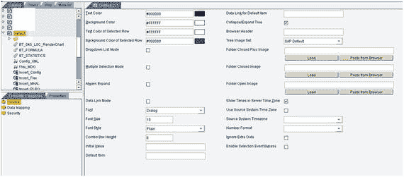

图 7-21. `iBrowser` 配置

- 常规
- 数据映射
- 安全性

### iCommand

`iCommand` 允许执行 SQL 命令查询而无需执行 HTTP POST。因为它可以持有数据集，所以可以将数据查询模板加载到屏幕上的隐藏对象中，并且该数据可以在 DHTML、HTML 表格、其他小程序等中使用。`iCommand` 不一定需要定义显示元素，并且小程序不需要预先执行模板查询请求。这使得它比网格更高效。

SAP MII 通过 `iCommand` 小程序支持电子签名和审计日志记录。此功能使最终用户能够实现符合 21 CFR Part 11 的解决方案。在 `iCommand` 小程序显示模板中对此功能有特殊设置。见图 7-22。

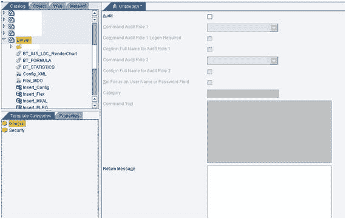

图 7-22. `iCommand` 配置

以下配置可用：

- 常规
- 安全性

### iCalendar

小程序中可以包含一个日历，并将其链接到其他小程序或网页表单元素。SAP MII 仅支持公历。建议将小程序尺寸设置为宽 200 像素，高 188 像素。见图 7-23。

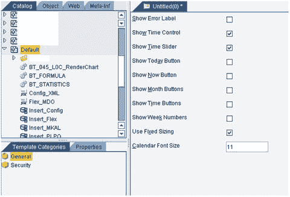

图 7-23. `iCalendar` 配置

以下配置选项可用：

- 常规
- 安全性

### i5Grid

在最新版本的 SAP MII（从 MII 14.0 SP04 开始）中，除了基于小程序的显示模板外，还添加了一些基于 UI5 的显示模板。通过网页或基于浏览器的脚本，可以使用 JavaScript 动态控制 `i5Grid` 或类似显示模板的行为和外观，包括方法和事件。这些网格主要用于加载来自查询的数据，其执行速度比小程序更快。见图 7-24。

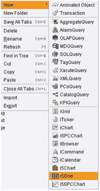

图 7-24. `i5Grid` 创建

图 7-25 展示了一个标记了所有可用属性的 `i5Grid` 示例。

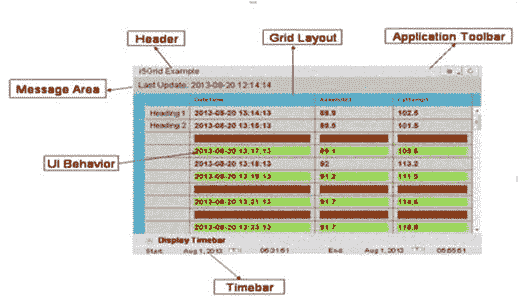

图 7-25. `i5Grid` 的图形表示

以下是 `i5Grid` 中可用的配置列表。网格区域是填充网格的主要配置之一。见图 7-26。

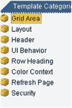

图 7-26. `i5Grid` 配置选项

#### `i5Grid` 区域

网格区域配置用于设置显示模板的通用属性。在网格区域中，可以指定网格类型。见图 7-27。

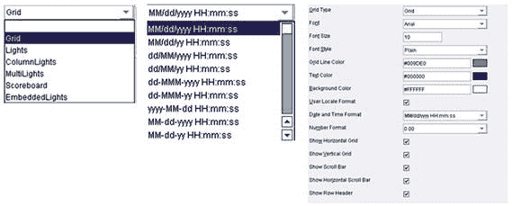

图 7-27. `i5Grid` 的各种配置

#### `i5Grid` 布局

布局配置用于设置 `i5Grid` 的数据源和列属性。见图 7-28。

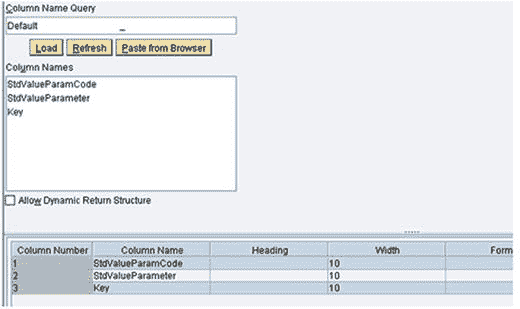

图 7-28. `i5Grid` 布局配置

#### `i5Grid` 标题

此配置用于设置标题属性。见图 7-29。

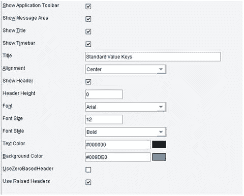

图 7-29. `i5Grid` 标题配置

#### `i5Grid` UI 行为

可以定义 `i5Grid` 的用户界面行为。见图 7-30。

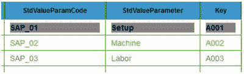

图 7-30. `i5Grid` UI 行为示例

可以在 `i5Grid` 显示中配置 UI 行为，如图 7-31 所示。

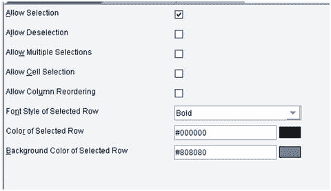

图 7-31. `i5Grid` UI 行为配置

#### `i5Grid` 行标题

可以设置 SAP MII 网格的行标题。见图 7-32。

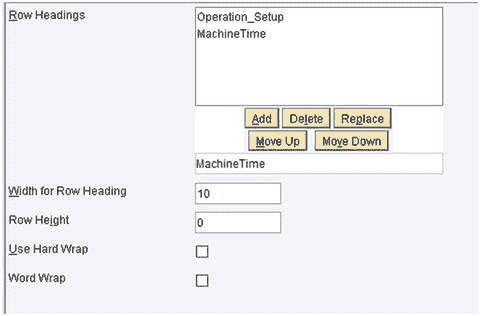

图 7-32. `i5Grid` 行标题配置

设置行标题后，网格将如图 7-33 所示。

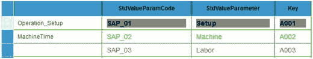

图 7-33. 设置行标题后的 `i5Grid`

#### `i5Grid` 颜色上下文

可以设置网格的颜色上下文。见图 7-34。

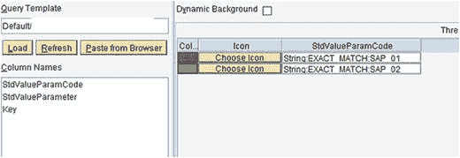

图 7-34. `i5Grid` 颜色上下文

# i5Grid 与 i5Chart 组件配置与使用


**图 7-33.** `i5Grid` 行标题示例

当颜色上下文如图 7-34 所示配置完成后，行文本将根据定义的条件以相应的颜色显示。见图 7-35。

- **`i5Grid` 刷新页面**：用于配置刷新选项，如图 7-36 所示。

    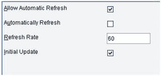
    **图 7-36.** `i5Grid` 刷新页面配置

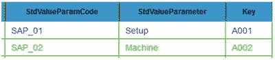
**图 7-35.** `i5Grid` 颜色上下文示例

## i5Grid 输出

可以使用网页或基于浏览器的脚本动态控制 SAP 制造集成与智能（SAP MII）中 `i5Chart` 的行为和外观。脚本可以实现以下功能：

- 更改 `i5Chart` 属性
- 调用 `i5Chart` 方法
- 使用 `i5Chart` 事件（例如用户选择）来链接 `i5Chart`，用于钻取或数据关联应用

图 7-37 显示了最终的输出示例。在 HTML 页面中包含 `i5Chart` 的代码如下：

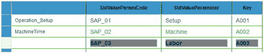
**图 7-37.** 包含所有功能的 `i5Grid` 最终输出示例

```
var i5Grid = new com.sap.xmii.grid.init.i5Grid("Default/Saptaparna/i5Grid_Exercise", "Default/Saptaparna/MDO_ReadSVKs");
i5Grid.setGridWidth("1240px");
i5Grid.setGridHeight("500px");
i5Grid.draw("GridDiv");
```

## i5Grid 功能

`i5Grid` 具有以下功能：

- **应用程序工具栏**：位于每个网格的右上角，默认包含一些图标。
    - **数据**：可以从网格中导出数据，支持 HTML、CSV 和 XML 三种格式。
    - **当前值**：显示查询中所有标签的当前值。这些值会以 HTML 格式在新的窗口中显示，适用于支持标签、PCo 和目录模式的查询。
    - **统计信息**：显示查询中所有标签的统计值。这些值会以 HTML 格式在新的窗口中显示。
    - **刷新率**：网格刷新的频率（以秒为单位）。
    - **自动刷新**：按照指定的频率自动刷新网格。
    - **打印**：打印网格预览。
    - **帮助**：提供当前使用的 SAP MII 标准应用程序帮助文档。
- **时间条**：用于配置时间条的显示或隐藏功能。网格区域会为所有基于查询的数据显示一个时间条。网格会根据选定的日期时间范围相应地刷新。时间条上的箭头可以全屏、四分之一屏或按当前数据显示图表。可以在模板中或使用日期/时间选择器配置日期范围、开始日期和结束日期。主要属性包括滑块、选择器、持续时间和日期/时间选择器。这些新功能增强了可视化的多样性。

有多种脚本方法可以从 SAP MII `i5Grid` 返回信息，例如 `getGridObject()`、`doPrint()`、`update(Boolean ReloadData)` 等。

## i5Chart

在 MII 14.0 SP04 版本中引入了一个名为 `i5Chart` 的新 MII HTML5 显示模板。`i5Chart` 使用基于 HTML5 的 SAP UI5 技术来渲染图表。它提供了多种可配置的图表来显示和分析数据，是 SAP MII 最重要和最强大的可视化组件之一。`i5Chart` 的显示模板支持 `SelectionEvent` 参数，并允许将 JavaScript 函数链接到图表中的项目。支持多种 `i5Chart` 类型，例如：折线图、柱状图、分组柱状图、饼图、堆叠柱状图、散点图、仪表图、水平柱状图、水平分组柱状图、气泡图、圆环图和自定义图表。见图 7-38。

- **`i5Chart` 图表区域**：图表区域选项卡用于配置图表类型、颜色、字体、通用图表参数以及元素在图表中显示时的行为。见图 7-39。

    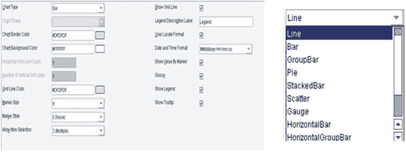
    图 7-39. 带有可用图表类型的 `i5Chart` 图表区域配置

- **`i5Chart` 标题**：设置 `i5Chart` 的标题、颜色、字体和其他属性。见图 7-40。

    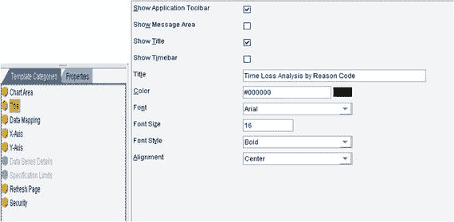
    图 7-40. `i5Chart` 标题配置

- **`i5Chart` 数据映射**：数据映射选项卡将查询返回的列映射到 `i5Chart` 对象的各种元素。见图 7-41。

    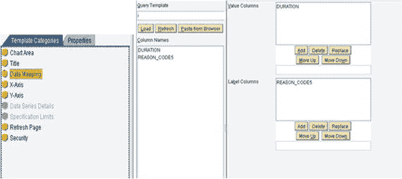
    图 7-41. `i5Chart` 数据映射配置

- **`i5Chart` X 轴**：X 轴选项卡配置与 X 轴（水平轴）相关联的参数。见图 7-42。

    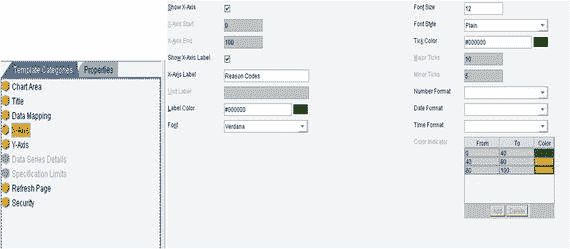
    图 7-42. `i5Chart` X 轴配置

- **`i5Chart` Y 轴**：Y 轴选项卡配置与 Y 轴（垂直轴）相关联的参数。见图 7-43。

    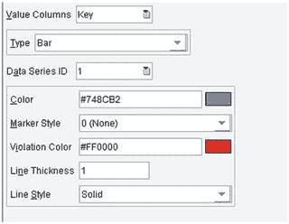
    图 7-43. `i5Chart` Y 轴配置

- **`i5Chart` 数据系列详细信息**：数据系列详细信息配置图表中数据系列的颜色。
- **`i5Chart` 规格限制**：规格限制选项卡通过定义图表中的上限和下限，为查询输出配置规格限制。见图 7-44。

    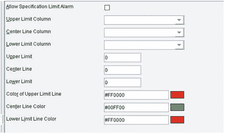
    图 7-44. `i5Chart` 规格限制配置

- **`i5Chart` 刷新率**：刷新页面选项卡设置图表的刷新率和刷新模式（自动/手动）。见图 7-45。

    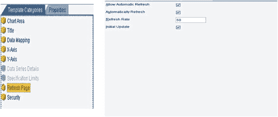
    图 7-45. `i5Chart` 刷新率配置

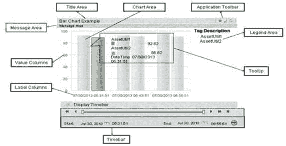
图 7-38. `i5Chart` 的图形化表示

### i5Chart 输出

在 SAP MII 中，使用 JavaScript 编写的网页或基于浏览器的脚本可以动态控制 `i5Chart` 的行为和外观。脚本可用于：

- 更改 `i5Chart` 属性
- 调用 `i5Chart` 方法
- 使用 `i5Chart` 事件（例如用户选择）将 `i5Chart` 链接到下钻或数据关联应用

图 7-46 展示了 `i5Chart` 的最终输出。以下是将 `i5Chart` 包含在 HTML 页面中的代码：

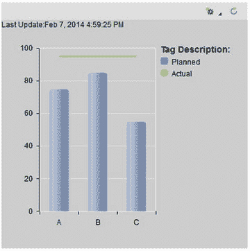
图 7-46. `i5Chart` 最终输出

```javascript
var i5Chart = new com.sap.xmii.chart.hchart.i5Chart("Default/Chart/CHA_I5Chart", "Default/Query/MDOQuery_GetData);
i5Chart.setChartWidth("400px");
i5Chart.setChartHeight("400px");
i5Chart.draw("chartDiv");
```

### i5Chart 特性

`i5Chart` 具有以下特性：

- **访问工具栏**：位于每个图表的右上角，默认包含一些图标。
    - **数据**：数据可以从网格以 HTML、CSV 和 XML 三种格式导出。
    - **当前值**：显示查询中所有标签的当前值。对于支持标签、PCo 和编录模式的查询，这些值会在新窗口中以 HTML 格式显示。
    - **统计信息**：显示查询中所有标签的统计值。这些值会在新窗口中以 HTML 格式显示。
    - **刷新率**：网格刷新的频率（以秒为单位）。

# SAP MII 图表功能与配置

-   **自动刷新**：按指定的频率刷新网格。
-   **打印**：打印网格预览。
-   **光泽效果**：以光泽效果显示图表，可在图表区域部分启用或禁用。
-   **时间条**：显示时间条可隐藏/取消隐藏时间条。图表区域会为所有包含时间数据的查询显示一个时间条。网格会根据选定的日期时间范围进行刷新。时间条上的箭头可以以全屏、四分之一屏或针对当前数据显示图表。日期范围、开始日期和结束日期可以在模板中或使用日期/时间选择器进行配置。主要属性包括滑块、选择器、持续时间和日期/时间选择器。这些新功能增加了可视化的灵活性。

有各种脚本方法可以从 SAP MII `i5Chart` 返回信息，包括 `getChartObject()`、`Refresh()`、`update(Boolean)` 等。

```
JavaDocs Source:
https://:/XMII/JSDOC/i5ChartAllClasses.html.
```

## i5SPC 图表

该图表以多种统计过程控制（SPC）图表格式显示每个标签具有多个观测值的数据集。每个 SPC 图表包括：

-   多种 `i5SPC` 图表类型，例如 `XBAR`、`XBAR-MR`、`XBAR-RANGE`、`XBAR-SDEV`、`INDIVIDUALS`、`INDIVIDUALS-MR`、`MR`、`EWMA`、`EWMA-RANGE`、`EWMA-SDEV`、`MEDIAN`、`MEDIAN-RANGE`、`HISTOGRAM`、`INDIVIDUALS-SHORT-RUN`、`INDIVIDUALS-MR-SHORT-RUN`、`XBAR-RANGE-SHORT-RUN`、`MR-SHORT-RUN`、`P`、`NP`、`C`、`U` 等，用于不同类型的过程控制和统计质量分析。
-   数据点高亮和抑制功能，方便用户进行临时分析。
-   自动计算的标准统计与质量指标。
-   图表中的可视化警报，用于显示违反 SPC 规则的情况，并为每个数据点添加注释文本。

`i5SPC` 图表的配置选项与 `iSPC` 图表的选项非常相似。主要区别在于 `i5SPC` 专用于 UI5 扩展。`i5SPC` 图表中提供以下模板配置（见图 7-47）：

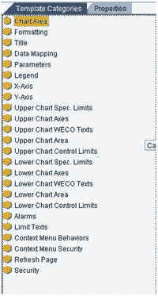

图 7-47. `i5SPC` 图表配置选项

配置 `i5SPC` 图表后，其显示效果如图 7-48 所示。

### i5SPC 图表区域
图表区域选项卡用于配置图表类型、颜色、字体、通用图表参数以及元素在图表中显示时的行为。可能的图表类型如下（见图 7-49）：

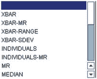

图 7-49. `i5SPC` 图表可用图表类型

### i5SPC 图表格式化
此功能用于配置 SAP MII SPC 图表的格式化属性。见图 7-50。

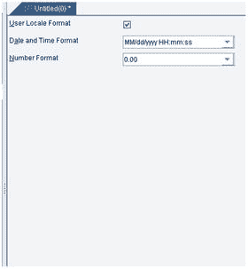

图 7-50. `i5SPC` 图表格式化

### i5SPC 图表标题
此选项卡用于设置 `i5SPC` 图表的标题、颜色、字体和其他属性。见图 7-51。

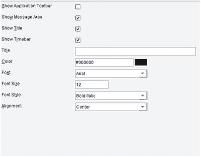

图 7-51. `i5SPC` 图表标题配置

### i5SPC 图表数据映射
数据映射选项卡用于将查询返回的列映射到 `i5SPC` 图表对象的各个元素。见图 7-52。


图 7-52. `i5SPC` 图表数据映射配置

### i5SPC 图表参数
参数选项卡用于配置特定于各个图表类型的参数。见图 7-53。


图 7-53. `i5SPC` 图表参数配置

### i5SPC 图表图例
图例选项卡用于配置显示在 SPC 图表右侧的图表图例的外观和行为。见图 7-54。


图 7-54. `i5SPC` 图表图例配置

### i5SPC 图表 X 轴
X 轴选项卡用于配置与 X 轴（水平轴）相关的参数。见图 7-55。


图 7-55. `i5SPC` 图表 X 轴配置

### i5SPC 图表 Y 轴
Y 轴选项卡用于配置与 Y 轴（垂直轴）相关的参数。见图 7-56。


图 7-56. `i5SPC` 图表 Y 轴配置

### i5SPC 图表控制限与规格限
`i5SPC` 图表可以像下面这样配置上规格限（见图 7-57）：

-   上图表规格限选项卡用于配置统计过程控制（SPC）图表的上图规格限。
-   上图表轴选项卡用于配置统计过程控制（SPC）图表的上图轴。
-   上图表区域选项卡用于配置统计过程控制（SPC）图表的上图区域。
-   上图表控制限配置用于配置统计过程控制（SPC）图表的上图控制限。见图 7-58。


图 7-58. `i5SPC` 图表的各类控制限配置属性


图 7-57. `i5SPC` 图表上图表控制限配置

下规格限类似，如图 7-59 所示。


图 7-59. `i5SPC` 图表下规格限

### i5SPC 图表警报
警报选项卡用于配置当数据值违反某些规则时 SPC 图表的警报。见图 7-60。


图 7-60. `i5SPC` 图表警报配置


图 7-48. 包含所有属性的 `i5SPC` 图表示例

## i5SPC 图表输出

图 7-61 显示了 `i5SPC` 图表的输出。


图 7-61. `i5SPC` 图表示例输出

可以创建不同类型的 `i5SPC` 图表，例如 `XBAR`、`Histogram` 等，如图 7-62 所示。


图 7-62. 具有各种图表类型的 `i5SPC` 图表示例

## i5SPC 图表：UI 中 i5SPC 图表的渲染选项

在 HTML 页面中包含 `i5SPC` 图表的代码如下：

```javascript
var i5SPCChart = new com.sap.xmii.chart.hchart.i5Chart("Default/Saptaparna/i5SPCChart", "Default/Saptaparna/TagQuery");
i5SPCChart.setChartWidth("400px");
i5SPCChart.setChartHeight("400px");
i5SPCChart.draw("SPCchartDiv");
```

## i5SPC 图表特性

以下是 `i5SPC` 图表的一些特性：

-   **控制限与规格限**：规格限是由用户/客户设置的公差值，适用于单个单元。控制限是控制图上的水平线，代表过程的边界。

# 控制限与规格限

- **控制限**：控制限指示过程的行为以及过程是否受控。上控制限（`UCL`）和下控制限（`LCL`）是根据查询中可用数据通过统计计算得出的。`UCL` 和 `LCL` 通过计算为稳定过程所收集的过程数据的均值、标准差和极差来设定。参见图 7-63。


图 7-63. `i5SPC` 图表的控制限与规格限

- **规格限**：规格限决定过程能力与西格玛值。可以为每个图表定义上规格限（`USL`）和下规格限（`LSL`）。控制限是基于历史数据计算得出的限值或平均值。

1. **子组**：SPC 图表的一个重要方面是将数据收集组织成子组。每个子组必须处于受控状态。数据点要么是子组测量值的平均值，要么是绘制在标签和值列上的单个测量值。

2. **警告限**：控制图上的警告限是位于控制限之内的限值。可以定义上警告限和下警告限。当使用警告限时，控制限被称为行动限。默认情况下，警告限设置为 `2-西格玛`。使用警告限的优点是，它们比 `3-西格玛` 行动限能更快地发出过程变化的信号。当三个数据点中有两个位于图表中心线的 `2-西格玛` 和 `3-西格玛` 之间时，考虑 `WECO` 规则。在控制图中：

   - 如果均值位于警告限内，则不采取行动。

   - 如果均值位于警告限和行动限之间，则再取一个样本。

   - 如果均值位于行动限之外，则采取行动。

   1. **内限**：内限设置在距离中心线 `+/- 1` 西格玛的位置。您可以设置上图表和下图表的内限。

#### `i5ValueHelp`

`i5ValueHelp` 提供了从任何表中过滤正确输入数据的功能。如果在任何表中使用了值帮助，当用户在值帮助的文本字段中开始输入单词或单词的一部分时，表格会立即被过滤并返回任何匹配项。要使用值帮助，查询模板是必需的。

在 `i5ValueHelp` 配置中，可以配置四个属性：

- 常规

- 搜索结果

- 搜索条件

- 模板安全性

## 动画对象

动画对象是用于诸如数字驾驶舱或仪表盘、标签生成、专用 `UI` 和报告组件等应用的自定义用户界面（`UI`）控件，您无需使用小程序或其他控件即可使用它们。

这些对象是在 `SAP MII Workbench` 中创建的，并基于可缩放矢量图形（`SVG`），这是一种用于表示矢量图形的基于 `XML` 的格式。

`SVG` 文件和动画对象通过 `SAP MII Workbench` 中“业务逻辑事务”下的“`SVG 渲染器`”和“`动画渲染器`”操作转换为图像文件。

### 配置动画对象

请按照以下步骤创建动画对象：

1. 可以使用 `SAP MII Workbench` 中的 `文件 ➤ 新建 ➤ 动画对象` 菜单选项创建动画对象。

2. 创建动画对象后，用于配置它的各种选项将出现在 Workbench 的左下面板中，如图 7-64 所示。


图 7-64. 配置选项和一个动画对象示例

### 选择 `SVG` 文档

您可以选择一个 `SVG` 文档，它提供了用于渲染图像的动画对象定义。参见图 7-65。


图 7-65. 支持 `SAP MII` 的各种类型的动画对象

### 动画对象的属性

您可以查看动画对象的所有公共属性的列表。公共属性是动画对象的对象属性，可以从 `BLS` 事务中访问和操作，如图 7-66 所示。


图 7-66. 动画对象的公共属性

从公共属性配置中，用户可以创建或更新任何公共属性。除此之外，用户还可以在同一动画对象的计算属性下定义一些条件或计算。如果用户愿意，他们可以查看对象底层的 `XML`。用户还可以操作对象的内部和外部属性来控制动画，完成后，用户可以预览最终的动画对象。

### 用于动画对象的操作块

在 `MII Workbench` 中，`MII` 提供了一组操作块，用于在网页上将动画对象渲染为图像：


图 7-67. 在 `SAP MII` 中处理动画对象的操作块

- **`SVG` 渲染器**：用于获取 `SVG` 文档并生成图像，该图像以支持的图像格式表示渲染后的图形。

- **`动画渲染器`**：用于生成带有应用于图像的动画的 `SVG` 文档。

- **`图像合成器`**：用于合并两个生成的图像。

- **`图像创建器`**：用于创建具有指定属性的图像。

- **`图像缩放器`**：用于将图像缩放到特定的高度和宽度。

图 7-68 显示了在网页上查看动画对象所需的代码示例。


图 7-68. 在网页中查看动画对象的代码示例

## SAP `UI5`

在 `SAP MII`（14.0 及以上版本）中，最佳实践是使用 SAP `UI5` 前端技术。它也可以在早期版本中使用，但必须将完整的 `UI5` 库单独加载到 Workbench 中。SAP `UI5`（SAP 用户界面库用于 HTML 5）是一个库集合，开发者可用其构建在浏览器中运行的桌面和移动应用程序。

SAP `UI5` 提供丰富的互联网应用程序，因为它基于跨浏览器的 `JavaScript` 库。SAP `UI5` 是一个轻量级编程模型，由标准和扩展控件组成。此外，您可以创建新的自定义控件或扩展现有控件。

`i5Charts`、`i5Grids` 和 `i5SPC` 图表使用 SAP `UI5` 的库以图形方式表示从数据源获取的数据。SAP `MII` 环境中的 SAP `UI5` 应用程序可以遵循 `MVC`（模型-视图-控制器）模式进行开发。参见图 7-69。


图 7-69. SAP `UI5` 执行模型

**注意**：模型-视图-控制器（`MVC`）是一种架构模式，它将应用程序分为三个主要的逻辑组件：模型、视图和控制器。每个组件都旨在处理应用程序的特定开发方面。`MVC` 是最常用的行业标准 Web 开发框架之一，用于创建可扩展和可伸缩的项目。

`MVC` 包含三个概念。视图可以使用不同的语言来定义，例如 `JavaScript` 或 `HTML`。控制器绑定视图以及视图中使用的模型。

视图可以使用 `XML` 与 `HTML`、混合或独立方式来定义：

* `XML`：`sap.ui.core.mvc.xmlview`

* `JavaScript`：`sap.ui.core.mvc.JSView`

* `JSON`：`sap.ui.core.mvc.JSONView`

* `HTML`：`sap.ui.core.mvc.HTMLView`

控制器绑定到一个视图。它们也可以与多个视图一起使用。

在模型部分，数据绑定可以在视图中使用。参见图 7-70。


图 7-70. SAP `UI5` 数据绑定

SAP `UI5` 应用程序可以使用不同的视图来开发：

* `JS` 视图

* `XML` 视图

* `JSON` 视图

* `HTML` 视图

`XML` 视图是新引入的，主要用于类似 Fiori 的前端（使用 SAP `UI5`），并且可以部署在 Fiori Launchpad 中。SAP Fiori 是 SAP 软件和应用程序的一种新用户体验（UX）。它提供了一组用于常规业务功能的应用程序，例如工作审批、财务应用、计算应用和各种自助服务应用。SAP Fiori 支持多种设备应用程序，允许用户在桌面/笔记本电脑上启动一个进程，并在智能手机或平板电脑上继续该进程。SAP 基于 `UI5` 用户界面开发了 Fiori 应用。

SAP `UI5`（SAP 用户界面用于 HTML 5）是一个库集合，开发者可用其构建在浏览器中运行的桌面和移动应用程序。使用 SAP 的 SAP `UI5` `JavaScript` 工具包，开发者可以使用 `HTML5` Web 开发标准构建 SAP Web 应用程序。

SAP `UI5` 支持所有主流 Web 浏览器及其最新版本，如 IE、Mozilla Firefox、Google Chrome 和 Safari。

### SAP `UI5` 数据绑定

数据绑定由 `UI5` 控件用于保存应用程序数据。它允许您在对应用程序数据进行更改时自动更改控件。当使用双向数据绑定时，每当绑定控件的值发生变化时，应用程序数据就会更新。

#### 数据绑定模型类型

SAP `UI5` 支持三种模型实现类型：

* JSON 模型：支持 JavaScript 对象表示法格式的数据。支持双向数据绑定。
* XML 模型：支持 XML 数据。支持双向数据绑定。
* OData 模型：创建 OData 请求并相应地处理响应。仅支持符合 OData 的数据。支持实验性的双向数据绑定。

## SSCE

SAP MII 推出了自助服务组合仪表板（Self-Service Composition Dashboard），它集成在 SAP MII 包中。使用 SSCE，您可以通过拖放 UI 组件并绑定相应的数据来轻松开发前端屏幕。此外，在后端，UI 代码会自动生成，并且可以在任何地方根据需要进行修改以生成所需输出。

它根据需求创建、设计、配置和显示完整的仪表板。它是一个基于角色的应用程序。要访问 SSCE 组件，必须为用户分配 `XMII_SSCE_ALL` 角色。主要 SSCE 特性和功能如下：

* **仪表板创建**：使用任何 SAP MII 内容（查询模板、显示模板、MDO/KPI 对象和资源文件）、UI 元素和来自工厂信息目录的标签，可以创建仪表板。
* **所选对象的配置**：来自工厂信息目录（PIC）的选定标签可以放置在图像上。可以根据所选标签的所需条件配置颜色、图形和图标。当标签在 SSCE 上移动到空单元格时，会显示标签趋势（折线图）。
* **灵活的布局**：使用 SSCE 的不同布局，显示来自任何查询模板的数据和用户特定的 UI 控件。
* **灵活的仪表板**：保存创建的仪表板以供以后使用，并且如果需要，可以轻松修改。
* **自定义**：通过将保存的内容添加到导航树来自定义创建的仪表板。
* **仪表板预览**：预览创建的仪表板，可以使用静态或实时图像。
* **安全性**：通过分配角色来保护您的仪表板。

### 主要组件

三个主要组件是“设计”、“预览”和“源代码”。图 7-71 展示了设计仪表板。


*图 7-71. SSCE 设计仪表板*

#### 设计

主要用于使用标准布局创建仪表板，同时选择相应的内容，例如：

* **MII 内容**：显示模板、查询模板、MDO/KPI 对象和资源文件是该部分的预定义对象。参见图 7-72。
  
  *图 7-72. SSCE MII 内容菜单*

* **UI 元素**：SSCE 提供通过添加 UI 元素（例如标签、文本输入字段、按钮、图像和下拉框）来创建更具交互性的页面的功能。这些元素可以直接拖放到设计仪表板中。参见图 7-73。
  * ✓ 在布局背景中创建一个参考网格，第一个 UI 元素始终放置在网格的左上角单元格。后续元素放置在网格的指针位置。
  * ✓ 一旦选择了 UI 元素，右侧窗格中会出现“属性”选项卡，显示与该 UI 元素关联的所有属性，如图 7-74 所示。
    
    *图 7-74. SSCE 中的 UI 元素属性*
    
    *图 7-73. SSCE UI 元素菜单* 可以配置 UI 元素的属性，如 ID、文本值、可见性、事件处理程序等。
  * ✓ 添加事件处理程序后，会在“源代码”选项卡的自定义代码区域中创建一个 JavaScript 方法。可以在“预览”选项卡中看到 UI 元素及其配置。参见图 7-75。
    
    *图 7-75. 设置 UI 元素的事件* 一旦单击“源代码”选项卡，就会显示事件处理程序的自动生成代码，如图 7-76 所示。
    
    *图 7-76.* ### SSCE 中的事件处理程序自动生成代码

* **工厂信息目录**：来自工厂信息目录的标签可以移动到空单元格、图像或标签趋势图上。它可以重新定位到所需位置。在实时和设计模式下，可以在趋势和当前视图中查看选定的标签。对标签的更改/配置会在预览模式下自动捕获。

### 仪表板操作与配置

自定义的仪表板布局可以通过 `Open Dashboard` 命令进行搜索和打开。此外，您创建的内容可以在 `Preview` 选项卡中进行配置和预览。仪表板的合并、取消合并和删除也是可行的。还可以根据需要查看仪表板的实时模式。也可以创建指向仪表板的导航链接。安全性是一个额外的优势。

UI 仪表板可以在 `Preview` 选项卡中查看，如图 7-77 所示。

*图 7-77. SSCE 中的预览窗口*

### 源代码编辑

`Source Code` 选项卡可用于查看为所创建仪表板生成的 HTML 源代码。可以通过 SAP MII Workbench 将外部代码附加到现有源代码中，并附带额外的 CSS 或 JavaScript。JavaScript 会添加到生成源代码中标记为供用户输入脚本的区域。

当选择 `Edit` 时，整个源代码区域会分成两部分，如图 7-78 所示。
*   左侧部分代表生成的 HTML 源代码，不可编辑。
*   右侧部分代表可编辑的挂钩点。此部分进一步分为两个区域：自定义代码和脚本助手。

*图 7-78. SSCE 中的源代码编辑器*

在 `Custom Code` 区域，您可以添加必须在运行时可用的代码。您可以使用生成代码区域中创建的任何对象或可用的 API，通过 `Add Include(s)` 在运行时修改对象的行为。

### 脚本助手

在 `Script Assistant` 中，您可以通过提供可用的选项（包括小程序及其方法、查询类型和查询方法）来进一步改进脚本语法，以绑定到小程序。以下配置可用（参见图 7-79）：
*   **Applet/SAP UI5**：列出小程序名称以及 SAP UI5 对象。

*图 7-79. SSCE 中可用的 UI5 小程序*

*   **Applet/SAP UI5 Methods**：列出基础小程序名称以及 SAP UI5 对象方法。参见图 7-80。

*图 7-80. SSCE 中可用的 UI5 方法*

*   **Query Type**：列出与所选小程序的 Applet 方法相关联的任何查询类型。参见图 7-81。

*图 7-81. SSCE 中可用的查询类型*

*   **Object Methods**：列出适用于所选小程序/SAP UI5 对象的对象方法名称。参见图 7-82。

*图 7-82. SSCE 中可用的对象方法*

*   **Include Document Object Reference**：如果选中此复选框，系统会将文档对象作为前缀添加到小程序名称前，以引用网页上的小程序或控件。建议使用前缀。例如，选中复选框时，会添加一个文档前缀引用（参见图 7-83）。

*图 7-83. 在 SSCE 中包含文档引用*
如果未选中此复选框，则不会创建文档前缀引用，如图 7-84 所示。

*图 7-84. 在 SSCE 中排除文档引用*

## 关键绩效指标 (KPI)

关键绩效指标 (KPI) 是监控关键运营领域并让企业了解该领域或组织绩效如何的数字指数衡量指标。KPI 对于绩效评估至关重要。KPI 通常针对特定业务场景进行配置，并让相关管理层了解这些领域是表现良好、需要监控还是需要立即关注和改进。

# KPI 可以在 SAP MII 中创建和配置，也可以使用内置的 KPI 监控屏幕进行监控。

## KPI 框架

KPI 框架是 SAP MII 的内置功能，允许您定义 KPI 并创建用于计算和监控的逻辑。该框架还允许您创建自定义 UI 并从 SAP MII 使用 KPI 数据。它可以使用数据连接器从任何车间系统或历史数据库中获取 KPI 计算所需的数据。也可以为 KPI 计算创建自定义逻辑。

以下是 KPI 框架的主要步骤：

-   KPI 定义
-   数据获取
-   数据消费

## KPI 定义

KPI 定义是创建和配置 KPI 的地方。创建 KPI 需要分配 `XMII_DEVELOPER` 角色。

### KPI 的类型

SAP MII 有两种类型的 KPI：

-   **基础 KPI**：不依赖于任何其他 KPI
-   **复合 KPI**：依赖于其他不同的 KPI 来获取数据

#### 基础 KPI

`基础 KPI` 是独立、自给自足的绩效指标，无需借助外部系统即可自行收集和计算数值。这些基础 KPI 可以成为其他 KPI 的一部分，用于收集所需数据。

要配置基础 KPI，请遵循以下步骤：

1.  打开 SAP MII 菜单，选择 `工作台` ➤ `启动工作台`。
2.  打开 `对象` 选项卡。
3.  右键单击 `项目` 文件夹。
4.  选择 `新建文件` ➤ `基础 KPI`，如图 7-85 所示。


图 7-85. 选择 `基础 KPI`

5.  页面左下角有指向不同配置页面的链接。参见图 7-86。


图 7-86. `基础 KPI` 的模板类别

`常规` 页面包含 KPI 的标题信息。此页面中可用的字段如图 7-87 所示。

-   `描述`：指定 KPI 的描述。
-   `数据类型`：此字段指定所生成 KPI 值的数据类型。可用的类型为 `integer`、`double`、`float` 和 `long`。
-   `度量单位`：指定 KPI 的度量单位。
-   `模式`：这是一个只读字段，用于指定 KPI 的类型（`基础/复合型`）。
-   `类型`：有三种可用类型：
    -   `正向`：KPI 值越高表示性能越好。如图 7-88 所示，当类型选择为`正向`时，绿色定义为 `+10` 到 `最大` KPI 值，黄色定义为 `+5` 到 `+10` KPI 值，红色定义为 `0` 到 `+5` KPI 值。


图 7-88. `正向`类型 `基础 KPI` 示例

    -   `负向`：与正向指标相反。红色范围为 `-10` 到 `最大负值` KPI 值，黄色范围为 `-5` 到 `-10` KPI 值，绿色范围为 `0` 到 `-5` KPI 值。参见图 7-89。


图 7-89. `负向`类型 `基础 KPI` 示例

    -   `双向`：意味着它应该处于一个既有上限也有下限的特定范围内。对于此类型，在图 7-90 中，红色范围为 `+20` 到 `最大` 以及 `0` 到 `+5` KPI 值，黄色范围为 `+15` 到 `+20` 以及 `+5` 到 `+10` KPI 值，绿色范围为 `+10` 到 `+15` KPI 值。


图 7-90. `双向`类型 `基础 KPI` 示例

-   `范围`：取决于类型。对于正向 KPI，绿色在顶部，其次是黄色和红色。对于负向 KPI 则相反。
-   `聚合逻辑`：此字段指定查询 KPI 时用于值聚合的逻辑。可用选项有：
    -   `最小值`：返回检索结果的最小值。
    -   `最大值`：返回检索结果的最大值。
    -   `平均值`：返回检索结果的平均值。
    -   `总和`：返回检索结果所有值的总和。
    -   `范围`：返回最大值与最小值之间的差值。


图 7-87. `基础 KPI` 中的常规界面

`数据提供者` 页面配置 KPI 的数据源（参见图 7-91）。它可以是一个查询模板、一个事务或另一个 KPI。点击 `加载` 按钮并选择所需对象。然后点击 `确定` 按钮。图 7-92 展示了加载过程。


图 7-92. 在 `数据提供者` 中加载对象


图 7-91. `基础 KPI` 中的数据提供者

`维度` 是 KPI 的属性，来自 `数据提供者` 的列数据可以映射到这些属性上。`维度` 和 `时间戳` 是两个标准的可用属性。通过 `数据提供者` 可能还可以获得其他属性。在 `维度` 页面上配置这些属性，如图 7-93 所示。


图 7-93. 基础 KPI 中的维度界面

`生命周期` 配置用于调度 KPI 在给定时间收集数据。为此，需要配置一个调度器。没有调度器，KPI 无法存储数据。点击 `创建新` 按钮并提供必填信息。选中 `已启用` 复选框。为调度器选择运行的时间模式。为调度器选择模式——`追加`、`插入`、`更新` 或 `删除`。点击 `全部部署` 按钮来部署调度器。它将自行创建调度器并开始运行。

为 KPI 分配角色，以确保只有授权用户才能使用该 KPI。然后保存并部署 KPI。

#### 复合 KPI

复合 KPI 是根据其每个依赖 KPI 或系统的值计算得出的。复合 KPI 可以依赖于基础 KPI、复合 KPI 或两者。它们可以配置为从多个数据源收集数据，例如事务、查询模板或其他 KPI。

##### 配置复合 KPI

请按照以下步骤配置复合 KPI：

1.  打开 SAP MII 菜单，选择 `工作台` ➤ `启动工作台`。
2.  打开 `对象` 选项卡。
3.  右键单击 `项目` 文件夹。
4.  选择 `新建文件` ➤ `复合 KPI`，如图 [7-94] 所示。


图 7-94. 选择复合 KPI

5.  在页面左下角有指向不同配置页面的链接。
6.  `常规` 页面包含 KPI 的标头信息。此页面上的可用字段包括：
    -   `描述`：指定 KPI 的描述。
    -   `数据类型`：指定生成的 KPI 值的数据类型。可用类型为整数 `integer`、双精度 `double`、浮点 `float` 和长整型 `long`。
    -   `计量单位`：指定 KPI 的计量单位。
    -   `模式`：此只读字段指定 KPI 的类型（基础/复合）。
    -   `类型`：三种可用的类型是：
        -   `正向`
        -   `负向`
        -   `双向`：类型为“正向”的 KPI 意味着值越高表示性能越好。“负向”类型则相反。“双向”类型意味着它应处于具有上限和下限的特定范围内。
    -   `范围`：取决于类型。对于正向 KPI，绿色位于顶部，其次是黄色和红色。对于负向 KPI，顺序相反。
    -   `聚合逻辑`：此字段指定在查询 KPI 时用于聚合值的逻辑。可用选项包括：
        -   `最小值`：返回检索结果中的最小值。
        -   `最大值`：返回检索结果中的最大值。
        -   `平均值`：返回检索结果的平均值。
        -   `总和`：返回检索结果所有值的总和。

## 数据消费与监控

在制造业中，必须测量各种参数以从多个角度监控性能。这些参数称为关键绩效指标（KPI）。您还必须定期监控用于计算 KPI 的数据以及最终的 KPI 结果。这些都是关键的行业要求，因为 ISO 认证和质量许可取决于 KPI 结果。SAP MII 具有内置功能，可使用标准 KPI 公式计算 KPI，并且如果需要，可以创建一定程度的自定义 KPI 公式。本节介绍如何配置和使用 KPI，如何使用 KPI 查询查询数据，以及如何可视化这些数据。

7.  在`数据提供者（Data Provider）`页面上，有一个名为`KPI 数据提供者（KPI Data Provider）`的附加区域（见图 [7-95]）。此字段允许您添加复合 KPI 所依赖的 KPI。要添加依赖 KPI，请单击`加载（Load）`按钮，然后从弹出框中选择 KPI。点击`确定（OK）`。

    
    图 7-95. 复合 KPI 中的数据提供者屏幕

8.  如果复合 KPI 的值来自外部系统，则需要在此选择`数据提供者（Data Provider）`。

9.  复合 KPI 的`维度（Dimension）`页面与基础 KPI 的非常相似，直到您尝试将多个 KPI 的值映射到复合 KPI。要设置复合 KPI 的值，请单击`编辑表达式（Edit Expression）`按钮。选择编辑表达式，然后点击`确定（OK）`。

10. `生命周期（Lifecycle）`配置可调度 KPI 在给定时间收集数据。为此，需要配置一个调度器。没有调度器，KPI 就无法存储数据。点击`新建（Create New）`按钮并添加必填信息。选中`已启用（Enabled）`复选框。为调度器选择一个运行的时间模式。选择调度器的模式：`追加（Append）`、`插入（Insert）`、`更新（Update）`或`删除（Delete）`。点击`全部部署（Deploy All）`按钮以部署调度器。它将创建调度器并开始运行。

11. 为 KPI 分配角色，以确保只有授权用户才能使用该 KPI。

12. 保存并部署 KPI。

### KPI 查询

`KPI Query` 是一种新型查询模板，允许您查询 KPI 数据。

请按照以下步骤配置 KPI 查询：

1.  启动`工作台（Workbench）`。

2.  转到`目录（Catalog）`选项卡。

3.  右键单击任意项目，然后选择`新建（New）` ➤ `KPI 查询（KPI Query）`。见图 [7-96]。

    
    图 7-96. 选择 KPI 查询

4.  `KPI 查询（KPI Query）`屏幕在屏幕左下角有不同的配置页面。这些页面是：

    *   `数据源（Data Source）`
    *   `常规（General）`
    *   `日期范围（Date Range）`
    *   `选择查询（Select Query）`
    *   `删除查询（Delete Query）`
    *   `插入查询（Insert Query）`
    *   `参数（Parameters）`
        *   `转换（Transformation）`
        *   `安全（Security）`

5.  在`常规（General）`页面上，指定一个数据服务器和一个连接器。SAP MII 提供了一个名为 `KPIConnector` 的默认数据服务器。该数据服务器可用于查询在该服务器上创建的 KPI 值。

6.  可以根据使用服务器的需求启用或禁用此数据服务器，并可以在 SAP MII 管理菜单中进行维护。

7.  点击`加载（Load）`按钮，然后从弹出框中选择要查询的 KPI。点击`确定（OK）`。

8.  从下拉列表中选择模式。可用的模式选项包括：

    *   `属性列表（Attribute List）`：显示所有 KPI 维度的列表。
    *   `删除（Delete）`：删除选定 KPI 的数据。
    *   `信息（Info）`：显示所有 KPI 元数据的列表。
    *   `插入（Insert）`：将数据插入 KPI。
    *   `KPI 列表（KPI List）`：显示在选定数据服务器上创建和配置的 KPI 列表。
    *   `模式列表（Mode List）`：显示 KPI 查询可以运行的不同模式。
    *   `选择（Select）`：从选定的 KPI 检索数据。

9.  打开`维度（Dimensions）`页面，并从可用维度中选择一个维度。选择`添加（Add）`。见图 [7-97]。

    
    图 7-97. 在 KPI 中定义维度

10. 也可以从`维度（Dimensions）`页面配置过滤器表达式。

11. `维度（Dimension）`屏幕中的`粒度（Granularity）`决定了查询 KPI 时数据的表示方式。可用的粒度类型包括：

    *   `小时（Hour）`：数据将根据聚合逻辑按小时聚合。
    *   `天（Day）`：数据将根据聚合逻辑按天聚合。
    *   `月（Month）`：数据将根据聚合逻辑按月聚合。
    *   `无（None）`：聚合逻辑将应用于整个数据集。
    *   `原始（Raw）`：将显示所有可用的 KPI 数据。
    *   `周（Week）`：数据将根据聚合逻辑按周聚合。

12. 使用合适的名称保存查询。

13. 创建一个显示模板。

14. 将显示模板添加到 KPI 查询的可视化页面。

15. 执行 KPI 查询。

### KPI 监控页面

您刚刚创建的 KPI 需要被监控。SAP MII 提供了创建个性化仪表板的功能，以便使用显示模板或`KPI 监控（KPI Monitor）`屏幕进行监控。见图 [7-98]。


图 7-98. KPI 监控屏幕

通过选择`KPI 与警报（KPI & Alert）`类别，从 SAP MII 管理菜单打开`KPI 监控（KPI Monitor）`页面。点击`创建（Create）`按钮，然后选择`创建搜索模板（Create Search Template）`，并输入名称、描述和持续时间。添加要监控的 KPI，然后点击`确定（OK）`。如果需要，进一步配置 KPI 的维度。

### 在 KPI 中使用警报

可以为 KPI 配置警报，每当 KPI 值超过特定限制时触发警报。单个 KPI 可配置多个警报。

按照以下步骤创建和配置警报：

1.  选择工作台的`对象`选项卡。

2.  右键点击任意项目文件夹，然后选择`新建文件 ➤` 警报。参见图 7-99。

    
    图 7-99. 选择警报对象

3.  添加简短文本和详细文本。参见图 7-100。

    
    图 7-100. 为警报对象添加简短文本和详细文本

4.  为警报设置过期时间（小时），超过该时间后警报将自动过期。

5.  输入警报严重级别。

6.  添加后续操作，例如警报触发后需要执行的步骤。

7.  添加完成警报可能需要的任何容器属性。

8.  选择一个交付事务，该事务将在警报触发时执行，以通知相关用户。参见图 7-101。

    
    图 7-101. 交付事务配置

9.  添加角色。参见图 7-102。

    
    图 7-102. 可用安全角色

10. 用适当的名称保存您的警报。

11. 打开需要触发该警报的对应 KPI，并选中`启用警报`复选框。参见图 7-103。


图 7-103. 在 `KPI` 中启用警报

12. 点击`警报名称`区域的`加载`按钮，选择特定警报。点击`确定`。

13. 从列表中选择该警报，点击`添加`按钮将警报添加到对象列表中。

14. 保存并运行。

## 工厂信息目录（PIC）

每个制造行业在其车间系统中都存有数据，这些数据以无组织的方式存储，且缺乏业务一致性。工厂信息目录（`PIC`）是 SAP MII 中提供的一个框架，用于以有序的方式维护和定义这些数据的关系。

在车间，许多系统为不同的数据点（如温度、压力等）存储或捕获数据，这些数据以扁平结构存储，与其他数据集或关联的业务对象没有关系。业务方面的痛点在于，他们拥有所有数据，但缺乏与之相关的业务上下文。因此，业务人员难以搜索特定数据并进行分析或使用。

### PIC 的优势

工厂信息目录（`PIC`）具有以下优势：

* `PIC`提供了框架，用于创建来自不同车间系统的数据点或标签的分层、特定于工厂的目录。

* `PIC`从 ERP 系统为这一层级结构提供业务上下文。

* 通过`PIC`，车间资产可以根据 SAP ERP 系统中定义的业务规则进行逻辑分组。

* 可以为对象和数据点或标签采用对业务友好的命名约定，使其易于被业务用户和开发人员使用。

`PIC`位于车间系统和企业系统之间（参见图 7-104）。它从车间系统获取数据，从 ERP 系统获取业务上下文，并将这些组合成层级格式以提高可用性。


图 7-104. `PIC` 在中间件解决方案中的位置

`PIC`层级结构包含两类对象：

* **组**：这些是包含逻辑标签的逻辑分组。

* **标签**：这些是车间系统的数据点。

## 在 SAP MII 中创建 PIC 层级结构

在 SAP MII 中创建`PIC`层级结构涉及多个步骤，以下各节将按顺序介绍所有这些步骤。

### 创建属性集

属性集是属性的集合，允许您将这些属性的特定值添加到与之关联的`PIC`对象中。可以通过 SAP MII 的`属性集管理`屏幕，选择菜单选项`目录服务 ➤ 属性集`来添加、更新和删除该属性集中的属性。参见图 7-105。


图 7-105. 目录服务中的属性集屏幕

SAP MII 包含以`SAP_`开头的预定义属性集。这些属性集包含一些标准属性，且无法更新或删除。

`使用情况`选项卡（参见图 7-106）列出了所选属性集映射到的`PIC`对象。一旦编辑并保存属性集，系统会显示该属性集映射到的`PIC`对象列表，并询问是否推送更改。如果推送更改，这些更改将反映在`PIC`层级结构中。即使不推送更改，也可以从`工厂信息维护`屏幕的`PIC`层级结构中拉取这些更改。


图 7-106. 属性集中的使用情况选项卡

如果属性集正在工厂信息目录中使用，则无法删除。

未选择更新的节点会标识为`不同步`状态，可以从`PIC`屏幕检查其同步状态，如图 7-107 所示。


图 7-107. `PIC` 中的同步状态

### 创建类别

类别定义了`PIC`对象的类型。一旦将类别添加到`PIC`对象，与该类别关联的属性集也会被添加到该`PIC`对象。可以从`类别管理`屏幕创建、编辑或删除类别，该屏幕可通过 SAP MII 菜单路径`目录服务 ➤ 类别`进入。

SAP MII 包含以`SAP_`开头的预定义类别，用于功能有效属性的属性集。这些类别无法删除或关联到属性集，也无法移除，但可以进行编辑。对类别的任何更改都可以根据用户选择推送到`PIC`层级结构（类似于属性集）。参见图 7-108。

1. 在`属性集`选项卡中，您可以在添加新类别或编辑现有类别时，向类别添加属性。参见图 7-109。

   

   图 7-109. 类别屏幕：属性集

2. 在`本地化`选项卡中，可以指定不同的语言，并且根据用户区域设置，类别描述可以随之更改。参见图 7-110。

   

   图 7-110. 类别本地化屏幕

3. `使用情况`选项卡显示了已保存类别在系统中的使用情况。参见图 7-111。

   

   图 7-111. 类别使用情况屏幕


图 7-108. 通用类别屏幕

如果类别正在工厂信息目录中使用，则无法删除。

### 创建更改列表并将其标记为默认

在 SAP MII 菜单的 `Catalog Services` 组下，有以下两个界面：

- `Plant Information Maintenance`（工厂信息维护）：在此处维护工厂资产层级结构，并将 `PIC` 对象映射到实际的车间对象。所有更改均在此处完成、审批并应用。之后，更改将移至 `PIC`。

- `Plant Information Catalog`（工厂信息目录）：这是一个只读界面，用于查看已在 `Plant Information Maintenance` 界面中创建并审批的 `PIC` 层级结构。

特定用户可以创建多个更改列表，并且这些列表可以同时保持打开状态。其中只有一个可以是当前更改列表。对 `PIC` 层级结构的更改会在当前更改列表中进行维护，直到这些更改被审批并应用到 `PIC` 为止。一旦对 `PIC` 层级结构的所有更改完成，更改列表将提交审批。授权的用户组可以批准或拒绝更改列表。如果批准，请选择 `Approved State ➤ Apply Changes`。如果拒绝，更改将重新分配给用户进行重置（更改将被还原，更改列表将关闭）。图 7-112 显示了更改列表的生命周期。


图 7-112. 更改列表的生命周期

`Catalog Services ➤ Change List` 界面提供了处理更改列表的不同功能，包括 `Create`（创建）、`View`（查看）、`Set as Current`（设为当前）、`Reset`（重置）、`Submit for Approval`（提交审批）和 `Delete`（删除）。还有一个 `Display Details`（显示详细信息）按钮，可以在弹出窗口中获取对该特定更改列表所做的更改列表。

弹出窗口有五个选项卡：

- `New`（新建）：包含新建对象的更改。

- `Edit`（编辑）：包含编辑后对象的更改。

- `Log`（日志）：显示更改列表已通过的阶段列表。

- `Delete`（删除）：包含已删除对象的列表。

- `Notes to Approver`（给审批者的备注）：审批者应了解的所有额外信息都提及于此。

图 7-113 显示了一个状态为 `open`（打开）的已创建更改列表。


图 7-113. 现有的更改列表

如果用户创建了多个更改列表，并希望将其中一个指定为当前更改列表，他们必须选择该更改列表，然后单击 `Set as Current`（设为当前）按钮进行标记。当前标记的更改列表将出现在 `Waiting for Approval`（等待审批）列表的顶部。


图 7-114. 将更改列表设置为当前列表

选择一个更改列表并单击 `Display Details`（显示详细信息）将显示该特定更改列表的详细信息。见图 7-115。


图 7-115. 显示更改列表的详细信息

当您单击 `Display Details` 时，将弹出一个包含新更改列表详细信息的窗口。用户可以在此界面上单击 `Submit` 或 `Reset` 以进行下一步操作。见图 7-116。


图 7-116. 更改列表详细信息界面

用户可以添加备注给审批者，如图 7-117 所示。


图 7-117. 给审批者的备注功能

更改列表在审批通过且更改已应用，或者被拒绝并重置后即关闭。

### 在工厂信息维护中创建 PIC 层级结构

通过从 SAP MII 菜单中选择 `Catalog Services ➤ Plant Information Maintenance` 打开 `Plant Information Maintenance`。界面分为两部分——左侧是 `Plant Information Sources`，右侧是 `Plant Information Catalog`。见图 7-118。


图 7-118. 工厂信息维护界面

在界面的右侧，可以创建 PIC 层级结构。如前所述，PIC 层级结构可以有两种对象类型：`Tag`，它是代表测量点的叶节点；以及 `Group`，它是按逻辑分组的标记容器。见图 7-119。


图 7-119. 工厂信息目录层级结构

PIC 层级结构有一个名为 `Root` 的默认节点，所有创建的对象都位于此 `Root` 节点下。`Plant Information Catalog` 界面顶部有以下按钮：

- `New`：此处提供创建组或标记的选项（见图 7-120）。选择所需选项后，它将在弹出窗口中要求您提供 `Name`、`Description` 和 `Category`。当您单击 `OK` 时，它将在选定节点下创建该对象。可以在任何组下创建新的组或标记，但不能在任何标记下创建对象。

  

  图 7-120. 选择一个新的 PIC

`New Group` 界面出现，如图 7-121 所示。


图 7-121. 创建新的组 PIC

创建对象后，界面下方有五个选项卡，包含该特定对象的详细信息：

- `General`：指定常规属性，如名称、描述、命名空间和类别。

- `Property Set`：指定可以分配值的关联属性集。

- `Custom Property`：指定添加到此对象的自定义属性及其对应值。

- `Log`：指定对该特定对象执行的活动列表。

- `Translate`：为所选对象指定依赖于语言的描述文本。

- `Edit`：点击此按钮后，所有编辑功能如 `Edit`、`Cut`、`Copy`、`Paste` 和 `Delete` 都将可用（见图 7-122）。

  

  图 7-122. 编辑 PIC

- `Save`：当点击 `Edit` 按钮时，此按钮将启用。允许您保存对对象所做的更改。

- `Cancel`：当点击 `Edit` 按钮时，此按钮将启用。允许您放弃在点击 `Edit` 按钮后所做的所有更改。

- `Export`：点击此按钮，它将把选定节点及其所有子对象的完整层级结构导出为 XML 格式。

- `Import`：点击此按钮，它将导入 XML 格式文件中包含的整个层级结构及其所有子节点。

### 添加组和标签

现在我们来看屏幕的左侧，即 `Plant Information Sources` 部分。该部分包含 `PCo Data Server` 选项卡，其中列出了通过 SAP MII 的 PCo 连接器连接到 SAP MII 的所有车间系统。你可以选择所需的数据服务器，搜索并映射或添加合适的标签。请参见图 7-123。


图 7-123. 从 PCo 数据服务器将已添加的 PCo 标签添加到 PIC

有两种方式可以将车间标签映射/添加到 PIC 层级结构中。可以通过点击 `Add to Plant Information` 按钮，将它们添加到层级结构中的某个组下。另一种方式是在层级结构中创建一个标签，然后使用 `Map Tag` 按钮，将其映射到车间标签列表中的某个标签。该部分的 `Usage` 按钮会弹出一个窗口，显示映射到该车间标签的 PIC 标签。

一旦 PIC 层级结构中的某个标签被映射到车间标签，所有属性都可以映射到车间标签的元数据。在这种情况下，属性值无法手动分配。值将从车间获取并存储。`Refresh` 按钮可用于重新从车间获取标签值。请参见图 7-124。


图 7-124. 添加从 PIC 创建的 PCo 标签并将其映射到 PIC

同一时间只能有一个用户操作一个对象。如果某个用户正在操作某个对象，该对象将被该用户的姓名锁定（显示在 PIC 层级结构的 `Operations` 列中），其他用户无法编辑。

### 添加业务上下文

要添加业务上下文，需要获取 ERP 系统数据。SAP MII 有五个可配置的资源适配器用于此目的。这些适配器允许你将所有五个资源汇聚到一点，并从中获取数据。

你可以在资源适配器中按照以下步骤配置 ERP 系统：

1.  登录到 SAP NetWeaver Administrator。

2.  导航到 `Configuration` ➤ `Infrastructure` ➤ `Application Resources`。

3.  搜索 `Plant Information Catalog`。将显示所有五个适配器的列表。

4.  转到 `Properties` 选项卡。

5.  输入必填字段：`Name`、`Type`、`Value` 和 `Description`。

6.  点击 `Save`。

配置完成后，可以从 `Plant Information Sources` 部分中的 `ERP Resources` 选项卡将 ERP 对象映射到 PIC 对象。

### 审批变更列表

层级结构现已就绪，需要获得批准。除非层级结构的变更得到授权人员的批准，否则它不会从 `Plant Information Maintenance` 部分移至 PIC。用户的 UME 配置文件应分配有 `SAP_XMII_Approver` 角色，才有权批准或拒绝 PIC 层级结构的变更。使用菜单路径 `Catalog Services` ➤ `Approval List` 将显示提交审批的变更列表，并附带显示该变更列表详细信息、批准或拒绝的选项。请参见图 7-125。


图 7-125. 提交变更列表以供审批

### 对变更列表应用更改

一旦变更列表获得批准，它会再次出现在同一列表中，状态为“已批准”，并等待更改被应用。对于状态为“已批准”的变更列表，`Apply Changes` 按钮将变为可用。点击 `Apply Changes` 后，该变更列表中对象上的锁定将被释放，并在 `Plant Information Catalog` 屏幕中反映更改。请参见图 7-126。


图 7-126. 审批列表屏幕

### 使用 PIC 层级结构

# 创建和配置 `Catalog` 查询

在查询模板中，有 `Catalog` 查询。这是专门用于使用 PIC 层级结构的。创建 PIC 时，PIC 标签会映射到 PCo 数据服务器的标签或车间标签。PIC 保存的是映射关系，而不是数据。当查询 PIC 标签时，会实时从车间或 PCo 数据服务器获取实时数据。

但 ERP 对象映射的工作方式不同。映射完成后，所有业务上下文都会立即保存到本地 SAP MII 系统中的相应属性中。

按照以下步骤创建和配置 `Catalog` 查询：

1.  启动工作台（`Workbench`）。
2.  转到 `Catalog` 选项卡。
3.  右键单击任意文件夹，然后选择 `New` ➤ `Catalog Query`，如图 7-127 所示。
    
    图 7-127. 选择目录查询（Catalog query）
    图 7-128 中显示的 `Template Categories` 选项可用于配置 `Catalog` 查询。
    
    图 7-128. 在目录查询中配置模板类别
4.  在 `Data Source` 屏幕中，选择源数据服务器和查询模式（见图 7-129）。可用模式如下：
    
    图 7-129. 目录查询中的可用模式
    *   `ModeList`：显示模式列表。
    *   `GroupList`：显示 PIC 层级结构中所有可用的组列表。
    *   `TagList`：显示 PIC 层级结构中所有可用的标签列表。
    *   `Current`：显示标签和属性值的当前值。
    *   `History`：显示标签和属性值的插值历史值。
    *   `HistoryEvents`：显示标签和属性值的历史值。
    *   `Statistics`：根据车间记录显示统计数据。
    *   `RetrieveProprties`：显示属性值。
5.  在“车间信息目录查询详情”（`Plant Information Catalog Query Details`）屏幕中，导航到 PIC 树中所选数据服务器的 PIC 层级结构。请参见图 7-130。
    
    图 7-130. 配置层级结构目录查询
6.  通过拖放或使用可用按钮，将标签对象移动到“已选标签”（selected tags）区域。
7.  从已选标签列表中选择 `Tag`，并选择相应的属性。
8.  在 `Extended` 选项卡中，选择用于映射的目录服务器和 PCo 服务器。
9.  为所有 PCo 服务器选择元数据。
10. `Retrieve Properties Details` 屏幕与“车间信息目录查询详情”（`Plant Information Catalog Query Details`）屏幕非常相似，用于 `Retrieve Properties` 模式。此屏幕上有一个选项可以选择组和标签。

目录查询也可以在 illuminator 服务中使用，如下所示：

```
://:/XMII/Illuminator?QueryTemplate=&content-type=text/xml&Group=
```

## PIC Web 服务

PIC 提供了四个 Web 服务。所有对 PIC 的操作都可以使用其中任何一个 Web 服务来完成。

这些 Web 服务如下：

*   目录服务（`Catalog Service`）
*   目录管理服务（`Catalog Admin Service`）
*   变更列表服务（`Change List Service`）
*   属性集服务（`Property Set Service`）

### 目录服务

使用 `Catalog Service`，你可以执行所有可通过“车间信息目录屏幕”（`Plant Information Catalog Screen`）执行的操作，并将其作为服务内的方法。此 Web 服务的 WSDL URL 是：

```
://:/PlantInformationCatalogService/PlantInformationCatalogServiceBean?wsdl&mode=ws-policy
```

可用的方法包括：

*   `BrowseGroups`
*   `BrowseTags`
*   `FetchAllCustomProperties`
*   `GetTagDetails`
*   `GetGroupDetails`
*   `GetCategories`
*   `GetObjectProperties`
*   `GetPropertyValue`
*   `SearchGroups`
*   `SearchTags`

### 目录管理服务

使用 `Catalog Admin Service`，您可以在服务中以方法的形式执行所有可通过 `Plant Information Maintenance` 屏幕执行的操作。该 Web 服务的 WSDL URL 为：

```
://:/PlantInformationMaintenanceService/PlantInformationMaintenanceServiceBean?wsdl&mode=ws-policy
```

可用的方法包括：

*   `AddProperties`（添加属性）
*   `BrowseGroups`（浏览群组）
*   `BrowseTags`（浏览标签）
*   `CreateGroup`（创建群组）
*   `CreateTag`（创建标签）
*   `DeleteGroup`（删除群组）
*   `DeleteTag`（删除标签）
*   `DeleteProperties`（删除属性）
*   `GetGroupDetails`（获取群组详情）
*   `GetTagDetails`（获取标签详情）
*   `GetPropertyValue`（获取属性值）
*   `MaintainGroup`（维护群组）
*   `MaintainTag`（维护标签）
*   `SearchGroups`（搜索群组）
*   `SearchTags`（搜索标签）

### 变更列表服务

使用 `Change List Service`，您可以在服务中以方法的形式执行所有可通过 `Change List` 屏幕执行的操作。该 Web 服务的 WSDL URL 为：

```
://:/ChangeListServices/ChangeListServicesBean?wsdl&mode=ws-policy
```

可用的方法包括：

*   `CreateChangeList`（创建变更列表）
*   `SearchChangeLists`（搜索变更列表）
*   `ManageChangeListStatus`（管理变更列表状态）
*   `ResetObjects`（重置对象）
*   `ApplyChanges`（应用变更）

### 属性集服务

使用 `Property Set Service`，您可以在服务中以方法的形式执行所有可通过 `Property Set` 屏幕执行的操作。该 Web 服务的 WSDL URL 为：

```
://:/PropertySetServices/PropertySetServicesBean?wsdl&mode=ws-policy
```

可用的方法包括：

*   `AddProperties`（添加属性）
*   `DeleteProperties`（删除属性）
*   `CreatePropertySet`（创建属性集）
*   `EditPropertySet`（编辑属性集）
*   `DeletePropertySet`（删除属性集）
*   `SearchPropertySets`（搜索属性集）

## 什么是 SAP 工厂连接性（PCo）？

SAP 工厂连接性（PCo）是一个框架，包含一组服务和`管理工具`，可在控制系统、控制设备、文件、历史数据库、TCP 套接字和 SAP 之间提供双向通信路径。它基于 Microsoft.Net 开发。

### 为何选择 PCo？

在任何制造业中，都有大量机器和设备持续产生海量过程数据。确保这些数据得到正确分析并实时执行，对于保障平稳运行、在出现偏差时快速决策至关重要。

借助 SAP MII 和 PCo，即使底层系统提供不同类型的连接协议，也能轻松实现与制造自动化系统的实时集成。为了驱动实时智能，PCo 充当连接适配器，而 SAP MII 则提供业务逻辑来管理数据并整合业务规则。

### PCo 的历史

# PCo 技术概述与配置指南

PCo 是第二代 SAP 制造连接器技术。它取代了最初由 Lighthammer Corp. 开发、SAP 于 2005 年 7 月收购 Lighthammer 后纳入的 xMII UDS（通用数据服务器）产品。

PCo 的初始版本 2.0 于 2008 年 12 月发布。该版本仅支持基于实时事件的通知，并提供了以下代理和目标端。

代理：
- `OPC DA 代理`：支持 OPC DA 2.05a 和 3.0 规范
- `OPC A&E 代理`
- `OPC UA 代理`：支持订阅 OPC UA 变量数据、变更事件以及 OPC UA v1.0 build 224 [及更高] 版本
- `套接字代理`：支持接收流和面向连接的套接字消息

目标端：
- `MII 目标端`：支持向 MII 11.5、12.0 和 12.1 发送通知消息
- `RFC 目标端`：用于启用 EWM 与套接字代理之间的双向通信，并且仅用于 EWM 场景中的套接字代理
- 不提供通用的 RFC 使用方式

## 将 PCo 与自动化系统集成

PCo 提供以下连接器作为源系统：
- OPC 数据访问（OPC DA）
- OPC 历史数据访问（OPC HDA）
- OPC 报警与事件（OPC A&E）
- OPC 统一架构（OPC UA）
- 对象链接与嵌入数据库（OLEDB）
- 开放数据库连接（ODBC）
- iHistorian
- OSISoft PI
- TCP/IP 套接字
- 文件监视器

它通过标签查询、`PCo` 查询和来自 SAP MII 的 SQL 查询提供一种查询机制，并按需从底层系统检索数据。

`PCo` 还提供通知机制。可以订阅源系统的一个或多个标签，以便在标签值发生变化或满足特定条件时，向目标系统接收 `PCo` 通知。

`PCo` 可以向以下目标系统发送通知：
- SAP MII
- SAP ME（制造执行系统）
- SAP HANA 数据库
- SQL Server
- 业务企业系统（SAP ERP/EWM）

`PCo` 可以将未经处理的标签信息发送到目标系统。但为了使其更有意义，SAP MII 被用作中间件，便于开发逻辑，将相应的机器或过程参数附加到从 `PCo` 接收的数据，并将其整合到实际目标系统以供进一步处理。

## 机器数据连接

`PCo` 与 SAP MII 一起直接连接到自动化控制系统。首先，需要在 `PCo` 中配置一个指向自动化控制系统的源系统。`PCo` 可以通过 OPC 服务器连接到 SCADA 或工厂历史数据库，或通过连接器直接连接到源系统。机器的某些参数值表示机器停机时间，通常称为标签。这些标签可在工厂数据历史数据库中找到。OPC 模拟器通常用作自动化系统模拟器。

作为 Microsoft Windows 的可执行程序，建议将 `PCo` 和源系统安装在同一台 Windows 服务器上，以避免复杂的防火墙和 DCOM 安全配置。

## 什么是 OPC？

OPC 代表 OLE for Process Control（用于过程控制的 OLE）。OPC 是一种软件接口标准，允许 Windows 程序与工业硬件设备（例如 PLC 设备）进行通信。

OPC 以客户端/服务器配对的方式实现，其中 OPC 服务器是一个软件程序，用于将 PLC 使用的硬件通信协议转换为 OPC。见图 7-131。


图 7-131. 数据流图及 OPC 的定位

协议和 OPC 客户端软件是任何需要连接到硬件（例如 `PCo`）的程序。OPC 客户端使用 OPC 服务器从硬件获取数据或向硬件发送命令。

OPC 是一种开放标准，可降低制造商的成本并为用户提供更多选择。硬件制造商只需为其设备提供一个单一的 OPC 服务器，即可与任何 OPC 客户端进行通信。软件供应商只需在其产品中包含 OPC 客户端功能，即可与成千上万的硬件设备即时兼容。用户可以根据需要选择任何 OPC 客户端软件，并放心它能够与其支持 OPC 的硬件无缝通信，反之亦然。

## 在 PCo 管理控制台中进行配置

请按照以下步骤进行源系统配置：

1. 打开 `PCo` 管理控制台。
2. 点击 `新建源系统` 图标。
3. 从下拉菜单中选择 `源系统类型`（假设为 `OPC DA 源系统`）。根据源系统连接器类型选择 `源系统类型`。
4. 指定源系统的名称。
5. 指定源系统的描述。
6. 点击 `确定`。源系统即创建完成。
7. 选择新创建的源系统。右侧窗格中会显示相应的连接详细信息。
8. 选择源系统的服务器详细信息。见图 7-132。

   

   图 7-132. 在 `PCo` 中进行源系统配置

9. 添加服务器名称。如果源系统和 `PCo` 安装在同一台服务器上，则服务器名称可设为 `localhost`。否则，需要填写源系统服务器的主机名或 IP 地址。
10. `PCo` 现在将自动检测该特定主机上可用的 `OPC DA` 服务器。见图 7-133。

    

    图 7-133. 在 `PCo` 中选 `OPC` 服务器

11. 还可以在 `OPC` 代理配置的 `设置`、`别名` 和 `可靠连接` 选项卡中选择某些其他属性。见图 7-134。

    

    图 7-134. 在 `PCo` 中的 `OPC DA` 设置

最大重试次数和重试间隔可以在 `可靠连接` 窗口中设置，如图 7-135 所示。


图 7-135. 在 `PCo` 中的 `OPC` 连接保留配置

## PCo 代理配置

下一步是配置代理、目标系统以及用于捕获实时数据的通知。您可以使用流程智能来处理数据。

1. 从 `PCo` 菜单中，点击代理实例下的新建图标。
2. 选择需要配置代理的源系统。
3. 指定名称。
4. 输入描述。代理即创建完成。
5. 选择通用参数，如日志级别（`error`、`fatal`、`information` 或 `warning`）。
6. 如有需要，指定服务模式和身份验证。
7. 指定通知消息队列和调度设置，以启用对从 `PCo` 发送的通知消息进行排队。
8. 创建一个新代理。见图 7-136。

   

   图 7-136. 在 `PCo` 中创建代理

创建新代理后，需要进行多项特定于代理的配置。请参见图 7-137 至图 7-142。


图 7-142. 代理的通知处理配置


图 7-141. 代理的订阅项配置


图 7-140. 代理的标签查询配置


图 7-139. 在 `PCo` 中为代理配置服务器类型和端口


图 7-138. `PCo` 中的代理日志


图 7-137. 在 `PCo` 中配置已创建代理的主机

`日志` 选项卡显示读取标签和触发通知时的所有信息和错误日志。见图 7-138。`服务器` 选项卡用于配置代理的端口和服务器类型，如图 7-139 所示。`标签查询` 选项卡用于配置标签查询，这有助于缓存来自数据源的数据，如图 7-140 所示。`订阅项` 选项卡用于添加需要为该特定代理组合在一起的所有标签，如图 7-141 所示。

## 通知处理

如果应用程序需要启用通知场景，则必须在 `订阅项` 选项卡中指定需要监控值并触发通知的相应标签。`通知处理` 选项卡用于配置自动 `消息` 排队方法和调度规则以处理通知，如图 7-142 所示。

### 目标系统配置

仅当存在通知场景，并且 `PCo` 需要针对标签值的特定变化向目标系统发送通知消息时，才需要配置目标系统。

当基于临时需求从 `SAP MII` 查询标签值时，不需要目标系统。

可以在 `PCo` 中配置不同类型的目标系统来发送通知消息，其中之一是 `SAP MII`。

当 `SAP MII` 接收到来自 `PCo` 的通知消息后，它会通过业务逻辑处理这些消息以添加上下文背景，因为 `PCo` 无法添加所有业务上下文。`PCo` 消息仅包含标签信息。

### 通知处理事件配置

当自动化系统中的某个标签值因机器物理参数变化而改变时，必须触发相应的操作。如果该标签记录在历史数据库中，则会触发一个工厂维护通知。

对于 OPC DA 源系统，源系统本身会根据 `PCo` 中指定的条件进行评估，以向 `PCo` 发送信号来触发通知。

对于任何其他源系统，`PCo` 会根据标签值更新速率或源系统设置配置中的事件间隔，持续评估触发条件来触发通知。

1. 选择之前创建的代理。
2. 点击 `Create Notification` 图标。参见图 7-143。


图 7-143. 代理实例的通知

3. 指定名称。
4. 指定描述。
5. 点击 `OK`。即会创建一个通知。将通知添加到代理实例名称后，所有通知的名称、状态和详细信息都会显示在代理实例名称下，如图 7-144 所示。


图 7-144. 创建的通知及状态

6. 在 `Notification` 选项卡中指定触发条件。使用已订阅的标签指定任何条件，如图 7-145 所示。


图 7-145. 通知的触发表达式

7. 在 `Output` 选项卡中定义消息格式，如图 7-146 所示。


图 7-146. 定义通知的输出结构

8. 在 `Message Delivery` 选项卡中指定消息传递条件，如图 7-147 所示。


图 7-147. 消息传递时间配置

9. 在 `Destination` 选项卡中指定目标系统。此处提及针对 `PCo` 通知处理要执行的 `BLS`，如图 7-148 所示。


图 7-148. 为 `PCo` 通知配置目标

### 使用 SAP PCo 将 Excel 与 SAP MII 集成

`SAP MII` 可以通过 `SAP PCo` 读取 Excel 文件。使用 `SAP MII` 集成 `PCo` 来读取 Excel 文件（`.xlsx`）已变得很普遍。

```
测试环境：
SAP MII 版本：12.2 SP6 Patch 15
SAP PCO：PCo 2.1.5.1
安装包：Microsoft Access DB Engine X32-bit
连接器类型：OLEDB
```

作为前提条件，`PCo` 和 `Microsoft Access DB Engine` 应安装在同一台服务器上。

**注意：** `SAP MII` 版本和 `PCo` 版本是独立的，如果存在所需的提供程序，则应可配置。通过 `PCo` 将 Excel 文件（`.xlsx`）读取到 `MII` 需要使用 SAP 推荐的提供程序，即“Microsoft Office 12.0 Access Database Engine OLE DB Provider”。

要读取 Excel 文件，您需要在 `PCo Management Console` 和 `SAP MII` 连接详细信息中设置一些配置。有关详细步骤，请参阅此博客文章：[`blogs.sap.com/2015/10/26/procedure-to-integrate-pco-with-sap-mii-to-read-excelxlsx-files/`](https://blogs.sap.com/2015/10/26/procedure-to-integrate-pco-with-sap-mii-to-read-excelxlsx-files/)。

### 从 MII 菜单页面管理通知

现在，您可以直接从 `SAP MII` 菜单选项中管理 `SAP 15.0` 中的 `SAP PCo` 通知。您无需登录工厂管理控制台即可创建、配置和管理 `PCo` 通知。参见图 7-149。


图 7-149. 从 `SAP MII` 菜单页面进行 `PCo` 通知管理

在 `SAP MII` 中直接管理通知的好处如下：

- 用户可以在同一屏幕集中管理和维护多个 `PCo` 安装。
- 用户可以直接在 `SAP MII` 中修改、暂停和恢复通知。
- 利用 `SAP MII PIC` 中可用的业务上下文进行增强。
- 即使在代理实例运行时也可进行修改，而通过工厂管理控制台则无法实现这一点。

如下所示，当选中 `Notification Management under Plant Connectivity Integration` 选项时，将打开 `Plant Connectivity Management` 屏幕，并且其中进一步提供以下窗口选项卡：

- `Manage Notifications by SAP Plant Connectivity`
- `Manage Notification by PIC`
- `Browse Notifications`

#### 按 SAP Plant Connectivity 管理通知屏幕

一旦您选择了 `Manage Notifications by SAP Plant Connectivity`，将看到如图 7-150 所示的屏幕。


图 7-150. 从 `SAP MII` 菜单页面按 Plant Connectivity 管理通知

选择 `PCo` 服务器后，所有通知将显示在列表中，并包含描述和其他详细信息，如图 7-151 所示。


图 7-151. 来自管理通知的通知列表

`PCo Servers` 列表包含在该 `SAP MII` 服务器中配置的对应 `PCo` 数据服务器所配置的所有通知。用户可以查看、监控并根据所选 `PCo` 数据服务器的名称（按创建日期、`Modified On` 日期、`Modified by` 以及数据服务器的状态（`running`、`stopped` 或 `pending`））进行分析。

选择一个数据服务器后，将显示已配置的通知。如果没有可用的通知，则不显示任何数据。右下角有一个按钮，用于直接在 `SAP MII` 中针对该数据服务器创建通知，如图 7-152 所示。


图 7-152. `Create Notification` 按钮

#### 按 PIC 管理通知屏幕

在此屏幕上，您可以查看 `Plant Information Catalog` 层次结构并管理针对标签的通知。如果需要，您还可以创建新通知。参见图 7-153。


图 7-153. `Manage Notification By PIC` 屏幕

#### 浏览通知屏幕

在此屏幕上，可以使用筛选选项监控与 `PCo` 数据服务器关联的所有通知的状态和版本控制，如图 7-154 所示。


图 7-154. 从管理通知浏览通知

对于选定的通知，您可以执行以下操作：

- 查看通知
- 将通知详细信息以 `XML` 格式导入到 `SAP MII` 系统
- 以 `XML` 格式导出通知
- 激活
- 暂停
- 恢复

## 查询与会话管理 (JRA)

会话是指在单个连接期间，两个通信端点之间进行的一系列交互。SAP 在 MII 中引入了一些新功能，使用户能够逻辑地查询 SQL 数据库。这确保用户可以在会话中进行查询，同时使用 `commit` 和 `rollback` 进行适当的事务处理。其限制是 `IDBC` 和 `DataSource` 类型的数据服务器可以使用此功能。以下是 SAP MII 事务中包含的用于在会话中调用这些特定数据库的操作块。见图 7-155。


图 7-155. SAP MII 中的 SQL 会话支持

### SQL 事务开始

此操作主要用于为逻辑数据库事务启动会话。执行时，数据服务器会连接到连接池。此操作块包含服务器详情和连接超时等输入项。见图 7-156。


图 7-156. SQL 事务开始操作块及其配置

### SQL 事务提交

此操作块对数据库事务执行提交操作。该操作提交从事务开始后，SAP MII SQL 查询模板所做的所有操作。主要输入参数是用于提交的 SQL 事务操作块名称。提交事务意味着使事务内 SQL 语句所做的更改永久生效。见图 7-157。


图 7-157. SQL 事务提交操作块及其配置

### SQL 事务回滚

此操作回滚一个事务。提供此选项用于选择要回滚的事务，以撤销在事务开始后 MII SQL 查询模板在 SAP MII 事务中所做的所有更改。主要输入是 SQL 事务开始操作块的名称。回滚会将事务状态恢复到上一次执行提交操作时的状态。见图 7-158。


图 7-158. SQL 事务回滚操作块及其配置

### SQL 事务结束

此操作结束当前的数据库逻辑事务。此处的输入同样是 SQL 事务开始操作块的名称。这会断开在 SQL 事务开始操作块中配置的数据服务器连接。在流程完成时结束事务以断开服务器连接始终是最佳实践。见图 7-159。


图 7-159. SQL 事务结束操作块及其配置

除了在 SAP MII SQL 查询事务中使用会话外，SAP 还通过 SAP MII 在会话中维护对 SAP ECC（SAP ERP 中央组件）的调用。这对于 SAP JCo (SAP Java 连接器) 和 SAP JRA (Java 资源适配器) 连接都是这样实现的。

## 使用 SAP JRA (Java 资源适配器)

Java 资源适配器 (JRA) 允许与 SAP ERP 系统进行同步和异步通信。在 SAP MII 中，它用于与 SAP ERP 的两种通信类型。本节仅介绍通过操作块进行的同步通信。

要使用 JRA，用户需要在 NetWeaver 管理员 (NWA) 中配置 JCA 连接工厂。

请按照以下步骤配置 JRA 适配器：

1. 登录 NetWeaver 管理员页面 (`http://<server>:<port>/nwa`)。
2. 选择 配置管理 ➤ 基础设施 ➤ 应用程序资源。
3. 选择 JCA 资源。
4. 从资源列表中选择 `SAPJavaResourceAdapter15`。
5. 在 资源详情 部分，选择 依赖的 JCA 连接工厂 选项卡。
6. 选择 复制并添加新的 JCA 连接工厂 来定义 JRA 连接。见图 7-160。


图 7-160. JCA 连接工厂配置创建

7. 为 JNDI (Java 命名和目录接口) 名称输入一个相关的资源名称（见图 7-161）：

图 7-161. JRA 工厂的 JNDI 配置

   - `NonGlobal`：特定于 SAP ERP 的连接。此设置不会纳入分布式（Java 事务 API 或 JTA）事务。
   - `Shareable`：这是默认的 JRA 操作，因为它是可共享的，即使应用程序想要获取多个连接，也只会创建一个物理连接。
   - `Unsharable`：应用程序的每个连接都将使用连接池中独立的物理连接。

8. 转到 配置属性 选项卡。
9. 输入以下 JRA 通信配置的值（见图 7-162）：

图 7-162. JCA 适配器属性配置

   - `SAPClient`：SAP ERP 客户端编号
   - `UserName`：SAP ERP 客户端用户名
   - `Password`：用于连接客户端的 SAP ERP 密码
   - `Language`：输入用户的登录语言
   - `ServerName`：在您网络上解析的 SAP ERP 服务器 URL（完全限定域名）
   - `PortNumber`：您正在连接的 ERP 定义的系统编号

10. 立即保存配置。

现在，JRA 适配器已配置并保存，JRA 操作块即可用于 SAP MII 中的开发。

对于 SAP JRA，SAP MII 中不同的操作块描述如下：

- **SAP JRA 启动会话**：此操作用于使用 SAP Java 资源适配器在 SAP MII 和 SAP ERP 中央组件 (SAP ECC) 之间打开一个会话。用户必须从 JRA 连接器名称列表中选择已配置的 JCA 工厂连接，如图 7-163 所示。

图 7-163. 启动会话操作块的 JRA 工厂连接器列表

- **SAP JRA 函数调用**：这是调用 RFC 的操作。它与 SAP JCo 函数操作块（稍后解释）不同，因为 JRA 更安全，并且遵循用户特定的加密算法。见图 7-164。

图 7-164. JRA 函数操作块配置

- **JRA 会话操作**：提供 SAP JRA 启动会话操作块名称。（JRA 函数块中的其他配置选项具有相同功能，将在稍后的 JCo 函数操作块部分解释）。

- **SAP JRA 提交**：此操作在使用 SAP Java 资源适配器 (SAP JRA) 的 SAP MII 和 SAP ERP 中央组件 (SAP ECC) 之间的会话期间执行提交功能。见图 7-165。

图 7-165. JRA 提交操作块及其配置

- **SAP JRA 回滚**：此操作用于在使用 SAP Java 资源适配器 (SAP JRA) 的 SAP MII 和 SAP ERP 中央组件 (SAP ECC) 之间的会话期间回滚函数调用。见图 7-166。

图 7-166. JRA 回滚操作块及其配置

- **SAP JRA 结束会话**：此操作用于使用 SAP Java 资源适配器 (SAP JRA) 关闭 SAP MII 和 SAP ERP 中央组件 (SAP ECC) 之间的会话。见图 7-167。

图 7-167. JRA 结束会话操作及其配置

## 使用 SAP JCo（SAP Java 连接器）

# SAP JCo 操作块

`SAP JCo` 操作块使用 SAP Java 连接器（`SAP JCo`）调用业务应用程序编程接口（`BAPI`）。它们还控制 `SAP MII` 与 `SAP ERP 中央组件`（`SAP ECC`）之间的会话。

其组件描述如下：

## SAP JCo 接口
此操作从 ERP 服务器创建一个到 SAP Java 连接器（`JCo`）接口的连接，并创建一个远程函数调用（`RFC`）请求。`SAP JCo 接口`操作用于向 ERP 系统发送 XML 消息以及从 ERP 系统接收 XML 消息。这不需要会话处理。参见图 7-168。


图 7-168. JCo 接口操作块及其配置

## SAP JCo 启动会话
此操作在 `SAP MII` 与 `SAP ERP 中央组件`（`SAP ECC`）之间打开一个会话。参见图 7-169。


图 7-169. JCo 启动会话操作块及其配置

## SAP JCo 结束会话
此操作关闭 `SAP MII` 与 `SAP ERP 中央组件`（`SAP ECC`）之间的一个会话。参见图 7-170。


图 7-170. `SAP JCo 结束会话`操作块及其配置。此操作使用与`启动会话`操作块相同的名称进行配置，并按下图所示方式放置在引用中，以终止 `JCo` 会话。

## SAP JCo 函数
此操作在 `SAP MII` 与 `SAP ERP 中央组件`（`SAP ECC`）之间的会话期间执行一个函数。参见图 7-171。


图 7-171. `SAP JCo` 函数操作块及其配置

以下是一些常用于配置 `JCo` 函数的选项：
- `RFC 类型`：可用的类型如下：
    - 尽力而为（`sRFC` 或 `0`）
    - 仅执行一次（`tRFC` 或 `1`）
    - 顺序仅执行一次（`qRFC` 或 `2`）
- `队列名称`：用于顺序 `BAPI`/`RFC` 处理的 `tRFC` 队列名称。
- `RFC 名称`：要调用的 `BAPI`/`RFC` 的名称。
- `搜索模式`：用于按名称搜索 `BAPI`/`RFC`。可与星号（`*`）通配符一起使用进行模糊搜索。
- `保留天数`：异步重试调用 `SAP ECC` 的天数。仅适用于异步处理类型。
- `最大重试次数`：重试调用 `SAP ECC` 的最大次数。仅适用于异步处理类型。
- `重试间隔`：`SAP ECC` 通信重试之间的时间间隔（以秒为单位）。
- `处理类型`：用于与 `SAP ECC` 通信的以下策略之一：
    1.  同步处理：`BAPI`/`RFC` 仅执行一次，即使失败也只执行一次。
    2.  出错时异步处理：`BAPI`/`RFC` 执行一次。事务等待初始调用成功或失败，然后继续。如果与 `SAP ECC` 的通信中断，则会在后台重试。
    3.  异步处理：`BAPI`/`RFC` 始终在后台执行。事务继续执行，无需等待响应。

## SAP JCo 提交
此操作在 `SAP MII` 与 `SAP ERP 中央组件`（`SAP ECC`）之间的会话期间执行提交功能。参见图 7-172。


图 7-172. `SAP JCo` 提交操作块及其配置。此操作需要在 `JCo` 提交操作块中引用 `JCo 启动会话`操作块的名称，以提交该函数。

## SAP JCo 回滚
此操作用于在 `SAP MII` 与 `SAP ERP 中央组件`（`SAP ECC`）之间的会话期间回滚一个函数。参见图 7-173。


图 7-173. `SAP JCo 回滚`操作块及其配置。此操作需要在 `JCo 提交`操作块中引用 `JCo 启动会话`操作块的名称，以提交该函数。

## SAP JCo 执行队列
此操作用于执行排队的远程函数调用（`qRFC`）处理。假设一个带有 `RFC` 的 `SAP JCo 函数`操作可以被配置。其值为“顺序仅执行一次”，并指定了队列名称。然后，可以向事务添加 `SAP JCo 执行队列`操作，以便在目标 `SAP` 服务器上运行该队列。每当需要任何排队的远程函数调用（`RFC`）时，此操作块会与 `SAP JCo 函数`操作块一起使用。为实现此目的，需要将 `SAP JCo 函数`操作块的 `RFC 类型`配置为“顺序仅执行一次”，并指定队列名称，如图 7-174 所示。


图 7-174. `SAP JCo 执行队列`操作块及其配置。系统会检查是否存在现有的数据缓冲区条目。如果存在条目，系统会为 `qRFC` 创建一个新的数据缓冲区条目，并将其添加到作业中。

## SAP MII 15.X 中的新操作块

`SAP MII` 的新版本中引入了许多新的操作块。新操作块描述如下：

### SQL 事务执行批处理
此操作块用于执行批处理，如图 7-175 所示。


图 7-175. `SQL 事务执行批处理`操作块及其配置

### SQL 事务清除批处理
此操作块清除队列中的批处理，如图 7-176 所示。


图 7-176. `SQL 事务清除批处理`操作块及其配置

### JSON 到 XML 转换器
此 XML 功能块将 `JSON` 结构转换为 `XML` 结构，如图 7-177 所示。


图 7-177. SAP `JSON 到 XML 转换器`操作块及其配置。当在 `JSON` 输入中提供一个输入 `JSON` 结构，并保存并执行后，会生成一个 `XML` 版本作为该操作块的输出。`大尺寸 JSON`复选框是一个布尔标志，选中时取值为 `1`，未选中时取值为 `0`。如果选中，则可以提供较大的 `JSON` 输入；否则将不接受。

### ADS 打印
`ADS 打印`允许您从 `SAP MII` 生成带条形码/二维码的 `PDF` 格式文件。这可以直接用于将结果打印到真实打印机、保存到文件系统或提供给 Web 浏览器，如图 7-178 所示。


图 7-178. `ADS 打印`操作块及其配置

请参阅 [`http://www.sap.com/documents/2016/09/864b7d45-8a7c-0010-82c7-eda71af511fa.html`](http://www.sap.com/documents/2016/09/864b7d45-8a7c-0010-82c7-eda71af511fa.html)。

# 总结

本章介绍了与 `MDO`、可视化服务、`UI5` 和 `SSCE`、KPI 和警报、`PIC`、`PCo`、查询和 `JRA` 的会话处理以及 `SAP MII` 中引入的新操作块相关的一般概念。

下一章将讨论使用 `SAP MII` 时应遵循的最佳实践以及常见问题解答，这将帮助您更深入地理解 `SAP MII`。
