# 6. 与 SAP MII 的集成

与各种系统集成是 SAP MII 的关键特性之一；本章将讨论 SAP MII 可能的集成领域。同时，它还会阐述从 SAP MII 创建与各种系统集成所需的步骤。本章将介绍与 SAP ECC、数据库、其他使用 HTTP 和 Web 服务协议的遗留系统，以及电子邮件、FTP 等其他标准连接器的集成步骤。此外，还将说明如何将 SAP MII 作为其他 SAP 制造产品（如 SAP ME 和 SAP OEE）的集成平台。

SAP MII：

-   可与 `SQL` 和 `Oracle` 等数据库集成。

-   可与 SAP 企业计划系统（即 SAP ECC）集成。

-   可与 `SMTP` 集成，从而能够发送电子邮件。

-   可与任何其他支持 `HTTP POST` 服务、`Web 服务`等的遗留系统集成。

-   可与文件传输协议集成，并利用其自身的标准文件处理业务逻辑，连接到本地文件夹和共享网络文件夹以交换文件。

-   被 SAP `OEE` 和 SAP `ME` 等 SAP 制造产品用作其集成平台。

## 将 SAP MII 与数据库集成

通过使用 SAP MII，可以连接到不同应用的数据库以获取数据。要实现这一点，首先必须配置数据服务器以连接到数据库。完成后，就可以从 SAP MII Workbench 访问该数据库，并在此创建查询模板。这些查询模板执行 MII 特定的查询编辑器操作，例如 `INSERT`、`UPDATE`、`DELETE` 和 `SELECT`。首先，数据服务器部分将说明 MII 支持的不同数据服务器。第二部分将描述查询模板。这些查询模板可以作为数据提供者在任何嵌套逻辑内的 SAP MII 事务中使用。

### 数据服务器

SAP 提供了与各种数据源或数据服务器的连接能力，可从这些数据源或服务器获取、推送和更新数据。这种双向数据流可以在 SAP 数据服务器配置功能中进行配置。SAP MII 中已配置了多种连接器，而通过提供相应的数据库驱动程序 JAR 包（访问`https://blogs.sap.com/2014/02/24/data-connection-details-for-data-server-configuration/`以获取关于相应数据库驱动程序和下载链接的更多信息）和连接属性，还可以配置第三方供应商的连接器。这些数据服务器在配置查询模板时使用。请参见图 6-1。

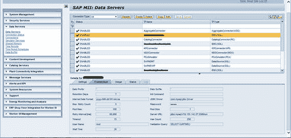

图 6-1. SAP MII 数据服务器屏幕

### 查询模板

查询模板是在 SAP MII Workbench 中通过查询进行配置的。查询可用于从数据源读取、写入、更新或删除数据。以下是 SAP MII 查询模板类型：

-   聚合

-   报警

-   OLAP

-   MDO

-   KPI 框架

-   `SQL`

-   标签

-   Xacute

-   XML

-   PCo

-   目录

以下各节将对最常用且重要的查询模板进行说明。

### 配置 SQL 查询模板

`SQL` 查询用于面向 `SQL` 的连接器，例如 `IDBC` 连接器。它用于从连接的数据库中检索和更新数据。

请按照以下步骤配置 `SQL` 查询模板：

1.  在目录选项卡中，选择项目，然后右键单击并选择新建。选择一种查询类型，例如 `SQL` 查询。请参见图 6-2。

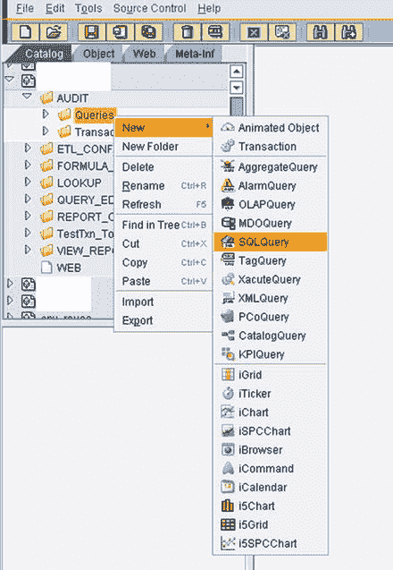

图 6-2. 创建 SQL 查询模板

2.  从可用服务器列表中选择一个服务器。此列表由在 SAP MII 管理菜单中配置的数据服务器生成。请参见图 6-3。

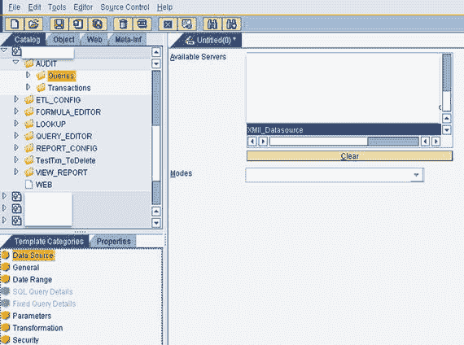

图 6-3. 选择 SQL 数据服务器

3.  从模式列表中选择查询的模式。不同类型的连接器将有不同的可用模式。请参见图 6-4。

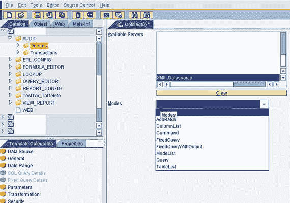

图 6-4. 从数据服务器选择模式

`SQL` 连接器具有以下模式：

-   `ColumnList`：用于检索所选数据库中特定表的列列表。

-   `Command`：当查询不期望返回结果时使用。`INSERT`、`UPDATE` 和 `DELETE` 查询可在此模式下使用。

-   `FixedQuery`：使用此模式编写复杂的 `SELECT` 查询。可以通过查询语句、参数和过滤条件，使用此模式调用特定于数据库的查询和存储过程。

-   `FixedQueryWithOutput`：用于执行返回引用作为输出的 `Oracle` 存储过程。

-   `ModeList`：所有可用于 `SQL` 的模式都将作为输出给出。

-   `Query`：用于通过选择来配置查询的不同部分，从而创建查询。

-   `TableList`：返回选定数据库中所有表的列表。

在上述定义的模式中，以下是 SAP MII 应用程序开发中最常用的模式。选择查询模式后，需要定义查询，如图 6-5 所示。

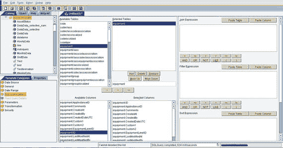

图 6-5. 查询模式屏幕

如果选择了固定查询模式，则用户需要手动编写 `SELECT` 语句，如图 6-6 所示。

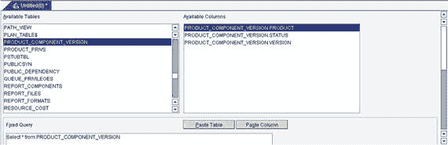

图 6-6. 固定查询模式屏幕

如果选择了命令查询模式，则用户需要手动编写 `UPDATE`/`INSERT`/`DELETE` 语句，如图 6-7 所示。

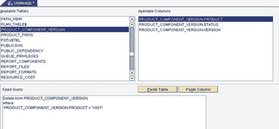

图 6-7. 命令查询模式屏幕

`SQL` 查询的各种模板类别如图 6-8 所示，并在下文进行说明。

-   **数据源**：用于选择查询的数据来源。随后会选择合适的服务器和模式。

-   **常规**：可以使用不同的属性配置查询的结果集：
    -   `RowCount`：从查询返回的最大行数。
    -   `NumberFormat`：数据值的数字格式。
    -   `CacheDuration`：查询在缓存中保留的时间。

-   **日期范围**：日期范围界面用于为时间敏感的查询分配参数。在标签和报警查询中，日期过滤器应用于时间列。在 `SQL` 查询中，日期过滤器应用于 `DateColumn`。

-   **SQL 查询详情**：用于配置查询。此处会显示表列表和列列表，如果选择了查询模式，则可以在此处编写查询语句。

-   **固定查询详情**：如果选择了查询模式以外的其他模式，则用于配置查询。

-   **参数**：用于向查询提供测试参数以进行测试。

-   **转换**：用于提供 XSL，以便根据解决方案的要求转换查询输出。

-   **安全性**：可以使用安全性界面为角色分配读取或写入权限。

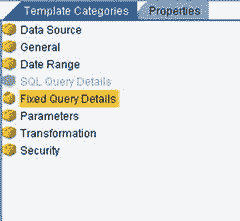

**图 6-8.** `SQL` 模板类别

要测试所形成的查询及其结果数据集，请执行图 6-9 中显示的查询。

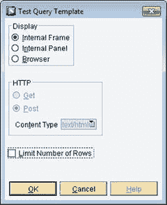

**图 6-9.** 查询模板执行选项

查询模板执行结果的显示选项如下：

-   **内部框架**：这是 SAP MII Workbench 环境中的一个内部框架，用于显示查询结果，如图 6-10 所示。

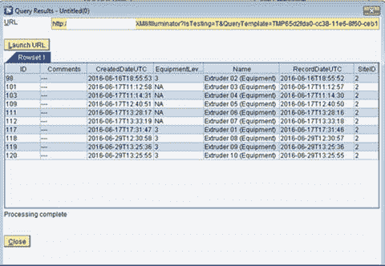

**图 6-10.** 内部框架查询执行模式

-   **内部面板**：这是一个内部面板，位于查询面板下方但仍在查询面板内部，用于显示查询结果，如图 6-11 所示。

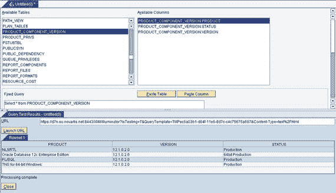

**图 6-11.** 内部面板查询执行模式

-   **浏览器**：在此处，您可以选择类型为 `text/html`、`text/xml` 或 `text/csv`，如图 6-12 所示。

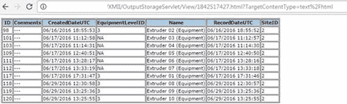

**图 6-12.** 浏览器查询执行模式

SAP MII 使用特定的 XML 结构来显示结果。它包含行集、列和迭代行。行节点包含来自查询结果的数据。图 6-13 显示了 XML 格式的查询结果。

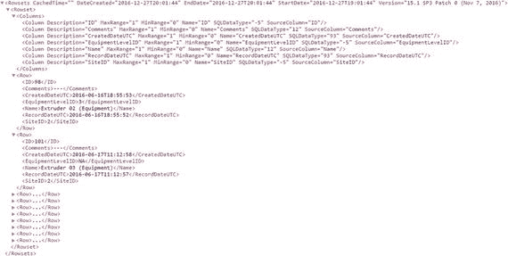

**图 6-13.** 标准 XML 查询模板结果输出

## 查询的 URL 格式

SAP MII 查询可作为独立服务在 WEB v2.0 REST 接口中使用。结果以标准的 SAP MII 格式的 XML 形式提供：

`http://<servername>/XMII/Illuminator?QueryTemplate=<Project>/<Path>/<TemplateName>`

## MDO 查询模板

MDO 查询模板用于查询 MDO 中的数据。配置 MDO 查询时，需要使用 MDO 类型连接器。它用于检索或更新 MDO 中的数据。MDO 查询也可用于连接来自两个不同 MDO 的结果。MDO 查询的结果以使用标准 SAP MII 结构的 XML 文档形式显示。

按照以下步骤配置 MDO 查询模板：

1.  在“目录”选项卡中，选择任意项目，右键单击，然后选择“新建” ➤ “`MDOQuery`”，如图 6-14 所示。

    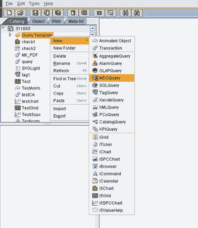
    **图 6-14.** 创建 MDO 查询模板

2.  从可用服务器列表中选择一个服务器，如图 6-15 所示。

    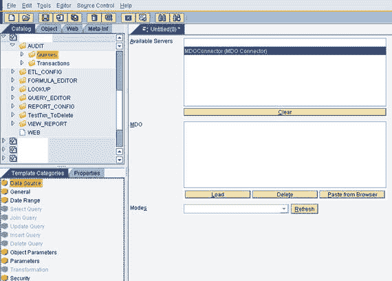
    **图 6-15.** 选择 MDO 数据服务器

3.  单击 MDO 部分中的“加载”，然后选择要操作的 MDO 对象，如图 6-16 所示。

    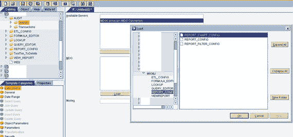
    **图 6-16.** 加载 MDO 对象

4.  现在从“数据服务器”屏幕的“模式”列表中选择模式，如图 6-17 所示。

    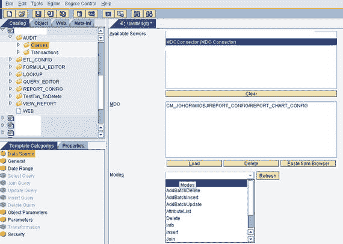
    **图 6-17.** 选择 MDO 查询模式

    以下模式可用：
    -   `AttributeList`：用于检索 MDO 属性和配置。
    -   `Delete`：用于删除 MDO 中存储的数据。
    -   `Info`：用于获取 MDO 属性。
    -   `Insert`：用于在没有数据提供程序的情况下为 MDO 插入数据。
    -   `ModeList`：用于检索 MDO 中可用的模式列表。
    -   `Select`：用于在持久化 MDO 的情况下获取持久化在 MDO 中的数据，对于按需 MDO，则从后端获取数据。
    -   `Update`：用于更新 MDO 中的数据。
    -   `Join`：返回对所选 MDO 进行 JOIN 操作的结果。返回的数据取决于 JOIN 的类型。

5.  根据所选模式，可以定义查询。对于选定的模式，以下查询选项可用：
    -   **选择查询**：如果选择的模式是选择类型，则 MDO 将配置为选择查询。可以从 MDO 的可用属性列表中选择属性。如果选择选择模式，则会出现图 6-18 所示的屏幕。

        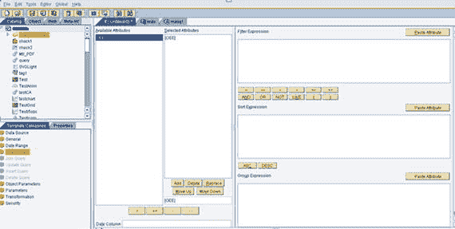
        **图 6-18.** 选择查询模式屏幕

    -   **连接查询**：如果选择的模式是连接类型，则 MDO 将配置为连接查询。它使用两个或多个持久化 MDO。可以应用两种类型的连接——内连接和左外连接——并且根据连接类型获取结果。见图 6-19。

        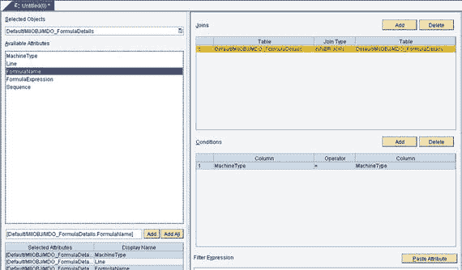
        **图 6-19.** 连接查询模式屏幕

    -   **更新查询**：如果选择的模式是更新类型，则 MDO 将配置为更新查询。这用于更新 MDO 的列出属性。见图 6-20。

        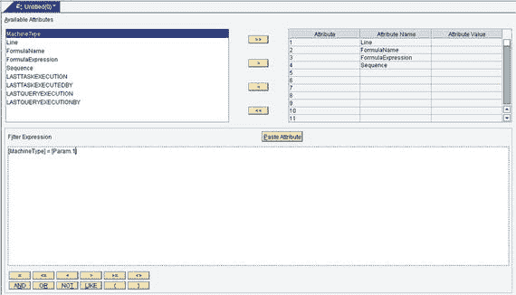
        **图 6-20.** 更新查询模式屏幕

    -   **插入查询**：如果选择的模式是插入类型，则 MDO 将配置为插入查询。这用于在没有数据提供程序的情况下向 MDO 插入数据，如图 6-21 所示。

        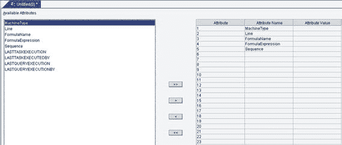
        **图 6-21.** 插入查询模式屏幕

    -   **删除查询**：如果选择的模式是删除类型，则 MDO 查询将配置为删除查询。这用于从 MDO 中删除数据，如图 6-22 所示。

        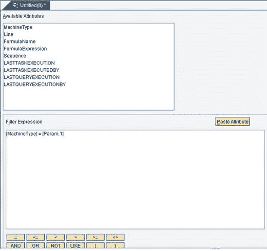
        **图 6-22.** 删除查询模式界面

6.  可在 MDO 查询中配置多种模板类别，如图 6-23 所示。
    *   **数据源**：从可用服务器列表中选择一个服务器。这些服务器配置了 MDO 连接器类型。然后加载查询中所需的 MDO。由于可以配置 JOIN 查询，因此可以配置单个或多个 MDO。随后选择查询模式。
    *   **常规**：可使用不同属性配置查询的结果集：
        *   `RowCount`：查询返回的最大行数
        *   `NumberFormat`：数据值的数字格式
        *   `CacheDuration`：查询在缓存中保留的时间
    *   **日期范围**：日期范围界面用于为时间敏感型查询分配参数。在标签和报警查询中，日期过滤器应用于时间列。在 SQL 查询中，日期过滤器应用于 `DateColumn`。
    *   **参数**：用于为查询中使用的参数提供值。
    *   **安全性**：您可以使用安全性界面为 MDO 分配具有读取或写入权限的角色。

    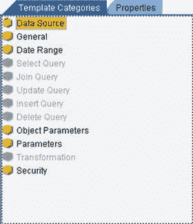
    **图 6-23.** MDO 查询中的模板类别

7.  测试并执行查询结果。见图 6-24。

    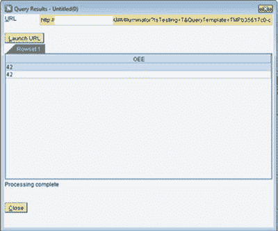
    **图 6-24.** MDO 查询执行结果界面

## PCo 查询模板

PCo 查询模板可用于连接到 SAP PCo 服务器，并利用 PCo 标签和编写简单的 SQL 查询语句从中获取详细信息。此查询模板支持 PCo 连接器。

请按照以下步骤配置 PCo 查询模板：

1.  从“目录”选项卡中，选择一个项目，然后右键单击并选择 “新建” ➤ “`PCoQuery`”，如图 6-25 所示。

    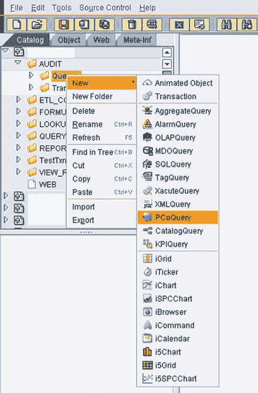
    **图 6-25.** 创建 PCo 查询模板

2.  从数据源界面的可用服务器列表中选择一个服务器，如图 6-26 所示。

    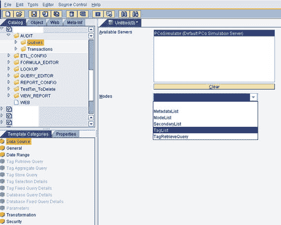
    **图 6-26.** PCo 查询模板中的数据源界面

3.  选择 `TagList` 后，双击 “模板类别” 选项卡中的 “标签选择” 详细信息，如图 6-27 所示。

    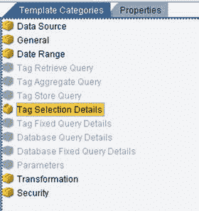
    **图 6-27.** 从模板类别选项卡中选择标签选择详细信息

    从左侧选择所需标签并添加到右侧，以从这些标签获取预期结果，如图 6-28 所示。

    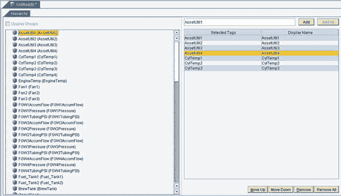
    **图 6-28.** 在标签选择详细信息界面中配置标签

4.  测试并执行查询结果，如图 6-29 所示。

    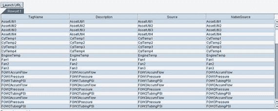
    **图 6-29.** 标签选择模式查询结果

## XML 查询模板

此查询模板默认使用 XML 连接器。该查询模板可以返回提供给它的任何 URL 的 XML 输出。例如，如果需要使用特定逻辑执行 illuminator 服务，可以在 XML 查询模板中配置 illuminator URL 以返回 XML 输出，此 XML 可进一步用于业务逻辑事务。见图 6-30。

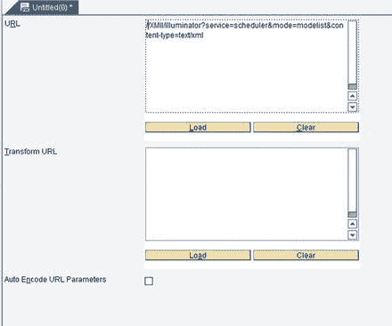

图 6-30. 提供 XML 查询模板 URL

**注意**：在 XML 查询模板中提供 URL 时，最好不要使用主机和端口 URL，因为在迁移或主机/服务器发生任何更改时，您需要手动在代码中修改此项。对于外部 URL，最好使用 `//` 代替主机和端口。对于内部 URL（对象从 MII 工作台的 Web 选项卡调用），最好使用 `web://` 或 `server://`。

### Xacute 查询模板

此查询模板使用 Xacute 连接器连接到直接从 UI 调用的任何业务逻辑事务。它只能使用标准的 BLS XML 输出作为输入来执行，如图 6-31 所示。

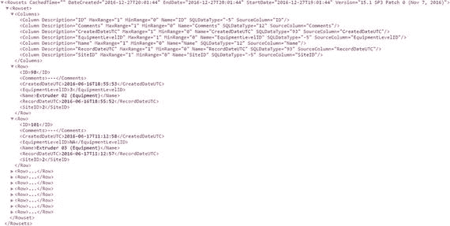

图 6-31. SAP MII BLS 标准 XML 输出

Xacute 查询模板提供以下可用模式选项（见图 6-32）：

*   `ModeList`：检索 MDO 中可用的模式列表。
*   `Query`：提供指向 BLS 的链接，并定义查询模板结果的输入和输出参数。默认情况下，对于 BLS 中声明的多输出类型变量，下拉列表中的输出参数为 `*`。此外，开发人员可以选择需要从查询模板输出中显示的 BLS 中的特定输出变量。
*   `TargetFolderList`：列出目标服务器上存在的所有文件夹。
*   `TransactionFolderList`：列出目标服务器上存在的所有事务文件夹路径。
*   `TransactionInputList`：提供业务事务的输入详细信息。
*   `TransactionList`：列出所有事务对象及其路径。
*   `TransactionOutputList`：提供业务事务的输出详细信息。

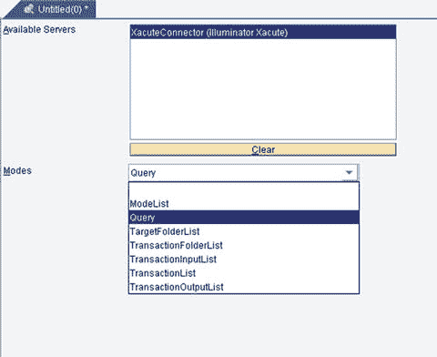

图 6-32. Xacute 查询模式

最常用的模式是 `Query` 模式。如果选择了查询模式，您将看到如图 6-33 所示的界面。

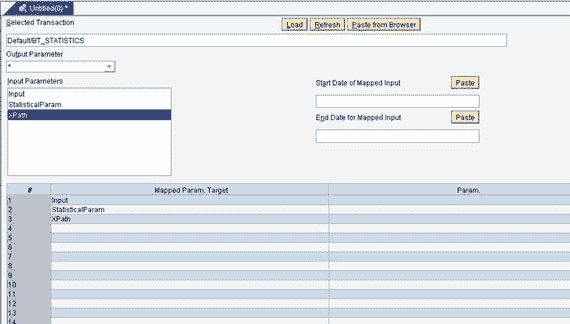

图 6-33. Xacute 查询的查询模式界面

## 使用业务逻辑服务集成 SAP MII

在进行与这些不同系统的集成工作之前，MII 开发人员需要对 SAP MII 业务逻辑服务有良好的基础理解，了解如何开发 BLS，并熟悉创建 BLS 所需的最常用操作块。随后将解释最常见的集成场景。

### 什么是业务逻辑服务？

`SAP Manufacturing Integration and Intelligence` 是 SAP 提供的一个平台，主要用于与制造执行系统和企业系统集成，充当集成的中间件。除此之外，`SAP MII` 也可用作定制化集成的平台。借助最新的 SAP UI 技术（`UI5`），`MII` 作为后端平台，负责放置逻辑以向前端 `SAP UI5` 提供数据，而 `SAP UI5` 则以用户友好且可呈现的方式显示数据。

在此环境中，逻辑开发非常通用，采用拖放式编码，被称为 `MII 事务` 或 `业务逻辑服务`（`BLS`）。`BLS` 是一种以图示方式编写逻辑的方法，其中的逻辑由某些称为 `MII` 中动作块的特定块构成。这些块具有独特的功能，并服务于单一的业务需求。这些块遵循从左到右的执行流程。

在 `SAP MII 事务` 中，可以实现任何类型的业务逻辑。它可以包含用于查询数据库以执行 `INSERT`、`UPDATE` 和 `DELETE` 操作的逻辑，也可以包含用于与 `SAP ECC`、`SAP ME` 或 `SAP OEE` 系统集成的逻辑。甚至 `HTTP POST`、Web 服务、电子邮件、`FTP` 和消息队列集成都是可能的，只要拥有针对特定系统的相应连接器。

此外，`SAP MII 事务` 动作块有两个部分——一个是配置部分，另一个是链接编辑器，包含编辑器函数和运算符部分，用于修改逻辑。除了 `SAP MII` 标准动作块外，它还允许用户灵活添加自定义动作块，可以从 `SAP MII` 管理页面中的 `系统资源 ➤ 自定义动作` 添加。添加自定义动作需要进行一些设置，例如需要正确实现自定义动作的 `BLSSDK` 和 `MII Jar` 文件。这为用户提供了广泛的灵活性，可以根据制造应用的技术需求开发逻辑。

`SAP MII 事务` 可以从 `SAP MII 工作台` 手动执行以测试逻辑。除此之外，还有多种其他方法，如下所示：

- 基于某些逻辑条件或事件，使用 `SAP MII 调度器` 按计划执行
- 通过外部 `URN`（使用 `Xacute Query` 的 `Runner 服务` 或 `Illuminator 服务`）或 Web 服务（`SOAP`）请求从网页执行
- 从另一个 `SAP MII 事务` 同步或异步执行

在架构方面，`SAP 事务` 使用 `XML` 和 Web 服务框架。Web 服务/`SOAP` 请求和 `XML` 数据结构可以通过适当的功能进行暴露。Web 服务器上安装了引擎，其余编辑器则从独立机器上的 `SAP MII BLS` 菜单动态加载，并具有正确的 `JRE` 设置。Web 服务器将 `SAP MII 事务` 存储为 `XML`，以及其他配置（如全局属性、模式等）。

### 创建 BLS

可以在 `SAP MII 工作台` 中创建 `SAP MII 事务`，但必须先打开 `SAP MII 工作台`。

1.  选择 `MII 管理 ➤ 内容开发 ➤ 工作台 ➤ 文件 ➤ 新建 ➤ 事务`，如图 6-34 所示。
    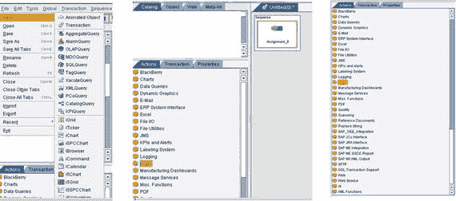
    图 6-34. 创建 `SAP MII BLS`（事务）的基本组件

这些显示了基本的 `SAP MII 事务` 创建组件。最右侧的图显示了所有文件夹，所有可能的动作都归入其中。这些动作是创建事务所涉及逻辑的构建块。任何逻辑都需要基本的输入或输出参数才能工作。类似地，`SAP MII 事务` 也有一些参数（参见图 6-35）。共有三种类型的参数：

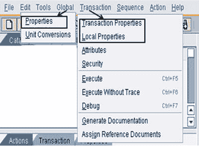

图 6-35. 在 `SAP MII BLS` 中创建变量时可用的属性

- `全局`：对所有项目全局有效。
- `事务`：特定于某个事务，主要用于输入和输出。
- `局部`：事务内部的局部变量。用于内部逻辑执行的参数。

### 常用动作块

为了详细说明 `SAP MII 事务` 的功能，动作块便应运而生，因为它们是任何 `SAP MII` 逻辑（`BLS`）的构建块。每个类别都有许多可用的动作。图表类别包括显示分析动作，数据查询类别包括查询动作块，日志记录类别包括用于在任何断点处记录数据的动作，逻辑类别包括要实现的基本逻辑等。

### 逻辑

此文件夹包含逻辑操作块，这些块是主逻辑实现所必需的。`赋值` 操作块用于将前一个输出的数据值分配给任何局部变量或事务变量。`交换机` 操作块用于根据切换条件切换到多个逻辑。它包含 `for 循环`、`重复器` 或 `迭代器` 操作块，用于根据需要循环处理 XML 节点。它还包括处理异常所必需的操作块，例如 `异常启用器` 以及 `抛出` 和 `捕获` 块。图 6-36 展示了逻辑文件夹中可用操作块的一瞥。

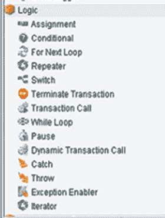

图 6-36. 逻辑操作块

每个操作块根据其执行过程需要不同的输入并提供不同的输出。

*   **赋值操作**：此操作块用于为事务属性赋值。此操作无需配置，也无需填写输入字段。相反，您可以在此操作中分配一个属性，或包含编辑器操作符或函数来修改它们。参见图 6-37。
    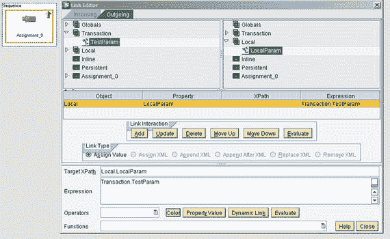
    图 6-37. 赋值操作块

在配置操作块时，有不同类型的链接交互和链接类型可用。有关更多详细信息，请参考图 6-38。
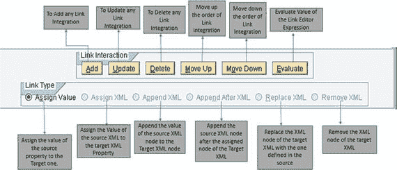
图 6-38. 在任何操作块中配置链接选项

*   **条件操作**：此操作用于评估所配置的任意数量的条件，然后根据执行的逻辑将逻辑导向真或假。参见图 6-39。
    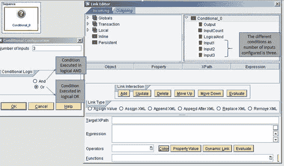
    图 6-39. 条件操作块

### SAP MII 操作块

本节介绍 SAP MII Business Logic Services 中的各种操作块。

#### 控制流操作块

*   **重复器操作块**：用于在作为 `XPATH` 提供的输入（该输入在 XML 中是重复的）的 XML 节点上进行重复。当在特定节点上重复时，输出会获取子节点的值。参见图 6-40。

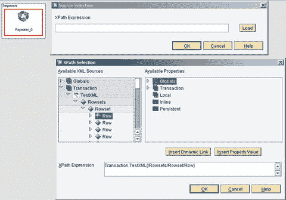

图 6-40. 重复器操作块

*   **For Next 循环操作块**：用于按指定次数执行一系列操作块。它类似于常用编程语言中的 `for` 关键字。参见图 6-41。

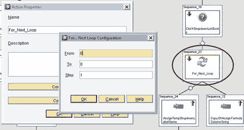

图 6-41. For Next 循环操作块

*   **交换机操作块**：用于基于变量控制 BLS 事务中的执行流，该变量可以是另一个操作块的属性、事务属性和局部属性。参见图 6-42。

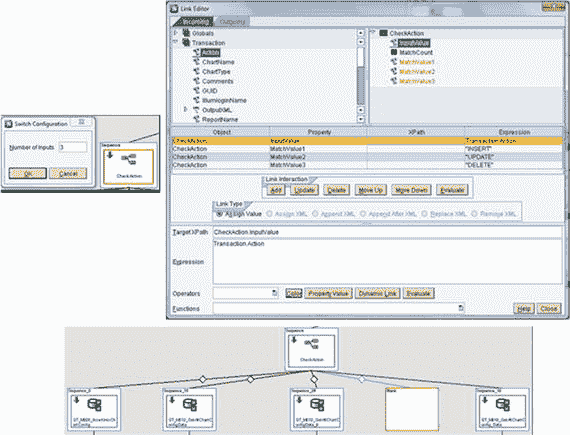

图 6-42. 交换机操作块

*   **事务调用操作块**：用于从另一个事务中调用并执行一个驻留在同一 MII 服务器中的预定义事务。此操作块允许您在 MII 中创建一些可重用的功能。参见图 6-43。

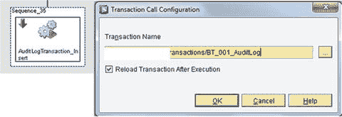

图 6-43. 事务调用操作块

需要执行的事务可以在配置屏幕中浏览并选择，字段为 `事务名称`，或者整个事务路径也可以在此操作块的链接编辑器中进行映射。要在每次执行后重新加载并刷新事务，请勾选名为 `执行后重新加载事务` 的复选框，如图 6-43 所示。通过将 `异步` 属性设置为 `true` 或 `false`，BLS 可以分别被异步或同步调用。参见图 6-44。

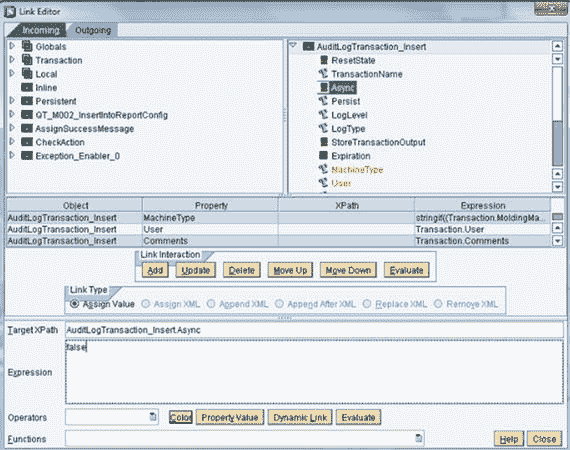

图 6-44. 设置事务调用操作块的 `异步` 属性

*   **动态事务调用操作块**：用于从嵌套事务调用中调用另一个事务。这与事务调用操作块类似。唯一的区别是事务属性可以被添加、删除和映射。当使用动态事务调用操作块时，字段可以动态更改。参见图 6-45。

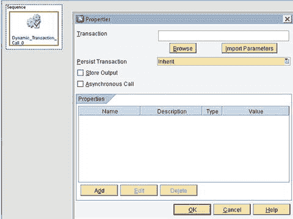

图 6-45. 动态事务操作块

*   **迭代器操作块**：用于重复处理列表变量的数据。它类似于重复器，但重复器是在 XML 节点上进行重复，而它是在列表变量上进行重复。它需要一个列表类型的变量作为其输入，如图 6-46 所示。

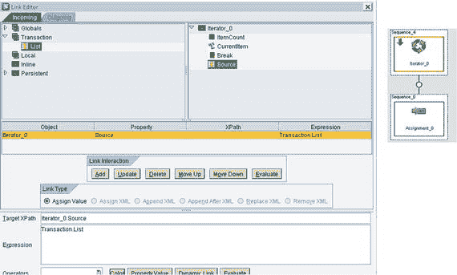

图 6-46. 迭代器操作块

#### 异常处理操作块

*   **异常启用器操作块**：启用在业务逻辑执行期间记录任何类型的异常。此操作用于向开发者指示异常处理模型已在运行时更改。
*   **抛出操作块**：抛出由于开发者想要记录的某些异常而发生的任何类型的错误。这用于将事务置于异常状态，这将导致所有操作被跳过，直到到达捕获操作或到达事务结束。
*   **捕获操作块**：在执行过程中的任何点捕获错误。当事务处于异常状态时，事务会跳过所有操作，直到到达捕获操作，或者直到事务结束。

从概念上讲，异常处理类似于任何其他面向对象编程的异常处理概念。参见图 6-47。

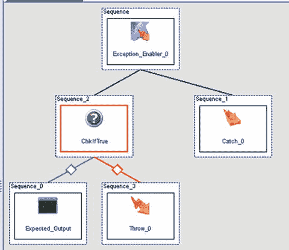

图 6-47. SAP MII 中的异常处理

#### 日志操作块

此类别包含用于在 BLS 逻辑之间进行记录的操作。请参考图 6-48 了解“日志记录”下可用的操作块。


图 6-48. 日志记录操作块

主要有三种操作。第一个是 `Tracer` 操作块，用于在从 Workbench 运行 BLS 事务时，通过在跟踪窗口中显示任何消息或值来调试 BLS 事务。见图 6-49。

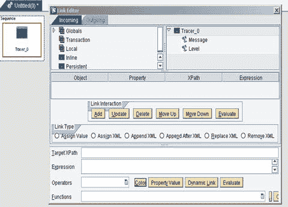

图 6-49. 跟踪器操作块

`Message` 操作块在调试期间向 MII 开发人员提供相关消息。`Level` 操作块提供用于在调试期间定义跟踪级别的选项，如图 6-50 所示。

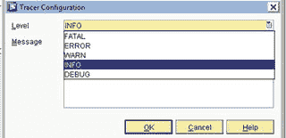

图 6-50. 跟踪器中的级别类型

`INFO` 提供与操作块中使用的参数相关的信息。`FATAL` 仅在 BLS 执行期间捕获到致命错误时返回相关消息。`WARN` 仅返回 BLS 执行期间发生的警告信息。`DEBUG` 返回 BLS 执行期间操作块的中间调试步骤详细信息。`ERROR` 返回 BLS 执行期间发生的任何错误消息。默认情况下，选中 `INFO` 级别类型。

除此之外，还提供了 `XML Tracer`。它用于创建自定义日志或跟踪文件，以便仅将来自 BLS 事务的 XML 消息记录到文件中，如图 6-51 所示。

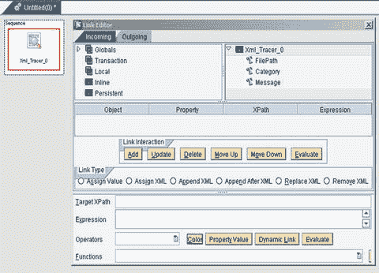

图 6-51. XML 跟踪器操作块

`FilePath` 选项提供开发者希望写入 XML 跟踪内容的 Web 文件路径。`Message` 选项提供需要写入文件的相关消息。

可以使用 `Event Logger` 在 NetWeaver 日志中跟踪消息记录，如图 6-52 所示。

- `Message`：提供需要写入 NetWeaver 日志的相关消息。
- `Source`：定义日志记录源信息，例如任何唯一标识，以便开发人员可以在 NetWeaver 的日志查看器中使用该关键词搜索日志记录信息。默认情况下，源被定义为 `UserEvent`。
- `EventType`：定义要在 NetWeaver 中记录的事件类型，如图 6-53 所示。


图 6-53. 事件记录器中的事件类型


图 6-52. 事件记录器操作块

`INFO` 提供与操作块中使用的参数相关的信息。`FAILURE` 仅在异常类型为“failure”时返回相关消息。`WARN` 返回 BLS 执行期间发生的警告信息。`DEBUG` 返回 BLS 执行期间操作块的中间调试步骤详细信息。`ERROR` 仅在异常类型为“error”时返回相关的错误消息。默认情况下，选中 `INFO` 级别类型。

### SAP MII XML 输出

SAP MII 使用 XML 工作。XML 具有标准格式，遵循 `rowsets/rowset/row` 格式。见图 6-54。


图 6-54. SAP MII XML 输出操作块：标准输出 XML

这些操作块（如图 6-55 所示）使创建 SAP MII 特定的标准 XML 变得更加容易：

- `Document` 操作块：定义 XML 结构的主要操作块，其中将列分配为其可能的数据类型、数据类型的长度等。见图 6-56。


图 6-56. 文档操作块

- `Rowset` 操作块：在由 `Document` 操作块定义的 XML 文档中添加一个 `Rowset` 元素。
- `Column` 操作块：在由 `Document` 操作块定义的 XML 文档的行集下添加一个新的列定义。见图 6-57。


图 6-57. 列操作块

- `Row` 操作块：在由 `Document` 操作块定义的 XML 文档中添加数据行，作为 `<Row>` 元素及其子元素。见图 6-58。


图 6-58. 行操作块配置

# SAP MII 数据查询与ERP集成

## 数据查询模板

`Data Queries` 模板包含所有查询类型的操作块，这些操作块可通过 SAP MII 中的 `Query` 模板功能创建。其中包括 `SQL`、`MDO` 以及更多其他类型，如图 6-59 所示。


图 6-59. 数据查询操作块

要添加和配置此操作，首先需要选择一个空白序列，然后双击或拖拽所需操作到该序列上。例如，以 `SQL Query Data Queries` 为例。将 `SQL query` 拖拽到空白序列上。您也可以选中空白序列，然后双击 `Query` 操作块。参见图 6-60。


图 6-60. 创建数据查询

对此操作进行配置时，您有两种选择。您可以直接双击特定的查询操作块，选择 `Configure Objects` 选项，如图 6-61 所示。


图 6-61. 选项 1：配置数据查询

当您右键点击查询时，会出现 `Configure` 选项，如图 6-62 所示。


图 6-62. 选项 2：配置数据查询

接下来，会出现一个配置查询的屏幕（参考图 6-63），当您点击 `Load` 按钮时，会显示一个查询列表，您可以从中选择所需的查询。


图 6-63. 查询配置屏幕

配置好查询对象后，点击 `Links`（参见图 6-62）或点击 `Configure Links`（参见图 6-61），如图 6-64 所示。


图 6-64. 配置链接屏幕

链接有助于在 BLS 运行时执行过程中，根据需求动态分配查询参数。除此之外，还可以创建动态查询语句并将其链接到 `Query`，然后根据查询模板可用的模式列表分配查询模式。

用户可以动态创建过滤表达式（`FilterExpr`）、连接表达式（`JoinExpr`）和分组表达式（`GroupingExpr`），从而减少硬编码或静态值以及查询表达式。这使得逻辑可以调用更少的操作块，因为同一个查询模板可以通过传递动态参数来重用。这反过来又有助于优化逻辑并提高效率。

例如，假设您要查询名为 `User` 的表，该表包含 `ID`、`name`、`country`、`address`、`contact_no` 和 `e-mail` 列。有两种方法可以从表中检索数据：

*   仅检索国家为印度的数据。
*   检索 `ID` 在 12 到 99 之间且姓名为空的数据。

为了处理这两种情况，您可以不必编写两个 SQL 查询模板，而是使用一个查询模板，同时动态传递表达式。

查询模板在 `Fixed Query` 模式下创建并保存。接着，需要通过 `Configure Links` 屏幕将下述 `query` 语句动态链接到 `Query` 参数。

```
语句 : 场景 1 : SELECT * FROM User WHERE User.country = 'India'
场景 2 : SELECT* FROM User WHERE User.ID BETWEEN 12 AND 99 AND User.name IS NULL
```

当使用 `Query` 模式创建并保存查询模板后，需要从 `Configure Links` 屏幕维护以下配置：

1.  需要将 `User` 表链接到 `Tables` 参数。
2.  需要将对应的列名（逗号分隔的列名）链接到 `Columns` 参数，例如 `ID`、`name`、`country`、`address`、`contact_no` 和 `e-mail`。
3.  需要将过滤条件链接到 `FilterExpr`。在场景 1 中，它将是 `User.country = 'India'`；在场景 2 中，它将是 `User.ID BETWEEN 12 AND 99 AND User.name IS NULL`。

与 SQL 查询类似，这种方法对于代码优化是可行且有益的。

## 将 SAP MII 与 ERP (SAP ECC) 集成

如开头所述，ECC 集成是制造车间和中件层的主要需求之一。以下部分解释了为什么需要这种集成，以及如何使用 SAP MII 创建无缝集成。

### 为什么制造业需要 ERP (SAP ECC)？

如前所述，ERP 是企业计划系统，意味着高层级的业务规划在 ERP 中完成。与其他行业一样，制造业遵循一些标准步骤来运作。这些步骤包括：规划、按需求下达订单、根据创建的订单生成 BOM（物料清单），同时，还需要进行主数据管理以维护物料分类、工艺路线、工作中心等。之后，订单详情连同 BOM 和主数据一起传递给车间生产和仓库。这确保了从仓库的物料转移和车间生产执行过程能够正确进行。

必须按照 BOM 和主数据中定义的操作、组件和步骤执行。一旦制造过程完成，包括良品数量和废品在内的生产数量会更新到 ERP 中。成本分析和装运处理信息需要从 ERP 传递给车间。一旦装运完成，这些信息需要更新回 ERP。

要完成这个制造周期，需要在 ERP 中的多个模块之间进行协作，包括 `PP`（生产计划）、`MM`（物料管理）、财务与会计（`FICO`）、供应链、装运、销售、仓库管理等。SAP ECC 是 SAP 的一款产品，它将所有这些模块作为一个 ERP 包在内部集成在一起。

### 将 SAP ECC 与车间集成

另一个集成需求是填补 ECC 与车间制造之间的差距，以便实时传递规划信息。SAP MII 可以集成这两者，并实时双向传递数据。SAP MII 提供了一些额外的安全层（如访问限制、加密等）和智能功能（如报表、实时状态监控、确认处理等）。

### 将 SAP MII 与 SAP ECC 集成

SAP MII 可以通过两种方式与 SAP ECC 集成（参见图 6-65）：


图 6-65. ECC 与 MII 之间的信息流

*   使用 `IDOC`：`IDOC` 是 SAP 的一种中间文档，用于在两个 SAP 系统之间或从一个 SAP 系统到另一个非 SAP 系统之间传输数据。`IDOC` 会根据 `IDOC` 类型生成一个增强的 XML 结构，供系统使用。SAP MII 提供了标准功能，可以接收 `IDOC` XML 并按需处理。
*   使用 `RFC`（ `BAPI` ）：`BAPI` 包含 SAP ECC 中的标准或自定义函数模块。函数模块是在 SAP 系统中定义的程序。它们用于将 SAP 数据暴露给非 SAP 系统。当一个函数模块被启用为可远程访问的函数模块时，它被称为 `BAPI`（业务 API）。

#### 使用 IDoc 集成 SAP ECC 与 MII

SAP ECC 可以通过 IDoc 将消息推送到 MII，但在 SAP MII 中接收消息之前，需要在 MII 端完成一些配置。请按照以下步骤操作：

1. 在 NetWeaver 中配置消息监听器。该监听器保存了 ECC 端的配置，例如唯一的程序 ID、客户端、主机等。SAP MII 有 10 个专用的 IDoc 监听器。要进行配置，请访问 `http://<host>:<port>/nwa`。

2. 导航至 `配置管理` > `基础设施` > `应用程序资源`，如图 6-66 所示。


图 6-66. 配置管理

3. 点击 `应用程序资源` 链接，进入如图 6-67 所示的界面。


图 6-67. 应用程序资源界面

4. 在资源名称中输入监听器的名称，例如 `XMIIIDOC01`，然后按 Enter 键。从列表中选择要配置的 `资源适配器`。

5. 屏幕底部区域将显示监听器的详细信息。点击`属性`选项卡进行配置。你需要填写`ProgramID`、`User`、`Password`、`Language`、`SAPClient`、`ServerName`和`portNo`字段。

6. 导航至 SAP MII 菜单页面。进入`消息服务` ➤`消息监听器`。选择所需的监听器，然后点击`更新`按钮，如图 6-68 所示。


图 6-68. 消息监听器

通过这些步骤，可以接收 IDoc 消息，并进一步将其存储在 SAP MII 的内部表中。现在你需要了解如何处理 IDoc 消息。为此，需要进行另一种配置，称为处理规则（见图 6-69）。


图 6-69. 消息处理规则

在 SAP MII 中，可以定义两种类型的处理规则：

- **基于类别的处理规则**：为消息类型定义一个唯一的类别。使用此规则的好处是，从 ECC 推送到 MII 的每条消息都会被标记一个唯一的标识 ID，这有助于随时从 MII 逻辑中召回该消息。无需将消息单独存储在另一个数据库中。只需存储消息 ID，即可用于召回消息。使用此规则的另一个好处是，可以唯一地识别和监控每条消息的状态，因为此规则的处理不是自动的，开发者可以根据`categorized`状态定义逻辑，以确定何时拾取消息、拾取频率以及消息类型的优先级。消息状态需要按如下方式更新：

```
RECEIVED=1
PROCESSED=2
FAILED=3
NORULEDEFINED=4
RUNNING=5
CATEGORIZED=6
```

其中，数字在 MII 逻辑中用于表示相应的状态。通常，为了处理基于类别的处理规则，必须使用一个 MII 事务来调度一个调度程序，该程序可以根据 BLS 中编写的逻辑定期检查队列中是否有任何新消息。

- **基于事务的处理规则**：此处理规则直接链接到一个 BLS。每当特定消息类型的新消息到达特定监听器时，BLS 会自动触发并立即处理该消息。此规则不存在消息 ID 的概念。

要处理基于类别的消息处理，需要在 BLS 中调用以下动作块：

- `查询消息`动作块：通过一组选择条件查找缓冲消息列表。

- `读取消息`动作块：读取由消息服务接收并缓冲的消息内容。

- `更新消息`动作块：更新缓冲消息的状态和状态文本，可能是在 BLS 事务进行临时处理之后。

- `删除消息`动作块：从 SAP MII 数据库中删除缓冲消息。与`读取消息`和`更新消息`动作块类似，此动作块也没有对象配置，只需在其链接配置中指定`MessageId`即可。

- `投递消息`动作块：将消息直接投递到同一个 MII 服务器实例中。

## 使用 RFC (BAPI) 集成 SAP ECC 与 MII

SAP MII BLS 提供了一些强大的动作块来连接到 SAP ECC，以检索或写入来自车间层的数据。这种与 ECC 的集成由 SAP JCo 或 JRA 动作提供，用于执行 BAPI 以连接到 SAP 系统。参见图 6-70。


图 6-70. SAP JCo 和 JRA 接口动作块

要配置 SAP 服务器别名，需要使用 SAP MII`数据服务` ➤`连接`菜单选项打开别名编辑器，如图 6-71 所示。


图 6-71. MII 连接界面

点击`创建`按钮以创建新别名。你可以从下拉菜单中选择`JCo`。你必须指定一个唯一的名称、可选的描述以及服务器主机名或 IP 地址。还必须为正在创建配置的服务器指定连接器特定的属性。可以使用`复制`按钮复制现有配置，使用`删除`按钮删除配置。

接下来，为正在创建的 SAP 连接创建凭证访问，如图 6-72 所示。


图 6-72. 凭证存储

SAP MII 中的 JRA 和 JCo 动作块都可以通过 BAPI 连接到 SAP ECC，但由于 SAP JCo 动作块更常用，本章仅介绍该动作块。

### SAP JCo 接口动作块

最常用的调用 BAPI 的动作块是`JCo接口`动作块，无需任何会话处理。SAP JCo 接口动作用于从 ERP 服务器创建到 SAP Java 连接器 (JCo) 接口的连接，并创建一个远程函数调用 (RFC) 请求来执行 BAPI。参见图 6-73。


图 6-73. JCo 接口动作块

必须填写以下选项：


图 6-74. 在 JCo 动作块中配置 BAPI

- **连接别名**：从此下拉菜单中，你可以选择在步骤 1 中创建的 SAP 连接。然后，SAP 服务器、客户端和系统编号将自动填充。

- **凭证别名**：你可以选择针对该连接设置的特定凭证。

- **RFC 名称**：可以使用搜索模式选项进行搜索，然后从列表中选择所需的 BAPI。

必须配置这些选项才能执行 BAPI 并在 BLS 中进一步处理。也可以使用`SAP JCo函数`动作块来调用 BAPI，但它适用于会话处理逻辑（即`SAP开始会话`和`SAP结束会话`动作块）。

# 将 SAP MII 与 SMTP 服务器集成

简单邮件传输协议（SMTP）是一种用于电子邮件传输的互联网标准。以下部分详细说明了如何在 SAP MII 中使用 SMTP。

可以在 SAP MII 菜单中通过选择`Connections`来配置 SMTP 服务器，如图 6-75 所示。


图 6-75. SMTP 服务器连接配置

凭据的维护方式与 JCo 连接类型所述类似，可从凭据存储中进行。这是为了在需要发送任何通知时，能够根据要求向收件人发送电子邮件。为满足此需求，SAP MII 在电子邮件类别下包含了操作块，如图 6-76 所示。


图 6-76. 电子邮件操作块

这会向通过 SMTP 服务器指定的收件人发送电子邮件。执行此操作所需的配置必须预先在连接部分中配置好，并且在 SAP MII 事务中配置电子邮件操作块时可以选择该配置。要配置此操作块，必须在 SAP MII 管理控制台中进行强制性的几项配置。一项是连接详细信息，另一项是登录邮件服务器的凭据。SMTP 邮件服务器的详细信息也必须可访问，此功能才能正常工作。共有两个操作——一个用于发送电子邮件，另一个用于从 SAP MII 事务中读取电子邮件。

发送邮件操作块的不同属性如图 6-77 所示。


图 6-77. 发送邮件操作块

同样，读取邮件操作块也有不同的属性，需要在使用该操作块读取邮件之前进行设置。其配置与发送邮件类似，如图 6-78 所示。


图 6-78. 读取邮件操作块

# 将 SAP MII 与 Web 协议集成

SAP MII 可以使用标准 Web 协议（如 Web 服务和 HTTP POST）与其他遗留系统集成。SAP MII 内置了专门用于调用 Web 服务的操作块，也可以向服务器实例发送消息。

## Web 服务操作块

该操作块通过发送和接收 SOAP 消息，使用其 WSDL URL 来执行 Web 服务。Web 服务操作块需要使用 WSDL、身份验证和连接详细信息等信息进行配置。参见图 6-79。


图 6-79. Web 服务配置向导

请按照以下步骤配置 Web 服务操作块：

1. 在配置向导的 URL 字段中输入 WSDL 后，单击`Next`按钮。

2. 根据需求，设置身份验证和连接详细信息。

3. 在下一个视图中，需要从可用的端口中选择所需的端口。参见图 6-80。
   
   图 6-80. Web 服务中的端口选择

4. 在下一个视图中选择端口后，需要选择操作，如图 6-81 所示。
   
   图 6-81. Web 服务中的操作选择

5. 单击 `Finish` 按钮。Web 服务配置现已完成。Web 服务的请求和响应结构将出现在链接编辑器中，如图 6-82 所示。
   
   图 6-82. Web 服务请求和响应结构

### HTTP POST 操作块
HTTP 代表超文本传输协议，用作协作式、分布式信息系统之间的应用层协议。
从 SAP MII 门户启动工作台。在左下角的“操作”选项卡上，有一个名为 `Web` 的操作菜单项。所有 HTTP 操作块都在其下可用，如图 6-83 所示。

图 6-83. Web 操作块

HTTP POST 操作块可以执行以下功能（参见图 6-84）：
* 将文档发布到特定 URL 并进行处理
* 调用没有有效 WSDL 定义的 Web 服务
* 从 RSS 源读取信息

图 6-84. HTTP POST 操作块

可用的属性如下：
* `URL`：文档需要发送到的 URL。
* `Post Data`：要发布的文档
* `UserName`：访问 URL 的凭据
* `User Password`：访问 URL 的凭据
* `Content Type`：取决于文档和 URL 接受的类型
* `ReturnAsString`：以字符串形式存储返回结果
* `ReturnAsXML`：如果期望返回 XML，则存储 XML
* `UseDestinationService`：强制使用指定的目标服务

## 将 SAP MII 与文件系统集成
文件 I/O 文件夹包含所有处理文件输入和输出的操作块（参见图 6-85）。使用这组操作块，您可以在工作台中写入和删除文件以及创建目录。还有一些操作块用于使用文件传输协议从外部源读取文件。平面文件和高级平面文件解析器是用于解析平面文件的操作，通过它们可以将 CSV 输入解析为具有不同结构的 XML。

图 6-85. 文件 I/O 操作块

### 获取文件列表操作块
此操作块检索指定文件夹下的文件列表。文件夹路径可以是网络共享驱动器、本地驱动器文件夹（MII 服务器安装的位置），或者需要指定 MII 工作台的 Web 选项卡。如果需要获取特定文件类型，则可以使用掩码功能提供特定的文件扩展名。SAP MII 支持以下文件类型：`.csv`、`.txt` 和 `.xml`（或任何类型的平面文件）。参见图 6-86。

图 6-86. 获取文件列表操作块

### 写入文件操作块
在本组所有操作中，这是最常见的操作块，使用频率很高。此操作用于写入文件，可以创建新文件并写入内容，或追加内容到已有文件中。链接编辑器和配置屏幕具有以下属性。需要提供的路径是文本文件的链接，如图 6-87 所示。

图 6-87. 写入文件操作块

Web 文件夹路径以 `WEB://<ProjectName>/<FileName>` 的形式提供。根据文件情况，模式必须设置为 `CREATE` 或 `APPEND`。可用文本是要写入文件的内容，路径则指文件路径。

当执行`写入文件操作块`时，文件通常会在工作台的 Web 选项卡下，按照配置中指定的路径创建。MES 仅与文件系统配合工作，在这种情况下，`写入文件操作块`用于将文件写入 MES 目标文件夹。`使用 BOM` 复选框允许您在文件前面写入 UTF-8 的字节顺序标记，并且仅在创建文件时适用。对于某些程序（如 Microsoft Excel）来说，BOM 是必需的，以便它们能识别包含 Unicode 字符的 UTF-8 CSV 文件。

`写入文件`操作块也用于在需要直接跟踪运行时的业务逻辑值时进行追踪。在这种情况下，开发人员可以将`写入操作块`放置在相应的 BLS 中，并在配置链接中定义变量，以便按需跟踪值以进行调试。因此，在前端执行期间，当控制权到达放置了`写入操作块`的 BLS 时，该块就会被执行。然后，开发人员可以检查从前端传递到 BLS 的确切值。如果在代码中发现任何错误，这有助于分析逻辑。

### 删除文件操作块
它接收完全限定路径来删除指定的文件。

### 平面文件解析器操作块
它接收逗号分隔值（CSV）文件作为输入，并将其转换为 `/rowsets/rowset/row` 格式的 SAP MII XML。要使用此操作块，您必须在调用`平面文件解析器`之前加载一个文本文件加载器。文本加载器的字符串内容也需要映射到`平面文件解析器`的输入。参见图 6-88。

图 6-88. 平面文件解析器操作块

### 高级平面文件解析器操作块
这是`平面文件解析器`操作块的进阶版本。开发人员在解析平面文件时可以定义附加功能。您可以提供文档配置来定义列属性。如果未定义列，则`有列`复选框默认处于禁用状态。如果列未定义，您可以勾选它。一旦勾选，意味着在生成输出 XML 时，操作块将使用第一行或输入数据来生成列。否则，它会将列的数据类型生成为字符串。如果选择了自动扩展，则会添加已定义的附加列；否则，在生成输出时这些列将被截断。行尾字符让您可以指定一个字符作为行尾字符；默认情况下，换行符或回车符被视为行尾字符。逗号是默认分隔符，但您可以提供一个特定的分隔符，用于分割平面文件行中的不同数据值并将其放入 XML 文档中。

图 6-89. 高级平面文件解析器操作块

### FTP 操作块
FTP 在网络的设备之间传输文件。要使用 FTP，SAP MII 有一些专用于 FTP 集成的内置操作块。在 BLS 中使用 FTP 操作块之前，必须先创建 FTP 连接。

### 创建 FTP 连接
文件传输协议 (FTP) 是一种标准网络协议，它使用客户端-服务器架构将文件从服务器传输到客户端。尽管由于安全性差，它已不再被广泛使用，但有时仍用于同一服务器内封闭、安全网络上的内部文件传输。请按照以下步骤在 SAP MII 中创建 FTP 连接：
1. 在 SAP MII 门户中，导航至 `数据服务` ➤ `连接`，如图 6-90 所示。
   
   图 6-90. 数据服务连接选择

2. 在“连接”页面上，点击 `创建`，如图 6-91 所示。
   
   图 6-91. 创建 SAP MII 连接
   将出现一个弹出窗口用于创建连接。

3. 为连接提供一个名称。选择 `FTP` 作为连接类型，然后点击 `确定`。参见图 6-92。
   
   图 6-92. 创建 FTP 连接

4. 现在提供目标系统的服务器 IP 和端口并保存，如图 6-93 所示。
   
   图 6-93. FTP 连接配置
   FTP 连接现已创建。

5. 在 SAP MII 中，使用配置链接中的连接别名来连接到 FTP 操作块的 FTP 服务器。

**FTP 输入**：此操作块用于获取和查看指定远程位置上可用的文件内容。提供配置好的连接和凭证别名，以及远程文件和文件夹，如图 6-94 所示。


图 6-94. FTP 输入操作块

**FTP 输出**：此操作块用于将文件创建到指定的远程文件夹路径。它还允许您追加位于特定位置的文件内容。参见图 6-95。


图 6-95. FTP 输出操作块

**FTP 获取文件列表**：此操作块获取指定远程位置上所有可用文件的列表。可以根据掩码（文件格式）和日期时间格式过滤列表。参见图 6-96。


图 6-96. FTP 获取文件列表操作块

**FTP 删除文件**：此操作块从指定的远程文件夹路径中删除所有可用文件。参见图 6-97。


图 6-97. FTP 删除文件操作块

**FTP 创建目录**：此操作块在指定的远程位置创建一个新文件夹。参见图 6-98。


图 6-98. FTP 创建目录操作块

## 将 SAP MII 与其他制造产品集成

SAP 拥有其他一些制造产品来帮助执行流程。SAP 的两个主要制造产品是 `SAP ME` 和 `SAP OEE`。`SAP ME` 主要面向离散行业，而 `SAP OEE` 产品的目标用户则是流程行业。这两个产品都包含两个部分——通过多个功能屏幕进行流程处理，以及集成功能。

通过多个屏幕进行流程处理的功能是由 SAP 在 `SAP MII` 之上开发的，并且由于它们是 SAP 的产品，因此是标准功能。对于集成，这两个产品都有自己的组件——`MEINT` 和 `OEEINT`。由于这两个产品的架构相同，因此处理步骤也相同。`MEINT` 和 `OEEINT` 专用于连接 `SAP ECC`。要安装 `MEINT` 和 `OEEINT`，您需要在 `NetWeaver` 上执行一个特定于 `MEINT` 或 `OEEINT` 的 CTC 向导文件。执行此文件时，`MEINT` 和 `OEEINT` 的所有标准配置（包括 `调度器`、`消息服务`、`监听器` 等）都会自动配置完成。`MEINT` 和 `OEEINT` 唯一可定制的部分是工作流、支持工厂和全局配置。

`SAP OEEINT` 和 `MEINT` 使用 `SAP MII` 提供以下功能：

- 它为所有消息类型提供了与 `SAP ERP` 和 `SAP ME/OEE` 集成的标准接口。
- 它具有使用 `XSLT` 的消息增强和转换能力，可将 `ERP` 消息结构更改为 `MES` 级别的结构。
- 该接口提供灵活性和可扩展性，允许用户在工作流中为不同的消息类型定义自己特定的定制逻辑。
- 还可以通过基于 Java 的 `ME-SDK` 定制或使用 `MII BLS` 来提供接口的可扩展性。
- 支持双向数据处理，并且可以实现特定工厂或特定消息类型的数据处理。
- 强大的消息监控功能可用于工作流每个步骤的执行结果。

### 什么是工作流？

工作流是预定义的、相互依赖的步骤执行过程，用户可以在其中使用该步骤的标准可用组件，也可以根据自己的需求自定义步骤。工作流包含多个步骤，使得集成步骤更加灵活，因此一条消息可以在处理过程中被多次处理和验证，最终处理后的消息可以通过 `MES` 传递到车间，并可直接执行。工作流是双向的，因此可以为从 `ECC` 到 `ME/OEE` 以及反向的消息流进行工作流定制。

有三种类型的工作流可用：

- **标准工作流**：这有助于转换入站消息并将其传输到目标系统。这是唯一可以将数据发送到其他系统的工作流。此工作流可以双向工作，从 `ECC` 到 `ME/OEE` 或反向。
- **拆分工作流**：这基于某些条件，可以将入站消息拆分为多个具有不同消息类型的消息。此工作流依赖于标准工作流，即拆分工作流将数据提供给标准工作流，标准工作流最终将数据推送到目标系统。通常，拆分工作流用于 `ECC` 到 `ME/OEE` 的单向流。例如，如果 `MATMAS 02` 来自 `ECC`，并且 `SAP ME/OEE` 有多个工厂的场景，拆分工作流将根据工厂 ID 将 `MATMAS02` 拆分为多个消息，以便使用特定工厂的 Web 服务将消息发送到 `ME/OEE`。
- **关联工作流**：其功能与拆分工作流相反。此工作流将不同的消息类型合并为一条消息，并将其传递给标准工作流。

### 配置工作流

在 `MEINT` 和 `OEEINT` 中，主要的定制操作通过工作流来处理。工作流配置涉及七个步骤。以下是配置工作流所需的步骤：

1. `Pre-XSLT 事务`
2. `请求 XSLT`
3. `Post-XSLT 事务`
4. `服务事务`
5. `响应 XSLT`
6. `通过处理程序`
7. `失败处理程序`

除此之外，每个部分根据其执行优先级还有三个层级：

- **客户**：这是根据客户组织 IT 团队的要求定义的定制部分。
- **合作伙伴**：这是由向客户提供解决方案的 SAP 合作伙伴定义的。
- **标准**：这是由 SAP 定义的，用于提供标准化解决方案。

在进行定制时，合作伙伴最好先检查标准层级中是否定义了任何标准事务或 `XSLT`。如果有，合作伙伴应复制标准内容，然后在此基础上进行定制。同样，客户应首先查看合作伙伴解决方案是否可用。如果可用，则基于合作伙伴解决方案进行定制；否则，如果标准解决方案可用，则采用标准解决方案。

在两个集成组件中，SAP 为 `ECC` 中可用的大多数消息提供了标准工作流，但有时需要针对标准消息进行共同定制。例如，`BOMMAT03` 是 `ECC` 中的标准 `IDoc`，因此 `ECC` 直接发送 `BOMMAT03` 以传输到 `ME/OEE`。在 `MEINT` 和 `OEEINT` 中，提供了针对 `BOMMAT03` 的标准工作流。但有时由于客户需求，您必须定制 `BOMMAT03`，然后将其重命名为 `Z_BOMMAT03`。为了处理这些定制，您还必须在 `MEINT/OEEINT` 中定制标准工作流。

由开发人员决定需要在工作流的哪个步骤中实施更改，以根据所需的更改处理定制的 `IDoc`。有两种处理方式——增强标准 `BOMMAT03` 工作流，或者复制标准工作流并创建一个包含更改的新工作流。

如果使用 `MII` 事务完成工作流定制，则 `BLS` 的以下事务属性始终是固定的：

- `变量名称: InputXML`，`数据类型: XML`，`变量类型: 输入`
- `变量名称: OutputXML`，`数据类型: XML`，`变量类型: 输出`
- `变量名称: Error`，`数据类型: String`，`变量类型: 输出`

在工作流执行时，第一步的输出作为第二步的输入，依此类推，直到执行完成。例如，`IDoc` 消息将是 `Pre-XSLT 事务` 步骤的输入，`Pre-XSLT 事务` 的输出将是 `请求 XSLT` 的输入，依此类推。图 `6-99` 显示了工作流步骤：它们如何执行以及如何进行定制。

```
* `Pre-XSLT 事务`：支持 SAP MII 事务和 Java 类（自 ME 6.0 和 OEE 1.0 起）。如果接收到的 IDoc 消息中需要进行验证和定制，此步骤非常适合该场景。
* `Request XSLT`：仅支持 XSLT。在此步骤中，IDoc 消息结构被转换为车间层级的消息结构。如有需要，也可通过修改 XSLT 文件在此步骤中进行定制。
* `Post-XSLT 事务`：支持 MII 事务和 Java 类（自 ME 6.0 和 OEE 1.0 起）。在将 XML 转换为车间消息结构后，如果需要更多验证或定制，这就是执行这些操作的位置。
* `服务事务`：支持 MII 事务和 Java 类（自 ME 6.0 和 OEE 1.0 起）。在此步骤中，默认配置了标准 Web 服务，用于通过 Web 服务将消息推送到目标系统。
* `Response XSLT`：仅支持 XSLT。在此步骤中，Web 服务执行的响应将从 Web 服务输出转换为可读的 XML 格式。
* `通过处理器` 和 `失败处理器`：支持 MII 事务和 Java 类（自 ME 6.0 和 OEE 1.0 起）。基于响应 XSLT 步骤，如果服务事务执行成功，将调用通过处理器，在此可以执行某些活动，例如通知或确认触发等。如果执行失败，将调用失败处理器以采取进一步行动，例如记录确切的错误消息。
```


**图 6-99.** 工作流配置界面