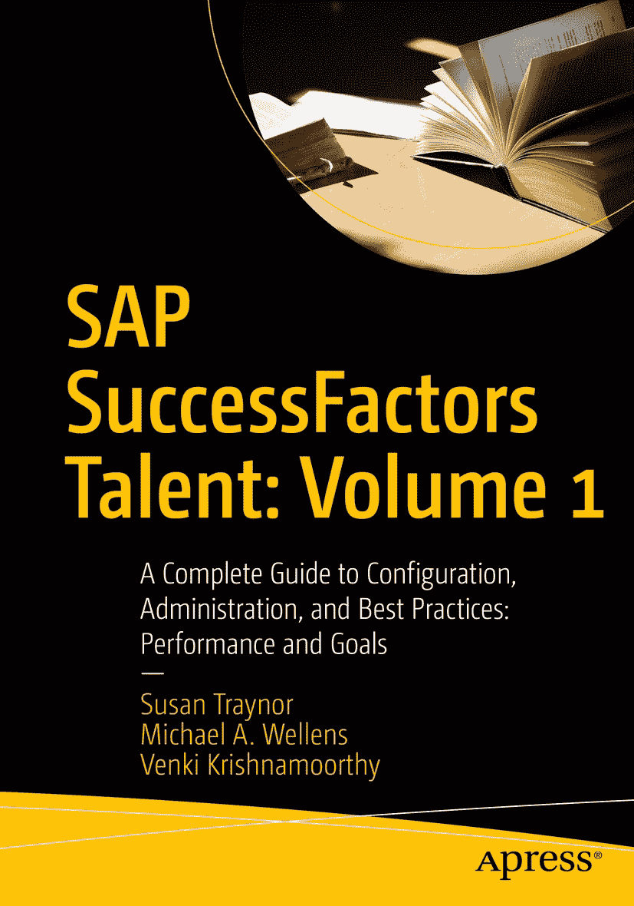

ISBN 978-1-4842-6599-4 电子书 ISBN 978-1-4842-6600-7 [`doi.org/10.1007/978-1-4842-6600-7`](https://doi.org/10.1007/978-1-4842-6600-7)

© Susan Traynor, Michael A. Wellens 和 Venki Krishnamoorthy 2021  
本作品受版权保护。出版商保留所有权利，涉及全部或部分材料，特别是翻译、重印、重用插图、朗诵、广播、微缩胶片复制或以任何其他物理形式复制，以及信息传输或存储检索、电子改编、计算机软件，或目前已知或未来开发的类似或不同方法的权利。本出版物中使用的通用描述性名称、注册商标名称、商标、服务标记等，即使未作特别声明，也不意味着这些名称不受相关保护性法律和法规的约束，因此可自由通用。出版商、作者和编辑假定本书中的建议和信息在出版之日是真实准确的。出版商、作者或编辑均不对本文所含内容或可能存在的任何错误或遗漏提供明示或暗示的保证。出版商对已出版地图中的管辖权主张及机构隶属关系保持中立。本书全球发行由位于纽约百老汇 1 号（邮编 10004）的 Springer Science+Business Media New York 负责。电话 1-800-SPRINGER，传真 (201) 348-4505，电子邮件 `orders-ny@springer-sbm.com`，或访问 `www.springeronline.com`。Apress Media, LLC 是加利福尼亚州有限责任企业，其唯一成员（所有者）为 Springer Science + Business Media Finance Inc (SSBM Finance Inc)。SSBM Finance Inc 是一家特拉华州公司。

*谨以此书感恩献给*

*Jeffrey S. Kob 和 Randall M. Kob*

*以及*

*给予 Michael 机会踏入 SAP SuccessFactors 世界的 Sheila McGovern*

*还有*

*Venki 的母亲 Thiripurasundari，她曾是他的导师和挚友*

## 致谢

特别感谢 Jeremy Masters 将我们汇聚一堂。

## 作者简介

## 技术审校者简介

