# 2. 人才简介

SuccessFactors 中的人员简介以不同的信息块形式显示员工数据。这些信息块为员工和经理提供自助服务功能。在信息块中显示哪些数据可以通过权限进行控制；信息块的视图也可以通过权限进行控制。通常，人员简介包含个人信息、地址和联系方式等信息块。如果您已实施名为 Employee Central 的 SAP SuccessFactors HRIS 产品，则可以配置额外的信息块，例如工资单、国民身份证等。

人才简介是 SAP SuccessFactors 中人员简介的一个子部分。人才简介由绩效、潜力、薪酬和继任管理等信息块组成。

在本章中，我们将详细讨论人才简介，包括如何使用提供员工和经理自助服务功能的信息块来配置人才简介，如何填充信息块，以及如何设置信息块的编辑或仅显示权限。

**注**：当您配置 SuccessFactors 并将员工导入实例时，SuccessFactors 会默认为所有员工创建一个人简介。您可以向人员简介添加信息块。这些信息块可以是系统自带的信息块和客户构建的信息块的组合。

员工简介中显示员工相关数据的区块被称为`背景元素`。

### 人员简介中的人员选择器

人员选择器是人员简介中的一个下拉列表（见图 2-1），用于显示员工的经理、直接下属和同级。用户可以从姓名中选择以查看特定员工的简介。当您单击下拉列表时，系统会显示一个搜索框。您也可以使用搜索框搜索员工。

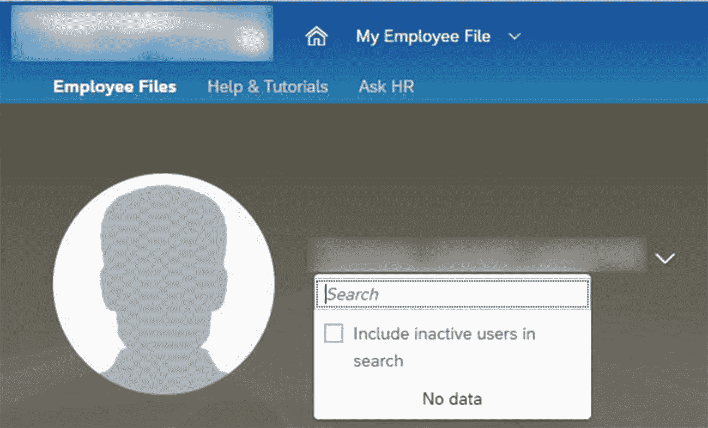
*图 2-1：人员简介中的人员选择器*

客户有时有隐藏人员选择器中同级人员的业务需求。在管理中心有一个设置，您可以在此隐藏人员选择器下拉列表中的同级人员。请注意，此设置是全局性的，不能限制到特定的员工组。

要隐藏人员选择器中的同级详细信息，请转到管理中心并点击平台功能设置。在显示的配置页面上，选择名为“隐藏同级”的设置。保存您的配置。

### 人才简介

人才简介显示与人才解决方案相关的信息块（见图 2-2）。当安装了 SuccessFactors 人才解决方案，如绩效管理、继任管理、薪酬和学习管理系统时，与这些解决方案相关的信息块将被激活并在系统中可用。

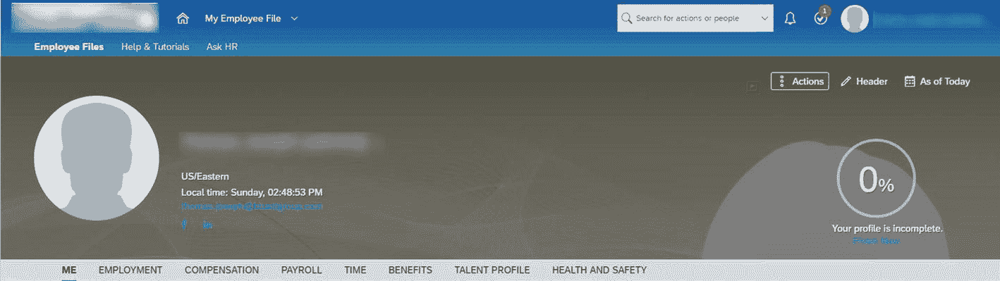
*图 2-2：人才简介*

**注**：您可以通过以下方式访问员工简介：转到 SuccessFactors 主页，单击“主页”下拉列表，然后选择“我的员工档案”（图 2-3），这是 SuccessFactors 演示实例中的员工档案。员工简介将显示各种标题。单击标题将导航到员工简介中的特定信息块。

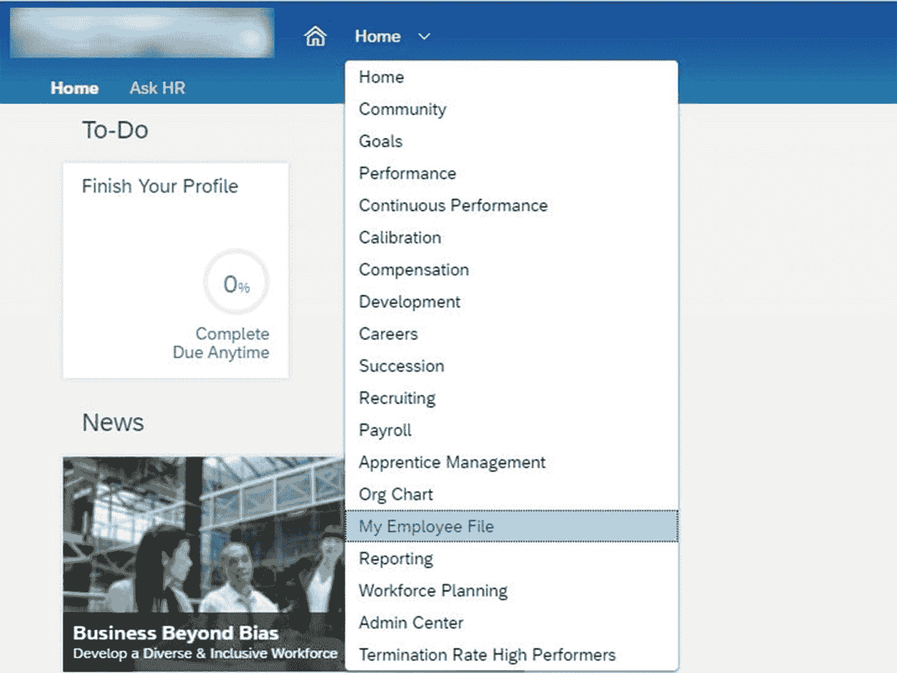
*图 2-3：导航到“我的员工档案”*

表 2-1 列出了您将在人才简介中看到的一些示例信息块。这不是一个完整的列表，客户可能已经配置了其中一些或几个其他信息块。其中一些信息块在客户实例中可能以不同的名称提及。

**表 2-1**：人才简介中的示例信息块

| Portlet | 描述 |
| :--- | :--- |
| `Badges` | 组织授予员工徽章，以表彰其出色的工作表现。例如，员工可能会获得“团队合作者”徽章，以表彰其卓越的团队协作能力。员工可以在一定时间内展示该徽章。还有一些徽章可能与员工的工作表现无关，而是反映员工的工作文化。例如，某枚徽章可能表彰员工在特定时期内的 100%出勤率或零客户投诉。徽章通常是一种表示同伴认可的方式，这些徽章可以展示在“人才简介”中的指定 Portlet 中。 |
| `Talent Overview: Talent Information` | `Talent Information` Portlet 显示企业中使用的不同人才标识。HR、经理或人才团队可以编辑 `Talent Information` Portlet。企业配置的标识可能包括以下内容：1. *流失风险*：该员工流失的风险有多大？值可能为低、中、高或非常高。2. *流失影响*：如果该员工离开团队，对团队/组织会产生多大影响？值可能为低、中、高或非常高。3. *离职原因*：一个备注框，用于记录离职原因，或使用下拉菜单（也称为选择列表值）来选择离职原因。4. *未来领导者*：该员工是否有潜力成为领导者？可能值为是和否。 |
| - | 5. *多元化候选人*：该员工是否是多元化候选人？*多元化*的含义可能因国家或地域而异。6. *新任职*：如果该员工是新任职的，此标识可能设为“是”。企业可能在最初的 180 天或 365 天内使用此标识。此标识可能用于触发下游活动，例如启动 30/60/90 天目标。这些标识可能具有二进制（是/否）或多个值。具体使用哪些值取决于业务需求，这些可以在研讨会中讨论并记录下来。客户企业可能不会使用所有这些标识，或者其中一些标识可能会被重新定义以符合企业文化。客户也可以使用自定义标识。 |
| `Talent Overview: Overview` | 此 Portlet 将显示总体绩效评分、潜力排名、能力排名和目标评分。Portlet 还将显示“绩效与潜力”九宫格矩阵。 |
| `Skill Profile` | 员工（或任何拥有适当权限的人员）可以在此 Portlet 中添加技能。 |
| `Performance and Competencies: Performance History` | 此 Portlet 显示员工在配置日期范围和流程内的绩效评级。此 Portlet 是系统提供的，并具有预定义字段。因此，无法对此 Portlet 进行修改。 |
| `Performance and Competencies: Competencies` | 此 Portlet 显示员工在其年度绩效表格中，在配置日期范围和流程内获得的能力评级。 |
| `Promotability and Performance: Promotability (Manager View Only)` | 在此 Portlet 中，经理将输入职位角色的详细信息、员工是否准备好晋升，以及员工可能胜任该职位的时间范围。还有一个可选的备注字段，经理可以在其中输入评论。 |
| `Potential and Performance Views: Potential (Manager View Only)` | 在此 Portlet 中，经理将输入员工的潜力评级。 |
| `Objective-Competency Historical Matrix Grid Placement` | 此 Portlet 将显示目标与能力评级的九宫格矩阵。这些评级来自配置日期范围和流程内的年度绩效表格。 |
| `Successors: Successor portlet` | 此 Portlet 显示被指定接替该员工职位的人员。 |
| `Successors: Nomination portlet` | 此 Portlet 显示该员工被指定为继任者的职位。 |

客户可以配置许多不同的 Portlet，以符合其文化和业务需求。对于顾问或内部 `SuccessFactors` 团队来说，理解业务需求并相应地配置 Portlet 非常重要。

**提示**

建议的做法是尽可能使用默认 Portlet。使用默认 Portlet 的一个显著优势是，如果 `SuccessFactors` 有升级，这些 Portlet 会自动升级，无需客户团队付出任何额外努力。对于包含来自人才解决方案数据的 Portlet，默认 Portlet 会自动使用来自最新表格或对象的评级进行更新。

在下一节中，我们将深入探讨不同 Portlet 中“人才简介”的配置。我们还将研究需要使用 XML 在 `Succession` 数据模型中进行哪些配置。在探索配置的过程中，我们将初步了解名为 `Manage Business Configuration` 的配置步骤。

### 构建自定义 Portlet

“人才简介”可以包含默认 Portlet 以及客户特定 Portlet 的组合。我们可以在基于 XML 的 `Succession` 数据模型中配置 Portlet。如果您无法访问数据模型，则可以在 `Admin Center` 中配置 Portlet。

在本节中，我们将讨论如何在 `Admin Center UI` 中创建背景元素，然后讨论如何在 XML 中创建背景元素。

**注意**

如果您熟悉 XML 配置，可以从 `Provisioning` 下载 `Succession` XML 文件。客户无法访问 `Provisioning`。只有被授予 `Provisioning` 访问权限的认证顾问才能访问它。

### 在 UI 中创建背景元素

“人员简介”中的自定义 Portlet 被称为`背景元素`。

在搜索框中输入配置步骤 `Manage Business Configuration`（参见图 2-4）。在 `Manage Business Configuration` 屏幕上，向下滚动到 `Employee Profile` 部分，并展开 `Background Elements`。我们将在此部分创建一个自定义背景元素。向下滚动并点击 `Create New`。


图 2-4 操作搜索框

在显示的页面上（参见图 2-5），您需要填写各个字段。表 2-2 描述了不同的字段及其含义。

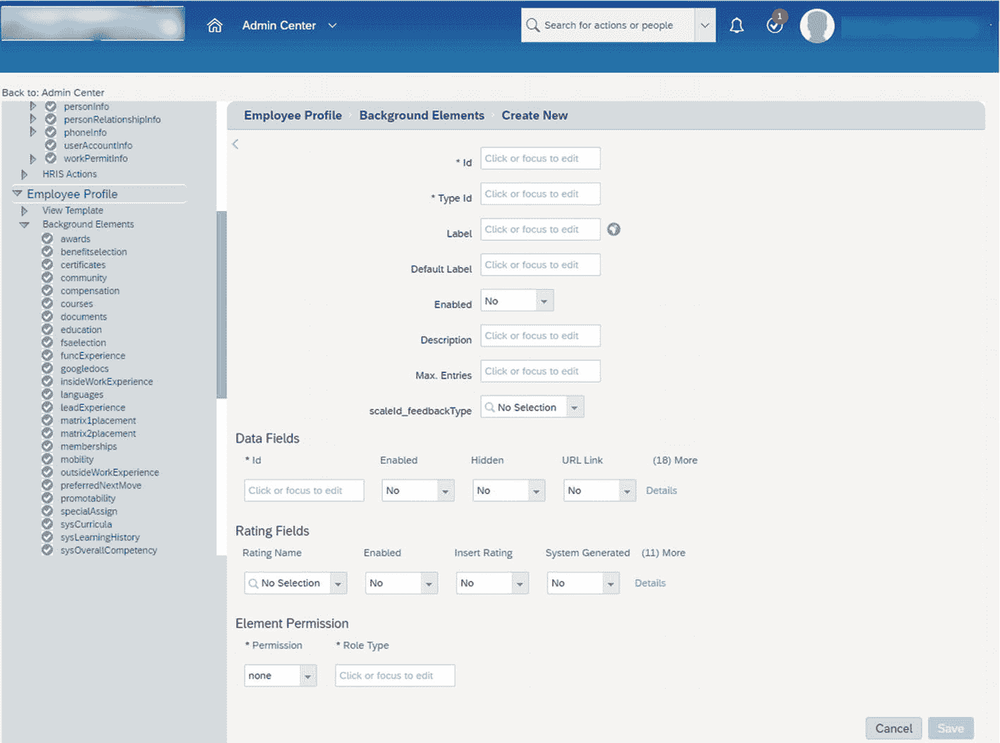
图 2-5 创建背景元素

`注意`

如果搜索没有将您带到 `Manage Business Configuration` 页面，请查看下一节“启用业务配置 UI”。否则，请跳到“块设置”部分。

## 启用业务配置 UI

客户和实施团队使用 `Business Configuration UI (BCUI)` 来执行以下操作：

1. 添加/维护自定义背景元素
2. 维护标准的 `userinfo` 对象
3. 添加/更改标签
4. 添加/更改翻译
5. 启用字段
6. 更改字段的可见性
7. 将字段设为必填

### 前提条件

您需要确保 `Succession` 数据模型在 `Provisioning` 中可用。`Manage Business Configuration`（也称为 `BCUI`）是 `SuccessFactors` 中的一个管理工具，用于创建和维护通常在 XML 数据模型中维护的对象。

如果 `Succession` 数据模型不可用，请打开一个组件为 `LOD-SF-PLT-PPRV` 的工单，并请求支持将 `Succession` 数据模型导入到您的公司 ID 中。

### 在您的实例中启用 BCUI

在“配置”中，确认配置开关 `Enable Generic Objects` 已勾选。如果未勾选，您需要将其勾选。启用 `Enable Generic Objects` 后，在“管理中心”选择 `Enable Business Configuration`。启用此项后，您需要在“配置”中执行 BCUI 同步作业，即 `Synchronize Business Configuration`（参见图 2-6）。此作业仅需执行一次。

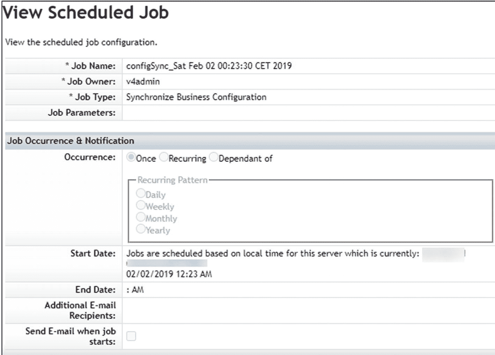
图 2-6 配置“同步业务配置”

在“配置”中，点击 `Manage Scheduled Jobs`。在显示的页面上，创建一个作业类型为 `Synchronize Business Configuration` 的作业。配置作业后，仅执行该作业一次。

> `注意`
> 在作业运行期间，配置步骤 `Manage Business Configuration` 将被锁定。在此期间，对 Succession 数据模型所做的任何更改都可能导致 BCUI 与 Succession 数据模型之间存在差异。

作业执行后，您通过 `Manage Business Configuration` 对 Succession 数据模型所做的任何更改都将自动触发此作业。

## BCUI 的权限

对于需要访问 `Manage Business Configuration` 的权限组/权限角色，您需要分配在 `Manage Business Configuration` 中访问和维护对象的权限。在“管理中心”中，`Manage Permission Roles` 项目分配了本节所述的权限。

在 `Administrator Permissions` 部分的 `Metadata Framework` 权限组中，选择以下项：

- `Manage Data`
- `Read/Write Permission on Metadata Framework`
- `Import Permission on Metadata Framework`
- `Admin Access to the OData API`
- `Manage Configuration UI`

在 `Administrator Permissions` 部分的 `Manage Business Configuration` 权限组中，执行以下操作：

- 为列出的对象选择可见性和操作。
    - 为某个对象选择 `Visibility` 意味着该对象将显示在 BCUI 中。
    - `Actions` 表示可以对该特定对象执行的操作。
- 点击 `Done` 保存您的设置。

## 块设置

配置表 2-2 中的设置，以配置背景元素。

表 2-2 背景元素中的字段

| 字段 | 说明 |
| --- | --- |
| `Type Id` | `Type Id` 值用于标识背景元素。因此，`Type Id` 值应为唯一的整数，例如 10。 |
| `ID` | 您在此字段中输入背景元素的 ID。该 ID 应为唯一值，并且不能用于任何其他元素。ID 不应包含任何空格，因为不支持空格，例如 `custWillingToRelocate`。建议的做法是以小写字母开头，后跟其他大写单词，且无空格。*注意：您会注意到某些 SuccessFactors 交付的背景元素以 `sys` 开头。在修改此类窗口小部件时，需要考虑这些窗口小部件的限制。* |
| `Label` | 这是将显示在“人员档案”中的字段名称。您可以通过单击字段旁边的图标来添加语言翻译。 |
| `Default Label` | 这是未配置标签的语言所显示的标签。 |
| `Enabled` | `Enabled` 的值为 `Yes`/`No`。如果您希望该字段显示在“人员档案”中，请选择值 `Yes`。*注意：在“人员档案”中显示窗口小部件是一个两步过程。**步骤 1：在配置中启用该窗口小部件。**步骤 2：在基于角色的权限中授予该窗口小部件查看/编辑的权限。* |
| `Description` | 此条目将显示在块中。该字段仅供参考。 |
| `Max Entries` | 这是可以在该背景元素中创建的最大条目数。最大条目数仅对 ESS/MSS 有效。当通过平面文件导入填充窗口小部件时，最大条目数会被覆盖。 |
| `Scale Id (Feedback Type)` | 输入您计划在此窗口小部件中使用的评分等级。例如，如果该窗口小部件用于记录员工的搬迁意愿，并且该意愿按 1 到 3 的等级记录，那么您将使用包含 1、2、3 的评分等级。 |

## 数据字段

在本节中，您将填写在后台窗口小部件中显示的字段的详细信息。如图 2-5 所示，前四个字段在屏幕上可见。要查看需要填写的其他字段，您需要点击 `Details`。表 2-3 描述了这些字段。

> `注意`
> 作为一种建议做法，请在填写这些字段之前先填写“块设置”下的设置。

表 2-3 背景元素中的数据字段

| 字段 | 说明 |
| --- | --- |
| `Id` | 这是后台数据字段的 ID。它必须是唯一的，并且不能与特定后台元素中的任何其他数据字段重复。 |
| `Enabled` | 值为 `Yes` 和 `No`。如果希望该字段显示在后台元素中，请选择值 `Yes`。 |
| `Hidden` | 如果希望该字段在人员档案中呈现，请选择值 `Yes`。否则，值应为 `No`。 |
| `URL Link` | 在该字段中输入的值将显示为链接。默认值为 `Yes` 和 `No`。如果不希望该值在用户界面中显示为链接，请选择 `No`。 |
| `Field Name` | 这是数据库字段名称。支持的值如下：**VARCHAR（文本）字段（`vfld1` 到 `vfld13`）**：如果该字段显示文本并且是下拉列表，则可以使用此类型。可以使用 `vfld1` 到 `vfld13` 的值。*注意：在特定的后台元素中，不能重复使用字段名称。如果您有一个字段名称为 `vfld1` 的字段，那么下次有文本/选择列表字段时，您必须使用例如 `vfld2`。* |

### 字段名称与配置说明

| 字段 | 说明 |
| :--- | :--- |
| - | **DATE 字段（`dfld1` 到 `dfld5`）**：如果该字段是日期字段，则将字段命名为 `dfld1` 到 `dfld5`。使用此字段名称时，字段将显示一个“日历”按钮，您可以使用该按钮选择日期。***注意：*** *与 Varchar 字段名称类似，您不能在同一个后台元素中重复使用日期字段名称。因此，如果您将一个数据字段命名为 `dfld1`，则下一个日期字段将为 `dfld2`。系统限制在一个特定后台元素中最多只能有五个日期字段。* **开始日期和结束日期（`startDate`，`endDate`）**：这些是日期字段。如果使用此日期名称，则将两个字段都设为必填项，以便同时填写开始日期和结束日期字段。此字段通常用于确保开始日期和结束日期的值同步。换句话说，结束日期的值不早于开始日期。***注意：*** *您只能在特定的后台元素中使用开始日期/结束日期。将开始日期和结束日期字段设为必填项可确保两个字段都被填写，而不会留下一个空白。* **整数（INTEGER）字段（`ifld1` 到 `ifld4`）**：这支持的整数范围为 `-2,147,483,648` 到 `2,147,483,647`。如果您计划使用此字段名称，则值需要在 `ifld1` 到 `ifld4` 范围内。此字段使用的字段名称不能在同一个后台元素中用于其他不同的字段。***注意：*** *如果该字段用于捕获电话号码，建议您将该字段用作文本字段；换句话说，字段名称可以是 `vfld1` 到 `vfld15`。* **FLOAT（实数）字段（`ffld1` - `ffld4`）**：如果您计划使用该字段输入浮点数，请使用此字段名称。字段名称需要在 `ffld1` 到 `ffld4` 的范围内。**最后修改日期（`lastModified`）**：此字段显示该 Portlet 行项目最后修改的日期。***注意：*** *如果您计划向此字段导入值，请勿使用此字段名称。导入时不支持此字段。* **附件字段（`ATTACHMENT_ID`）**：如果您计划使用此字段上传/导入附件，请使用此字段名称。***注意：*** *一个后台元素中只能有一个附件字段。* |
| `Number Format Ref.` | 您可以将此数据字段留空。*注意：SuccessFactors 创建此字段是作为未来产品开发的占位符。即使该字段显示，当前也不可用于任何配置。* |
| `Field Display Format Ref.` | 您可以将此数据字段留空。*注意：与 `Number Format Ref.` 类似，此字段在配置用户界面中显示为未来 SuccessFactors 产品的占位符。* |
| `Masked` | 如果该字段中的数据需要在人员档案用户界面中受到保护而不显示，则选择 `Yes`。可用值为 `Yes` 和 `No`。*注意：如果您选择 `Yes`，则该字段中的数据将被星号屏蔽并显示为 `******`。您需要点击星号才能查看该值。* |
| `Document Type Id` | 如果您使用此后台元素上传附件，则可以使用此数据字段对附件进行分类。此字段是一个选择列表，它提供以下值：<br>• 360 度多评估者附件<br>• 应聘面试附件<br>• 附件<br>• 候选人历史<br>• 证书<br>• 求职信<br>• 通用对象附件<br>• HRIS 附件<br>• 绩效评估<br>• 绩效附件<br>• 出版物<br>• 简历<br>• 用户自定义<br>*注意：仅当字段类型为 `Attachment_ID` 时才需要填写此字段。* |
| `Max. File Size KB` | 这是可以上传到后台元素中此字段的附件的最大文件大小。*注意：此处指定的文件大小应小于或等于在 Provisioning 中配置的附件最大文件大小（参见图 2-6）。**您需要是经过 SuccessFactors 认证的顾问才能访问 Provisioning。目前客户无权访问 Provisioning。* |
| `File Formats` | 如果字段类型是附件，您可以为该后台元素定义此数据字段支持的文件格式。支持的文件格式如下：`DOC`、`PDF`、`CSV`、`HTM`、`PPT`、`XLS`、`GIF`、`PNG`、`JPG`、`JPEG`、`HTML`、`RTF`、`BMP`、`XLSX`、`DOCX`、`PPTX`、`TXT`、`XML`、`MSG`、`DOCM`、`TIF` 和 `MP4`。 |
| `HRIS Fields Mapping value` | 您可以将此数据字段留空。 |
| `Earning Data Mapping Value` | 您可以将此数据字段留空。 |
| `Text Area Enabled` | 如果字段名称是 `VarChar`，并且您希望该字段支持多行文本，则可以选择 `Yes`。此数据字段的有效值为 `Yes` 和 `No`。 |
| `Merge` | 默认值为 `Yes`。请勿更改此值。 |
| `Label` | 这是将在用户界面和 SuccessFactors 实例中显示的名称。在此数据字段中，您可以通过单击字段中显示的图标来配置语言翻译。 |
| `Default Label` | 这是针对您尚未配置标签的语言所显示的标签。*示例：如果实例中的语言之一是中文，并且您尚未配置中文语言的标签（有关详细信息，请参阅 `Label` 字段），那么当您的语言是中文时，将显示在此数据字段中配置的值。* |
| `Picklist` | 如果您的字段是一个选择列表，请选择将在此后台元素的此数据字段中显示的选择列表。*注意：在此字段中选择选择列表之前，应先在实例中配置并存在该选择列表。* |
| `Parent Picklist Id` | 如果您希望此字段是一个选择列表，并且它使用另一个字段作为父字段，则请输入父字段的 ID。*示例：在此后台元素中，您正在捕获如果有机会，员工愿意重新安置到哪个国家和州。您有两个字段：`Country` 和 `State`。因此，如果您在 `Country` 字段中选择 `USA`，则州字段将显示美国的所有州。如果您在父字段中选择 `Canada`，则州字段将显示加拿大的所有省/地区。在配置 `Country` 字段时，在 `picklist` 数据字段中，您将选择 `Country` 选择列表。在配置 `State` 字段时，在 `picklist` 数据字段中，您将选择 `State` 选择列表。在 `State` 字段的 `parent picklist ID` 数据字段中，您将输入 `Country` 字段的 ID。* |
| `Required` | 如果您希望此字段为必填项，则选择 `Yes`。选择 `No` 将使该字段成为可选字段。有效值为 `Yes` 和 `No`。 |
| `Max Length` | 在此数据字段中，您可以配置字段的最大长度。有效值如下：<br>• `vfld1` 到 `vfld15`（4,000 个字符）<br>• `Start date`：日期<br>• `End date`：日期<br>• `dfld1` 到 `dfld3`：日期<br>• `ifld1` 到 `ifld5`：整数 `-2147483648` 到 `2147483647`<br>• `ffld1` 到 `ffld4`：浮点数 `1.40129846432481707e-45` 到 `3.40282346638528860e+38`（正数或负数） |
| `Display Size` | 此数据字段未被使用。您可以将其留空。 |

## 使用 XML 配置背景元素

您可以在 XML 中配置背景元素。您可以从 `Provisioning` 下载一份继任数据模型副本。在 `Provisioning` 中，继任数据模型位于**继任管理**部分；点击**导入/导出数据模型**链接（见图 2-7）。在显示的页面上，选择**导出文件**选项（选择**保存**，而非**打开**），然后点击**提交**。

**注意**

您需要一个编辑器来编辑 XML 文件。互联网上有一些免费的编辑器可供使用。`Notepad++` 和 `XMLPad` 是其中比较流行的两款。

使用您选择的任意编辑器打开 XML 文件。向下滚动到包含背景元素 XML 代码的部分。

作为练习，我们将使用 XML 创建一个背景元素。在该背景元素中，员工将输入他们最喜欢的五个旅行目的地。他们将按 1 到 5 的等级对这些目的地进行排序，且最多可创建五条记录。

背景元素的结构如下：

- 旅行目的地名称（文本字段）

- 对该旅行目的地为何是其最爱的描述（文本区域字段）

- 旅行目的地评分（选择列表）

- 上次访问日期（日期）

- 附件（上传旅行目的地图片）

背景元素的结构应包含在标签 `<background-element>` 和 `</background-element>` 之间。切勿在另一个背景元素结构内构建新的背景元素；换言之，不支持嵌套背景元素。

清单 2-1 显示了继任数据模型中提供的背景元素 `insideWorkExperience` 的 XML 代码。

```
```
Inside Work History
Inside Work History

From Date
From Date

End Date
End Date

Title
Title

Department
Department
```

# 清单 2-1
背景元素的 XML 代码

请参考表 2-2 和 2-3，以便更好地理解此 XML 代码。如果您是 XML 新手，开发新背景元素的一个简单方法是复制现有背景元素并对其进行修改。

**提示**

为了构建新的背景元素，我们将复制提供的背景元素并进行修改。我们将该背景元素命名为**最喜欢的旅行目的地**，其 ID 为 `favTravelDestinations`。对于类型 ID，我们从 `90` 开始。您可以使用 XML 文件中未使用的任何 ID。通常，对于自定义背景元素，我从 `90` 开始。因此，第一个自定义元素为 `90`，接着是 `91`，以此类推。确保您使用的 ID 未被其他任何背景元素使用。不支持重复的 ID。

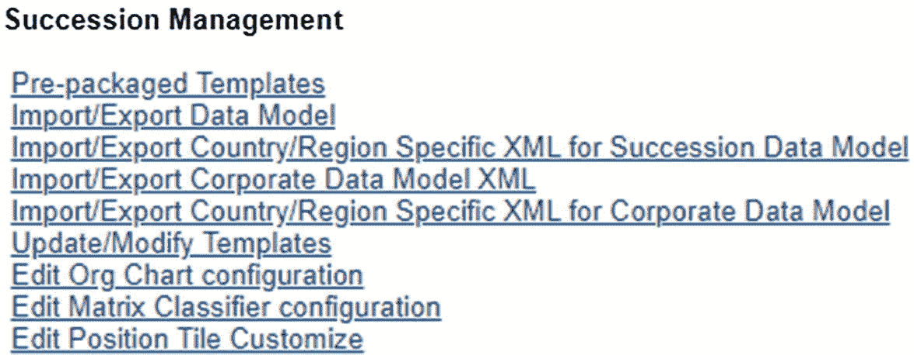

**图 2-7** 下载继任数据模型

清单 2-2 显示了背景元素**最喜欢的旅行目的地**的 XML 代码。

# 清单 2-2
自定义背景元素的 XML 代码

```
Favorite Travel Destinations
Favorite Travel Destinations
Test

Name of destination
Name of destination

Desc why this is your fav destination?
Desc why this is your fav destination?

Rate travel destination
Rate travel destination

Date last visited
Date last visited

Post PICS if any
Post PICS if any
```

现在，让我们来回顾一下我们配置的 XML 代码。您会注意到，背景元素包含在标签 `<background-element>` 和 `</background-element>` 之间。与 `favTravelDestination` 相关的所有配置都包含在这些标签内。

- 背景元素 `favTravelDestination` 的 ID 在名为 `id` 的字段中提及。类型 ID 在字段 `type-id` 中提及。我们讨论过，员工最多只能输入五个条目。这在字段 `max-entries` 中提及。我们将背景元素命名为**最喜欢的旅行目的地**。

```
    Favorite Travel Destinations
    Favorite Travel Destinations
    Test
```

- 背景元素中的各个字段包含在标签 `<data-field>` 和 `</data-field>` 之间。我们将目的地名称配置为文本字段，因此字段名为 `vfld1`。字段 ID 为 `destName`。该字段的标签是“Name of destination”。

```
    Name of destination
    Name of destination
```

- 我们希望员工描述为什么这是他们最喜欢的旅行目的地。该字段需要是一个文本区域，以便条目显示在更大的文本字段中，并且我们可以滚动该字段。您会注意到 XML 代码 `text-area-enabled` 为 `true`。如果我们不设置此项，该字段将显示为文本字段。由于该字段是描述性的，如下所示：

```
    Desc why this is your fav destination?
    Desc why this is your fav destination?
```

- 我们希望员工按 1 到 5 的等级对旅行目的地进行评分。为此，字段应配置为选择列表，我们还需要配置一个选择列表并将其分配给该字段。如果您查看 XML 代码，会看到字段名为 `vfld11`。我们已经在“Name of destination”中使用了字段名 `vfld1`。如前所述，每个背景元素的字段名应是唯一的。您会注意到 XML 代码 `<picklist id>`。这表示该字段是一个选择列表字段。选择列表 ID 表示分配给此字段的选择列表。

```
    Rate travel destination
    Rate travel destination
```

- 我们希望配置一个日期字段，以记录员工上次访问该目的地的日期。由于该字段是日期字段，字段 `id` 值为 `endDate`，字段名为 `endDate`。

```
    Date last visited
    Date last visited
```

- 我们希望配置一个字段，以便员工在愿意分享时上传旅行照片。我们将 `field-name` 配置为 `attachment1`，并将 `document-type-id` 配置为 `Attachments`。

```
    Post PICS if any
    Post PICS if any
```

**提示** 如您所见，通过**管理中心**在 UI 中配置背景元素要容易得多。无论如何，这是我首选的配置背景元素的方法。作为产品路线图的一部分，`SuccessFactors` 正在将越来越多的配置任务从 `Provisioning` 迁移到**管理中心**，以便客户可以在 UI 中配置和维护其应用程序。

## 配置选项列表

虽然配置选项列表超出了本书的范围，但由于我们在配置自定义背景元素时使用了选项列表，因此我们将简要了解如何配置它们。在本节中，我们将了解如何在 `Picklist Center`（选项列表中心）中创建选项列表。

**注意：** SAP 已宣布所有 SuccessFactors 客户都将迁移到 `Picklist Center`。因此，在本节中，我们将回顾如何在 `Picklist Center` 中创建选项列表。

在 `Action`（操作）搜索框中输入配置步骤 **Picklist Center**。在显示的页面上（见图 2-8），点击 `+` 图标创建一个新的选项列表。如果选项列表已创建，您想对其进行维护，请在搜索框中输入选项列表的名称。

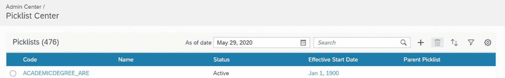

**图 2-8** – 配置选项列表

系统会弹出一个创建选项列表的对话框（见图 2-9）。在对话框中，配置以下设置：

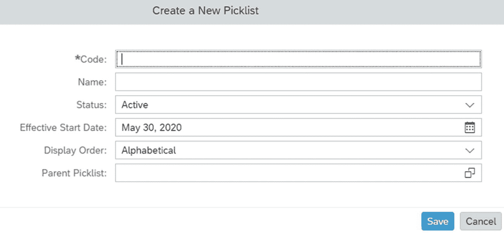

**图 2-9** – 创建新的选项列表

- **Code（代码）**：输入选项列表的代码。该代码应是唯一的。

- **Name（名称）**：这是您正在创建的选项列表的标签。此标签将显示在选项列表字段的用户界面中。

- **Status（状态）**：选项列表的状态需要设置为 `Active`（激活）才能使用。如果您不再需要该选项列表，则将其状态更改为 `Inactive`（停用）。

- **Effective Start Date（生效开始日期）**：这是选项列表激活并在实例中可用的日期。作为一种实践，我们将此日期配置为 `01/01/1900`。

- **Display Order（显示顺序）**：默认情况下，显示顺序为 `Alphabetical`（按字母顺序）。其他值为 `Numeric`（数字顺序）和 `Custom`（自定义顺序）。

- **Parent Picklist（父选项列表）**：如果您正在创建的选项列表是子选项列表，请输入父选项列表的名称。

点击 `Save`（保存）创建新的选项列表。现在，我们将为此选项列表添加值。见图 2-10。

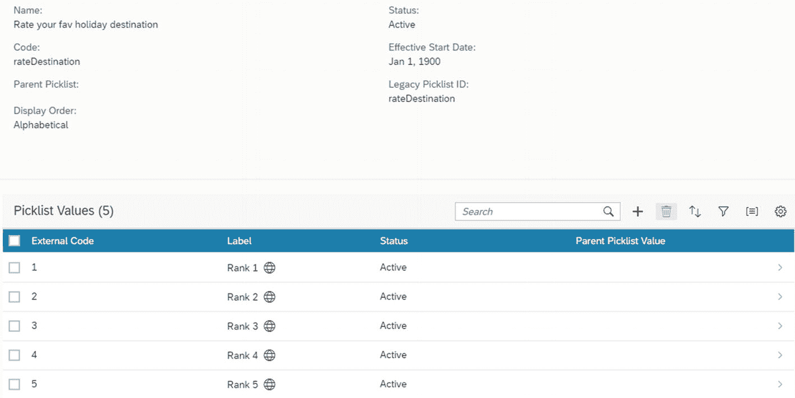

**图 2-10** – 向选项列表添加值

在显示的页面上，点击 `+` 图标。然后为这些设置输入以下值：

- **External Code（外部代码）**：SuccessFactors 中的所有模块都通过外部代码进行通信。`External Code` 设置是该特定选项列表值的 ID。在一个选项列表内，请确保外部代码是唯一的。

- **Label（标签）**：这是选项列表值的标签。此标签将显示在选项列表的用户界面中。建议做法是，标签应具有含义且易于理解。

- **Status（状态）**：如果您希望显示该选项列表值，则状态应为 `Active`（激活）。如果该值不再使用，则其状态将为 `InActive`（停用）。
```

- **Non-unique External Code（非唯一外部代码）**：默认情况下，系统会从 `External Code`（外部代码）字段复制值。保留此字段是为了在迁移后维护旧版选项列表的外部代码。请勿更改此字段中显示的值。

点击 `Save`（保存）以保存这些值。以类似的方式，为该选项列表输入其他值（见图 2-11）。

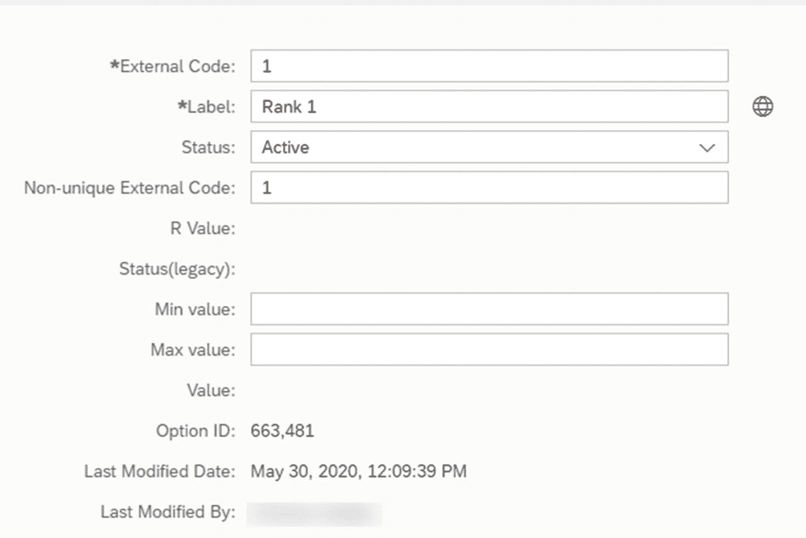

*图 2-11* – 配置选项列表值

**提示：** 创建选项列表后，如果在选项列表字段中看不到新创建的选项列表，请在 `Action`（操作）搜索框中输入配置步骤 `OData API Metadata Refresh And Export`（OData API 元数据刷新和导出）。在显示的页面上，点击 `Cache`（缓存）字段旁边的 `Refresh`（刷新）按钮（见图 2-12）。

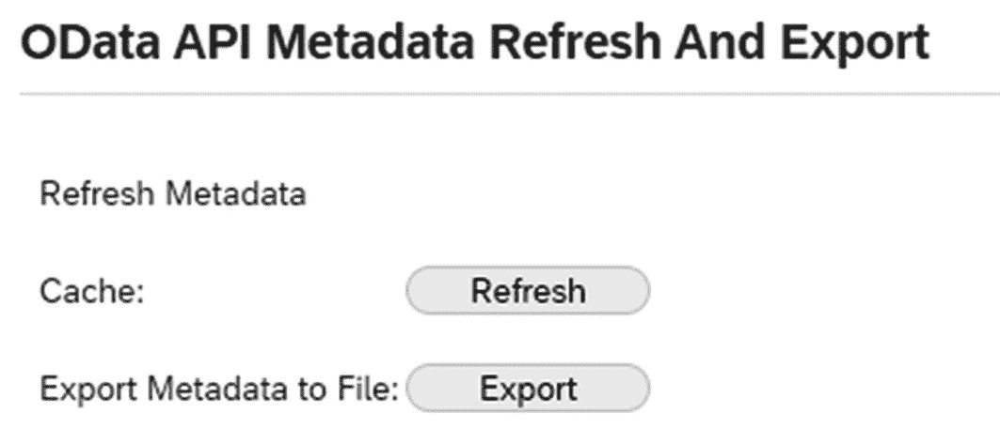

*图 2-12* – OData API 元数据刷新

这将刷新缓存。刷新后，您将能够在选项列表值中看到新创建的选项列表。

创建了背景元素后，在下一节中，我们将讨论如何将背景元素添加到员工档案中。

### 配置人才档案

我们配置的背景元素需要显示在员工门户中。在员工档案中显示背景元素是一个两步过程。

1.  在配置步骤 `Configure People Profile`（配置员工档案）中，将背景元素分配给一个版块和一个区块。

2.  分配所需的权限，以便背景元素显示在员工档案中。

在下一节中，我们将讨论如何将背景元素分配给一个区块。

#### 员工档案区块

如果要在员工档案中显示背景元素，则需要将该背景元素分配给一个区块。此分配在配置步骤 `Configure People Profile` 中完成。您可以通过转到管理中心并单击 `Configure People Profile`（配置员工档案）来访问该配置步骤。

在讨论配置步骤之前，在本节中，我们将回顾系统中可用的不同区块。

##### 人才模块

此处列出的人才模块类别，用于展示来自人才解决方案的员工相关数据，例如绩效与目标管理、薪酬与浮动薪酬、继任计划以及发展计划。表 2-4 对这些模块进行了说明。

**表 2-4**

人才模块

| 模块名称 | 模块说明 |

| --- | --- |

| 个人档案趋势信息 | 此模块用于显示员工的评级信息，例如总体绩效评级。使用此模块时，您可以选择要显示的评级信息。不同的选项如下：`仅绩效经理视图`、`仅潜力经理视图`、`总体目标`、`总体能力`。 |

| 能力-行为分解 | 此模块用于显示在 SuccessFactors 绩效管理表单中收集的行为评级。 |

| 能力 | 此模块用于显示在 SuccessFactors 绩效管理表单中收集的能力评级。 |

| 发展目标 | 此模块用于显示在 SuccessFactors 发展目标计划中记录的发展目标信息。 |

| 目标评级 | 此模块用于显示在 SuccessFactors 绩效管理表单中收集的目标评级。 |

| 概览 | 此模块用于显示绩效与潜力或方式与内容的最新评级。 |

| 绩效历史 | 此模块用于显示员工的绩效评级。 |

| 继任者 | 此模块用于显示被提名为该员工当前职位继任者的员工。 |

| 职位 | 此模块显示员工当前职位的详细信息。 |

| 绩效-潜力历史矩阵网格布局趋势 | 此模块显示绩效与潜力评级。 |

| 当前提名 | 此模块显示员工被提名为继任者的职位。 |

| 方式与内容历史矩阵网格布局趋势 | 此模块显示目标与能力评级。 |

| 学习历史 | 此模块显示您的员工已完成的学习项目列表。 |

| 课程状态 | 此模块显示分配给员工的课程及其完成状态。 |

| 浮动薪酬个人视图 | 此模块显示员工的浮动薪酬。 |

| 历史 | 此模块显示系统中的所有表单，例如已完成的绩效表单、360 度评估表单和活跃的目标表单。 |

| 个人浮动薪酬报表 | 此模块显示员工的个人浮动薪酬报表。 |

| 薪酬报表 | 此模块显示员工的薪酬报表。 |

| 奖金分配报表 | 此模块显示员工的奖金分配报表。 |

| 技能档案 | 此模块显示分配给员工的技能及其预期/当前评级。在人员档案中，员工可以编辑此模块以添加新技能并提供自己的评级。 |

| 个人合并报表 | 此模块显示员工的个人合并报表。这是一个薪酬专用的门户组件。 |

| 目标 | 在此模块中，您可以创建和编辑目标。*注：在 SuccessFactors 中，“目标”和“目的”可以互换使用。* |

**注意：** 我们暂不讨论“雇佣信息”模块，因为该模块用于显示来自 Employee Central 的数据。

##### 个人信息

这些模块显示在继任数据模型中定义的标准元素和`userinfo`元素中收集的个人数据。表 2-5 对这些模块进行了说明。

**注意：** 标准元素是由 SuccessFactors 提供的数据元素。标准元素示例包括 `username`、`userid`、`firstname`、`lastname`、地址字段、`ssn`等。

**表 2-5**

个人信息

| 模块名称 | 模块说明 |

| --- | --- |

| 传记信息 | 此模块用于记录员工的人员信息，例如 `personID`、出生日期和出生国家。*注：`personID` 通常用于捕获员工在系统中的 ID。根据业务需求，`personID` 可用于维护员工的旧系统 ID（来自之前的人力资源信息系统）。在业务需求收集研讨会期间，请了解需求以及此字段在 SuccessFactors 中的使用方式。* |

| 个人信息 | 此模块显示员工的个人信息。模块中记录了诸如姓名、婚姻状况、国籍、称谓、首选姓名等详细信息。如果实施了 Employee Central，此模块还会显示员工的全球信息详情。当您选择员工居住的国家时，系统将显示特定于该国家的字段。例如，如果您选择美国，则会显示特定于美国的字段，如族裔、退伍军人身份和残疾详情，供员工填写。*注：客户使用`首选姓名`来记录员工的首选姓名。许多员工在工作场所使用昵称，并且同事之间以该名字相称。此字段可用于记录员工的首选姓名。* |

| 联系信息 | 此模块包含联系信息，例如电子邮件和电话号码。对于电子邮件和电话号码，您可以记录业务、个人以及任何客户自定义的联系信息。 |

| 地址信息 | 此模块用于维护员工的地址信息。地址类型的典型选项包括家庭地址、邮寄地址、工资单地址等。您的客户可能有不同于这些选项的设置。 |

| 国民身份证信息 | 此模块用于记录员工的国民身份证信息。如果员工有多个国民身份证（常见于拥有双重国籍或在外籍工作的员工），则也可以在此模块中记录。 |

| 工作资格 | 此模块显示员工的工作许可详情。如果员工是移民或外籍员工，通常需要填写此模块。模块中记录了诸如签发工作许可的国家、证件类型、证件号码、签发日期和到期日期等详细信息。*注：客户对如何维护此模块或人力资源部门如何在工作许可临近到期时收到通知存有疑问。如果您拥有 Employee Central，您可以配置警报，以便在工作许可到期前“n”天通知人力资源部门（或任何需要通知的人）。如果您的系统中没有 Employee Central，则目前没有功能可以通知人力资源部门工作许可即将到期。变通方法是开发一个报告，以识别所有工作许可即将到期的员工。* |

| 紧急联系人 | 此模块记录员工的紧急联系人详情。员工与紧急联系人的关系也在此模块中维护。*注：在业务需求收集研讨会期间，请与客户确认他们在记录员工紧急联系人时的文化习惯。有时，客户希望只维护一个紧急联系人，并且只维护联系电话号码，而不记录电子邮件地址。如果客户有 SuccessFactors Onboarding 模块，紧急联系信息通常在入职流程中记录。在这种情况下，入职流程中记录的信息应在此模块中显示。* |

| 家属 | 此模块维护员工的家属详情以及他们与员工的关系。 |

###### 薪酬信息

来自 SuccessFactors 薪酬模块的数据显示在这些区块中。请参见表 2-6。

**表 2-6** 薪酬信息

| 区块名称 | 区块描述 |

| --- | --- |

| 薪酬信息 | 此区块显示员工的薪酬详细信息，例如薪酬类型、薪酬组、薪资等级、奖金目标、薪酬比率和渗透率。 |

| 非经常性薪酬组件 | 此区块显示非经常性薪酬组件，例如奖金。 |

| 备选成本分配 | 如果员工被分配到多个成本中心，这些详细信息将显示在此区块中。 |

| 一次性扣除 | 此区块显示员工的单次扣款。 |

| 预支资格 | 此区块显示预支工资的资格详情。 |

| 当前预支款 | 此区块显示员工已领取的预支工资。 |

| 薪资信息 | 此区块显示员工的薪资详细信息。*注意：如果薪资外包给第三方薪资提供商，则不要启用此区块。* |

# 人员档案概述

`总薪酬历史`是一个小组件。该小组件以图形格式显示员工的薪酬历史。

`经常性扣除`此区块显示对员工工资的经常性扣除。

## 自定义区块

自定义区块（见表 2-7）包含用于收集员工数据的对象，且独立于任何 `SuccessFactors` 模块。例如，有关管理经验的详细信息将在背景元素中捕获，并显示在`个人档案背景信息`区块中。

**表 2-7** 自定义区块

| 区块名称 | 区块描述 |
| --- | --- |
| `个人档案背景信息` | 此区块显示背景元素中的数据。背景元素可以是自定义构建的，也可以由 `SuccessFactors` 提供。 |
| `个人档案用户信息` | 此区块显示员工的基本详细信息，如名字、姓氏等。 |
| `徽章` | 此区块显示员工已获得的徽章。自定义徽章和系统提供的徽章均显示在此区块中。注意：如有需要，您可以配置与您组织文化相符的自定义徽章。 |
| `标签` | 您可以针对特定技能、经验或兴趣等为员工添加标签。您可以使用这些标签来搜索具有特定技能或兴趣的员工。 |
| `备注` | 这是一个文本区域区块，可以输入和显示备注。通常，备注区块由 HR 或经理用于输入与员工相关的备注。如果备注区块由 HR 或经理使用，则员工通常没有查看该区块的权限（即，该区块将对员工隐藏）。 |
| `组织架构图` | 此区块显示员工与其经理之间的汇报关系。如果员工有直接下属，则也会显示该员工的直接下属。点击显示的头像时，系统将带您进入该特定员工的个人档案。 |
| `LinkedIn` | 此区块是一个小组件，用于显示员工的 `LinkedIn` 个人资料。您可以配置个人档案与 `LinkedIn` 之间的集成，以在个人档案中动态显示 `LinkedIn` 个人资料。 |
| `个人档案趋势信息` | 此区块显示员工的评级信息。评级信息来源于绩效评级、目标评级以及绩效与潜力对比评级等数据。 |

### 添加分区

在个人档案中，分区允许您将不同的组件逻辑地分组。一个分区由一个分区标题和子分区组成。一个分区可以包含任意数量的子分区。

一个个人档案可以包含任意数量的分区。

在图 2-13 中，标题“福利”和“人才档案”是分区。如图所示，通过将个人档案分类为分区并添加包含背景元素的子分区，可以为用户呈现一个更简洁、更友好的个人档案。

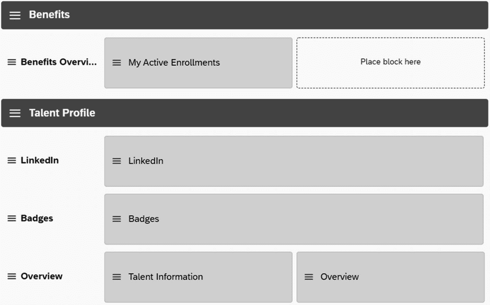

**图 2-13** 分区/子分区

要创建分区，请前往管理后台并选择“配置个人档案”。在显示的页面中，滚动到页面底部。点击“添加新分区”按钮。

将创建一个新分区（见图 2-14）。在“编辑分区：无标题”下，输入分区名称，然后点击“保存”。

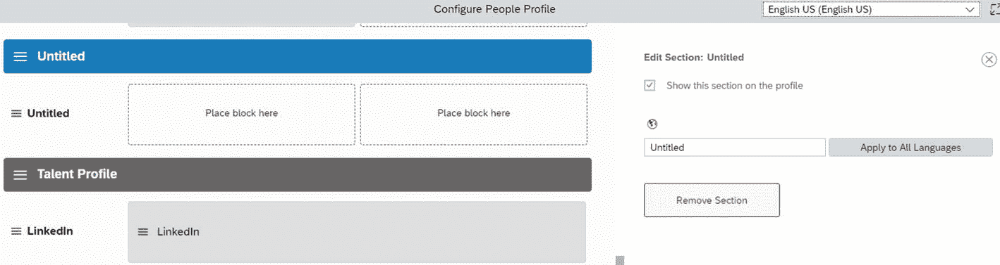

**图 2-14** 创建分区

**提示**

您可以通过点击“编辑分区”下显示的地球图标，以多种语言添加分区标题。或者，当您点击“应用于所有语言”按钮时，您输入的标题也可用于其他语言。

### 添加模块

你可以将模块添加到新建的区域。首先，为小节添加标题（见图 2-15）。点击区域中显示的小节（在我们的“测试”区域中，该小节目前没有标题）。此时将显示设置“编辑小节：无标题”。输入小节的标题，然后点击“保存”。

> **注意**
> 请参阅本章的“人员档案模块”部分，以了解更多关于模块以及可供配置的不同类型模块的信息。

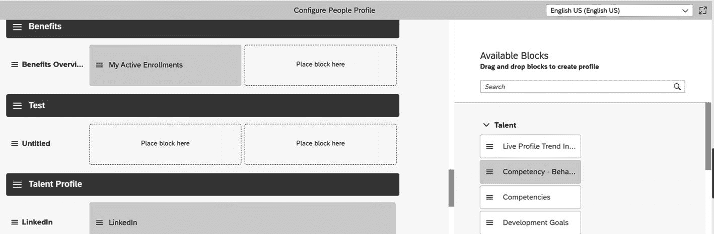

**图 2-15** – 创建模块

若要在小节中添加模块，请浏览可用的模块以找到要添加的模块。将该模块拖拽至你希望其显示的小节中。

如果该小节已满（即该小节中已配置了两个模块），请将模块悬停在两个模块之间，或悬停在模块与下一个小节之间。系统将自动创建新的小节。

> **提示**
> 将模块移动到小节时，如果你在模块中看到红色勾选标记，则表示系统没有足够的空间将该模块放入该特定小节。当系统能够将模块放入小节时，你会注意到模块右上角出现绿色勾选标记。

将模块移动到小节后，你会注意到需要添加详细信息，例如模块标题和描述，以及选择评分显示方式的选项（见图 2-16）。标题为必填字段，并会显示在人员档案中。你在配置中输入的描述会作为上下文帮助文本显示在人员档案中。保存你的配置。

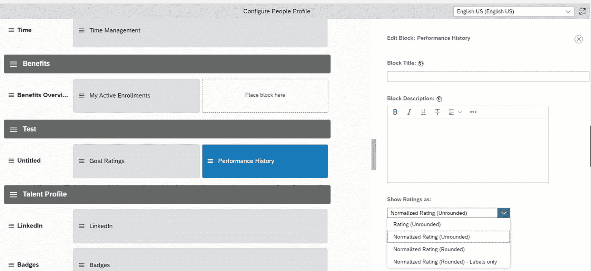

**图 2-16** – 配置模块

当你配置`个人档案背景信息`模块时，你会注意到还需要进行额外的配置。

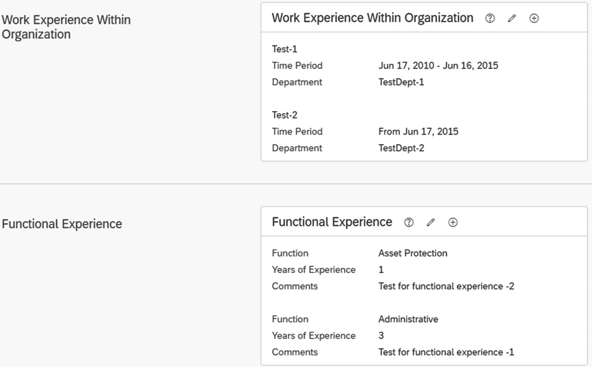

**图 2-17** – 重复条目

- **背景元素**：系统会显示系统中所有可用背景元素的配置设置列表。你选择希望在人员档案中显示的背景元素。

- **重复条目标题**：在背景元素模块中，用户可以创建多条数据条目。你可以选择是否为每个单独的条目设置标题。该背景元素中配置的列可供你选择。或者，你也可以选择`无`。如果选择`无`，则系统会将多条数据条目显示为单个无标题的模块。在图 2-17 中，我们有两个不同的小节显示背景元素：`组织内工作经验`和`职能经验`。在背景元素`组织内工作经验`中，我们将`标题`列作为重复条目的标题，而在背景元素`职能经验`中，我们选择`无`作为重复条目的标题。因此，不同的数据条目显示为单个模块。

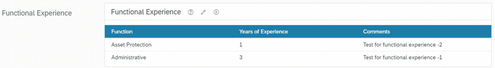

**图 2-18** – 以表格视图显示的背景元素

- **模块大小**：选项包括`小`和`大`。选择`小`时，背景元素会显示在小节的一列中。选择`大`时，背景元素会显示在小节的两列中。

- **模块布局**：选项包括`列表视图`和`表格视图`。图 2-17 中显示的背景元素为列表视图。背景元素中的条目以滚动列表的形式显示。图 2-18 中的背景元素以表格视图显示。在表格视图中，背景元素的列显示为列标题，不同的条目显示在单独的行中。

你可以在一个区域中添加任意数量的模块。当你向区域添加模块时，系统会自动创建新的小节。如图 2-16 所示，每个小节显示两列；因此，你可以在每个小节中配置两个模块。有些模块（如`LinkedIn`和`徽章`）较宽，占据两列。因此，在这些小节中，你只能配置一个模块。

> **提示**
> 在配置区域或小节时，如果你想返回到可用模块，请点击`编辑区域`/`编辑小节`配置视图右上角显示的`X`图标。此时将显示可用模块配置视图。

### 配置常规设置

在`配置人员档案`配置页面的顶部，你会看到一个名为`常规设置`的区域。你可以通过勾选/取消勾选选项来启用或禁用这些设置（见图 2-19）。

表 2-8 总结了每个选项。

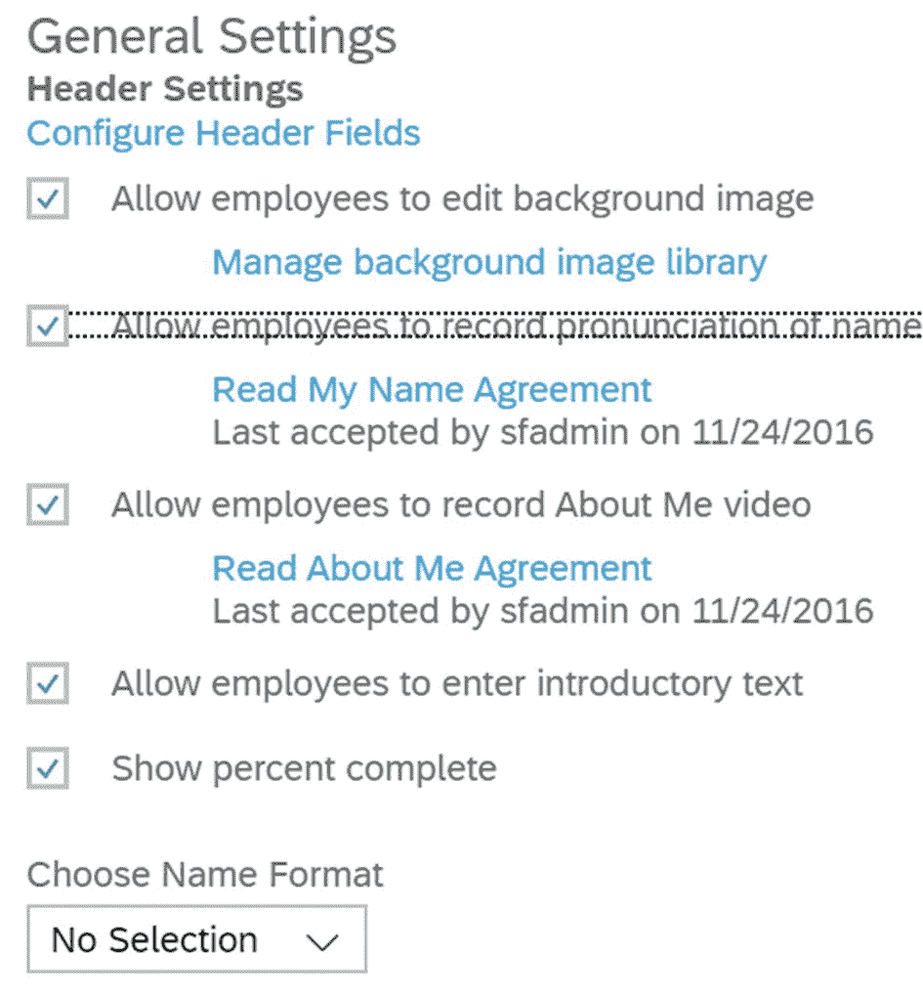

**图 2-19** – 人员档案：常规设置配置

**表 2-8** 常规设置配置选项

| 配置设置 | 描述 |
| --- | --- |
| `允许员工编辑背景图片` | 启用此选项后，员工可以上传自己的背景图片到个人资料头部。 |
| `管理人员背景图片库` | 图片库维护着可供员工选择的图片存储库。作为管理员，你可以维护可供员工使用的图片。 |
| `允许员工录制姓名发音` | 如果勾选，员工将获得在人员档案中访问`我的姓名`的权限。用户可以使用此功能录制关于如何发音其姓名的简短音频片段。用户也可以输入其音标拼写。注意：在复选框下方，你会看到一个指向`阅读我的姓名协议`的链接。该协议规定所有媒体内容均存储在位于德国的 SAP 数据中心。此链接/协议不对用户开放。 |
| `允许员工录制关于我的视频` | 如果勾选，员工将获得在人员档案中访问`关于我`的权限。用户可以使用此功能录制关于自己的简短视频片段。该视频片段将在人员档案中该员工的个人资料头部内提供。注意：在复选框下方，你会看到一个名为`阅读关于我协议`的链接。该协议规定所有媒体内容均存储在位于德国的 SAP 数据中心。此链接/协议不对用户开放。 |
| `允许员工输入简介文字` | 启用此选项后，员工可以输入关于自己的简介文字，最多 500 个字符。简介文字将在人员档案中该员工的个人资料头部内提供。 |

| 显示完成百分比 | 如果启用此选项，最终用户会看到其人员档案中显示完成百分比的图标。员工可以使用档案完成向导来完成其档案。**注意：** `显示完成百分比`仅对该特定员工可见（即，当他们以“自己”的身份查看其人员档案时），对其他任何用户/角色（包括管理员角色）均不可见。 |

### 配置标头字段

如图 2-20 所示，你可以点击“`配置标头字段`”链接，以配置应在“`人员档案`”标头中显示哪些数据字段。

默认情况下，标头中可显示以下字段：

-   员工照片
-   员工姓名
-   `用户 ID`
-   职位头衔
-   员工所在组织详情，例如部门、分部、地点
-   时区（由员工选择）
-   当地时间（员工所在时区）
-   `电子邮件`
-   电话号码
-   `Facebook` 和 `LinkedIn` 徽标

系统还允许你选择最多三个你在系统中配置的自定义数据字段。

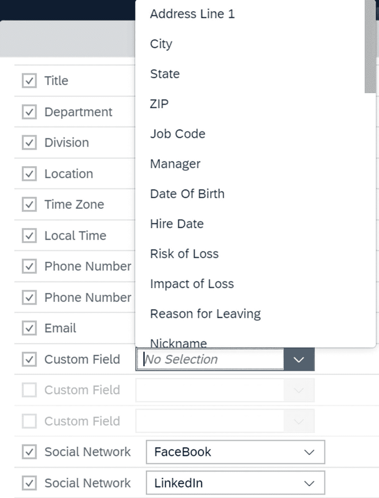
图 2-20 人员档案：配置标头设置

当你点击“`配置标头字段`”链接时，会显示可供配置的字段（见图 2-20）。在显示的页面上，你可以勾选/取消勾选希望显示在“`人员档案`”标头中的字段。

要配置自定义字段，你需要勾选“`自定义字段`”。一旦勾选，选择列表便会启用。你可以从选择列表中选择任意可用字段显示在档案标头中。

**注意：** 员工需要获得权限才能查看“`人员档案`”标头中的某个字段。作为管理员，我们在进行此配置时所做的只是启用那些可以在“`人员档案`”和档案标头中被编辑/设为可见的字段。员工需要被授予 `自身` 的相应权限才能查看或编辑某个字段。其他角色，如 `经理`、`上级经理`、`HR` 和 `同事`，也需要拥有相应的权限。例如，你可能有一个要求，即 `Facebook` 仅应对员工本人和 `HR` 可见（角色为 `自身`）。在这种情况下，你只需向 `自身` 和 `HR` 角色授予权限。其他角色（如 `经理`、`上级经理`、`HR` 和 `同事`）将没有查看或编辑的权限。

### 配置人才数据设置

在“`人才数据设置`”区域（见图 2-21），你可以配置等级评分应在“`人员档案`”中显示的日期范围。你还可以配置这些评分的来源。这些来源是系统中已配置并可用的不同表单。你也可以将进行中的表单作为数据源包括在内。

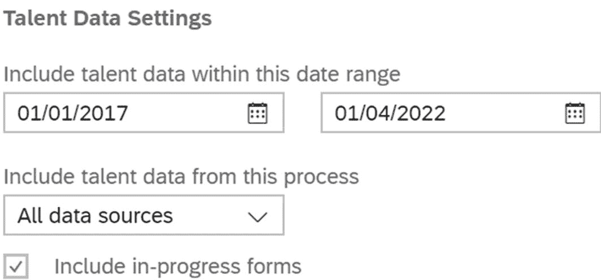
图 2-21 人员档案：配置人才数据设置

**提示：** 建议你选择所有数据源。这样你就可以查看员工历年的评分。

#### 设置对 Portlet 的权限

我们需要为不同角色（如员工（`自身`）、`HR`、`经理`、`直接上级`及更高级经理）设置对“`人员档案`”中不同 portlet 和数据字段的编辑/查看功能的权限。在下一节中，我们将回顾如何为不同角色配置权限。

#### 经理权限角色

你将权限分配给一个角色，并将该角色分配到一个权限组（见图 2-22，你可以在其中访问与权限相关的配置步骤）。员工需要被分配到一个权限组，才能导航操作 `SuccessFactors`。

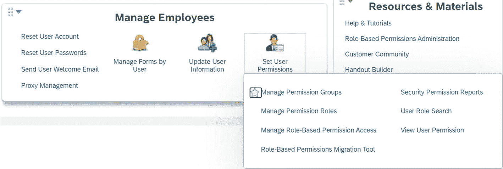
图 2-22 设置用户权限

在开始配置之前，负责配置权限的顾问/团队需要了解需要哪些权限组，并且需要为每个组分配权限。一个员工可能被分配到多个权限组。重要的是，要考虑分配给员工的不同权限组之间不应相互抵消。例如，假设一个员工被分配到一个无权查看其他员工业绩评分的组，同时又分配到了一个有权查看其他员工业绩评分的组。在这种情况下，系统会判定拥有查看权限的组优先于没有查看权限的组。

客户通常会询问 `HR`、经理或 `HR` 支持台如何知晓员工是否在“`人员档案`”中更新了信息。例如，如果员工更改了姓名或家属信息，`HR` 需要了解此变更，以便支持后续流程。如果没有部署 `Employee Central`，`HR` 就无法收到任何姓名更改的通知。因此，在这种特定场景下，需要告知业务部门：姓名将仅对员工本人（`自身`）可见，且只有 `HR` 拥有编辑能力。

在审查各模块的权限时，你需要与业务部门确认谁将维护这些模块中的数据。你应该仔细填写权限工作簿，确定参与者（`HR`、`经理`、`经理+1` 等）以及他们对每个模块拥有的权限（编辑/查看）。

**提示：** `SuccessFactors` 中有一些预定义的报表，你可以在基于角色的权限（`RBP`）配置期间执行以提供支持。这些报表如下：

-   `RBP 用户到角色报表`：此报表列出了授予用户的所有权限角色，以及分配给该权限角色的目标人群。
-   `RBP 权限到用户报表`：此报表列出了所有权限以及被授予特定权限的用户。
-   `RBP 用户到组报表`：此报表列出了用户及其所属的权限组。
-   `RBP 权限角色报表`：此报表列出了已授予的权限角色及其分配的目标人群。

#### 需要分配的权限

`People Profile` 很可能是 `SuccessFactors` 中最重要的对象。在 `SuccessFactors` 中，它是比其他任何对象都更频繁被查看/编辑的对象。因此，正确捕获和配置权限要求至关重要。当系统中存在多个模块时，配置与人员档案相关的权限会更具挑战性。在配置权限时，您需要谨慎行事，避免最终创建超出必要的过多权限组或权限角色。

> **提示**
>
> 通常，会为每个 `SuccessFactors` 模块维护一个权限工作簿。虽然这是实施过程中的标准方法，但对于安全管理员来说，这无法提供任何关于这些权限如何与现有权限组和角色合并的见解。

图 2-23 展示了一个权限工作簿的快照，这是我通常在进行实施时所使用的。在左侧，我们列出了系统中所有可用的权限。在右侧，我们确定了不同的执行者，例如所有用户、员工组、主管（通常指直属经理及以上级别）等。然后，我们确定谁需要哪些权限的访问权限。我发现，维护一个通用的权限工作簿，可以大大减轻权限需求收集和配置的压力，同时也有助于安全管理员理解 `SuccessFactors` 安全架构的整体蓝图。

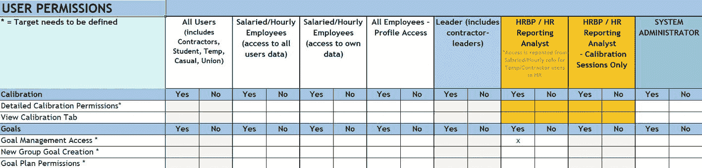
*图 2-23 – 权限工作簿*

> **注意**
>
> 详细审阅权限工作簿超出了本书的范围。

在表 2-9 中，我们将审阅访问 `People Profile` 中特定对象需要分配哪些权限。

**表 2-9 – 权限**

| 待访问对象 | 权限名称 | 描述 |
| --- | --- | --- |
| `People Profile` | `User Permissions ➤ General User Permission ➤ Live Profile Access` | 此权限应分配给所有需要访问 `People Profile` 的用户。 |
| 在 `People Profile` 中配置的区块和板块 | `User Permissions ➤ Employee Views` | 控制 `People Profile` 中配置的板块的可见性。`Employee Views` 中列出了 `People Profile` 中配置的不同板块。您可以勾选/取消勾选需要分配给此权限角色的板块。 |
| `People Profile` 中的数据字段 | `User Permissions ➤ Employee Data` | 查看员工数据的权限在此权限中列出。您可以控制哪些字段/背景元素可以被哪个权限角色编辑或查看。**注意：** 您可以对单个 HRIS 字段（例如 `First Name`、`Last Name`、`Address 1` 等）进行权限设置。背景元素（系统提供的和自定义的）仅能作为独立的背景元素进行权限设置。 |

#### 导入与导出数据

我们可以将数据导入到系统中配置的任何背景元素中。目前，从非 MDF 背景元素导出数据的唯一方式是通过报表。

要将数据导入到非 MDF 背景元素，您可以转到管理后台并点击 `Import Extended User Information`。

> **注意**
>
> 您可以通过转到管理后台并点击 `Import and Export Data` 来导出和导入基于 MDF 的背景元素的数据。讨论基于 MDF 的背景元素超出了本书的范围。当 `SuccessFactors Employee Central` 在系统中时，会使用基于 MDF 的背景元素。

### 导入扩展用户信息

# 背景信息数据导入与导出

## 导入背景信息

在配置步骤 `Import Extended User Information`（参见图 2-24）的登录页面上，选择 `Background Information` 选项以将数据导入到背景元素中。

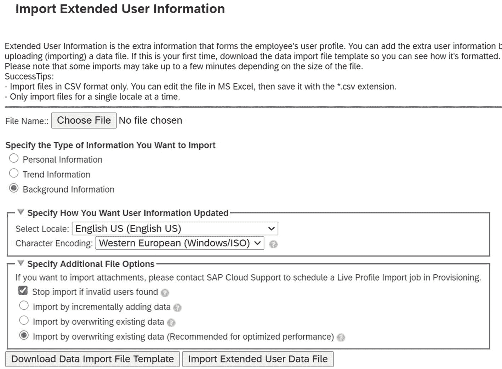  
*图 2-24 – 背景信息数据导入*

点击 `Download Data Import File Template` 下载我们将使用的导入模板。该模板包含系统中所有非 MDF 背景元素的结构。我们只会使用将要为其导入数据的背景元素。因此，您需要删除本次导入不会用到的背景元素结构。

图 2-25 显示了我们之前配置的背景元素 `Favorite Travel Destinations` 的列。我们仅为此背景元素导入少量员工的数据。

我们将按照以下格式填写数据：

- `^UserID`：输入您要为其导入数据的员工的 UserID。
  > **注意**
  > 您可以从 UDF 文件（“用户数据文件”）中获取 UserID。您可以通过转到管理后台并点击 `Employee Export` 从系统中导出 UDF 文件。
- `AssignmentID`：此列可以留空。
- `favTravelDestinations`：此列的值始终为 `favTravelDestinations`。此值是静态的。
- `destName`：输入目的地名称。针对本次导入，我们的值将是 `London, England`。
- `destDesc`：此列将包含为什么这是首选目的地的描述。我们的值将是 `“I love everything about London.”`  
  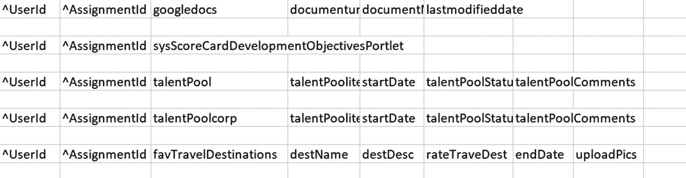  
  *图 2-25 – 用于导入数据的导入模板*
- `rateTravelDest`：我们的值将是 `Rank 5`。
  > **注意**
  > 在背景元素中，字段 `rateTravelDest` 是一个选择列表字段。您需要查看选择列表以获取您在此处使用的实际值。您需要在此列中输入选择列表值的标签。
- `endDate`：此字段在用户界面中的标签是 `Date Last Visited`。我们将使用值 `7/3/2017`。

在配置步骤 `Import Extended User Information`（参见图 2-25）中，选择单选按钮 `Background Information`。选择适当的区域设置和字符编码。根据我们这里的讨论，我们将选择 `English US` 和 `Unicode (UTF-8)`。

在 `Specify Additional File Options` 部分，您有三个选项：

- **通过增量添加数据导入**：选择此选项时，文件中的数据将被添加到员工记录中的现有数据中。如果导入文件中没有某员工的记录，但系统中已存在该记录，则现有记录不受影响。
- **通过覆盖现有数据导入**：此选项将覆盖现有数据。因此，如果员工 `1000` (UID) 存在此背景元素的现有记录，且该员工未出现在导入文件中，则其数据将被擦除。使用此选项时请谨慎。
- **通过覆盖现有数据导入（为优化性能推荐）**：此选项将使用文件中的现有数据覆盖数据。如果系统中的数据与文件中的数据相同，则该记录将被跳过。

对于本次导入，我们将选择“通过增量添加数据导入”选项。

点击 `Choose File` 并上传文件。点击 `Import Extended User Data File` 以导入文件。系统现在将显示一个对话框。阅读对话框内容后点击 `Yes`。

访问 `People Profile` 并检查背景元素。您会注意到数据已成功导入。

## 导出数据的计划任务

如果您拥有 `Provisioning` 的访问权限，则可以配置后端作业来计划导出。在 `Provisioning` 中，进入`管理作业计划程序`部分的配置步骤 `管理计划任务`。在显示的页面中，点击 `创建新作业`。

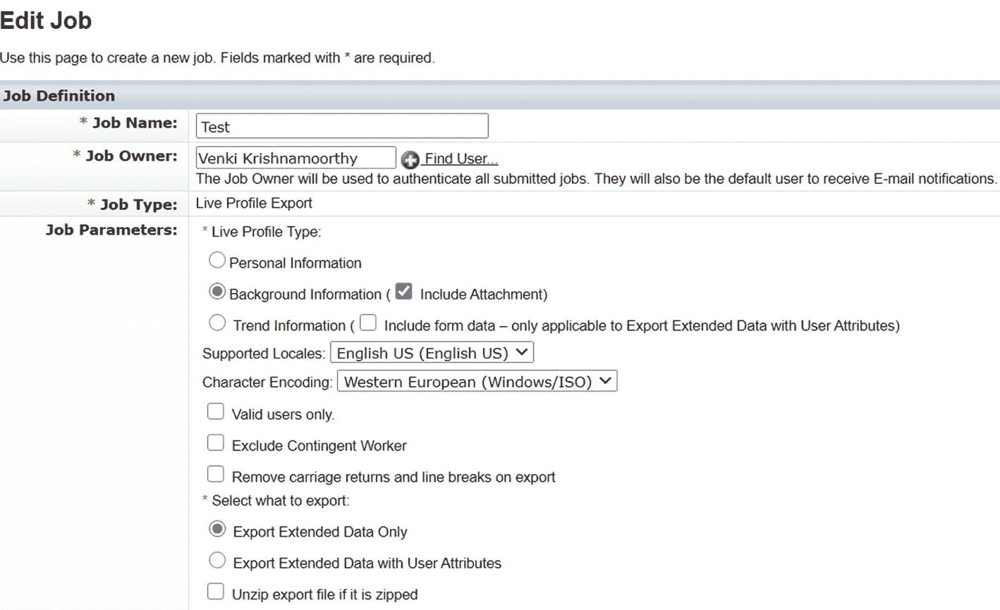  
*图 2-26 计划导出数据的作业*

如图 2-26 所示，输入作业名称和作业所有者。在 `作业类型` 中，选择 `实时用户档案导出`。在 `作业参数` 中，选择 `背景信息`，然后选择 `包含附件`。在“选择导出内容”部分，选择 `仅导出扩展数据`。

在 `服务器访问` 中，您需要输入 SFTP 的详细信息。

> **注意：** 所有 `SuccessFactors` 客户都将有权访问 `SuccessFactors` 提供的 SFTP。有时，客户可能更倾向于使用他们自己的 SFTP。请与客户确认他们的偏好。

在 `文件访问` 中，输入您希望将导出的文件存放到的文件夹。

在 `作业发生与通知` 中，将作业配置为仅执行一次。

保存作业。在作业页面上，提交作业并立即执行。当作业成功执行后，登录 SFTP，您应该会在您在 `Provisioning` 中配置的文件夹中看到导出的文件。

> **提示：** 您可以在 `Provisioning` 中配置作业，以将数据导入到背景元素。将导入文件放到 SFTP 的特定文件夹中。配置并执行作业。计划任务将使用该文件并相应地更新背景元素。

### 使用集成中心导出背景元素数据

虽然 `集成中心` 通常用于为集成创建数据文件，但您也可以使用 `集成中心` 来导出背景元素的数据。您可以通过前往 `管理中心` 并点击 `集成中心` 来访问 `集成中心`。在显示的页面上，点击 `我的集成`。这将打开一个新页面，显示所有在 `集成中心` 中配置和可用的集成。点击 `创建` 并选择 `计划简单文件输出集成` 来创建一个新的集成。

在搜索框中，输入您要导出数据的背景元素的 ID（参见图 2-26）。在我们的讨论中，我们将输入 `favTravelDestinations`。在同一页面的右侧，您将看到该背景元素中配置的字段。选择您希望包含在导出文件中的字段。点击 `选择`。在下一页，您可以输入文件名以及文件输出格式。点击 `下一步`。此处会显示背景元素中的数据。在显示的页面中，您还可以选择重命名列标题以及数据格式。如果需要，您还可以通过拖放来更改列的顺序，以按照您希望的顺序排列。

> **提示：** 当您使用 `Provisioning` 中的计划任务导出数据时，重命名列标题或配置数据格式的选项是不可行的。因此，一些客户更喜欢使用 `集成中心` 来导出数据。

在数据显示的页面中，您可以右键单击任何列标题。这将显示可用于配置该特定列的选项。

在 `目标设置` 选项中，您可以配置 SFTP 详细信息、文件名以及希望生成文件存放的文件夹。在 `计划` 选项中，您可以配置此作业的执行时间和频率。参见图 2-27。

> **注意：** 您还可以通过在 `报告中心` 创建基于表格的报告来导出数据。如您所见，我们有多种导出数据的选项。您选择哪种选项取决于业务需求。例如，如果您只需要一次性或按需导出数据，那么优先使用报告导出。如果导出的数据将被其他应用程序使用，那么您可以使用 `集成中心` 或 `Provisioning` 中的计划任务来导出数据。与 `Provisioning` 中的计划任务相比， `集成中心` 相对较新，因此 `Provisioning` 中的计划任务更常见且更受欢迎。

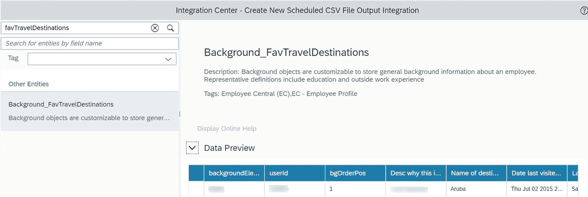  
*图 2-27 使用集成中心导出数据*

## 案例研究

在本节中，我们将回顾一个案例研究，其中我们将在 `人员档案` 中配置趋势元素，并将历史数据导入这些元素。

### 描述

客户 A 希望在 `人员档案` 中配置趋势元素，并且希望这些元素仅对直线经理和 HR 经理可见和可编辑。员工将无法访问这些趋势元素。客户希望将 `绩效` 和 `潜力` 模块分别标记为“仅限绩效经理/HR 查看”和“仅限潜力经理/HR 查看”。

客户 A 还希望将历史遗留数据加载到这些趋势元素中。

### 解决方案

背景元素 `sysOverallObjective`、`sysOverallCompetency`、`sysOverallPerformance`、`sysOverallPotential`、`sysOverallCustom1` 和 `sysOverallCustom2` 被称为*趋势元素*。

我们将像配置其他背景元素一样，在人员档案中配置它们。

**步骤 1：** 我们将检查趋势元素的结构，并在需要时启用它们。前往管理中心，点击“管理业务配置”。

在显示的页面上（见图 2-28），点击“员工档案”部分，然后点击“背景元素”。向下滚动，并点击 `sysOverallPerformance`。

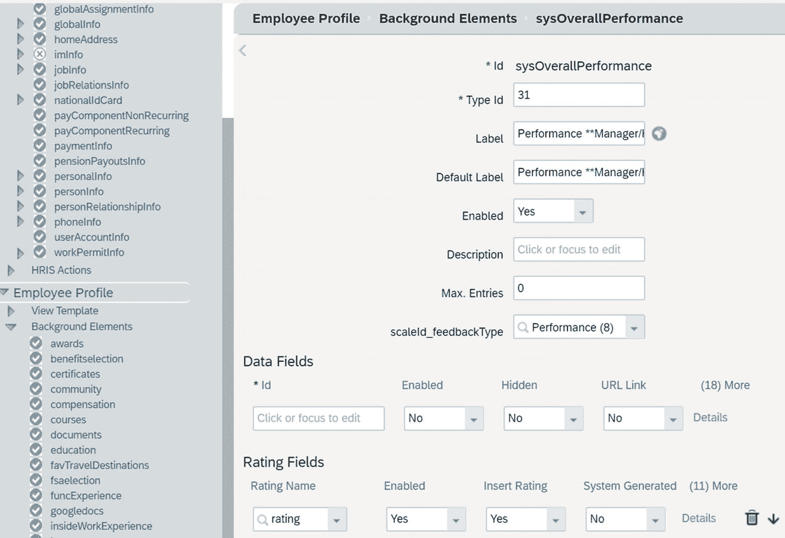

图 2-28

### 启用 `sysOverallPerformance`

检查“已启用”字段的值是否为“是”。如果不是，请从下拉菜单中选择“是”，然后点击“保存”。这将启用该趋势元素。

**注意**

“评分字段”部分用于趋势元素。这些字段显示评分数据。在评分字段中，转到“评分”字段，然后点击“详细信息”。在显示的页面上，确保“已启用”字段为“是”，并且“插入评分”字段为“是”。点击“保存”以保存更改。

类似地，启用趋势元素 `sysOverallPotential`，并在需要时对“评分字段”进行更改。

### 步骤 2：在人员档案中配置趋势元素

现在，我们将通过前往管理中心并点击“配置人员档案”来在人员档案中配置这两个趋势元素。在显示的页面上（见图 2-29），滚动到“人才档案”部分。

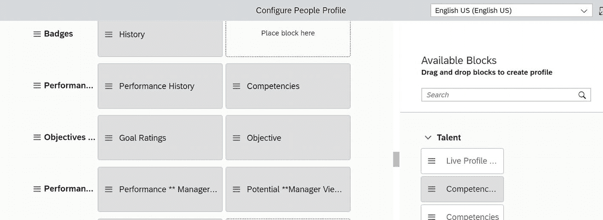

图 2-29

在人员档案中配置 `sysOverallPerformance`/`sysOverallPotential`

在“可用块”列表中，滚动到“人才”部分。该部分的第一个块是“个人档案趋势信息”。选择该块并将其拖放到“人才档案”部分。这将显示“编辑块属性”（见图 2-30）。在编辑页面上，在“趋势元素”下拉菜单中，选择趋势元素“绩效 **仅经理可见”。这就是我们在上一部分中检查的块 `sysOverallPerformance`。现在，将“块标题”更改为“绩效 **经理/HR 可见”。更新描述以反映“块标题”设置。点击“保存”以保存更改。

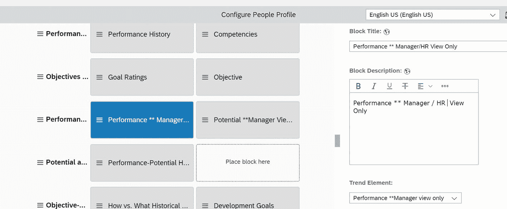

图 2-30

编辑块 `sysOverallPerformance`

类似地，配置块 `sysOverallPotential`。将分区标签更改为“绩效和潜力 仅经理/HR 可见”。记得勾选选项“在档案上显示此分区”。点击“保存”以保存更改。

### 步骤 3：设置块权限

现在，我们将通过前往管理中心并选择“经理权限角色”来将这些块的权限仅授予直线经理和 HR。选择需要授权的适当权限角色。在“用户权限”部分，滚动到“员工数据”。在显示的页面上（页面将显示在您的右侧），滚动到“背景”部分。为块“绩效 **仅经理/HR 可见”和“潜力 **仅经理/HR 可见”选择“编辑/查看”权限。

### 步骤 4：验证配置

前往您作为直线经理或 HR 身份所管理的任意员工的人员档案。滚动到“人才档案”部分。您可以查看我们刚刚配置的分区和块。请参见图 2-31 以查看我的实例中的视图。

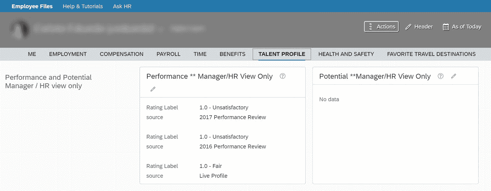

图 2-31

`sysOverallPerformance` 和 `sysOverallPotential` 在人员档案中显示

### 注意

如果您想创建块和分区/子分区，建议您探索人员档案中的 LinkedIn 块。您可以参考 SAP SuccessFactors KBA: 2085406，“如何启用 LinkedIn 集成（标准元素）- 员工档案”，以获取有关如何在人员档案中配置 LinkedIn 的详细信息。供您参考，SuccessFactors 现在提供了一个在人员档案中显示 LinkedIn 小部件的选项。您可以参考 SAP SuccessFactors KBA: 2507469，“人员档案的 LinkedIn 小部件概述 - SuccessFactors 员工档案”，了解如何配置该小部件。

## 结论

在本章中，我们讨论了人员档案和人才档案。然后，我们讨论了如何在人员档案中配置块。我们研究了当前可用的两个选项：在管理中心的用户界面中配置和在继任数据模型中配置。您应该使用哪个选项取决于您自己的偏好。没有唯一的方法。两个选项都能完成任务。在本章后面，我们讨论了如何导出和导入数据。我们研究了在管理中心手动导入的选项以及在 Provisioning 中配置计划任务的选项。随后，我们回顾了如何通过在 Provisioning 中配置导出任务来导出数据。我们还讨论了集成中心和报告中心提供的选项。在本章末尾，我们通过一个案例研究，讨论了如何配置趋势元素，如 `sysOverallPerformance` 和 `sysOverallPotential`。

有一件事我们没有讨论，我将其留作您的练习：将数据导入到新配置的趋势元素中。作为提示，我建议您回顾“导入扩展用户信息”部分和图 2-24。该过程类似于为背景元素导入数据。

在下一章中，我们将讨论职位档案构建器，我们将回顾职位档案构建器提供的功能，以及如何利用它为您的人才战略带来效率。