# 3. 职位档案构建器

职位档案构建器是`SAP SuccessFactors`中的一个工具，用于维护职位元素。这些元素包括职位描述、经验、资质、技能、能力、行为、教育背景、认证和技能。职位档案构建器 (`JPB`) 基于`SuccessFactors`元数据框架，并且可以与`SuccessFactors`人才模块（如招聘、绩效与目标管理、职业发展、继任管理和人员档案）集成。

## 表 3-3 职位档案构建器对象及相关对象

| 职位档案构建器对象 | 相关对象 |
| --- | --- |
| 系列 | 系列 – 技能 |
|  | 系列 – 能力 |
| 角色 | 角色 – 映射的技能 |
|  | 角色 – 职位代码 |
|  | 角色 – 映射的能力 |
|  | 角色 – 映射的人才库 |
|  | 角色 – 映射的能力行为 |
| 能力 | 能力 – 行为 |
|  | 能力 – 能力类型 |
| 教育背景 | 教育背景 – 学位 |
|  | 教育背景 – 专业 |
| 职位档案 | 职位档案 – 页眉 |
|  | 职位档案 – 认证 |
|  | 职位档案 – 身体要求 |
|  | 职位档案 – 相关行业 |
|  | 职位档案 – 学位 |
|  | 职位档案 – 雇佣条件 |
|  | 职位档案 – 简短描述 |
|  | 职位档案 – 能力 |
|  | 职位档案 – 专业 |
|  | 职位档案 – 薪酬数据 |
|  | 职位档案 – 技能 |
|  | 职位档案 – 详细描述 |
|  | 职位档案 – 页脚 |
|  | 职位档案 – 工作职责 |
|  | 职位档案 – 面试问题 |
| 职位模板 | 职位模板 – 关联的系列 |
|  | 职位模板 – 分区 |

## 表 3-2 档案内容类型

| 内容类型 | 描述 | `JPB` 对象 |
| --- | --- | --- |
| 职位族 | 涉及相似工作类型的职位可以归为职位族。通常，同一职位族中的职位需要相似的胜任力、技能和培训。例如：人力资源（HR）、会计等。 | `设置职位族与角色` |
| 角色 | 与特定职位相关的预期行为和技能。在`JPB`中，角色可以与职位代码、职位分类、职位族和职务相关联。例如：会计。 | `设置职位族与角色` |
| 胜任力类型 | 胜任力类型有助于将胜任力组织到不同类别中。例如：所有与会计角色相关的胜任力可以归类为“会计”胜任力类型。一个胜任力可以分配给多个胜任力类型。 | `胜任力类型` |
| 胜任力 | 胜任力是一组已定义的行为。胜任力帮助组织与员工识别和评估需要发展的胜任力差距。胜任力也帮助组织和员工识别员工擅长的胜任力。员工需要具备并拥有为某个角色所定义的一组特定胜任力的经验。例如：一个名为`承担责任`的胜任力可能具有行为“对履行承诺负责；对任务和目标表现出主人翁精神；不为糟糕表现找借口或将责任推卸给他人”。因此，如果`承担责任`胜任力与某个角色相关联，我们会期望员工表现出“对他们需要交付的任务负责并具备主人翁精神”的行为。 | `胜任力` |
| 行为 | 这是某个角色所需的一组已定义的特质。例如：人力资源业务伙伴（HRBP）角色可能需要一个名为`善于倾听`的胜任力，该胜任力可能关联着`同理心`行为。一个胜任力可以有多个关联行为。一个行为可以关联到多个胜任力。 | `分配行为` |
| 技能 | 技能是工作所需的知识与经验的结合。员工可以通过经验、学习、指导和跟随经验丰富的人员来发展这些技能。注意：技能通过熟练程度进行评估。例如：`系统设计`是系统分析师角色所需的技能。员工可以通过教育、经验（来自过往工作）、学习（通过组织提供的学习课程）以及跟随有经验的同事来发展这项技能。`系统设计`是系统分析师工作的必备技能。要成为首席系统分析师，你需要达到熟练程度 5 级（5/5），而初级系统分析师只需要 3 级熟练程度。 | `技能` |
| 工作职责 | 工作职责是指分配给某个职位的一系列任务、职责和责任。例如：作为人力资源业务伙伴（HRBP），你的工作职责将包括在计算机系统中维护员工的个人档案。 | `工作职责` |
| 相关行业 | 这是一个行业列表。某些工作可能需要特定的行业经验。此列表可以与这些特定工作相关联。例如：制造流程的系统设计与HRIS业务流程的系统设计是不同的。因此，系统分析师的角色可能需要具备在制造公司工作的经验。 | `相关行业` |
| 雇佣条件 | 这是一个就业所需条件的列表。这些雇佣条件可以是通用的，也可以是与特定工作相关的。例如：一个通用的雇佣条件可能包括工作日的办公时间。一个特定的雇佣条件可能是要求隔周周六上班。 | `雇佣条件` |
| 学历——学位 | 这是一个学历水平列表。一些工作可能需要特定的学位级别。学位列表可能包括：完成学业、学士学位、硕士学位、博士学位等。例如：制药公司科学家的职位可能要求员工拥有博士学位。 | `学历——学位` |
| 学历——专业 | 这是在攻读学位期间所修科目的列表。专业列表可能包含以下内容：国际商务、人工智能、有机化学等。例如：制药公司科学家的角色可能要求员工拥有有机化学博士学位。 | `学历——专业` |
| 身体要求 | 这是一项执行工作所需的身体条件列表。例如：仓库工人可能需要频繁举起重达 20 磅的物体。 | `身体要求` |
| 认证 | 这指的是由外部机构进行的评估列表或通过教育获得的资格。例如：`SuccessFactors`顾问应获得`SuccessFactors`招聘模块的助理认证。 | `认证` |
| 面试问题 | 这是系统中维护的问题列表。这些问题可以是通用的，也可以是针对特定角色的。例如：一个通用问题可能是“你是否有在美国工作的授权？”一个针对特定角色的问题可能是，“你完成过多少次`SuccessFactors`实施？” | `面试问题` |

## 表 3-1 `JPB` 的权限设置

| `RBP` 权限选项 | 权限 |
| --- | --- |
| 一般用户权限 | 选择`用户登录`。选择`实时档案访问`。 |
| 元数据框架 | 选择`全部`。**注意**：选择`全部`将选中`元数据框架`选项下的所有可用权限。 |
| 管理职位档案构建器 | 选择`全部`。**注意**：此权限授予管理职位档案及职位档案内容，以及导入/导出职位档案内容的权限。 |
| 管理职位与技能档案可见性 | 滚动至以下权限：`职位档案`：选择`查看`、`编辑`和`导入/导出`。`JobReqJobProfile`：选择`查看`、`编辑`和`导入/导出`。`技能档案`：选择`查看`、`编辑`和`导入/导出`。 |
| 管理职位与技能档案可见性 | `技能档案`。`分级技能（Rated Skills）`：选择`查看`、`纠正`、`创建`、`调整顺序`、`删除`和`导入/导出`。**注意**：仅当`技能档案`对象启用时，此权限才可见。 |

**注意**
在本章中，我们将`职位档案构建器`简称为`JPB`。

使用`JPB`，您可以在`SuccessFactors`中为不同的内容类型构建内容库。以下是`JPB`中可用的内容类型：

- 职族
- 职位角色
- 认证
- 胜任力，包括行为表现
- 雇佣条件
- 教育背景、学历
- 教育背景、专业
- 面试问题
- 岗位身体条件要求
- 技能，最多五个熟练度级别
- 相关行业
- 工作职责，包括职务

在`JPB`中开发内容后，您需要创建职位档案模板，在其中定义要包含在职位档案中的格式和章节。职位档案会关联到职位角色，而与职位角色相关的内容则来源于您将在系统中创建或导入的内容。

`JPB`构建于`SuccessFactors` `元数据框架 (MDF)`之上。`MDF`使您能够创建和维护对象定义、对象之间的关系以及对象层级结构。`JPB`是`SuccessFactors`旧工具`职位描述管理器 (JDM)`的继承者。`JDM`与`JPB`之间的区别在于`MDF`。如果您是现有的`JDM`客户，您可以通过将职族、角色和职位代码迁移到角色映射，并将胜任力迁移到新配置的`JPB`框架，从而升级到`JPB`。您只能在配置`JPB`之后进行此项配置。知识库文章 2276692，“关于从 JDM 迁移到 JPB 的说明”是一份很好的参考资料。

**注意**
详细讨论`MDF`超出了本书的范围。

在实施`JPB`之前，请确保客户实例满足以下前提条件：

- 客户应已实施`SuccessFactors`平台。
- 客户应已实施基于角色的权限 (`RBP`)。
- 客户应使用`V12`用户界面。

**注意**
`JPB`是`SuccessFactors`平台的一个组件，无需支付额外许可费用。

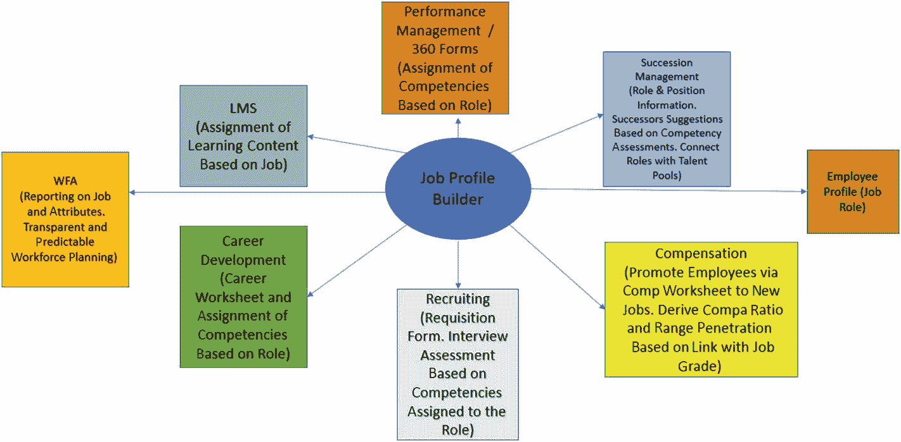

**图 3-1** 将`JPB`与`SuccessFactors`人才管理模块集成

图 3-1 展示了不同的`SuccessFactors`模块如何利用`JPB`。

实施`JPB`使企业中的不同职位角色能够清晰洞察所需的岗位要求、技能和胜任力。当系统中定义了岗位标准后，员工可以识别自身岗位的职位要求、明确培训需求、与主管合作规划绩效目标，并确定在企业中担任下一个职位角色所需的技能和胜任力。招聘人员可以使用`JPB`中的内容创建职位申请，并且可以通过利用与岗位相关联的比较比率和区间渗透率来进行薪酬规划。

**注意**

客户会使用由第三方供应商开发的职位描述、技能和胜任力。我们可以使用此类第三方供应商提供的内容，并将其加载到`JPB`中。

在本章中，我们将讨论如何配置`JPB`，以及如何将其集成到`SuccessFactors`人才管理模块中。我们将首先回顾如何在`Provisioning`中激活`JPB`。然后，我们将介绍需要设置的权限，以便访问`JPB`和不同对象，以及如何配置不同对象的可见性设置。我们将审视不同的内容类型，以及如何将数据导入到不同的内容类型中。在本章末尾，我们将通过一个案例研究，了解在真实场景中如何将`JPB`集成到`SuccessFactors`模块中。本章将提供关于如何在企业人才战略中利用`JPB`的全面概述。

## 在 Provisioning 中的配置

在开始使用`JPB`之前，我们需要在`SuccessFactors` `Provisioning`中激活`JPB`。在`Provisioning`的`编辑公司设置`部分，搜索`JDM v2.0`（见图 3-2）。选中此开关。您还需要选中`技能主目录`开关。（请注意，它提示您“请确保合同中包含该内容。需要额外订阅费用。”）记得保存您的设置。如果您未激活`技能主目录`开关，您将无法在配置屏幕`管理职位档案内容`上看到来自`SuccessStore`的`添加<<内容类型>>`链接。“需要额外订阅费用”的说明已失效；因此，您可以忽略该说明。

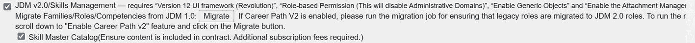

**图 3-2** 在`Provisioning`中激活`JPB`

**注意**

在激活`JDM v2.0`之前，您需要激活以下开关：

- `启用通用对象`

- `启用附件管理器`

### 设置安全权限

您需要为以下`JPB`权限配置基于角色的可见性权限：

- 职位与技能可见性

- 技能档案

- 分级技能

由于`JPB`是一个基于`MDF`的对象，我们在管理屏幕`配置对象定义`上配置这些设置。按照以下各节的步骤完成配置。

您可以在`管理员部分` ➤ `管理职位与技能档案可见性`中查看这些权限。

### 设置可见性：职位档案

我们需要编辑`职位档案`对象定义以配置可见性设置。转到`管理中心`并点击`配置对象定义`。

在显示的屏幕上，第一个搜索框中选择`对象定义`。然后在搜索框中输入`职位档案`（见图 3-3）。

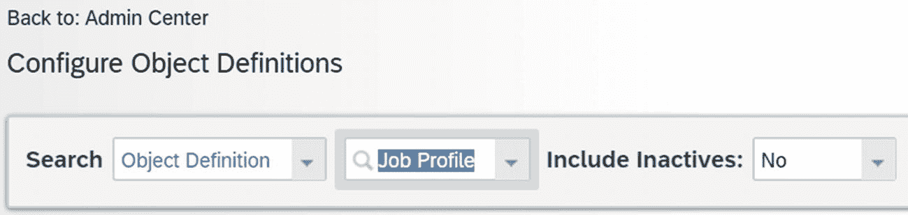

**图 3-3** `职位档案`对象定义

将显示`职位档案`的对象定义。点击`执行操作` ➤ `进行更正`。这将使您能够编辑对象定义。向下滚动页面至`安全`部分（见图 3-4）。

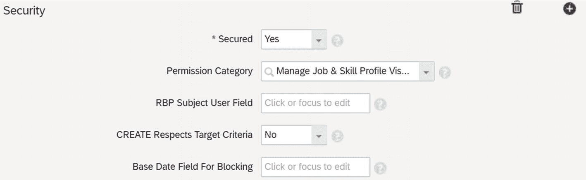

**图 3-4** 编辑`职位档案`对象定义的安全设置

按图 3-4 所示配置`安全`部分。

- *安全字段*：设置为`是`。

- *权限类别*：设置为`管理职位与技能档案可见性`。

- *RBP 主体用户字段*：留空。

- *创建符合目标条件*：设置为`否`。

点击`保存`以保存您的设置。

### 设置可见性：技能档案

我们需要编辑`技能档案`对象定义来配置可见性设置。前往管理中心，点击`配置对象定义`。

在显示的屏幕上，第一个搜索框中选择`对象定义`。然后在相邻的搜索框中输入`技能档案`。

此时会显示`技能档案`的对象定义。点击`执行操作` ➤ `进行修正`。这样你就可以编辑对象定义了。向下滚动页面至`安全`部分（见图 3-5）。

**图 3-5** 编辑`技能档案`对象定义的安全设置

按照图 3-5 所示配置`安全`部分：

- *安全字段*：`是`

- *权限类别*：`管理职位与技能档案可见性`

- *RBP 主体用户字段*：`externalCode`

- *创建尊重目标条件*：`否`

点击`保存`以保存你的设置。

### 设置可见性：已评技能

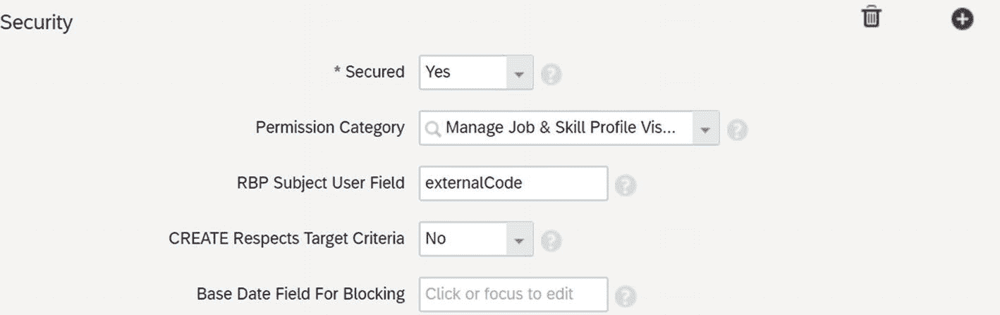

**图 3-6** 编辑`已评技能`的安全设置

我们需要编辑`已评技能`对象定义来配置可见性设置。前往管理中心，点击`配置对象定义`。

在显示的屏幕上，第一个搜索框中选择`对象定义`。然后在相邻的搜索框中输入`已评技能`。

此时会显示`已评技能`的对象定义。点击`执行操作` ➤ `进行修正`。这样你就可以编辑对象定义了。向下滚动页面至`安全`部分（见图 3-6）。

按照图 3-6 所示配置`安全`部分。

- *安全字段*：`是`

- *权限类别*：`管理职位与技能档案可见性`

- *RBP 主体用户字段*：`externalCode`

- *创建尊重目标条件*：`否`

点击`保存`以保存你的设置。

## 配置基于角色的权限

你需要将表 3-1 中显示的权限授予需要访问`JPB`的角色。

点击`完成`以保存你的更改。

图 3-7 显示了需要配置的权限设置，以便授予对`职位档案`对象的查看/编辑权限。

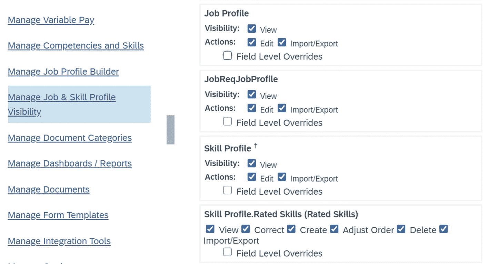

**图 3-7** 为`JPB`配置`RBP`

> **说明**
>
> `字段级别覆盖`提供两个选项：`无访问权限`和`只读`。如果某个特定角色不应读取或不应访问该对象中的某个特定字段，那么你可以使用`字段级别覆盖`并分配特定权限。

## 职位档案构建器内容

在表 3-2 中，我们将审查职位档案内容类型。

通过此对`JPB`的介绍，我们将开始审查各个内容类型的配置。

## 职族

`职族`是`JPB`中的基础内容类型。所有其他内容都建立在职族内容之上，或与职族内容相关。在本节中，我们将审查如何在`JPB`中构建一个职族。

### 使用 SuccessStore 创建职族

我们可以通过从`SuccessStore`下载交付的内容，在 SAP SuccessFactors 中创建职族。

> **说明**
>
> 最佳实践是利用`SuccessStore`中可用的内容。如有需要，你也可以通过手动构建所需内容来创建职族和角色。

前往管理中心，点击`管理职位档案内容`。在显示的页面上，点击下拉菜单`选择内容类型`，然后选择`设置职族和角色`。在显示的页面上，点击`从 SuccessStore 添加职族`。这将显示`管理 SuccessStore 技能内容`配置页面。

> **说明**
>
> 配置页面`管理职位档案内容`包含两个标签页：`职族`和`角色`。请确保你处于`职族`标签页。见图 3-8。

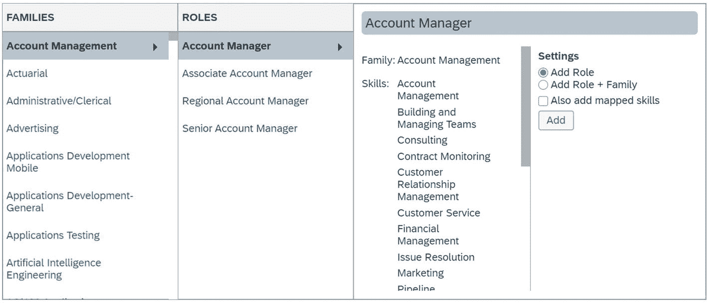

**图 3-8** `管理 SuccessStore 技能内容`页面

在显示的页面上，选择你想要添加的职族。这将显示与该职族关联的所有角色。选择你想要添加的角色。这将显示与该角色关联的所有技能。选项面板提供给你`添加角色`和`添加角色 + 职族`的选项。它还提供“同时添加映射技能”的选项。点击`添加`来添加你的选择。当你不再想添加更多职族时，点击“我已完成”。这将带你返回配置页面`管理职位档案内容`。在`管理职位档案内容`页面上，你将看到你从`SuccessStore`添加的新职族。

### 通过用户界面创建职能门类

您可以通过用户界面手动创建职能门类。前往管理中心，点击“管理职位档案内容”（`Manage Job Profile Content`）的配置页面。在显示的页面上，点击“选择内容类型”（`Select Content Type`）下拉菜单，选择“设置职能门类与角色”（`Set Up Families and Roles`）。在显示的页面上，点击“创建职能门类”（`Create Family`）。

在下一个显示的页面（见图 3-9）上，输入您正在创建的职能门类的名称。（此为必填字段。）

### 将技能映射到职能门类
点击“映射技能”（`Map Skills`）以将某些技能映射到新创建的职能门类。在显示的页面（见图 3-10）上，在下拉菜单中选择“按类别浏览的未分配技能”（`Unassigned Skills Browsed by Category`）。

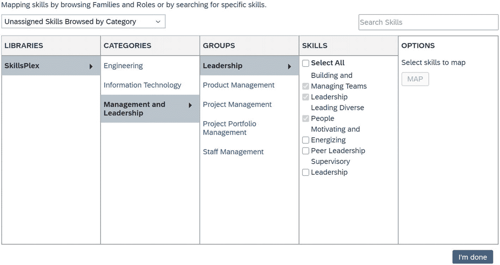

**图 3-10**
通过选择“按类别浏览的未分配技能”将技能映射到职能门类

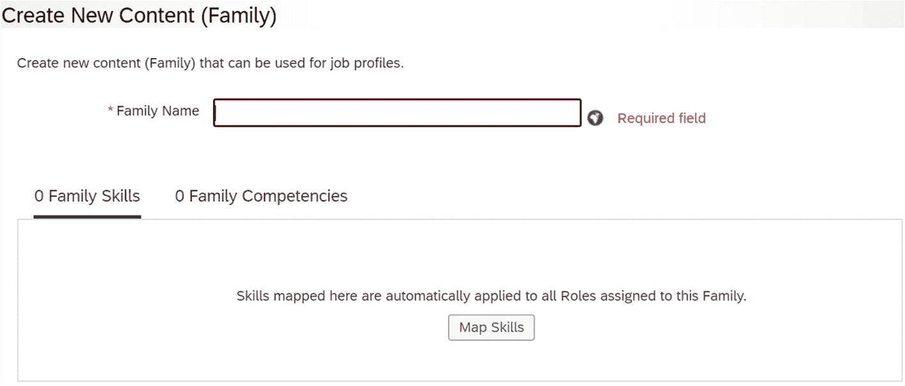

**图 3-9**
在用户界面中创建职能门类

1.  点击显示的库。这将显示可用的类别。
2.  选择您感兴趣的类别。这将显示属于所选类别的组。
3.  选择您感兴趣的组。这将显示该组可用的技能。
4.  选择您感兴趣的技能。如果您想将所选技能映射到一个角色，请点击选项窗格中显示的“映射”（`Map`）。
5.  点击“完成”（“I’m Done”）以结束操作。

这将带您返回“创建新内容（职能门类）”（`Create New Content (Family)`）配置页面。您会看到新添加的技能已被添加到该职能门类中。

您可以为新添加的技能添加熟练度等级（见图 3-11）。点击“熟练度等级”（`Proficiency Level`）列中的下拉菜单，为每个技能选择熟练度等级。为每个技能添加熟练度等级将有助于管理者评估其员工相对于职位所需熟练度等级的掌握情况。同时，员工也能识别出任何技能差距，并参加培训项目以填补所识别的差距。

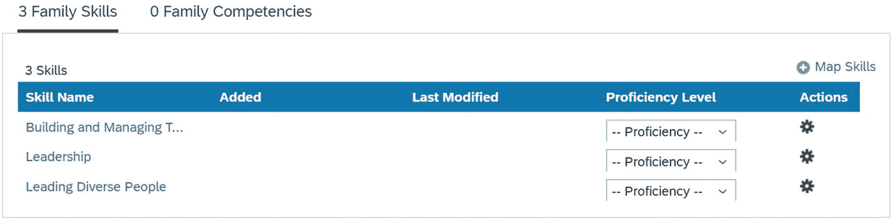

**图 3-11**
为新添加的技能添加熟练度

**注意**：我们将在本章稍后部分介绍技能门户组件。

我们也可以通过选择“按职位职能门类浏览的基于职能门类的技能”（`Family-based Skills Browsed by Job Family`）选项来将技能映射到职能门类。

具体来说，要将技能映射到职能门类，请点击您要为其映射技能的职能门类。分配给该职能门类的角色将被显示出来。在显示的页面上，点击“已映射技能”（`Mapped Skills`）选项。在下一个显示的页面上，您将看到“映射技能”（`Map Skills`）选项。在显示的页面上，从下拉菜单中选择“按职位职能门类浏览的基于职能门类的技能”（`Family-based Skills Browsed by Job Family`）选项（见图 3-12）。

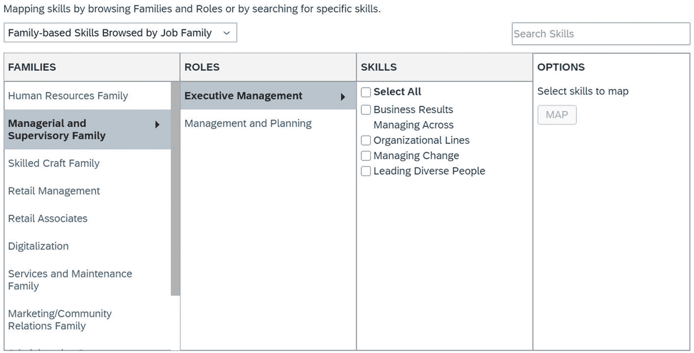

**图 3-12**
通过选择“按职位职能门类浏览的基于职能门类的技能”将技能映射到职能门类

这将显示系统中配置的所有职能门类。选择您要为其分配技能的职能门类。这将显示分配给该职能门类的角色。选择您要为其分配技能的角色。

这将显示系统中可用的技能。选择所有需要的技能。

点击“映射”（`Map`）。这会将技能分配给特定角色。

点击“完成”（“I’m done.”）。

这将带您进入显示分配给该角色和职能门类技能的页面（见图 3-13）。

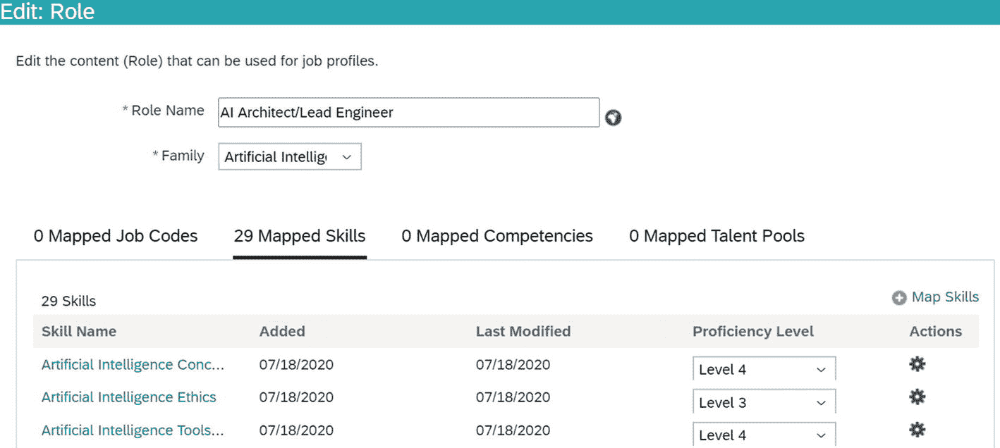

**图 3-13**
列出分配给职能门类和角色的技能

### 编辑技能
在显示的页面上，点击任意技能。新页面（见图 3-14）将显示该技能的内容，以及所分配熟练度的描述。

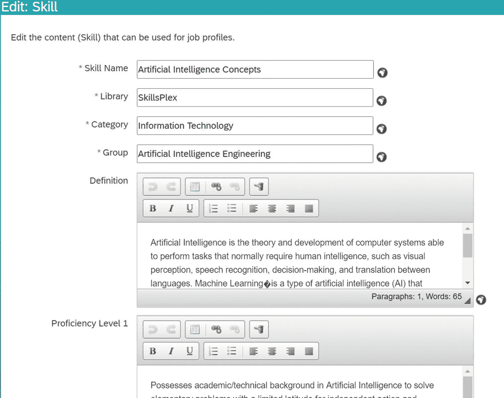

**图 3-14**
编辑技能的内容

客户通常会购买第三方工具来获取技能内容和熟练度描述。通常，客户希望编辑这些内容以符合企业文化及其业务性质。另一些时候，在导入内容时，可能会导入外来字符（例如图 3-14 中所示的`&ʿ`），因此我们必须编辑内容以将其删除。随着企业对职位档案的价值和附加值越来越熟悉，客户可能还希望更改技能的类别。您可以在“编辑：技能”（`Edit: Skill`）页面上进行此类编辑。

### 角色
在系统中创建角色与创建职能门类类似。前往管理中心，点击“管理职位档案内容”（`Manage Job Profile Content`）。在显示的页面上，点击“角色”（`Roles`）选项卡。页面中将显示系统中不同的角色及其所属的职能门类（见图 3-15）。

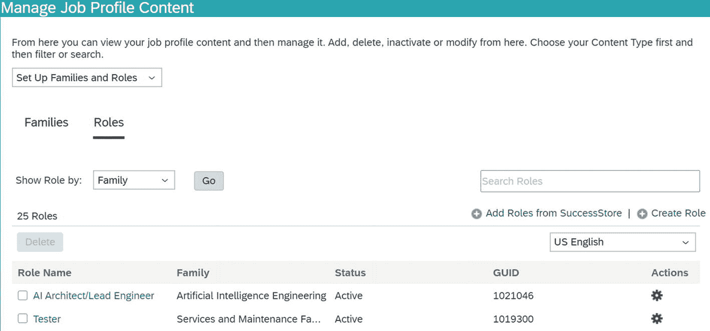

**图 3-15**
实例中可用的角色

点击“创建角色”（`Create Role`）。这将显示“创建新内容（角色）”（`Create New Content (Role)`）。输入角色的名称。在“职能门类”（`Family`）下拉字段中，选择该角色将要分配到的职能门类名称。现在我们需要将角色映射到职位代码。

点击“映射职位代码”（`Map Job Codes`）。在显示的对话框中（图 3-16），您需要输入要分配的职位代码的前导字符。系统会根据前导字符显示所有匹配您输入内容的职位代码。如果有多个匹配项，选项将以下拉菜单形式显示。

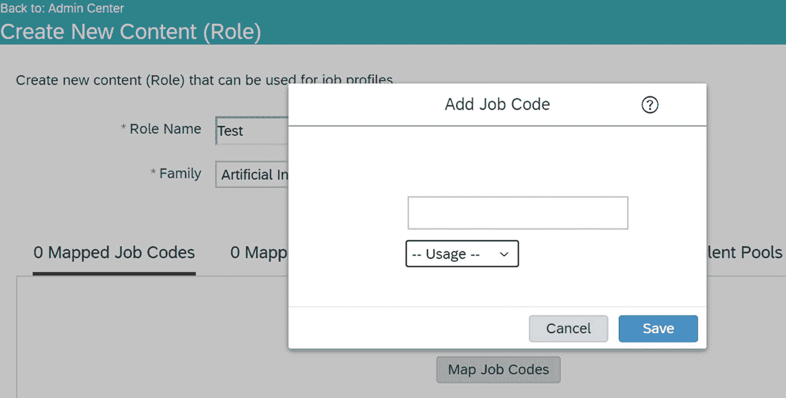

**图 3-16**
为角色添加职位代码

选择职位代码后，您需要选择其用途。可用选项为“默认”（`Default`）和“继任”（`Succession`）。点击“保存”（`Save`）以添加职位代码。

如果您想添加更多职位代码，请点击“添加职位代码”（`Add Job Code`）。

点击“创建角色”（`Create Role`）以完成设置。

如果您的系统环境中包含`Employee Central`，请参考知识库文章 2832345，“使用 JDM 或 JPB - 员工档案时，职位代码或分类与角色映射的区别”，以了解如何配置 JPB。

将显示“管理职位档案内容”（`Manage Job Profile Content`）页面，其中包含新创建的角色。

**注意**：您可以通过点击相应的选项卡，为新创建的角色添加技能、胜任力和人才库。该过程类似于为角色添加职位代码。当您映射胜任力时，与该胜任力相关的行为和胜任力类型也会被映射到职能门类。请注意，当您将人才库映射到角色时，其前提条件是系统中已存在该人才库。创建人才库的过程类似于创建胜任力类型，这将在本章后面讨论。

2) 您可以使用`SuccessStore`创建角色。该过程类似于使用`SuccessStore`创建职能门类。

### 技能
在用户界面和`SuccessStore`中创建技能的过程与我们之前讨论的创建职能的过程类似。

我们之前已经讨论过如何编辑技能内容，以及如何为技能分配熟练度并编辑已分配给技能的熟练度。

**提示**：如果您的人员概要文件中有一个技能门户部件（见图 3-17），您可以查看分配给该岗位的技能。

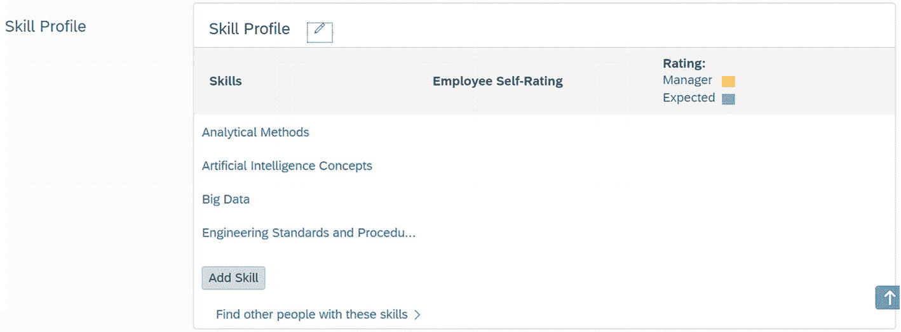

图 3-17：人员概要文件中的技能门户部件

如果员工拥有相应权限，他们可以添加技能并进行自我评分。经理的评分以及该技能的期望评分也会显示。此视图极大地帮助员工了解在已分配技能中是否存在任何能力差距。理解能力及其差距能极大地帮助员工制定学习计划。当您点击“查找拥有这些技能的其他人员”链接时，系统将返回具有类似技能分配的员工的搜索结果。这极大地增强了员工与同事社交并互相学习经验的体验。

### 胜任力与胜任力类型
*胜任力*是员工执行任务的能力。胜任力包括已识别/定义的行为集合和胜任力类型。胜任力类型是系统中对胜任力进行分类的方式，并且可以独立维护。将胜任力分配给职位代码，使组织能够识别需要为员工发展的胜任力，使主管能够识别需要投入的胜任力，并帮助员工识别需要填补的胜任力差距。

在本节中，我们将讨论如何在`SuccessFactors`中创建和维护胜任力及胜任力类型。

如果您系统中部署了`Employee Central`，请参考知识库文章 2080013，“如何管理职能、角色和胜任力映射 - `SuccessFactors Employee Central`”。

最佳实践是利用`SuccessStore`中可用的内容。或者，您也可以通过手动构建所需内容来创建胜任力和胜任力类型。

### 胜任力类型

在`SuccessFactors`中，您可以在`管理数据`配置步骤中创建和维护胜任力类型。胜任力类型也可以通过`导入和导出数据`配置步骤批量导入系统。

我们可以通过前往管理中心并点击`管理数据`来手动创建胜任力类型。在显示的页面上，对于`新建`字段，选择`胜任力类型`。在`胜任力类型`界面（见图 3-18），输入胜任力类型的名称。点击`保存`以保存您的条目。

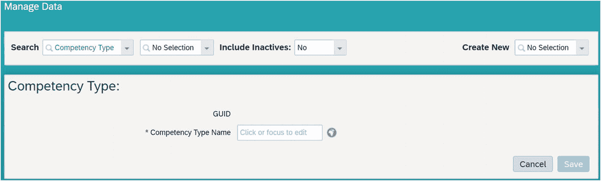

**注意：**
`GUID`是一个唯一标识符，由系统自动生成。`GUID`无需任何配置。在您保存新的胜任力类型后，系统将生成一个`GUID`。

要在`管理数据`中维护现有的胜任力类型，请在搜索框中输入`胜任力类型`。在下一个字段中，选择您要维护的胜任力类型。您可以修改`胜任力类型名称`字段，然后点击`保存`以保存您的条目。

### 批量创建胜任力类型

您可以通过将数据导入系统来创建新的胜任力类型。具体来说，您可以前往管理中心并点击`导入和导出数据`。在显示的页面上，在字段“选择要执行的操作”中，选择选项“下载模板”。在字段`选择通用对象`中，选择`胜任力类型`。在字段“包含依赖项”中，选择`否`。点击`下载`。

在模板中（见图 3-19），输入胜任力类型的名称。您无需输入`GUID`。将 A 列留空。

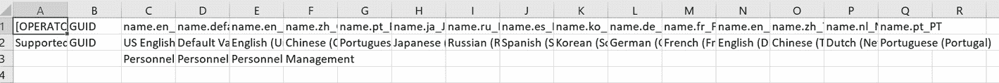

**注意：**
通常，我们至少要输入`name.defaultValue`和`name.en_US`列中的胜任力类型名称。这些列可能会根据您使用的默认语言以及已激活的其他语言选项而变化。

现在，在`导入和导出数据`配置步骤（见图 3-20）中，在“选择要执行的操作”中选择`导入数据`。在字段`选择通用对象`中，选择`胜任力类型`。对于`清除类型`，选择`增量加载`。（注意：如果您选择`完全清除`选项，现有的胜任力类型将被新值覆盖。）点击`导入`以导入您的数据。（注意：如果您想验证模板格式是否正确，可以点击`验证`。如果验证失败，您可以找出导致错误的原因，进行更正，然后重试。）

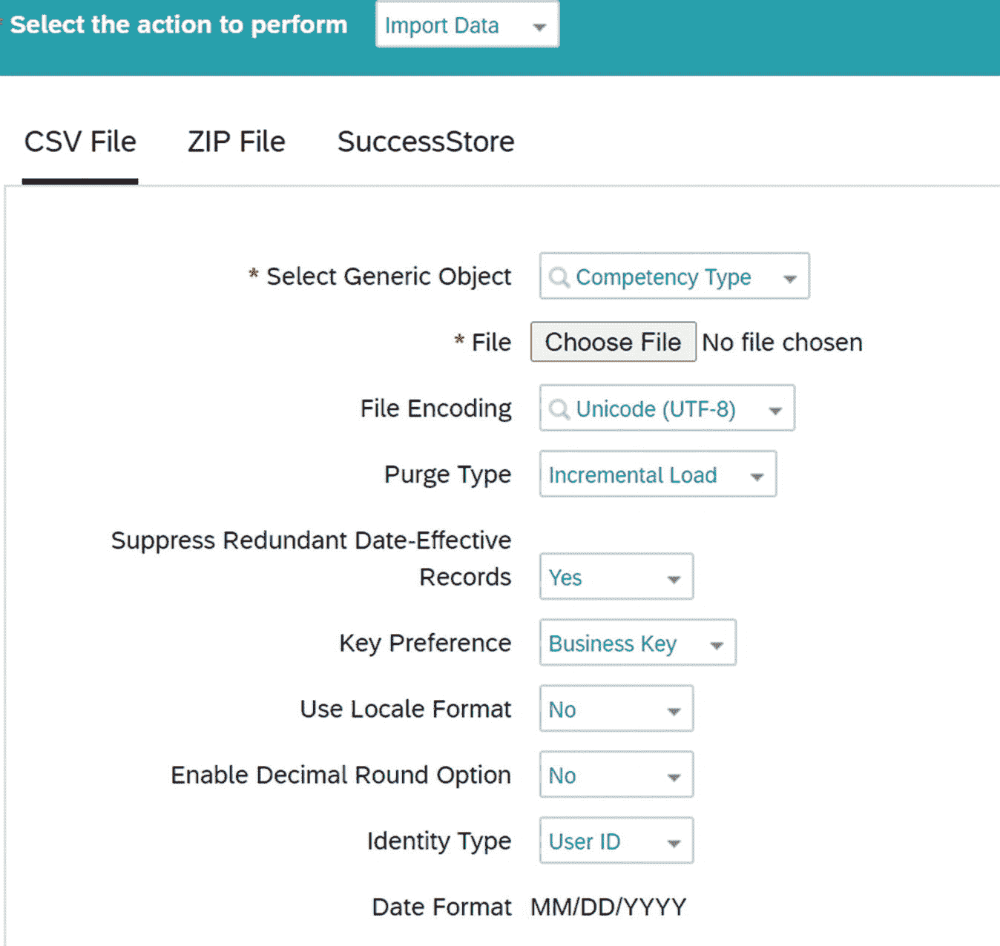

在`监控作业`配置步骤中，您可以监控数据是否已导入或是否存在任何错误（见图 3-21）。您可以通过前往管理中心并点击`监控作业`来访问`监控作业`。在`监控作业`中，如果您向右滚动到`作业详情`列，您可以看到数据导入模板中有多少条记录以及已处理了多少条。`下载状态`列提供了一个超链接，用于下载作业的结果。下载的文件将在错误记录旁显示错误详情（如果有的话）。

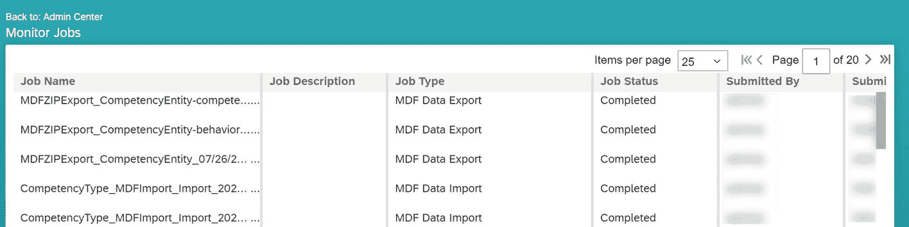

### 能力

如果要维护一项现有能力，请明确你要维护的对象。在与该能力对应的行中，你会看到一个齿轮图标（见图 3-22）。点击齿轮后，你将看到 `Edit`（编辑）、`Inactivate`（停用）和 `Delete`（删除）选项。如果要对能力进行修改，请点击 `Edit`（编辑）。`Inactivate`（停用）不会删除该能力，但该能力将不再可用。`Delete`（删除）将永久删除该能力。

创建新能力的流程与我们之前介绍的内容类似。在“`Manage Job Profile Content`（管理职务档案内容）”页面上，从下拉菜单中选择“`Competency`（能力）”。要添加新能力，请点击“`Create Competency`（创建能力）”。在显示的页面上（见图 3-23），你可以输入新能力的详细信息。

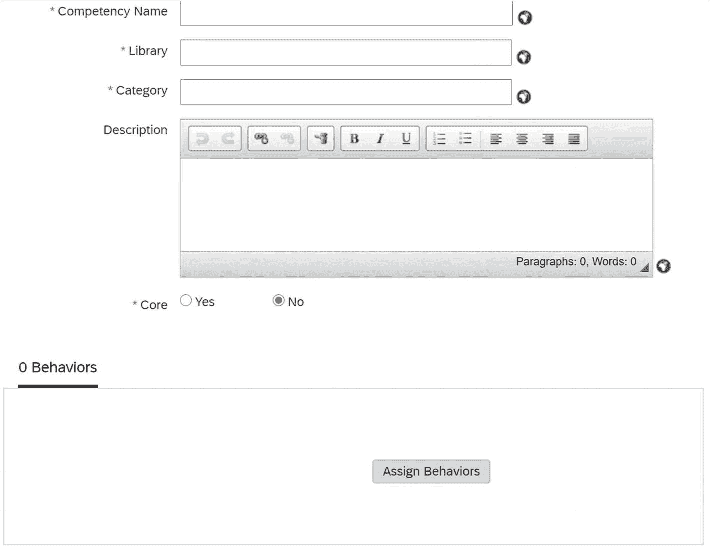

如果要编辑某项能力，你可以点击该能力（显示在“`Competency Name`（能力名称）”列下）。系统将显示详细信息页面，你可以在该页面中对该能力进行修改。

当某项能力与某职务档案关联时，即使你停用了该能力，它仍会继续显示。如果你不想使用特定能力，且不希望该能力出现在职务档案中，则需要删除该能力。

在“`Edit Competency`（编辑能力）”页面（见图 3-23）上，输入能力名称以及要为其分配的库和类别。在“`Description`（描述）”字段中，输入该能力的描述。你可以选择该能力是否为核心能力。

> **注意：** 在“`Library`（库）”和“`Category`（类别）”字段中，你需要输入起始字符，系统将显示可用的数据。如果有多个选项可用，则选项将以下拉列表形式显示。

输入能力详情后，你可以为该能力定义行为。在“`Behaviors`（行为）”部分，点击“`Assign Behaviors`（分配行为）”。在显示的对话框中，输入行为名称并提供描述。点击“`OK`（确定）”保存你的输入。保存行为后，系统会为该行为生成一个 `GUID`。

向下滚动页面，在“`Competency Type`（能力类型）”部分，你可以将能力分配到某一能力类型。你可以为一项能力分配多种能力类型。当一项能力被分配到多种能力类型时，在“`Manage Job Profile Content (Competency)`（管理职务档案内容（能力））”页面的“`Competency Type`（能力类型）”列中，你会注意到显示第一个能力类型，后面跟着一个带超链接的加号（`+`）。加号会显示附加到此能力的其他能力类型的数量。将鼠标悬停在 `+` 符号上，将显示已分配的能力类型。

> **注意：** 前提条件是，系统中应已配置好能力类型，并且可用于将能力分配到该能力类型。

> **提示：** 你可以通过导入和导出数据来创建新能力（请回顾我们之前讨论过此功能的能力类型相关章节）。我们建议你将其作为一项练习自行操作：创建新能力，然后将新能力与行为和能力类型关联起来。

> **注意：** 为其他职务档案构建器 (JPB) 对象创建内容的流程与我们目前讨论的内容类似。我们建议你将为其他 JPB 对象创建内容作为练习，以便熟悉该流程。

### 职务档案对象依赖关系

在表 3-3 中，我们列出了可以与职务档案关联的职务档案对象类型以及其他职务档案构建器 (Job Profile Builder) 对象。你可以在配置步骤“`Manage Job Profile Content`（管理职务档案内容）”和“`Manage Job Profile Content Import/Export`（管理职务档案内容导入/导出）”中建立这些关联。我们已经在之前的章节中回顾了这两个配置步骤。

### 管理职位档案内容导入/导出

我们可以通过将不同职位档案构建器对象的内容批量导入系统来创建它们。您也可以从同一个配置步骤导出不同 JPB 对象的内容。要访问该配置，请转到管理中心并点击`管理职位档案内容导入/导出`（见图 3-24）。

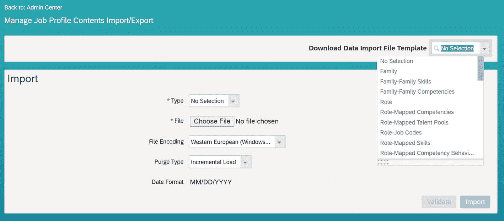

在显示的页面上，在`下载数据导入文件模板`字段中，您可以下载要为其导入内容的模板。以我们的审查为例，我们将下载`角色映射的人才库`对象的模板，并为此对象导入数据。

> **注意：** `下载数据导入文件模板`下拉列表中列出的职位档案构建器对象将在“职位档案对象依赖关系”一节中予以审查。

当您选择一个对象进行下载时，您可以选择下载包含数据的模板，或者下载空白模板。如图 3-25 所示，如果您选择`是`，将下载包含数据的模板。选择`否`将下载空白模板。如果您是 JPB 配置的新手，我们建议您下载包含数据的模板。您可以查看数据的构建方式，并在填充模板数据时将其作为参考。（注意：在导入数据之前，请记住从模板中删除下载的数据。）

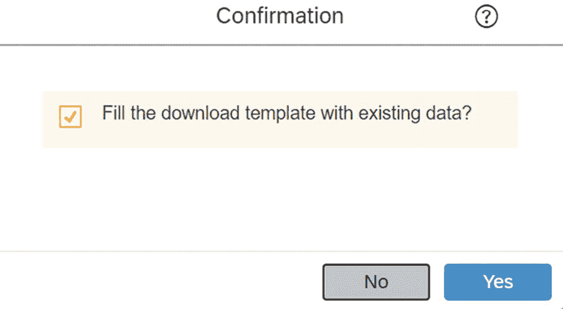

图 3-25 下载模板

> **注意**
> 如果您正在下载包含数据的模板，则需要从配置步骤`监控职位`中下载该模板。如果只是一个空白模板，系统将从配置步骤`管理职位档案内容导入/导出`中下载该模板。

由于 JPB 对象基于 MDF，因此您可以在不同 JPB 对象之间建立关联，也可以在相同类型的 JPB 对象之间建立父子关系。因此，如果您正在建立此类关联，请务必复制您计划关联的对象记录的 GUID。

如前所述，以我们的讨论为例，我们将为`角色映射的人才库`对象导入数据。在导入这些数据之前，我们应该检查我们计划与该对象关联的人才库是否存在于系统中。如果不存在，我们需要创建这些模板。

因此，为`角色映射的人才库`对象导入数据的过程如下：

1.  创建人才库。
    1.1. 我们之前讨论过，人才库是在配置步骤`管理数据`中创建的，而要导入/导出人才库，我们需要执行配置步骤`导入和导出数据`。
    1.2. 创建人才库后，我们需要记下新创建人才库的代码。这是必需的，因为我们正在将角色与人才库相关联。

        > **提示：** 您可以在配置步骤`管理数据`中找到人才库记录的代码。在显示的页面上（见图 3-26），在搜索字段中输入`人才库`。在下一个字段中，选择您正在考虑的人才库。记下`代码`字段中显示的代码。（注意：此代码对于每个人才库记录都是唯一的。）

        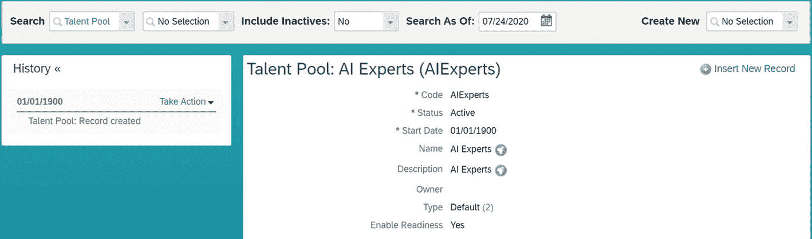

        图 3-26 在配置步骤`管理数据`中查看的人才库数据

2.  完成前述步骤后，填写`角色映射的人才库`对象的模板并执行导入。

3.  验证导入是否成功完成。

## 职位档案模板

我们可以使用职位档案模板为系统中配置的职位档案提供一致的外观和风格。职位档案模板通常包含多个分区。您可以定义哪些分区是必需的，并定义它们在分区中的显示顺序。您可以将一个职位档案模板分配给一个或多个职位族。

在本节中，我们将讨论职位档案模板、如何配置职位档案模板，以及如何将它们分配给职位族。

> **注意**
> 您可以在一个实例中配置多个职位档案模板。您可以为系统中的所有角色使用一个职位档案模板，或者为不同角色分配不同的职位档案模板。例如，您可以为一个被标识为“个人贡献者”的角色提供一种职位档案模板，为被定义为“经理”的角色提供另一种不同的职位档案模板，并为被定义为“高管”的角色提供另一种职位档案模板。

### 配置职位简介模板

要配置一个新的职位简介模板，请前往“管理中心”并点击`管理职位简介模板`。

在显示的页面上（见图 3-27），点击`创建模板`。

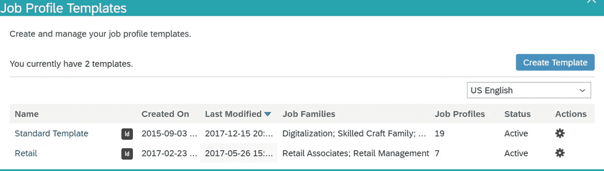

图 3-27 管理职位简介模板

> **提示**
> 如果系统中已存在职位简介模板，您可以通过复制现有模板来创建新的职位简介模板。要复制现有模板，请点击现有模板的齿轮图标（齿轮图标显示在`操作`列中）。您将看到`编辑`、`复制`和`删除`选项。点击`复制`即可复制模板。

在显示的页面上，输入模板的名称。您可以添加希望与此职位简介模板关联的职位族。点击`下一步`。

如前所述，职位简介模板由若干区块组成。每个区块将包含该职位特定“职位简介对象”的数据。点击`添加区块`以显示可以添加到职位简介模板的不同区块（见图 3-28）。

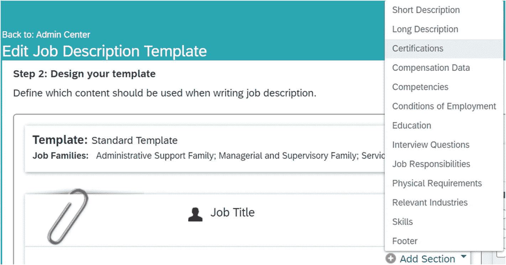

图 3-28 向职位简介模板添加区块

对于我们的职位简介模板，我们将添加名为`详细描述`、`简短描述`、`胜任力`、`技能`、`教育背景`和`面试问题`的区块。

> **提示**
> 我们可以将系统提供的职位简介对象重命名为符合业务需求的任何标题。例如，`详细描述`区块可以重命名为`职位描述`，`简短描述`可以重命名为`职位概要`。要重命名区块，请点击它。区块标题现在即可编辑。输入您想使用的标题并点击`完成`。
>
> 此外，您可以通过拖放区块到职位简介模板中的适当位置来调整区块顺序。

您可以继续配置职位简介模板（见图 3-29）。

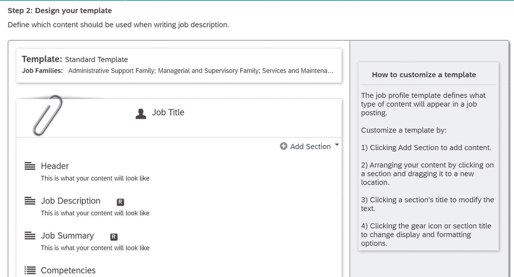

图 3-29 配置职位简介模板

当您点击一个区块时（见图 3-30），该区块的选项将显示在区块右侧。

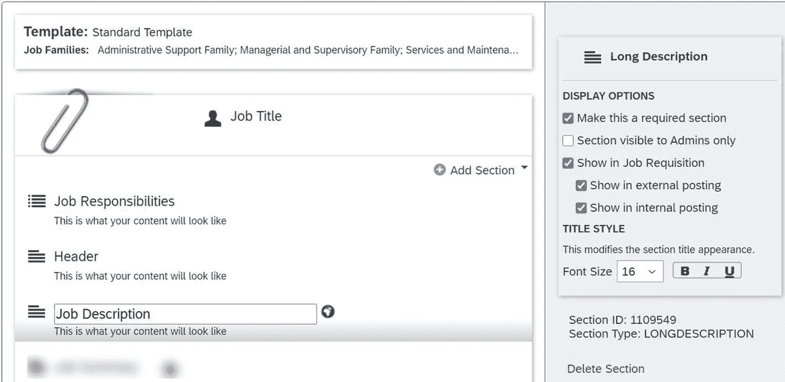

图 3-30 向职位简介模板添加区块

以下是可用的区块选项：

*   **设为必填区块**：如果您勾选此选项，则该区块在职位简介模板中为必填项。
    > **注意**
    > 当您将一个区块设为必填时，该区块中会显示一个红色`*R*`标记。

*   **仅限管理员可见**：您可以设置该区块仅在管理员接收职位简介确认时对其可见。

*   **在职位申请中显示**：职位简介模板可以与 SuccessFactors 招聘模块集成。集成配置后，勾选此选项将使该区块在职位申请中可见（可用），以便招聘人员等资源可以查看。

*   **在外部招聘公告中显示**：勾选此选项将使该区块发布在外部招聘公告中，以便外部候选人能够看到根据模板格式化的职位要求。

*   **在内部招聘公告中显示**：勾选此选项将使该区块发布在内部招聘公告中，以便内部候选人能够看到根据模板格式化的职位要求。

> **注意**
> 当一个区块被标记为“仅限管理员可见”时，该区块无法在职位申请中显示。因此，`在职位申请中显示`选项将不可选。

您还可以配置字体样式及不同的字体选项（粗体、下划线和斜体）。

> **提示**
> 最佳实践是使职位简介模板中所有区块的字体样式保持一致。

现在您已经了解了这些背景信息，接下来我们将讨论职位简介以及如何在系统中配置职位简介。

### 职位简介

以下是在系统中配置职位简介的前提条件：

-   系统中应包含`JPB`对象的内容。

-   职位简介模板已配置并可在系统中使用。

要在系统中设置职位简介，请前往管理中心，点击`管理职位简介`。

在显示的页面（见图 3-31）上，您可以看到系统中已配置并可用的职位简介。您还可以根据职位所属的`职能`、`角色`或`职位`进行筛选。

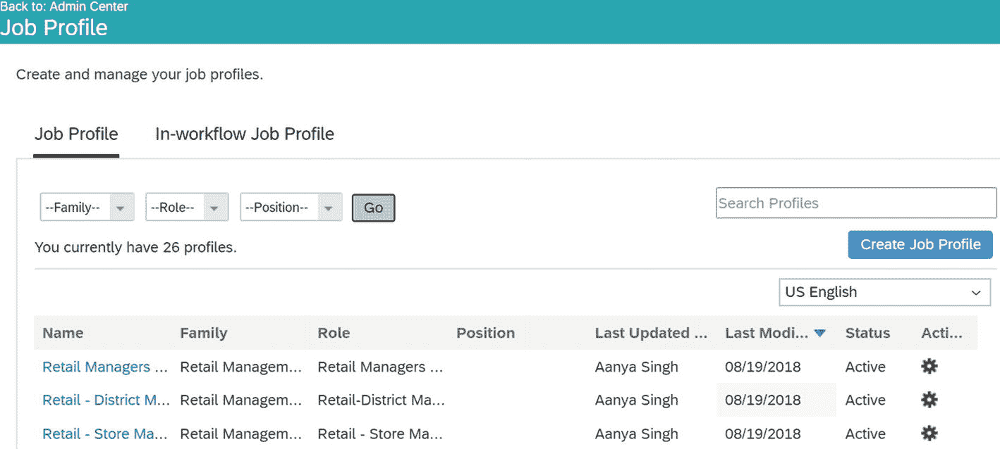

图 3-31 管理职位简介

要创建新的职位简介，请点击`创建职位简介`。

在显示的页面（见图 3-32）上，您可以选择要分配的职位职能。

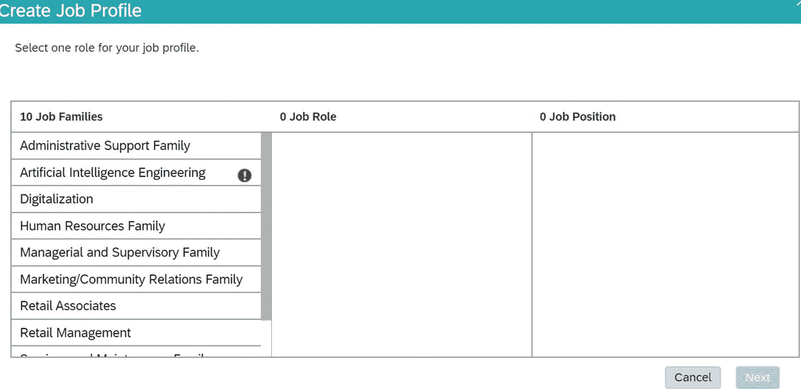

图 3-32 创建职位简介

系统会显示该职位职能下分配的所有角色。选择您要分配的职位角色。

> **注意**
> 角色与职位简介之间存在一一对应的关系。换言之，一个角色只能分配给一个职位简介。

系统会显示分配给该职位角色的所有职位。您可以选择一个或多个职位进行职位简介的分配。将职位分配给职位简介后，点击`下一步`。

此时将显示职位简介模板。

在审阅各个版块并向其中添加内容之前，我们需要先为职位简介输入一个标题。在职位简介的顶部，点击`输入职位简介名称`字段。您需要在此处输入职位简介的标题。（注意：如果您不输入标题，将无法保存职位简介。）

> **注意**
> 如果某个职位简介内容（见图 3-33）已映射到该角色，则该已映射内容不可进行任何编辑。您会注意到，已映射到此角色的能力项显示为锁定状态（即不可编辑）。

图 3-33 不可编辑的版块

如果您想为职位简介添加新内容，请高亮选中版块标题（例如图 3-33 中的标题），然后点击`编辑`。对于此职位简介，您可以添加系统中可用的新能力项。

# 职位简介管理

对于尚未映射内容的 `JPB` 对象，您可以直接在职位简介中添加内容。将鼠标悬停在版块标题上时，会看到一个 `添加` 按钮。您可以点击 `添加` 来添加新内容。

**注意**

`JPB` 对象的内容应在系统中完成配置并可用。

点击 `我已完成` 以保存您的内容和更改。（注意：您需要手动激活职位简介。默认情况下，新创建的职位简介处于 `草稿` 状态。）这将带您进入配置页面 `管理职位简介`。在显示的页面上，找到新创建的职位简介。在 `操作` 列下，点击齿轮图标。这将显示 `编辑`、`复制`、`删除` 和 `激活` 选项。点击 `激活` 以激活新创建的职位简介。

**注意**

在职位简介中，如果某个必填版块没有内容，您将无法激活该职位简介。当您尝试激活时，将收到一条错误消息（见图 3-34）。点击 `更新职位简介` 即可编辑该职位简介，并为必填版块填入内容。

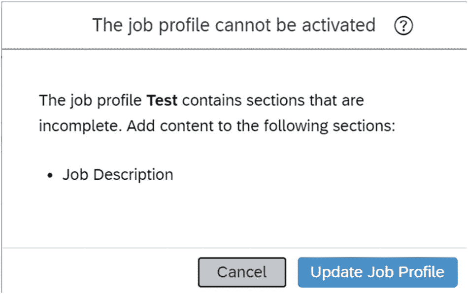

**图 3-34** 尝试激活不完整的职位简介时出现的错误消息

**注意**

`SuccessFactors` 不建议清除职位简介数据。清除职位简介数据可能会影响数据与实体的映射关系，也可能影响 `JPB` 招聘管理数据。

## 职位简介生成器：工作流

许多组织希望在职位简介发布前先进行审阅和批准。这将确保关键利益相关者了解相关更改，验证不同版块中是否已填入正确数据，并确保所做的更改与讨论内容保持一致。

在本节中，我们将讨论如何设置工作流，以及如何配置工作流使其显示在 `SuccessFactors` 首页的 `待办事项` 磁贴上。

### 配置职位简介生成器工作流

您可以通过前往管理中心，点击 `管理组织、薪酬和职位结构` 来创建工作流。在显示的页面上，从 `新建` 下拉菜单中选择 `工作流`。

如图 3-35 所示，我们创建了一个名为 `职位简介变更` 的工作流。

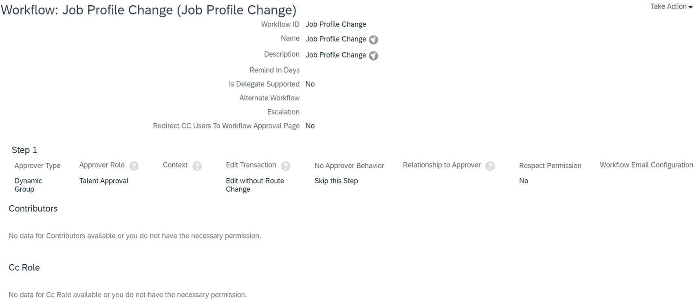

**图 3-35** 创建工作流

**注意**

动态组是根据特定标准配置的一组审批人。当您将动态组设为审批人时，该组的所有成员都会收到工作流审批、评论请求和工作流完成通知。

`审批人类型` 的其他选项包括 `动态角色`、`职位` 和 `职位关系`。

要创建动态组，请前往管理中心，点击 `管理工作流组`。在显示的页面（见图 3-36）上，您可以点击 `创建新组` 来创建新组。您可以通过点击特定组名来编辑现有组。您还可以通过点击 `克隆组` 来复制现有组。

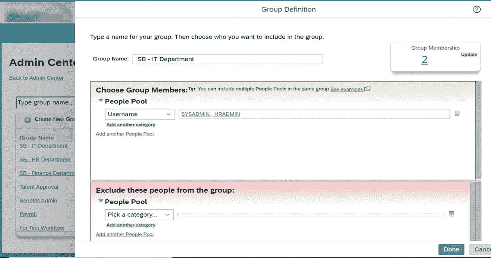

**图 3-36** 创建动态组

-   对于 `审批人类型`，选择 `动态组`。对于 `审批角色`，选择 `动态组`。

-   对于 `编辑事务`，选择 `编辑但不改变路由`。

**注意**

对于 `编辑事务` 字段，您有以下选项：

-   `无审批人行为`：您可以指定如果某个步骤未识别出审批人，工作流应如何执行。选项包括 `跳过此步骤` 和 `终止工作流`。

-   `尊重权限`：在此字段中，您指定工作流审批人是否有权查看工作流字段。选项如下：
    -   `是`：审批人有权查看他们拥有权限的工作流字段。
    -   `否`：审批人有权查看工作流字段，无论其分配的基于角色的权限如何。

-   `禁止编辑`：审批人无法编辑正在运行的工作流。

-   `编辑并变更路由`：审批人可以编辑正在运行的工作流。当工作流重新提交时，系统会自动重新计算工作流审批路由。

-   `编辑但不改变路由`：审批人可以编辑正在运行的工作流。当工作流重新提交时，系统不会重新计算工作流审批路由。

-   `仅编辑附件`：审批人只能编辑工作流的附件（如有）。

点击 `保存` 以保存新配置的工作流。

配置好 `JPB` 的工作流后，在下一节中，我们将探讨如何使工作流审批通知显示在 `SuccessFactors` 首页的 `待办事项` 磁贴中。

**注意**

您需要被分配以下基于角色的权限，才能在系统中设置工作流：

-   `管理工作流请求`
-   `管理工作流组`

您还需要被分配到一个动态工作流组中。

## 职位档案生成器工作流：在待办事项磁贴中显示

我们将对 `职位档案草稿` 对象定义进行配置更改。要进行更改，请转到管理中心并单击 `配置对象定义`。

在显示的页面（见图 3-37）上，在搜索框中选择 `对象定义`。从对象定义列表中选择 `职位档案草稿`。单击 `执行操作`，然后单击 `进行更正`。

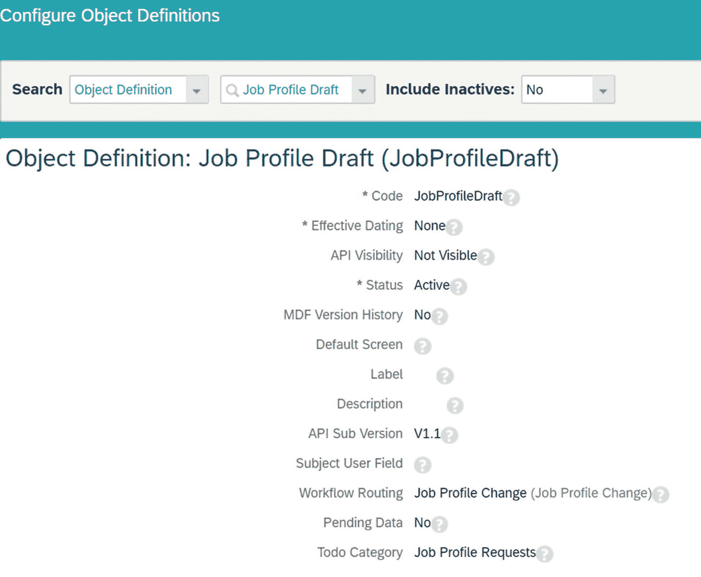

**图 3-37** 编辑职位档案草稿对象

我们将对该对象进行以下更改：

-   在 `工作流路由` 字段中，选择我们在 `配置职位档案生成器工作流` 一节中配置的工作流（`职位档案变更`）。
-   在 `待处理数据` 字段中，选择 `否` 选项。
-   在 `待办事项类别` 字段中，选择 `职位档案请求` 选项。

单击 `保存` 以保存更改。

要查看哪些职位档案和工作流正在处理中，请转到配置步骤 `管理职位档案`。在显示的页面上，您将看到两个选项卡：`职位档案` 和 `工作流中的职位档案`。要查看工作流，请单击 `工作流中的职位档案` 选项卡（见图 3-38）。

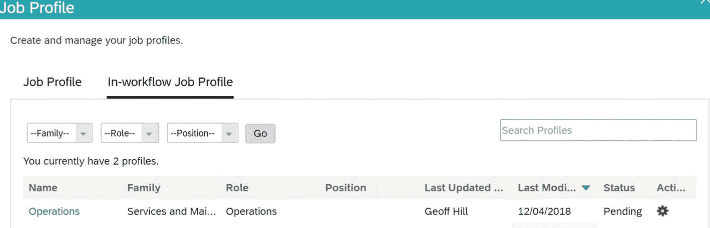

**图 3-38** “工作流中的职位档案”选项卡

显示的页面将列出已更改并等待审批的职位档案。当您单击职位档案时，显示的页面（见图 3-39）将显示需要审批该更改的审批人。在显示的档案中，您可以单击 `先前版本` 选项卡来查看更改前的职位档案。

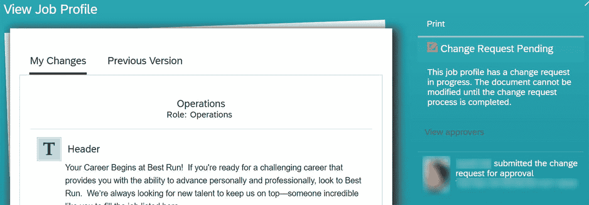

**图 3-39** 职位档案工作流详情

## 职位档案确认设置

在本节中，我们将讨论如何配置职位档案确认设置。某些行业（通常是受监管行业，如制药、医疗保健等）要求组织提供其员工理解所分配职位说明的证明。组织需要维护此类信息的接收凭证。

要配置确认，请转到管理中心并单击 `配置职位档案确认`。

> **注意：** 如果您无法访问此配置步骤，请确认您已分配了 `配置职位档案确认设置` 权限。该权限位于 `管理员权限` 下的 `管理职位档案生成器` 中。

在显示的页面（见图 3-40）上，您可以选择应触发确认的职位档案更改。您可以在以下情况下触发确认：

-   职位档案发生变更
-   职位代码发生变更
-   角色与职位档案映射发生变更

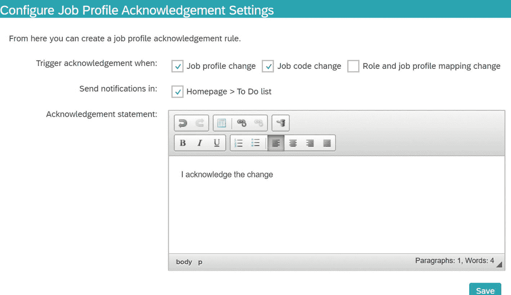

**图 3-40** 配置职位档案确认设置

您还可以配置标准确认声明。

当您对职位档案进行更改时，受影响的员工会在 `SuccessFactors` 主页的待办事项列表中的 `职位档案变更` 磁贴中看到通知（见图 3-41）。

**图 3-41** “职位档案变更”磁贴

单击该磁贴会将用户带到一个确认页面，用户可以在该页面审查更改并单击 `我已阅读` 来确认已接收。

> **提示：** 您可以通过转到管理中心并单击 `职位档案确认报告`，来查看已收到职位档案变更确认通知的员工列表。在报告（见图 3-42）中，您还可以查看员工是否已审阅更改并完成确认。如果员工尚未确认更改，状态将为 `待处理`。如果员工已确认更改，将显示确认更改的日期和时间戳。您可以按用户名、姓氏、角色和用户所做的最新更改来筛选报告。

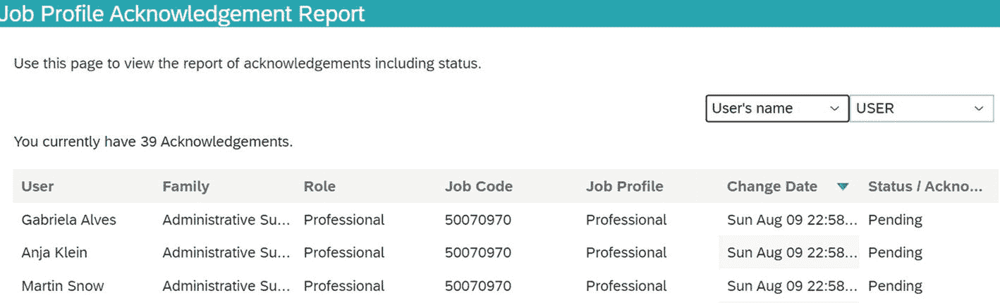

**图 3-42** “职位档案确认报告”屏幕

了解了 `JPB` 的背景后，我们将回顾一个需要将 `JPB` 与 `SuccessFactors Recruiting` 集成的案例。

# 案例研究

在本节中，我们将回顾一个案例研究，其中我们将`JPB`与SuccessFactors Recruiting Management (RCM)集成。

### 描述

客户A已实施SuccessFactors Recruiting Management。在当前职位档案生成器实施过程中，客户正在探索将`JPB`与RCM集成的可能性。公司希望其顾问向他们说明需要完成哪些配置步骤。

### 解决方案

我们将完成将招聘管理与`JPB`集成所需的配置。

**步骤 1：** 要将`JPB`与招聘模块集成，请转到管理中心并单击“管理招聘设置”。在显示的页面（见图 3-43）上，滚动到“职位需求”部分。选中“在需求中使用职位简介”选项。

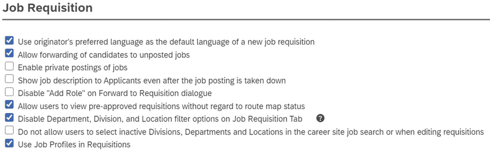

图 3-43  
将`JPB`与招聘管理（RCM）集成

单击“保存”以保存设置。

**步骤 2：** 查看职位简介模板，并确认您希望与职位需求集成的部分。对于这些部分，请确认您已标记“在职位需求中显示”选项。如果您希望该部分在职位发布中可见，则可以勾选“在外部发布中显示”和“在内部发布中显示”选项。

**提示：** 某些部分，例如面试问题，不应显示在职位发布中，但它们应在职位需求中可用。对于此类部分，您需要选择“在职位需求中显示”，但不要勾选“在外部发布中显示”和“在内部发布中显示”选项。

**步骤 3：** 当您创建新的职位需求时，可以选择“浏览系列与角色”选项。创建此选项非常有用，因为您可以在创建需求时直接选择职位系列和角色（见图 3-44）。

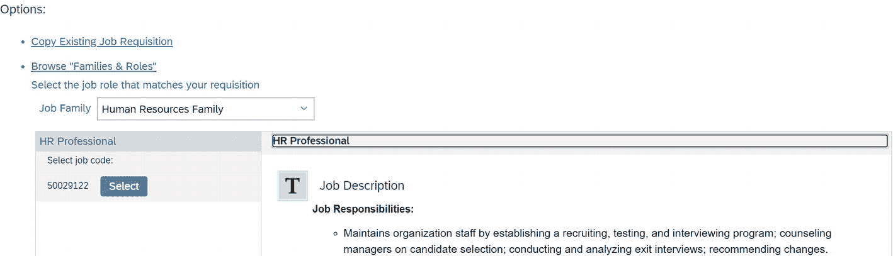

图 3-44  
使用“浏览系列与角色”选项创建职位需求

当您使用“从空白模板创建新职位需求”选项创建需求时，系统会提示您选择一个职位角色（见图 3-45），以便从职位简介中显示与该职位角色相关的具体细节。单击“选择角色”后，系统会将您带到与图 3-44 相同的界面。

图 3-45  
系统提示选择职位角色

在职位需求中，您可以单击“职位简介”选项卡，在职位需求和职位简介之间切换。

如果您希望招聘人员或招聘经理（或任何招聘角色）能够编辑职位简介中的部分内容，则需为其授予`JobReqJobProfile`中的“编辑”权限。您可以在“管理员权限 → 管理职位与技能简介可见性”中找到`JobReqJobProfile`权限（见图 3-46）。

图 3-46  
授予在职位需求中编辑职位简介的权限

**步骤 4：** 当职位需求与`JPB`集成后，如果某个部分在职位简介中可用，则该部分将显示在“职位简介”选项卡上。您在需求中对职位简介所做的任何更改仅适用于该需求，不会回写到主职位简介。职位需求创建后，您对职位简介所做的任何更改都不会同步到该需求中。

## 本章总结

在本章中，我们首先回顾了职位简介构建器是什么，以及它如何与其他 SuccessFactors 人才管理模块集成。我们审查了需要授予用户的权限，以便他们能够访问与`JPB`相关的不同配置步骤。我们列出了`JPB`内容类型，并在本章后面讨论了`JPB`对象之间的依赖关系。我们还详细讨论了如何配置`JPB`内容以及如何导入/导出内容。随后，我们在本章中配置了一个职位简介模板，并使用该模板配置了一个职位简介。我们还讨论了如何为`JPB`配置工作流。在章节末尾，我们回顾了员工如何查看和确认其分配职位的职位描述。最后，我们讨论了如何将`JPB`与招聘管理（RCM）集成。

在下一章中，我们将讨论 SuccessFactors 目标管理。该章节将详细讨论配置选项，以及员工和经理如何设定各自的目标。