# 4. 基础目标管理

目标管理为 SAP SuccessFactors 客户提供了在线设定和追踪整个组织业务目标的方法。此外，它还为 SAP SuccessFactors 中的许多集成功能提供了起点，使公司能够平稳运营，并为员工提供正向引导和奖励。客户可以通过识别用于开发和追踪每个目标的字段来配置其目标计划模板。另外，客户可以决定员工的目标是个人目标、团队目标和/或小组目标。无论客户选择在目标计划中包含哪种目标类型，其结果都可以在全年内进行更新和追踪，甚至可以整合到绩效考核表中。

对于试图执行其业务战略的组织而言，SuccessFactors 目标管理的功能变得至关重要。为了说明这一点，我们以两家公司为例。在这两家公司中，高层业务目标均在董事会中设定，并传达给首席执行官（CEO）执行。在第一家公司，CEO 召集其直接下属开会，分享构成目标的各项财务指标和增长数据。然后，他们要求直接下属将这些信息层层传达下去。在季度末，首席财务官（CFO）要求其团队提取报告，以检查他们是否在朝着高层目标前进。CEO 的团队随后审查结果，并命令直接下属尝试找出哪些方面进展顺利，哪些方面出现问题。随着年底临近，绩效评估离线进行，并根据个人绩效对每位员工进行评级。然而，尽管基于经理观察和关系的高评级数量众多，但由于公司业绩不佳，很少有员工获得加薪。当员工询问为何存在如此大的差距时，经理们陷入了尴尬的境地，无法给出清晰的解释。

第二家公司采用了 SAP SuccessFactors，并将作为我们贯穿本章的范例。董事会会议结束后，CEO 立即在 SAP SuccessFactors 中设定自己的目标。由于安全权限限制，CEO 确信只有自己能看到这些目标。随后，CEO 召集直接下属开会，讨论如何将部分目标分解到他们的目标计划中。接着，CEO 将部分目标向下级联至直接下属，并为其他下属创建目标，同时将这些目标与自己的目标关联。此外，直接下属也会创建一些自己的目标。此过程会逐级重复，直至最后一个符合目标计划条件的员工。在定期的持续绩效管理会议中，员工和管理者会主动在系统中更新自己的目标和状态。当第一季度到来时，CFO 提交了结果报告，但这一次，CEO 的团队能够将这些结果与系统中的数据进行对比。团队可以从一个目标计划导航到另一个，追踪组织中哪些目标达到或超出了预期，哪些在个人层面未能达标，并采取相应的纠正措施。在持续的绩效评审中，这些纠正措施会被沟通传达，引导公司朝着更好的方向发展。到了年底，目标会被纳入年度绩效表格，并以清晰的百分比形式呈现为总体绩效评分的一部分。这进而会影响基于绩效的薪酬部分，为管理者解释员工薪酬提供了清晰的依据。此外，管理者还可能看到自己的目标如何与组织内更高层级的目标相关联，从而有助于解释个人贡献如何影响公司的整体绩效。确实，一个成功实施的 SAP SuccessFactors 目标管理方案能为您的组织带来巨大益处！让我们更深入地探讨如何着手吧！

## 本章涵盖内容

在本章中，我们将引导您完成设置目标管理的各个步骤，以满足大多数组织的需求。首先，我们会在配置管理中启用该模块并分配配置权限。接着，我们通过在线编辑器创建和修改一个基本的目标计划模板。然后，我们详细讲解如何编辑该在线编辑器生成的 XML，并附带您可以在实际应用中使用的示例代码。最后，我们将以最终用户的视角快速浏览端到端的基础目标流程。在下一章中，我们将介绍其他不常用但功能强大的目标管理概念和功能，这些功能在满足不同组织执行业务目标的需求时非常有效。

## 目标管理的基本配置

在本节中，我们将介绍从头到尾配置一个基本目标计划所需的所有步骤，以便最终用户能够访问一个满足具有基本需求的公司简单要求的目标计划。通常，这种类型的目标计划是与真实客户进行首次迭代评审的良好起点。

### 配置目标管理的前提条件

在进行主要配置之前，需要执行一些步骤以确保目标管理功能已开启，并且已授予访问配置所需屏幕的适当权限。

#### 配置管理设置

设置目标管理的第一步是编辑您的配置管理设置，以便 SAP SuccessFactors 中能显示相应的屏幕和权限。请按以下步骤操作：


图 4-1

配置管理中的目标管理设置

1. 登录配置管理并选择您的公司 ID。
2. 点击“公司设置”。
3. 勾选“目标管理套件”旁边的复选框，并在下拉菜单中选择“全面目标管理”，如图 4-1 所示。

#### 分配配置和管理目标管理的权限

在此，我们将分配基于角色的权限，使您能够配置和管理目标管理。请按以下步骤操作：

> 注意
> 我们假设本章中基于角色的权限已在配置管理中启用，并且您有权编辑权限角色。另请注意，配置管理设置有时需要一段时间才能在系统中生效。如果您没有立即看到权限显示，请注销并在大约一小时后重新登录。更改通常不会超过一夜就能生效。

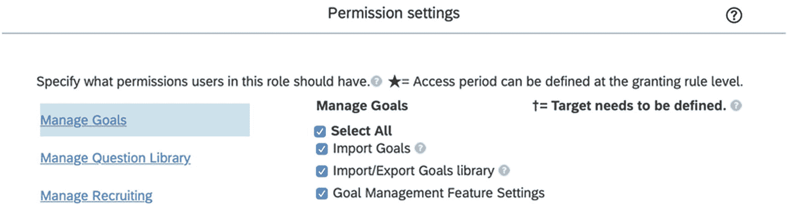

图 4-2

管理目标权限

1. 在搜索栏中输入并选择 `Manage Permission Roles`。
2. 屏幕加载后，点击您要修改的角色。然后点击 `Permission…`。
3. 点击左侧的 `Manage Goals`，然后勾选 `Import Goals`、`Import/Export Goals library` 和 `Goal Management Feature Settings` 旁边的复选框，如图 4-2 所示。

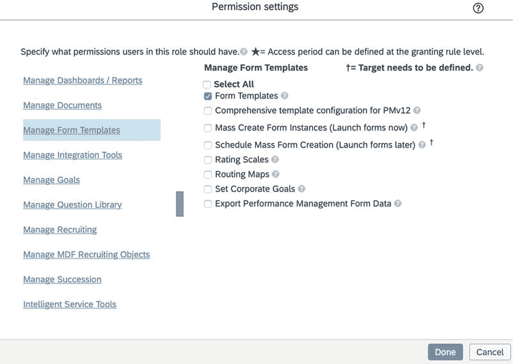

图 4-3

分配管理表单模板的权限

1. 点击左侧的 `Manage Form Templates`，然后勾选 `Form Templates` 旁边的复选框，如图 4-3 所示。

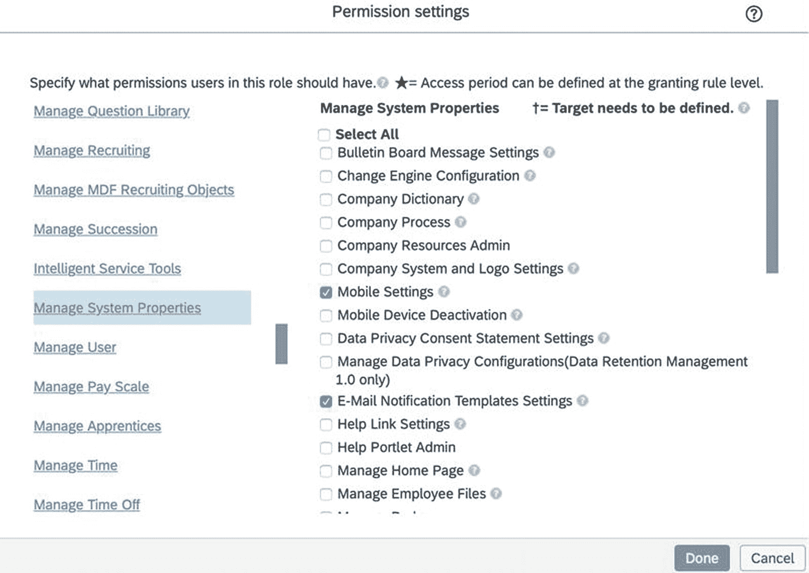

图 4-4

管理系统属性权限

1. 点击左侧的 `Manage System Properties`，然后勾选 `Mobile Settings` 和 `E-Mail Notification Templates Settings` 旁边的复选框，如图 4-4 所示。
2. 在主要权限角色屏幕上点击 `Done`，然后点击 `Save Changes`。

### 目标管理的主要配置

现在我们已经激活了目标管理模块，并拥有了进行配置所需屏幕的权限，让我们开始吧！本节将引导您完成配置一个简单目标计划的基本步骤，同时涵盖修改主模板和管理流程的屏幕。

### 目标模板配置

下面我们来了解如何创建和编辑目标模板。目标模板通常也被称为目标计划。一般每年或每个周期都会创建一个新模板；因此，通常会在模板名称中包含年份，例如"2020 年目标计划"（别担心，创建新目标计划就像复制旧模板并重命名一样简单）。在我们的示例中，将使用在线编辑器界面"管理模板"。这是开始创建基础模板的好方法，对于没有配置权限的客户也同样可用。目标模板的一些功能无法在在线编辑器中编辑，必须直接在模板底层的 XML 中进行操作，然后通过配置上传到系统中。我们将单独介绍这些功能。开始操作前，请遵循以下步骤：

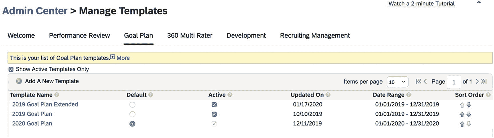

图 4-5

管理模板界面

1.  在搜索栏中输入并选择"管理模板"。界面将如图 4-5 所示。

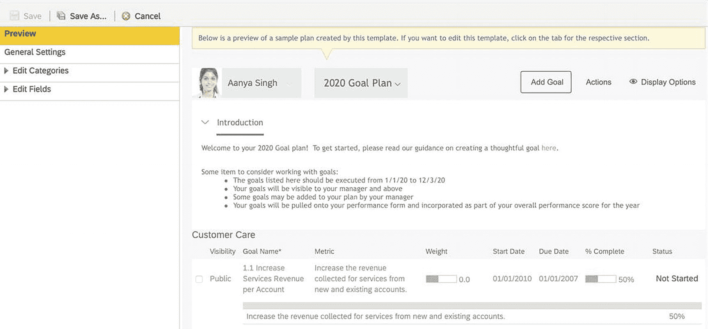

图 4-6

目标计划编辑器"预览"页面

2.  点击"添加新模板"。在弹出的窗口中，从 SuccessStore 选择一个模板，例如"扩展目标计划"。这将作为您编辑的起始模板。点击"添加到我的实例"。
3.  为模板输入一个名称，例如"2020 年目标计划"，然后点击"保存"。编辑器将如图 4-6 所示，显示"预览"页面。

**注意** 虽然预览可以大致了解模板上将显示哪些字段，但它并不能 100% 真实地反映表单在屏幕上的实际外观。我们建议使用测试用户进行测试。

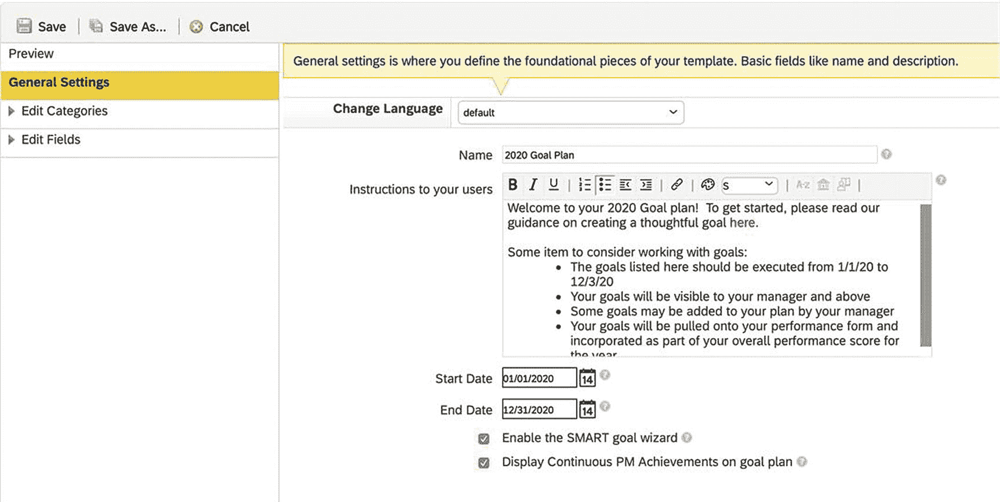

图 4-7

目标模板通用设置

4.  点击左侧的"通用设置"。界面将更新为通用设置页面，如图 4-7 所示。首先确保您已选择页面顶部的"更改语言"下拉菜单中的"默认"语言。如果您正在进行全局实施，您可以从下拉菜单中选择一种语言以提供所需的翻译。

# SAP SuccessFactors 目标计划配置指南

**注意** 我们建议始终使用在线编辑器的每个页面上的默认语言来配置表单。这将自动为您系统中启用的其他语言填充值（如果您需要编辑可用语言，可以在配置中公司设置下激活它们）。因此，如果您只使用美国英语（`en_US`）并填写所有默认值，则完全无需更改语言。

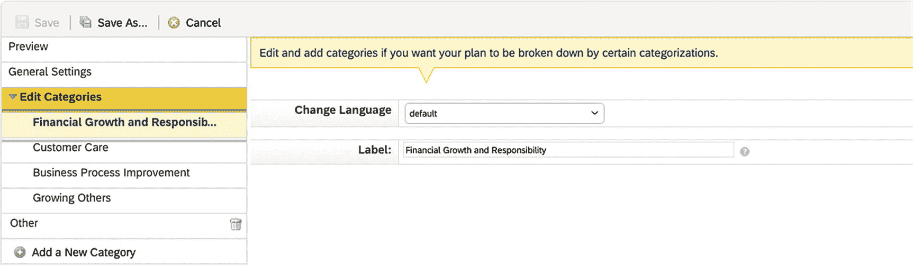

图 4-8

## 编辑类别

**5.** 使用"名称"字段根据需要更改目标计划的标题。

**6.** 在"用户说明"字段中输入您想提供的任何说明。

**注意** 这是一个在线 HTML 编辑器。我们发现一些客户喜欢提供技术帮助文档和策略文档的链接，这些文档提供了创建 SMART 目标的背景信息，超越了 SAP 提供的在线向导。

**7.** 输入开始和结束日期。

**注意** 这些日期是目标被其所在计划的员工执行的时间。通常，我们发现这些日期与年度开始和结束或财年开始和结束对齐。如果目标计划在第一季度末到期，开始日期设在过去的情况也并不少见。

**8.** 如果需要，请勾选 SMART 目标向导的复选框。

**注意** 目标向导是一个弹出窗口，允许最终用户逐步创建个人目标，并在每一步询问他们的目标是否具体、可衡量、可实现、相关和有时限（SMART）。我们经常发现客户对查看 SMART 目标向导的功能很好奇，但随后认为它过于简单而无用，转而选择依赖自己的策略和程序文件来帮助指导用户。此外，您必须使用某些标准字段才能使 SMART 目标向导正常工作。

**9.** 如果需要，请勾选"在目标计划上显示持续绩效管理成就"旁边的复选框。这将在目标计划中添加一列，显示与目标相关的任何 CPM 成就。

**注意** 我们建议使用此功能，因为它有助于提醒用户他们的成就。您必须已实施持续绩效管理 (`CPM`) 才能使此功能生效。我们将在第 13 章更详细地介绍 `CPM`。

**10.** 点击"编辑类别"（在继续到下一页之前，您可能也想定期点击"保存"）。这将展开以显示您下载的模板附带的标准类别，如图 4-8 所示。您可以根据需要重命名这些类别、删除它们或添加其他类别。

**注意** "类别"与目标计划配置中被称为"字段"的其他区域不同，它们是唯一的。类别将作为分区显示在最终用户的目标计划上，在视觉上分隔每个目标。它们对于报告也很重要，因为它们可能与整体业务计划的主要支柱相对应。要完全移除类别的使用，您需要在 XML 模板中删除所有类别（请参阅本章后面的"下载、编辑和上传 XML"部分）。

- 要添加类别，请点击"添加新类别"，该类别将出现在列表中。
- 要编辑类别名称，请点击该类别，然后在右侧出现的字段中输入类别的新名称（在选择语言后）。
- 要删除类别，请点击垃圾桶图标。

**注意** 我们不建议在表单被最终用户使用后删除类别，因为这可能会破坏数据！此外，许多公司要求将"选择类别"添加到类别下拉菜单中。但是，如果下拉菜单类别之一是"选择类别"，这会被视为最终用户目标计划上的一个分区。因此，我们不建议在下拉菜单中添加这样的值。

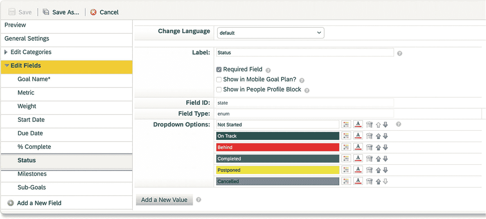

图 4-9

## 编辑字段

**11.** 点击"编辑字段"。该区域将展开，显示您从 SuccessStore 下载的模板中包含的字段，如图 4-9 所示。您可以将鼠标悬停在一个字段上，然后点击垃圾桶图标来删除它。您可以通过拖放字段来更改它们在目标计划中的显示顺序。点击"添加新字段"来添加一个字段，或点击现有字段进行编辑。

**注意** 您不能在线工具中删除 `name`、`metric`、`start` 和 `due` 字段。我们也建议使用这些字段，因为它们与诸如目标向导之类的标准功能相关联。

## 可用的自定义字段类型和配置选项

表 4-2

| 字段类型 | 配置选项 |
| --- | --- |
| `text` | 必填字段，在人员档案模块中显示。 |
| `textarea` | 必填字段，在人员档案模块中显示。 |
| `enum` | 必填字段，在人员档案模块中显示。作为枚举字段，还需要您定义可能的条目列表，以及每个条目的背景和前景颜色标签。 |
| `date` | 必填字段，在人员档案模块中显示。 |
| `percent` | 必填字段，在人员档案模块中显示。 |
| `number` | 必填字段，在人员档案模块中显示。 |
| `link` | 必填字段，在人员档案模块中显示。 |

## 目标计划标准字段与选项

表 4-1

| 技术字段名 | 字段类型 | 描述 | 配置选项 |
| --- | --- | --- | --- |
| `name` | `textarea` | 这是用于标识目标的主要字段，例如“到年底将销售收入提高 5%”。此字段不可删除。 | 标签、必填字段、在人员档案模块中显示。 |
| `metric` | `textarea` | 用于标识如何衡量目标。此字段不可删除。 | 标签、必填字段、在人员档案模块中显示。 |
| `weight` | `percent` | 此字段通常被将目标纳入绩效表单的组织使用。它将决定该单个目标分数占整个目标板块分数的百分比。如果您使用绩效表单，并且认为某些目标（如公司强制目标）应比个人目标具有更高的权重，我们建议使用此字段。否则，所有目标将被同等对待。 | 标签、必填字段、在人员档案模块中显示。 |
| `start` | `date` | 用于指示目标开始执行的日期。此字段不可删除。 | 标签、必填字段、在人员档案模块中显示。 |
| `due` | `date` | 用于指示目标结束执行的日期。此字段不可删除。 | 标签、必填字段、在人员档案模块中显示。 |
| `done` | `percent` | 用于指示目标完成的百分比。我们建议使用此字段，因为它有助于报告。 | 标签、必填字段、在人员档案模块中显示、在移动目标计划中显示。 |
| `state` | `enum` | 用于指示目标是按计划进行还是需要注意。我们建议包含此字段，因为它对执行地图很重要。 | 标签、必填字段、在人员档案模块中显示、在移动目标计划中显示。作为一个枚举字段，它还需要您定义可能的条目列表，并为每个条目定义背景和前景颜色标签。 |
| `milestones` | `table` | 此字段用于追踪为帮助实现目标而计划的特定里程碑的目标完成日期与实际完成日期。根据我们的经验，大多数客户不使用此字段，因为它会变得过于详细。 | 标签、必填字段。作为一个表格，您还需要定义表格的列标题。默认标签为“目标日期”、“里程碑”和“实际日期”。 |
| `tasks` | `table` | 尽管技术字段名是“tasks”，但此字段的默认标签是“子目标”。根据我们的经验，大多数客户不使用此字段，因为它会变得过于详细。 | 标签、必填字段。作为一个表格，您还需要定义表格的列标题。默认列标签为“子目标描述”和“完成百分比”。 |
| `targets` | `table` | 尽管技术字段名是“targets”，但此字段的默认标签是“任务”。其理念是详细列出多个独立任务，这些任务共同促成更大目标的实现。根据我们的经验，客户不使用此字段，因为它会涉及过多不必要的细节。 | 标签、必填字段。作为一个表格，您还需要定义表格的列标题。默认列标签为“目标日期”和“任务”。 |
| `desc` | `textarea` | 用于更详细地描述目标。我们建议不要使用此字段，因为它有时会导致与`name`字段中应填写的内容混淆。 | 标签、必填字段、在人员档案模块中显示。 |

**1.** 编辑字段时，请修改标签（务必先选择您想要的语言），并根据需要勾选“必填字段”复选框。如果您希望此字段显示在“人员档案模块”中，也请勾选此框。有关此模块的更多信息，请参见第 2 章。`done`和`state`字段还允许您将这些字段显示在计划的移动版本上。请参考表 4-1 和 4-2，根据您组织的业务需求添加、编辑和删除标准字段及自定义字段。

**2.** 点击“保存”。

**3.** 返回“管理模板”主屏幕，您可能还希望将最新模板移至顶部并将其设为默认模板，以便用户在目标计划页面上首先看到它。

恭喜！您现在已设置了一个基本的目标计划模板！参考我们的模型组织，我们可以看到此模板将如何帮助公司使用各种字段来记录目标数据，这些字段可以添加、删除和配置以满足组织需求。我们还向您展示了哪些字段可用于与年度绩效评估和持续绩效管理进行集成，以进一步激励和追踪员工朝着这些业务目标取得的进展。接下来，我们将了解目标库如何通过提供表述良好的示例目标来指导员工，以及执行地图和一致性图表如何帮助您从更宏观的角度了解目标在整个组织中的执行情况。

### 目标库

目标库提供了一组供最终用户参考的示例目标。如果员工对设定目标的概念不熟悉，并且需要具体的示例来学习如何制定一个规范的目标，这些内容会非常有帮助。SAP SuccessFactors 提供了一个标准目标库，当您使用来自 SuccessStore 的目标计划模板时，会引用该库。您可以修改此库，或者从头开始构建一个新库。

**注意：** 虽然标准目标库提供了一些很好的示例，但其提供的类别和具体目标可能并非都与您的组织相关。此外，标准库仅预填充了名称和指标字段。如果您希望填充其他字段，则需要创建一个新库（如果需要，您可以简单地复制现有库作为起点，但我们建议将其创建为一个具有唯一标识符的新库）。如果您创建了自定义库，您还需要在目标计划模板 XML 中执行映射，将您上传的字段映射到目标计划模板上的相应字段。我们将在“下载、编辑和上传 XML”部分介绍如何执行此操作。

要导入目标库，请遵循以下步骤：

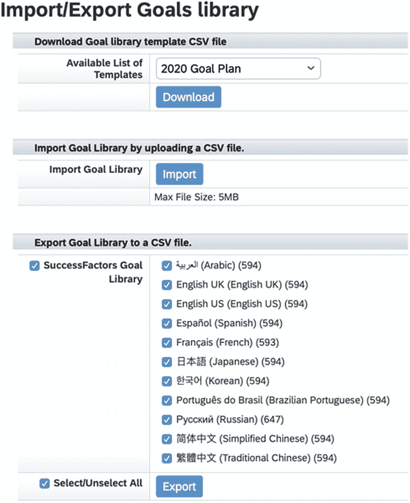

**图 4-10** 导入/导出目标库界面

1. 在搜索栏中输入并选择“导入/导出目标库”。屏幕将如图 4-10 所示显示。

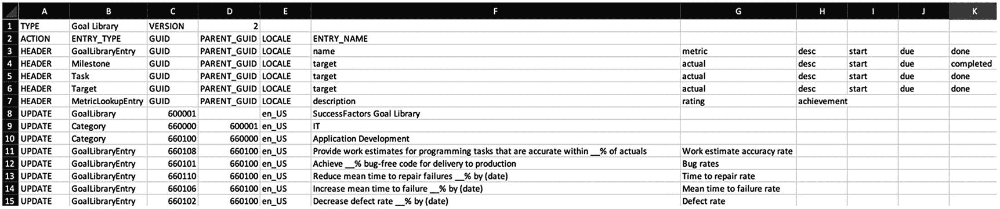

**图 4-11** 针对 `en_US` 区域设置的标准库下载示例

2. 在开始创建自己的库之前，您可能希望先更好地了解 SuccessFactors 目标库的结构。要下载 SuccessFactors 库，请选中“SuccessFactors 目标库”旁边的复选框，以及您希望下载的一个或多个所需语言。点击“导出”。您可以打开文件查看并编辑信息，如图 4-11 所示。

**注意：** `.csv` 文件中的第 2 行定义了文档的整体标题。您将在上图中观察到，有五行以 `"HEADER"` 开头。这些行各自定义了如何根据 `ENTRY_TYPE` 列中的值来构造标题以及 `.CSV` 文档中给定行的数据。例如，您在示例中看到的大部分行其 `ENTRY_TYPE` 都是 `"GoalLibraryEntry"`，每一行代表一个单独的目标。您为目标模板配置的字段将出现在右侧的 `ENTRY_NAME` 列及之后的位置。此结构将根据您下载的目标计划模板而变化。标题将根据需要基于您的模板被包含进来。

第 8 行通过定义目标库名称开始文件的实际数据。接下来的两行定义了一个类别，然后是一个子类别。请注意 `GUID`（全局唯一标识符）列非常重要。您为某个条目定义的 `GUID` 可以作为另一个条目的父 `GUID` 被引用。例如，最高层级的所有类别都会引用分配给该库的 `600001` 这个 `GUID`。类别也可以引用其他类别作为父级，从而成为子类别。然后，一个 `GoalLibraryEntry` 会引用一个类别或子类别。`Milestone`、`Task`、`Target` 和 `MetricLookupEntry` 则各自引用一个 `GoalLibraryEntry` 作为其父级。

如果您正在更新库，请务必将 `ACTION` 列中的 `"ADD"` 更改为 `"UPDATE"`。您每次都必须执行库的完整加载；不能只更新一个条目。您也可以使用 `"DELETE"` 操作来移除条目。标准库非常容易损坏 —— 我们建议将您希望保留的库条目复制到一个新库中。

3. 要从头开始创建库，请选择您希望下载其 `.CSV` 导入文件模板的目标模板，然后点击“下载”。

4. 打开文件并根据上述注意事项中的说明进行条目录入。保存文件，然后点击“导入”以选择要上传的文件。根据任何错误消息来排查错误；否则，您的新库将出现在“将目标库导出到 CSV 文件”部分下。

5. 请注意，如果您创建了一个新库，您将需要更改目标模板的 XML。关于如何执行此操作的说明，请参见本章的“下载、编辑和上传 XML”部分。

## 电子邮件通知

目标管理提供旨在让员工和经理及时了解目标计划变更的通知。请按照以下步骤配置这些邮件：

**注意**

许多客户往往会发现过多邮件会让用户感到疲劳。我们建议限制开启哪些邮件。通常，客户不会选择开启任何这些通知。相反，很多人依赖报告来管理员工和经理是否填写了目标，并手动通知那些看起来不活跃的用户。

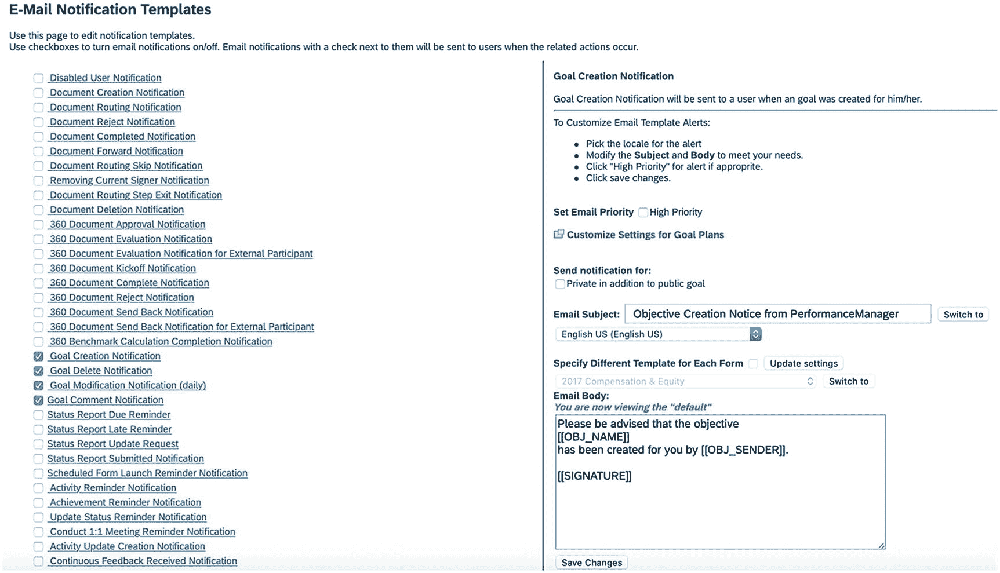

**图 4-12** — “电子邮件通知模板”屏幕

1. 在搜索栏中输入并选择“电子邮件通知模板设置”。屏幕将如图 4-12 所示。

**表 4-3** — 目标管理通知列表

| 通知 | 备注 |
| --- | --- |
| 目标创建通知 | 当添加目标时，向目标计划的所有者发送警报。这在经理为员工更新计划时可能有用。您可以选择包含或排除私人目标。可用令牌为 `[[OBJ_NAME]]` `[[OBJ_SENDER]]` `[[SIGNATURE]]`。 |
| 目标删除通知 | 当删除目标时，向目标计划的所有者发送警报。这在经理为员工更新计划时可能有用。您可以选择包含或排除私人目标。可用令牌为 `[[OBJ_NAME]]` `[[OBJ_SENDER]]` `[[SIGNATURE]]`。 |
| 目标修改通知（每日） | 如果有任何目标被修改，则每 24 小时批量向员工和经理发送电子邮件通知。可用令牌为 `[[LAST_EMAIL_DATE]]` `[[GOAL_OWNER]]` `[[OBJ-PLAN-NAME]]` `[[OBJ_LIST]]` `[[SIGNATURE]]`。您可以选择包含或排除私人目标。请注意，您还可以排除对链接目标、取消链接目标以及级联目标操作的修改通知。您也可以排除删除操作，以免消息与目标删除通知重复。您还可以选择矩阵经理是否会为其矩阵下属接收通知。此外，您可以按员工合并邮件，这样经理对于某个员工目标计划的所有更改只会收到一条消息。配置此通知后，您需要登录您公司实例的配置中心并设置一个计划任务来发送通知。请按照以下步骤操作：<br>1. 点击“管理计划任务”。<br>2. 在出现的新屏幕中，点击“创建新任务”并输入名称，例如“目标修改通知”。<br>3. 对于“任务类型”，选择“目标通知邮件”，并在任务参数中选择“今天”。对于执行次数选择“重复”，并选择“每日”。选择 23:00 作为时间（该任务通过收集自 0:00 以来的所有修改来工作，因此这能最大限度地捕获所有修改）。<br>4. 对于开始日期，选择今天的日期以及大约在当前时间后 5 分钟的时间。<br>5. 点击“创建任务”。<br>6. 在出现的主屏幕中，点击“操作”菜单并选择“提交”。您的任务将每天在 23:00 开始运行！<br>另外，如果您想在此通知中启用指向目标计划的直接链接，请执行以下步骤：<br>1. 确保已为此通知选择“按员工合并”选项。<br>2. 在搜索栏中输入并选择“公司系统和徽标设置”。<br>3. 勾选“启用 HTML 通知”旁边的复选框。<br>4. 点击“保存公司系统设置”。 |
| 目标评论通知 | 当向目标添加评论时，向员工和经理发送通知。如果经理评论，员工会收到通知。如果员工回复，经理会收到通知。如果其他人发表评论，则两人都会收到邮件。可用令牌为 `[[OBJ_RECIPIENT]]`、`[[OBJ_SENDER]]`、`[[OBJ_NAME]]`、`[[OBJ-PLAN-NAME]]`、`[[OBJ_COMMENT]]`、`[[OBJ_COMMENT_HERE]]`。 |

2. 参考表 4-3 来决定激活和/或编辑哪些模板。勾选您想要激活的邮件旁边的复选框，然后点击左下角的“保存通知设置”。要编辑任何特定通知的单独设置或内容，请点击左侧的通知名称，右侧屏幕将相应更新。点击“保存更改”以保存对该特定通知所做的编辑。
    1. 要修改不同语言的消息，请从下拉菜单中选择语言，并在进行编辑之前点击“切换到”。

3. 修改邮件内容时，您可以插入令牌以从相关目标计划中提取文本数据。可用令牌列于表 4-3 中。

### 启用移动功能

移动目标允许员工和经理访问、查看和编辑基本目标信息，例如名称、描述和状态。不支持备用或高级功能，例如群组目标、团队目标、指标查找表等。

**注意**

由于移动应用的简单性质，我们将不介绍如何使用该应用。我们邀请您前往 Apple App Store 或 Android Market 搜索“SuccessFactors”来下载该应用。下载后，您可以点击右上角的“演示”来浏览该应用。如果您想将应用与您实例上的特定用户关联以使用真实数据，则需要完成屏幕上的注册过程。如需查看支持和不支持的功能列表，请参考 SAP 注释 2475032。

要启用移动功能，请按照以下步骤操作：

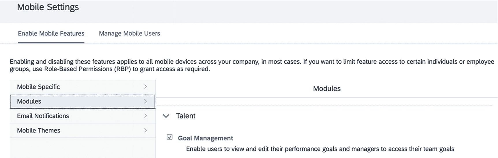

**图 4-13** — 在移动设置中激活目标管理

1. 在搜索栏中输入并选择“启用移动功能”。将出现移动设置屏幕。

2. 点击左侧的“模块”。然后勾选“目标管理”旁边的复选框，如图 4-13 所示。更改将立即生效。

## 向最终用户分配目标表单权限

在进一步通过编辑 XML 来配置我们的目标计划之前，明智的做法是在测试实例中向最终用户（例如，仅一个测试用户）分配权限，以便我们可以看到 XML 配置的结果并根据需要进行故障排除。要分配权限给最终用户，请按照以下步骤操作。

### 创建员工角色

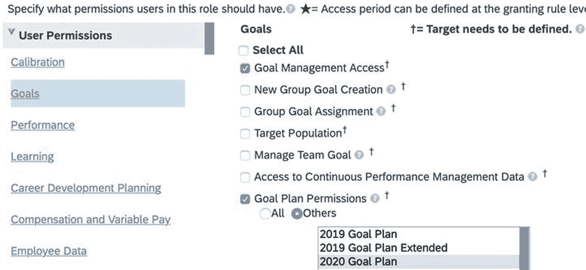

图 4-14：目标计划最终用户权限

1. 在搜索栏中输入并选择`管理权限角色`。点击您要编辑的权限角色名称（或通过点击`新建`创建一个新角色），然后点击`权限…`。

2. 在弹出的窗口中点击左侧的`目标`，然后勾选`目标管理访问权限`（该权限允许用户导航至系统的目标板块）和`目标计划权限`旁的复选框。点击`其他`单选按钮，并高亮选中您希望授予用户权限的特定目标计划。图 4-14 展示了最终结果示例。

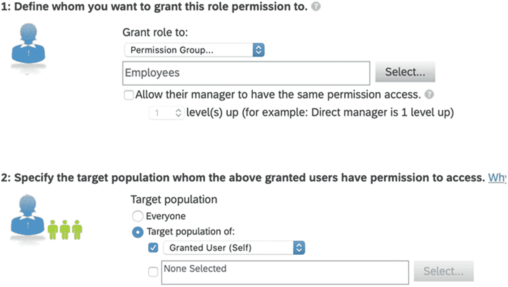

图 4-15：定义目标计划访问的目标群体

3. 点击`完成`。

4. 在角色主界面上，您需要定义目标群体。通常对于员工角色，其目标群体仅限于员工本人。因此，员工只能查看和编辑自己的目标计划。滚动至角色页面底部，点击`添加…`。在`将角色授予：`处，选择该角色将赋予的群体。在目标群体下方，选择`目标群体为`单选按钮，然后点击下拉菜单旁的复选框，选择`被授予用户（本人）`。参见图 4-15。

5. 点击`完成`，然后在角色主界面上点击`保存更改`。

**注意**：此处的权限仅控制特定员工对目标计划的访问入口。关于目标的操作权限以及公共目标与私人目标的可见性，均在各目标计划模板 XML 中定义。部分组织提倡透明度，可能希望向全体员工开放整个组织的目标计划访问权限，但通过控制操作权限，确保只有员工和经理能够编辑目标。

### 创建经理角色/HR 角色

如需创建经理角色，请重复上述为经理角色设置的步骤。在第 4 步中，对于`将角色授予：`，选择`所有经理`，或选择特定的经理群体。同时，在`目标群体`下，选择`被授予用户的直属下属`。勾选`包含对被授予用户的直属下属的下级报告的访问权限`，并选择您希望经理拥有访问权限的层级深度。图 4-16 展示了最终结果示例。

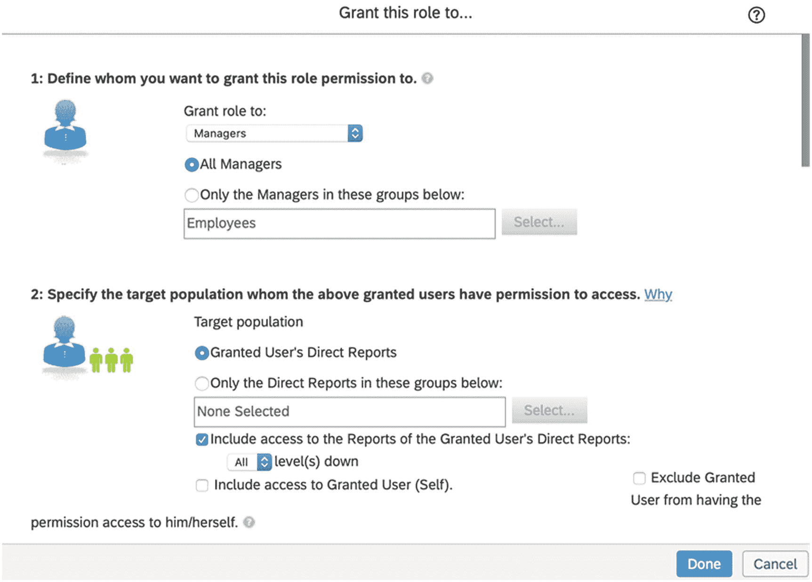

图 4-16：为经理定义目标计划目标群体访问权限

**注意**：根据我们的经验，您可能还需要为 HR 管理员重复此流程以创建单独的角色，只需在第一个下拉菜单中选择`HR 经理`即可。

## 需要 XML 配置的基本目标计划功能

现在我们已经构建了一个基本的目标计划并将其分配给示例群体，以便进行故障排除，接下来可以开始深入研究不那么直观的 XML 配置。

### 下载、编辑和上传 XML

为了编辑 XML，我们首先需要下载它。当您使用本章前面部分介绍的在线工具创建目标计划模板时，系统会自动生成一个 XML。现在，我们将登录到配置系统来下载模板以便编辑。请按照以下步骤下载模板、修改模板并重新上传：

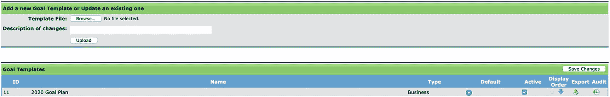

图 4-17：上传和下载目标计划 XML 模板

1. 登录贵公司的配置系统，点击`导入/更新/导出目标计划模板`。

2. 如图 4-17 所示，点击`导出`列下方的图标。您的网页浏览器会将文件下载到本地计算机。

3. 使用 XML 编辑器打开文件，进行编辑后点击`保存`。

4. 返回配置系统，这次上传目标计划：点击`导入/更新/导出目标计划模板`。

5. 点击`浏览…`按钮，选择您的 XML 文件。

6. 点击`上传`。系统将处理文件，并给出成功消息或错误消息，您可以根据错误消息对所做的更改进行故障排除。

**注意**：我们建议您每次仅修改少量设置，并将每组更改保存为本地计算机上的新文件名，以便缩小可能问题的范围。在最坏的情况下，您可以回退到文件的上一个成功版本。

### 目标计划 XML 格式

在本节中，我们将依次逐步讲解 XML 的每个区域，并描述配置选项，包括示例代码片段。通过按顺序将这些示例代码片段拼接起来，您可以上传一个功能完整的目标计划。

#### `<obj-plan-template>` 标签

`<obj-plan-template>` 标签是 XML 结构中的最高层级标签。它定义了一系列可开启或关闭、或可调整的选项，用于启用/禁用功能或对其进行调整。

示例如下：

```
参考表 4-4 根据需要修改属性值。
```

**表 4-4 `<obj-plan-template>` 属性**

| 属性 | 描述 |
| --- | --- |
| `spellchk` | 对于任何文本区域字段，如果此值设置为 `"true"`，则会显示拼写检查链接；否则，不显示该链接。 |
| `new-obj-share-status-public` | 当设置为 `"true"` 时，所有新目标默认为公开；否则，它们被设置为私有。如果你选择只允许用户拥有一种类型的目标，并隐藏公开与私有目标的区别，则必须将此设置为 `"true"` 并移除所有私有访问权限。更多信息，请参见 SAP 说明 2514964。 |
| `instructions-viewdefault` | 此属性不再使用，系统会忽略它。 |
| `alerts-viewdefault` | 将终端用户的显示选项默认为查看提醒。提醒会向用户显示其他人是否修改了目标或链接/对齐关系。 |
| `cascade-parent-viewdefault` | 此属性不再使用，系统会忽略它。 |
| `cascade-child-viewdefault` | 此属性不再使用，系统会忽略它。 |
| `expand-collapse-categories` | 如果设置为 `"true"`，则用户可以展开或折叠每个类别。 |
| `share-confirm` | 如果设置为 `"true"`，则会弹出一个确认框，询问用户是否确认共享目标；否则，不显示此确认框。 |
| `unshare-confirm` | 如果设置为 `"true"`，则会弹出一个确认框，询问用户是否确认取消共享目标；否则，不显示此确认框。 |
| `allow-group-goal` | 如果你选择使用组目标，则将此设置为 `"true"`。我们将在第 5 章中介绍组目标。 |
| `goal-tree-link` | 如果设置为 `"true"`，则已链接的目标旁边会显示一个图标，用户可以点击该图标查看“目标对齐聚焦”报告。 |
| `pager-max-objs-per-page` | 接受一个整数值。根据此处输入的目标数量创建分页。如果设置为 `"0"`，则所有目标显示在一页上。我们建议将其设置为 `"0"`。 |
| `pager-max-page-links` | 此属性不再使用，系统会忽略它。 |
| `pager-max-children-per-parent` | 此属性不再使用，系统会忽略它。 |
| `more-details-child-format` | 如果输入 `"goal-plan"`，则向下对齐的目标会以目标计划中显示的迷你版本显示。如果未设置或设置为 `"original"`，则仅显示全名、用户名和目标名称。 |
| `show-goal-id` | 如果设置为 `"true"`，则目标计划中会添加一列“目标 ID”。 |
| `display-alignment-format` | 如果设置为 `"names"`，则显示目标所有者姓名，并附带一个查看其计划中目标的链接。如果设置为 `"goals"`，则显示所有者姓名、目标名称和其他字段，而不是链接。 |
| `use-text-for-privacy` | 如果设置为 `"true"`，则用户可以从“公开”和“私有”的下拉选项中选择。否则，使用图标（太阳镜）来指示目标是否为私有。如果你不使用私有与公开目标，请完全移除该属性。更多信息，请参见 SAP 说明 2514964。 |

#### `<obj-plan-id>` 元素

`<obj-plan-template>` 标签下的第一个元素是 `<obj-plan-id>`。它设置了系统中目标计划的唯一数字标识符。如果你使用在线编辑器工具创建计划，系统会自动分配此标识符。否则，你可以选择一个尚未使用的数字。你可以在配置界面的“导入/更新/导出目标计划模板”屏幕上查看现有模板并选择一个新的 ID。如果你上传的计划与现有计划具有相同的 ID，则会覆盖该计划。

示例如下：

```xml

```

你选择的数字很重要，因为不同的数字对应使用相同 XML 格式的不同类型目标计划。数字范围如下表所示：

| 数字范围 | 模板类型 |
| :--- | :--- |
| 1–1000 | 目标计划 |
| 2001–3000 | 发展计划 |
| 4001–5000 | 学习活动 |
| 5001–5099 | 职业工作表 |

### `<obj-plan-type>` 元素
`<obj-plan-type>` 元素定义了计划是目标计划、发展计划、学习活动还是职业工作表。使用 `"Business"` 将计划类型定义为目标计划。

示例如下：
```xml
Business
```

### `<obj-plan-name>` 元素
这将是你使用在线工具设置并为终端用户显示的目标计划标题。第一行定义了默认名称。你可以在其下方为实例中每个启用的区域设置名称。

示例如下：
```xml
2020 Goal Plan
2020 Goal Plan
```

### `<obj-plan-desc>` 和 `<obj-plan-lastmodified>` 元素
描述和最后修改时间仅对在 XML 或在线工具中配置目标计划的人员显示。当你在在线工具中保存或在配置中上传 XML 时，最后修改时间会自动更新。

示例如下：
```xml
6/20/20 3:16 PM
```

### `<obj-plan-start>` 和 `<obj-plan-due>` 元素
开始日期和截止日期定义了实现目标的周期。这些应该在在线工具中设置。它们也作为用户创建目标时的默认开始日期和结束日期。

示例如下：
```xml
01/01/2020
12/31/2020
```

### `<obj-plan-numbering>` 元素
通过将一个目标添加到计划中另一个目标的下方并缩进它，可以将目标组织成子目标。要启用此功能，您必须通过此元素定义编号方案。通常，我们发现如果客户需要编号，他们倾向于使用 `1.1.1` 的表示法，其中第一个数字是类别的编号顺序，第二个数字是类别中目标的编号，第三个是缩进的目标：

要移除编号，只需从此元素中删除这三行代码。要禁止缩进，只删除最后一行。要使编号根据用户按列排序的方式自动生成，请删除两行。

### `<switches>` 元素
`<switches>` 元素是您可以列出希望为目标计划开启或关闭的各种功能的地方。在以下示例中，我们仅涵盖与目标计划相关的开关（其他用于发展计划的开关将在第 2 卷第 1 章中介绍）。

参考表 4-5 来决定关闭或开启哪些开关。

**表 4-5 可用的目标计划 XML 开关**

| 开关 | 描述 |
| :--- | :--- |
| `cascader-role` | 如果你计划允许经理或其他用户级联目标，重要的是要意识到，默认情况下，级联者将对目标员工目标的所有字段拥有写入权限。如果你的需求不同，你将需要启用此特殊级联者角色，该角色可以定义不同的权限。更多信息，请参见 SAP 说明 2072029。 |
| `cws-dispoption-competency-desc` | 如果你将能力与目标关联，开启此选项将默认在目标计划上显示能力描述。 |
| `turnoff-add-personal-goal-button` | 这关闭了用户创建个人目标的能力。它本质上强制用户使用库目标或管理员已导入到其计划中的目标。仅建议用于不允许终端用户在库外或管理员放置在其计划上的目标之外创建临时目标的组织。 |
| `percentage-value-over-100` | 开启此开关允许任何百分比字段（例如权重字段）中输入的数值超过 100。我们建议保持关闭，除非你有一个自定义的百分比字段，其中可能与此相关（例如，超过 100% 的完成率）。 |

#### `threaded-feedback`
此功能允许以线程样式显示目标评论，而此前它们以表格形式显示。我们建议启用此功能。如果您计划添加目标并希望将评论显示在绩效表单上，请遵循 SAP 备注 2459850 中的说明。

#### `continuouspm-integration`
此开关对应于在线工具中用于启用持续绩效管理集成的复选框。此开关将在目标计划中增加一列，显示与目标相关的任何 CPM 成果。如果您已实施 CPM，我们建议启用此功能。

以下是一个包含我们建议的示例代码段：

### `<add-wizard>` 元素
如前所述，在在线工具中创建模板时，目标向导是一个弹出窗口，允许最终用户逐步创建个人目标，并在每一步询问其目标是否符合“具体的、可衡量的、可达成的、相关的、有时限的”（SMART）原则。如果您选择添加此功能，您将看到此元素被添加到您的目标计划模板中。虽然您可以通过在线工具打开或关闭向导，但将目标对齐作为向导一部分的额外功能只能通过 XML 添加。要添加此额外功能，只需像以下示例那样添加`<include-goal-align>`。

我们的示例代码段如下所示（但我们根据客户反馈建议不要包含此项）：

### `<text-replacement>` 元素
在 XML 的这一区域，您可以定义一系列用于替换目标计划屏幕上特定标准文本元素的元素。SAP 备注 2072180 定义了可放置在`for`属性中的可用选项。值得注意的是，您将看到您在在线工具中定义的说明会出现在此处。

以下是我们的示例，其中包含了来自在线工具的说明：
```
here.Some item to consider working with goals:The goals listed here should be executed from 1/1/20 to 12/3/20Your goals will be visible to your manager and aboveSome goals may be added to your plan by your managerYour goals will be pulled onto your performance form and incorporated as part of your overall performance score for the year]]>
```

### `<obj-library>` 元素
为了将目标库与目标计划关联起来，需要在 XML 中定义一个映射。您从 SuccessStore 下载的标准目标模板已经包含了一个到 SuccessFactors 目标库的映射。您可以将其替换为您自己的映射，如下例所示。只需列出所有库字段 ID 以及您希望映射的所有目标计划 XML 字段名称。

以下示例将库中的`Name`映射到目标计划模板 XML 中的`name`：

图 4-18 展示了映射流程，从本章前面介绍的库上传开始，经过 XML 中定义的映射，最终到达最终用户屏幕。

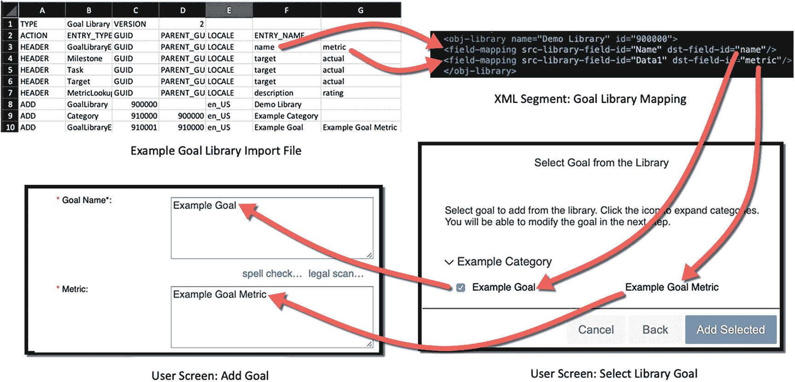

### `<category>` 和 `<default-category>` 元素
XML 的这一部分用于定义您的目标类别。我们建议您使用在线工具定义类别，它们将自动填充到此区域。如果您根本不想将计划划分为类别，请完全删除此部分（以及默认类别和类别字段的权限）。请注意，您在此处定义类别的顺序将决定它们向用户显示的顺序。默认类别必须放在最后。

我们的示例代码段如下所示：
```
Financial Growth and Responsibility
Financial Growth and Responsibility

Customer Care

Business Process Improvement
Business Process Improvement

Growing Self and Others
Growing Self and Others

Other
Other
```

### `<field-definition>` 元素

字段定义是向目标计划添加单个字段的方式。它们设置了字段的名称、类型、是否必填等属性。我们建议您在在线编辑器中创建所有字段。这是因为每当您添加字段时，在线工具都会自动更新`<field-definition>`、`<field-permissions>`、`<plan-layout>`和`<form-layout>`元素。在在线工具中添加字段后，您可以根据需要对在线工具中无法设置的个别设置进行编辑。在线工具无法创建的少数标准字段和类型，我们需要在此处作为补充进行说明。第一种是显示为复选框且很少使用的`bool`类型字段。第二种是标准的`comments`字段（`id`和`type`均为`comments`），客户可能希望包含也可能不包含（我们在示例中包含了它们，以便您了解其样式）。第三种是标准字段`id` `obj-plan-field1`（`type`为`text`），用作已分配目标的使命陈述，且很少使用。最后两种是`group-rating`和`group-rating-comments`，类型为`rating`，我们将在第 5 章中进一步讨论。

如果您选择创建或手动编辑字段，请参考表 4-6 了解字段定义的每个属性的含义。

### 表 4-6

目标计划字段属性

| 属性 | 描述 |
| --- | --- |
| `required` | 设置为`true`或`false`以指定该字段是否为必填。 |
| `viewdefault` | 如果希望默认不显示此字段，则设置为`off`（用户必须从显示选项中选择才能看到）；否则，此项默认开启。 |
| `showlabel` | 当您稍后定义计划布局时，这将更有意义——它决定是否显示字段标签。如果该字段位于布局的第一行并因此显示在列标题下方，我们建议将此项设置为`off`；否则，设置为`on`。 |
| `reportable` | 如果设置为`true`，该字段将被添加到标准目标清单报告中。您最多可以选择 20 个字段，并且它们在不同目标计划间的ID和类型必须匹配。根据我们的经验，大多数公司不使用此遗留报告。同样重要的是，任何自定义字段必须设置为可报告，以便经理在向下级联目标后可以查看员工计划上的这些字段。 |
| `field-show-coaching-advisor` | 仅用于类型为`textarea`的字段。这主要用于发展计划，并就会在员工未达到、达到或超越胜任力期望时如何撰写辅导要点提供建议。 |
| `spellchk` | 仅用于类型为`textarea`的字段，用于显示一个拼写检查图标，对字段内容执行拼写检查。 |
| `cascade-update` | 如果设置为`push-down`，则只有群组/团队目标所有者可以编辑该字段。如果设置为`regular`，则任何被分配该目标的人都可以编辑。我们将在第 5 章中进一步讨论这一点。 |

以下是排版后的文本：

我们的以下示例仅展示使用在线编辑器时生成的几个示例字段（为简洁起见），此外我们手动添加了`comments`字段，以便让您深入了解每种类型字段的结构：

```
目标名称
目标名称
目标名称
目标名称

指标
指标
指标
指标

权重
权重
权重
权重
0.0

开始日期
开始日期
开始日期
开始日期

截止日期
截止日期
截止日期
截止日期

完成百分比
完成百分比
完成百分比
完成百分比
0.0

状态
状态
状态
状态

未开始
未开始

进行中
进行中

已延迟
已延迟

已完成
已完成

已延期
已延期

已取消
已取消

里程碑
里程碑
里程碑
里程碑
里程碑
里程碑

目标日期
目标日期
目标日期
目标日期

里程碑
里程碑
里程碑
里程碑

实际日期
实际日期
实际日期
实际日期

评论
评论
```

## `<permission>` 元素

`<permission>` 元素部分列出了可在目标计划中执行的每个操作，并为每个操作分配了可执行者（由标准目标管理角色定义）。在线编辑器的主要缺点之一是您无法使用编辑器编辑操作权限。幸运的是，当您创建模板时，它会提供一些标准权限，这些权限可以在 XML 中修改。请参考表格 4-7 和 4-8 来了解每个操作的含义、每个角色包含的人员以及哪些角色可以执行哪些操作。请记住，在考虑角色和权限时，起始参考点始终是您正在查看其目标计划的员工。

### 表 4-8

目标计划操作

| 操作 | 描述 |
| --- | --- |
| `private-access` | 如果目标设置为私有，则定义的角色可以查看它。 |
| `create` | 谁可以在目标计划中创建目标。 |
| `delete` | 谁可以从计划中移除目标。请注意，对于团队目标，无论此权限如何，创建者始终可以删除。 |
| `delete-group-goal` | 谁可以从目标计划中移除团队目标。 |
| `move` | 谁可以缩进或将目标向上或向下移动。 |
| `share` | 谁可以将目标设为公开或私有。 |
| `cascade-pull` | 谁可以将目标从另一个计划拉取到当前计划中（只能是 `*` 或 `none`）。 |
| `cascade-push` | 谁可以将目标从当前计划推送到另一个计划中。 |
| `cascade-align` | 谁可以将此计划中的两个不同目标链接到另一个计划。 |
| `unalign-parent` | 谁可以取消链接已推送到目标计划中的目标。 |
| `unalign-child` | 谁可以取消链接已推送到另一个目标计划中的目标。 |
| `create-row` | 谁可以在类型为 `type=“table”` 的字段中创建行。 |
| `delete-row` | 谁可以在类型为 `type=“table”` 的字段中删除行。 |
| `move-row` | 谁可以在类型为 `type=“table”` 的字段中移动行。 |

### 表 4-7

目标计划权限角色

| 角色 | 描述 | 支持的操作 |
| --- | --- | --- |
| `*` | 所有人 | `private-access`, `create`, `delete`, `delete-group-goal`, `cascade-pull`, `cascade-push`, `cascade-align`, `create-row`, `delete-row`, `move-row` |
| `E` | 员工（其目标计划所属者） | `private-access`, `create`, `delete`, `delete-group-goal`, `move`, `share`, `cascade-pull`, `cascade-push`, `cascade-align`, `unalign-parent`, `unalign-child`, `create-row`, `delete-row`, `move-row` |
| `EM` | 用户数据文件中定义的员工的经理 | `private-access`, `create`, `delete`, `delete-group-goal`, `share`, `cascade-push`, `cascade-align`, `create-row`, `delete-row`, `move-row` |
| `EMM` | 员工的经理的经理 | `private-access`, `delete`, `delete-group-goal`, `share`, `cascade-push`, `cascade-align`, `create-row`, `delete-row`, `move-row` |
| `EM+` | 员工的经理以及该经理以上的所有汇报链成员 | 与上述操作相同 |
| `ED` | 员工的直接下属 | 与上述操作相同 |
| `EDD` | 员工直接下属的直接下属 | 与上述操作相同 |
| `ED+` | 员工的直接下属以及层级中所有下属 | 与上述操作相同 |
| `EM` | 员工经理的直接下属（即同一位经理下的同事）。 | 与前述操作相同 |
| `EX` | 用户数据文件中定义的员工矩阵经理。 | 与前述操作相同 |
| `EY` | 以矩阵经理身份汇报给员工的直接下属。 | 与前述操作相同 |
| `EH` | 用户数据文件中定义的员工 HR 经理。 | `private-access`， `share`， `cascade-align`， `create-row`， `delete-row`， `move-row` |
| `F` | 表单审核人。如果你已将目标拉取至绩效表单，并注意到某些审核绩效表单的人因与员工无直接汇报关系而无法查看目标，则可能需要使用此角色。完整说明请参见 SAP 说明 2077256。 | `private-access`， `create`， `share`， `cascade-align`， `create-row`， `delete-row`， `move-row` |
| `OP` | 目标父级角色。仅在使用团队目标时相关（将在第 5 章中介绍）。指将该目标下推至员工计划的人。 | `private-access`， `delete` |

OC | 目标子级角色。仅在使用团队目标时相关（将在第 5 章中介绍）。指其目标由此目标下推而来的人。 | `private-access` |

Cascader | 将目标级联至员工计划的人。请记住，此角色仅在 `cascader-role` 开关打开时生效。 | `create-row`， `delete-row`， `move-row`（仅用于字段/表级权限） |

> **注意**

> 上表并未列出 SAP SuccessFactors 中所有可用角色，仅包含目标管理模块中支持的角色。如需查看所有模块的完整列表，请参阅 SAP 说明 2087940。

以下示例展示了从 SuccessStore 创建模板时赋予的标准权限。根据我们的经验，你很可能需要修改这些权限以适应组织的需求：

### `<field-permission>` 元素

`<field-permission>` 元素使用标准角色定义各字段的权限。`type` 属性中可设置的可用权限包括 `None`、`Read` 和 `Write`。

> **注意**

> 表字段的权限也可以按单个表列来定义；但我们不建议这样做，因为绩效管理（PM）表单不支持此方式。

以下示例展示了通过在线编辑器添加字段时的默认权限。我们的示例还包含了手动添加的备注字段：

### `<plan-layout>` 元素

`<plan-layout>` 元素控制主目标计划屏幕上各字段的显示顺序。此外，列权重决定了当浏览器窗口缩放时该字段试图占据的屏幕空间（所有权重的总和应为 100）。

示例如下：

### `<form-layout>` 元素

该元素控制目标在绩效管理表单内的“目标详情”标签页中的显示方式（假设你正在将目标集成到绩效表单中）。整个布局在 `CDATA[ ]` 的括号内以 html 编写。从以下示例中可以看到，每个函数调用如何对应表格单元格内一个特定字段（在字段定义中具有相应 `id`）的显示，以及列宽如何再次通过百分比定义（这些百分比的总和应为 100）。

示例如下：

```
Category: ${field.category}
#set ($group = "name-state")

#if ($display.name) ${label.name}:
${field.name} #end
&nbsp;
#if ($display.metric) ${label.metric}:
${field.metric} #end
&nbsp;
#if ($display.weight) ${label.weight}:
${field.weight} #end
&nbsp;
#if ($display.start) ${label.start}:
${field.start} #end
&nbsp;
#if ($display.due) ${label.due}:
${field.due} #end
&nbsp;
#if ($display.done) ${label.done}:
${field.done} #end
&nbsp;
#if ($display.state) ${label.state}:
${field.state} #end

#### turn off grouping for subsequent fields #set ($group = "")

#if ($display.milestones)

${label.milestones}:${field.milestones}
#end
]]>
```

> **注意**

> 在 `<form-layout>` 元素之后，如果你是从 SuccessStore 创建的模板，可能会注意到 `<pdf-layout>` 和 `<details-layout>` 元素。这些是已不再使用的遗留元素，可以忽略，或替换为 `"<pdf-layout><![CDATA[[]]]></pdf-layout> <details-layout><![CDATA[[]]]></details-layout>"`。如果完全移除它们，系统会在上传 XML 时抛出错误。

### `<mobile-field-list>` 元素

此部分控制移动端目标列表视图中显示的字段。如果你在在线工具中勾选了 `done` 和 `state` 字段的复选框，它们将如下示例所示显示在此处：

> **注意**

> 我们在文档末尾添加了 `<obj-plan-template>` 字段的闭合标签，因为这是 XML 文档的结尾，需要闭合该标签。

## 基本配置总结

恭喜！你现在已经开启了目标管理，使用在线编辑工具配置了一个基本的目标计划模板，将该表单分配给了用户，并对底层 XML 进行了修改以支持组织的任何基本需求！现在，是时候按照端到端的目标计划流程，参观我们在示例中创建的表单了。

## 使用目标管理

在本节中，我们将基于上一节构建的样本 XML，通过一个基本的目标设置流程，审视我们配置的最终成果。首先，我们将以经理身份登录，在自己的计划上创建一些目标，并将这些目标级联给下属员工。然后，我们将作为其中一名员工登录，查看目标，调整我们的计划，并与同事对齐目标。让我们开始吧！

### 以经理身份创建和级联目标

在目标设定周期中，经理的典型工作场景是创建目标并将其级联给员工。以我们的模型公司示例为例，此时 CEO 将登录系统并开始向团队分配目标。让我们按照以下步骤了解如何实现：

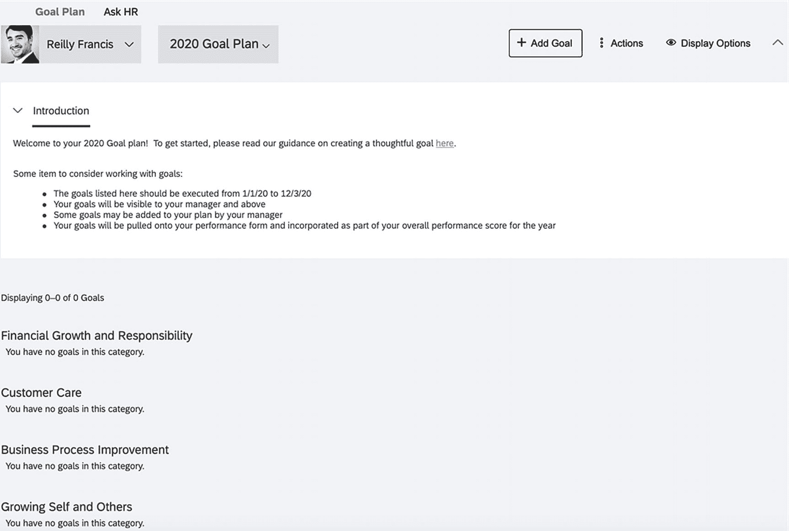

**图 4-19** 目标计划

1. 以你分配给经理角色的某个用户身份登录系统或代理登录。

2. 点击屏幕左上角的导航菜单，选择“目标”。屏幕将如图 4-19 所示。被选为默认计划并分配给经理的目标计划应出现在用户名旁边的下拉菜单中。你会注意到所选类别已出现，但尚未分配任何目标。

3. 点击“添加目标”。你将看到创建新目标、使用目标向导或从其他目标计划复制的选项。

4. 点击“创建新目标”。你将看到添加个人目标或库目标的选项。点击“库目标”。

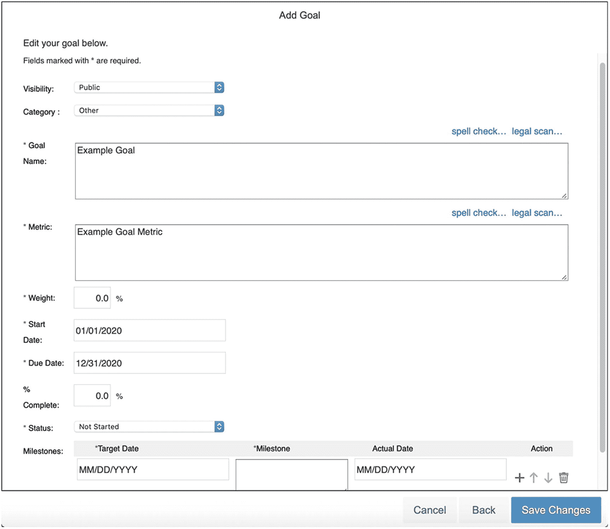

**图 4-21** 添加目标

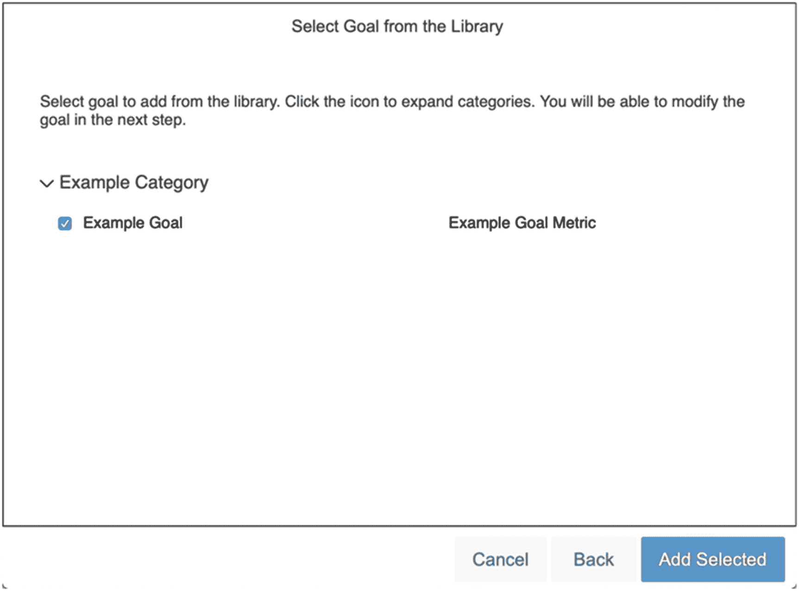

**图 4-20** 添加库目标

5. 你将看到已上传至库并与目标计划模板中 `<obj-library>` 映射关联的目标列表。通过点击左侧的复选框选择目标，然后点击“添加所选”。示例如图 4-20 所示。根据 `<field-definition>` 元素中的配置，将出现如图 4-21 所示的“添加目标”屏幕。映射的库字段将预填充，如下所示。开始日期和截止日期也将默认填入 `<obj-plan-start>` 和 `<obj-plan-end>` 日期。

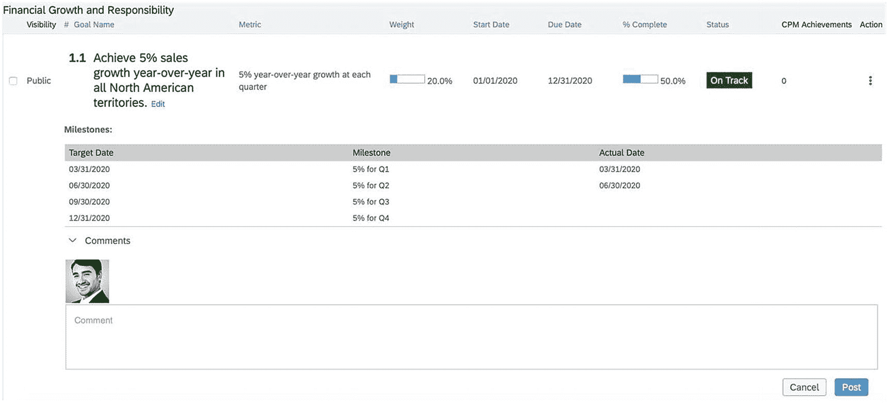

**图 4-22** 目标计划中显示的目标

1.  根据需要修改字段中的值，然后点击“保存更改”。

    该目标将如图 4-22 所示。

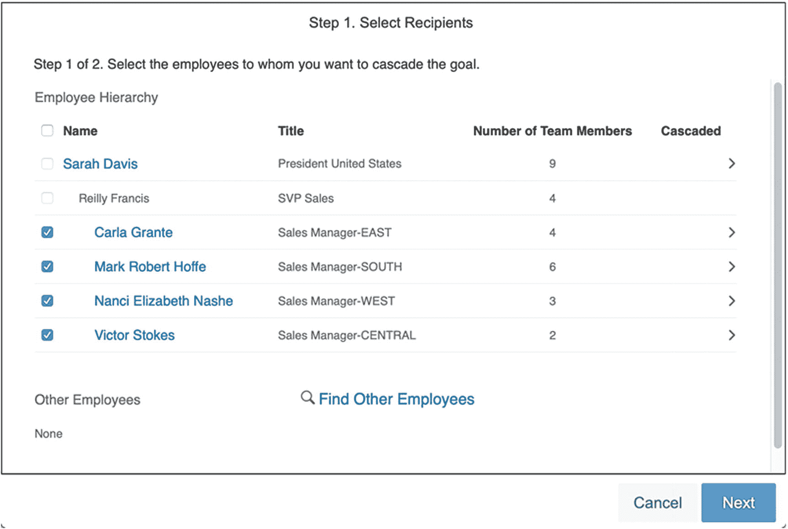

**图 4-23** 级联目标

1.  点击目标旁边的复选框将其选中，然后点击最右侧“操作”下方的三个点图标。您将看到基于您的 `<permission>` 元素设置而可用的操作。您也可以点击屏幕顶部“添加目标”旁边的“操作”来查看更多操作。点击此处并选择“级联”。屏幕将如图 4-23 所示显示用户的直接下属。

2.  假设您已正确设置权限，您可以勾选经理的每个直接下属旁边的复选框，然后点击“下一步”。确认字段已按您的要求填充，然后点击“级联”。

3.  在成功弹出窗口中，点击“关闭”。

4.  现在点击左上角已登录经理的姓名，下拉显示直接下属列表。点击您要查看其计划的员工姓名。加载计划后，您将在员工的目标计划上看到您级联的目标。

### 作为员工创建和对齐目标

现在我们已经了解了经理如何创建目标并将其级联给员工，让我们来看看员工如何使用 SMART 目标向导创建自己的目标并将其与他人对齐。请遵循以下步骤：

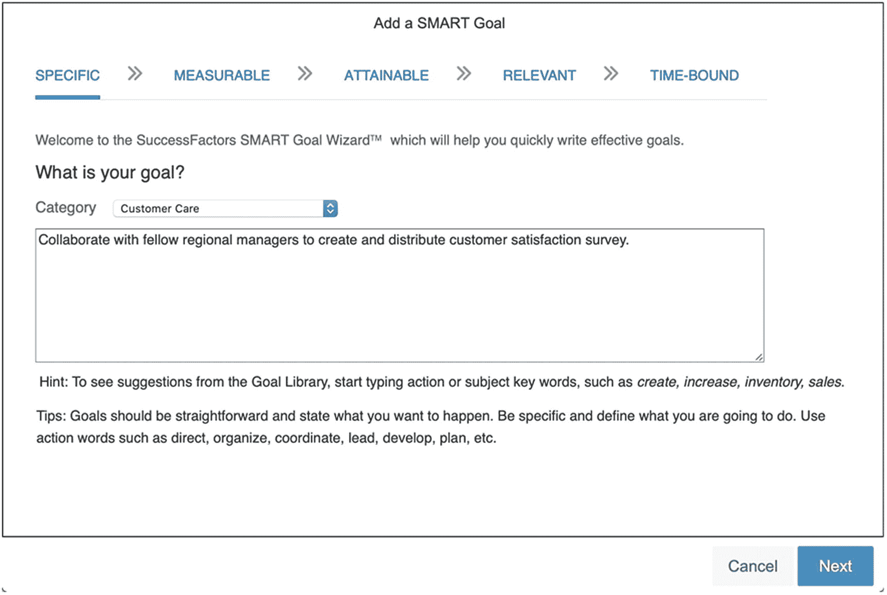

**图 4-24** 使用 SMART 向导添加目标

1.  以被分配了您所创建的员工角色的身份登录或代理登录。

2. 点击屏幕左上角的导航菜单，然后点击“目标”。将加载默认的目标计划。

3. 点击“添加目标”。您将看到用于创建新目标、使用目标向导或从其他目标计划复制的选项。

4. 点击“目标向导”。“添加 SMART 目标”屏幕将如图 4-24 所示。通过输入所需信息并点击“下一步”逐步完成向导的每个步骤。该目标将出现在目标计划上。确保目标设置为公开。

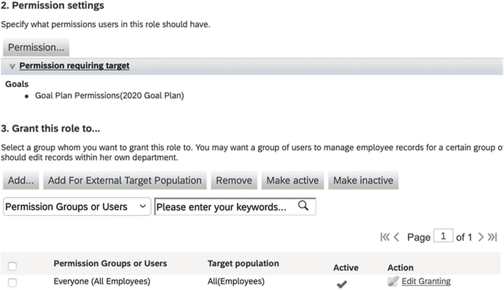

`图 4-25` 授予查看所有员工目标计划模板权限的角色

1. 重新以管理员身份登录，并按照“创建员工角色”部分的步骤，创建一个新的员工角色，但这次将目标用户的权限设置为“全部”。结果应如图 4-25 所示。

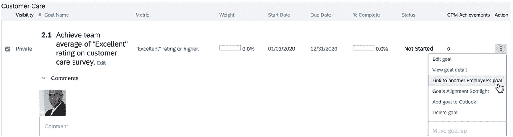

`图 4-26` 对齐目标

1. 现在，为同一个经理名下的另一位员工重复步骤 1-4。在目标计划主页面上，勾选目标旁边的复选框。点击“操作”列下方的三个点图标，并选择“链接到另一位员工的目标”，如图 4-26 所示。

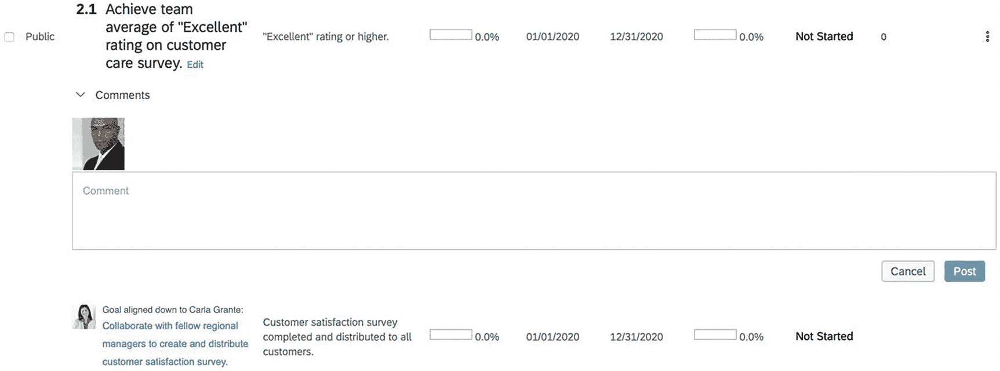

`图 4-27` 对齐目标的结果

1. 在出现的新弹出窗口中，点击两位员工共同经理的姓名。您将看到经理直接下属的姓名。点击步骤 1 中用户旁边的单选按钮，然后点击“下一步”。

2. 点击您在步骤 1-4 中创建的目标旁边的单选按钮，然后点击“下一步”。

3. 在确认屏幕上，点击“链接”。您现在应该看到该目标与第一个目标对齐，如图 4-27 所示。

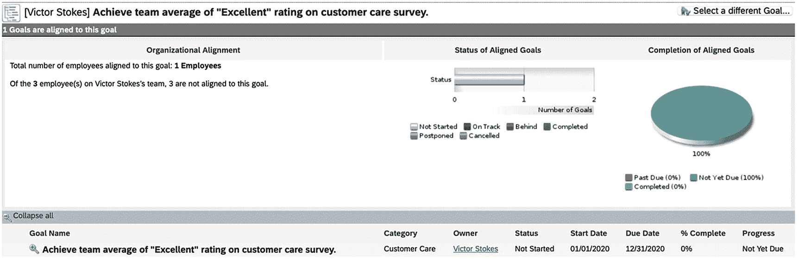

`图 4-28` 目标对齐聚焦报告

1. 现在您也可以点击“操作”列下方的三个点图标，并选择“目标对齐聚焦”来查看此目标及其链接的另一个目标的状态，如图 4-28 所示。

在前面的示例中，我们向您展示了两种最常见的目标计划场景：一种是经理为自己和员工设定目标，另一种是员工也可以查看其他计划中的公开目标，并将目标与其自身计划对齐。我们还可以说明上述步骤如何帮助我们的模范公司 CEO 不仅创建和级联目标，还能跨组织跟踪相互关联的目标的进度。

## 总结

我们希望您享受了设置和使用基本目标计划的体验！现在您应该知道如何在配置中激活目标管理、设置权限以配置和管理目标管理、创建基本目标计划模板并直接编辑 XML，以及作为经理和员工使用该计划。您还看到了模范公司如何使用这个强大的在线工具来设定其公司目标，并在公司内逐级下传，以便员工执行。此外，我们看到了员工如何使用该工具在相互关联的目标上进行协作，以及如何跨公司跟踪这些目标的进度。我们还向您展示了员工如何从示例目标库中提取内容并设定自己的个人目标。在下一章中，我们将逐步介绍一些利用目标管理中不太常用但功能依然强大的特性的替代目标设定方法。

## 5. 备选目标管理概念与功能

根据我们的经验，上一章介绍的基本配置和用法是大多数组织在实施目标管理时所必需的。然而，还有其他一些管理工具和可配置功能，使用范围虽不广，但可能非常强大。此类功能通常仅用于需要支持其独特业务流程的组织。在本章中，我们假设您已熟悉创建和使用目标计划的基本工具，并将逐步介绍一些更特殊的场景，在这些场景中我们可以利用一些较少使用的管理功能和配置选项。

> **注意**
>
> 我们假设在进行本章所述的任何额外配置之前，您已完成前一章中概述的基本配置。

## 使用批量更新工具管理目标

许多人力资源管理员最终会通过授予他们一个权限角色来手动管理目标，该角色允许他们访问和查看所有员工或他们被指定为人力资源管理员的目标计划。虽然这对于小团体来说很实用，但对于大量员工则需要使用批量更新工具。以下小节概述了可用于执行此类批量更新的两种工具。

### 批量导入和分配目标

在某些业务目标设定对所有员工都是集中式的组织中，目标将由管理员批量分配给员工，而不是由员工自行选择。这种情况可能程度不同：员工可能完全没有自己创建的目标，或者某些目标由集中管理员设定，其他目标则由员工自行分配。对于基本的目标计划，有两个屏幕有助于批量分配目标：旧的“导入目标”和“Beta 版目标导入”屏幕。

### 旧版导入目标屏幕

默认情况下，当您按照上一章的配置步骤启用目标管理时，管理员可以访问旧版“导入目标”屏幕。要为导入目标分配权限并激活测试版目标导入，请执行以下步骤：

1. 在搜索栏中输入并选择“管理权限角色”。

2. 屏幕加载后，点击要修改的角色，然后点击“权限…”。

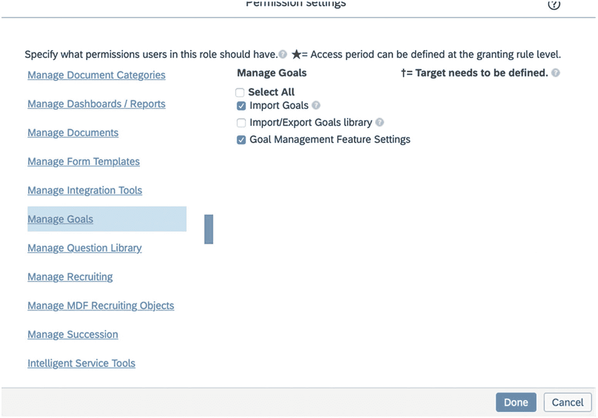

`图 5-1` 导入目标和目标管理功能设置权限

3. 点击左侧的“管理目标”，然后点击右侧的“导入目标”和“目标管理功能设置”，如图 5-1 所示。

4. 点击“完成”。在主屏幕上点击“保存更改”。

5. 分配权限后，可以通过在搜索栏中输入并选择“目标管理功能设置”，选择“目标导入”，然后点击“保存”来激活“测试版目标导入”。

**注意：** 这两个屏幕并不是批量分配目标的唯一方式。如果您实施团队目标，还有另一种相关的方法，我们将在下一节中介绍。

### 测试版目标导入

尽管名为“测试版”，但测试版目标导入已完全可用。它提供了 SAP 在旧版导入目标基础上添加的最新功能，包括支持指标查找表和注释；将导入作为作业调度；对齐目标；更新已添加到计划、使命声明和团队目标中的目标；以及将目标设置为只读。要通过“测试版目标导入”屏幕导入目标，请执行以下步骤：

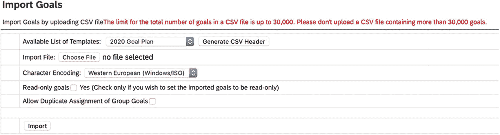

`图 5-2` 测试版目标导入屏幕

1. 请确保您以已分配电子邮件的用户身份登录，否则您将无法在最后一步看到结果电子邮件！

2. 在搜索栏中输入并选择“测试版目标导入”。测试版目标导入屏幕将出现，如图 5-2 所示。

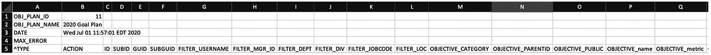

`图 5-3` 示例目标导入模板 CSV 文件（含标题）

3. 选择您要上传目标的目标计划模板。点击“生成 CSV 标题”。系统将根据模板 `XML` 中的配置，下载一个包含与目标计划模板关联字段的文件。示例如图 5-3 所示。

`表 5-1` 目标导入文件列

| 列 | 描述 |
| --- | --- |
| `TYPE` | 指定您上传的是普通目标的`OBJECTIVE`、取决于团队目标类型的`OBJECTIVE_GROUPV1`或`OBJECTIVE_GROUP_V2`（我们将在下一节介绍团队目标版本），还是团队目标的`OBJECTIVE_TEAM`（也将在下一节介绍）。您还可以指定`TASK`、`MILESTONE`、`TARGET`、`METRICLOOKUP`或`OBJCOMMENT`用于与目标关联的表数据。 |
| `ACTION` | 可以是`ADD`、`UPDATE`、`DELETE`、`ASSIGN`、`SHARE`、`UNSHARE`或`UNASSIGN`。`SHARE`和`UNSHARE`用于为团队目标分配/取消分配所有者。`ASSIGN`/`UNASSIGN`只是将团队目标添加到计划中。 |
| `ID`/`SUBID` | 未使用。SAP 将使用此字段填充创建目标导出屏幕时系统为该目标生成的自动内部系统 ID。 |
| `GUID` | 目标的唯一 ID，供您（上传者）用于标识要分配的目标。 |
| `SUBGUID` | 表数据（`TASK`、`MILESTONE`等）的唯一 ID，供您（上传者）用于标识该表数据。 |
| `FILTER_*` | 当您填充这些字段时，系统将查看用户数据文件（`UDF`）中的相应字段，并将目标/表数据分配给所有具有相同值的用户。例外情况是`MGR`字段，它不起作用（保留以备将来功能使用）。如果您不想进行过滤，而是将行分配给所有用户，请在`FILTER_USERNAME`列中输入“`ALL`”，并将其他所有列留空。 |
| `OBJECTIVE_*` | 这些列将根据您选择的模板的`XML`定义而变化。它们代表目标计划中的每个字段/表字段。`PUBLIC`字段的值为“`Y`”或“`N`”。日期字段应采用`3/30/2020`的格式。 |

4. 向文件添加行。

# 目标管理操作与配置

## 目标导入模板说明

**注意：** 让我们花点时间看看上图中显示的示例导入模板。您在文件中包含的每一行数据代表要添加的一个目标或表字段行，至少包含模板上的最小必填字段以及一个或多个用户的分配。列`D`、`E`和`F`都代表您赋予目标的 ID。列`G`到`L`都以`FILTER`开头，允许您使用过滤条件来选择谁将获得该目标。任何匹配过滤条件的用户都将被分配该目标。其余以`OBJECTIVE`开头的列是根据`XML`配置的字段，将与目标关联填充。表 5-1 给出了每一列的具体说明。

5. 点击“导入文件”并选择您更新的文件。

6. 选择字符编码。

**注意：** 我们推荐使用`UTF-8`字符编码，特别是对于包含多种语言的国际化实施，以避免上传格式错误的字符。

7. 根据需要选中“只读目标”和“允许重复分配团队目标”旁边的复选框。

8. 点击“导入”。您将收到一条错误消息或成功消息，表明已调度作业，并且您将收到一封包含结果的电子邮件。

**注意：** 作为使用此屏幕上传的替代方法，您可以在配置中使用相同的文件模板来调度作业，以便从`SFTP`服务器拉取文件。为此，请登录您公司实例的配置环境，点击“管理作业”。点击“创建作业”，并在“作业类型”字段中选择“`TGM FTP Data Import`”。在上传非常大的文件时，您可能希望使用此方法。请注意，无论使用哪种方法，系统都限制您一次最多上传 30,000 条记录。

## 旧版导入目标

根据 SAP 帮助文档，旧版“导入目标”仅在“测试版目标导入”不支持您要完成的功能时使用——具体来说，是设置目标计划的可见性以及将目标设置为只读。然而，我们在同一文档中看到，这些功能在测试版目标导入中是支持的。此外，我们不建议设置目标计划的可见性——这是在基于角色的权限存在之前的旧版活动，而基于角色的权限现在用于控制对目标计划的访问。因此，我们不建议使用旧版“导入目标”。根据我们的个人经验，我们从未遇到过需要使用它的客户。

## 向最终用户添加导入目标的权限

在某些情况下，您可能希望为目标导入功能对最终用户（例如经理）开放。为此，请将以下代码段添加到目标计划`XML`的`<permission>`元素部分：

```
<permission>
  ...
</permission>
```

然后，经理将看到从目标计划屏幕右上角“操作”菜单中导入目标的选项，如图 5-4 所示。文件格式与管理员的相同；但是，只能使用用户过滤器，并且用户名必须是当前屏幕上显示的目标计划对应的用户名。

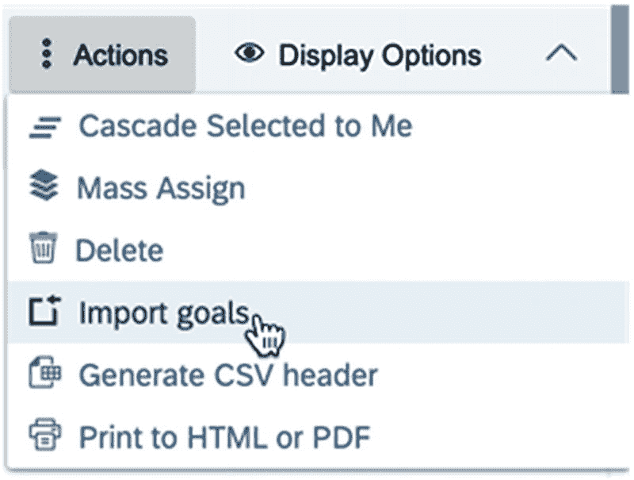

**图 5-4** 从操作菜单导入目标

## 员工间目标转移

当员工离职、调岗或工作职责发生变化时，会发生什么？在很多情况下，这会导致业务目标的转移，需要将这些目标从一个人转移到另一个人。为了实现这一点，我们可以在员工之间转移目标。接下来，我们将逐步介绍设置和使用目标转移功能所需的步骤。

### 设置配置

在使用该功能之前，需要先在配置中启用它。请按照以下步骤激活该功能：

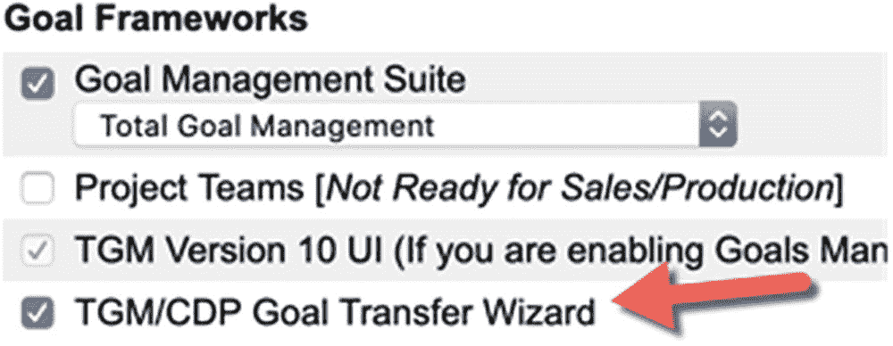

**图 5-5** 在配置中启用目标转移向导

1. 登录配置，并选择您的公司实例。

2. 点击“公司设置”。

3. 勾选“`TGM/CDP`目标转移向导”旁的复选框，如图 5-5 所示。

4. 点击“保存”。

### 分配权限

现在功能已激活，接下来需要分配使用它的权限：

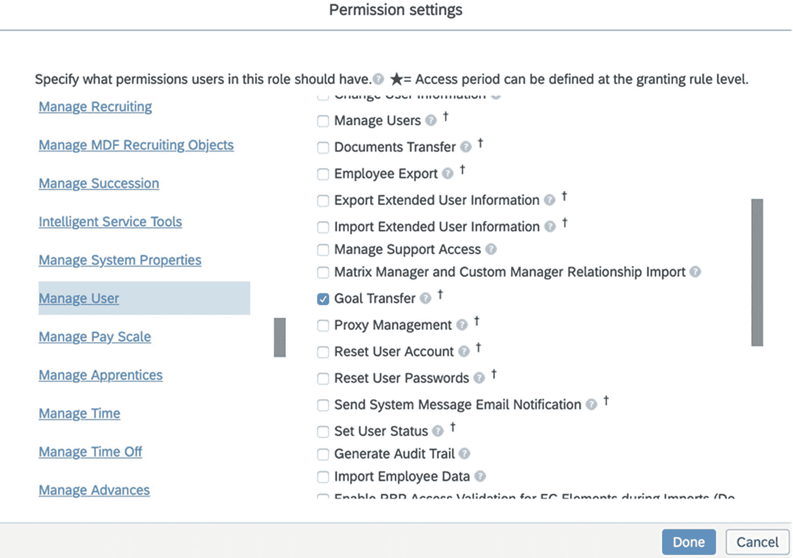

**图 5-6** 分配目标转移权限

1. 在搜索栏中输入并选择“管理权限角色”。

2. 屏幕加载后，点击您要修改的角色。然后点击“权限...”

3. 点击左侧的“管理用户”，然后点击右侧的“目标转移”，如图 5-6 所示。

4. 点击“完成”。

5. 在主屏幕上，点击“保存更改”。

### 使用目标转移

现在功能已开启，并且我们拥有使用权限，可以开始操作了！请遵循以下步骤：

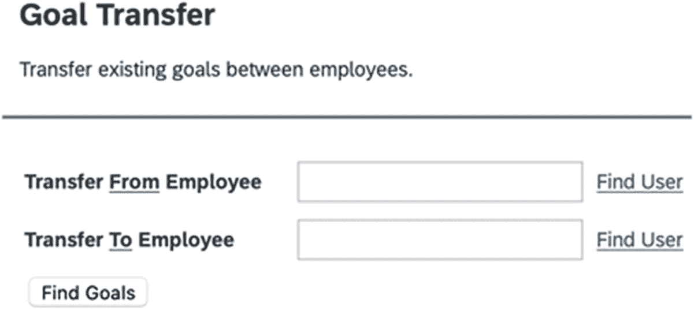

**图 5-7** “目标转移”屏幕

1. 在搜索栏中输入并选择“在用户之间转移目标”。屏幕将如图 5-7 所示显示。

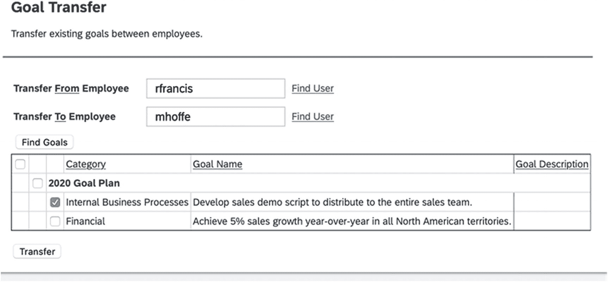

**图 5-8** 转移目标

2. 输入要转出目标的员工的用户名，或使用“查找用户”链接来查找该员工。

3. 对要转入目标的员工重复上一步操作。

4. 点击“查找目标”。计划中的目标将如图 5-8 所示显示。

> **注意**  
> 请勿转移已分配给用户的母目标。

5. 勾选要转移的目标旁的复选框，然后点击“转移”。

6. 屏幕将更新，告知您目标已成功转移。

> **注意**  
> 对目标所做的任何评论，以及其他目标的任何关联，也将一并转移。

## 其他目标管理概念与功能

在本节中，我们将介绍一些不常用，但可以提供强大功能以满足组织更专业化需求的功能。这包括目标执行与对齐图、目标计划状态、自定义计算、成就查找、组目标、团队目标和计划（Initiatives）。

### 目标执行/对齐图

目标执行提供了一种方法，使客户能够比标准完成百分比和状态字段更深入地跟踪整个组织内的目标进展。它适用于频繁跟踪目标进度，并将目标状态更新作为其业务执行策略一部分的组织。例如，一个采用目标管理（MBO）方法论并需要工具来帮助跟踪进度的组织。目标执行由三个组件组成：状态报告、执行图和会议议程。其核心理念是，组织团队围绕其关联目标紧密合作，并定期提供状态报告。通过这种方式，系统数据保持最新，显示关联目标进展情况的执行图或对齐图也始终保持相关性。

> **注意**  
> 由于`Adobe Flash`将在 2020 年底退役，执行图正被对齐图取代。两者的配置几乎相同，主要的技术差异在于底层用户界面技术。我们建议使用新的对齐图，因为旧技术将不再受支持。此外，目标执行功能的全部维护结束时间定于 2019 年下半年，生命周期结束时间定于 2020 年下半年。有关更多详细信息，请参阅 SAP 说明`2071572`。因此，我们保留本节内容主要是为了支持现有客户，不建议为新客户启动新的目标执行实施。

### 目标执行前提条件

使用此功能时，需要注意一些限制。首先，目标必须相互关联（级联或对齐），可视化才有意义。其次，我们将在本章中概述的标准字段一次只能关联一个激活的目标计划（这是屏幕知道正在执行哪个计划并进行渲染的方式）。同时请记住，权限在此处发挥作用，它决定了哪些目标是公开的，哪些是私有的，以及因此谁可以在执行图/对齐图中看到它们。

#### 配置设置

要在配置中激活目标执行，请遵循以下步骤：

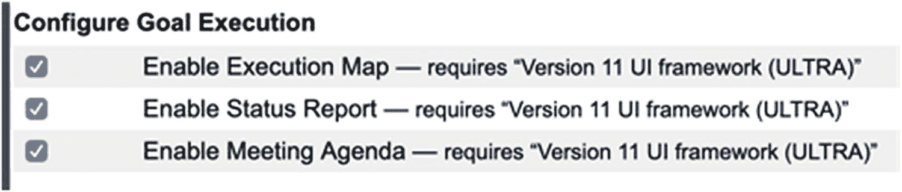

**图 5-9** 目标执行配置设置

1. 登录您公司实例的配置，然后点击“公司设置”。

2. 勾选“启用执行图 – 需要‘版本 11 UI 框架 (`ULTRA`)’”、“启用状态报告 – 需要‘版本 11 UI 框架 (`ULTRA`)’”和“启用会议议程 – 需要‘版本 11 UI 框架 (`ULTRA`)’”旁的复选框。示例如图 5-9 所示。

3. 点击“保存”。

#### 配置权限

请遵循以下步骤为您的管理员角色分配配置目标执行的权限：

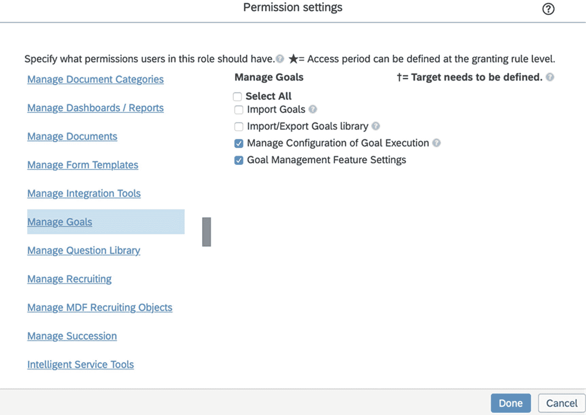

**图 5-10** 管理目标执行权限

1. 在搜索栏中输入并选择“管理权限角色”。

2. 点击您要编辑的角色名称。

3. 点击“权限...”

4. 点击左侧的“管理目标”。

5. 勾选“管理目标执行配置”和“目标管理功能设置”旁的复选框，如图 5-10 所示。

6. 点击“完成”。

7. 在主屏幕上，点击“保存更改”。

### 目标执行/对齐图配置

在目标执行屏幕工作之前，您需要将表 5-2 中的以下字段实现在您的目标计划 `XML` 的 `<field-definition>` 元素部分。

**表 5-2** 目标执行字段

| `字段` | `类型` | `描述` |
| --- | --- | --- |

## 配置目标执行字段

以下是目标执行功能所需的自定义字段定义：

`bizx-target` | 数值 | 指计划参与者试图实现的目标指标值。如果目标是团队目标，您还可以设置字段属性 `rollup-calc-type="sum"` 或 `"average"`，以便目标负责人根据所有关联目标的输入值获得最终目标分数。请务必在 `<plan-layout>` 元素中也包含此字段。 |

`bizx-actual` | 数值 | 当前已实现的指标实际值。如果目标是团队目标，您还可以设置字段属性 `rollup-calc-type="sum"` 或 `"average"`，以便目标负责人根据所有关联目标的输入值获得最终实际分数。请务必在 `<plan-layout>` 元素中也包含此字段。 |

`bizx-pos` | 枚举 | 表示成功的可能性。仅限于以下枚举值，需在 XML 中为字段输入这些值：

```
<enum-value value="1" style="background:red;color:black;">
<enum-label>低</enum-label>
</enum-value>
<enum-value value="2" style="background:yellow;color:black;">
<enum-label>中</enum-label>
</enum-value>
<enum-value value="3" style="background:green;color:white;">
<enum-label>高</enum-label>
</enum-value>
<default-value>3</default-value>
```

请务必在 `<plan-layout>` 元素中也包含此字段。 |

`bizx-strategic` | 枚举 | 标识此目标是否为战略目标的“是/否”标志。您只能在 XML 中定义以下值：

```
<enum-value value="0" style="background:white;color:black;">
<enum-label>非战略</enum-label>
</enum-value>
<enum-value value="1" style="background:white;color:black;">
<enum-label>战略</enum-label>
</enum-value>
<default-value>0</default-value>
```

请务必在 `<plan-layout>` 元素中也包含此字段。 |

`bizx-effort-spent` | 枚举 | 显示在执行地图、状态报告和会议议程页面中（非目标计划主页面）。该字段仅限于您必须在 XML 中包含的以下值：

```
<enum-value value="0" style="background:white;color:black;">
<enum-label>无</enum-label>
</enum-value>
<enum-value value="1" style="background:white;color:black;">
<enum-label>非常少</enum-label>
</enum-value>
<enum-value value="2" style="background:white;color:black;">
<enum-label>很少</enum-label>
</enum-value>
<enum-value value="3" style="background:white;color:black;">
<enum-label>一些</enum-label>
</enum-value>
<enum-value value="4" style="background:white;color:black;">
<enum-label>很多</enum-label>
</enum-value>
<enum-value value="5" style="background:white;color:black;">
<enum-label>非常多</enum-label>
</enum-value>
<default-value>0</default-value>
``` |

`bizx-status-comments` | 文本域 | 仅用于状态报告视图上的评论（非目标计划主页面的评论）。 |

## 激活目标执行功能

将字段添加到 XML 后，您可以按照以下步骤激活目标执行功能：

> **注意：** 如果您之前未添加该字段，则在尝试保存设置时会收到错误提示！

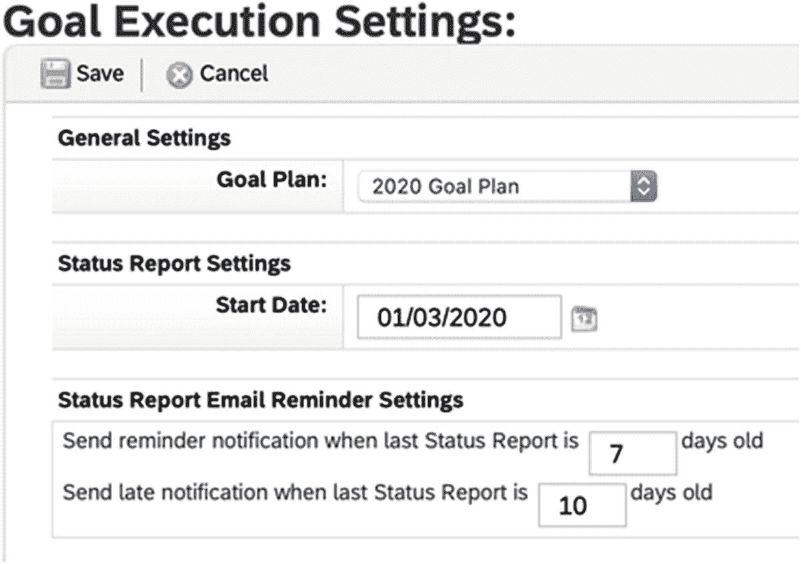

**图 5-11** 目标执行设置

1.  在搜索栏中输入并选择“目标执行设置”。

2.  在“目标计划”字段中，选择您已添加目标执行字段的活跃目标计划。

3.  在“状态报告设置”下，考虑是否要为员工添加填写状态报告的提醒。在图 5-11 所示的示例中，我们将开始日期设为一年的第一个星期五，并设置每周五发送提醒通知。如果报告在周一之前未填写，员工将收到另一封提醒邮件，通知状态报告已逾期。

4.  点击“完成”以保存更改。

## 配置电子邮件模板

在实际发送电子邮件之前，您需要完成电子邮件模板的配置。如果您不想发送邮件提醒，您仍然需要完成上述提醒设置；但是，您可以禁用后续步骤中概述的电子邮件。要配置提醒邮件，请执行以下步骤：

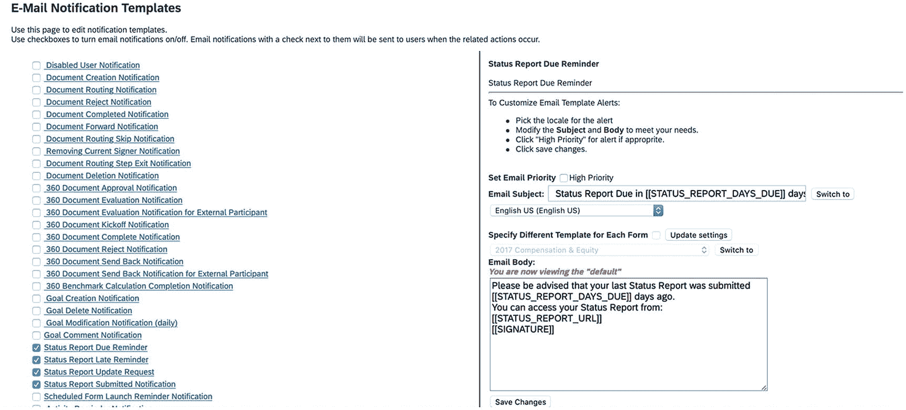

**图 5-12** 目标执行邮件配置

1.  在搜索栏中输入并选择“电子邮件通知模板设置”。

2.  根据需要勾选“状态报告到期提醒”、“状态报告逾期提醒”、“状态报告更新请求”和“状态报告已提交通知”旁边的复选框，然后点击“保存通知设置”。示例见图 5-12。

3.  点击您想要编辑的电子邮件模板名称。完成编辑后，点击“保存更改”。

## 启用目标对齐图表

如果您希望使用对齐图表而不是执行地图，在激活上述所有通知后，还应执行以下步骤：

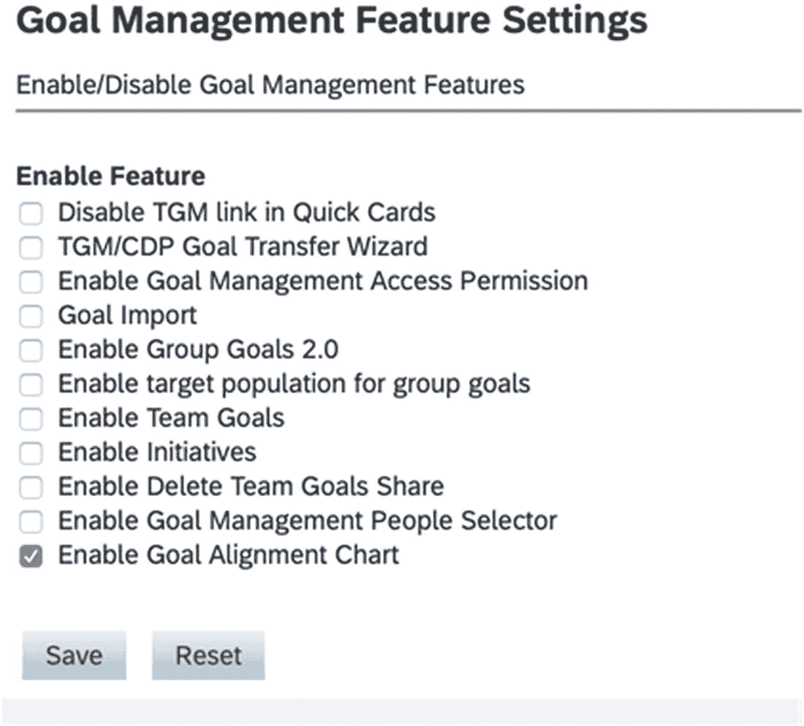

**图 5-13** 启用目标对齐图表

1.  在搜索栏中输入并选择“目标管理功能设置”。

2.  勾选“启用目标对齐图表”旁边的复选框，如图 5-13 所示。

3.  点击“保存”。

> **注意：** 我们建议使用新的对齐图表，因为目标执行功能将在 2020 年后不再受支持。

## 分配最终用户权限角色

现在我们已经完成了配置，接下来可以为最终用户分配使用目标执行功能的权限。请执行以下步骤：

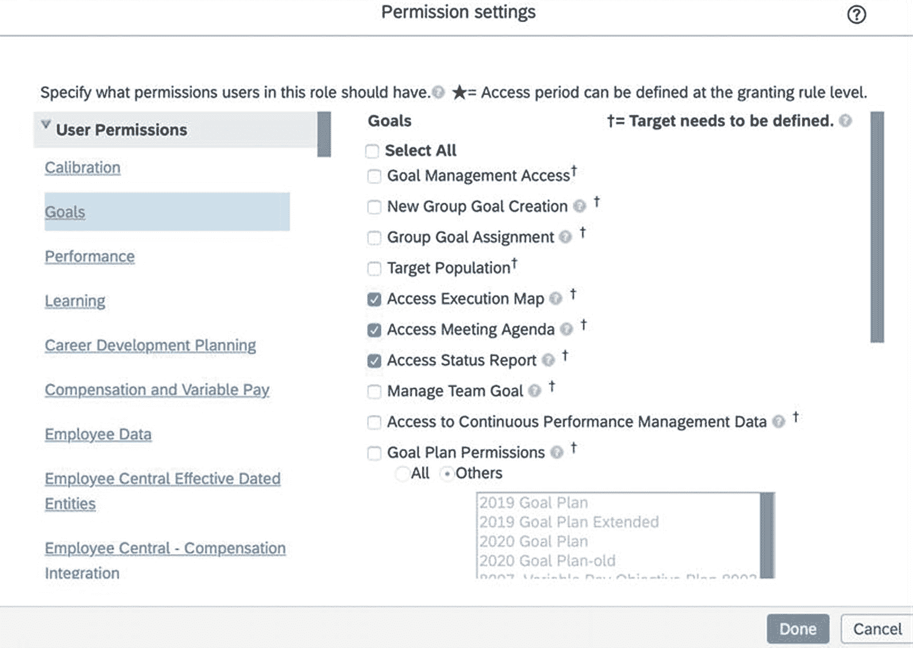

**图 5-14** 目标执行最终用户权限

1.  在搜索栏中输入并选择“管理权限角色”。

2.  点击您要编辑的角色名称。

3.  点击“权限...”

4.  在左侧点击“目标”。

5.  根据需要勾选“访问执行地图”、“访问会议议程”和“访问状态报告”旁边的复选框。示例见图 5-14。

> **注意：** 通常，执行地图分配给经理或高管角色，会议议程分配给经理角色，状态报告分配给员工角色。

6.  点击“完成”。

7.  在权限角色主屏幕上，点击“保存更改”。

## 使用目标执行

下面，我们将通过一个快速场景来演示目标执行的工作原理：

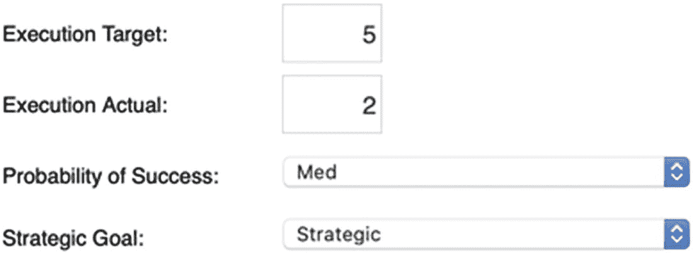

**图 5-15** 填写目标执行专属字段

1.  以一名目标关联到其经理的员工身份登录。

2.  导航至目标计划。

3.  在“操作”列下，点击“编辑目标”。填写新的 `bizx-target`、`bizx-actual`、`bizx-pos` 和 `bizx-strategic` 字段的值。示例见图 5-15。

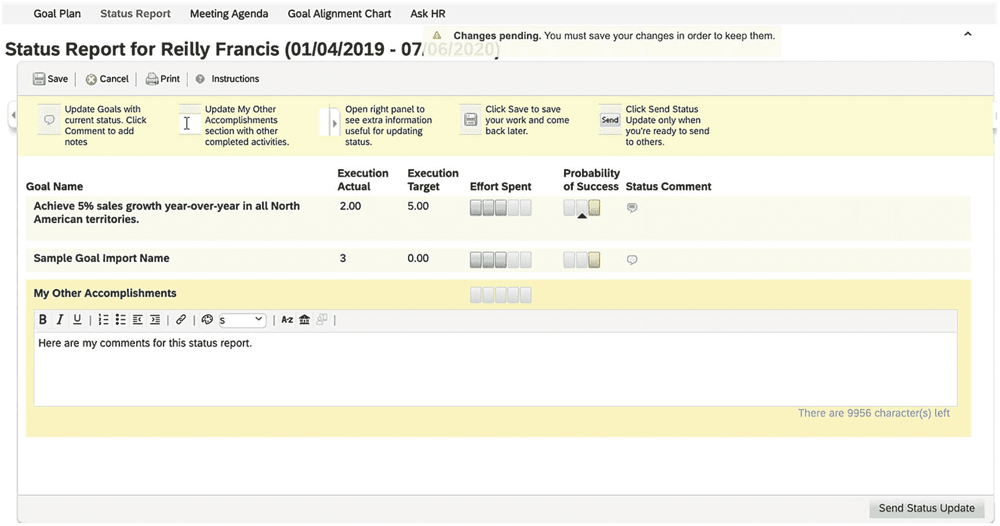

**图 5-16** 目标执行状态报告

4.  导航至“状态报告”。如图 5-16 所示，填写 `bizx-target`、`bizx-actual`、`bizx-effort-spent` 和 `bizx-status-comments` 字段的值。点击“发送状态更新”。

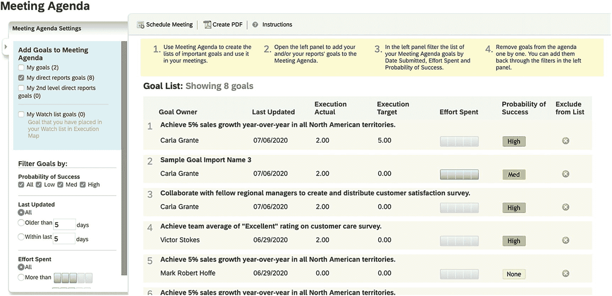

# **图 5-17** 会议议程页面

1.  以该目标所关联的目标负责人（经理）身份登录。
2.  导航到“目标 ➤ 会议议程”。屏幕将如图 5-17 所示。您将看到员工更新的状态报告。您也可以使用此屏幕选择/取消选择要在 PDF 打印输出中创建的目标。

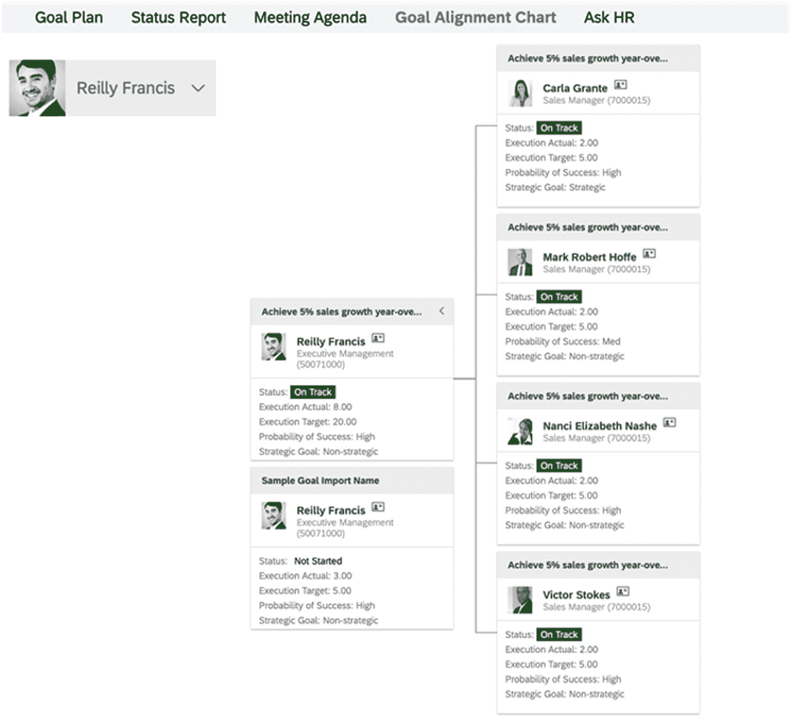

**图 5-18** 目标对齐图表

1.  导航到“目标 ➤ 目标对齐图表”。假设存在关联目标，并且所有“目标执行”字段已通过目标计划和状态报告填写完毕，您将看到这些关联目标的状态，如图 5-18 所示（如果字段值缺失，您将看到一个错误屏幕）。您可以点击`>`和`<`图标来查看/隐藏每个目标之间的关联关系。您还可以下载图表的 PDF 或 JPEG 格式。

## 目标计划状态

根据我们的经验，一些组织要求锁定目标计划，以便限制或禁止对目标进行进一步编辑。例如，一个组织可能希望在 1 月份强制执行目标设定期，之后锁定计划，以便在当年后期无法编辑目标（例如，以防止任何试图使原始目标看起来更接近实际结果的行为）。由于目标计划不是可路由的表单，实现此目标的逻辑方法是通过目标计划状态。目标计划状态在目标计划顶部添加一个链接，以便只有被授权的人员才能锁定或解锁该计划。当表单被锁定或解锁时，它将遵循两套（或更多，取决于您配置的数量）不同的已定义权限（通常将字段设置为可编辑或只读）。

> **注意**
>
> 此功能不适用于群组目标和团队目标。另外，虽然我们个人只见过锁定和解锁状态，但从技术上讲，您可以定义任意数量的状态。更多详情，请参见 SAP 注释`2072109`。

### 配置目标计划状态

要添加目标计划状态，您需要为每个状态定义一组权限。这可以通过添加`<object-plan-states>`元素，然后在其内部定义每个`<object-plan-state>`元素来完成。每个`<object-plan-state>`应包含一组`<permission>`和`<field-permission>`元素，这些元素定义了特定于该状态的权限。

示例代码如下所示：

```
...
  <object-plan-states>
    <object-plan-state id="unlocked">
      <label>Unlocked</label>
      <action>Unlock</action>
      <permission>...</permission>
      <field-permission>...</field-permission>
    </object-plan-state>
    <object-plan-state id="locked">
      <label>Locked</label>
      <action>Lock</action>
      <permission>...</permission>
      <field-permission>...</field-permission>
    </object-plan-state>
  </object-plan-states>
...
```

### 使用目标计划状态

添加目标计划状态后，用户将在目标计划顶部看到状态指示器，如下所示。在我们的示例中，以员工身份登录时，您可以看到目标计划状态是什么，但必须由经理登录并查看员工的目标计划才能更改其状态。状态名称和操作将根据您在 XML 配置中的定义显示。在图 5-19 所示的示例中，经理只需点击“锁定”链接，权限就会更改为我们在示例代码中为“锁定”状态定义的权限。


**图 5-19** 目标计划状态的经理视图

### 自定义计算

可以创建基于其他字段值进行计算的自定义字段。一个常见的例子是“目标评分”字段，您可以通过将单个目标评级乘以该目标的权重来计算。

#### 配置自定义计算

使用计算功能需要在 XML 中添加两个新元素（以及它们可能拥有的子元素）。`<calculator>`元素定义了执行计算的方式（可以理解为`字段 a + 字段 b`），而`<auto-population>`元素定义了哪个字段被填充哪个计算结果。此外，`<auto-population>`可以包含规则。`<rules>`元素允许您定义哪些`<calculator>`元素将作为条件，哪些将作为结果。您甚至可以包含指标查找表（也称为成就查找表），这有助于定义哪些评分满足各种条件和阈值，从而转换为最终评级。

> **注意**
>
> 有关指标查找表的更多信息，请参见 SAP 注释`2072202`。

在创建计算和条件时，您可以使用标准的`+`、`-`、`*`和`/`运算符。也可以使用括号`()`定义优先级。此外，还支持使用`FUNC.<functionname>`格式的函数。支持的函数有：`round(number)`、`ceil(number)`、`floor(number)`和`diff(date1, date2, Unit)`。`Unit`可以是以下值之一：`MILLISECOND`、`SECOND`、`MINUTE`、`HOUR`、`DAY`、`WEEK`、`MONTH`、`QUARTER`、`YEAR`。`NOW`全局变量将返回当前日期和时间。

在创建条件时，您可以使用标准的`==`、`!=`、`>`、`>=`、`<`、`<=`、`&&`、`||`和`!`运算符。

在里程碑、目标、任务等表格中，您可以对列使用以下函数：`sum(column)`、`avg(column)`、`add(column1, column2)`、`subtract(column1, column2)`、`multiple(column1, column2)`和`divide(column1, column2)`。您还可以使用函数`gm_sub_goal_rating_of_milestones`、`gm_sub_goal_rating_of_targets`和`gm_sub_goal_rating_of_tasks`来计算每种表格类型的最终评级。

要计算目标计划的总分，您需要使用标准字段`goal-score`来填充每个单独目标的评级。然后，您可以将`<obj-plan-template>`元素的属性`show-total-goalscore`设置为`true`。或者，您可以通过在`<category>`元素中设置相同的属性和值来为每个类别设置总分。

如何使用计算的例子不胜枚举。为简洁起见，我们在下面提供了一个简单但常见的示例，以帮助您理解计算的结构，以便您可以根据需要创建自己的计算。在此示例中，我们为每个目标计算一个分数，并向最终用户显示每个类别的总分和最终总分。

我们的示例代码如下所示：

```
...
  <auto-population>
    <rules>
      <rule>
        ...
        <result>
          <calculator>...</calculator>
          <field id="goal-score" />
        </result>
      </rule>
    </rules>
  </auto-population>
  <calculator id="Rating">
    <label>Rating</label>
    <label>Rating</label>
    <description>Individual Goal Rating</description>
    <default-value>0.0</default-value>
    <format>#.#</format>
    <calculation>...</calculation>
  </calculator>
...
```

> **注意**
>
> 这里有几个“陷阱”可能会让您感到困扰！首先，当您将`goal-score`添加到计划布局时，它要到第二天才会出现。其次，如果您更新了计算逻辑，您需要以最终用户身份更新每个目标中的值，然后新的计算才会执行！很多时候，一旦计算逻辑发生变化，最好在测试时直接创建全新的目标。在目标计划周期中间更改计算逻辑很可能会导致计算错误和混乱。

#### 以最终用户身份查看目标评分

作为最终用户，您现在可以看到目标计划顶部的目标评级、每个类别顶部的评级以及作为每个目标列出的评级，如图 5-20 所示。

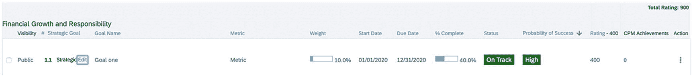

**图 5-20** 向最终用户显示的目标评级

## 群组目标

# 群组目标与团队目标

`群组目标`提供了两个不同版本（v1 和 v2），用于创建、管理目标并将其分配给特定群组中的个人以协作执行。无论您选择使用哪个版本，每个目标都有一个创建者（制定目标的人）、一个所有者（目标最初在其计划上创建的人）、一个分配者（将目标分配给成员的人）以及成员（被分配了目标的用户）。此外，在这两个版本中，对所有者目标所做的任何更改都可以下推给成员目标（这是使用群组目标而非简单关联个人目标的一个关键原因）。表 5-3 突出了 v1 和 v2 之间的差异，以帮助您选择哪个版本（如果有的话）可能适合您的组织。您必须选择其中一个版本。

| 群组目标版本 | 描述 |
| --- | --- |
| v1 | 最适合于您希望动态分配成员（例如，按部门、分部、地点字段）和/或希望所有成员获得相同评级的情况。 |
| v2 | 虽然此版本不支持动态分配（必须具体指明所有成员，但可以在目标分配后进行更改）也不支持群组评级，但它支持较新的功能，例如任务、目标、里程碑和计算评级。此外，字段可以由群组成员编辑。有关更多信息，请参见 SAP 注释 `2072705`。 |

## 配置前提条件

在配置群组目标之前，您必须决定要使用群组目标 v1 还是 v2。如果您选择 v1，它默认已开启，您只需执行 XML 和权限设置。如果您想使用 v2，则需要在配置管理中开启所需的版本。请按照以下步骤开启群组目标 v2：

1.  登录您公司实例的配置管理。
2.  点击“公司设置”。
3.  点击“启用 Group Goals 2.0 – 需要‘总体目标管理’”。
4.  点击“保存”。

> **注意：** 如果您希望群组目标的更新也适用于非活跃用户（例如，如果他们正在休假），请点击下图所示的选项。此外，如果您使用的是基于角色的权限，并希望向角色添加一项允许最终用户定义目标人群的权限，请点击下方的“启用群组目标的目标人群 – 需要‘总体目标管理’”。您还可以勾选“启用群组目标分配权限的目标人群”和“启用群组目标删除权限的目标人群”复选框，以便这些权限在授予访问权限时使用角色的目标人群。图 5-21 指出了这些选项的位置。

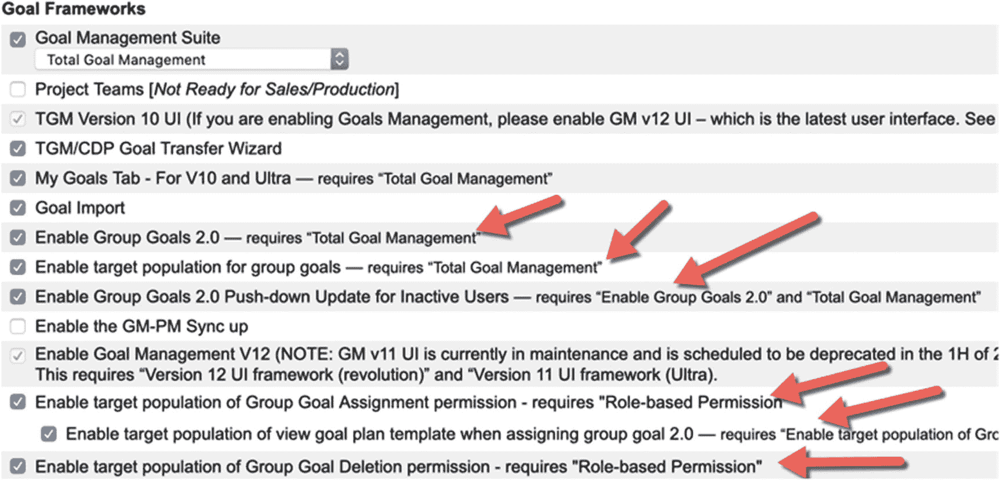

*图 5-21 启用群组目标 v2 及相关选项*

### 配置群组目标

要在您的目标计划中允许群组目标，只需将 XML `<obj-plan-template>` 元素属性 `allow-group-goal` 编辑为 `true`。

示例代码如下所示：

```
...
...
```

### 分配最终用户权限

一旦我们在配置管理中完成设置并在计划中开启了群组目标，我们就可以为最终用户进行权限角色分配。请按照以下说明操作：

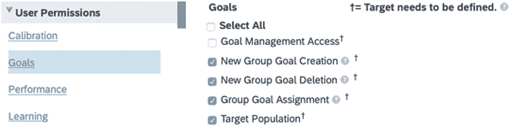

*图 5-22 群组目标权限*

1.  在搜索栏中输入并选择“管理权限角色”。
2.  点击您想要编辑的权限角色的名称。
3.  点击“权限...:”，然后在左侧点击“目标”。
4.  选中“新建群组目标创建”和“群组目标分配”权限，如图 5-22 所示。

> **注意：** 上图中的“目标人群”权限仅当您在配置管理中选择了“启用群组目标的目标人群”选项时才会出现；您还需要确保在您的角色中定义了一个目标人群。同样，如果您在配置管理中选择了“启用群组目标分配权限的目标人群”和“启用群组目标删除权限的目标人群”，那么这些选项将如图 5-22 所示那样出现。

5.  点击“完成”。
6.  在主权限角色编辑屏幕上，务必在“授予此角色给…”部分下，通过点击“添加…”或“编辑授权”并根据需要定义目标人群，来根据需要更新/添加目标人群。
7.  在主权限角色编辑屏幕上，点击“保存更改”。

### 使用群组目标

既然我们已经完成了配置并分配了权限，让我们开始使用我们的群组目标吧！请按照以下说明操作：

> **注意：** 我们将在此处演示群组目标 v2，因为它支持我们迄今为止在示例代码中配置的功能。

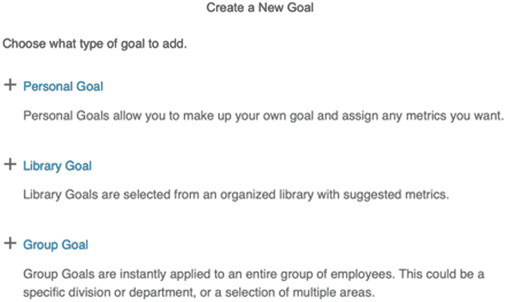

*图 5-23 创建群组目标*

1.  以您已分配群组目标权限的人员身份登录（在我们的示例中，这是一位经理）。
2.  在导航菜单中，导航至“目标”。
3.  点击屏幕右上角的“添加目标”，然后选择“创建新目标”。应出现“创建新目标”屏幕，其中包含创建“群组目标”的选项，如图 5-23 所示。

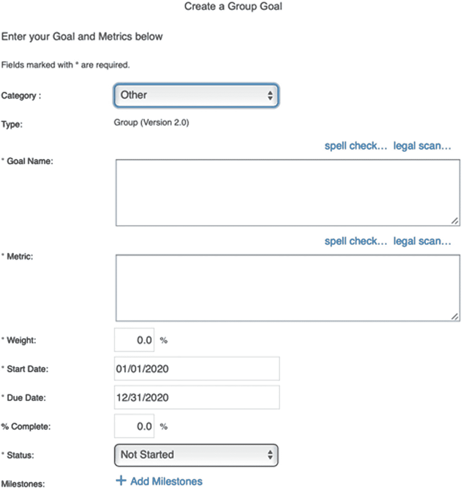

*图 5-24 添加群组目标*

4.  点击“群组目标”。将出现“创建群组目标”屏幕，如图 5-24 所示。请注意，显示的字段将与您的 XML 中配置的字段相对应；主要区别在于“类型”字段将显示为只读，并显示为“群组（版本 2.0）”。


*图 5-25 分配群组目标*

5.  根据需要填写字段，然后点击“保存更改”。该目标将被添加到目标计划中。
6.  在目标计划中，点击目标旁边的复选框，然后点击“分配”，如图 5-25 所示。
7.  点击您希望为其分配目标的员工旁边的复选框，然后点击“下一步”。
8.  点击“分配”。群组目标即已分配给员工。

## 团队目标

`团队目标`提供了一种方式，让经理可以将目标分配给他们的团队，而无需在自己的目标计划中拥有这些目标。此功能基本上与本章刚刚介绍的群组目标 2.0 相同，主要区别在于该目标不在经理的目标计划中。然而，尽管功能非常相似，但重要的是要注意，某些配置和最终用户菜单选择是不同的，以防客户希望并行使用它们。`团队目标`还引入了共同所有者概念。当执行团队目标的“共享”操作时，与之共享的人将成为共同所有者，并拥有与所有者相同的权限。如果所有者放弃了目标，其中一位共同所有者将成为新的所有者。这一点很重要，因为如果没有人成为共同所有者，而所有者变为非活跃状态，该目标将无法编辑。

### 配置团队目标的前提条件

在进行配置之前，请确保按照以下步骤在配置管理中激活团队目标：


*图 5-26 启用团队目标*

1.  登录到贵公司的配置界面，点击“公司设置”。
2.  勾选“启用团队目标”旁边的复选框，如图 5-26 所示。
3.  点击“保存”。

### 配置团队目标

正如我们在团队目标中提到的，您需要添加相同的 XML 代码，将 `allow-group-goal` 属性设置为 `true`。

此外，您还需要遵循以下步骤：


*图 5-27 启用团队目标*

1.  在搜索栏中输入并选择“目标管理功能设置”。
2.  勾选“启用团队目标”和“启用删除团队目标共享”选项旁边的复选框，如图 5-27 所示。
3.  点击“保存”。

### 分配最终用户权限

激活团队目标后，您可以将其分配给权限角色。请遵循以下步骤：

1.  在搜索栏中输入并选择“管理权限角色”。
2.  点击您想要编辑的权限角色名称（建议使用经理角色）。
3.  点击“权限…”：
4.  在弹出窗口的左侧，点击“目标”，然后根据需要勾选“管理团队目标”、“分配团队目标”和“共享团队目标”旁边的复选框。

> **注意：** 请留意此界面，“管理团队目标”和“分配团队目标”需要设置权限目标，而“共享团队目标”则不需要！

5.  点击“完成”。
6.  在主权限角色编辑界面，务必在“授予此角色给…”部分下，通过点击“添加…”或“编辑授权”，并根据需要定义目标群体，从而根据需要更新/添加目标群体。
7.  在主权限角色编辑界面，点击“保存更改”。

### 以最终用户身份使用团队目标

现在我们已经配置并分配了团队目标权限，让我们来试一下！请遵循以下步骤：


*图 5-28 启动团队目标*

1.  以您已分配权限的用户身份登录（例如，一位经理）。
2.  在导航菜单中选择“目标”。

### 创建团队目标

1.  点击屏幕右上角的“操作”，然后选择“启动团队目标”，如图 5-28 所示。


`图 5-29` 创建团队目标

1.  在出现的新屏幕中，点击右上角的“创建团队目标”。

2.  您将看到“创建团队目标”界面，如图 5-29 所示。该界面显示的字段与您在主要 XML 配置中配置的一致。“类型”字段将显示值“团队”。根据需要填写字段，然后点击“保存更改”。


`图 5-30` 显示操作菜单的团队目标界面

1.  您将返回主“团队目标”界面，该界面现在将显示您刚刚创建的团队目标（以及您作为所有者的任何其他目标）。点击您目标“操作”列下的图标，然后选择“分配”。示例见图 5-30。


`图 5-31` 选择接收团队目标的员工

1.  弹出窗口将自动显示您团队的成员，如图 5-31 所示。勾选他们姓名旁边的复选框，然后点击“下一步”。接着点击“分配”。


`图 5-32` 共享团队目标

1.  您将返回主“团队目标”界面，其中“分配给”列下的数字已更新。再次点击“操作”列下的图标，然后点击“共享”。

2.  将显示“共享团队目标”弹出窗口，如图 5-32 所示。输入您希望与之共享目标的用户名称（例如，经理的上级），然后点击“添加”。最后点击“完成”。

3.  点击“目标面板”返回目标计划。您会注意到该目标并未显示在您（作为经理）的目标计划上。您可以查看团队成员的目标计划，会发现该目标出现在他们的计划中。您也可以尝试以经理的上级身份登录，会发现该目标同样未显示在其计划中，但由于已共享，他们可以在“团队目标”界面中看到该目标。

至此，大功告成！您已经成功创建、对齐并共享了一个团队目标！

## 举措

举措为组织提供了一种在公司、部门或团队级别设定高层目标的方式，员工可以将其个人目标与之对齐。举措也可以分组到举措组中。举措的分配和共享方式与团队目标相同（即使其他人成为该举措的共同所有者）。

**注意** 根据我们的经验，举措易于配置，并能有助于聚焦高层目标。

### 配置举措的先决条件

在配置之前，请务必遵循以下步骤在配置界面中激活举措：


`图 5-33` 启用举措

1.  登录到贵公司的配置界面，点击“公司设置”。

2.  勾选“启用举措”旁边的复选框，如图 5-33 所示。

3.  点击“保存”。

### 配置举措

在系统中激活后，配置举措是一个简单的过程。请遵循以下步骤：


`图 5-34` 配置举措

1.  在搜索栏中输入并选择“`目标管理功能设置`”。屏幕将如图 5-34 所示。

2.  勾选“启用举措”旁边的复选框。

3.  点击“保存”。

### 为举措分配最终用户权限

现在举措已在系统中激活并配置完成，我们可以将其分配给最终用户。请遵循以下步骤分配管理和共享举措的权限：


`图 5-35` 分配管理和共享举措的权限

1.  在搜索栏中输入并选择“`管理权限角色`”。

2.  点击您想要编辑的权限角色名称（建议使用经理角色或 HR 管理员角色）。

3.  点击“权限…”：

4.  在弹出窗口的左侧，点击“目标”，然后根据需要勾选“管理举措”和“共享举措”旁边的复选框。示例见图 5-35。

5.  点击“完成”。

6.  在主权限角色编辑界面，务必在“授予此角色给…”部分下，通过点击“添加…”或“编辑授权”，并根据需要定义目标群体，从而根据需要更新/添加目标群体。

7.  在主权限角色编辑界面，点击“保存更改”。

### 以最终用户身份使用举措

现在配置已完成，角色也已分配，我们可以开始使用举措了！请遵循以下步骤来管理、共享举措，并将目标与举措对齐：


`图 5-36` 管理举措界面

1.  以您分配权限的用户身份登录公司实例。

2.  在搜索栏中键入并选择“`管理倡议`”。将显示“管理倡议”屏幕，如图 5-36 所示。


`图 5-37` 创建倡议组和倡议

3.  单击右上角的“创建倡议组”按钮。输入倡议组名称和描述，并将该倡议标记为有效。根据需要单击“添加倡议”按钮，向组中添加单个倡议，并根据需要输入倡议名称和描述。完成后，单击“保存”。示例如图 5-37 所示。


`图 5-38` 管理倡议操作菜单

4.  您将返回到主“管理倡议”屏幕，您的倡议组将显示在列表中，如图 5-38 所示。单击“操作”列下的图标，然后选择“共享”以共享该倡议。


`图 5-39` 共享倡议屏幕

5.  将出现“共享倡议”弹出窗口，如图 5-39 所示。键入您要与之共享该倡议的员工的姓名（请记住，员工搜索将遵循角色的目标人群）。单击“添加”，然后单击“完成”。

**注意** 然后，您可以作为与之共享该倡议的人员登录，该倡议也会出现在他们的“管理倡议”屏幕上。如果您想撤销自己作为倡议所有者的访问权限，请从“操作”菜单中选择“撤销”。要彻底删除一个倡议，请从“操作”菜单中选择“删除”。


`图 5-40` 倡议组分配示例

6.  您将返回到“管理倡议”主屏幕。单击“操作”列下的图标，然后单击“分配”。将出现“倡议组分配”弹出窗口，如下图所示。在这里，您可以使用用户数据文件（`UDF`）中的字段动态创建组。示例如图 5-40 所示。


`图 5-41` 将目标与倡议对齐

7.  完成创建受分配者组后，单击“与目标计划对齐”选项卡。选中您希望添加该倡议的目标计划旁边的复选框。然后点击“完成”。

8.  从主导航菜单导航到“目标”，然后选择其中一个受分配者的目标计划。单击目标旁边的“编辑”。已分配的倡议组将出现在编辑目标屏幕的底部，并带有您可以选择与目标对齐的可用倡议，如图 5-41 所示。

恭喜！您现在已经成功创建、共享、分配并使目标与倡议对齐！

## 结论

在本章中，我们介绍了目标计划的备选功能和管理技术。虽然根据我们的经验，基本目标计划能满足大多数组织的需求，但看到组织使用本章介绍的一个或多个功能也并不罕见。

我们首先向您展示了如何使用批量导入和目标转移功能，在直接编辑单个用户的目标计划之外管理目标。然后，我们开始介绍备选概念，首先介绍了目标执行，它向我们展示了如何跟踪整个组织的目标进度。接着，我们讨论了目标计划状态功能，该功能可以根据状态（通常用于“锁定”目标计划）允许不同的权限方案。接下来，我们探讨了如何自动计算单个目标的评级。我们还介绍了组目标 v1 和 v2，它们允许您自动将目标更改推送给所有参与者，以及团队目标，其用法类似于组目标，但适用于经理不想被分配到该目标的情况。现在您应该清楚理解这三个功能是如何紧密相关，但在整个组织内协作处理目标时，用于不同场景的。最后，我们介绍了倡议功能，这些功能可用于将目标与您在组织内定义的特定员工群体所驱动的关键业务倡议对齐。

需要注意的是，虽然所有这些功能在技术上可以并行运行，但我们从未在实际场景中见过这种情况。例如，在同时使用组目标、团队目标和倡议的场景中，需要向员工传达的概念范围会令人困惑。在这种情况下，您很可能会因为试图让员工理解目标计划如何运作的噪音而失去推动业务目标的重点。在大多数情况下，我们发现客户会使用一个基本的目标计划，并且可能同时使用本章中的一个或两个功能。这里的关键要点是了解这些功能的存在，以便在特殊情况下满足绝大多数客户的特殊需求，并且系统实施者不应感到必须使用所有功能。