# 6. 绩效管理介绍

绩效管理有助于培养人才，衡量个人与公司目标一致的目标，识别培训需求，并奖励绩效。绩效评估过程用于评估员工在实现目标和能力方面的有效性，并且是识别下一年度发展需求的工具。一旦对绩效进行了评级和讨论，其结果可用于校准、继任计划和薪酬决策。

SAP SuccessFactors 绩效管理通过使用高度可配置的模板和路线图自动执行年度评估流程，从而简化了该流程。例如，一份典型的绩效表整合了员工的目标和能力，并在一年中在人与人之间流转。可以记录实现目标的进展并添加评论。在年底，员工可以评估他们认为自己实现目标的程度。经理将做出最终的评级决定。然后，经理和员工将坐下来讨论当年的绩效并为下一年做计划。

此自动化流程由人力资源管理员管理，并允许在特定日期为特定员工组生成表单。如果表单需要向前或向后移动、需要修改截止日期或需要删除或恢复表单，管理员可以在流程中进行干预。

**注意**

要完成本章中的配置步骤，我们假定您已完成了第 4 章所述的“目标管理”配置。此外，我们还假定您已按照第 3 章所述，将能力与岗位角色关联起来，或将能力标记为“核心”，以便能将其纳入表单。

接下来几章我们将讨论绩效管理。此处，我们将介绍配置绩效管理的初始步骤，包括：

1. 在 `Provisioning` 中启用设置
2. 创建基于角色的权限
3. 配置路线图
4. 配置评分等级
5. 配置绩效表单模板

在第 7 章中，我们将深入探讨绩效表单模板，以便更好地理解模板的各部分。我们将了解每个模板部分的用途、配置和权限。

完成第 7 章中绩效表单模板的设置后，我们将继续在第 8 章中管理绩效表单。第 9 章将从用户角度提供绩效流程的逐步演示。第 10 章将涵盖绩效表单模板 XML 和翻译。最后，在第 11 章中，我们将了解更多关于“请求反馈”、“获取反馈”和“添加修改者”功能的信息。

## 配置绩效表单模板时需要做出的决策

作为实施过程的一部分，您需要审查绩效管理的可用功能，并决定启用哪些特性和功能。您还需要就即将创建的绩效表单的布局、权限和内容做出决策。

您需要做出的决策类型包括以下内容：

* 绩效评审流程的步骤有哪些？
* 每个步骤涉及哪些角色？
* 路线图中使用的标签和文本是什么？
* 目标计划是否会集成到绩效表单中？
* 表单上是否会使用发展目标？
* 每个步骤中哪些角色可以查看和执行哪些操作？
* 是否可以从表单中添加或删除目标？
* 是否包含能力？如果是，是核心能力、角色特定能力还是自定义能力？
* 表单上将显示哪些部分？
* 表单上有哪些必填字段？
* 将使用哪种类型的总体评分？
* 评分是文本、圆形还是星形？
* 表单是否包含“获取反馈”和“请求反馈”附件以及与目标关联的 CPM 成就？
* 是否使用手动总体评分？
* 在表单总体评分中使用的目标和能力权重是多少？

这项工作的成果将是一份完整的配置工作簿。工作簿中做出的决策将驱动您实例中绩效管理的配置。

请使用以下链接访问绩效管理配置工作簿：[`https://partneredge.sap.com/en/products/successfactors-hcmsuite.html`](https://partneredge.sap.com/en/products/successfactors-hcmsuite.html)

## Provisioning

让我们从 `Provisioning` 开始。我们将设置 SAP SuccessFactors Performance Management v12 Acceleration，这是最新版本，并将在后续版本中持续更新和增强。

转到“公司设置”并启用以下内容：

* 绩效管理
* 绩效管理访问权限 – 需要“版本 11 UI 框架 (ULTRA)”
* 工作流
* GM-PM 同步

以下是建议启用但与绩效管理相关的可选功能：

* 团队概览访问权限
* 绩效管理团队评分人
* 绩效管理团队评分人 – 启用除自评外所有表单的显示
* 表单路由的相对日期
* 可折叠路线图

## 可选功能

某些可选功能可能已经启用。若未启用，建议开启以下功能：

* 法律扫描
* 启用完整版法律扫描
* 拼写检查
* 启用完整版拼写检查
* 语言包（如需自定义短语和标签）
* 显示待办事项 Portlet
* 登录后显示主页
* 动态群组 V2

若您正在使用能力素质模型，还应启用以下功能：

* 能力素质库管理套件
* 写作助手（若使用 SuccessFactors 2.1 能力素质库）

如前所述，“GM-PM 同步”作为一项可选设置，允许目标在特定配置下同步至绩效表单。该功能支持在绩效表单上进行的任何目标更新同步至目标计划；反之亦然——若用户在目标计划中添加新目标，其当前有效的绩效表单也将同步更新。

针对临时性绩效管理报告，请确保启用`Ad Hoc Builder`，然后启用以下选项：

* 在“其他临时子域架构配置”下启用“绩效管理”
* 在`people pill`的`启用从用户开始包含`中启用“绩效管理”

保存已完成的更新。请注意，“公司设置”中的某些部分需要单独保存。

现在我们已经启用了绩效管理，接下来将进入实例创建基于角色的权限。

## 绩效管理管理员的基于角色权限

我们将创建管理员所需的权限，以便其创建和管理绩效相关任务。您可能决定由人力资源部门的用户处理管理任务，而非由系统管理员负责整个绩效周期。

请创建一个包含应具有绩效管理管理员角色的一个或多个用户的权限组，或识别现有角色并为其添加绩效相关访问权限。

在搜索栏中输入并选择`管理权限角色`。然后选择并打开现有角色进行更新，也可以创建新的权限角色。

打开角色后，进入`权限角色详情`页面的权限设置部分，点击`权限`按钮，将弹出如图 6-1 所示的权限设置弹窗。

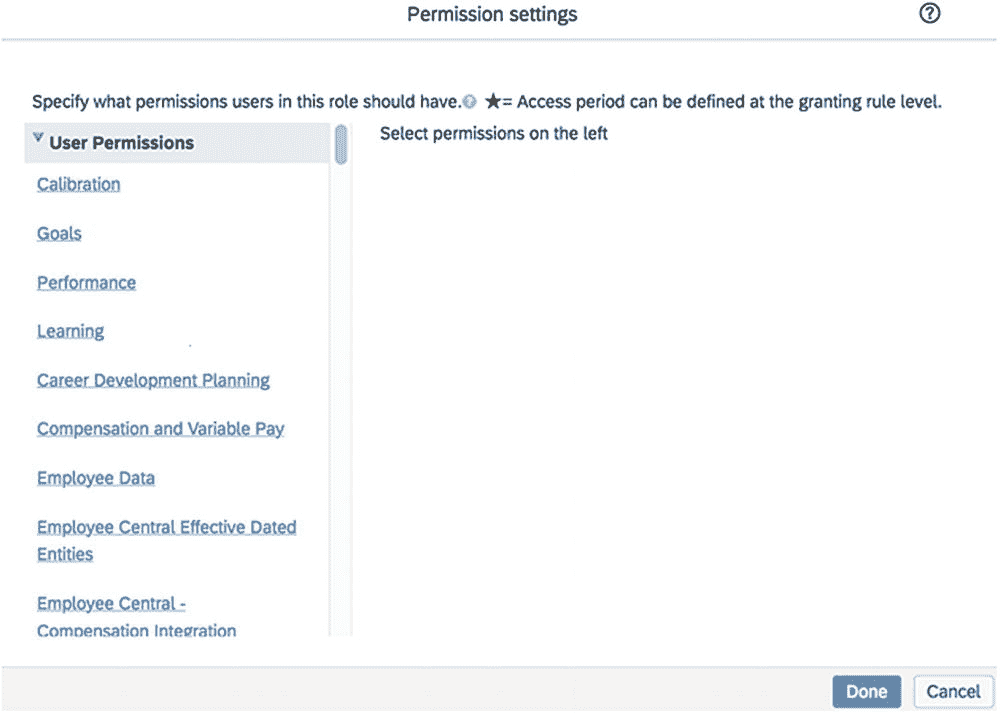

*图 6-1：权限设置概览*

在屏幕左侧页面的`用户权限`部分，找到并选择`绩效`。相关绩效权限将显示在该部分的右侧。

如图 6-2 所示，选择`绩效管理访问权限`。

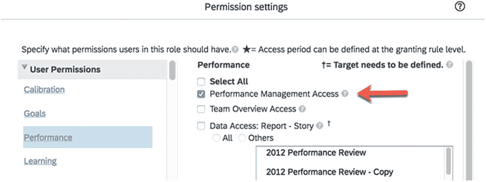

*图 6-2：绩效管理访问权限*

继续在页面左侧向下滚动，找到并选择`通用用户权限`。查看此处选项并选择`创建表单权限（全部）`。

返回页面左侧，向下滚动至角色权限的`管理员权限`部分。

查找下文中列出的每个子部分并添加以下权限：

* `管理文档`：启用除 360 相关权限外的所有权限。
* `管理表单模板`：启用除“公司目标”（现已废弃）外的所有权限。
* `管理系统属性`：启用`绩效管理功能设置`和`电子邮件通知模板设置`。
* `管理用户`：启用`文档传输`、`管理用户`、`员工导出`、`代理管理`、`导入员工数据`和`管理员工动态群组`。

此外，在`用户权限` ➤ `报告权限`中，您可包含以下权限：

* `临时报告构建器标准报告库`（若使用 EC）
* `报告中心`
* `经典报告`
* `详细报告`
* `列表视图`
* `分析磁贴和仪表板`

## Performance Management Permission Configuration

Select any performance-related tiles and dashboards.

* Create Reports
* Performance Management
* Run Reports
* Select any performance-related tiles and dashboards

Optional advanced permissions can be added:

* `管理用户`："To-Do Administrator"、"Manage Home Page"、"Include Inactive Employees in Search"、"Employee Export"、"Export Extended User Information"、"Import Extended User Information"、"Import Employee Data"、"Proxy Management" and "Manage Dynamic Employee Groups"
* `管理系统属性`："Manage Employee Files"
* `管理仪表板/报表` ➤ Select All

*   Manage Position Profile Builder: Select All (Only if using Position Profile Builder)

After selecting permissions, click "Done". Now you can assign a permissions group or standard role to a permissions role. For an admin role, you can assign a user to an admin permissions group and then select this group for that role. Next, choose the target population the permissions group will have access to. For an admin role, the target population can be "Everyone", as shown in Figure 6-3. If your admin is also a regular user, you can click "Exclude Granted User Access to Self".

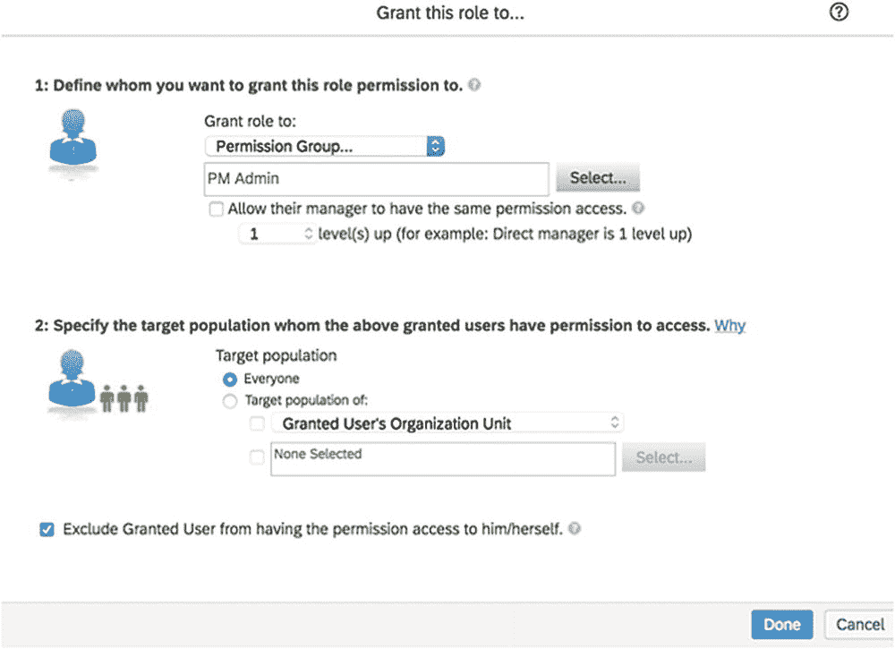

**Figure 6-3** Role and Target Population

You may also have performance management administrators in different countries or regions. You might want to restrict their target population to a specific geographic location or other criteria. In this case, you can create a permissions group as a target population. This may also require an additional admin permissions group specific to a region, country, or other criteria.

After selecting the desired options, click "Done". Click "Save Changes", and your admin role will now be able to configure performance form templates.

We have now enabled Performance Management v12 Acceleration and created performance permissions for the Performance Management (PM) Admin role. You may need to log out and log back in for the permissions to apply.

## Performance Management Feature Settings

We will now enable the features used in Performance Management. Enter and select `Performance Management Feature Settings` in the search bar. The settings interface is shown in Figure 6-4.

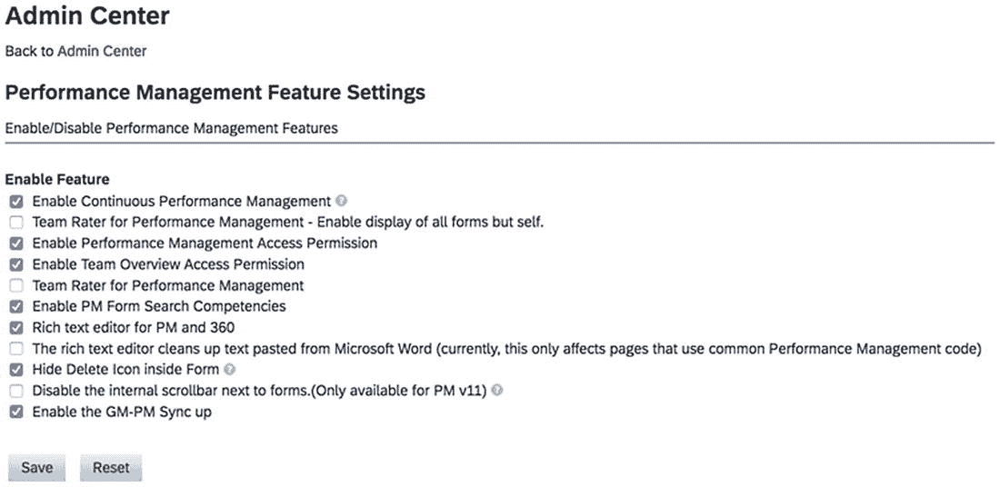

**Figure 6-4** `Performance Management Feature Settings`

Descriptions for each feature are included in Table 6-1.

**Table 6-1** Performance Management Features

| Feature | Description |
| --- | --- |
| `Enable Continuous Performance Management` | Applicable only if you use `Continuous Performance Management` (CPM) and associate goals with achievements. In the Goals or Development Goals section, a goal column will appear indicating the CPM achievement attached to the goal. |
| `PM Team Assessor – Enable All Forms Except Self Display` | Controls whether the Team Assessor can be used for assessors other than the direct manager. Team Overview access must also be enabled. Applicable only for the Manager role. |
| `Enable PM Access` | **Required.** Used in Role-Based Permissions (RBP) to identify roles that can access the Performance tab from the main menu. |
| `Enable Team Overview Access` | **Recommended.** Used in RBP to identify roles that can access the Team Overview sub-tab within Performance from the main menu. Applicable only for the Manager role. |
| `PM Team Assessor` | Used in Team Overview for side-by-side comparison of assessees for rating competencies. Team Overview access must be enabled. Applicable only for the Manager role. |
| `Enable PM Form Search Capability` | Applicable only for PM v11. Do not enable. |
| `Rich Text Editor for PM and 360` | Allows users to use a Rich Text Editor to enhance comments and text responses, offering options for formatting text, changing fonts and text colors, etc. |
| `Rich Text Editor Cleanup Pasted Text from Microsoft Word` | May override the automatic cleanup of text pasted from MS Word. |
| `Hide Delete Icon Inside Form` | The delete button inside the form will not be visible. |
| `Disable Internal Scroll Next to Form` | Applicable only for PM v11. |
| `Enable PM-GM Sync` | **Highly Recommended.** Used to synchronize goals from Goal Plans to goals in Performance Forms. |

Required and recommended features are marked. After saving the updates, let's continue!

There are two very useful features within performance forms: Spell Check and Legal Scan. We will cover each.

### Spell Check

# 公司词典与法律扫描功能

大多数绩效表单都有供用户添加评论的区域。我们已启用拼写检查功能，以便用户核实拼写错误。一旦启用，除非管理员希望向公司词典添加额外单词，否则无需进一步操作。如果用户希望在评论中包含公司术语，此功能会特别有用。

## 管理公司词典

要管理公司词典，需要为管理员角色添加基于角色的权限。在角色权限中，请使用以下路径：

`Administrator Permissions` ➤ `Manage System Properties` ➤ `Company Dictionary`

在搜索栏中输入并选择“Manage Dictionary”。图6-5展示了词典界面的一个示例。

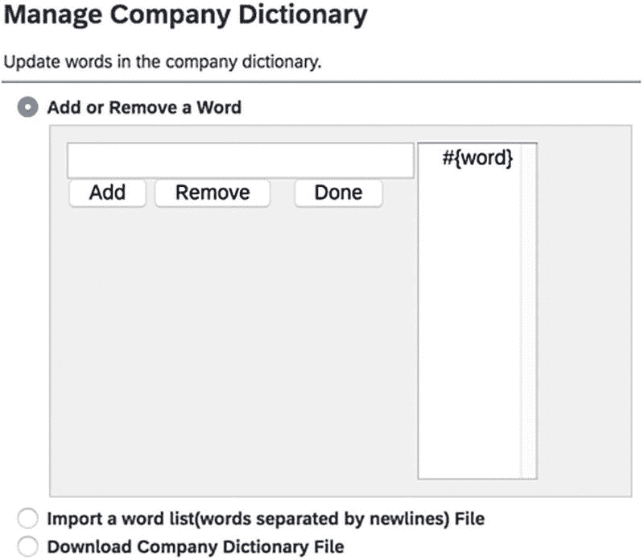

**图6-5** 从公司词典添加/删除单词

这里有三种添加单词的选项：

1.  添加或删除一个单词。

2.  通过CSV文件导入单词列表。

3.  下载公司词典文件。

### 添加或删除单词

单击“Add or Remove a Word”按钮，您将能够直接在此屏幕上向公司词典添加单词或从中删除单词。要添加一个单词，请在文本框中键入该单词，然后单击“Add”按钮。任何现有单词也可以用同样方式删除。完成所有更新后，单击“Done”，词典将保存修改。

### 导入单词列表

单击“Import a word list”按钮，可以从CSV文件向公司词典添加单词。没有现成的示例模板可下载用于构建该文件。请创建一个简单的文件，每行一个单词，将文件保存为CSV格式，然后导入该文件。

### 下载公司词典

也可以下载现有的公司词典。可以向文件中添加新单词，然后重新导入。

## 法律扫描

用户可以在绩效表单中的任何文本条目上执行法律扫描，以查找任何冒犯性或不恰当的单词或短语。SAP提供了一个基础法律扫描库，其中包含被认为不受欢迎的术语及其建议的替换词。

### 管理法律扫描库

要管理法律扫描库，需要为管理员角色添加基于角色的权限。在角色权限中，请使用以下路径：

-   `Administrator Permissions` ➤ `Manage Competencies and Skills` ➤ `Legal Scan Library`

-   `Administrator Permissions` ➤ `Manage Competencies and Skills` ➤ `Legal Scan Library Import`

可以通过“Legal Scan Library”向库中添加单词或短语，如图6-6所示。

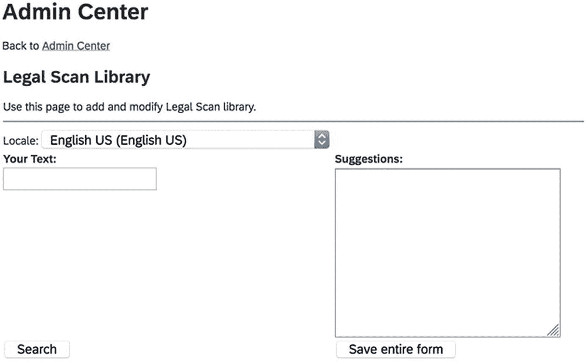

**图6-6** 添加到法律扫描库

管理员可以在“Your Text”框中输入单词或短语，并在“Suggestions”框中输入建议的替代内容。由于扫描使用精确匹配，请确保为单词或短语的多个变体创建条目。

### 法律扫描库导入

可导入法律扫描库。在搜索栏中键入并选择“Legal Scan Library Import”。导入屏幕示例如图6-7所示。

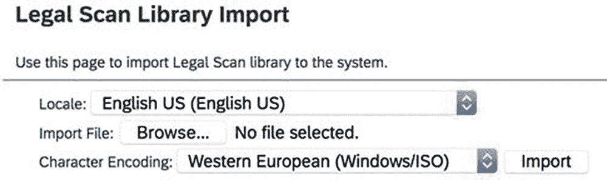

**图6-7** 法律扫描库导入

在此，管理员将导入一个包含待替换单词/短语和建议替换内容的文件。没有可供下载以查看文件布局的模板，但文件布局非常直观。导入文件包含两列且无表头：A列包含要替换的关键词（必须为小写），B列包含建议的替换单词或短语。然后，使用CSV格式保存该文件。无法下载或导出现有库。如需获取库的副本，需向SAP提交支持工单。

> **注意**：要了解如何请求获取法律扫描库副本，请参阅SAP注释 #2219367。

在本章稍后开始配置表单模板时，我们将看到如何为绩效表单启用法律扫描和拼写检查功能。现在我们已经了解了一些基本功能、设置和权限，接下来让我们深入探讨绩效管理模板。

# 表单还是模板？

首先，让我们澄清“绩效表单”（`performance form`）和“绩效表单模板”（`performance form template`）这两个术语之间的区别。有些人错误地将它们混用，但它们并不相同。表单模板类似于一个蓝图，它定义了绩效表单的布局、表单内的各个部分，以及工作流程、评分等级、角色和权限。绩效表单是根据表单模板的设置和选项为员工生成的。绩效表单是实际的个人绩效评估，是传统纸质绩效表单的自动化电子版本。每个表单都包含特定于用户的信息。表单从绩效表单模板生成。

一旦我们启用了绩效管理并为管理员授予了基于角色的权限，我们就可以构建绩效表单模板。表单模板由以下部分组成：

*   路线图（Route map）

*   评分等级（Rating scale）

*   部分（Sections）

在创建表单模板之前，需要完成一些先决步骤。我们将先了解路线图和评分等级，然后才能开始创建绩效表单模板。

# 路线图

# 路线图概述

可以将路线图视为绩效表单模板的“路线图”。路线图定义了表单的流程（步骤）。它确定了在每个步骤中谁将拥有表单，以及用户可能执行的操作。更正式地说，路线图定义了表单在绩效评估过程中的流转，明确了步骤顺序并为每个步骤分配了角色。路线图还可以为流程的每个步骤定义开始和结束日期。在表单上可见的与路线图相关的文本、标签和按钮也在此处定义。

分配给路线图步骤的角色是基于与表单生成目标用户的关系。员工角色（`E`）分配给该用户。`EM` 角色是用户的经理，`EH` 角色是员工的 HR 经理，依此类推。

示例如下：

1.  员工在其“绩效收件箱”中收到绩效表单并进行自我评估。对目标和能力进行评分并添加评论。

2.  表单流转至经理处。经理将看到员工的所有评分和评论。经理完成对员工的评估。为目标和能力添加评分和评论。总体表单评分根据经理的目标和能力评分计算得出。

3.  表单流转至二级经理处进行审阅。二级经理可以添加可选评论。

4.  表单流转至下一环节，经理与员工进行年终绩效面谈。在此环节中，给予反馈并审阅评分。

5.  表单流转至员工处进行签字确认。这是为了确认年终评估会议已举行。

6.  表单流转至经理处进行签字确认。这是为了确认与员工举行的年终评估会议已完成。

7.  经理签字后，表单流程完成。该评估的副本将出现在所有相应用户的“绩效已完成”文件夹中。

我们将为表单的每一次流转在路线图中构建一个步骤。

在 Provisioning 中设置绩效管理时，我们提到了几个可选的路线图相关功能：

*   “启用表单路由的相对日期”（`Enable Relative Dates for Form Routing`）控制是否可以在路线图中为步骤使用相对日期。如果你不明白这意味着什么，我们稍后会解释。如果启用但决定以后不使用，启用它不会影响你的路线图。如果你决定在未来的路线图中使用它，该选项将已可用。

*   “启用可折叠路线图”（`Enable Collapsible Route Map`）是另一个你可能已启用的选项。如果绩效表单很长，此功能会很方便。如果用户需要大量滚动，他们可以折叠表单上的路线图以腾出一些空间。路线图可随时展开。

我们设置的管理员基于角色的权限包括创建和编辑路线图的权限。该权限位于以下路径：`Administrator Permissions` ➤ `Manage Form Templates` ➤ `Routing Maps`。此权限授予创建和编辑路线图的访问权限。

路线图必须在配置绩效表单模板之前创建。路线步骤及其关联角色用于为模板中的按钮、部分和字段构建权限。一个路线图可以被多个绩效表单模板使用，而一个绩效表单模板只能有一个路线图。随着我们继续，这一点会变得更加清晰。

路线图将显示在绩效表单上，这有助于用户跟踪表单在流程中所处的步骤，并查看步骤的截止日期、步骤描述以及每个步骤分配给了哪个用户/角色。示例如图 6-8 所示。

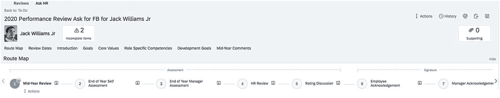

**图 6-8** 绩效表单上的路线图

如前所述，路线图基于步骤和角色。让我们先看看角色，以便了解它们如何在路线图中工作。前面的章节已经讨论过角色。对于绩效表单，我们主要会用到员工角色（`E`）、员工经理角色（`EM`）、HR 代表角色（`EH`），可能还有二级经理角色（`EMM`）。对于每个步骤，我们需要确定哪个角色将在其收件箱中收到该表单。

### 管理路线图

现在让我们进一步了解路线图。在搜索栏中键入并选择“Manage Route Maps”。将显示“Route Map List”，如图 6-9 所示。在创建路线图之前，此列表为空。为了说明此页面上的列，我们将查看一个包含现有路线图的列表。

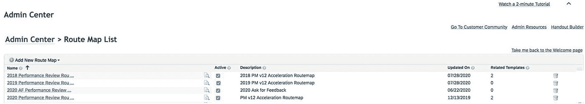

**图 6-9** 路线图列表

创建路线图后，它将显示在此概览页面上。路线图名称将列在第一列。名称列之后，您将看到一个显示图标。单击此图标可查看路线步骤，如图 6-10 所示。

**图 6-10** 路线步骤预览

接下来是“活动”列。如果复选框为空，则路线图处于非活动状态，无法在模板中使用。

随后是“描述”列，用于包含路线图的简要说明。该描述只会显示在此路线图概览页面上，不会出现在其他地方。如果描述过长，该列将显示“...”；将鼠标悬停在该列上，即可查看完整的描述，如图 6-11 所示。

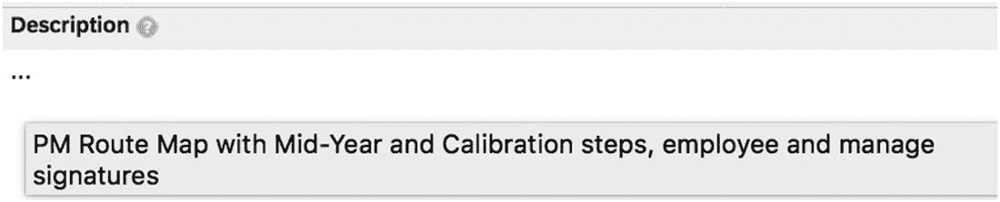

**图 6-11** 路线图描述

“更新于”列包含路线图最后修改的日期。

“相关模板”列显示使用了该路线图的绩效模板数量。点击该数字，您将看到使用该路线图的模板名称，如图 6-12 所示。

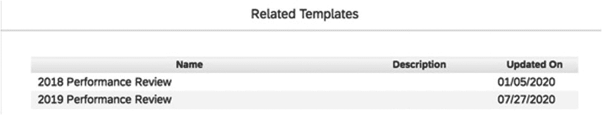

**图 6-12** 与路线图关联的模板

可以通过点击除“描述”之外的任何列标题来对路线图列表进行排序。既然我们已经介绍了路线图列表页面，接下来让我们创建一个路线图！

## 创建路线图

点击“添加新路线图”，您可以选择自行构建路线图或从库中选择。我们将从“从库中选择”开始，介绍这两个选项。如图 6-13 所示，将弹出一个窗口，显示 SuccessStore 中所有可用的路线图。

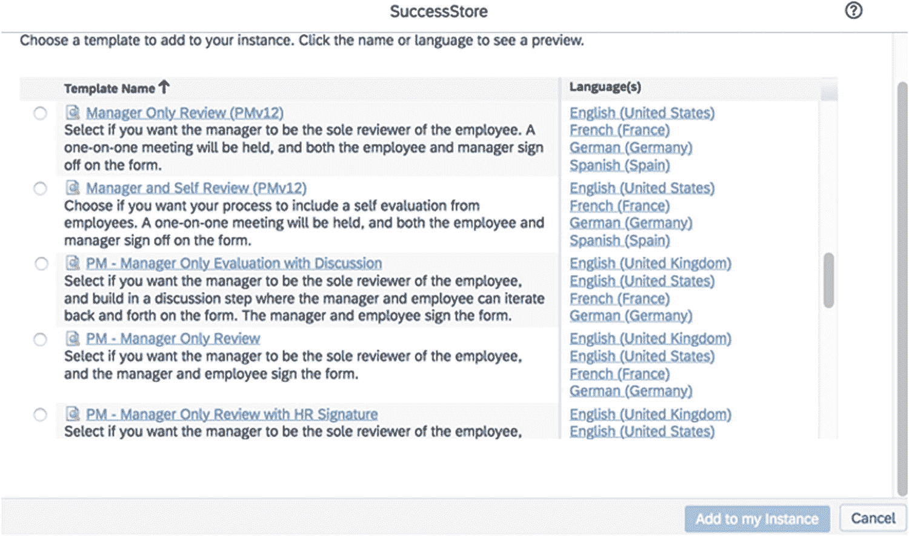

**图 6-13** SuccessStore 中可用的路线图

### SuccessStore 路线图

在这里，您将看到为 360 度评估、薪酬和绩效模板预定义的路线图。您可以滚动列表，阅读描述，并查看每种路线图可用的语言。您可以选择其中一个绩效路线图，并将其作为起点来创建满足您需求的路线图。选择后，“添加到我的实例”按钮将变为可用。系统将提示您为路线图命名，然后它会在您的屏幕上打开。您可能会发现使用 SuccessStore 路线图入手更容易，因为它提供了一个包含一些步骤及相关角色的框架。您可以添加或删除步骤、修改现有步骤或重新排列步骤顺序。由于这些字段尚未填充，您仍然需要决定许多文本和标签。

## 复制路线图

您也可以复制当前的路线图进行编辑，并将其用于与我们即将构建的表单模板关联。您可以打开一个现有的路线图，然后点击“另存为...”，如图 6-14 所示。

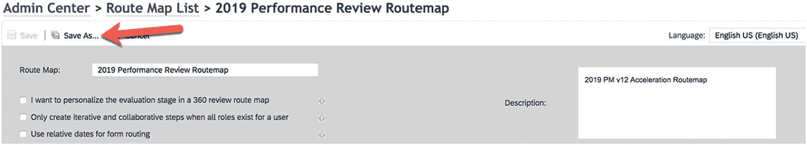

**图 6-14** 复制现有路线图

将弹出一个窗口，提示您为这个复制的路线图提供一个名称。保存新的路线图名称后，该路线图将显示出来，您就可以进行更新了。

## 构建路线图

我们现在来查看“自行构建”选项。将弹出一个包含已命名但没有任何步骤的路线图的窗口，如图 6-15 所示。

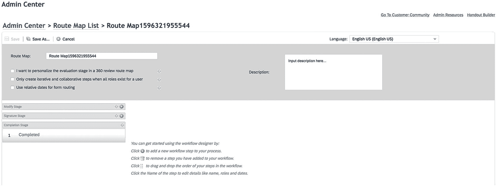

**图 6-15** 空白路线图

为路线图取一个有意义的名称。如果您计划将此路线图用于一个特定的绩效表单模板，您可以使用与绩效表单模板名称相似的名称。如果您计划将此路线图用于多个绩效表单模板，您可以使用一个对所有这些模板都足够通用的名称。在您从所有路线图列表中创建绩效表单模板时，您需要标识出路线图名称，因此请确保名称有意义且易于查找。在添加步骤之前，您将无法保存路线图，所以让我们继续了解路线图的组成部分。

路线图页面上的几乎每个字段都有一个问号图标。这是一个很好的资源，提供了该字段用途的描述。示例如图 6-16 所示。

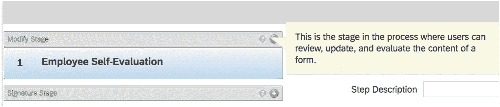

**图 6-16** 信息图标

## 路线图阶段

在路线图屏幕的左侧，您将看到三个阶段：修改、签名和完成。阶段内部构建了步骤。这些步骤标识了表单的流程以及每个步骤涉及的角色：

1.  *修改阶段*是大部分操作发生的地方。此阶段的步骤允许用户查看和更新表单内容。

## 签名阶段

*签名阶段*用于签署或确认表单内容。该步骤由员工和/或经理使用，以确认已经进行了年终绩效讨论和评级。电子签署表单并不表示同意最终评级，而仅表示确认讨论已进行。用户最多只能在此阶段提供评论，表单的其余部分不可编辑。提交后，表单的签名行将包含用户的姓名以及表单签署的日期。

## 完成阶段

*完成阶段*发生在最终签名步骤提交之后。此阶段不能创建任何步骤，并且在表单内，用户无法执行任何操作。在此阶段，表单已被路由到用户的“绩效已完成”文件夹。所有在路线图上拥有角色的用户都将在其“已完成”文件夹中收到一份表单副本。

现在我们已经了解了这三个路线图阶段，接下来让我们探讨一些可选功能。通常，这些复选框是未选中的，但我们将介绍每个选项的用途。

## 路线图选项

如图 6-17 所示，路线图页面顶部有三个复选框可以启用。

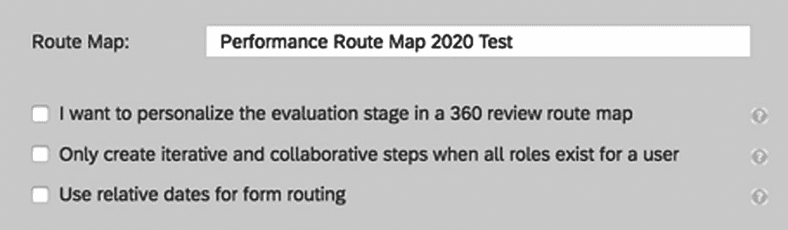

图 6-17：路线图选项

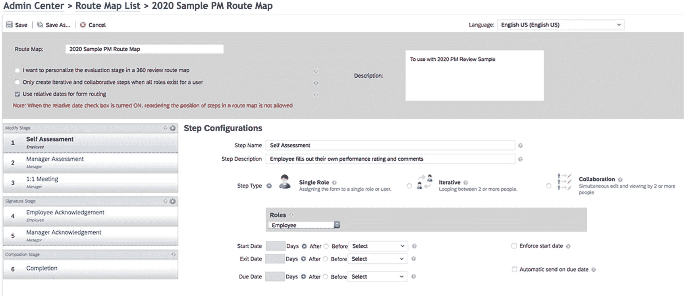

图 6-18：路线图中的相对日期

1.  我需要在 360 度评估路线图中个性化评估阶段：将此复选框保持未选中状态。此选项仅适用于 360 度评估模板。360 度评估表单将在第 12 章中介绍。

2.  仅当用户存在所有角色时才创建迭代和协作步骤：用一个例子可能是解释此选项的最佳方式。假设您的绩效表单有一个步骤，从员工（E）开始，然后是经理步骤（EM），接着是一个由经理（EM）和人力资源经理（EH）共享的步骤。如果员工在 EH 角色中没有人力资源经理（即用户数据文件中的 HR 字段不包含 HR 用户 ID），则此经理/人力资源经理步骤将被跳过，表单将路由到下一步。

3.  为表单路由使用相对日期：仅当在`预置` ➤ `公司设置`中启用了“为表单路由启用相对日期”时，您才会看到此选项。启用后，步骤的开始、退出和到期日期将基于表单活动之前或之后的天数，而不是使用固定的日历天数。您将在图 6-18 中看到一个示例。

根据具体步骤以及选择的是“之前”还是“之后”，天数将相对于表单创建日期、同一步骤的到期日期、同一步骤的退出日期或表单的到期日期。例如，为路线图第一步的开始日期选择“之前”，三个日期字段选项将为：表单到期日期之前“X”天、同一步骤到期日期之前或同一步骤退出日期之前。如果选择了“之后”单选按钮，则天数将相对于表单创建日期。启用后，编辑路线图时，步骤将无法重新排序。

## 修改阶段步骤

现在我们将使用工作流设计器为路线图构建步骤。在`修改阶段`部分，点击“添加步骤”图标。系统将提示您为步骤命名，如图 6-19 所示。

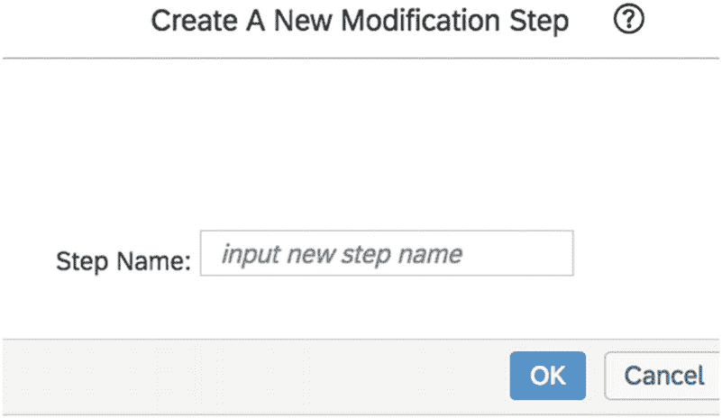

图 6-19：创建一个修改步骤

为步骤命名并点击“确定”后，该部分会展开，您现在将在路线图中看到新步骤。点击新步骤，让我们查看现在为该步骤显示的`步骤配置`。示例如图 6-20 所示。

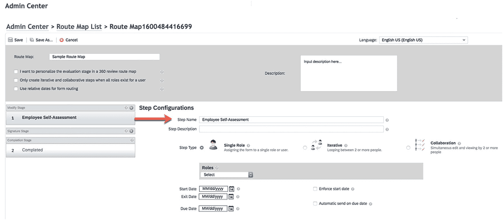

图 6-20：步骤配置

现在我们将逐一介绍这些字段。

`步骤名称`是在您将步骤添加到路线图时创建的。从上图可以看出，步骤名称显示在`步骤配置`的`步骤名称`字段中。您可以在任一位置更改步骤名称。名称应为该步骤所发生事件的简短描述。例如，“员工自我评估”是步骤名称，并将显示在绩效表单的路线图中。

`步骤描述`将显示在用户主页的“绩效待办事项”磁贴中。此磁贴包含用户所有待处理的绩效相关任务。例如，如果您将步骤描述为“2020 年自我评估”，则磁贴中的`待办事项`项目将显示为“[员工姓名]的 2020 年自我评估”。这在后期阶段尤其有用，当管理者收件箱中有数十份员工评估，并且他们正试图为特定员工找到特定步骤中的特定表单时。如果创建路线图时此字段留空，则`待办事项`列表将使用步骤名称。

在查看`步骤类型`之前，让我们先了解一下角色。必须为路线图中的每个步骤确定角色。这是用户相对于被评估员工所持有的角色。最常见的角色是员工 (E)、管理者 (EM)、HR 代表 (EH) 和第二级管理者 (EMM)。建议避免使用自定义角色，因为该角色在绩效表单中不可用。

在`步骤类型`部分下方，有一个用于选择角色的框。点击向下箭头查看可用标准角色列表，如图 6-21 所示。

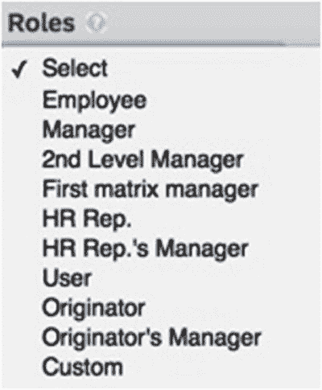

图 6-21：步骤角色

我们将为路线图的每个步骤选择角色。现在我们来查看`步骤类型`。

`步骤类型`标识步骤中使用的角色以及步骤将如何运作。`步骤类型`选项仅对`修改`和`签名阶段`步骤可用。如表 6-2 所示，有三种类型可供选择。

**表 6-2：步骤类型**

| 步骤类型 | 描述 |
| --- | --- |
| 单一 | 此步骤中只有一个角色。例如，您希望表单转至具有员工角色的用户。 |
| 迭代 | 在此步骤中，多个角色将有权访问表单。但是，表单一次仅与一个角色的用户在一起。表单将保留在该步骤中，但会在它们之间来回传递。您需要确定必须为此步骤中第一个角色的角色（进入用户），以及能够将表单路由到下一步骤的角色（退出用户）。每个角色都将有一个按钮，用于将表单发送给步骤中的另一个角色。只有退出用户才能将表单路由到下一步骤。 |
| 协作 | 多个角色共享此步骤。根据绩效表单模板中的权限，所有角色都可以编辑或查看表单。但是，该步骤中的每个角色不能同时处理该表单。表单不会在步骤内来回传递。此步骤中的所有角色的收件箱中都有该表单，但当一个角色正在编辑时，另一个角色只能查看被锁定不可编辑的表单。在表单顶部，会显示“表单当前由[员工姓名]处理”。这是另一个协作者正在编辑表单的提示。一旦编辑表单的角色保存并关闭表单，另一个角色即可进行编辑。只有被指定为退出角色的角色才会拥有将表单路由到下一步骤的按钮。进入用户只能保存/关闭或取消。 |

协作步骤的示例如图 6-22 所示。该步骤由员工和管理者共享。管理者被指定为退出用户，这意味着只有管理者会在此步骤中看到提交按钮。员工将无法路由表单。

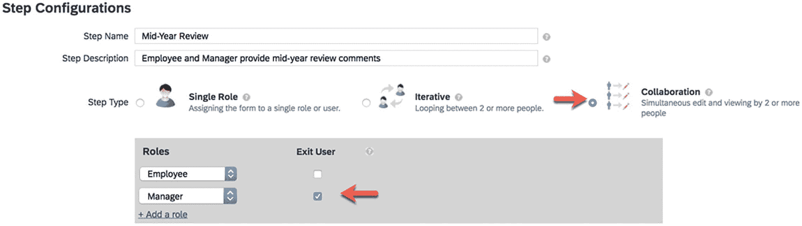

图 6-22：协作路线图步骤

当表单处于迭代步骤时，员工可以编辑表单，但可能无法将其提交到下一步骤，如图 6-23 所示。唯一可用的选项是“取消”和“保存并关闭”。

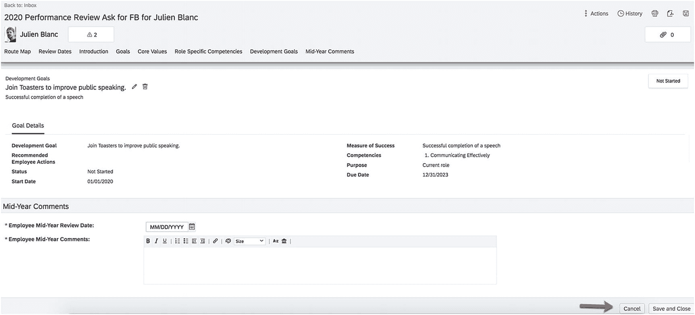

图 6-23：迭代步骤中非退出用户的角色

现在我们将回溯并返回到路线图。一旦步骤被命名、确定了其类型以及属于该步骤的角色，我们将查看步骤日期。

## 步骤日期

步骤日期是可选条目，适用于`修改`和`签名阶段`步骤。日期主要用于您关注表单在绩效周期内的特定日期位于特定步骤时。

我们将解释这些日期是什么以及如何使用它们。

`开始日期`是步骤开始的日期。如果表单在步骤开始日期之前到达用户的收件箱，用户可以在该步骤中处理表单，并且表单不会被锁定。还有一个强制开始日期的复选框。强制开始日期会使表单在用户收件箱中变为只读，直到步骤开始的那一天。用户会在收件箱中看到表单，但在步骤开始日期之前无法编辑。如果在表单周期开始之前生成表单，强制步骤开始日期可能对第一步有帮助。

当用户试图在步骤开始日期之前编辑表单时，会看到如图 6-24 所示的消息。

图 6-24：步骤尚未开始的弹出窗口

`退出日期`用于防止用户在步骤退出日期之前将表单移动到下一步骤。

## 路由图步骤配置指南

`Due Date`标识步骤必须完成的截止时间。同时提供一个复选框，用于自动将表单发送到下一步。“自动发送至截止日期”功能与步骤截止日期配合使用。启用后，将显示两个单选按钮：“仅发送通过验证的表单”或“无论验证结果如何始终发送”。验证指步骤中任何必填项：

- 当启用自动发送并选择“无论验证结果如何始终发送”时，即使该步骤的角色尚未接触表单或填写必填字段，表单也会自动移至下一步。这通常用于员工步骤。由于经理的评分是记录评分，如果员工未输入自我评估，表单将移至下一步供经理评分。未输入员工必填评分不会影响整体表单评分，因此将表单移交给下一步通常是安全的。自动发送选项会在步骤截止日期后的第二天移动表单。如果使用此选项且同时设定了步骤退出日期，则该日期必须早于截止日期。

- 当启用自动发送并选择“仅发送通过验证的表单”时，如果该步骤的用户未填写表单上的所有必填字段，则截止日期过后表单不会自动移至下一步。如果步骤包含审核过程所需的字段，建议使用此选项。例如，经理评估步骤。经理必须输入个人目标评分、评论和总体评分。如果经理尚未打开表单或保存表单时未完成所有必填字段，则当步骤截止日期到达时，表单将停留在当前步骤。

对于从头开始构建的路由图，您只需命名步骤并指定步骤类型和角色后即可保存路由图。

### 路由图高级选项

在步骤的“步骤配置”中，点击“显示高级选项”，您将看到一系列需要填写的额外字段。高级选项适用于修改阶段、签名阶段和完成阶段。但每个阶段的字段会有所不同。图 6-25 展示了修改阶段步骤的高级选项。

请参考表 6-3 了解这些字段在绩效管理（PM）表单中的含义和用途。

**表 6-3 步骤高级选项**

| 高级选项 | 描述 |
| --- | --- |
| 步骤介绍与鼠标悬停文本 | 路由图显示在绩效表单顶部，当鼠标悬停当前步骤时，此文本提供该步骤用途的说明。 |
| 步骤完成后的名称 | 步骤完成后，路由图上显示的步骤名称。如果留空，将使用步骤名称。 |
| 拒绝按钮鼠标悬停文本 | 仅在签名阶段可用，表单可被拒绝并退回上一步。这是悬停在拒绝按钮上时看到的文本。 |
| 步骤模式 | 定义角色在步骤中可执行的操作：完全编辑或仅评论。这些选项仅在修改阶段可用。 |
| 迭代步骤按钮文本 | 仅对标识为迭代的步骤可用。您可以为此按钮设置标签，用于在同一步骤的用户间来回移动表单。 |
| 退出按钮文本 | 将表单移至下一步的按钮标签。也显示在步骤的下拉菜单和步骤确认页面的按钮上。 |
| 步骤退出文本 | 当表单提交至下一步时，会显示一个确认页面，您可以定义在此显示的文本，例如说明操作的含义或用户需要做什么。 |
| 上一级步骤退出按钮文本 | 如果用户要将表单退回一步，这是表单上按钮的标签。 |
| 上一级步骤退出文本 | 当表单退回一步时，会显示一个确认页面，您可以定义在此显示的文本。 |
| 步骤退出提醒 | 启用后，路由图页面会展开，以便您创建提醒文本，在提交表单至下一步时显示。此消息将以弹出窗口形式显示。不适用于迭代步骤。 |
| 步骤 ID | 使用`SuccessStore`路由图时自动生成的系统标识符，例如“5139493800574679”。从头创建路由图时此字段为空。建议重新标记系统生成的 ID，使用简短名称以便在模板 XML 中引用，例如员工签名步骤使用“ESign”。从头创建路由图时，请使用简短易识别的步骤 ID。 |
| 审核开始 | 只有一个步骤可启用此选项。标识此为审核的开始，并会为经理创建团队概览页面。所有步骤（包括“审核开始”步骤）都将显示在团队概览中。 |
| 轮次外访问 | 允许审核人在团队概览上访问表单并在表单进入其收件箱前提供评分。需要启用“审核开始”才能使用此选项，但不能分配给第一个步骤。不支持迭代或协作步骤。 |
| 一对一会议 | 可在修改阶段的步骤中启用。这会在团队概览上为经理提供“确认一对一会议”按钮。该按钮会将表单路由至签名步骤而无需打开表单。建议用于单个角色（EM），并且应为最后一个修改步骤。 |

创建初始步骤后，添加另一个步骤并填写适用的相同字段。按照流程中步骤应发生的顺序创建所有步骤。提醒您，一旦表单进入签名阶段，表单将不可编辑，只能在绩效表单的签名部分添加评论。

### 签名阶段步骤

添加完修改阶段的所有步骤后，点击签名阶段中的添加图标以创建签名步骤。该阶段的路由图示例如图 6-26 所示。

在此阶段中，“步骤类型”选项不再是修改阶段的“单一角色”、“迭代”或“协作”。取而代之的是一个下拉列表，仅允许选择一个单一角色。您可以在此阶段创建多个步骤，每个步骤对应一个应签署表单的角色。命名步骤后，您将看到与修改阶段相同的“步骤配置”部分。但展开高级选项时，您需要填写的字段会更少。您无法将表单移回修改阶段，因此不会看到“上一级步骤退出文本”和“上一级步骤退出按钮文本”选项。也没有“审核开始”、“轮次外访问”和“一对一会议”选项。但有一个用于定义拒绝按钮鼠标悬停文本的选项。如果表单模板配置为允许在签名步骤拒绝表单，您可以在此处设置悬停在拒绝按钮上时显示的鼠标悬停文本。

表 6-3 还提到，对于系统生成的路由图，需要重命名步骤 ID，因为它们使用长数字字符串。如果表单模板 XML 需要更新且您需要引用步骤 ID，则用描述性名称替换会很有帮助。您将在第 10 章中了解绩效表单模板 XML。

### 完成阶段步骤

## 路线图完成

当你确定了签名步骤后，路线图的最后一个阶段就是“完成”，如图 6-27 所示。

此阶段没有任何操作。一旦最终签名从签名阶段提交，表单将直接进入“绩效已完成”文件夹，供路线图中每个角色的用户使用。

完成阶段几乎不需要配置。你可以输入步骤介绍文本和步骤介绍鼠标悬停文本。此外，还可以选择其他应收到已完成绩效表单副本的角色。

在完成路线图的构建后，请保存它。你现在已经学会了如何创建路线图。

如前所述，现有的路线图可以被删除、复制或编辑。可以使用`SuccessStore`中的路线图或复制的路线图作为起点，创建一个新的路线图，用于新的表单模板。最好避免删除任何路线图，除非它们未在任何绩效表单模板中使用。建议仅对已与某个绩效表单模板关联的现有路线图进行文本或标签更改。如果现有路线图已与绩效表单模板关联，不建议添加或删除其中的步骤，因为这会破坏表单内的权限。

通过`管理路线图`所做的任何更改都不会影响已生效的表单。要对已生效的表单进行更改，你需要使用`修改表单路线图`选项。你将在第 8 章中了解更多关于此功能的信息。

我们现在已经学会了如何从`SuccessStore`下载路线图。我们复制了一个现有的路线图，并创建了一个全新的路线图。我们了解了路线图中的各个阶段，并学习了步骤角色、步骤类型，以及如何创建文本和按钮标签。我们很快就会学习如何将路线图与表单模板关联。但首先，我们需要创建一个要在表单中使用的评级量表。

## 评级量表简介

作为创建评级量表的序曲，我们应该进一步了解评级在绩效表单中是如何使用的。绩效表单中的目标和能力部分用于评估员工。在这些部分中，每个目标和能力都会进行评级。评级量表定义了可用的评级值。摘要部分包含表单的整体评级，该评级由各项评级和部分权重计算得出。此外，也允许经理手动覆盖计算出的总体评级。所有这些都使用我们将要定义的同一评级量表。

由于常规的摘要部分不计算总体目标和总体能力得分，因此有一个可选的“目标能力摘要”部分用于此目的。还有一个可选的摘要部分，供经理输入手动评定的总体绩效评级和潜力评级。这些摘要部分用于继任计划，并使用继任矩阵评级量表。由于这些摘要部分不使用绩效评级量表，这些部分的评级将单独处理。现在，我们先来看一下表单模板中目标、能力和摘要部分所使用的评级量表。

**注意**

> 有关评级的更多信息，例如在特定场景中如何进行计算，请参阅 SAP 注释 #2078768。

## 评级量表

绩效评估的目的是为员工提供一个年度总体评级。因此，在创建绩效表单之前，我们需要设置评级量表，以定义每个可能的评级值是什么。

评级量表定义了一组数值，并包含相应的分数标签和描述。关于这个数值评级量表的一个有趣之处在于，它在表单上的默认显示形式是一组星星。有一些选项允许用圆圈代替星星显示，或者你也可以选择为评级量表使用文本。当我们开始配置绩效表单模板时，我们将进一步讨论这些选项。

该量表将用于目标能力摘要和摘要部分。可以为表单的不同部分使用不同的评级量表，但这样做并不建议，因为它可能导致总体评级、报告和仪表板中的不准确。

需要基于角色的权限才能创建评级量表。在搜索栏中键入并选择`管理权限角色`。选择并打开管理员角色以添加权限。使用路径`管理员权限 ➤ 管理表单模板 ➤ 评级量表`将此权限添加到该角色。

一旦你的角色拥有创建/编辑评级量表的权限，请在搜索栏中键入并选择`评级量表`。`评级量表概览`页面将显示，如图 6-28 所示。

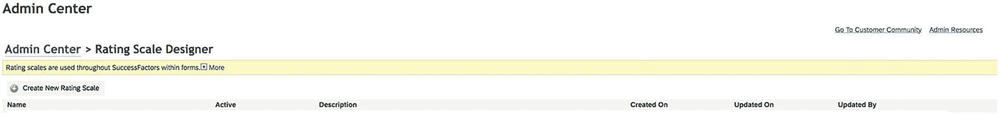

**图 6-28** 评级量表设计器概览页面

与路线图概览页面类似，这里有名称、描述和`激活`列。评级量表可以被停用或删除，但建议不要删除已在往年表单中使用过的评级量表。只有激活的评级量表才能用于绩效表单模板。此外，还有量表创建日期、量表最后更新日期以及最后更新者等列。

我们可以使用三个预构建的评级量表之一，创建一个全新的评级量表，或者复制一个现有的评级量表。我们将探索所有这些选项。

> 有关自定义评级量表的更多信息，请参阅 SAP 注释 #2078766。

>

> 有关最佳实践，请参阅 SAP 注释 #2078781。

## 创建新评级量表

我们将定义评级量表中有多少个分数，然后为每个分数创建关联的文本标签和描述。如果你为评级使用文本，评级标签将显示在绩效表单上。如果你将鼠标悬停在评级量表上，评级描述将显示在表单上。这对用户很有帮助，他们可以在给出评级之前看到带有描述的评级。

点击`创建新评级量表`，评级量表设计器将显示，如图 6-29 所示。

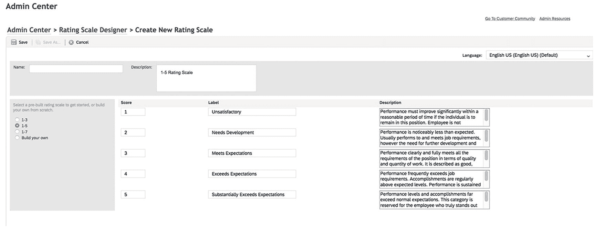

**图 6-29** 创建评级量表

## 评分量表选项

在此，您可以选择使用三种预设量表，或自行创建量表。默认的五分量表将显示标签和说明。您可以使用该五分量表，并对标签或说明进行任何修改。

您可以删除此量表的评分项，或为其添加更多评分项。此外，还可以选择创建三分量表或七分量表。另一种选择是构建您自己的量表。

建议使用五分量表。此量表大小提供了一个中间评分，并且评分之间具有足够的区分度。最低评分为`"1"`，最高评分为`"5"`。

也可以使用反向量表，其中`"5"`为最低评分。要启用此功能，需要在配置（Provisioning）中反转量表设置。在`"公司设置"`中，启用`"评分量表顺序：较低值被视为更有利（例如，"1"优于"5"）（仅用于仪表盘和报表）。"` 不建议使用反向量表。

请注意，一旦启用此设置，反向量表将应用于所有包含绩效评分的绩效模板和报表中的所有评分量表。如果您在反向量表中使用圆形或星形进行评分，评分量表将显示为下拉列表。如果您计划在职业发展规划模块中实施职业工作表（Career Worksheet），则不支持反向量表。

### 构建您自己的量表

点击`"构建您自己的"`按钮后，评分量表设计器页面会发生变化，您将看到一个空白量表。示例见图 6-30。

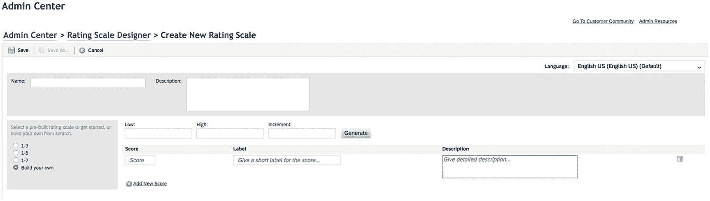

*图 6-30：构建您自己的评分量表*

您可以通过输入带有标签和说明的评分来开始构建量表，然后点击`"添加新评分"`以添加一个新的空白评分行。

为了避免使用`"添加新评分"`选项一次添加一行，您可以在评分行上方的`"最低"`、`"最高"`和`"增量"`框中输入值。此方法将根据您选择的最小和最大评分以及每个评分之间的增量生成一个评分量表。

在图 6-31 所示的示例中，最低评分为 1，最高评分为`"7"`，评分以 1 为增量递增。

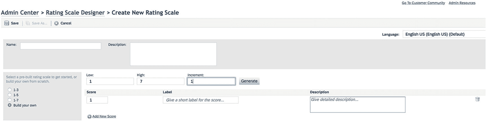

*图 6-31：生成评分量表*

点击`"生成"`按钮后，将创建包含七个评分的评分量表，如图 6-32 所示。

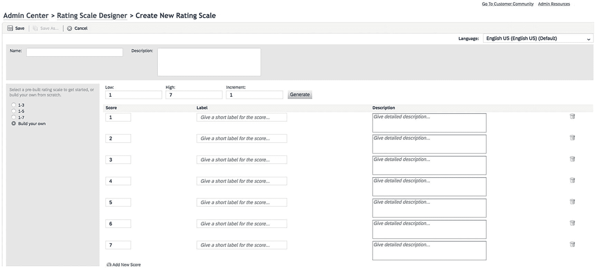

*图 6-32：生成的评分量表*

使用此方法无需一次添加一个新评分。但是，每个评分的标签和说明仍然需要输入。虽然不推荐，但可以创建最多包含 40 个评分的评分量表。

### 复制评分量表

您可以打开一个现有的评分量表，点击`"另存为…"`（如图 6-33 所示），并提供一个新的量表名称；这样您就创建了一个现有评分量表的副本。

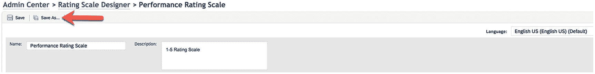

*图 6-33：复制现有评分量表*

然后，您可以编辑新的评分量表，更改标签和说明，或修改评分数。

至此，路线图和评分量表已配置完毕，接下来我们进入绩效表单模板。

#### 管理模板

我们将开始配置我们的绩效管理表单模板。该模板定义了绩效表单的组件和结构。它将指定要使用的路线图、评分量表、目标计划，以及胜任力（能力项）和可选的发展计划。已启动的绩效表单的外观和行为基于这些配置决策。

在搜索栏中键入并选择`"管理模板"`。这看起来类似于创建目标计划模板。您现在将看到一个额外的选项卡`"绩效评估"`，它出现在`"目标计划"`选项卡之前，如图 6-34 所示。

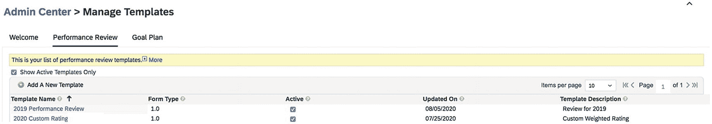

*图 6-34：管理模板中的绩效评估选项卡*

在我们下载预先构建的 SuccessStore 绩效表单模板之前，不会看到任何模板列出。一旦我们有了一个表单模板，我们可以复制它来创建一个新版本，例如用于新的计划年度。建议为每个绩效评估周期使用单独的模板。

当我们有多个表单模板时，适用以下操作：单击`"模板名称"`、`"更新日期"`或`"模板描述"`列标题以更改模板排序顺序。表单类型字段标识版本。只有有效的模板才能被使用。

与目标计划模板类似，当启用`"仅显示活动模板"`时，只会显示活动模板。非活动计划无法使用或启动。由于模板无法删除，您可以隐藏非活动模板以使概览列表更易于管理。

将显示少于 50 个字符的模板描述，与目标计划和路线图描述类似，将鼠标悬停在`"…"`上可查看更长的模板描述。

### 从 SuccessStore 添加模板

与创建目标计划和路线图类似，我们可以从 SuccessStore 添加新模板。点击`"添加新模板"`，预置的最佳实践模板将显示出来，如图 6-35 所示。

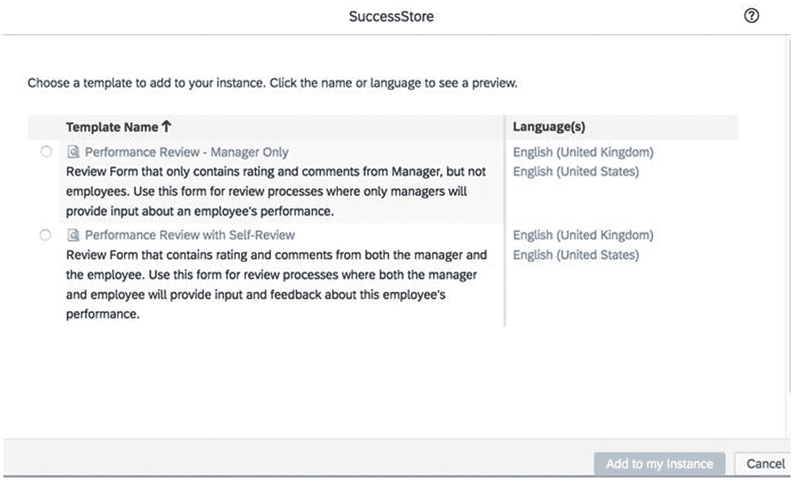

*图 6-35：SuccessStore 绩效表单模板*

选择一个模板添加到您的实例中。系统将提示您命名模板，如图 6-36 所示。

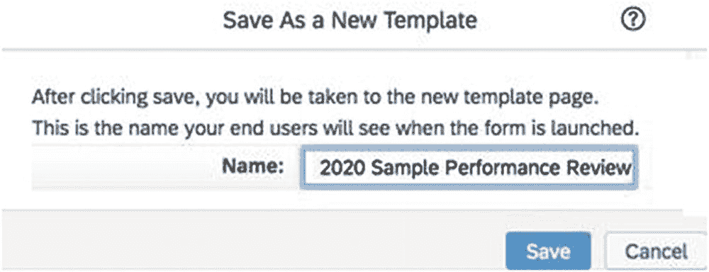

*图 6-36：命名绩效表单模板*

建议在模板名称中包含年份或周期。此名称将显示在绩效表单上，因此请确保其有意义。示例如图 6-37 所示。

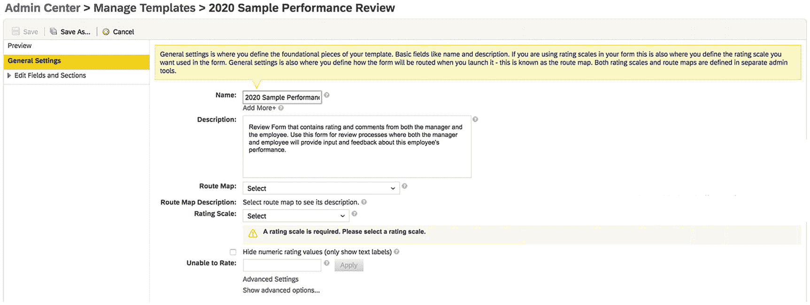

*图 6-37：入门级绩效表单模板*

### 复制表单模板

创建模板的另一种方法是复制任何现有模板。无法从头开始创建模板。与复制目标计划模板类似，打开一个现有的绩效表单模板并点击`"另存为…"`。出现提示时，提供新名称并保存模板。现在您将拥有一个表单模板的副本以供编辑。但是，某些高级的表单模板设置将不会被复制过来。我们稍后会详细讨论这一点。

## 模板组件

我们有了一个绩效表单模板。然后呢？我们将了解其组件，以便掌握如何修改模板。就像目标计划模板一样，在页面最左侧，您会看到`"预览"`和`"常规设置"`。绩效表单模板还包含`"编辑字段和章节"`。

我们将在本章介绍`"常规设置"`，并在下一章继续介绍`"编辑字段和章节"`。

## 常规设置概览

表单模板的“常规设置”示例如图 6-38 所示。

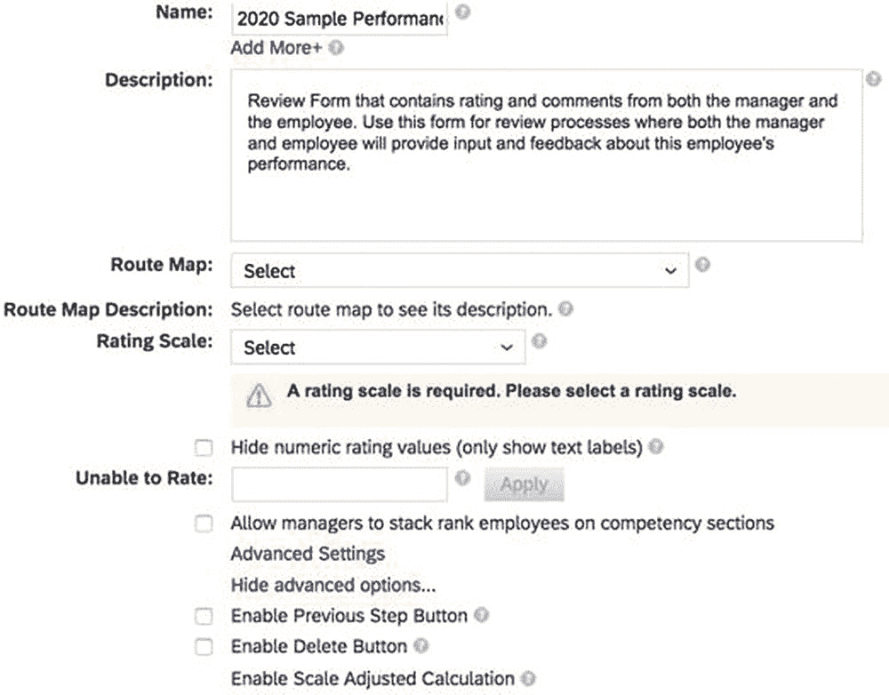

**图 6-38** 表单模板的常规设置

在“常规设置”中，您可以找到模板名称和描述，并在此处确定要使用的路线图和评分量表。“隐藏评分数值”、“无法评分”、“高级设置”和“显示高级选项…”是我们需要决定的其他选项。如果在操作过程中遇到困难，您会在所有模板分节的许多字段旁看到问号图标。将鼠标悬停在该图标上，即可获得有关该字段的有用信息。

## 分节概述

点击“编辑字段和分节”即可查看表单模板的布局和内容，该模板位于“常规设置”下方，如图 6-39 所示。

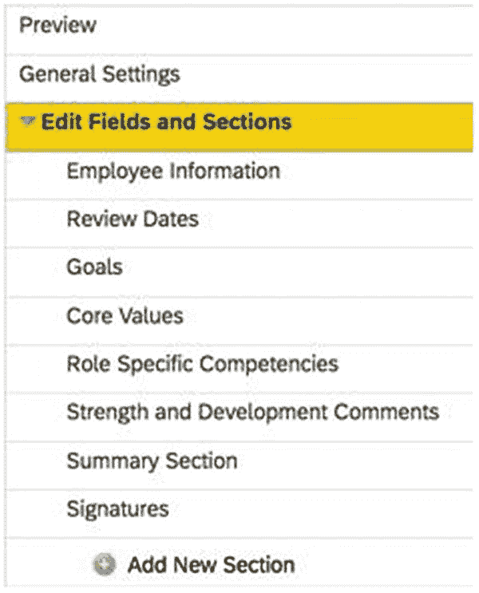

**图 6-39** 表单模板分节

展开视图将列出模板中会出现的分节。现在，让我们回到“常规设置”以了解更多信息。

## 常规设置

在此，我们将定义`模板名称`，并确定要与`表单模板`关联的`路线图`和`评分量表`。这些是必填字段。选择`路线图`和`评分量表`后，其描述将根据您在创建时为其分配的描述自动填充。

`模板名称`可通过点击“添加更多+”进行本地化。如图 6-40 所示，会弹出一个窗口，您可以添加所选语言的标签。

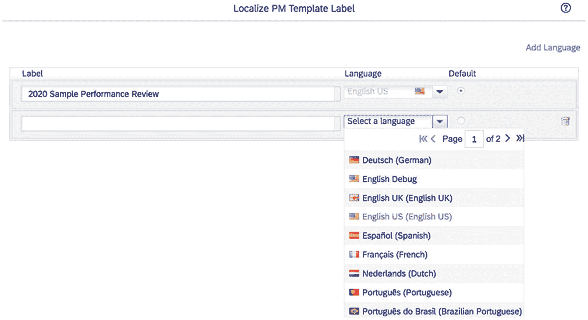

**图 6-40** 模板标签的本地化

`模板描述`为可选字段，不会出现在表单的任何位置。它对管理员而言更具参考价值，如果包含表单流程、所用角色以及评分内容的摘要，可能会很有帮助。与目标计划和路线图类似，如果描述超过 50 个字符，它将不会显示在`模板概览`页面的“模板描述”列中。相反，您需要将鼠标悬停在“…”上才能查看描述。

必须为`表单模板`附加一个`路线图`，以确定表单的工作流程。如果您在此处尝试选择`路线图`，将会看到一个警告弹出窗口，类似于图 6-41 所示。

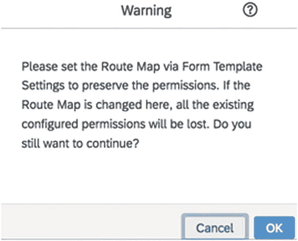

**图 6-41** 路线图选择警告

从`SuccessStore`下载的`表单模板`未附加`路线图`，因此在此处选择您的`路线图`是安全的。如果您复制了一个`表单模板`，原始`表单模板`中的`路线图`和`绩效量表`会显示在“常规设置”中。如果您随后创建了一个新的`路线图`用于复制的模板，并在此处选择它，则现有的权限将会被破坏。为避免这种情况，您需要在“高级设置”中选择新的`路线图`。建议始终在“高级设置”中选择`路线图`，这样您将养成使用此方法的习惯，并且无需担心引起任何`路线图/角色权限`问题。

现在，我们需要确定表单中将要使用的`评分量表`。点击“评分量表”字段中的下拉箭头，以显示所有启用的量表。示例如图 6-42 所示。

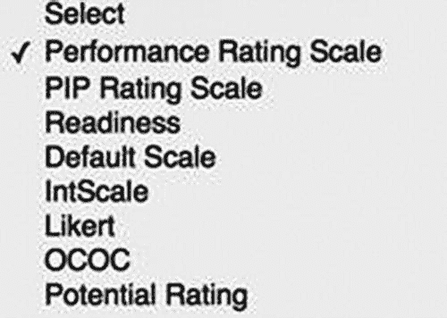

**图 6-42** 评分量表选择

选择我们新创建的`评分量表`。所选`评分量表`将应用于模板中所有包含评分的分节。有一个复选框用于启用“隐藏评分数值（仅显示文本标签）”。此选项将使`评分量表`显示为带有评分标签的下拉列表。如果您的组织习惯于文本评分，则可以使用此选项。如果未启用，默认`评分量表`将使用星级。

“无法评分”用于定义中性评级的标签，并适用于所有使用评分的表单分节。例如，它可用于表示“不适用”或“新到无法评分”。此中性值将成为量表的一部分，但不会用于计算总体评分。输入标签后，点击“应用”，如图 6-43 所示。

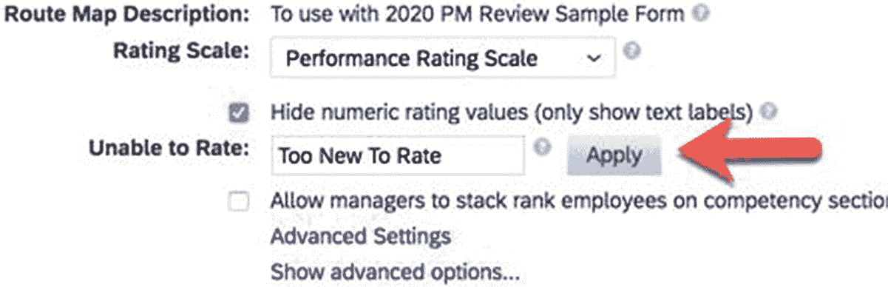

**图 6-43** 将中性评级应用于评分量表

这将使“无法评分”值应用于表单中所有包含评分的分节。此时您将无法保存更新的`表单模板`。必须在“目标”分节中确定`目标计划`才能保存。但我们将继续讨论这些设置和选项，直到进入“目标”分节为止。现在，我们继续讨论“常规设置”中的“高级设置”。

## 高级设置

点击“高级设置”，将显示一个弹出窗口，也称为*表单模板设置*。这些设置的子集如图 6-44 所示。

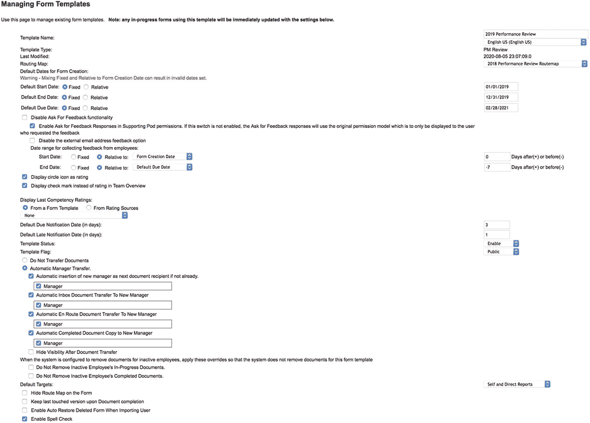

**图 6-44** 表单模板设置

在这里，您会看到大量的设置，它们用于启用某些功能并定义一些表单行为。更新这些设置时，有些会立即应用于已生效的表单，有些则仅在新启动的表单中生效。

选择要与模板一起使用的`路线图`。在页面左侧找到“路线图”，您会看到该模板尚未分配`路线图`，如图 6-45 所示。

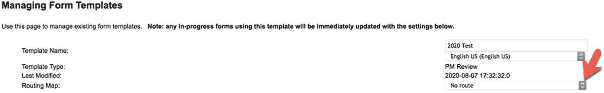

**图 6-45** 选择路线图

点击下拉箭头选择我们创建的`路线图`。接下来，滚动到此设置页面的最底部，您会看到一个标有“更新表单模板”的按钮。点击此按钮以保存设置。

现在，我们将重点介绍一些您可能启用的常用设置。我们从默认日期开始，如图 6-46 所示。

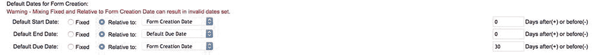

**图 6-46** 选择表单创建日期

### 表单创建的默认日期

这些日期将定义绩效评估的考核期和表单的截止日期。您可以使用固定日期或相对日期。这些日期会影响任何电子邮件通知，因为它们是基于日期的。与`路线图`上的相对日期类似，*相对日期*基于`表单创建日期`、`默认开始日期`、`默认结束日期`或`默认截止日期`之前或之后的天数。使用负数表示所选日期之前的天数。

示例如图 6-47 所示。

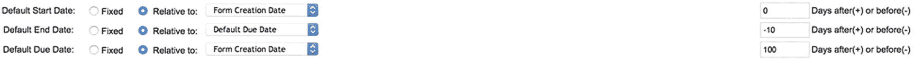

**图 6-47** 相对表单日期

在此示例中，`默认开始日期`是`表单创建日期`后的 0 天。这意味着评估开始日期与表单生成的日期相同。`默认截止日期`是`表单创建日期`后的 100 天。`默认结束日期`是`默认截止日期`前的 10 天。

#### 选择“固定”默认日期

选择“固定”默认日期将导致日期选项发生变化。您现在可以选择实际的日历日期，如图 6-48 所示。

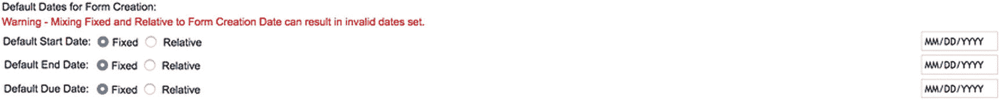

**图 6-48** 固定默认表单日期

通常情况下，固定日期用于年度绩效表单。您可以设置开始日期为 1 月 1 日，结束日期为 12 月 31 日。截止日期通常设置在评估期结束日期后的 15 到 30 天。无论默认日期的类型如何，当为此模板启动表单时，这些日期都会被引入，并显示在表单的“审查日期”部分。如果您不更改这些日期，则将使用默认日期。

#### 默认通知日期

接下来，我们将介绍默认通知日期。示例如图 6-49 所示。

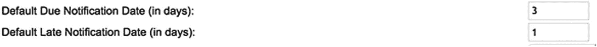

**图 6-49** 默认通知日期

这些日期用于根据`表单截止日期`前的“X”天数，确定何时发送`表单截止日期通知`和`逾期表单通知`：

*   `默认到期通知日期`（天数）

*   `默认逾期通知日期`（天数）

在讨论复制`表单模板`时，我们提到某些高级设置不会从原始`表单模板`复制过来。这同样适用于所有这些日期字段。它们将重置为零，`默认截止日期`为创建日期后的 30 天。

## 通用表单模板设置

请参考表 6-4 了解一些常见设置。

**表 6-4** 通用表单模板设置

| 设置项 | 描述 |
| --- | --- |
| `自动经理转移` | 选择“自动经理转移”下的所有选项。此设置允许表单根据关系变更重新路由。*要了解更多信息，请参考 SAP 注释 #2077194。* |
| `将圆形图标显示为评分` | 星标是默认的评分类型。您可以选择用圆形代替星标来显示评分。 |
| `在团队概览中显示对勾代替评分` | 在已启动表单的“团队概览”中，经理将在步骤列中看到一个对勾，以标识步骤已完成，而不是显示步骤的数值评分。 |
| `启用拼写检查` | 当使用公司词典时推荐启用。要使用此功能，必须先在配置中启用`公司词典`。 |
| `启用法律扫描` | 当您有法律库时推荐启用。要使用此功能，必须先在配置中启用`法律库`。 |
| `启用写作助手` | 仅适用于包含能力的表单。 |
| `禁用“请求评论”路由` | 如果不使用“获取反馈”选项，请勾选此选项（以禁用）。 |
| `禁用“请求编辑”路由` | 如果不使用“获取反馈”选项，请勾选此选项（以禁用）。 |
| `隐藏添加/删除签署人按钮` | 勾选此选项（以禁用）。 |
| `禁用“发送并打开下一份表单”按钮` | 勾选此选项（以禁用）。 |
| `禁用“删除”按钮` | 勾选此选项（以禁用）。 |
| `禁用“备注”按钮` | 勾选此选项（以禁用）。 |
| `禁用“表单”按钮` | 勾选此选项（以禁用）。 |

## 禁用“360”按钮

勾选此选项（以禁用）。

| 在签署阶段显示签署路由步骤名称 | 启用。当表单处于签署阶段时，在路由图中显示步骤的名称。 |

| 显示步骤开始日期 | 勾选此选项（以禁用）。 |

| 在文档打印预览中显示数字签名 | 启用。指定签署人的姓名、角色以及签署表单的日期显示在表单的打印副本上。 |

| 禁止用户更改结束日期 | 勾选此选项（以禁用）。 |

| 禁止用户更改截止日期 | 勾选此选项（以禁用）。 |

| 启用表单路由到上一步 | 可选，仅当您允许表单返回到上一步时启用。 |

### 显示跳过签名步骤时的签名栏

建议启用。用于在跳过签名步骤时，在表单的签名区域显示一个空签名行，而不是完全不显示任何签名信息。

### 启用附件

启用后可向绩效表单添加附件。

保存所有更新并关闭此弹出窗口。

> **注意**
>
> 如需查看完整的高级设置列表及其用途，请参考 SAP 注释 `#2077413`。

接下来，我们将讨论模板可用的高级选项。

## 显示高级选项

在“高级设置”链接下方，点击“显示高级选项…”，如图 6-50 所示。

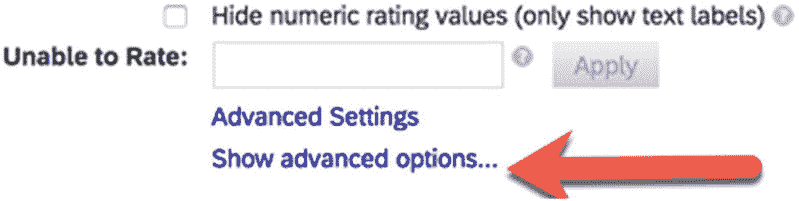

*图 6-50 – 显示高级选项*

此部分将展开，如图 6-51 所示。

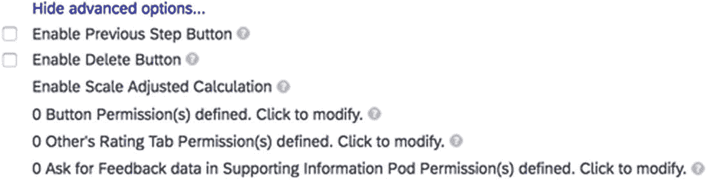

*图 6-51 – 高级选项*

展开后，“显示高级选项…”将变为“隐藏高级选项…”。您可以点击此标签来隐藏这些选项，该部分将折叠。

选项详情请参考表 6-5。

### 表 6-5 – 高级选项

| 选项 | 描述 |
| --- | --- |
| **启用上一步按钮** | 启用后，表单上将出现一个按钮，可将表单回退一步。必须在高级表单模板设置中启用此选项才能使用。 |
| **启用删除按钮** | 不建议启用。启用后，可以定义删除按钮可用的步骤和角色。必须在高级表单模板设置中启用此选项才能使用。 |
| **启用缩放调整计算** | 用于摘要部分，创建一个“调整后的计算得分”来替代始终为数值的计算表单评分。将分数映射到标签，并可基于每个分数的最小值或最大值进行分数映射。*我们将在下一章的摘要部分更详细地介绍这一点。* |
| **已定义按钮权限** | 为每个步骤中的角色定义按钮权限。如果未定义，则所有步骤中的所有角色都将拥有按钮权限。 |
| **已定义他人评分标签页权限** | 允许某个角色查看目标、能力和摘要部分的“他人评分”标签页。包含评论和评分选项。 |
| **已定义在支持信息面板中请求反馈数据的权限** | 使用“请求反馈”功能时，设置权限以在表单的“支持信息”面板中查看反馈。如果未设置权限，所有用户将在所有步骤中看到反馈。*我们将在第 11 章中学习* 请求反馈 *功能。* |

从高级选项中可以看出，复选框用于启用某些选项，某些选项则用于定义权限。“启用缩放调整计算”将在下一章的摘要部分进行讨论。如果未在高级表单设置中启用“请求反馈”，则不会看到“已定义在支持信息面板中请求反馈数据的权限”选项。我们将在第 11 章中了解此功能。

## 保存模板

提醒一下，只有在选择了将在审核过程中使用的目标计划后，才能保存更新后的模板。您可以使用在第 4 章中创建的目标计划。如果您现在想保存模板，请展开“编辑字段和部分”，找到“目标”部分，并选择要关联到模板的目标计划。示例如图 6-52 所示。现在点击“保存”以保存更新后的表单模板。

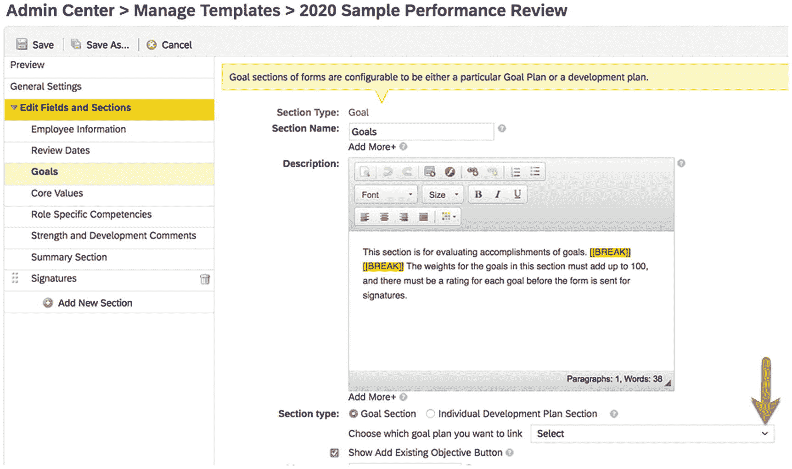

### 图 6-52

将目标计划关联至绩效表单模板

接下来，我们将了解如何在模板中使用权限。

### 高级选项权限

随着学习的深入，我们将进一步探讨绩效表单模板中使用的权限，但以下是一些需要牢记的高级概念。除了基于角色的绩效管理权限外，表单模板中还存在针对路线图中角色的特定权限，这些权限控制着用户能够查看和执行的操作。表单权限反映了表单查看者与表单主体之间的关系。举例说明：乔（员工角色）为丹（经理角色）工作，而辛迪是乔的人力资源经理（HR 代表角色）。为乔创建了一份绩效表单。你需要决定这些角色（员工、经理和人力资源经理）在流程的各个步骤中能够查看和执行哪些操作。

默认的表单权限中，表单各部分的权限为`Enabled`（启用），各部分的字段权限为`Write`（写入）。这些权限允许所有角色在流程的所有步骤中查看和操作所有内容。

要授予权限，请先移除角色和步骤的默认权限，然后根据需要为每个路线步骤中的每个角色重新授予权限。

系统“自上而下”读取权限。请先设置最严格的权限，然后有选择性地授予每个权限。

当我们进入模板各部分时，这一点将变得清晰，但目前这些关于权限的信息已足以让我们讨论将出现在绩效表单上的按钮和面板。

### 按钮和面板

接下来，我们将学习出现在绩效表单上的按钮和面板。我们将了解它们的功能和工作原理。按钮位于绩效表单的右下角。按钮用于执行诸如将表单退回上一步、提交表单至下一步、保存表单或签署表单之类的操作。绩效表单上的按钮示例如图 6-53 所示。

**图 6-53**

绩效表单上的按钮

面板显示在绩效表单的顶部，包含来自表单的数据。面板可能包含整体表单评分，并标识当前步骤需要填写的必填字段数量，或用于存放附件。此处，我们将为路线图中每个步骤的角色授予按钮和面板的权限。

图 6-54 是一个包含五个可用面板的绩效表单标题示例。

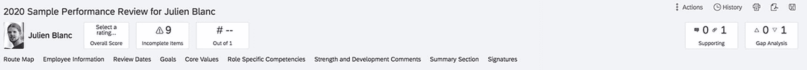

**图 6-54**

绩效表单上的面板

与我们关联到绩效表单模板的路线图定义了路线步骤以及每个步骤中的角色。按钮权限将根据路线步骤中的角色进行设置。我们将为路线图中每个步骤的每个角色定义哪些按钮是可见的，哪些是隐藏的。

例如，对于在“员工自我评估”步骤中具有员工角色的路线图，必须定义员工在此步骤中能够访问的按钮。

按钮权限位于`General Settings`（常规设置）内的高级选项中。点击`0 Button Permission(s) defined. Click to modify.`（已定义 0 个按钮权限。点击进行修改。）将显示一个用于添加按钮权限的弹窗。如图 6-55 所示，点击`+ Add Another`（+ 添加另一个）。

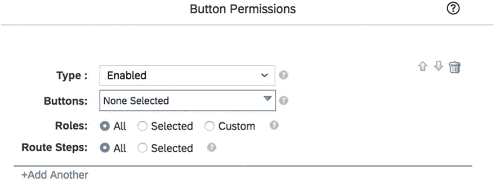

**图 6-55**

添加按钮权限

你需要确定权限类型、按钮、角色和路线步骤以授予按钮权限。完成权限设置的选项如下所示。

- **类型** 定义访问权限：
  - `Enabled`（启用）使按钮在该步骤中可见且可点击。
  - `None`（无）使按钮在该步骤中对用户不可见。
- **按钮** 标识允许特定步骤中的特定角色使用的按钮和面板。
- **角色** 标识正在设置权限的角色。
- **路线步骤** 标识允许使用该按钮的步骤。这些路线步骤来自关联到表单模板的路线图。

请参考表 6-6 了解每个按钮的描述。

### 表 6-6

按钮描述

| 按钮 | 描述 |
| --- | --- |
| `拒绝` | 将表单从签署步骤发回至上一个修改阶段步骤。 |
| `最终确定表单` | 将表单发送至下一步。此按钮的标签在路线图中配置。 |
| `签署` | 用于签署阶段。点击签署按钮将以电子方式签署表单并添加日期。 |
| `发送至上一步` | 将表单退回一步。此按钮的标签在路线图中配置。 |
| `删除表单` | 仅在高级模板设置中未禁用删除按钮时生效。删除按钮出现在表单工具栏上。 |
| `获取评论` | 用于获取反馈。仅在高级模板设置中未禁用“请求评论路由”时生效。 |
| `获取编辑` | 用于获取反馈。仅在高级模板设置中未禁用“请求编辑路由”时生效。 |

有五个面板可能出现在绩效考核表单的顶部。请参考表 6-7 了解面板描述。

### 表 6-7

面板描述

| 面板 | 描述 |
| --- | --- |
| 总体评分 | 此按钮仅在给出最终评分后显示表单评分，并且仅对有权对所有部分项目进行评分的用户可见。 |
| 差距分析 | 员工和经理评分差异的比较图表。 |

| 未完成项 | 此面板包含必填字段的计数。如果所有必填字段都未填写，用户将无法提交表单。用户可以点击此面板查看哪些必填字段尚未填写。对于有必填项的步骤非常有用。点击面板中的必填字段会将表单移动到需要填写该字段的部分。 |

| 团队排名 | 经理可以查看其每位直接下属的、已使用相同表单模板评分的表单的评分排名。 |

| 支持信息 | 如果已在高级模板设置中进行配置，可能包含附件、员工档案中的注释以及“请求反馈”评论。 |

## 按角色和步骤确定按钮权限

我们需要按角色和步骤确定按钮权限。按钮权限基于与绩效表单模板关联的路线图中的角色。这些决策应在配置工作簿中做出。但作为复习，对于路线图中的角色，我们应该考虑：

- 在所有步骤的表单中都不使用的按钮/面板

- 所有步骤都需要的按钮/面板

- 特定步骤需要的按钮/面板

- 特定步骤不需要的按钮/面板

- 在已完成的表单上显示的面板

首先，确定您不希望在任何步骤的表单上看到的所有按钮和面板。

例如，对于一个基本模板，您可能不需要：

- `获取编辑`

- `获取评论`

- `拒绝`

- `删除表单`

您可能不需要以下面板：

- `差距分析`

- `团队排名`

我们的第一个按钮权限将标识那些永远不应出现在表单上的按钮和面板。类型应为`None`（无），我们将选择要隐藏的按钮和面板。这意味着在您不希望表单上可见的每个按钮旁边打勾。接下来，我们将选择所有角色和所有步骤。例如，图 6-56 列出了六个在每一步中对于所有角色都不可见的按钮。

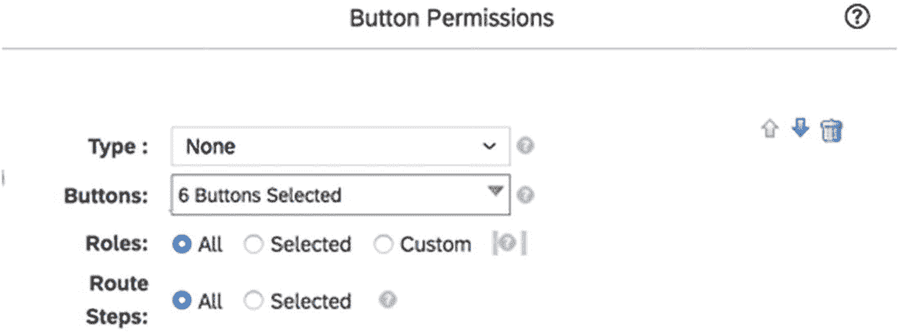

**图 6-56** 从表单中隐藏的按钮

如果你点击 `Buttons` 的下拉箭头，就会看到我们选中的按钮。由于我们已经移除了所有角色和步骤对特定按钮和容器的权限，现在我们可以确定在每个步骤和每个角色中都希望看到的按钮和容器。鉴于“未授予权限即表示按钮权限已授予”的原则，为每个步骤和每个角色创建按钮/容器权限仍然可能有用。这并不意味着要为每个步骤和每个角色下的每个按钮和容器都分别设置权限。相反，你应该明确在每个步骤中，每个角色需要哪些按钮和容器，以及哪些需要隐藏。

首先，你可以创建“启用（`Enabled`）”权限。确定在当前步骤以及与该步骤关联的角色下，哪些按钮和容器需要可用。对于要在该步骤中隐藏的按钮或容器，你需要创建一个“无（`None`）”权限，并指定该角色不应看到的按钮和容器。你需要对路线图中的每个步骤都重复此过程。

使用这种方法可以让你轻松发现任何权限问题，因为你可以看到每个步骤允许了哪些权限。例如，在测试期间，你期望经理在经理评估步骤中能够将表单发回给员工。然而，该按钮并没有出现在表单底部。因此，作为管理员，你可以返回模板，打开按钮权限，定位到经理评估步骤的按钮权限，并发现该按钮没有为经理角色启用。你可以通过为经理角色在此步骤中添加“发送到上一步（`Send to Previous Step`）”按钮来修正权限。但这不会修正已发布的表单。你需要重新发布表单来测试现在是否工作正常。话虽如此，为每个步骤明确定义“无（`None`）”和“启用（`Enabled`）”权限会使查找任何问题变得更加简单。

回顾一下我们的路线图，有一个按钮我们只需要在一个步骤中使用。经理评估步骤允许将表单发回给员工。为了能够使用这个按钮，我们首先必须在高级模板设置中启用“表单路由到上一步（`form routing to previous step`）”。启用此功能后，我们就可以在经理评估步骤中为经理授予“发送到上一步（`Send to Previous Step`）”按钮的权限，如图 6-57 所示。

**图 6-57** 将表单后退一步的权限

在路线图的“修改阶段”中，每个步骤都需要“完成表单（`Finalize Form`）”按钮。这个按钮用于将表单推进到下一步。你应该确定路线图中“修改阶段”的步骤，并确保“完成表单（`Finalize Form`）”按钮在这些步骤中都已启用。对于签名步骤，应启用“签名（`Sign`）”按钮。这是为了在表单上以电子方式添加签名和日期所必需的。

表单底部最多只能出现五个按钮。在这五个按钮中，“保存并关闭（`Save and Close`）”和“取消（`Cancel`）”将始终显示。如果你为一个步骤启用了超过五个按钮，其中一些按钮将会根据按钮优先级被归入“更多操作（`More Actions`）”内。

按钮优先级如下：

1.  完成表单 或 签名 或 一对一确认 (`Finalize Form or Sign or Confirm 1:1`) （选择其一）

2.  拒绝 (`Reject`)

3.  发送 (`Send`)

4.  获取反馈/撤回反馈 (`Get Feedback/Recall Feedback`)

5.  发送到上一步 (`Send to Previous Step`)

6.  添加修改人 (`Add Modifier`)

7.  添加签名人 (`Add Signer`)

一个包含超过五个按钮的绩效表单示例如图 6-58 所示。

**图 6-58** 表单上最多五个按钮

关于按钮需要记住的事项：

- 使用上下箭头移动权限以更改其顺序。

- 对于协作式和迭代式的路线步骤，只有该步骤的退出用户才能看到“完成表单（`Finalize Form`）”按钮。即使你为该步骤中的两个角色都授予了按钮访问权限，情况也是如此。

- 如果你为“获取评论（`Get Comments`）”、“获取编辑（`Get Edits`）”和“删除表单（`Delete Form`）”创建了按钮权限，但如果在高级模板设置中没有启用相应的设置，这些按钮将不会在表单上显示。对于将表单路由后退一步也是如此。

- 如果表单已经发布，而你之后更新了表单模板中的按钮权限，这些更改不会影响已发布的表单。你需要重新发布表单才能使权限更新生效。

- 如果按钮在表单模板高级设置中被禁用，但在模板的高级选项中又被允许，则使用表单模板高级设置的权限。

基于按钮权限，你可以根据角色定义哪些容器会显示在已完成的表单上。例如，你可以决定允许员工在其完成的表单上查看他们的整体评分容器，而经理则可以查看总体分数容器、差距分析容器和团队排名器容器。我们将在第 7 章学习如何设置这些权限。

## 他人评分 (Other’s Rating) 标签页权限

本节要定义的最后一个权限是“他人评分（`Other’s Rating`）”标签页的权限，如图 6-59 所示。此权限授予查看表单上其他用户输入的目标和能力评级及评论的权限。

**图 6-59** 绩效表单上的“他人评分”标签页

图 6-60 显示了可以找到他人评分权限的表单模板部分。

**图 6-60** 需要定义的“他人评分”标签页权限

此权限用于授予路线步骤中的某个角色查看其他用户评论和评分的权限。示例见图 6-61。

**图 6-61** “他人评分”标签页权限

例如，在自我评估期间，员工为其表单上的每个目标输入评分和评论。当表单流转到经理评估步骤时，通过此权限，经理将能够看到员工输入的评分和评论。

为此，需要确定该标签页对于每个步骤以及步骤中的每个角色是可见（`Enabled`）还是隐藏（`None`）。这是通过 `类型 (Type)` 来完成的。最好从 `无 (None)` 开始，然后添加任何你希望该标签页可见的步骤。这可以确保“他人评分”标签页在任何步骤中都不会对任何角色可见。然后，你可以根据角色和步骤逐步添加权限。权限示例如图 6-62 所示。

**图 6-62** 第一步隐藏了“他人评分”标签页权限

请参阅图 6-63 中表单处于第一步时，“来自他人的评分 (`Ratings from Others`)”标签页显示“没有来自他人的评分 (`There are no Ratings from Others`)”的示例。发生这种情况是因为没有为该角色和该步骤设置 `无 (None)` 权限。

**图 6-63** 没有评分的“他人评分”标签页

### “Other’s Rating Tab Permissions”与表单模板设置

`Other’s Rating Tab Permissions` 定义了所有包含评分的表单部分的选项卡权限。登录用户将在屏幕左侧看到他们输入的评分；而其他所有人的评分将显示在屏幕右侧的 `Ratings from Others` 选项卡中。创建权限完成后，点击 `Done`。在表单模板的 `General Settings` 中点击 `Hide advanced options…` 以隐藏这些选项，该部分将折叠。保存模板，在下一章中，我们将进一步了解构成表单模板的各部分。

## 后续内容

本章我们涵盖了众多内容。目前我们已经了解了如何启用绩效管理、设置基于管理员角色的权限、创建路线图和评分量表。我们还从 `SuccessStore` 下载了一个预构建的绩效表单模板，并开始探索其功能、选项、设置和权限。在下一章中，我们将更深入地探讨绩效表单模板，并学习如何为表单各部分配置和授予权限。