# 7. 绩效表单模板设置

在上一章中，我们启用了绩效管理、设置了权限，并开始查看绩效表单模板的组件。本章我们将继续讨论，通过探索定义用户在绩效表单中看到的布局和内容的表单模板部分，还将学习可为各部分和字段配置的权限。

我们将返回表单模板以设置各部分和权限。在搜索栏中输入并选择 `Manage Templates`。转到 `Performance Review` 选项卡，选择要更新的绩效表单模板。

## 模板各部分

模板显示后，展开 `Edit Fields and Sections` 部分。示例如图 7-1 所示。

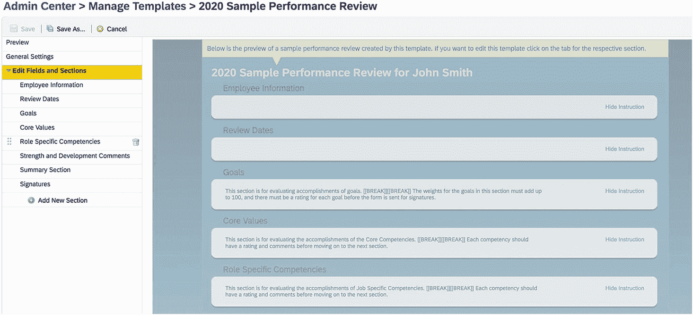

**图 7-1**
模板的编辑字段和部分视图

本章我们将重点关注此部分。根据从 `SuccessStore` 下载的预构建表单模板或复制的表单模板，您在模板上看到的部分可能有所不同。但是，可以添加任何标准部分，也可以创建自定义部分。

以下列出了模板中可能使用的标准部分：

*   `Introduction`
*   `Employee Information`
*   `Review Dates`
*   `Mid-Year`
*   `Additional Comments`
*   `Goals/Objectives`（以及 `Development Objectives`）
*   `Competency`（角色、核心和自定义）
*   `Summary`
*   `Performance Potential Summary`
*   `Objective Competency Summary`
*   `Customized Weighted Rating`
*   `Signature`

也可以创建包含自定义字段的自定义部分。

我们将了解这些部分，包括每个部分的目的、内容和可设置的权限。我们将查看可添加到表单模板中的部分。在模板最后一个部分下方，找到并点击 `Add New Section`，标准部分将显示在一个弹出窗口中，如图 7-2 所示。

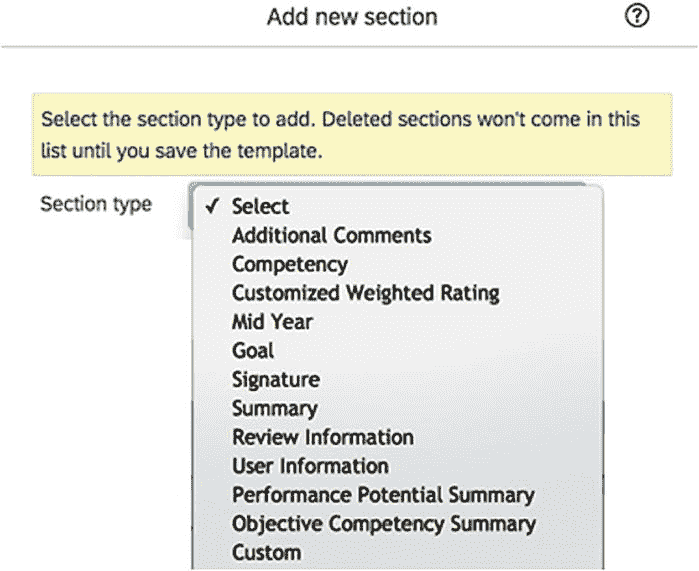

**图 7-2**
新部分选项

如果这些部分中的任何一个已存在于模板中，它们可能不会出现在列表中。某些部分每个模板只能使用一次，例如 `Employee Information`、`Review Dates`、`Summary` 和 `Signature`。未显示在 `Section type` 下拉列表中的部分已存在于模板中，因此无法再次添加。`Goals`、`Competency` 和自定义部分可以在表单模板中出现多次。选择一个部分名称，点击 `Add`，该部分将被添加到模板中。它将显示为表单模板的最后一个部分。

每个部分将按照表单模板中的顺序出现在您的绩效表单上。可以通过单击一个部分并将其拖到新位置来重新排列部分顺序。进行更新时请保存模板。

## 部分、操作和字段权限

在第 6 章中，我们回顾了按钮权限以及在表单模板 `General Settings` 的高级选项部分中找到的 `Other’s Rating Tab Permissions`。在表单模板的这一部分中，需要配置部分、操作和字段权限。根据部分类型，将有不同的功能和权限需要配置。

表 7-1 列出了权限类型及其选项。

**表 7-1**
权限类型

| 类型 | 权限 | 设置对象 |
| --- | --- | --- |
| `Section` | `Enabled`、`Hidden` 或 `Disabled` | 路线步骤中的角色 |
| `Action` | `Enabled`、`None` | 路线步骤中的角色 |
| `Field` | `None`、`Read`、`Write` | 部分评论、手动总体评分、计算总体评分、加权平均值 |

首先定义部分权限。我们可以隐藏一个部分、查看一个部分（`Disabled`）或编辑一个部分（`Enabled`）。对于用户可能编辑操作或字段的任何步骤，必须启用该部分。例如，如果您没有为某个步骤（用户将在其中添加目标评分）启用该部分，则该部分内字段的 `Write` 权限将不会被生效。权限的顺序很重要。系统从上到下读取它们。每个新权限会覆盖任何可能与之冲突的先前权限。

需牢记的一些基本规则如下：

*   当权限未设置时，系统授予所有用户所有权限。
*   对于仅需“只读”的部分，在所有步骤中为所有角色使用 `Disabled`。
*   要授予部分角色权限而非全部，请先为所有步骤中的所有角色定义 `None` 权限。然后，您可以逐步为需要查看该部分的角色和步骤添加权限。
*   如果一个部分已启用，则该部分内的字段权限可用于对某些角色隐藏字段。
*   如果一个部分是可编辑的，但字段权限为 `None`，则用户将只看到部分标题和页眉。
*   在路线图中需要 `Summary` 和 `Signature` 部分之前，请将其隐藏。
*   要在已完成的表单上查看字段，请首先为所有角色设置 `Read` 权限，然后为编辑设置 `Write` 权限，为查看设置 `Read` 权限，或为在特定步骤中隐藏字段设置 `None` 权限。

现在，我们将查看表单模板的每个部分以及如何设置它。

正如我们所见，存在标准的绩效表单模板部分。每个部分都有不同的功能、选项和权限。也可以创建自定义部分。自定义部分可以包含描述、部分评论和自定义字段。如果您单击一个部分，您可以更新部分标签、为其他语言添加标签以及设置权限。现在，我们将逐一介绍各部分类型。我们将看到模板中的部分及其在绩效表单上的显示方式，并学习如何配置部分和字段权限。

## Introduction 部分

#### 简介部分

此部分可配置为显示有关绩效评估流程的信息以及如何填写表单的说明，也可包含链接或图片。该部分的示例如图 7-3 所示。

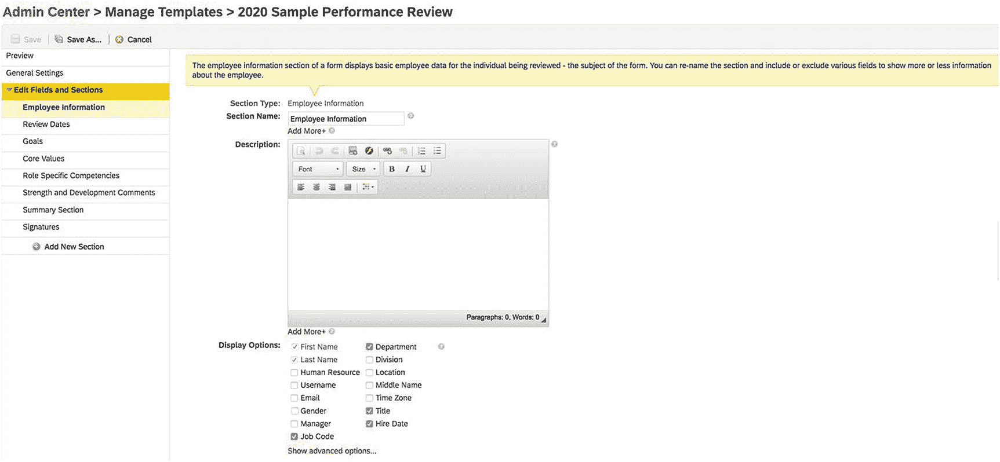

**图 7-3** 简介部分

此部分唯一可用的选项是`Section Name`（部分名称）和`Description`（描述），并且两者都可以有本地化标签。此部分不包含任何字段，因此无需设置字段权限。只能设置部分权限，即`Hidden`（隐藏）或`Disabled`（禁用）。由于此部分没有字段，即使您选择了`Enabled`（启用）或未设置权限，该部分仍将是只读的。

图 7-4 是一个嵌入了图片的简介部分示例。

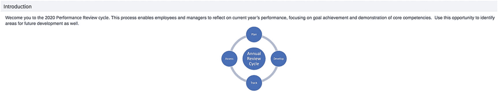

**图 7-4** 带图片的简介部分

### 员工信息部分

`Employee Information`（员工信息）部分可配置为显示员工的一些基本信息。该部分的示例如图 7-5 所示。

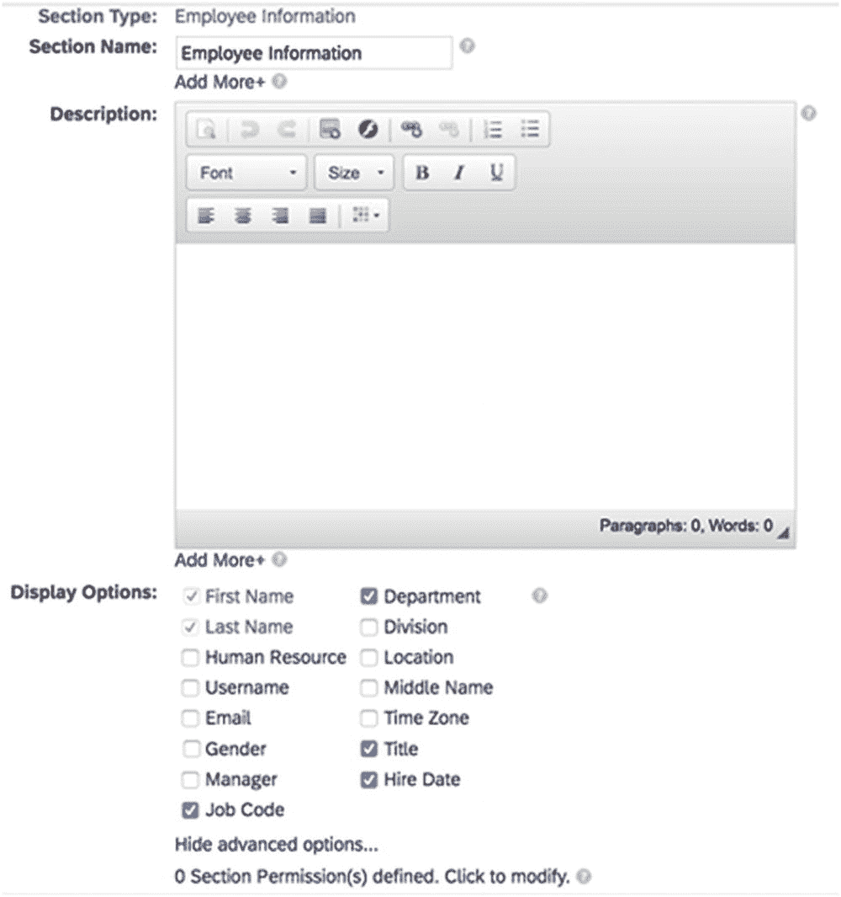

**图 7-5** 员工信息部分

您可以更改部分名称并添加本地化部分标签。您也可以添加带有本地化标签的描述。`Description`（描述）字段的内容将显示在表单的该部分中，可以是文本、图片、链接或它们的组合。描述将显示在`Display Options`（显示选项）所选字段的上方。`Display Options`（显示选项）中列出了可以出现在表单该部分中的字段。点击字段旁边的复选框，使其显示在此部分。

`Employee Information`（员工信息）部分的示例如图 7-6 所示。

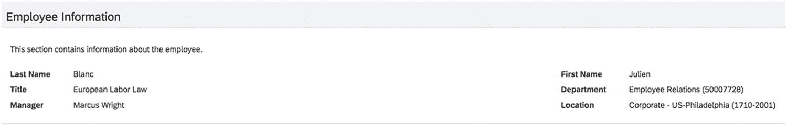

**图 7-6** 绩效管理表单上的员工信息部分

您还可以在此部分包含其他字段，但这些字段必须添加到表单模板`XML`中，我们将在第 10 章中介绍。其他字段包括：

*   `Emp ID`（员工编号）
*   `Business Phone Number`（办公电话）
*   `Fax Number`（传真号码）
*   `Home Address`（家庭地址）
*   `Review Frequency`（评估频率）
*   `Last Review Date`（上次评估日期）
*   用户数据文件中的任何自定义`01-15`字段

也可以重新排列`XML`中的字段显示顺序。

此部分是只读的，对所有角色和路由步骤，权限类型应为`Disabled`（禁用），如图 7-7 所示。如果没有授予任何部分权限，该部分仍会显示。

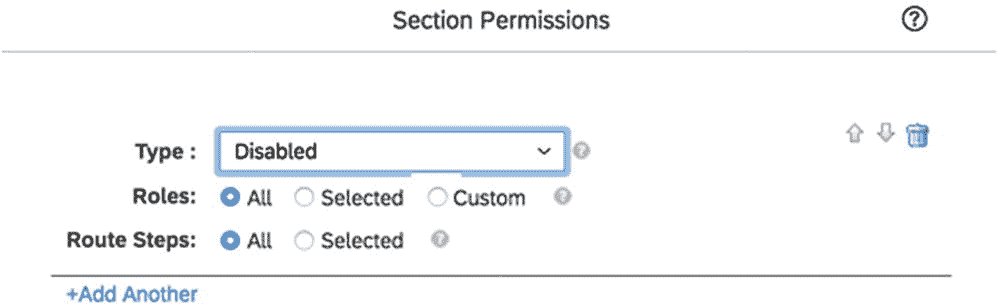

**图 7-7** 只读部分的权限

### 评估日期部分

`Review Dates`（评估日期）部分显示三个标准字段。您可以添加一个描述，该描述将显示在标准字段上方。您也可以为部分名称和描述添加本地化标签。该部分会显示启动表单的用户（发起人）的姓名。此部分还会从表单模板的高级设置中提取默认的开始日期和默认的结束日期。这些日期与默认的截止日期一起用于绩效评估周期。

模板中`Review Dates`（评估日期）部分的示例如图 7-8 所示。

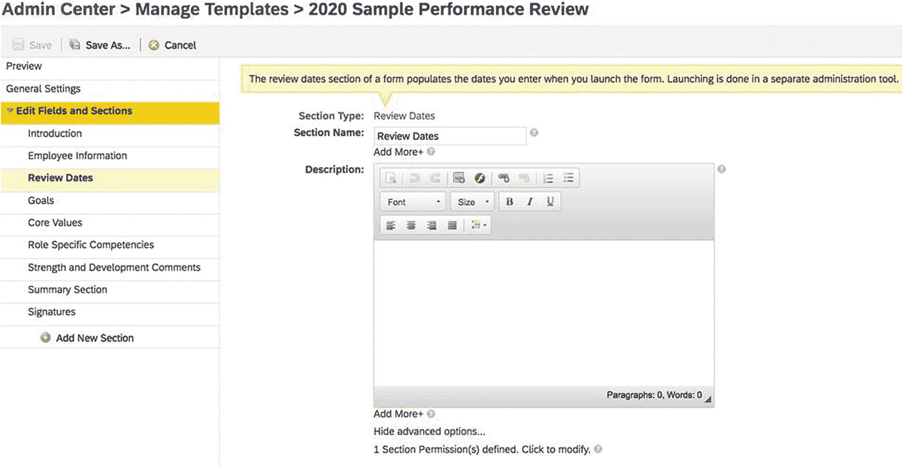

**图 7-8** 评估日期部分

不能向此部分添加额外字段，也不能删除或重新排序现有字段。绩效表单上该部分的示例如图 7-9 所示。

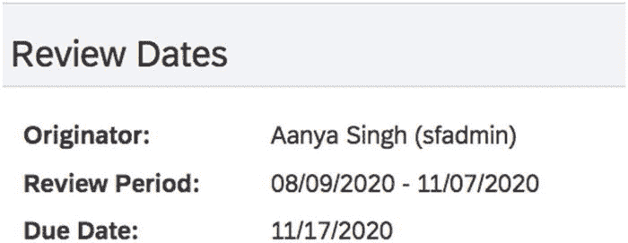

**图 7-9** 绩效管理表单上的评估日期部分

在上图所示的示例中，发起人是启动表单的用户。看到这个字段可能会让用户感到困惑，但它无法被移除。由于这是一个可选部分，许多组织选择不使用它。您可以通过点击垃圾桶图标来删除该部分；另一个选择是隐藏该部分。要在您的表单模板中使用此部分，应将其对所有角色和所有步骤禁用。

### 年中部分

`Mid-Year`（年中）部分可用于跟踪年中进行的任何讨论。员工和经理可以在年中坐下来回顾实现目标的进展情况。此时不会进行评级，但这是一个*纠正航向*的机会，以处理可能出现的任何问题。可以制定发展目标来解决年终前可以改进的薄弱领域。根据讨论内容，可以添加或移除其他目标。

模板中该部分的示例如图 7-10 所示。

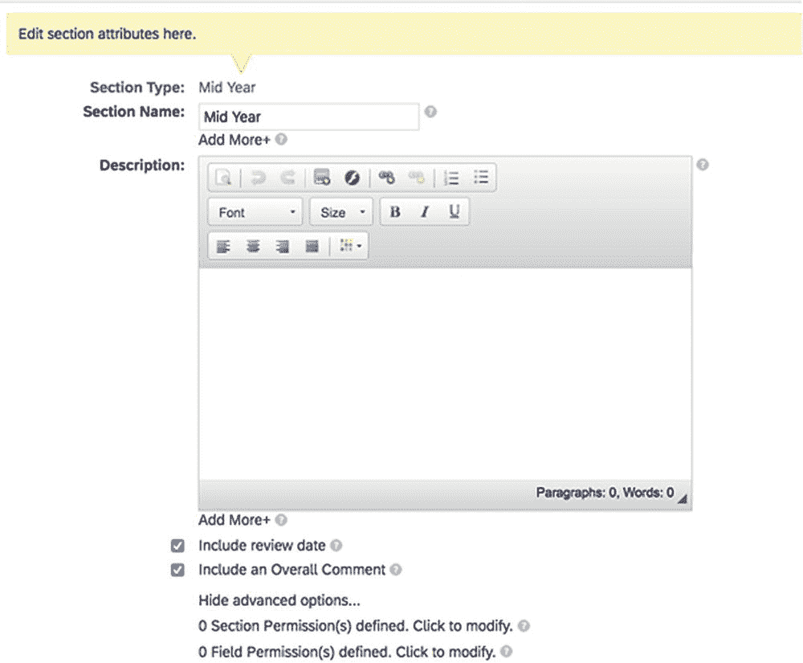

**图 7-10** 年中部分

此部分可以包含一个日期字段，用于标识年中谈话的日期。也可以启用整体部分评论。此部分可以隐藏、启用或禁用。此部分唯一可用的字段权限是部分评论。

以下是如何允许使用此部分的示例。您的绩效评估流程包含一个初始步骤，员工在此设定年度目标。然后表单流转到经理处编辑目标。在这些步骤中，`Mid-Year`（年中）和`Assessment`（评估）部分将被隐藏。`Mid-Year`（年中）部分在年中步骤期间显示并可编辑，而年中评估之后的评估步骤则被隐藏。一旦进入评估步骤，`Mid-Year`（年中）部分将变为只读。

`Mid-Year`（年中）部分的示例如图 7-11 所示。

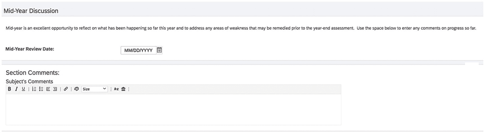

**图 7-11** 绩效表单上的年中部分

### 附加评论部分

还有一个可选部分可用于添加额外评论。您可以重命名此部分并包含一个描述，该描述将显示在部分的顶部。此部分已预先配置，仅包含评论文本框，如图 7-12 所示。您可以添加、编辑或删除评论字段，并本地化标签。

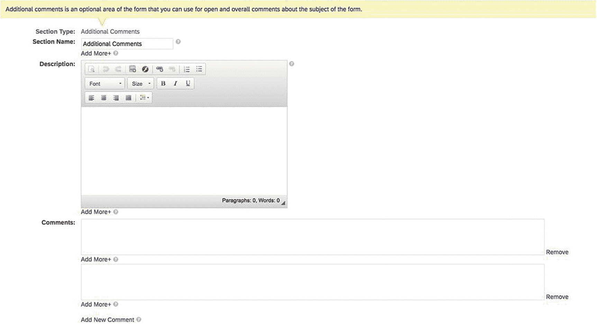

**图 7-12** 附加评论部分

如果您希望有一个与`Goals`（目标）或`Competency`（能力）部分评论分开的评论部分，这会很有用。您可以创建一个长文本字符串，作为您的`textarea`响应的标签。图 7-13 显示了一个示例。

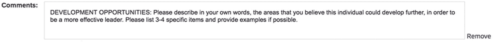

**图 7-13** 将文本添加为评论字段标签

此部分没有权限，这意味着在任何`Modify Stage`（修改阶段）步骤中，任何角色都可以添加评论。这也意味着任何角色都可以覆盖或删除来自先前步骤的评论。您可以在表单模板`XML`中添加权限来解决此问题，但创建一个自定义部分可能更简单，因为它提供了更多的字段类型和权限选项。

## 绩效表格的组成部分

图 7-14 展示了一个绩效表格中的示例评论部分。你可以看到，该部分已被重命名，并且 `Description` 字段显示在评论上方。

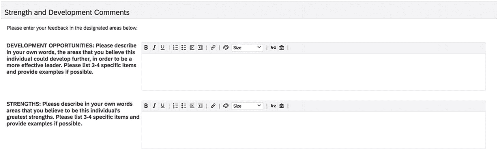

**图 7-14** PM 表格上的附加评论部分

至此，我们已经了解了在表单模板中可能只出现一次的基本部分。接下来，我们将介绍自定义部分。

## 自定义部分

除了标准部分之外，还可以创建自定义部分。在一个表单模板中，你可以有多个自定义部分。与大多数标准部分类似，自定义部分可以包含部分评论和描述。自定义部分的独特之处在于，在执行表单批量启动时，可以编辑其描述。模板的自定义部分如图 7-15 所示。

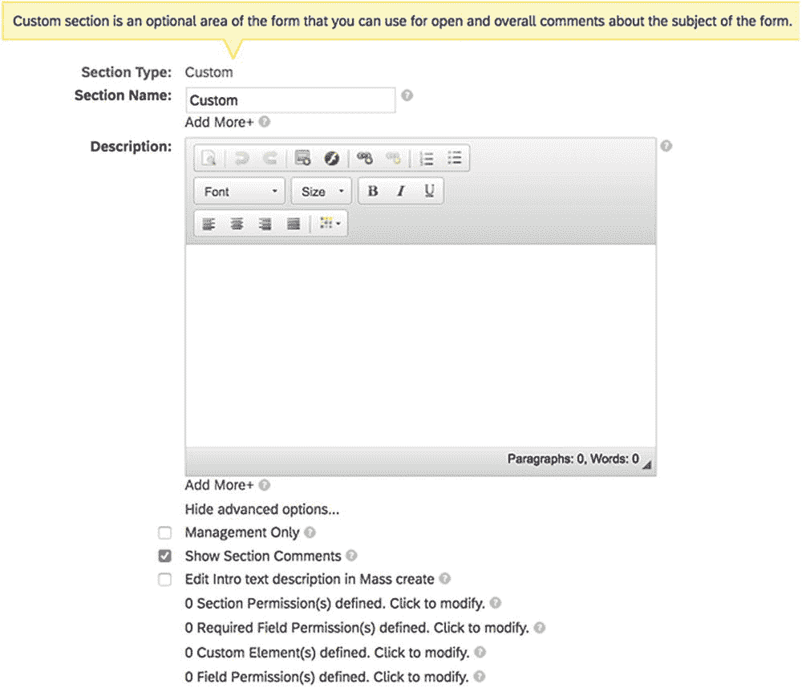

**图 7-15** 自定义部分

如图 7-16 所示，有几种类型的自定义元素。

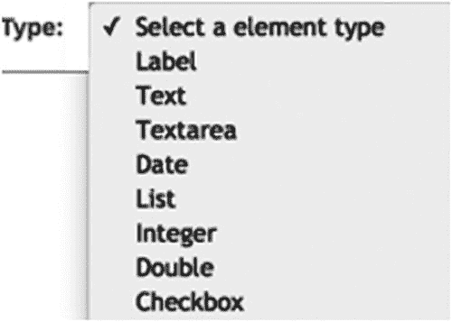

**图 7-16** 自定义元素类型

可以为目标、胜任力以及自定义部分创建自定义字段。在摘要部分也允许使用自定义字段，但必须通过表单模板 XML 添加。在一个部分中，自定义字段将垂直显示，而非并排显示，因此除了字段顺序外，你无法设置该部分中字段的布局。在目标和胜任力部分，自定义字段将显示在评级字段上方。

表 7-2 显示了可用的八种自定义元素类型。

**表 7-2** 自定义元素类型

| 元素 | 描述 |
| --- | --- |
| 标签 | 将显示为粗体文本标签，不附带数据输入字段。 |
| 文本 | 标签字段以及用于输入一行文本的开放框。 |
| 文本区域 | 多行文本输入框。 |
| 日期 | 日期输入。 |
| 列表 | 下拉列表。 |
| 整数 | 用于输入整数的文本框。 |
| 双精度 | 用于输入带小数数字的文本框。 |
| 复选框 | 带标签的复选框。指定 `"evalue"`；否则，选中时不会存储任何内容。 |

除了 `"Label"`（标签）元素类型外，每个自定义元素都可以定义一个标签，该标签将显示在输入字段之前。你可以决定在部分中添加一个或多个自定义字段。需要为每个步骤中的角色定义权限，以确定哪些角色可以查看该部分、浏览该部分或编辑该部分。

> **注意**：有关如何配置自定义字段的更多详细信息，请参考 SAP 备注 #2888737。

请注意，为某个部分定义的自定义元素，若要在另一部分中使用，则必须重新创建。

自定义部分具有 `"仅限管理层"` 选项，如图 7-17 所示。

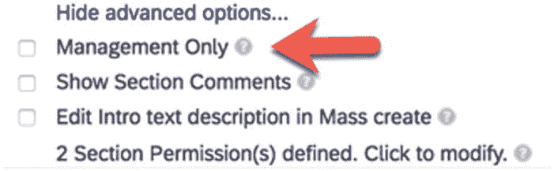

**图 7-17** 自定义部分中的“仅限管理层”选项

选中时，此选项充当部分权限，只有经理和人力资源角色才能在绩效表格上看到该部分。

一个使用了多种自定义元素的自定义部分示例如图 7-18 所示。

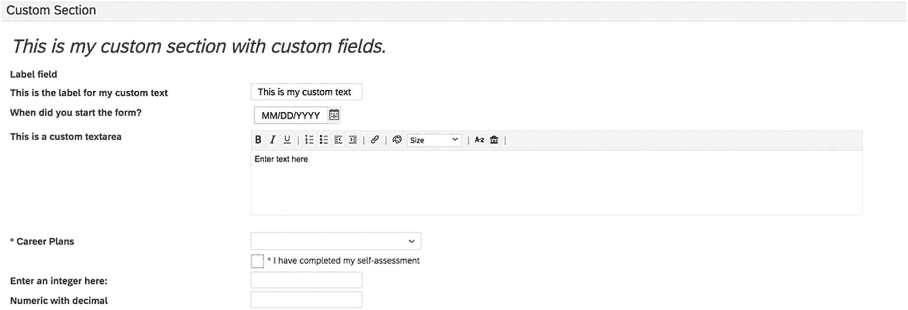

**图 7-18** 绩效表格中的自定义部分

接下来我们要看的几个部分用于评估。我们可以对目标计划中的目标以及特定于岗位的、核心的或自定义的胜任力进行评分。这些评分将用于计算总体绩效评级。在查看目标和胜任力部分之前，我们先来看看权重及其对这些部分的影响。

### 权重

权重是可选的，可用于部分，或部分内的项目，或两者兼用。目标和胜任力部分的权重用于总体表单评级计算。在一个部分内，你可以为该部分中的项目定义目标总权重。

关于权重需要了解以下几点：

-   权重可以设置为可编辑或只读。
-   通常，项目级的胜任力不被加权。
-   如果不使用权重，则项目和部分的权重被视为相等。
-   权重可以是数字或百分比。
-   将部分权重设置为 `0`，以将该部分排除在总体评分计算之外。

现在我们已经了解了一些关于权重的背景知识，也知道评分是怎么回事，接下来可以继续讲解目标和胜任力部分了。

#### 目标部分

通常情况下，年度目标的达成情况是衡量绩效的标尺。表单模板应包含你的组织正在使用的目标计划。表单模板上的目标部分示例如图 7-19 所示。

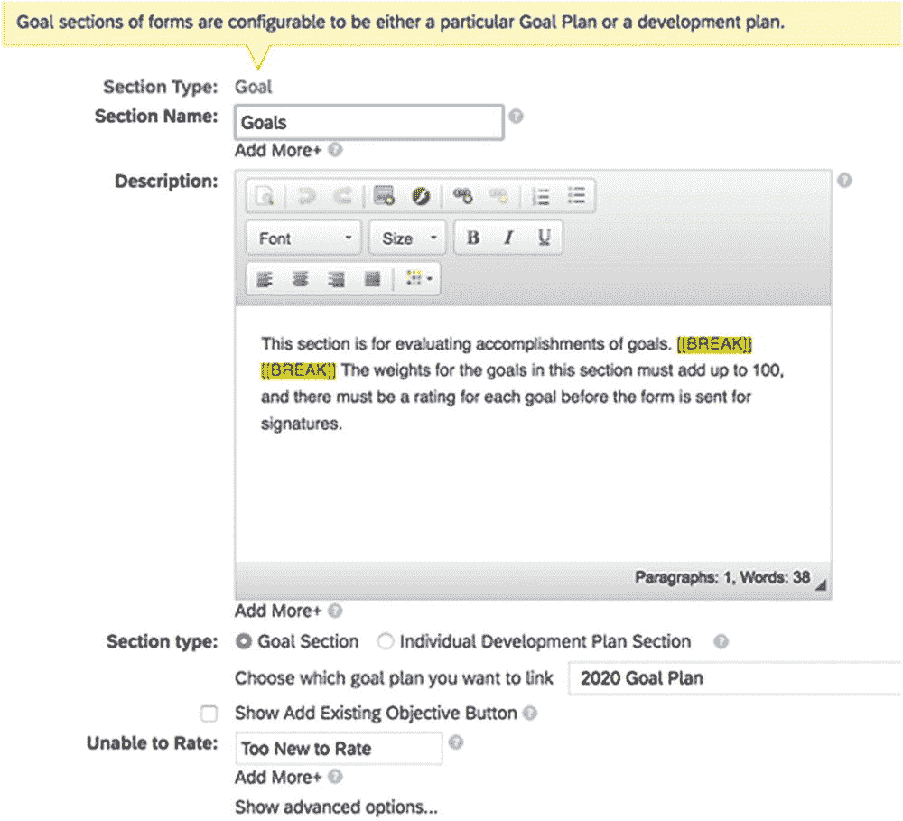

**图 7-19** 表单模板上的目标部分

在上图中，有一个需要填写的部分名称和描述。你还需要确定该部分使用的目标计划。目标部分可以在一个表单模板中出现多次，理想情况下，一次用于目标计划，另一次用于发展目标计划。可以有额外的目标计划部分，但不推荐；表单应该只使用一个目标计划进行评分。该部分的类型通过单选按钮 `目标部分` 或 `个人发展计划部分` 来标识。用于链接到模板的计划下拉列表将基于所选的部分类型单选按钮。

将目标填充到绩效表格有两种方式：自动填充和自动同步。

-   **自动填充** 在创建表单时从目标计划中拉取目标。此方法的一个缺点在于，如果在绩效表格启动后向目标计划中添加了任何目标，这些目标将不会出现在表单上，除非你配置并使用 `"添加现有目标"` 按钮。这需要用户在其绩效表格中手动添加目标。
-   **自动同步** 在目标计划和绩效表格之间同步目标。绩效表格将包含用户目标计划中的目标。对目标计划所做的任何更改都将反映在绩效表格中；反之，在绩效表格中进行的任何目标更新、删除或添加也将反映回目标计划中。

> **提示**：你可以在高级选项中勾选 `"同步目标计划和评审表单中的目标"` 选项来启用自动同步。

如果启用，用户可以在绩效表格上添加或删除目标。此外，可以为每个目标添加评论，添加为整个目标部分的评论，或者两者都添加。员工和经理可以为每个目标输入评分。

目标部分的其他特性包括：

-   拼写检查
-   法律扫描
-   评分等级描述

一个绩效表格的目标部分示例如图 7-20 所示。

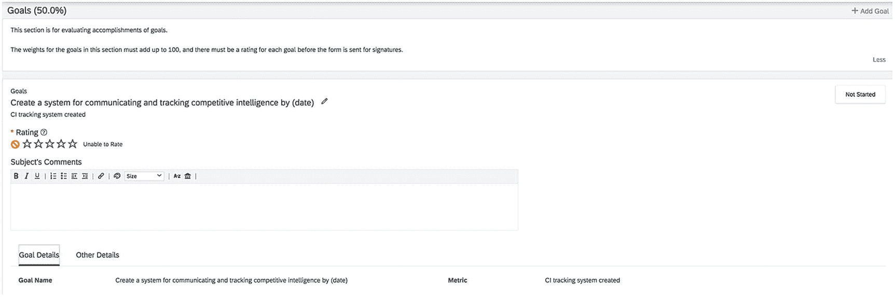

**图 7-20** 绩效表格上的示例目标部分

## 目标章节

“目标”章节的选项和功能取决于表单模板及 `Provisioning` 中表单模板 XML 所启用的内容。此处，我们将重点介绍可通过“管理模板”在表单模板中更新的功能。第 10 章将介绍可进行的 XML 更新。

在讨论表单模板选项之前，让我们先看一下上图中显示的示例“目标”章节。可以看到，有一个初始的“目标”章节作为表头。此处的章节描述即为“目标”章节表头。“目标”章节表头之后是来自用户目标计划的每个目标，这些目标被分隔到各自的目标子章节中。

对于每个目标，您都可以看到其名称和描述。我们在表单模板中创建并指定的评分量表将用于对每个目标进行评分。评分分数的默认视图以星形表示。用户可以为每个目标输入评论和评分。还可以在表单上最后一个目标之后设置一个总体目标评论章节。表单中对目标的任何更改都将反映在目标计划中。

### 配置决策

在填写配置工作簿时，需要做出以下决策：

-   哪些角色在哪些步骤中可以添加、编辑或删除目标？
-   哪些角色在哪些步骤中可以输入评分？
-   是否为每个目标设置评论？如果是，在哪个步骤，为哪个角色设置，以及这些评论是否为可选项？
-   哪个角色在哪个步骤中可以查看“他人评分”选项卡？
-   是否包含目标摘要章节？如果是，哪个角色在哪个步骤中可以添加或查看评论？评论是可选的还是必填的？
-   目标占总体评分的百分比是多少？
-   其他步骤的其他用户可以查看哪些目标章节数据？

这些决策决定了如何配置该章节。就我们的目标而言，我们将允许员工和经理为每个目标项目添加评论并提供评分。

*有关字段和章节权限的说明，请参考 SAP 注释 #2077252。*

### 配置章节

除了常规设置之外，还有很多选项，让我们从上往下看。我们首先来看看“描述”后面的选项。单击“显示高级选项…”以展开该章节，如图 7-21 所示。

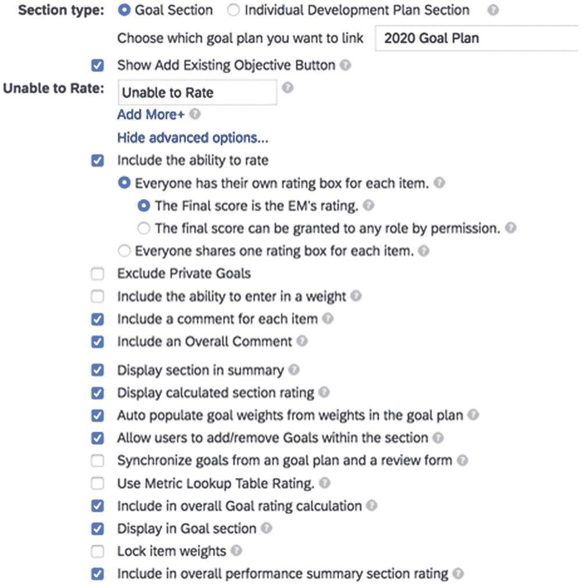

**图 7-21** 表单的目标章节

选择一个单选按钮，以标识您在此章节中使用的是目标计划还是发展计划。使用下拉列表选择要在绩效模板中使用的目标计划。这将从所选的目标计划中将目标拉取到绩效表单中。

> **注意**  
> 发展目标通常不进行评分。但是，如果您希望包含一个出现在绩效表单上的发展计划，可以添加一个额外的“目标”章节。您可以将该章节配置为能够添加或删除发展目标，但不进行评分。

请参考表 7-3 了解每个设置的含义。

**表 7-3** 目标章节高级设置

| 设置项 | 描述 |
| --- | --- |
| 显示“添加现有目标”按钮 | 仅当目标未从目标计划自动填充到表单时才适用。启用后，“添加目标”按钮允许用户从目标计划中选择一个目标添加到绩效表单中。 |
| 禁止评分 | 如果此设置是在“常规设置”中应用的，则它已经为所有包含评分的章节填充了该设置。如果在此处输入，则该标签仅适用于目标章节。也可以添加本地标签。 |

#### 高级选项

| 设置项 | 描述 |
| --- | --- |
| 包含评分功能 | 用于标识该章节是否会被评分。如果是，则每个目标都会被评分。对于每个评估步骤，角色将为每个目标拥有自己的评分框。经理的评分将成为最终评分，或者您也可以选择将其他角色的评分设为最终评分。或者，对于每个评估步骤，每个目标都会有一个评分框，并且每个步骤的评分会覆盖上一步骤输入的评分。如果未启用，则不会有评分目标的选项。启用时： • 每个人对每个目标项目都有自己独立的评分框。 – 最终分数是经理的评分（推荐）。 – 可以指定任何角色的评分作为最终评分。 • 所有人共享每个目标的一个评分框。最后输入的评分将成为最终评分。 |
| 排除私有目标 | 启用时： • 如果您的目标计划包含私有目标且自动同步已开启，则私有目标不会出现在绩效表单的“目标”章节中。 • 如果您的目标计划包含私有目标，自动同步未开启，并且启用了“添加现有目标”，则无法选择私有目标。 • 当启用在绩效表单内添加目标时，您将无法创建私有目标。 |
| 包含输入权重功能 | 允许用户更新目标权重。权重用于目标评分计算。 |
| 为每个项目包含评论 | 每个目标都会显示一个评论框。可以允许特定步骤中的特定角色添加或查看评论。 |
| 包含总体评论 | 在每个单独的目标之后，可以包含一个目标摘要章节，并允许用户添加或查看目标章节评论。 |
| 在摘要中显示章节 | 目标项目权重和评分显示在表单摘要章节中。 |
| 显示计算出的章节评分 | 计算出的总体目标评分显示在表单摘要章节中。 |
| 从目标计划权重自动填充目标权重 | 当与目标计划自动同步时，来自目标计划中每个目标的权重将填充到绩效表单上的目标中。 |
| 允许用户在章节内添加/移除目标 | 使用户能够向绩效表单中添加或从中删除目标。需与操作权限结合使用。 |
| 同步目标计划与审核表单中的目标 | 对目标计划所做的更改会自动同步到绩效表单的“目标”章节。对绩效表单内目标所做的更改会同步到目标计划。 |
| 使用指标查询表评分 | 如果目标计划包含指标查询表，则启用指标查询表评分功能。 |
| 包含在总体目标评分计算中 | 表示此章节中的目标将用于计算总体目标评分。 |
| 在目标章节中显示 | 使用目标能力摘要章节时，此章节中的目标将显示在此处。 |
| 锁定项目权重 | 防止用户更改目标权重。 |
| 包含在总体绩效摘要章节评分中 | 在总体绩效摘要章节中包含目标章节。 |
| 最少目标数 | 绩效表单上目标的最小数量。 |
| 最多目标数 | 绩效表单上目标的最大数量。 |
| 目标能力摘要的章节权重 | 仅当使用目标能力摘要章节时适用。指定用于目标能力评分计算的目标评分权重。 |
| 总权重 | 章节中所有目标的总权重。 |
| 评分量表 | 如果在模板的常规设置中选择，所有包含评分的章节将使用此量表。可以在章节内选择不同的量表，但不建议这样做。 |
| 隐藏评分数值 | 评分通过下拉列表使用评分标签进行选择，而不是使用星形或圆形。 |
| 默认评分 | 可以定义打开表单时显示的默认评分。 |
| 为评分字段选择替代标签 | 为评分字段定义另一个标签，例如“选择一个评分”。 |

在开始讨论评分量表之前，我们简要介绍了评分量表的格式。

### 评分量表外观

默认的评分量表以星形显示，如图 7-22 所示。

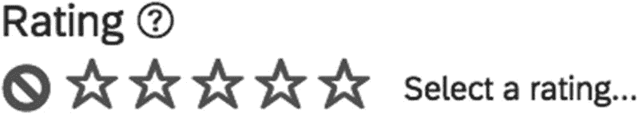

**图 7-22** 默认星形评分

“Too New to Rate” 值显示在量表的最左侧，其图标为“无圈”图标。

在表单模板的高级设置中，您可以选择使用圆形显示评分量表。圆形评分量表的示例如图 7-23 所示。

**图 7-23** 圆形评分

“Too New to Rate” 值显示在量表的最左侧，其图标为“无圈”图标。

最后一种评分量表显示方式是以下拉列表形式呈现的文本，如图 7-24 所示。

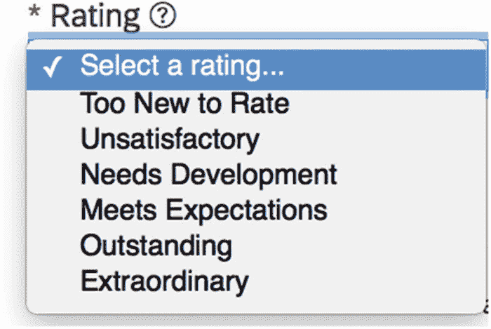

**图 7-24** 文本评分

下拉列表中使用的是评分量表的文本标签。

无论评分量表类型如何，这三种类型都在问号图标中显示评分描述，如图 7-25 所示。

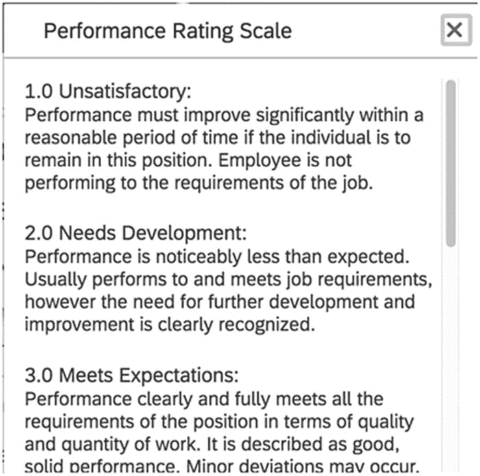

**图 7-25** 评分描述

“Too New to Rate” 值是下拉列表中的第一个评分。在这些评分量表中，“Too New to Rate” 没有数值，并且不参与整个表单的计算。所选量表类型将应用于目标与能力项评分以及摘要部分的总体评分。计算得出的总体表单评分将使用数值量表。我们将在讨论模板摘要部分时进一步介绍总体表单评分。

#### 部分的权限

一个部分可以设置五种类型的权限：

1.  部分
2.  操作（仅适用于目标与能力部分）
3.  字段
4.  必填字段
5.  自定义元素（仅适用于目标与能力部分以及使用 XML 的摘要部分）

并非所有权限都适用于每个部分。例如，操作、字段和必填字段不适用于员工信息、简介、审核日期和附加评论等部分。

图 7-26 展示了模板目标部分可用的权限类型示例。

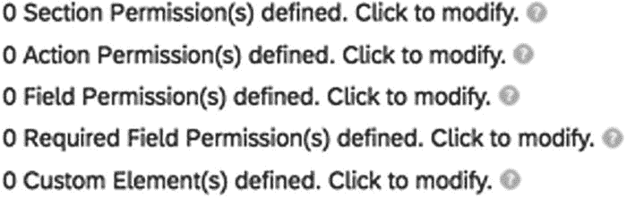

**图 7-26** 部分权限类型

我们将逐一查看每种权限类型。

##### 部分权限
我们从部分权限开始。部分可以设置为隐藏、可编辑或只读。权限类型包括“隐藏”、“启用”或“禁用”。对于每个模板部分，需要根据角色和步骤确定该部分是不可见、可编辑还是仅供查看。

#### 操作权限
操作权限用于目标与能力部分，以添加或移除目标或能力。操作类型有“无”或“启用”。操作选项包括“添加项目”或“移除项目”。仅当为该部分启用了“允许用户在此部分中添加/移除目标”时，这些权限才生效。这些权限应根据角色和步骤进行设置。

##### 字段权限
字段权限定义了在每个步骤中，哪些字段根据角色是隐藏、可查看还是可编辑的。例如，某个部分可能可见；但根据角色和步骤，某些字段可能被隐藏。选项包括“无”、“读取”和“写入”。

目标与能力字段包括：

*   项目评分（经理评分）
*   非官方用户评分
*   项目权重
*   部分权重
*   项目评论
*   主题评分（员工自评）

## 章节评论

- 章节评论
- 自定义字段

通常，员工会在经理评估之前的步骤中进行自评。允许员工对目标项目进行评分的字段是`Subject Rating`。使用`Item Rating`作为经理的评分。在路线图步骤中定义的任何其他角色将使用`Unofficial User Rating`。

### 必填字段权限（可选）

我们可以确定哪些字段（如果有）在表单可以进入下一步之前必须填写。为每个必填字段定义角色和步骤。表单模板中的必填字段权限如图 7-27 所示。

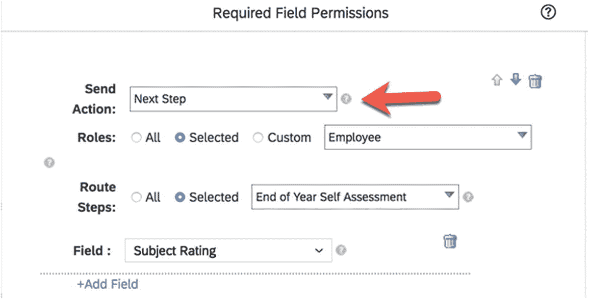

**图 7-27** 必填字段的发送操作

必填字段权限独有的特点是`Send Action`。您必须确定发送操作是`Next Step`还是`Signature`。对于`Next Step`，该字段是将表单发送到下一步之前必须填写的条目。`Signature`操作用于在移动到签名步骤之前必须填写该字段的情况。

例如，如果用户必须输入目标评分，则将其设置为应输入该字段步骤的必填字段。除非填写了必填字段，否则用户将无法将其绩效表单提交到下一步。如果允许，`Incomplete Items`面板将显示该步骤的必填字段数量。建议将评分设置为必填项，以便将表单提交到下一步。

### 自定义元素权限（可选）

我们之前在本章中讨论了自定义部分并了解了自定义字段。自定义字段可以添加到目标和能力部分。创建自定义字段后，您需要按步骤和角色定义权限。也可以将自定义字段设为必填。

如果在部分中启用了`Include an Overall Comment`，您将看到一个位于最终目标之后的评论部分。您可以按步骤和角色设置查看或创建评论的权限。图 7-28 显示了一个章节评论的示例。

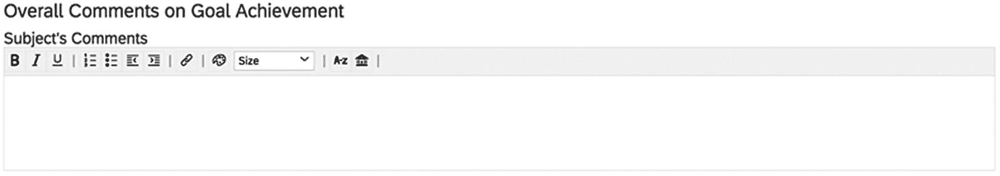

**图 7-28** 整体目标评论

如您所见，各个目标会被评分，但用户无法输入整体目标评分。各个目标项目的评分将用于计算整体表单评分。整体表单评分将显示在摘要部分。如果使用了客观能力摘要部分，则可以显示计算得出的整体目标评分。

## 发展目标部分

在表单模板中包含发展计划是一个可选部分。要添加此部分，请选择`Goal`部分类型，如图 7-29 所示。

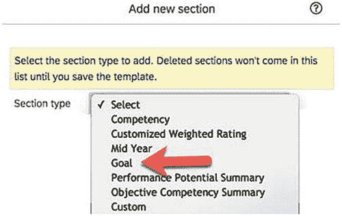

**图 7-29** 添加发展目标部分

这与用于目标的部分相同，因此选项和设置也相同。只需确保选中`Individual Development Plan Section`单选按钮，然后选择要链接到表单模板的发展计划。命名该部分，添加描述，并允许用户添加或移除发展目标。尽管可以对发展目标进行评分，但不建议这样做。发展目标旨在确定需要改进的领域，对其进行评分似乎不太合适。通常，在表单中包含此部分更多是为了提供信息，或允许用户根据其实现目标的进展情况来添加发展目标。发展目标面向未来，而评分目标则针对过去的行为。

如果包含此部分，您可以将其设置为只读，但允许员工添加发展目标或对现有发展目标添加评论。示例如图 7-30 所示。

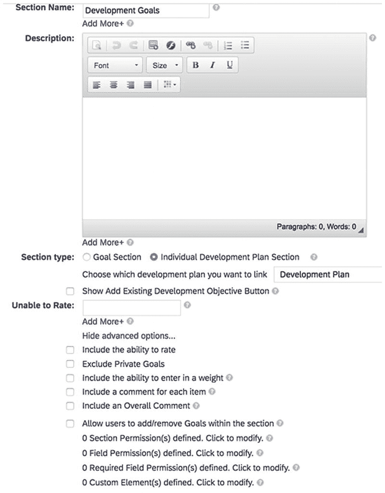

**图 7-30** 发展目标部分高级选项

表单中发展目标部分的一个示例发展目标如图 7-31 所示。

**图 7-31** 绩效表单上的发展目标

根据为此示例设置的权限，可以编辑或删除发展目标，并可以添加额外的发展目标。发展目标上没有评分。

### 能力部分

能力描述了员工履行其工作所需的基本技能。在绩效表单中包含能力是有意义的，因为能力是可观察和可衡量的，并且会影响绩效。除了对员工实现目标的情况进行评分外，也可以对能力进行评分。与目标部分一样，每个项目都会被评分。目标项目评分和能力项目评分将一起用于计算整体表单评分。

在配置工作簿中，需要做出决策以确定如何设置表单模板部分，包括：

- 使用角色、核心或自定义能力
- 在能力上使用评论，由哪个角色在哪个步骤进行
- 谁可以在哪个步骤对能力进行评分
- 使用整体能力评论

如果您正在使用能力库（最好是 SuccessFactors 2.1 能力库，且能力已链接到职位代码），您可以将员工特定角色的能力拉入表单进行评分。如果您还确定了`core`能力，您也可以在表单上有一个单独的核心能力部分。也允许用户向绩效表单添加额外能力。但建议谨慎行事，因为这可能会削弱角色和核心能力评分的权重重要性。

能力部分的其他可选功能包括：

- 拼写检查
- 法律审查
- 写作助手

这些选项需要在 Provisioning 以及表单模板高级设置中启用。

一个绩效表单的能力部分示例见图 7-32。

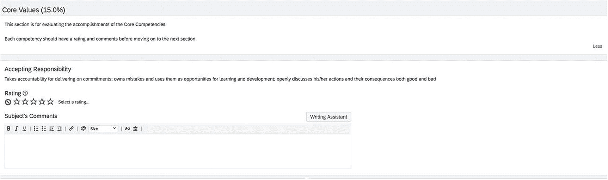

**图 7-32** 绩效表单上的核心能力部分

目标部分的大部分功能和配置选项与能力部分相同。我们将指出显著的差异。图 7-33 显示了表单模板中能力部分的一个示例。

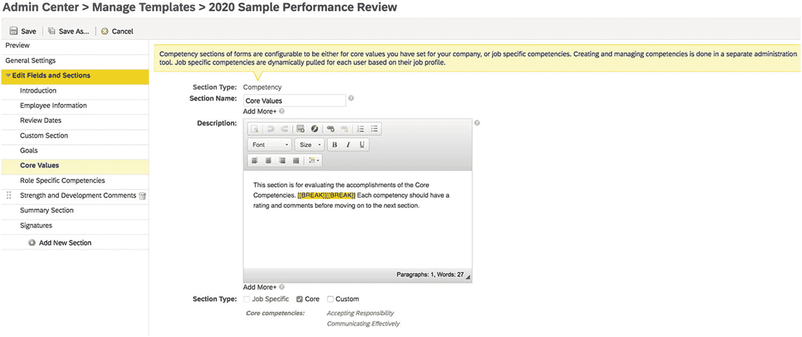

**图 7-33** 能力部分

### 能力部分类型

您的表单上可以有多个能力部分。理想情况下，您应该为每种能力类型创建一个单独的能力部分。但是，也可以在同一部分中包含自定义能力与特定职位的能力，或者自定义能力与核心能力。特定职位的能力和核心能力不能出现在同一部分中。

您可以选择`Job Specific`、`Core`或`Custom`作为部分类型。使用我们在图 7-34 中的示例，能力部分类型是`Core`，并且列出了核心能力。这意味着所有创建了表单的人都会拥有这些相同的能力。您可以决定是否存在适用于所有角色的公司范围能力。

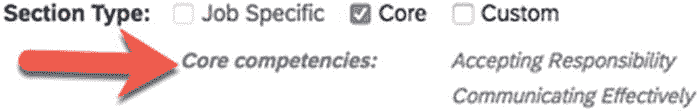

**图 7-34** 选择能力类型

## 能力模块

这些能力通过 `Job Profile Builder` 被识别为“核心”能力。如果您选择了“特定职位”，所有与用户职位角色关联的能力将填充到能力模块中。

### 自定义能力

另一种选择是使用自定义能力。这些是硬编码的能力，将显示在每个人的表单上。在将模块类型选择为“自定义”后，展开高级选项部分，您将看到“已定义 0 个自定义能力。单击以修改”，如图 7-35 所示。

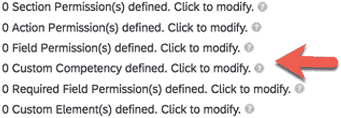

图 7-35  
定义自定义能力

您可以在模板中定义自定义能力。您可以从任何现有能力中选择那些应该硬编码在表单上的能力。您也可以创建不与职位代码关联或非核心的新能力，然后在模板中选择这些能力。

图 7-36 展示了创建自定义能力的示例。该能力是使用 `Job Profile Builder` 创建的。请参考第 3 章了解更多关于 `Job Profile Builder` 的信息。

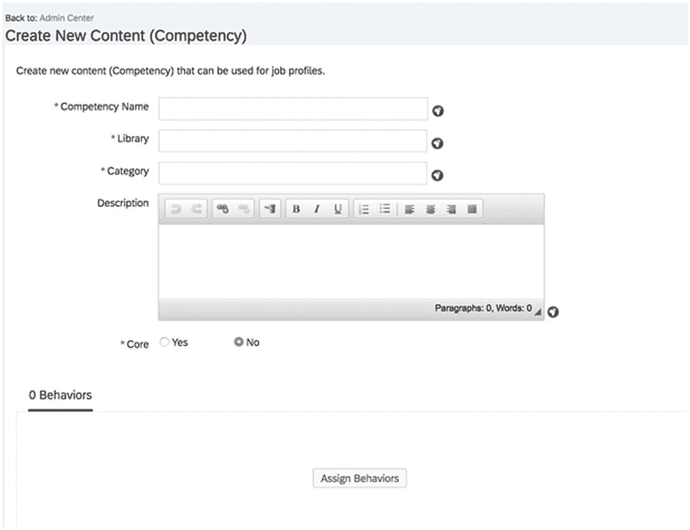

图 7-36  
创建新能力

一旦新能力创建完成，它就可以被选为硬编码能力，从而显示在所有用户的绩效表单上。如图 7-37 所示。

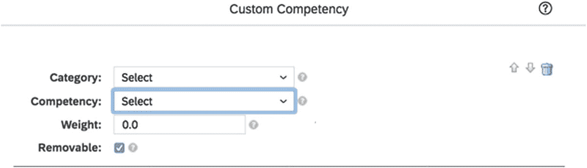

图 7-37  
选择硬编码能力

### 能力权限

与目标模块类似，您需要设置模块、字段、必填字段和自定义字段的权限。可用的字段与目标模块字段相同，如下所示：

- 项目评分（管理者评分）
- 非官方用户评分
- 项目权重
- 模块权重
- 项目评论
- 主体评分（员工自评）
- 模块评论
- 自定义字段

### 行为

如果您有能力关联的行为，并且这些能力的行为映射到职位角色，那么可以在绩效表单上显示与能力关联的行为。也可以根据这些行为来对能力进行评分。

图 7-38 是一个带有关联行为的能力示例。

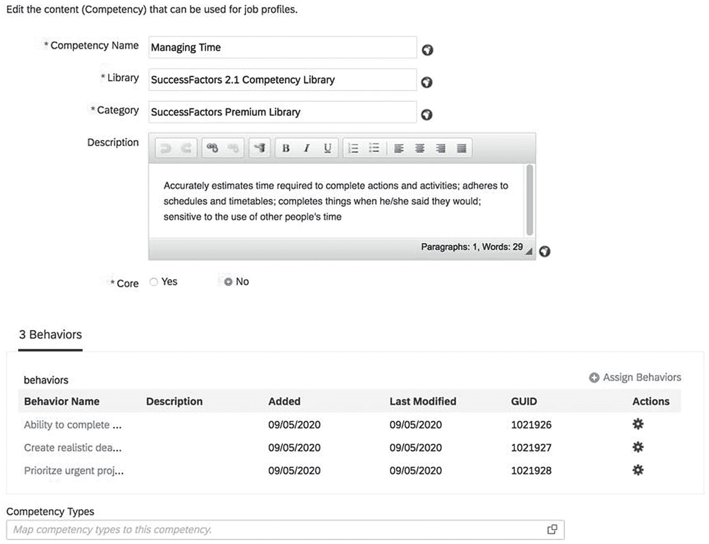

图 7-38  
带有关联行为的能力

该能力关联到一个职位角色，如图 7-39 所示。

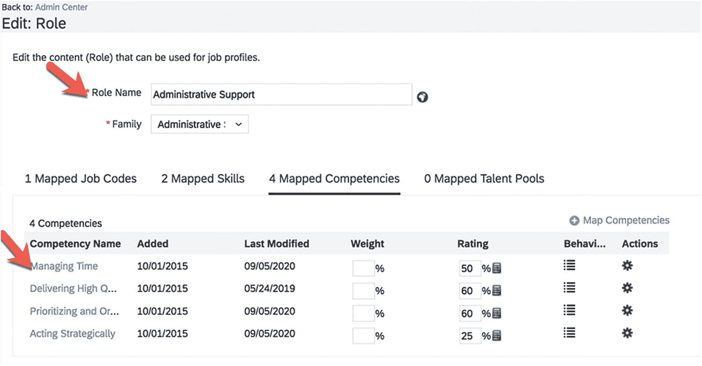

图 7-39  
与职位角色关联的能力

通过选择“显示行为”，将显示每个能力对应的行为。您还可以选择显示模式，使行为在绩效表单中出现在能力评分的上方或下方。

示例如图 7-40 所示。

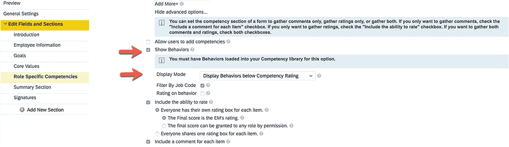

图 7-40  
显示每个能力的行为

图 7-41 展示了行为如何出现在绩效表单中能力下方的示例。

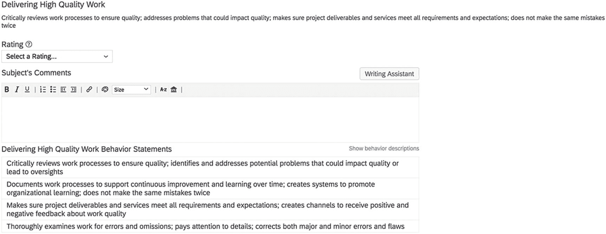

图 7-41  
绩效管理表单中带有行为的能力

在此示例中，用户对能力进行评分和评论，并查看关联的行为。

也可以基于行为而非能力进行评分。如果一个能力有多个行为，则每个行为都会被评分，然后系统会为每个能力计算总体行为评分。示例如图 7-42 所示。

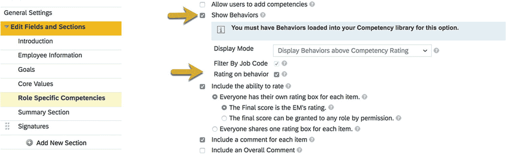

图 7-42  
根据行为对能力进行评分

例如，如果一个能力有五个关联行为，每个行为都会被评分，然后每个能力会有一个计算得出的总体行为评分。

图 7-43 所示的示例中有两个行为需要评分，以便为该能力生成计算评分。

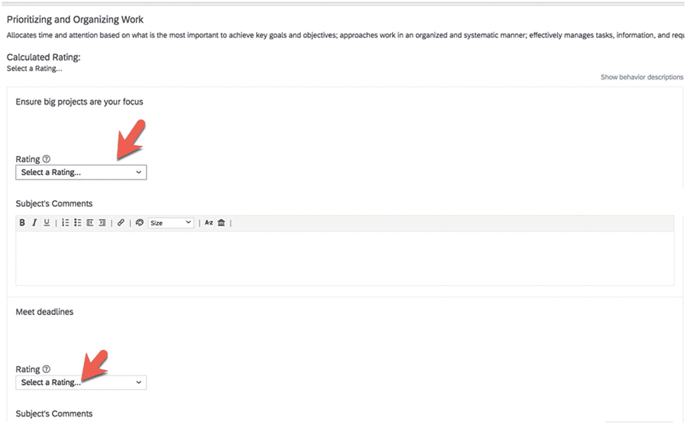

图 7-43  
需要在绩效管理表单上评分的带有行为的能力

## 总结模块

整体绩效总结模块包含了来自所有评估模块（目标和能力）的汇总评分信息。

可以在总结模块中使用的整体表单评分有三种类型：

1.  *计算出的总体评分*：这是默认评分，基于目标和能力模块中的项目评分以及模块权重得出。即使您对项目评分和手动总体评分使用星形、圆形或文本格式，该评分也将是数字格式。
2.  *手动总体评分*：允许管理者创建一个整体表单评分，用于替代计算出的整体表单评分。如果使用星形或圆形，手动总体评分在总结模块中将显示为星形或圆形。
3.  *调整后的计算评分*：允许将一系列评分映射到评分量表中的一个值。该评分可用于替代计算出的总体评分，因为它可以显示为文本，而非数字。

在讨论此模块时，我们将解释每种评分类型。

在配置工作簿中需要做出的评分决策包括：

- 是否显示计算出的总体评分？
- 是否允许手动覆盖计算出的评分？
- 是否使用总体绩效评论？
- 评分发生在哪个步骤？
- 哪些后续步骤可以查看此模块？

表单模板中总结模块的示例如图 7-44 所示。

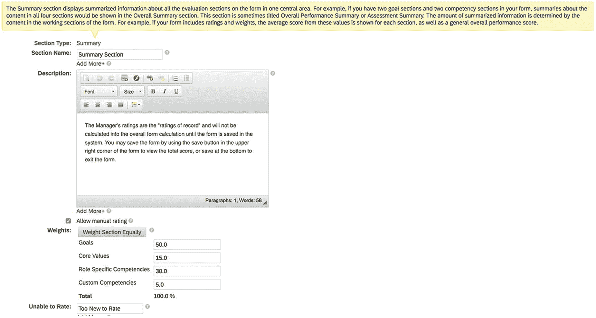

图 7-44  
绩效总结模块

#### 选项

- *允许手动评分* 将在总结模块中创建一个评分录入项，可用于替代计算出的评分。手动评分将覆盖计算出的评分，并成为记录在案的评分。
- *权重* 用于定义在总体评分计算中使用的每个模块的权重。您可以等权重分配模块，或为每个评分模块定义百分比。这些权重总和必须为 100%，并将用于计算总体评分。权重百分比将显示在模块标签中。
- 如果您有希望从总体评分中排除的评分模块，请将权重设置为 0，但确保其余模块权重加起来为 100%。
- *无法评分*，也称为“未评分评分”，在此处提供一个标签来表示不影响评分计算的非分数值，例如“入职时间过短无法评分”或“不适用”。如果已在“常规设置”中设置，则此项将已填充。

此模块使用在“常规设置”中确定的评分量表。这些评分的平均分以及每个模块的权重将显示在总结模块中，同时显示的还有一个计算出的总体绩效分数。您也可以允许管理者在此模块中手动输入员工的总体绩效评分。

让我们查看如图 7-45 所示的高级选项。

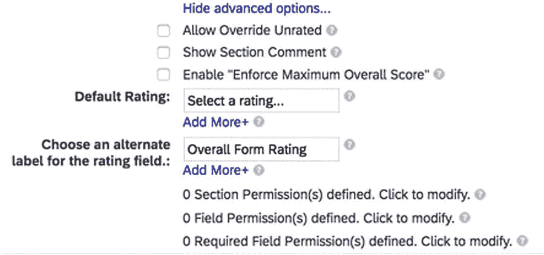

**图 7-45** 汇总部分高级选项

各选项的说明见表 7-4。

**表 7-4** 高级选项

| 选项 | 说明 |
| --- | --- |
| 允许覆盖未评级 | 与“手动评级”配合使用，允许在将表单发送到下一步骤时，用计算出的评级覆盖未评级的手动评级。 |
| 显示部分评论 | 创建一个汇总评论部分。 |
| 启用“强制设定最高总分” | 根据目标或能力级别的最低分数，设定评分者可以选择的最大可能总分。防止评分者给出超出允许范围的更高分数。*更多信息，请参见 SAP 说明 #2077218。* |
| 默认评级 | 未作选择时的评级值。可用于显示“选择评级”，以便用户知道需要输入评级。在保存评级前，此默认评级也会显示在总分显示块中。 |
| 为评级字段选择备选标签 | 允许您更改汇总部分中的“表单整体评级”标签。但是，这在表单模板中不起作用，因此必须在表单模板 XML 中更新该标签。 |

汇总部分需要设置“部分”、“字段”和“必填字段”的权限。

需要授权的字段包括：

- 部分评论
- 计算出的整体评级
- 手动整体评级
- 加权平均值

**部分权限**  
此部分应隐藏，直到经理进行评估时再显示。在此步骤中，经理将看到每个部分的评级。根据权重，各部分的评级将显示并计算出表单的整体评级。

一个绩效表单汇总部分的示例如图 7-46 所示。

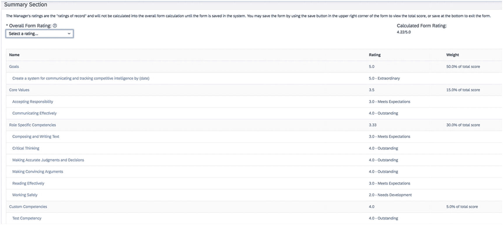

**图 7-46** 绩效管理表单上的汇总部分

在上图所示的示例中，在“目标”和“能力”部分中设置了“在汇总部分显示”，因此汇总部分将包含每个目标和能力及其评级的条目。此外，还会显示该部分的评级。

**部分评级计算**  
显示的部分评级按以下公式计算：  
*∑*(条目评级 * 条目权重) / ∑(条目权重)  

现在，我们准备逐步了解您可能使用的表单评级。

**计算出的表单整体评级**  
此部分包含基于目标与能力条目评级以及各部分权重计算出的表单整体评级。  
计算出的表单整体评级公式为：  
*∑*(部分评级 * 部分权重) / ∑(部分权重)  

要在此部分中看到此评级，`计算出的整体评级`字段应为任何需要看到此评级的角色和步骤设置`读取`权限。通常，如果您同时允许手动整体评级，并且它将覆盖计算出的评级，那么经理也将看到计算出的评级，但员工在后续任何步骤中都看不到。  
如果条目的权重总和不为 100%，则在计算此分数时会进行归一化处理。

> **注意**  
> 要了解有关评级归一化的更多信息，请参见 SAP 说明 #2078768。

**手动表单整体评级**  
经理可能希望将计算出的表单整体评级作为指导，但在分配整体评级时希望灵活考虑其他变量。由于计算出的整体评级不可编辑，因此汇总部分中可以使用手动表单整体评级。这允许经理覆盖计算出的表单评级。请确保在此部分中启用了“允许手动评级”，如图 7-47 所示。

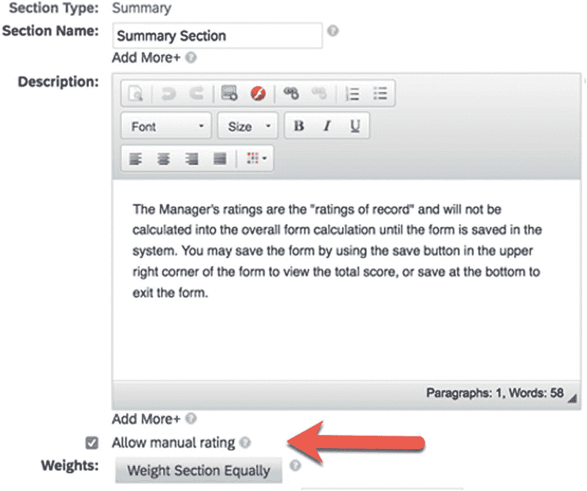

### 启用手动总体评分

使用手动总体评分时，手动总体表单评分将成为表单总体评分和记录评分。  
管理器需要拥有“手动总体评分”的“写入”权限，才能输入手动评分。启用后，默认值为管理器的评分，并将其作为记录评分。由于这将成为表单总体评分，强烈建议在后续所有步骤中向员工隐藏计算出的表单评分。

### 调整后计算评分

在“摘要”部分，可以使用与总体评分分数对应的调整评分量表。计算出的总体评分是数值型的，因此使用调整评分量表可以将评分文本标签映射到数值分数。此外，您还可以将一系列分数映射到特定分数，从而强制计算评分指向特定值。  
此功能在评分显示为星形或圆形时无效；调整后的计算评分将以文本形式显示。要使用此功能，您需要允许总体评分，因为它会填充此字段且为只读。

返回“常规设置”，然后点击“启用量表调整计算”，如图 7-48 所示。

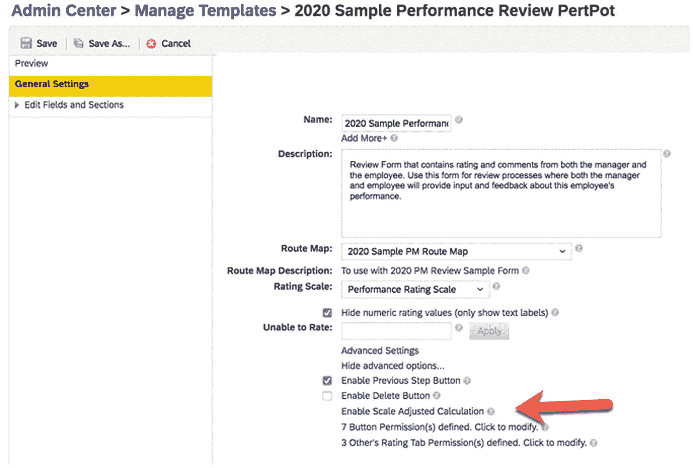

**图 7-48** 启用量表调整计算

您将看到一个复选框用于启用，如图 7-49 所示。

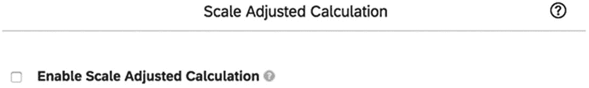

**图 7-49** 启用量表调整计算复选框

启用后，您可以设置量表中每个评分的值，如图 7-50 所示。

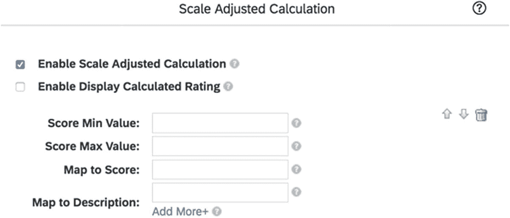

**图 7-50** 设置量表调整计算的值

该量表控制评分的计算或显示。如果您使用数值评分，可以将标签映射到分数。您可以设置最小和最大分数，以映射到量表中的一个评分。例如，如果计算评分为 3.7，您可以决定将 3.51 到 4 之间的任何评分映射到评分 4，然后将调整后的评分标签显示为总体评分。

启用此选项后，您可以显示调整后的评分标签（“映射到描述”字段）和/或调整后的评分值（“映射到分数”字段）。示例如图 7-51 所示。

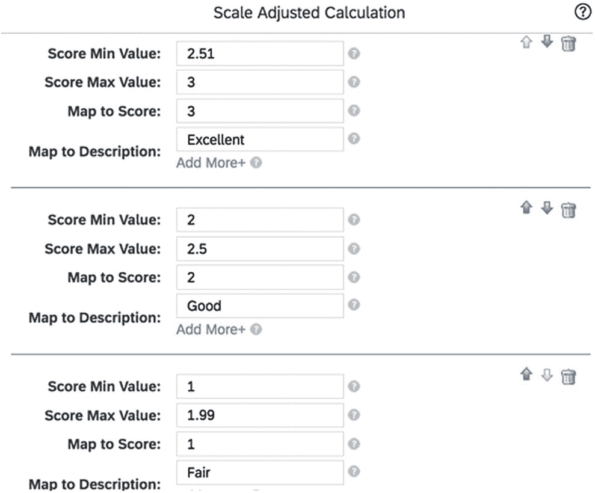

**图 7-51** 设置量表调整计算的值

第二个复选框“启用显示计算评分”启用后，将在“摘要”部分同时显示计算出的评分值。这意味着您将在该部分看到总体调整计算评分和总体计算评分。  
在“常规设置”中配置调整量表后，该量表即可在“摘要”部分使用。  
当未启用手动评分时，总体评分即为调整后的计算评分。没有单独的调整后计算评分需要授权，因此如果您启用了量表调整计算，则需读取的字段是“计算出的总体评分”。

记录评分按以下顺序确定：

*   默认总体评分为计算出的总体表单评分。
*   如果使用了调整后的计算评分，则其为总体表单评分。
*   手动总体评分优先于所有其他评分。
*   管理器的评分为记录评分。

### 评分量表外观

*   默认评分量表为星形。
*   如果使用星形的评分量表评分项超过七个，则量表变为下拉列表。
*   您可以在模板的高级设置中将星形更改为圆形。

## 排版后的内容

您可以使用评分标签显示评分等级。此设置在各个部分中完成。

如果在每个评分部分使用星号或圆圈，则针对手动总体评分，评分等级将显示为星号或圆圈，但计算出的总体评分将是数字。

我们现在已经看到了绩效表单的典型组成部分。需要`目标`和`能力`部分才能输入项目评分、项目评论以及各部分的总体评论。`摘要`部分使用这些部分的评分及其部分权重来计算表单总体评分。如果已配置，经理可以创建手动总体表单评分，该评分将覆盖计算出的评分。在经理评估步骤之后，表单可能会进入校准环节、二级经理评审环节，或进入经理与员工之间的一对一讨论环节。在会议期间，当表单与员工共享时，`摘要`部分将显示并讨论评分。会议结束后，表单通常会流转给员工，以便他们确认讨论会议已进行。这就是我们接下来要查看的`签名`部分。

## 签名部分

表单的最后一个部分是签名部分，如图 7-52 所示。

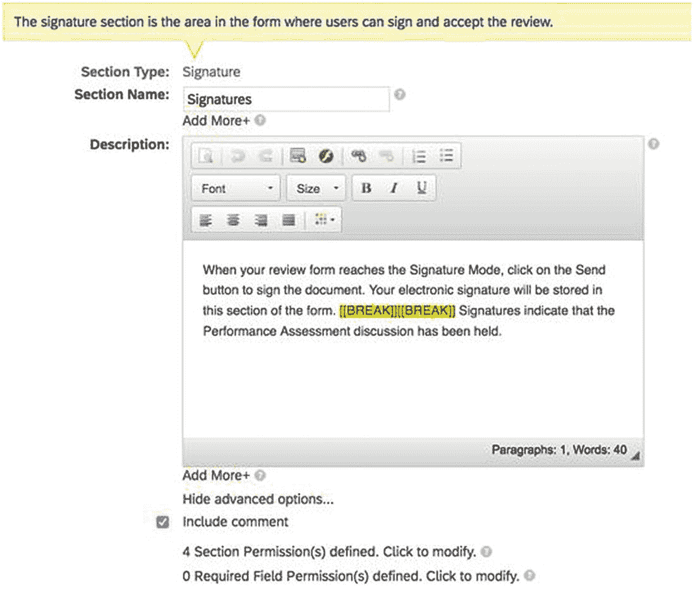

*图 7-52 表单模板的签名部分*

此部分用于电子签名，并显示表单签署的日期。一旦表单从“修改阶段”进入“签名阶段”，表单上唯一允许的输入项是签名评论。您可以使用`描述`字段创建文本，或添加签名前显示的图像或 URL。评论是可以添加到此部分的唯一字段。自定义字段不可用。需要为此部分设置部分权限和必填字段权限。仅当启用“包含评论”时，才能为部分评论设置必填字段权限。

关于部分权限，在准备好进行签名之前，`签名`部分应对所有步骤隐藏。如果可以添加签名评论，则该部分应在签名步骤中“启用”，并且您可以将评论设为必填。如果您不使用评论，则对于需要显示`签名`部分的步骤，该部分应被禁用。您可以在未启用部分权限的情况下签署表单。

提交后，表单会自动添加电子日期和签名。您可以在此阶段设置多个步骤，以获取多个签名，例如员工、经理和 HR 经理的签名。最终签名提交后，表单将进入所有路线图相关用户的`绩效已完成`文件夹。

图 7-53 显示了一个表单`签名`部分的示例。

*图 7-53 绩效表单的签名部分*

从示例中可以看出，签名行之前有一些文本行。这些文本来自表单模板中的`描述`字段。当存在多个签名步骤时，“`[员工姓名] 尚未签名`”将一直显示，直到后续签名步骤的用户提交表单为止。您可以在任何或所有签名步骤允许输入评论。

现在我们已经了解了绩效表单模板最常用的部分，我们将回顾可能使用的其他摘要部分：`绩效潜力摘要`和`目标能力摘要`。此外，还有一个`自定义加权评分`部分。

## 目标能力摘要部分

`目标能力摘要`部分提供了一些不同的总体评分以及一个表单总体评分。

> **注意：** 术语“目标”和“目的”可互换使用。在本章中，我们一直将目标称为目的，但请理解标准的`目标能力摘要`部分可能被重命名为“目的能力摘要”。

`目标能力摘要`部分可以与我们刚刚了解的`摘要`部分一起使用，或者替代它使用。有一点值得注意：如果您没有继任管理许可证，您将无法使用此摘要部分类型，因为它依赖于继任管理矩阵评分。

`目标能力摘要`部分生成三个评分：

1.  总体目标评分
2.  总体能力评分
3.  总体目标能力评分（“OCOC”）

> **注意：** `目标能力摘要`部分中的总体分数不支持按调整后的标尺计算评分。

标准的`摘要`部分使用目标项和能力项评分来计算表单总体评分，而此部分则汇总能力项评分以计算总体能力评分，并汇总目标项评分以计算总体目标评分。

此部分还可以创建一个总体目标能力评分（“OCOC”），该评分基于这些总体分数以及为`目标`和`能力`部分配置的权重进行计算。此评分基于表单模板“常规设置”中标识的评分等级。如果两个摘要部分都在表单模板中，则`摘要`部分的总体分数将作为记录评分。如果您希望将“OCOC”评分作为记录评分，则应省略标准的`摘要`部分。

如前所述，此部分使用矩阵评分等级来计算总体目标和能力评分，而不是使用其他部分使用的常规绩效评分等级。这两个分数的交叉点可以绘制在“方式与内容”矩阵网格上。这些评分等级通常包含三个评分，以允许形成 9 宫格评分。

在表单模板中使用此摘要部分的好处是，可以创建在继任管理模块中使用的总体能力和总体目标评分。这些分数可用于矩阵网格报告、人才概况和仪表板 Portlet。

如果您要将此摘要部分与标准的`摘要`部分一起使用，有一个重要的考虑因素。我们刚才提到，矩阵网格评分等级通常包含三个评分，以便构建 9 宫格矩阵。如果您在总体能力和目标分数上使用三分制的矩阵评分等级，而在表单其余部分使用五分制，这将对报告和人才概况 Portlet 造成不一致。这将导致分数被“归一化”。

为了保持一致性，建议在表单评分等级和矩阵评分等级中使用相同数量的分数。如果您使用五分制评分等级，则您的矩阵评分等级也应包含五个分数。两个评分等级的标签不必相同。

您将在第 2 卷第 5 章中了解到更多关于矩阵网格评分等级以及如何配置 9 宫格矩阵的内容。我们将简要介绍这些功能，以便了解如何在绩效表单的`目标能力摘要`部分中使用这些等级。

您需要在 Provisioning 中配置“继任管理”；还需要启用“矩阵网格报告（9 宫格）”和“矩阵网格：方式与内容对比报告（9 宫格）”。

请参考第 2 卷第 5 章，了解如何配置评分等级和矩阵网格。

既然我们已经介绍了矩阵评分等级和网格的概念，让我们回到模板来配置`目标能力摘要`部分：

*   将“目标能力摘要”部分添加到表单模板。您可以移动它，使其出现在`签名`部分之前。

*   我们可以使用此部分替代”摘要“（`Summary`）部分，并使用“OCOC”计算得分作为总体评级。如果是这种情况，请删除`Summary`部分；否则，常规`Summary`部分的总体评级将优先。
*   此部分可以作为`Summary`部分的补充，`Summary`部分的评级将作为记录评级。
*   确保将要纳入总体得分的“目标”（`Goals`）和“能力”（`Competency`）部分已启用相关设置，以将其纳入总体目标或能力评级计算。
*   如果尚未为继任计划（`Succession`）设置配置目标与能力的矩阵网格评级量表，请先进行配置。建议使用与绩效评级量表相同数量的评级等级。
*   如果计划在绩效表单的“目标能力摘要”（`Objective Competency Summary`）部分中显示图表，请配置“方式 vs. 结果”（`How vs. What`）矩阵网格报告。

在设置此部分时，需注意以下几点：

*   确保表单模板未使用星号或圆圈作为评级符号。
*   在“通用设置”（`General Settings`）中，启用“隐藏数值型评级值（仅显示文本标签）”（`Hide numeric rating values (only show text labels)`）。
*   矩阵网格评级量表只能以下拉列表形式显示。
*   虽然可以使用手动总体目标和能力评级，但建议不要这样做。

表单模板的“目标能力摘要”（`Objective Competency Summary`）部分如图 7-54 所示。

**图 7-54** 目标能力摘要部分

以下是一些关于哪个评级将成为记录评级的基本指南：

1.  如果使用“OCOC”得分且同时包含总体`Summary`部分，则`Summary`部分的评级将作为记录评级。
2.  如果使用“OCOC”得分但未包含总体`Summary`部分，则“OCOC”评级将成为表单总体评级，并作为记录评级。
3.  如果未为“目标能力摘要”部分或评级指定目标与能力部分的权重，则“OCOC”评级将为“未评级”（`unrated`）。
4.  如果使用“OCOC”得分且同时包含“绩效潜力摘要”（`Performance Potential Summary`）部分，则`Performance Potential Summary`部分的评级将作为记录评级。

此部分有一些设置需要在表单模板`XML`中进行配置，我们将在第 10 章中介绍。

表 7-5 列出了此部分可选择的选项。

**表 7-5** 目标能力摘要部分选项

| **选项** | **描述** |
| --- | --- |
| 包含部分评论（`Include section comments`） | 可在部分底部添加评论，适用于进行评级的用户。 |
| 计算总体能力评级（`Calculate overall competency rating`） | 总体能力评级基于能力部分项目评级和部分权重计算得出。 |
| 允许编辑总体能力评级：允许手动总体能力评级（`Allow overall competency rating to be edited: allow manual overall competency rating`） | 此选项允许手动输入总体能力评级。编辑内容不会反映在表单的总体绩效评级中。 |
| 计算总体目标评级（`Calculate overall objective rating`） | 总体目标评级基于目标部分项目评级和部分权重计算得出。 |
| 允许编辑总体目标评级：允许手动总体目标评级（`Allow overall objective rating to be edited: allow manual overall objective rating`） | 此选项允许手动输入总体目标评级。编辑内容不会反映在表单的总体绩效评级中。 |
| 显示总体目标能力评级（`Show overall objective competency rating`） | 即“OCOC”评级，是基于总体能力评级和总体目标评级计算得出的总体评级。 |
| 显示总体目标能力评级矩阵（`Display overall objective competency rating matrix`） | 矩阵网格将显示在表单上，用于标识员工总体能力评级与总体目标评级相交的象限。 |
| 总体评级显示顺序（`Overall Rating Display Order`） | 此选项不受支持。如果同时允许手动和计算得出的总体评级，无论选择何种顺序，手动评级始终显示在计算得出的评级之前。 |
| 部分显示顺序：先显示能力再显示目标，或先显示目标再显示能力（`Section Display Order: show competencies than objectives or objectives followed by competencies.`） | 决定在此部分中能力与目标的显示顺序。 |

“目标能力摘要”部分需要设置部分、字段和必填字段的权限。

需要授权的字段包括：

*   部分评论（`Section Comments`）
*   能力手动总体评级（`Competency Manual Overall Rating`）
*   目标手动总体评级（`Objective Manual Overall Rating`）

如果这些字段的权限设置为“无”（`None`），则部分将无评论，且仅使用计算得出的总体能力和总体目标评级。

图 7-55 是一个绩效管理（PM）表单中“目标能力摘要”部分的示例。可以看出，总体能力评级由两个能力部分（角色特定能力和核心能力）组成，每个部分的权重不同。评级量表为三分矩阵量表。总体能力评级由两个能力部分评级组成。

**图 7-55** 绩效管理表单中的目标能力摘要部分

总体评级（“OCOC”）由三个部分评级乘以其占总分百分比后再求和得出。

图 7-56 是展示目标与能力总体评级交叉点的矩阵网格。

**图 7-56** 目标能力摘要部分的矩阵网格

除非计划使用继任计划（`Succession`），否则此部分可能无需包含。

## 绩效潜力摘要部分（`Performance Potential Summary Section`）

现在我们将讨论“绩效潜力摘要”部分。此部分用于创建手动总体绩效评级和手动总体潜力评级。这些得分会填充到继任计划矩阵网格中，常用于识别高潜力人才。

此部分的行为与“目标能力摘要”部分类似，但使用不同的评级量表。与“目标能力摘要”部分一样，使用继任计划矩阵网格评级。在此情况下，矩阵评级量表为“绩效”（`Performance`）和“潜力”（`Potential`）。两个得分用于矩阵网格，以显示两个评级之间的交叉点。与“目标能力摘要”部分类似，建议矩阵评级量表与表单评级量表中的评分等级数量保持一致。

“绩效潜力摘要”部分用于输入手动评级：

1.  总体绩效评级（`Overall performance rating`）
2.  总体潜力评级（`Overall potential rating`）

### 配置表现-潜力矩阵报告

除了创建潜力矩阵评分量表和表现评分量表之外，还需要配置“表现-潜力”矩阵网格报告。有关此配置的更多信息，请参见第 2 卷第 5 章。

本节主要用于继任计划目的，特别是提名流程。如果您决定在本节中允许手动表现评分，则该评分将成为表单整体评分和记录评分。如果您在表单模板设置中启用了自定义评分计算，则该评分将成为记录评分。

与目标能力总结部分不同，本部分不支持计算的整体评分。您只能在本节中使用手动表现评分和潜力评分。此外，本部分不显示部分权重。

当您在绩效表单模板中包含总结部分和表现-潜力总结部分时，来自表现-潜力总结部分的整体表现分数即为该表单的记录评分。

点击“添加新部分”并选择“表现-潜力总结”。表单模板中的表现-潜力总结部分如图 7-57 所示。

**图 7-57** 表现-潜力总结部分

由于本部分没有计算评分，因此其选项比目标能力总结部分少。

以下列出了可用选项：

- 包括部分评论
- 允许编辑整体表现评分
- 允许编辑整体潜力评分
- 显示整体表现-潜力矩阵
- 部分显示顺序：表现/潜力 或 潜力/表现

表现-潜力总结部分需要设置部分、字段和必填字段的权限。

允许的字段包括：

- 部分评论
- 手动表现整体评分
- 手动潜力整体评分

如果不允许手动评分，则本节将没有值。

图 7-58 是绩效管理表单中表现-潜力总结部分的示例。

**图 7-58** 绩效表单上的表现-潜力矩阵网格

在此，经理选择来自矩阵网格评分量表的潜力和表现评分。两个数据点的交叉点显示在矩阵网格中。此信息也包含在员工档案和继任计划报告中。还有一个最终的整体评分部分可用。

### 自定义加权评分部分

最后一个总结部分计算自定义加权整体评分。自定义加权评分基于不同步骤中的不同角色计算，给出一个手动整体评分（来自官方评分字段）。来自步骤和角色的评分和权重在业务规则中定义。另一条规则定义了用于计算整体加权评分的触发步骤。

该部分显示用于计算表单评分的用户和步骤的评分。也可以配置手动覆盖评分。

计算出的表单评分基于在业务规则中指定的步骤和角色的评分和权重进行计算。您需要配置路由图中的哪个步骤触发计算。

> **注意**：管理员角色需要拥有创建业务规则的权限。

点击“添加新部分”并选择“自定义加权评分”以将该部分添加到表单模板中。

表单模板的自定义加权评分部分如图 7-59 所示。

**图 7-59** 表单模板中的自定义加权评分部分

有一个选项允许手动评分覆盖计算出的评分。字段权限针对手动评分和计算评分设置。没有部分评论，也没有任何自定义或必填字段。

图 7-60 展示了绩效表单中自定义加权评分部分的示例。

**图 7-60** 绩效管理表单的自定义加权评分部分

此示例显示了每个步骤中由哪个用户/角色给出的整体评分。创建了一个业务规则来确定基于角色和步骤的这些分数的权重。还创建了一个触发规则，用于确定应在哪个步骤计算最终评分。

业务规则标识了将在计算中使用的评分步骤。它定义了基于角色和步骤的这些评分的权重。

图 7-61 是所创建的业务规则的示例。

**图 7-61** 加权评分业务规则

在此示例中，来自评估步骤中经理角色的评分将占计算评分的 75%。来自人力资源审核步骤中人力资源经理角色的评分将占整体计算评分的 25%。

创建一个触发器以在表单计算中使用这些权重。触发规则的示例如图 7-62 所示。

**图 7-62** 计算整体评分的触发规则

触发规则指定要使用的表单模板、应应用计算的步骤以及要使用的计算规则。在我们的示例中，整体表单评分计算将使用`Weight_Roles`计算规则，该规则应用于使用“2020 自定义权重评分”表单模板启动的表单的人力资源审核步骤中。

此总结部分使用计算出的整体评分和手动整体评分。计算出的整体评分在基于业务规则的步骤处触发。手动整体评分可由在表单模板权限中设置的步骤中的角色修改。

自 2020 年 H1 版本起，此总结部分现在可用于校准流程。

我们现在已经了解了可用于绩效表单的各部分。我们学习了每个部分的用途，并了解了如何按角色和步骤为每个部分和字段设置权限。

## 结论

在下一章中，我们将设置基于员工角色的权限，启用电子邮件通知，并启动绩效表单。我们还将涵盖管理员在绩效审核过程中可能执行的一些功能。

